# Edge Computing & Serverless Architecture

## Introduction

The most important architectural shift in backend engineering since containerization is the move toward **edge computing** -- running application logic not in a centralized data center, but at the network edge, geographically close to users. Combined with serverless execution models that eliminate server management entirely, this creates a new paradigm where a user in Tokyo gets the same sub-50ms response time as a user in Virginia.

Understanding the internals of V8 isolates, the trade-offs between edge platforms, and when serverless is the _wrong_ choice separates senior engineers from those who only follow tutorials.

---

## The Edge Computing Model

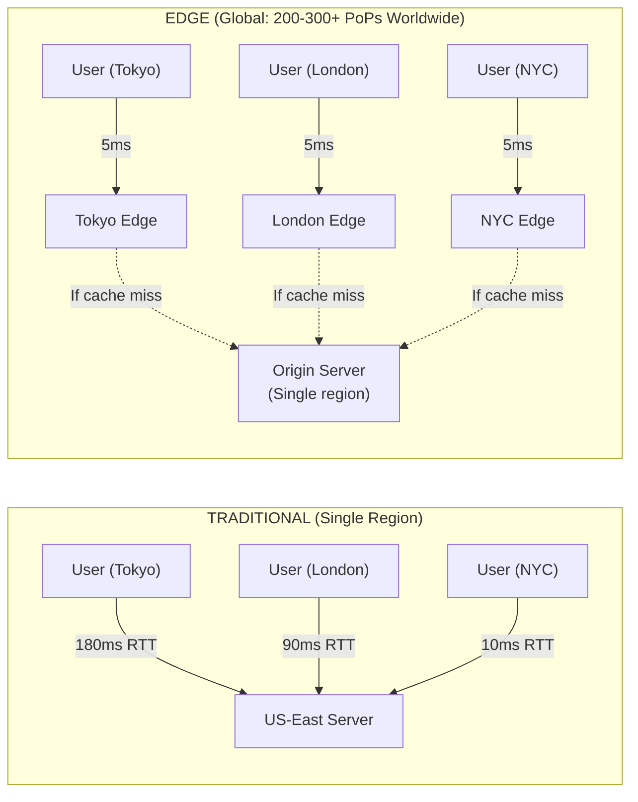

---

## V8 Isolates vs Containers

This is the most frequently asked architectural question about edge computing. Understanding the internals is critical.

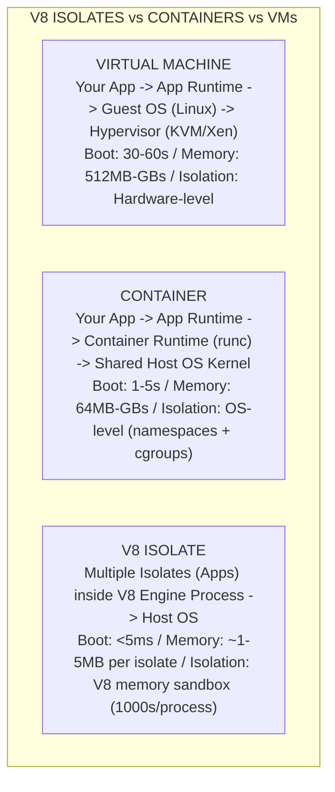

### How V8 Isolates Work

A V8 isolate is an independent instance of the V8 JavaScript engine with its own heap memory, garbage collector, and compilation pipeline. Multiple isolates share the same V8 process but cannot access each other's memory.

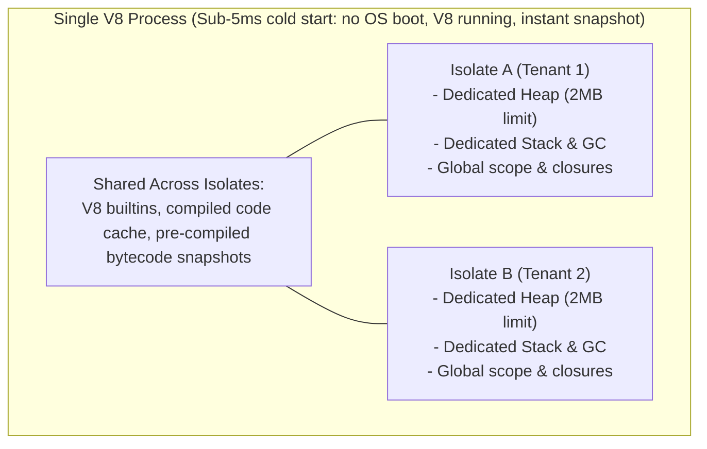

### Comparison Table

```
+-------------------+------------------+------------------+------------------+
| Property          | VM               | Container        | V8 Isolate       |
+-------------------+------------------+------------------+------------------+
| Cold Start        | 30-60s           | 1-5s             | <5ms             |
| Memory Overhead   | 512MB+           | 50MB+            | ~1-5MB           |
| Isolation Level   | Hardware         | OS (namespaces)  | V8 memory sandbox|
| Language Support  | Any              | Any              | JS/TS/Wasm       |
| CPU Time Limit    | Unlimited        | Configurable     | 10-30ms typical  |
| Max Execution     | Unlimited        | Configurable     | 30s-5min         |
| Network Access    | Full             | Full             | Fetch API only   |
| File System       | Full             | Full             | None (R2/KV)     |
| Density           | 10s/host         | 100s/host        | 1000s/process    |
| Use Case          | Legacy apps      | General compute  | Edge/API/proxy   |
+-------------------+------------------+------------------+------------------+
```

**Interview insight**: V8 isolates cannot run anything that requires file system access, long-running processes, or binary dependencies (native addons). This is a fundamental architectural constraint, not a temporary limitation. Edge functions are for request-response workloads, not background jobs.

---

## Cloudflare Workers (Deep Dive)

### Architecture

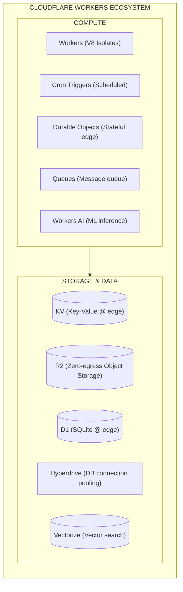

### Worker Code Example

```typescript
// src/worker.ts
export interface Env {
  MY_KV: KVNamespace;
  MY_R2: R2Bucket;
  MY_DB: D1Database;
  MY_QUEUE: Queue;
  AI: Ai;
  RATE_LIMITER: DurableObjectNamespace;
}

export default {
  async fetch(
    request: Request,
    env: Env,
    ctx: ExecutionContext
  ): Promise<Response> {
    const url = new URL(request.url);

    // Route handling
    if (url.pathname === '/api/cached-data') {
      return handleCachedData(request, env, ctx);
    }

    if (url.pathname === '/api/upload') {
      return handleUpload(request, env);
    }

    if (url.pathname === '/api/query') {
      return handleQuery(request, env);
    }

    if (url.pathname === '/api/ai/summarize') {
      return handleAISummarize(request, env);
    }

    return new Response('Not Found', { status: 404 });
  },

  // Cron trigger handler
  async scheduled(event: ScheduledEvent, env: Env, ctx: ExecutionContext) {
    ctx.waitUntil(cleanupExpiredSessions(env));
  },

  // Queue consumer
  async queue(batch: MessageBatch<unknown>, env: Env) {
    for (const message of batch.messages) {
      await processMessage(message.body);
      message.ack();
    }
  },
} satisfies ExportedHandler<Env>;

// KV: Read-heavy, eventually consistent cache
async function handleCachedData(
  request: Request,
  env: Env,
  ctx: ExecutionContext
): Promise<Response> {
  const key = new URL(request.url).searchParams.get('key');
  if (!key) return new Response('Missing key', { status: 400 });

  // Check KV cache first
  const cached = await env.MY_KV.get(key, 'json');
  if (cached) {
    return Response.json(cached);
  }

  // Fetch from origin
  const data = await fetchFromOrigin(key);

  // Cache with TTL (non-blocking via waitUntil)
  ctx.waitUntil(
    env.MY_KV.put(key, JSON.stringify(data), { expirationTtl: 3600 })
  );

  return Response.json(data);
}

// R2: S3-compatible object storage (no egress fees)
async function handleUpload(request: Request, env: Env): Promise<Response> {
  const formData = await request.formData();
  const file = formData.get('file') as File;

  if (!file) return new Response('No file', { status: 400 });

  const key = `uploads/${crypto.randomUUID()}/${file.name}`;

  await env.MY_R2.put(key, file.stream(), {
    httpMetadata: {
      contentType: file.type,
    },
    customMetadata: {
      uploadedBy: 'user-123',
      originalName: file.name,
    },
  });

  return Response.json({ key, size: file.size });
}

// D1: SQLite at the edge
async function handleQuery(request: Request, env: Env): Promise<Response> {
  const { results } = await env.MY_DB.prepare(
    'SELECT * FROM users WHERE active = ? ORDER BY created_at DESC LIMIT ?'
  )
    .bind(true, 20)
    .all();

  return Response.json({ users: results });
}

// AI Workers: ML inference at the edge
async function handleAISummarize(
  request: Request,
  env: Env
): Promise<Response> {
  const { text } = await request.json<{ text: string }>();

  const result = await env.AI.run('@cf/meta/llama-3.1-8b-instruct', {
    messages: [
      { role: 'system', content: 'Summarize the following text concisely.' },
      { role: 'user', content: text },
    ],
  });

  return Response.json({ summary: result.response });
}
```

### Durable Objects (Stateful Edge)

Durable Objects are the most architecturally interesting part of Cloudflare Workers. They provide **single-threaded, strongly consistent state at the edge** -- something that seems impossible in a distributed system.

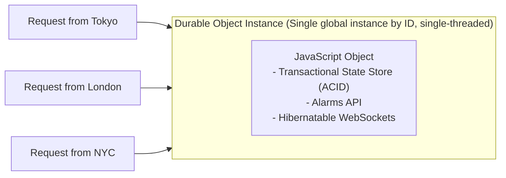

```typescript
// Durable Object: Rate Limiter
export class RateLimiter implements DurableObject {
  private state: DurableObjectState;
  private requests: number[] = [];

  constructor(state: DurableObjectState) {
    this.state = state;
  }

  async fetch(request: Request): Promise<Response> {
    const now = Date.now();
    const windowMs = 60_000; // 1 minute window
    const maxRequests = 100;

    // Load state
    this.requests = (await this.state.storage.get<number[]>('requests')) ?? [];

    // Remove expired entries
    this.requests = this.requests.filter((ts) => now - ts < windowMs);

    if (this.requests.length >= maxRequests) {
      return new Response('Rate limit exceeded', {
        status: 429,
        headers: {
          'Retry-After': String(
            Math.ceil((this.requests[0] + windowMs - now) / 1000)
          ),
        },
      });
    }

    // Record this request
    this.requests.push(now);

    // Persist (transactional, strongly consistent)
    await this.state.storage.put('requests', this.requests);

    return new Response('OK', {
      headers: {
        'X-RateLimit-Remaining': String(maxRequests - this.requests.length),
        'X-RateLimit-Limit': String(maxRequests),
      },
    });
  }
}
```

---

## AWS Lambda 2026

### Lambda Architecture

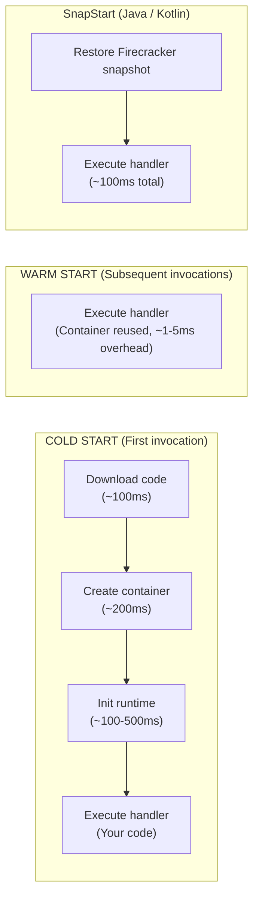

### Lambda Handler Patterns

```typescript
// handler.ts -- Modern Lambda handler with Powertools
import { Logger } from '@aws-lambda-powertools/logger';
import { Tracer } from '@aws-lambda-powertools/tracer';
import { Metrics, MetricUnit } from '@aws-lambda-powertools/metrics';
import middy from '@middy/core';
import httpJsonBodyParser from '@middy/http-json-body-parser';
import httpErrorHandler from '@middy/http-error-handler';
import { z } from 'zod';

const logger = new Logger();
const tracer = new Tracer();
const metrics = new Metrics();

const CreateUserSchema = z.object({
  name: z.string().min(1),
  email: z.string().email(),
});

async function baseHandler(event: APIGatewayProxyEventV2) {
  // Input validation
  const body = CreateUserSchema.parse(event.body);

  // Business logic
  const user = await createUser(body);

  // Metrics
  metrics.addMetric('UserCreated', MetricUnit.Count, 1);

  return {
    statusCode: 201,
    headers: { 'Content-Type': 'application/json' },
    body: JSON.stringify(user),
  };
}

// Middleware chain
export const handler = middy(baseHandler)
  .use(httpJsonBodyParser())
  .use(httpErrorHandler())
  .use(injectLambdaContext(logger))
  .use(captureLambdaHandler(tracer))
  .use(logMetrics(metrics));
```

### Response Streaming

```typescript
// Lambda response streaming (for long-running responses)
import { streamifyResponse } from 'aws-lambda';

export const handler = streamifyResponse(
  async (event, responseStream, context) => {
    // Set content type
    responseStream = awslambda.HttpResponseStream.from(responseStream, {
      statusCode: 200,
      headers: { 'Content-Type': 'text/event-stream' },
    });

    // Stream data as it becomes available
    for (let i = 0; i < 10; i++) {
      const data = await fetchChunk(i);
      responseStream.write(`data: ${JSON.stringify(data)}\n\n`);
    }

    responseStream.end();
  }
);
```

### Lambda URLs (No API Gateway Needed)

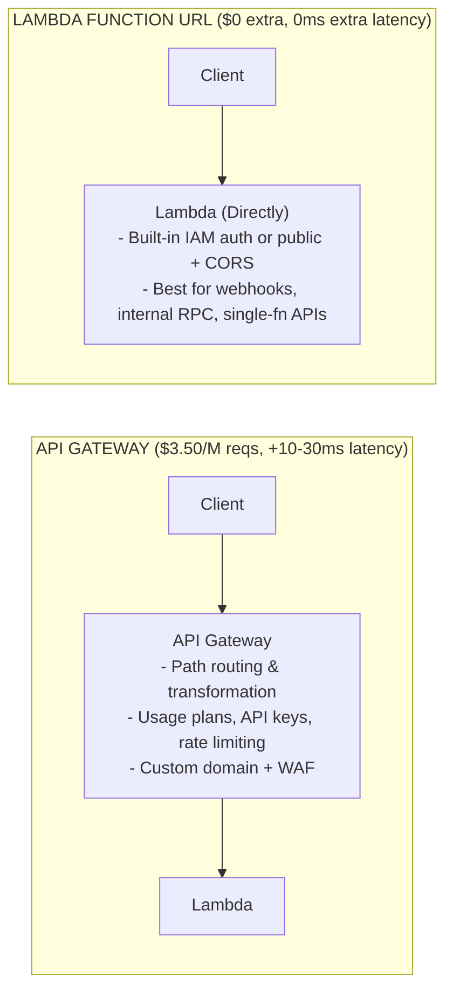

---

## Serverless Patterns

### Fan-Out/Fan-In

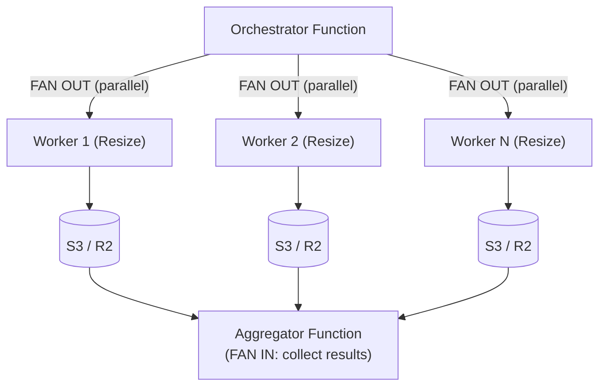

### Saga Pattern (Distributed Transactions)

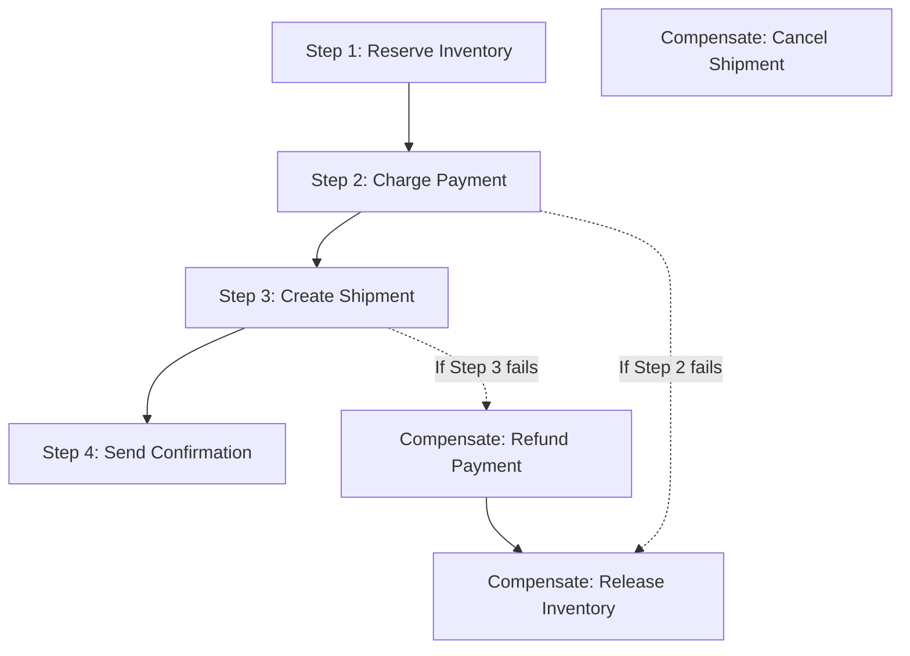

```typescript
// Step Functions state machine (simplified)
const orderSaga = {
  StartAt: 'ReserveInventory',
  States: {
    ReserveInventory: {
      Type: 'Task',
      Resource: 'arn:aws:lambda:...:reserveInventory',
      Catch: [
        {
          ErrorEquals: ['States.ALL'],
          Next: 'OrderFailed',
        },
      ],
      Next: 'ChargePayment',
    },
    ChargePayment: {
      Type: 'Task',
      Resource: 'arn:aws:lambda:...:chargePayment',
      Catch: [
        {
          ErrorEquals: ['States.ALL'],
          Next: 'ReleaseInventory',
        },
      ],
      Next: 'CreateShipment',
    },
    ReleaseInventory: {
      Type: 'Task',
      Resource: 'arn:aws:lambda:...:releaseInventory',
      Next: 'OrderFailed',
    },
    OrderFailed: {
      Type: 'Fail',
      Error: 'OrderProcessingFailed',
    },
  },
};
```

---

## Serverless Databases

### Architecture Comparison

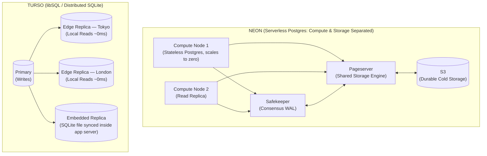

### Neon Connection Pooling

```typescript
// Neon serverless driver (HTTP-based, no TCP connection needed)
import { neon } from '@neondatabase/serverless';

// For edge functions (no persistent TCP connection)
const sql = neon(process.env.DATABASE_URL);

// Single query (HTTP request under the hood)
const users = await sql`SELECT * FROM users WHERE active = true LIMIT 20`;

// Transaction via HTTP
const result = await sql.transaction([
  sql`INSERT INTO orders (user_id, total) VALUES (${userId}, ${total}) RETURNING id`,
  sql`UPDATE inventory SET quantity = quantity - ${qty} WHERE product_id = ${productId}`,
]);
```

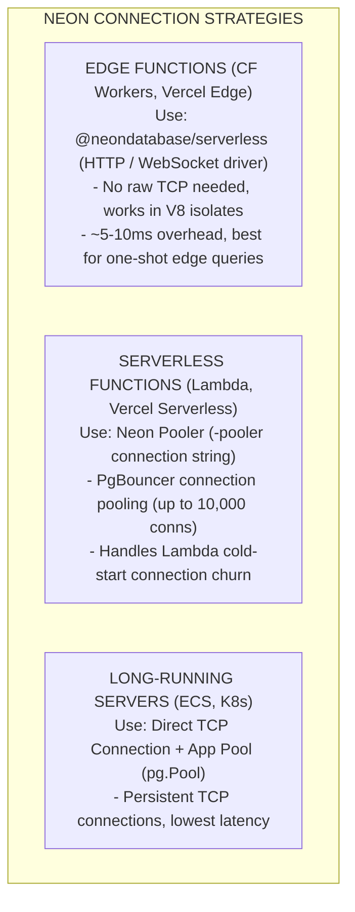

---

## Cold Start Optimization

```
+------------------------------------------------------------------+
|              COLD START OPTIMIZATION STRATEGIES                  |
+------------------------------------------------------------------+
|                                                                  |
|  STRATEGY              IMPACT         COMPLEXITY    PLATFORM     |
|  --------              ------         ----------    --------     |
|                                                                  |
|  Smaller bundle size   High           Low           All          |
|  Tree-shake deps       Medium         Low           All          |
|  Lazy imports          Medium         Medium        All          |
|  Provisioned conc.     Eliminates     Low ($$)      Lambda       |
|  SnapStart             High           Low           Lambda/Java  |
|  V8 isolates           Eliminates     Medium        CF Workers   |
|  Edge caching          High           Medium        All edge     |
|  Keep-alive pings      Workaround     Low           Lambda       |
|  Connection pooling    Medium         Medium        Lambda       |
|  ESM over CJS          Medium         Low           Node 22+     |
|                                                                  |
+------------------------------------------------------------------+
```

```typescript
// Cold start optimization: Lazy imports
// BEFORE: All imports loaded at cold start
import { S3Client, PutObjectCommand } from '@aws-sdk/client-s3';
import { DynamoDBClient } from '@aws-sdk/client-dynamodb';
import { SESClient } from '@aws-sdk/client-ses';

// AFTER: Import only when needed
export async function handler(event) {
  if (event.path === '/upload') {
    const { S3Client, PutObjectCommand } = await import('@aws-sdk/client-s3');
    // Use S3...
  }

  if (event.path === '/email') {
    const { SESClient } = await import('@aws-sdk/client-ses');
    // Use SES...
  }
}
```

---

## Cost Modeling

```
+------------------------------------------------------------------+
|              COST COMPARISON (100M requests/month)               |
+------------------------------------------------------------------+
|                                                                  |
|  SCENARIO: API serving JSON, ~50ms avg execution, 256MB memory   |
|                                                                  |
|  CLOUDFLARE WORKERS:                                             |
|  - Workers Paid: $5/mo + $0.50/million requests                  |
|  - 100M requests = $55/month                                     |
|  - Includes: KV reads, edge caching, DDoS protection             |
|                                                                  |
|  AWS LAMBDA:                                                     |
|  - Compute: 100M * 50ms * 256MB = 1,250,000 GB-s                |
|  - Cost: 1,250,000 * $0.0000166667 = ~$21                       |
|  - Requests: 100M * $0.20/M = $20                                |
|  - API Gateway: 100M * $3.50/M = $350 (!)                       |
|  - Total: ~$391/month (with API GW) or ~$41 (Lambda URL)        |
|                                                                  |
|  CONTAINERS (ECS Fargate):                                       |
|  - 2 vCPU, 4GB, 3 tasks (HA): ~$290/month                       |
|  - Fixed cost regardless of traffic                              |
|  - Better at high throughput, worse at low traffic                |
|                                                                  |
|  BREAKEVEN ANALYSIS:                                             |
|  - <50M req/mo: Serverless wins                                  |
|  - 50-200M req/mo: Depends on pattern                            |
|  - >200M req/mo: Containers usually cheaper                      |
|  - Spiky traffic: Serverless always wins                         |
|                                                                  |
+------------------------------------------------------------------+
```

---

## When Serverless is the Wrong Choice

```
+------------------------------------------------------------------+
|              SERVERLESS ANTI-PATTERNS                            |
+------------------------------------------------------------------+
|                                                                  |
|  WRONG FOR:                          USE INSTEAD:                |
|                                                                  |
|  WebSocket servers (long-lived)      Containers + ALB            |
|  Video transcoding (CPU-heavy)       ECS/GKE with GPU            |
|  ML training                         SageMaker/Vertex            |
|  Stateful applications               Containers + volumes        |
|  Sub-millisecond latency             Bare metal / dedicated      |
|  Large monolithic apps               Containers                  |
|  Consistent high traffic             Containers (cheaper)        |
|  Complex orchestration               Kubernetes                  |
|  Binary dependencies (FFmpeg)        Containers                  |
|                                                                  |
|  WARNING SIGNS:                                                  |
|  - Function duration > 30s regularly                             |
|  - Memory usage > 1GB                                            |
|  - Need shared file system                                       |
|  - Cold starts are unacceptable                                  |
|  - Monthly bill > equivalent container cost                      |
|                                                                  |
+------------------------------------------------------------------+
```

---

## Edge Middleware Pattern

```typescript
// Edge middleware (Vercel/Next.js pattern)
// middleware.ts -- runs at the edge before your application
import { NextResponse } from 'next/server';
import type { NextRequest } from 'next/server';

export function middleware(request: NextRequest) {
  const url = request.nextUrl;

  // A/B testing at the edge
  const bucket =
    request.cookies.get('ab-bucket')?.value ??
    (Math.random() > 0.5 ? 'control' : 'experiment');

  if (!request.cookies.get('ab-bucket')) {
    const response = NextResponse.next();
    response.cookies.set('ab-bucket', bucket, { maxAge: 86400 * 30 });
  }

  // Geolocation-based routing
  const country = request.geo?.country ?? 'US';
  if (country === 'CN' && !url.pathname.startsWith('/zh')) {
    return NextResponse.redirect(new URL(`/zh${url.pathname}`, request.url));
  }

  // Bot detection
  const ua = request.headers.get('user-agent') ?? '';
  if (isBot(ua) && url.pathname.startsWith('/api')) {
    return new NextResponse('Forbidden', { status: 403 });
  }

  // Feature flags at the edge
  const flags = getFeatureFlags(request);
  const response = NextResponse.next();
  response.headers.set('x-feature-flags', JSON.stringify(flags));

  return response;
}

export const config = {
  matcher: ['/((?!_next/static|favicon.ico).*)'],
};
```

---

## Common Interview Questions

### Q: Explain the trade-offs between V8 isolates and containers for API workloads.

**Strong answer**: V8 isolates provide sub-5ms cold starts and massive density (thousands per process) because they share the V8 engine process and only isolate memory heaps. Containers provide ~1-5 second cold starts and moderate density (hundreds per host) because each container has its own runtime, filesystem, and network stack. The critical trade-off is capability: V8 isolates cannot access the filesystem, cannot run native binaries, are limited to ~128MB memory and ~30 seconds execution time, and only support JavaScript/TypeScript/Wasm. Containers can run anything. For a JSON API with simple business logic, V8 isolates are strictly better -- lower latency, lower cost, simpler ops. For anything requiring binary dependencies (image processing with Sharp, PDF generation with Puppeteer), persistent connections (WebSockets for long durations), or heavy computation, containers are necessary. The architectural mistake I see most often is trying to force a container workload into an isolate model, resulting in hitting CPU/memory limits in production.

### Q: How would you design a globally distributed API with sub-100ms response times?

**Strong answer**: I would use a tiered architecture. The edge layer (Cloudflare Workers) handles request routing, authentication token validation, rate limiting, and serving cached responses. For read-heavy endpoints, I would use Workers KV (eventually consistent, replicated globally) or D1 (SQLite at the edge) for data that can tolerate staleness. For writes and strongly consistent reads, requests are forwarded to the nearest regional origin -- not a single origin, but 3-4 regional deployments (US-East, EU-West, AP-Southeast). Each region runs the application in containers with a local database replica. The database layer uses Neon with read replicas in each region, or CockroachDB for multi-region writes. The key insight is that most API responses are cacheable for some duration. Even a 10-second TTL at the edge eliminates 95%+ of origin traffic. For the remaining 5%, the regional origin architecture ensures ~20-30ms from user to nearest origin, plus ~10-20ms for a database query, keeping total latency well under 100ms.

### Q: When should you NOT use serverless?

**Strong answer**: There are five clear anti-patterns. First, WebSocket servers that maintain long-lived connections -- Lambda has a 15-minute timeout and each connection is a concurrent invocation (expensive at scale). Use containers with ALB instead. Second, CPU-intensive processing like video transcoding or ML inference -- Lambda's CPU is proportional to memory allocation, so you are paying for 10GB of RAM to get decent CPU, which is expensive. Use dedicated compute. Third, consistently high-throughput workloads above ~200M requests/month -- the per-request pricing model becomes more expensive than provisioned containers. Fourth, applications with heavy native dependencies -- bundling FFmpeg or Chromium into Lambda layers adds 50-100MB and increases cold starts. Fifth, applications requiring shared mutable state -- each invocation is isolated, so you need external state management (Redis, DynamoDB), adding latency and complexity that containers with local state would avoid. The meta-principle: serverless optimizes for operational simplicity and elastic scaling, not for cost at high scale or capability breadth.
