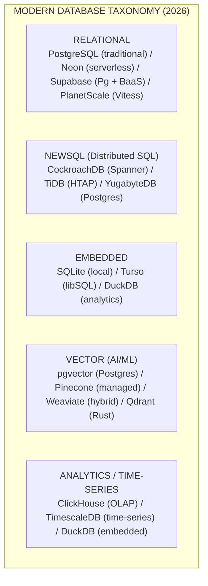
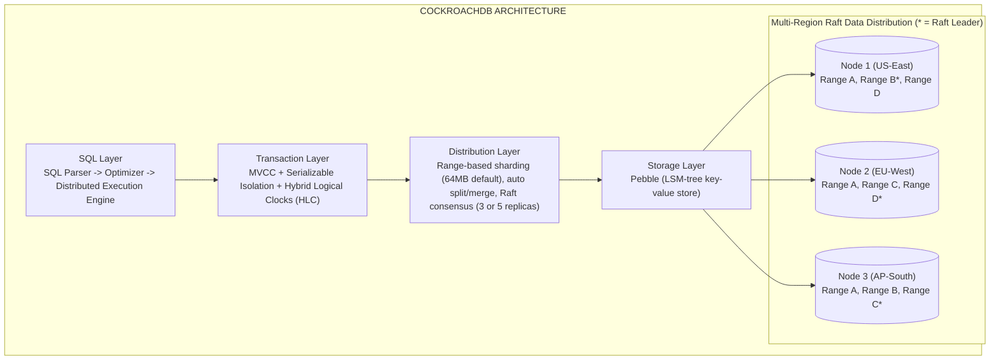
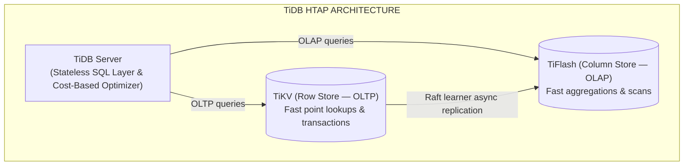
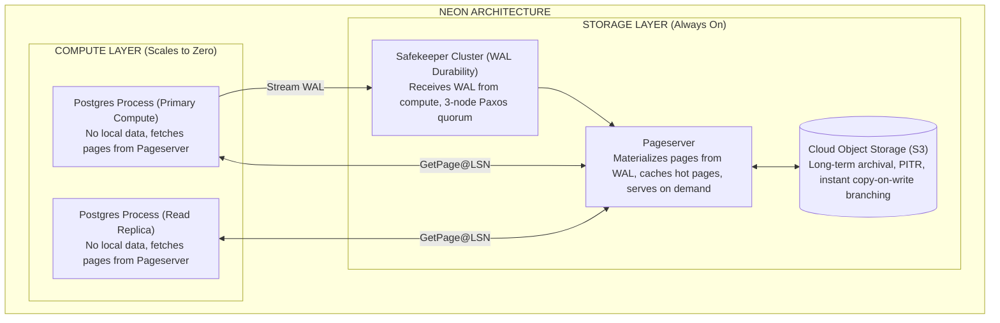
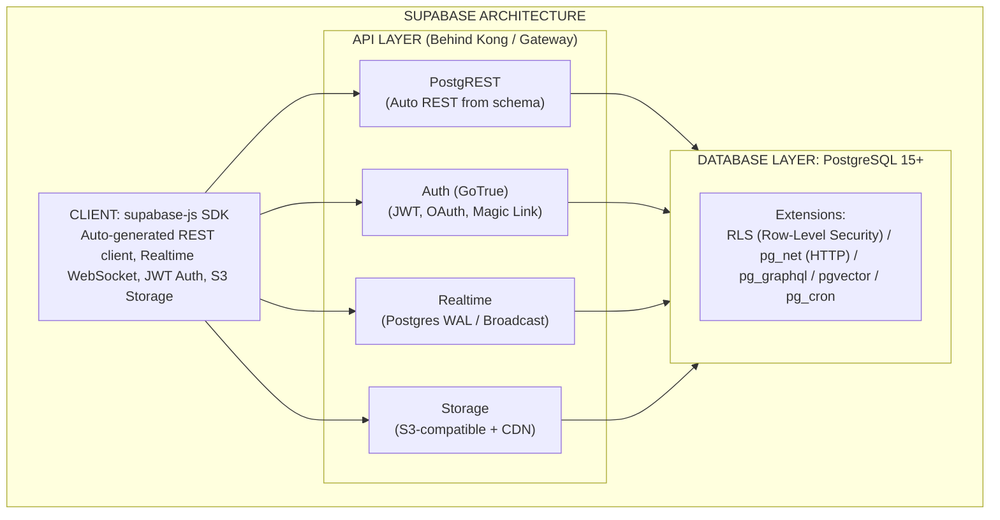
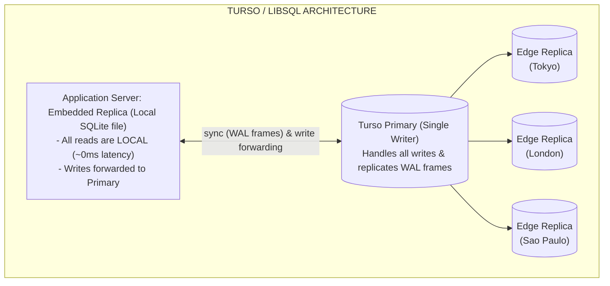
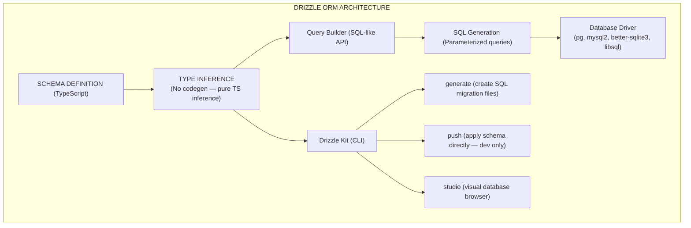
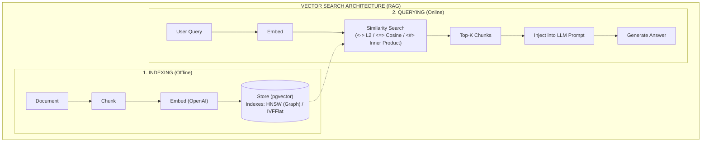
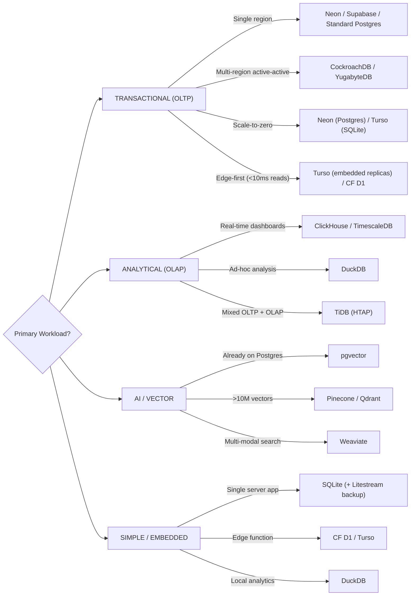
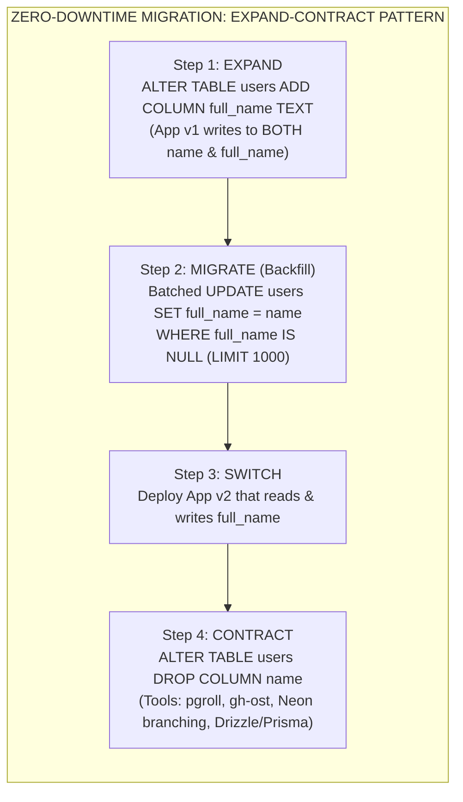

# Modern Database Landscape 2026

## Introduction

The database landscape in 2026 is defined by three converging trends: **serverless scaling** (databases that scale to zero and auto-scale without manual intervention), **embedded databases** (SQLite running everywhere from edge functions to mobile apps), and **AI-native storage** (vector databases becoming a standard part of the stack). Understanding these trends -- and more importantly, when each database type is the right choice -- is what separates backend engineers who can design systems from those who just follow tutorials.

This guide covers the new generation of databases that interviewers expect you to know deeply: their architectures, trade-offs, and the specific scenarios where each excels.

---

## Database Landscape Overview



---

## NewSQL: Distributed SQL Databases

### CockroachDB Architecture

CockroachDB implements the Spanner model: globally distributed SQL with serializable isolation and automatic sharding. Understanding its architecture reveals why distributed SQL is fundamentally different from traditional Postgres replication.



**Key Interview Points:**

- **Serializable isolation** (not READ COMMITTED like most Postgres setups) prevents anomalies but adds latency
- **Raft consensus** per range means writes require majority acknowledgment across replicas
- **Hybrid Logical Clocks** provide causal ordering without GPS clocks (unlike Google Spanner's TrueTime)
- **Locality-optimized** reads: configure table data to be pinned to specific regions

```sql
-- CockroachDB: Multi-region table configuration
CREATE TABLE users (
  id UUID PRIMARY KEY DEFAULT gen_random_uuid(),
  name TEXT NOT NULL,
  email TEXT UNIQUE NOT NULL,
  region TEXT NOT NULL,
  created_at TIMESTAMPTZ DEFAULT now()
) LOCALITY REGIONAL BY ROW;

-- Pin data to specific regions for compliance (GDPR)
ALTER TABLE users SET LOCALITY REGIONAL BY ROW AS region;

-- Global tables (replicated to all regions, fast reads everywhere)
CREATE TABLE feature_flags (
  key TEXT PRIMARY KEY,
  value JSONB NOT NULL,
  updated_at TIMESTAMPTZ DEFAULT now()
) LOCALITY GLOBAL;
-- Reads from any region, writes go to a single leaseholder
```

### TiDB (HTAP)

TiDB combines OLTP and OLAP in a single system. The key architectural innovation is separating row storage (TiKV) from columnar storage (TiFlash).



---

## Serverless Postgres

### Neon Architecture (Deep Dive)

Neon's core innovation is separating compute (Postgres processes) from storage (a distributed page server). This enables true scale-to-zero -- when no queries are running, compute costs nothing.



**Why This Architecture Matters:**

1. **Branching**: Create a full copy of your database in seconds (copy-on-write, like git). Use branches for dev environments, CI testing, and staging.
2. **Point-in-time recovery**: Restore to any moment in the WAL history.
3. **Scale-to-zero**: When no queries arrive, compute shuts down. You only pay for storage.
4. **Autoscaling**: Compute scales from 0.25 vCPU to 8 vCPU based on query load.

```typescript
// Neon branching for CI/CD
// Create a branch for each pull request
const { execSync } = require('child_process');

// In CI pipeline
const branchName = process.env.PR_BRANCH;

// Create Neon branch via API
const response = await fetch(
  'https://console.neon.tech/api/v2/projects/my-project/branches',
  {
    method: 'POST',
    headers: {
      Authorization: `Bearer ${process.env.NEON_API_KEY}`,
      'Content-Type': 'application/json',
    },
    body: JSON.stringify({
      branch: {
        name: `pr-${branchName}`,
        parent_id: 'main-branch-id',
      },
      endpoints: [
        {
          type: 'read_write',
        },
      ],
    }),
  }
);

const { branch, endpoints } = await response.json();
const connectionString = endpoints[0].connection_uri;

// Run migrations on the branch
execSync(`DATABASE_URL="${connectionString}" npx prisma migrate deploy`);

// Run tests against the branch
execSync(`DATABASE_URL="${connectionString}" npm test`);

// Branch auto-deletes when PR is merged (via webhook)
```

### Supabase Architecture

Supabase wraps PostgreSQL with a comprehensive backend-as-a-service layer.



### Row Level Security (RLS)

```sql
-- Supabase RLS: Security at the database layer, not the application layer

-- Enable RLS on table
ALTER TABLE posts ENABLE ROW LEVEL SECURITY;

-- Policy: Users can only read published posts or their own drafts
CREATE POLICY "read_posts" ON posts
  FOR SELECT
  USING (
    published = true
    OR auth.uid() = author_id
  );

-- Policy: Users can only insert their own posts
CREATE POLICY "insert_posts" ON posts
  FOR INSERT
  WITH CHECK (auth.uid() = author_id);

-- Policy: Users can only update their own posts
CREATE POLICY "update_posts" ON posts
  FOR UPDATE
  USING (auth.uid() = author_id)
  WITH CHECK (auth.uid() = author_id);

-- Policy: Only admins can delete posts
CREATE POLICY "delete_posts" ON posts
  FOR DELETE
  USING (
    EXISTS (
      SELECT 1 FROM user_roles
      WHERE user_id = auth.uid()
      AND role = 'admin'
    )
  );

-- Supabase Realtime: Subscribe to database changes
-- Client-side (supabase-js)
-- const channel = supabase
--   .channel('public:posts')
--   .on('postgres_changes', {
--     event: 'INSERT',
--     schema: 'public',
--     table: 'posts',
--     filter: 'published=eq.true',
--   }, (payload) => {
--     console.log('New post:', payload.new)
--   })
--   .subscribe()
```

**Interview insight**: RLS moves authorization from the application layer to the database layer. This means every access path to the data -- direct SQL, PostgREST, pg_graphql, functions -- is automatically protected. The trade-off is that RLS policies can become complex and hard to debug, and they add overhead to every query (Postgres must evaluate the policy for each row). For simple applications, RLS is powerful. For complex multi-tenant systems with dynamic permissions, application-level authorization may be more maintainable.

---

## Embedded Databases: The SQLite Renaissance

### Why SQLite in 2026?

```
+------------------------------------------------------------------+
|              SQLITE RENAISSANCE                                  |
+------------------------------------------------------------------+
|                                                                  |
|  WHY SQLITE IS EVERYWHERE NOW:                                   |
|                                                                  |
|  1. Edge computing needs embedded databases                      |
|     (Cannot run Postgres in a V8 isolate)                        |
|                                                                  |
|  2. Single-server is back                                        |
|     (Modern servers: 128 cores, 2TB RAM)                         |
|     (Single-server SQLite handles most workloads)                |
|                                                                  |
|  3. Replication solved                                           |
|     - LiteFS: FUSE-based replication                             |
|     - Litestream: S3-based replication                           |
|     - Turso/libSQL: Managed multi-region                         |
|                                                                  |
|  4. Performance                                                  |
|     - No network round trip (embedded)                           |
|     - Single file (simple ops)                                   |
|     - WAL mode: concurrent reads + single writer                 |
|     - ~50,000 inserts/sec on commodity hardware                  |
|                                                                  |
|  SQLITE LIMITATIONS TO KNOW:                                     |
|  - Single writer (no concurrent writes)                          |
|  - No built-in replication (need LiteFS/Turso)                   |
|  - Limited ALTER TABLE support                                   |
|  - No GRANT/REVOKE (security is filesystem-based)                |
|  - 281 TB max database size (rarely a concern)                   |
|                                                                  |
+------------------------------------------------------------------+
```

### Turso (libSQL)

Turso extends SQLite with replication, making it suitable for distributed applications.



```typescript
// Turso with embedded replicas
import { createClient } from '@libsql/client';

const db = createClient({
  url: 'file:local-replica.db', // Local embedded replica
  syncUrl: process.env.TURSO_URL, // Remote primary for sync
  authToken: process.env.TURSO_TOKEN,
  syncInterval: 60, // Sync every 60 seconds
});

// Reads: instant (local file)
const users = await db.execute('SELECT * FROM users WHERE active = 1');

// Writes: forwarded to primary, then synced back
await db.execute({
  sql: 'INSERT INTO users (name, email) VALUES (?, ?)',
  args: ['Alice', 'alice@example.com'],
});

// Manual sync (for when you need fresh data)
await db.sync();

// Batch operations (single network round trip)
const result = await db.batch(
  [
    {
      sql: 'INSERT INTO orders (user_id, total) VALUES (?, ?)',
      args: [userId, total],
    },
    {
      sql: 'UPDATE inventory SET quantity = quantity - ? WHERE product_id = ?',
      args: [qty, productId],
    },
  ],
  'write'
); // 'write' means these execute in a transaction
```

### DuckDB for Analytics

```typescript
// DuckDB: Embedded analytical database
// Perfect for: log analysis, data export, aggregations
import * as duckdb from 'duckdb-async';

const db = await duckdb.Database.create(':memory:');

// Query Parquet files directly (no import needed)
const result = await db.all(`
  SELECT
    date_trunc('hour', timestamp) as hour,
    status_code,
    COUNT(*) as request_count,
    AVG(response_time_ms) as avg_response_ms,
    PERCENTILE_CONT(0.99) WITHIN GROUP (ORDER BY response_time_ms) as p99_ms
  FROM read_parquet('s3://my-bucket/logs/2026-01-*.parquet')
  WHERE timestamp >= '2026-01-01'
  GROUP BY 1, 2
  ORDER BY 1, 2
`);

// Query CSV files
const csvResult = await db.all(`
  SELECT * FROM read_csv_auto('data/users.csv')
  WHERE signup_date > '2025-01-01'
`);

// Export query results to Parquet
await db.run(`
  COPY (
    SELECT * FROM read_csv_auto('raw_data.csv')
    WHERE amount > 0
  ) TO 'cleaned_data.parquet' (FORMAT PARQUET)
`);
```

---

## Modern ORMs

### Drizzle ORM (SQL-Like, Schema-as-Code)

Drizzle's philosophy: "If you know SQL, you know Drizzle." It maps SQL concepts directly to TypeScript, with zero abstraction leakage.



```typescript
// drizzle/schema.ts
import {
  pgTable,
  uuid,
  text,
  timestamp,
  integer,
  boolean,
  pgEnum,
} from 'drizzle-orm/pg-core';
import { relations } from 'drizzle-orm';

// Enum
export const userRoleEnum = pgEnum('user_role', ['admin', 'user', 'moderator']);

// Users table
export const users = pgTable('users', {
  id: uuid('id').primaryKey().defaultRandom(),
  name: text('name').notNull(),
  email: text('email').notNull().unique(),
  role: userRoleEnum('role').notNull().default('user'),
  active: boolean('active').notNull().default(true),
  createdAt: timestamp('created_at', { withTimezone: true })
    .notNull()
    .defaultNow(),
  updatedAt: timestamp('updated_at', { withTimezone: true })
    .notNull()
    .defaultNow(),
});

// Posts table
export const posts = pgTable('posts', {
  id: uuid('id').primaryKey().defaultRandom(),
  title: text('title').notNull(),
  content: text('content').notNull(),
  published: boolean('published').notNull().default(false),
  authorId: uuid('author_id')
    .notNull()
    .references(() => users.id, { onDelete: 'cascade' }),
  createdAt: timestamp('created_at', { withTimezone: true })
    .notNull()
    .defaultNow(),
});

// Relations (for query builder relational queries)
export const usersRelations = relations(users, ({ many }) => ({
  posts: many(posts),
}));

export const postsRelations = relations(posts, ({ one }) => ({
  author: one(users, {
    fields: [posts.authorId],
    references: [users.id],
  }),
}));
```

```typescript
// drizzle/queries.ts
import { eq, and, gt, desc, sql, count } from 'drizzle-orm';
import { db } from './db';
import { users, posts } from './schema';

// Type-safe queries -- return types are inferred from schema

// Simple select
async function getActiveUsers() {
  return db.select().from(users).where(eq(users.active, true));
  // Return type: { id: string, name: string, email: string, ... }[]
}

// Select specific columns
async function getUserNames() {
  return db.select({ id: users.id, name: users.name }).from(users);
  // Return type: { id: string, name: string }[]
}

// Complex query with joins
async function getPublishedPostsWithAuthors() {
  return db
    .select({
      postId: posts.id,
      postTitle: posts.title,
      authorName: users.name,
      authorEmail: users.email,
    })
    .from(posts)
    .innerJoin(users, eq(posts.authorId, users.id))
    .where(eq(posts.published, true))
    .orderBy(desc(posts.createdAt))
    .limit(20);
}

// Relational queries (similar to Prisma's include)
async function getUserWithPosts(userId: string) {
  return db.query.users.findFirst({
    where: eq(users.id, userId),
    with: {
      posts: {
        where: eq(posts.published, true),
        orderBy: [desc(posts.createdAt)],
        limit: 10,
      },
    },
  });
}

// Aggregations
async function getPostCountByAuthor() {
  return db
    .select({
      authorId: posts.authorId,
      authorName: users.name,
      postCount: count(posts.id),
    })
    .from(posts)
    .innerJoin(users, eq(posts.authorId, users.id))
    .groupBy(posts.authorId, users.name)
    .orderBy(desc(count(posts.id)));
}

// Upsert (insert or update on conflict)
async function upsertUser(data: { email: string; name: string }) {
  return db
    .insert(users)
    .values({ email: data.email, name: data.name })
    .onConflictDoUpdate({
      target: users.email,
      set: { name: data.name, updatedAt: new Date() },
    })
    .returning();
}

// Transaction
async function createPostWithTags(
  postData: { title: string; content: string; authorId: string },
  tagNames: string[]
) {
  return db.transaction(async (tx) => {
    const [post] = await tx.insert(posts).values(postData).returning();

    if (tagNames.length > 0) {
      await tx
        .insert(postTags)
        .values(tagNames.map((name) => ({ postId: post.id, tagName: name })));
    }

    return post;
  });
}

// Raw SQL (when the query builder is insufficient)
async function customQuery() {
  return db.execute(sql`
    SELECT
      u.name,
      COUNT(p.id) as post_count,
      MAX(p.created_at) as latest_post
    FROM ${users} u
    LEFT JOIN ${posts} p ON p.author_id = u.id
    WHERE u.active = true
    GROUP BY u.id, u.name
    HAVING COUNT(p.id) > 5
  `);
}
```

### Prisma (Schema-First)

```prisma
// prisma/schema.prisma
generator client {
  provider = "prisma-client-js"
}

datasource db {
  provider = "postgresql"
  url      = env("DATABASE_URL")
}

model User {
  id        String   @id @default(uuid())
  name      String
  email     String   @unique
  role      Role     @default(USER)
  active    Boolean  @default(true)
  posts     Post[]
  createdAt DateTime @default(now()) @map("created_at")
  updatedAt DateTime @updatedAt @map("updated_at")

  @@map("users")
}

model Post {
  id        String   @id @default(uuid())
  title     String
  content   String
  published Boolean  @default(false)
  author    User     @relation(fields: [authorId], references: [id], onDelete: Cascade)
  authorId  String   @map("author_id")
  createdAt DateTime @default(now()) @map("created_at")

  @@index([authorId])
  @@map("posts")
}

enum Role {
  ADMIN
  USER
  MODERATOR
}
```

```typescript
// Prisma queries (generated client)
import { PrismaClient } from '@prisma/client';

const prisma = new PrismaClient();

// Find with relations (Prisma's include is its strongest feature)
async function getUserWithPosts(userId: string) {
  return prisma.user.findUnique({
    where: { id: userId },
    include: {
      posts: {
        where: { published: true },
        orderBy: { createdAt: 'desc' },
        take: 10,
      },
    },
  });
}

// Select only needed fields (reduces data transfer)
async function getUserNames() {
  return prisma.user.findMany({
    select: {
      id: true,
      name: true,
    },
  });
}

// Complex filtering
async function searchUsers(query: string) {
  return prisma.user.findMany({
    where: {
      AND: [
        { active: true },
        {
          OR: [
            { name: { contains: query, mode: 'insensitive' } },
            { email: { contains: query, mode: 'insensitive' } },
          ],
        },
      ],
    },
  });
}
```

### Drizzle vs Prisma Comparison

```
+-------------------+------------------+------------------+
| Feature           | Drizzle          | Prisma           |
+-------------------+------------------+------------------+
| Schema Definition | TypeScript       | Prisma DSL       |
| Type Generation   | Inference (0ms)  | Codegen (build)  |
| Query Style       | SQL-like         | Fluent/Object    |
| Raw SQL           | First-class      | Escape hatch     |
| Bundle Size       | ~25KB            | ~800KB           |
| Serverless Ready  | Yes (lightweight)| Yes (Accelerate) |
| Migration Tool    | drizzle-kit      | prisma migrate   |
| Edge Compatible   | Yes              | Via Accelerate   |
| Learning Curve    | SQL knowledge    | Prisma DSL       |
| Join Support      | Native SQL joins | Limited (include)|
| Performance       | Faster (thinner) | Slightly slower  |
| Ecosystem         | Growing          | Mature           |
| Studio/GUI        | Drizzle Studio   | Prisma Studio    |
+-------------------+------------------+------------------+
```

**Interview insight**: Choose Drizzle when you want SQL-level control, minimal bundle size (critical for serverless/edge), and zero codegen. Choose Prisma when your team prefers a higher-level abstraction, needs the mature migration system, and values the extensive documentation and community.

---

## Vector Databases for AI/RAG

### pgvector (Postgres Extension)



```sql
-- Enable pgvector extension
CREATE EXTENSION IF NOT EXISTS vector;

-- Create table with vector column
CREATE TABLE documents (
  id UUID PRIMARY KEY DEFAULT gen_random_uuid(),
  content TEXT NOT NULL,
  metadata JSONB DEFAULT '{}',
  embedding vector(1536),  -- OpenAI ada-002 dimension
  created_at TIMESTAMPTZ DEFAULT now()
);

-- Create HNSW index for fast similarity search
CREATE INDEX ON documents
  USING hnsw (embedding vector_cosine_ops)
  WITH (m = 16, ef_construction = 64);

-- Similarity search (find 5 most similar documents)
SELECT
  id,
  content,
  metadata,
  1 - (embedding <=> $1::vector) as similarity  -- cosine similarity
FROM documents
WHERE metadata->>'category' = 'engineering'      -- pre-filter
ORDER BY embedding <=> $1::vector                -- nearest neighbor
LIMIT 5;
```

```typescript
// pgvector with Drizzle ORM
import {
  pgTable,
  uuid,
  text,
  jsonb,
  timestamp,
  index,
} from 'drizzle-orm/pg-core';
import { vector } from 'drizzle-orm/pg-core'; // pgvector support in Drizzle

const documents = pgTable(
  'documents',
  {
    id: uuid('id').primaryKey().defaultRandom(),
    content: text('content').notNull(),
    metadata: jsonb('metadata').default({}),
    embedding: vector('embedding', { dimensions: 1536 }),
    createdAt: timestamp('created_at', { withTimezone: true }).defaultNow(),
  },
  (table) => ({
    embeddingIdx: index('embedding_idx').using(
      'hnsw',
      table.embedding.op('vector_cosine_ops')
    ),
  })
);

// RAG pipeline implementation
async function searchDocuments(query: string, topK: number = 5) {
  // 1. Generate embedding for the query
  const queryEmbedding = await generateEmbedding(query);

  // 2. Similarity search
  const results = await db.execute(sql`
    SELECT
      id,
      content,
      metadata,
      1 - (embedding <=> ${sql.raw(`'[${queryEmbedding.join(',')}]'::vector`)}) as similarity
    FROM documents
    ORDER BY embedding <=> ${sql.raw(`'[${queryEmbedding.join(',')}]'::vector`)}
    LIMIT ${topK}
  `);

  return results;
}

async function generateEmbedding(text: string): Promise<number[]> {
  const response = await fetch('https://api.openai.com/v1/embeddings', {
    method: 'POST',
    headers: {
      Authorization: `Bearer ${process.env.OPENAI_API_KEY}`,
      'Content-Type': 'application/json',
    },
    body: JSON.stringify({
      input: text,
      model: 'text-embedding-3-small',
    }),
  });

  const data = await response.json();
  return data.data[0].embedding;
}
```

### Vector Database Comparison

```
+-------------------+------------------+------------------+------------------+------------------+
| Feature           | pgvector         | Pinecone         | Weaviate         | Qdrant           |
+-------------------+------------------+------------------+------------------+------------------+
| Type              | Pg extension     | Managed SaaS     | Open source      | Open source      |
| Language          | C                | Proprietary      | Go               | Rust             |
| Hosting           | Any Postgres     | Cloud only       | Self/cloud       | Self/cloud       |
| Max Dimensions    | 16,000           | 20,000           | 65,535           | 65,535           |
| Filtering         | SQL WHERE        | Metadata filter  | GraphQL/filter   | Payload filter   |
| Hybrid Search     | Via tsvector     | Sparse vectors   | BM25 + vector    | Sparse + dense   |
| Best For          | Existing Pg      | Zero ops         | Multi-modal      | Performance      |
| Cost              | Free (ext.)      | $70+/mo          | Free/paid        | Free/paid        |
| Scalability       | Single node      | Auto-scale       | Horizontal       | Horizontal       |
+-------------------+------------------+------------------+------------------+------------------+
```

**Interview insight**: For most applications, pgvector is the right starting point because you likely already have Postgres. It handles up to ~5M vectors efficiently on a single node. Only move to a dedicated vector database when you need: (1) >10M vectors, (2) sub-10ms latency at scale, (3) features like hybrid search that pgvector handles less efficiently, or (4) you want to avoid the operational complexity of managing Postgres indexes for vectors alongside your transactional workload.

---

## Database Selection Decision Tree



---

## Connection Pooling Strategies

```
+------------------------------------------------------------------+
|              CONNECTION POOLING COMPARISON                        |
+------------------------------------------------------------------+
|                                                                  |
|  WHY POOLING MATTERS:                                            |
|  - Each Postgres connection uses ~10MB RAM                       |
|  - Default max_connections: 100                                  |
|  - 100 Lambda functions = 100 connections = pool exhausted       |
|  - Connection setup: ~50ms (TCP + TLS + auth)                    |
|                                                                  |
|  +------------------+                                            |
|  | PgBouncer        |  Transaction pooling mode                  |
|  |                  |  - Oldest and most battle-tested            |
|  | Client -> PgB -> |  - Recycles connections after each txn     |
|  |           Postgres|  - Cannot use prepared statements (txn)   |
|  +------------------+  - 10,000+ clients -> 100 PG connections   |
|                                                                  |
|  +------------------+                                            |
|  | Supavisor        |  Supabase's pooler (Elixir-based)         |
|  |                  |  - Named prepared statement support         |
|  |                  |  - Tenant-aware (multi-database)            |
|  |                  |  - Built for serverless workloads           |
|  +------------------+                                            |
|                                                                  |
|  +------------------+                                            |
|  | Neon Pooler      |  Built into Neon (PgBouncer-based)        |
|  |                  |  - Auto-configured (add -pooler to host)   |
|  |                  |  - Handles scale-to-zero reconnection      |
|  |                  |  - Websocket support for edge functions     |
|  +------------------+                                            |
|                                                                  |
|  POOLING MODES:                                                  |
|  +------------------+-------------------------------------------+|
|  | Session          | Client owns connection for entire session ||
|  | Transaction      | Client owns connection for one txn only   ||
|  | Statement        | Client owns connection for one statement  ||
|  +------------------+-------------------------------------------+|
|                                                                  |
|  Best for serverless: TRANSACTION mode                           |
|  (connection released between transactions)                      |
|                                                                  |
+------------------------------------------------------------------+
```

---

## Migration Strategies



---

## Time-Series and Analytics

### ClickHouse

```sql
-- ClickHouse: Column-oriented OLAP database
-- Designed for: billions of rows, real-time aggregations

CREATE TABLE events (
  timestamp DateTime,
  user_id UInt64,
  event_type LowCardinality(String),
  properties String,  -- JSON stored as String
  country LowCardinality(String)
)
ENGINE = MergeTree()
PARTITION BY toYYYYMM(timestamp)
ORDER BY (event_type, user_id, timestamp)
TTL timestamp + INTERVAL 90 DAY;

-- Query: 1 billion rows in <1 second
SELECT
  toStartOfHour(timestamp) as hour,
  event_type,
  count() as event_count,
  uniq(user_id) as unique_users
FROM events
WHERE timestamp >= now() - INTERVAL 24 HOUR
GROUP BY hour, event_type
ORDER BY hour DESC;

-- Why it is fast:
-- 1. Columnar storage: Only reads columns used in query
-- 2. Compression: 10-40x compression on columnar data
-- 3. Vectorized execution: SIMD processing on column batches
-- 4. Partitioning: Skips irrelevant partitions entirely
-- 5. Primary key index: Sparse index on ORDER BY columns
```

---

## Common Interview Questions

### Q: When would you choose Drizzle ORM over Prisma?

**Strong answer**: I would choose Drizzle in three scenarios. First, for serverless and edge deployments where bundle size matters -- Drizzle is ~25KB vs Prisma's ~800KB, and Drizzle works natively in Cloudflare Workers without a proxy layer like Prisma Accelerate. Second, when the team has strong SQL knowledge and wants a query builder that maps 1:1 to SQL semantics -- Drizzle's `select().from().where().join()` reads like SQL, making it easier to reason about the generated queries and optimize them. Third, for performance-sensitive applications -- Drizzle generates simpler queries (fewer subqueries) and has thinner runtime overhead because it does type inference at compile time rather than runtime client generation. I would still choose Prisma when the team prefers a higher-level abstraction (the Prisma schema language is more readable for non-SQL developers), when the mature migration tooling and extensive documentation are important, or when using Prisma Pulse/Accelerate for real-time database events.

### Q: How does Neon separate compute and storage, and why does this matter?

**Strong answer**: Neon separates the Postgres compute process from data storage by intercepting the storage layer. In standard Postgres, the compute process reads and writes pages directly to local disk. In Neon, the compute process sends WAL records to a Safekeeper cluster (for durability via quorum writes), and the Pageserver materializes pages from WAL records and serves them back to compute on demand. Data is ultimately stored in S3 for durability. This matters for three reasons: (1) Scale-to-zero -- when no queries are running, the compute process shuts down while storage remains intact, eliminating costs for idle databases. (2) Instant branching -- creating a database copy is a metadata operation (copy-on-write), not a data copy, enabling per-PR database branches in seconds. (3) Point-in-time recovery -- since all WAL records are stored in S3, you can recover to any point in history. The trade-off is latency: the first page access after cold start requires a network round-trip to the Pageserver instead of local disk access, adding ~5-10ms. Neon mitigates this with local compute caching and prefetching.

### Q: How would you implement a RAG (Retrieval Augmented Generation) pipeline with pgvector?

**Strong answer**: The pipeline has two phases. In the indexing phase, I chunk documents into ~500 token segments with 50 token overlap (overlap prevents losing context at chunk boundaries), generate embeddings using OpenAI's text-embedding-3-small (1536 dimensions, $0.02/M tokens), and store chunks with their embeddings and metadata in a Postgres table with a pgvector column and an HNSW index for approximate nearest neighbor search. In the query phase, I embed the user's query with the same model, perform a cosine similarity search (`<=>` operator) with a LIMIT of 5-10 chunks, optionally pre-filter by metadata (category, date range) using a WHERE clause _before_ the vector search for efficiency, then inject the retrieved chunks into the LLM prompt as context. Key implementation details: (1) HNSW index parameters -- `m=16, ef_construction=64` for good recall/speed balance, (2) chunk size affects quality -- too large loses precision, too small loses context, (3) metadata filtering should use B-tree indexes alongside the HNSW index, (4) for hybrid search, combine pgvector similarity with Postgres full-text search (`tsvector`) using reciprocal rank fusion. The system scales to ~5M vectors on a single Postgres instance; beyond that, I would evaluate Qdrant or Pinecone for dedicated vector infrastructure.

### Q: Explain the trade-offs of CockroachDB's serializable isolation.

**Strong answer**: CockroachDB uses serializable isolation by default, which is the strongest isolation level in SQL. This means transactions appear to execute one at a time, even when running concurrently, preventing all anomalies including phantom reads, write skew, and lost updates. The trade-off is performance: serializable isolation requires tracking read and write sets, and transactions that conflict must be retried. In CockroachDB specifically, the distributed nature adds another dimension -- transactions that span multiple ranges (on different nodes) require coordination via the transaction coordinator, adding network round-trips. Write-heavy workloads with high contention (many transactions updating the same rows) will see significantly higher abort rates compared to READ COMMITTED (Postgres default). The practical impact: applications must implement retry logic for serializable transactions, and schema design should minimize cross-range transactions by co-locating related data. CockroachDB provides `AS OF SYSTEM TIME` for stale reads that bypass serializable overhead, useful for analytics queries that do not need the latest data. In my experience, the correctness guarantees of serializable isolation prevent an entire class of production bugs that are extremely difficult to reproduce and debug with weaker isolation levels, making the performance trade-off worthwhile for financial and inventory systems.
