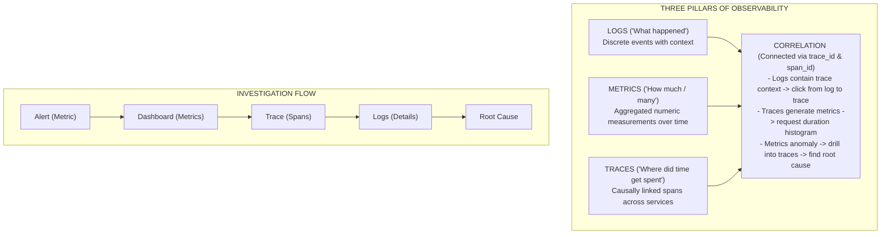
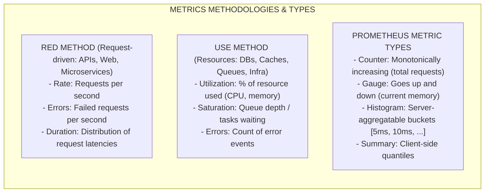
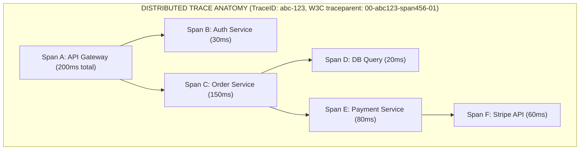
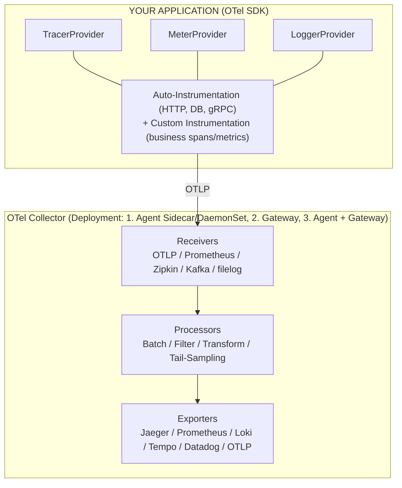
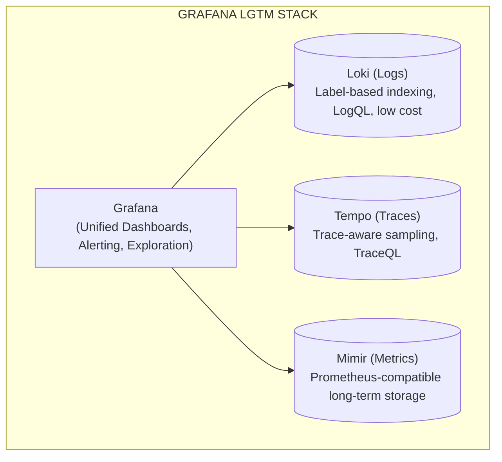
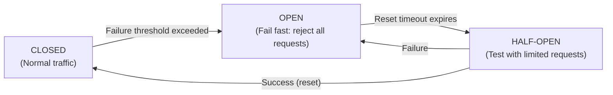
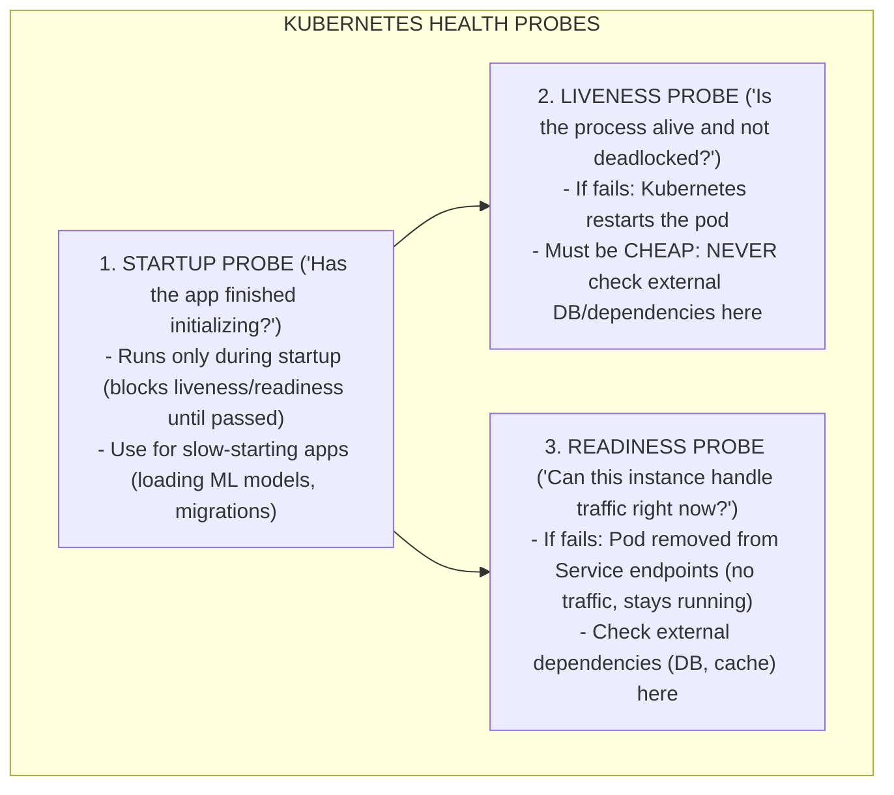
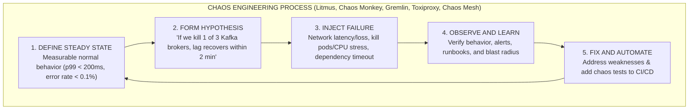

# Observability & Reliability Engineering

## Introduction

Observability is the ability to understand the internal state of a system by examining its external outputs. In 2026, observability is not a nice-to-have -- it is as fundamental to backend engineering as the code itself. The shift from monoliths to distributed microservices and serverless functions means you cannot simply attach a debugger. You must design systems to be observable from the start.

This guide covers the three pillars of observability, the OpenTelemetry standard that unifies them, the SLI/SLO framework for reliability, and the patterns that keep systems running when things inevitably break.

---

## The Three Pillars of Observability



### Structured Logging

Unstructured logs (`console.log("user logged in")`) are almost useless at scale. Structured logging outputs machine-parseable key-value pairs that can be searched, filtered, and correlated.

```typescript
import pino from 'pino';

// ── Logger Configuration ────────────────────────────────────
const logger = pino({
  level: process.env.LOG_LEVEL ?? 'info',
  formatters: {
    level(label: string) {
      return { level: label };
    },
  },
  serializers: {
    err: pino.stdSerializers.err,
    req: pino.stdSerializers.req,
    res: pino.stdSerializers.res,
  },
  // Redact sensitive fields
  redact: {
    paths: [
      'req.headers.authorization',
      'req.headers.cookie',
      'body.password',
      'body.creditCard',
    ],
    censor: '[REDACTED]',
  },
  // Add base fields to every log
  base: {
    service: 'order-service',
    version: process.env.APP_VERSION,
    environment: process.env.NODE_ENV,
  },
});

// ── Request-scoped logger with correlation ID ───────────────
function createRequestLogger(
  traceId: string,
  spanId: string,
  userId?: string
): pino.Logger {
  return logger.child({
    traceId,
    spanId,
    userId,
  });
}

// ── Usage ───────────────────────────────────────────────────
function handleOrder(req: Request, log: pino.Logger): void {
  log.info({ orderId: 'abc-123', amount: 49.99 }, 'Order received');
  // Output:
  // {
  //   "level": "info",
  //   "service": "order-service",
  //   "version": "2.1.0",
  //   "environment": "production",
  //   "traceId": "abc123def456",
  //   "spanId": "span789",
  //   "userId": "user-42",
  //   "orderId": "abc-123",
  //   "amount": 49.99,
  //   "msg": "Order received",
  //   "time": 1706000000000
  // }
}
```

**Log levels and their semantics:**

- `fatal`: System is unusable, immediate action required
- `error`: Operation failed, but system continues. Requires investigation
- `warn`: Something unexpected, but handled. May indicate future problems
- `info`: Normal operational events (request processed, job completed)
- `debug`: Detailed diagnostic info for development and troubleshooting
- `trace`: Extremely detailed, per-step execution info

### Metrics: RED and USE Methods



### Distributed Tracing



---

## OpenTelemetry (OTel)

OpenTelemetry is the CNCF standard for instrumentation. It provides a vendor-neutral API for generating telemetry data (traces, metrics, logs). Understanding OTel is essential -- it is the de facto standard in 2026.



### OpenTelemetry Setup in Node.js

```typescript
import { NodeSDK } from '@opentelemetry/sdk-node';
import { OTLPTraceExporter } from '@opentelemetry/exporter-trace-otlp-http';
import { OTLPMetricExporter } from '@opentelemetry/exporter-metrics-otlp-http';
import { PeriodicExportingMetricReader } from '@opentelemetry/sdk-metrics';
import { HttpInstrumentation } from '@opentelemetry/instrumentation-http';
import { ExpressInstrumentation } from '@opentelemetry/instrumentation-express';
import { PgInstrumentation } from '@opentelemetry/instrumentation-pg';
import { RedisInstrumentation } from '@opentelemetry/instrumentation-redis-4';
import { PinoInstrumentation } from '@opentelemetry/instrumentation-pino';
import {
  Resource,
  detectResourcesSync,
  envDetectorSync,
  hostDetectorSync,
  processDetectorSync,
} from '@opentelemetry/resources';
import {
  ATTR_SERVICE_NAME,
  ATTR_SERVICE_VERSION,
  ATTR_DEPLOYMENT_ENVIRONMENT_NAME,
} from '@opentelemetry/semantic-conventions';

// ── SDK Initialization (must run before any imports) ────────
const sdk = new NodeSDK({
  resource: detectResourcesSync({
    detectors: [envDetectorSync, hostDetectorSync, processDetectorSync],
  }).merge(
    new Resource({
      [ATTR_SERVICE_NAME]: 'order-service',
      [ATTR_SERVICE_VERSION]: process.env.APP_VERSION ?? 'unknown',
      [ATTR_DEPLOYMENT_ENVIRONMENT_NAME]: process.env.NODE_ENV ?? 'development',
    })
  ),

  traceExporter: new OTLPTraceExporter({
    url: process.env.OTEL_EXPORTER_OTLP_ENDPOINT + '/v1/traces',
  }),

  metricReader: new PeriodicExportingMetricReader({
    exporter: new OTLPMetricExporter({
      url: process.env.OTEL_EXPORTER_OTLP_ENDPOINT + '/v1/metrics',
    }),
    exportIntervalMillis: 15000,
  }),

  instrumentations: [
    new HttpInstrumentation({
      ignoreIncomingPaths: ['/health', '/ready', '/metrics'],
    }),
    new ExpressInstrumentation(),
    new PgInstrumentation({
      enhancedDatabaseReporting: true,
    }),
    new RedisInstrumentation(),
    new PinoInstrumentation(),
  ],
});

sdk.start();

process.on('SIGTERM', async () => {
  await sdk.shutdown();
  process.exit(0);
});
```

### Custom Spans and Business Metrics

```typescript
import { trace, metrics, SpanStatusCode } from '@opentelemetry/api';

const tracer = trace.getTracer('order-service');
const meter = metrics.getMeter('order-service');

// ── Custom Metrics ──────────────────────────────────────────
const orderCounter = meter.createCounter('orders.created', {
  description: 'Total orders created',
  unit: 'orders',
});

const orderValueHistogram = meter.createHistogram('orders.value', {
  description: 'Distribution of order values',
  unit: 'USD',
  advice: {
    explicitBucketBoundaries: [10, 25, 50, 100, 250, 500, 1000, 5000],
  },
});

const activeOrders = meter.createUpDownCounter('orders.active', {
  description: 'Currently active orders',
});

// ── Custom Span Example ─────────────────────────────────────
async function processOrder(order: Order): Promise<OrderResult> {
  return tracer.startActiveSpan(
    'processOrder',
    {
      attributes: {
        'order.id': order.id,
        'order.customer_id': order.customerId,
        'order.item_count': order.items.length,
      },
    },
    async (span) => {
      try {
        // Child span for validation
        const validated = await tracer.startActiveSpan(
          'validateOrder',
          async (validationSpan) => {
            const result = await validateOrder(order);
            validationSpan.setAttribute('order.valid', result.isValid);
            validationSpan.end();
            return result;
          }
        );

        if (!validated.isValid) {
          span.setStatus({
            code: SpanStatusCode.ERROR,
            message: 'Order validation failed',
          });
          span.end();
          return { success: false, error: 'Validation failed' };
        }

        // Child span for payment
        await tracer.startActiveSpan('chargePayment', async (paymentSpan) => {
          paymentSpan.setAttribute('payment.method', order.paymentMethod);
          await chargePayment(order);
          paymentSpan.end();
        });

        // Record metrics
        orderCounter.add(1, {
          region: order.region,
          payment_method: order.paymentMethod,
        });
        orderValueHistogram.record(order.totalAmount, {
          region: order.region,
        });
        activeOrders.add(1);

        span.setStatus({ code: SpanStatusCode.OK });
        span.end();
        return { success: true, orderId: order.id };
      } catch (error) {
        span.recordException(error as Error);
        span.setStatus({
          code: SpanStatusCode.ERROR,
          message: (error as Error).message,
        });
        span.end();
        throw error;
      }
    }
  );
}
```

---

## Observability Backends: The Grafana Stack



---

## SLIs, SLOs, and Error Budgets

```
+------------------------------------------------------------------+
|              SLI / SLO / SLA HIERARCHY                            |
+------------------------------------------------------------------+
|                                                                  |
|  SLA (Service Level Agreement) - Business contract               |
|  "99.9% availability, or we refund 10% of your bill"             |
|  +-----------------------------------------------------------+  |
|  |                                                           |  |
|  |  SLO (Service Level Objective) - Internal target          |  |
|  |  "99.95% of requests succeed within 200ms" (stricter!)    |  |
|  |  +------------------------------------------------------+ |  |
|  |  |                                                      | |  |
|  |  |  SLI (Service Level Indicator) - The measurement     | |  |
|  |  |  "Proportion of requests completing < 200ms"          | |  |
|  |  |                                                      | |  |
|  |  +------------------------------------------------------+ |  |
|  +-----------------------------------------------------------+  |
|                                                                  |
|  ERROR BUDGET:                                                   |
|  If SLO is 99.95%:                                               |
|  - Allowed errors per month: 0.05% = ~21.6 minutes downtime     |
|  - Error budget = total requests * (1 - SLO)                    |
|  - Example: 10M requests/month * 0.0005 = 5,000 allowed errors  |
|                                                                  |
|  BURN RATE:                                                      |
|  How fast you are consuming your error budget.                   |
|  - Burn rate 1.0 = consuming at exactly the sustainable pace     |
|  - Burn rate 2.0 = will exhaust budget in half the window        |
|  - Burn rate 10.0 = major incident, exhausted in 3 days          |
|                                                                  |
|  MULTI-WINDOW BURN RATE ALERTING:                                |
|  +--------------------+---------------------+-----------------+  |
|  | Severity           | Long Window         | Short Window    |  |
|  +--------------------+---------------------+-----------------+  |
|  | Page (critical)    | 1h burn rate > 14.4 | 5m burn > 14.4  |  |
|  | Page (high)        | 6h burn rate > 6    | 30m burn > 6    |  |
|  | Ticket (medium)    | 3d burn rate > 1    | 6h burn > 1     |  |
|  +--------------------+---------------------+-----------------+  |
|  Both windows must fire to avoid false positives.                |
|                                                                  |
+------------------------------------------------------------------+
```

**Common SLIs by service type:**

| Service Type  | Availability SLI             | Latency SLI                 | Quality SLI            |
| ------------- | ---------------------------- | --------------------------- | ---------------------- |
| HTTP API      | % of non-5xx responses       | p50, p95, p99 response time | % of valid responses   |
| Data pipeline | % of records processed       | End-to-end latency          | % of accurate results  |
| Storage       | % of reads/writes succeeding | Read/write latency          | Durability (data loss) |
| Streaming     | % of messages delivered      | Consumer lag                | % of ordered delivery  |

---

## Reliability Patterns

### Circuit Breaker



```typescript
interface CircuitBreakerConfig {
  readonly failureThreshold: number; // Failures before opening
  readonly successThreshold: number; // Successes to close from half-open
  readonly timeoutMs: number; // Time in open state before half-open
  readonly monitorWindowMs: number; // Window for counting failures
}

type CircuitState = 'CLOSED' | 'OPEN' | 'HALF_OPEN';

interface CircuitBreakerState {
  readonly state: CircuitState;
  readonly failureCount: number;
  readonly successCount: number;
  readonly lastFailureTime: number;
  readonly nextRetryTime: number;
}

function createCircuitBreaker(config: CircuitBreakerConfig) {
  let current: CircuitBreakerState = {
    state: 'CLOSED',
    failureCount: 0,
    successCount: 0,
    lastFailureTime: 0,
    nextRetryTime: 0,
  };

  function transitionTo(newState: CircuitState): void {
    current = {
      ...current,
      state: newState,
      failureCount: newState === 'CLOSED' ? 0 : current.failureCount,
      successCount: newState === 'HALF_OPEN' ? 0 : current.successCount,
      nextRetryTime:
        newState === 'OPEN'
          ? Date.now() + config.timeoutMs
          : current.nextRetryTime,
    };
  }

  async function execute<T>(fn: () => Promise<T>): Promise<T> {
    if (current.state === 'OPEN') {
      if (Date.now() >= current.nextRetryTime) {
        transitionTo('HALF_OPEN');
      } else {
        throw new Error('Circuit breaker is OPEN');
      }
    }

    try {
      const result = await fn();

      if (current.state === 'HALF_OPEN') {
        const newSuccessCount = current.successCount + 1;
        current = { ...current, successCount: newSuccessCount };
        if (newSuccessCount >= config.successThreshold) {
          transitionTo('CLOSED');
        }
      } else {
        current = { ...current, failureCount: 0 };
      }

      return result;
    } catch (error) {
      const newFailureCount = current.failureCount + 1;
      current = {
        ...current,
        failureCount: newFailureCount,
        lastFailureTime: Date.now(),
      };

      if (current.state === 'HALF_OPEN') {
        transitionTo('OPEN');
      } else if (newFailureCount >= config.failureThreshold) {
        transitionTo('OPEN');
      }

      throw error;
    }
  }

  return {
    execute,
    getState: () => current.state,
  };
}

// Usage
const paymentCircuit = createCircuitBreaker({
  failureThreshold: 5,
  successThreshold: 3,
  timeoutMs: 30000,
  monitorWindowMs: 60000,
});

async function chargePayment(amount: number): Promise<PaymentResult> {
  return paymentCircuit.execute(async () => {
    const response = await fetch('https://payments.api/charge', {
      method: 'POST',
      body: JSON.stringify({ amount }),
      signal: AbortSignal.timeout(5000),
    });
    if (!response.ok) {
      throw new Error(`Payment failed: ${response.status}`);
    }
    return response.json();
  });
}
```

### Health Check Endpoints



```typescript
import { Router, Request, Response } from 'express';

interface HealthStatus {
  readonly status: 'healthy' | 'degraded' | 'unhealthy';
  readonly checks: Record<
    string,
    {
      readonly status: 'pass' | 'fail';
      readonly latencyMs?: number;
      readonly message?: string;
    }
  >;
  readonly uptime: number;
  readonly version: string;
}

function healthRouter(dependencies: {
  db: Pool;
  redis: Redis;
  kafka: KafkaClient;
}): Router {
  const router = Router();
  const startTime = Date.now();

  // Startup probe -- returns 200 once app is ready
  let isStarted = false;
  router.get('/startup', (_req: Request, res: Response) => {
    if (isStarted) {
      res.status(200).json({ status: 'started' });
    } else {
      res.status(503).json({ status: 'starting' });
    }
  });

  // Liveness probe -- just check process health, NO external deps
  router.get('/health/live', (_req: Request, res: Response) => {
    const memUsage = process.memoryUsage();
    const heapUsedPct = memUsage.heapUsed / memUsage.heapTotal;

    if (heapUsedPct > 0.95) {
      res.status(503).json({
        status: 'unhealthy',
        reason: 'Memory pressure',
        heapUsedPct,
      });
      return;
    }

    res.status(200).json({ status: 'alive' });
  });

  // Readiness probe -- check all external dependencies
  router.get('/health/ready', async (_req: Request, res: Response) => {
    const checks: HealthStatus['checks'] = {};

    // Database check
    const dbStart = Date.now();
    try {
      await dependencies.db.query('SELECT 1');
      checks.database = {
        status: 'pass',
        latencyMs: Date.now() - dbStart,
      };
    } catch (error) {
      checks.database = {
        status: 'fail',
        message: (error as Error).message,
      };
    }

    // Redis check
    const redisStart = Date.now();
    try {
      await dependencies.redis.ping();
      checks.redis = {
        status: 'pass',
        latencyMs: Date.now() - redisStart,
      };
    } catch (error) {
      checks.redis = {
        status: 'fail',
        message: (error as Error).message,
      };
    }

    const allPassing = Object.values(checks).every((c) => c.status === 'pass');

    const health: HealthStatus = {
      status: allPassing ? 'healthy' : 'unhealthy',
      checks,
      uptime: Date.now() - startTime,
      version: process.env.APP_VERSION ?? 'unknown',
    };

    res.status(allPassing ? 200 : 503).json(health);
  });

  return router;
}
```

### Additional Reliability Patterns

```
+------------------------------------------------------------------+
|              RELIABILITY PATTERNS CHEAT SHEET                      |
+------------------------------------------------------------------+
|                                                                  |
|  BULKHEAD:                                                       |
|  Isolate resources so failure in one area does not cascade.      |
|  +--------+  +--------+  +--------+                              |
|  |Pool A  |  |Pool B  |  |Pool C  |  Separate connection pools  |
|  |Critical|  |Standard|  |Batch   |  for different workloads     |
|  |API     |  |API     |  |Jobs    |                              |
|  +--------+  +--------+  +--------+                              |
|  If batch jobs exhaust Pool C, critical API (Pool A) is fine.    |
|                                                                  |
|  RETRY WITH JITTER:                                              |
|  Without jitter: 1000 clients retry at exactly 1s, 2s, 4s       |
|  With jitter:    1000 clients retry at 0.7s, 1.8s, 3.2s (spread)|
|  Decorrelated jitter: sleep = min(cap, random(base, prev * 3))   |
|                                                                  |
|  TIMEOUT CASCADES:                                               |
|  Set timeouts that decrease as you go deeper in the call chain:  |
|  API Gateway: 10s -> Service A: 5s -> Service B: 2s -> DB: 500ms|
|  Inner services must be faster than outer services' timeouts.    |
|                                                                  |
|  LOAD SHEDDING:                                                  |
|  When overloaded, reject requests early (return 503) rather than |
|  processing them slowly. Better to serve 80% of requests fast    |
|  than 100% of requests slowly (or timing out).                   |
|                                                                  |
|  GRACEFUL DEGRADATION:                                           |
|  When a dependency is down, serve partial/cached results:        |
|  - Recommendations down? Show popular items instead              |
|  - Search down? Redirect to category browsing                    |
|  - Payment down? Queue order for later processing                |
|                                                                  |
+------------------------------------------------------------------+
```

---

## Chaos Engineering



---

## Interview Q&As

### Q1: How would you debug a latency spike in a microservice architecture?

**Answer**: I would follow a systematic top-down approach.

**Step 1: Identify the scope.** Is it all requests or a subset? Check dashboards for request rate, error rate, and latency (RED metrics). Is it one endpoint or all? One region or global? One service or many?

**Step 2: Trace a slow request.** Find a specific slow request in the tracing system (Tempo, Jaeger). Look at the waterfall view to identify which span took the longest. This immediately narrows the investigation from "the whole system" to "this specific service call" or "this database query."

**Step 3: Correlate with resource metrics.** For the slow service, check USE metrics: CPU utilization, memory pressure, disk I/O, network saturation. If CPU is at 95%, the fix is different than if CPU is at 10% but all threads are blocked on I/O.

**Step 4: Check dependency health.** If the slow span is a database call, look at database metrics: connection pool utilization, query execution time, lock contention. If it is an external API, check their status page and your circuit breaker state.

**Step 5: Examine logs in context.** Using the trace ID from the slow request, query structured logs for that specific trace. Look for warnings, retries, or unusual patterns that correlate with the latency.

**Step 6: Check for systemic issues.** Garbage collection pauses (check GC metrics), deployment changes (check deployment timestamps vs latency spike), increased traffic (check rate metrics), resource contention (check for noisy neighbors in shared infrastructure).

The key insight is moving from aggregate metrics (dashboards) to specific instances (traces) to detailed context (logs). This is exactly why the three pillars must be correlated via trace IDs.

### Q2: What is the difference between liveness and readiness probes, and what is a common mistake?

**Answer**: Liveness probes tell the orchestrator "is this process fundamentally broken?" If the probe fails, the pod is killed and restarted. It should only check the process itself: can it handle HTTP requests, is the event loop responsive, is memory within bounds.

Readiness probes tell the orchestrator "can this instance serve traffic right now?" If the probe fails, the pod is removed from the load balancer but NOT killed. It should check external dependencies: database connectivity, cache availability, required configuration loaded.

**The most common and dangerous mistake** is checking database connectivity in the liveness probe. If the database goes down for 30 seconds, every pod fails its liveness check, Kubernetes restarts them all, and when they come back up they all try to reconnect simultaneously, causing a thundering herd on the database. The database was going to recover in 30 seconds, but now you have a cascading failure.

Instead: check database only in the readiness probe. When the database is down, pods stay alive but stop receiving traffic. When the database recovers, pods immediately start serving again -- no restart required.

### Q3: Explain SLOs and error budgets. How do they influence engineering decisions?

**Answer**: An SLO (Service Level Objective) is an internal reliability target for a service, expressed as a percentage over a time window. For example: "99.95% of API requests return a non-error response within 200ms, measured over a rolling 30-day window."

The error budget is the inverse: 100% - SLO = budget for failures. With a 99.95% SLO over 30 days, you have 0.05% of requests as your error budget, which translates to roughly 21.6 minutes of total downtime.

**How error budgets influence decisions:**

1. **Deployment velocity**: If the error budget is healthy (lots of budget remaining), the team can deploy more aggressively -- ship new features, run experiments, try risky changes. If the budget is nearly exhausted, the team should freeze feature work and focus on reliability.

2. **Alerting**: Instead of alerting on arbitrary thresholds ("CPU > 80%"), alert on error budget burn rate. A burn rate of 14.4x means you will exhaust your monthly budget in 2 days -- page someone. A burn rate of 1.0 is sustainable -- no alert needed.

3. **Architecture investments**: If a service consistently burns through its error budget, that is a signal to invest in reliability: add redundancy, improve caching, implement graceful degradation.

4. **Cross-team negotiations**: When one team's SLO depends on another team's service, the error budget framework makes reliability discussions quantitative instead of political.

The key principle: reliability is not free. Every additional "nine" (99.9% to 99.99%) costs exponentially more engineering effort. Error budgets make this trade-off explicit and measurable.

### Q4: How does OpenTelemetry context propagation work across services?

**Answer**: Context propagation is the mechanism that connects spans across service boundaries into a single distributed trace.

When Service A calls Service B over HTTP, the OTel SDK injects trace context into the request headers using the W3C Trace Context standard:

```
traceparent: 00-4bf92f3577b34da6a3ce929d0e0e4736-00f067aa0ba902b7-01
             ^   ^                                ^                  ^
             |   |                                |                  |
          version traceId (16 bytes)         spanId (8 bytes)    flags (sampled)
```

Service B's OTel SDK extracts this header, creates a new span with the received trace ID and the received span ID as its parent, and continues the trace.

**Propagation works across different protocols:**

- **HTTP**: `traceparent` and `tracestate` headers
- **gRPC**: Metadata (same headers as HTTP/2)
- **Kafka**: Message headers
- **AMQP**: Message properties

**Baggage** is a separate propagation mechanism for arbitrary key-value pairs that travel with the trace context. For example, you might propagate `tenant-id` or `feature-flags` as baggage so that downstream services can access them without explicit parameter passing.

The OTel Collector can also manipulate context -- for example, adding attributes to all spans from a particular service, or performing tail-based sampling (deciding to keep or drop a trace after seeing all its spans).

### Q5: Describe a circuit breaker. When would you NOT use one?

**Answer**: A circuit breaker wraps calls to an external dependency and monitors failures. It has three states: CLOSED (normal operation, failures counted), OPEN (all calls fail immediately without attempting the remote call), and HALF-OPEN (limited test requests allowed to probe if the dependency recovered).

When failures exceed a threshold, the circuit opens. This prevents a failing service from consuming resources (threads, connections, memory) in the calling service while it waits for responses that will never come. After a timeout, the circuit enters half-open state and allows a few test requests through. If they succeed, the circuit closes and normal traffic resumes.

**When NOT to use a circuit breaker:**

1. **Idempotent background jobs**: If a job can safely be retried later, a simple retry with backoff is sufficient. The circuit breaker's fast-fail behavior is less useful when there is no user waiting for a response.

2. **When the dependency is critical and has no fallback**: If your service literally cannot do anything useful without the dependency (e.g., the primary database for a write operation), failing fast does not help -- you still cannot serve the request. A circuit breaker helps most when there is a degraded response you can serve (cached data, default values).

3. **High-throughput internal services**: If you are calling a Kafka broker or internal cache at thousands of requests per second, the half-open state (which allows very few requests through) creates a bottleneck during recovery. Instead, use health checks and load balancer-level removal.

4. **When the failure mode is transient**: If errors are caused by intermittent network glitches that resolve in milliseconds, a circuit breaker that opens for 30 seconds is overly aggressive. Use retries with jitter instead.

---

## Key Takeaways

1. **Observability is not monitoring.** Monitoring asks "is this metric in range?" Observability asks "why is the system behaving this way?" Design for observability from the start by using structured logs, correlated traces, and meaningful metrics.
2. **OpenTelemetry is the standard.** Vendor-lock on observability tools is expensive. Use OTel for instrumentation and choose backends independently. Auto-instrumentation gets you 80% of the value with minimal effort.
3. **SLOs drive engineering priorities.** Do not set arbitrary reliability targets. Measure what users care about, set realistic objectives, and use error budgets to balance reliability with feature velocity.
4. **Alerts should be actionable.** Every alert should have a runbook, a clear owner, and a defined severity. If an alert fires and the response is "ignore it," delete the alert.
5. **Reliability patterns are composable.** Circuit breakers, retries, timeouts, bulkheads, and load shedding work together. A robust service uses multiple patterns in layers: timeouts at the HTTP client, circuit breakers around dependency calls, bulkheads to isolate workloads, and load shedding at the gateway.
