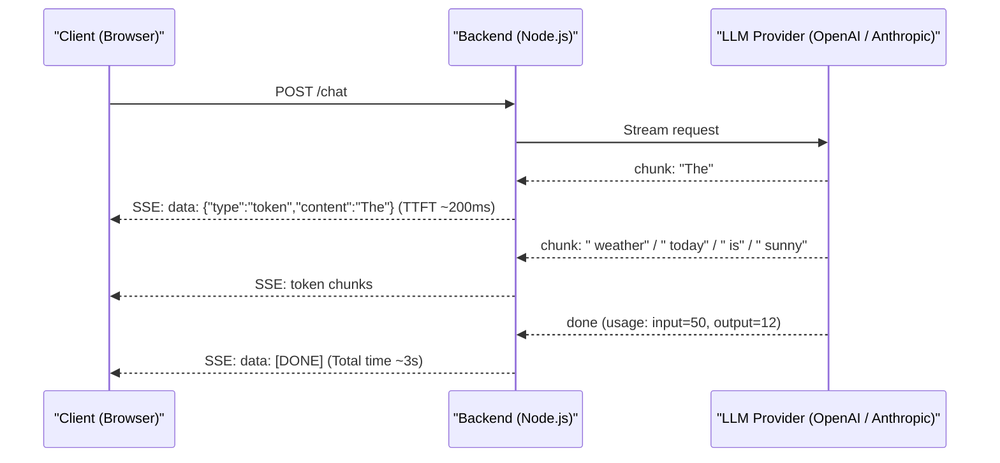
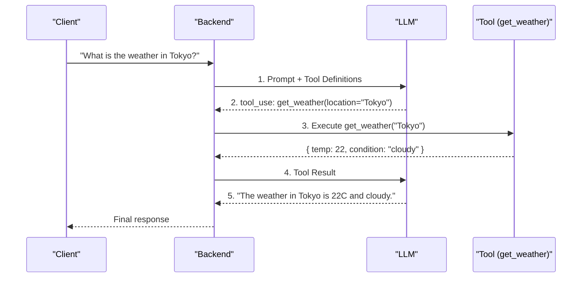
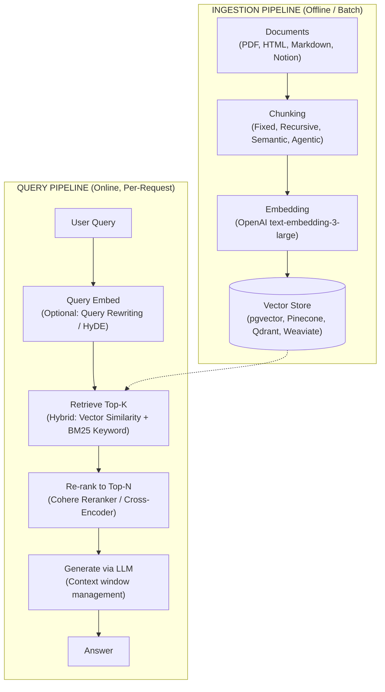
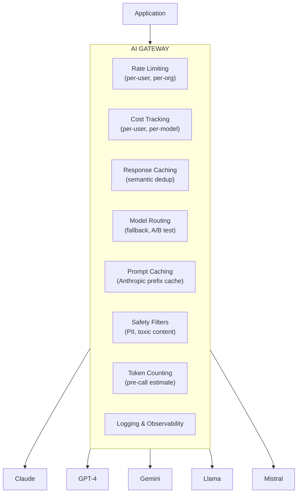
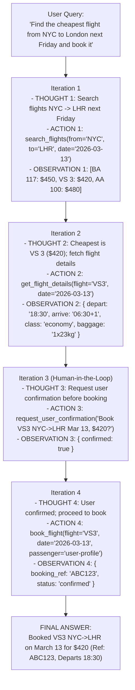
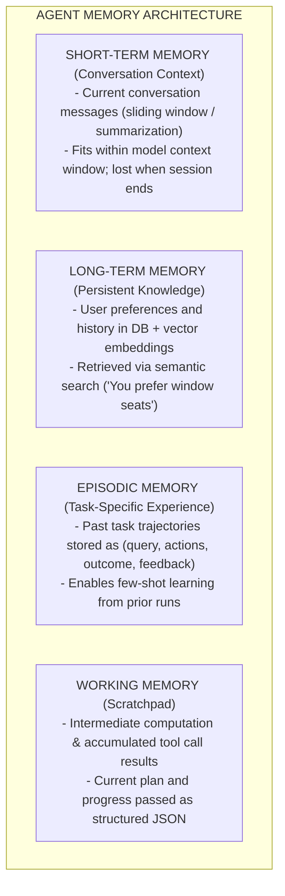
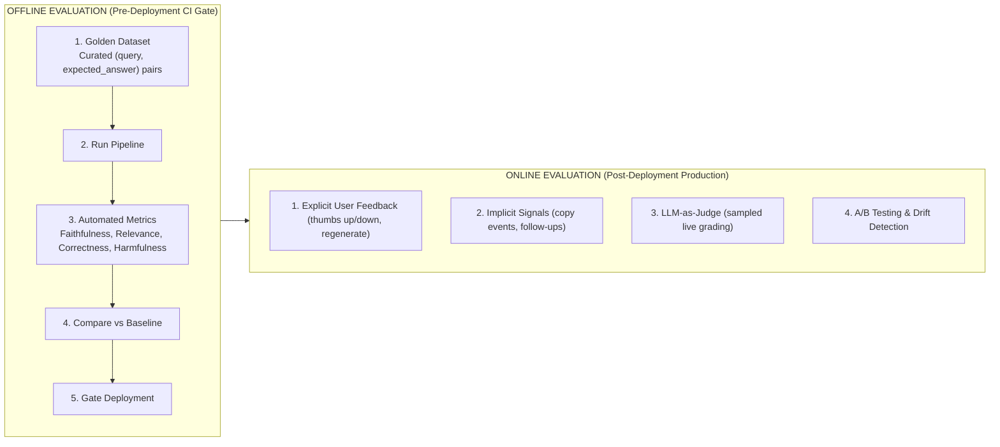

# AI-Native Backend Patterns

## Introduction

In 2026, integrating large language models (LLMs) into backend systems is no longer experimental -- it is a core competency. Every major product is shipping AI features, from intelligent search to autonomous agents. But the gap between a working prototype and a production AI backend is enormous. Prototypes ignore cost, latency, reliability, and safety. Production systems must handle all of these while serving millions of users.

This guide covers the architecture patterns, infrastructure decisions, and production concerns that define AI-native backend engineering. The focus is on practical implementation: how streaming actually works, how to build a RAG pipeline that scales, how to manage costs that can spiral by 100x overnight, and how to build agent systems that are controllable.

---

## LLM Integration Patterns

### Streaming Responses with Server-Sent Events

LLM responses take 2-30 seconds to generate completely. Users expect to see tokens appear in real-time. Server-Sent Events (SSE) is the dominant pattern for this.



```typescript
import Anthropic from '@anthropic-ai/sdk';
import { Request, Response } from 'express';

const anthropic = new Anthropic({
  apiKey: process.env.ANTHROPIC_API_KEY,
});

async function handleChatStream(req: Request, res: Response): Promise<void> {
  const { messages, model = 'claude-sonnet-4-20250514' } = req.body;

  // Set SSE headers
  res.writeHead(200, {
    'Content-Type': 'text/event-stream',
    'Cache-Control': 'no-cache',
    Connection: 'keep-alive',
    'X-Accel-Buffering': 'no', // Disable nginx buffering
  });

  try {
    const stream = anthropic.messages.stream({
      model,
      max_tokens: 4096,
      messages,
      system: 'You are a helpful assistant.',
    });

    stream.on('text', (text) => {
      res.write(
        `data: ${JSON.stringify({ type: 'token', content: text })}\n\n`
      );
    });

    stream.on('message', (message) => {
      res.write(
        `data: ${JSON.stringify({
          type: 'usage',
          inputTokens: message.usage.input_tokens,
          outputTokens: message.usage.output_tokens,
        })}\n\n`
      );
    });

    stream.on('error', (error) => {
      res.write(
        `data: ${JSON.stringify({ type: 'error', message: error.message })}\n\n`
      );
      res.write('data: [DONE]\n\n');
      res.end();
    });

    stream.on('end', () => {
      res.write('data: [DONE]\n\n');
      res.end();
    });

    // Handle client disconnect
    req.on('close', () => {
      stream.abort();
    });
  } catch (error) {
    res.write(
      `data: ${JSON.stringify({
        type: 'error',
        message: (error as Error).message,
      })}\n\n`
    );
    res.write('data: [DONE]\n\n');
    res.end();
  }
}
```

### Function Calling / Tool Use

Function calling allows the LLM to invoke structured functions in your backend. This is the foundation of all agent architectures.



```typescript
import Anthropic from '@anthropic-ai/sdk';

const tools: Anthropic.Tool[] = [
  {
    name: 'get_weather',
    description:
      'Get the current weather for a location. Use this when the user asks about weather conditions.',
    input_schema: {
      type: 'object' as const,
      properties: {
        location: {
          type: 'string',
          description: "City name, e.g., 'Tokyo' or 'San Francisco, CA'",
        },
        unit: {
          type: 'string',
          enum: ['celsius', 'fahrenheit'],
          description: 'Temperature unit. Default: celsius',
        },
      },
      required: ['location'],
    },
  },
  {
    name: 'search_database',
    description: 'Search the product database by query string.',
    input_schema: {
      type: 'object' as const,
      properties: {
        query: { type: 'string', description: 'Search query' },
        limit: { type: 'number', description: 'Max results. Default: 5' },
      },
      required: ['query'],
    },
  },
];

// Tool executor registry
const toolExecutors: Record<
  string,
  (input: Record<string, unknown>) => Promise<unknown>
> = {
  get_weather: async (input) => {
    const response = await fetch(
      `https://weather.api/v1/current?q=${input.location}&units=${input.unit ?? 'celsius'}`
    );
    return response.json();
  },
  search_database: async (input) => {
    return db.query(
      `SELECT * FROM products
       WHERE to_tsvector('english', name || ' ' || description)
             @@ plainto_tsquery('english', $1)
       LIMIT $2`,
      [input.query, input.limit ?? 5]
    );
  },
};

// Agentic loop: keep calling until LLM stops requesting tools
async function agenticChat(
  messages: Anthropic.MessageParam[]
): Promise<string> {
  const MAX_ITERATIONS = 10; // Safety limit

  for (let i = 0; i < MAX_ITERATIONS; i++) {
    const response = await anthropic.messages.create({
      model: 'claude-sonnet-4-20250514',
      max_tokens: 4096,
      tools,
      messages,
    });

    // Check if the LLM wants to use tools
    if (response.stop_reason === 'tool_use') {
      const toolUseBlocks = response.content.filter(
        (block): block is Anthropic.ToolUseBlock => block.type === 'tool_use'
      );

      // Execute all tool calls
      const toolResults: Anthropic.ToolResultBlockParam[] = await Promise.all(
        toolUseBlocks.map(async (toolUse) => {
          const executor = toolExecutors[toolUse.name];
          if (!executor) {
            return {
              type: 'tool_result' as const,
              tool_use_id: toolUse.id,
              content: `Unknown tool: ${toolUse.name}`,
              is_error: true,
            };
          }

          try {
            const result = await executor(
              toolUse.input as Record<string, unknown>
            );
            return {
              type: 'tool_result' as const,
              tool_use_id: toolUse.id,
              content: JSON.stringify(result),
            };
          } catch (error) {
            return {
              type: 'tool_result' as const,
              tool_use_id: toolUse.id,
              content: `Tool error: ${(error as Error).message}`,
              is_error: true,
            };
          }
        })
      );

      // Add assistant response and tool results to conversation
      messages = [
        ...messages,
        { role: 'assistant', content: response.content },
        { role: 'user', content: toolResults },
      ];
    } else {
      // LLM returned final text response
      const textBlock = response.content.find(
        (block): block is Anthropic.TextBlock => block.type === 'text'
      );
      return textBlock?.text ?? '';
    }
  }

  throw new Error('Exceeded maximum tool-use iterations');
}
```

### Structured Output

Getting reliable structured data from LLMs is critical for backend integration.

````typescript
import { z } from 'zod';

// Define the expected output schema
const ProductReviewAnalysis = z.object({
  sentiment: z.enum(['positive', 'negative', 'neutral', 'mixed']),
  confidence: z.number().min(0).max(1),
  topics: z.array(
    z.object({
      topic: z.string(),
      sentiment: z.enum(['positive', 'negative', 'neutral']),
      keywords: z.array(z.string()),
    })
  ),
  summary: z.string().max(200),
  actionRequired: z.boolean(),
  actionReason: z.string().optional(),
});

type ProductReviewAnalysis = z.infer<typeof ProductReviewAnalysis>;

async function analyzeReview(
  reviewText: string
): Promise<ProductReviewAnalysis> {
  const response = await anthropic.messages.create({
    model: 'claude-sonnet-4-20250514',
    max_tokens: 1024,
    messages: [
      {
        role: 'user',
        content: `Analyze this product review and respond with ONLY a JSON object matching this schema:
{
  "sentiment": "positive" | "negative" | "neutral" | "mixed",
  "confidence": number (0-1),
  "topics": [{ "topic": string, "sentiment": string, "keywords": [string] }],
  "summary": string (max 200 chars),
  "actionRequired": boolean,
  "actionReason": string (optional, only if actionRequired is true)
}

Review: "${reviewText}"`,
      },
    ],
  });

  const text =
    response.content[0].type === 'text' ? response.content[0].text : '';

  // Extract JSON from response (handle markdown code blocks)
  const jsonMatch = text.match(/```json\s*([\s\S]*?)\s*```/) ?? [null, text];
  const parsed = JSON.parse(jsonMatch[1] ?? text);

  // Validate with Zod
  return ProductReviewAnalysis.parse(parsed);
}
````

---

## RAG Pipeline Architecture

Retrieval-Augmented Generation (RAG) grounds LLM responses in your own data. A production RAG system is far more complex than "embed, store, retrieve."



### Chunking Strategies

```
+------------------------------------------------------------------+
|              CHUNKING STRATEGIES COMPARISON                        |
+------------------------------------------------------------------+
|                                                                  |
|  FIXED-SIZE CHUNKING                                             |
|  Split every N characters/tokens with overlap.                   |
|  + Simple, predictable chunk sizes                               |
|  - Breaks mid-sentence, loses context                            |
|  Best for: Homogeneous documents, quick prototypes               |
|                                                                  |
|  RECURSIVE CHARACTER SPLITTING                                   |
|  Split by paragraph -> sentence -> word, with overlap.           |
|  + Respects natural boundaries                                   |
|  + Good default for most documents                               |
|  - Chunk sizes vary significantly                                |
|  Best for: General-purpose text documents                        |
|                                                                  |
|  SEMANTIC CHUNKING                                               |
|  Embed sentences, cluster by similarity, split at low-similarity |
|  boundaries.                                                     |
|  + Keeps semantically related content together                   |
|  - Expensive (requires embedding each sentence)                  |
|  - Harder to implement                                           |
|  Best for: Dense technical documents, legal contracts            |
|                                                                  |
|  DOCUMENT-STRUCTURE-AWARE                                        |
|  Use document structure: headers, sections, code blocks.         |
|  Split at structural boundaries, keep hierarchy metadata.        |
|  + Preserves document organization                               |
|  + Enables filtering by section                                  |
|  - Requires document parsing                                     |
|  Best for: Documentation sites, structured knowledge bases       |
|                                                                  |
|  CHUNK SIZE GUIDELINES:                                          |
|  +----------------+--------------------+------------------------+|
|  | Too small      | 100-200 tokens     | Loses context          ||
|  | Sweet spot     | 400-800 tokens     | Good retrieval/context ||
|  | Too large      | 1500+ tokens       | Dilutes relevance      ||
|  +----------------+--------------------+------------------------+|
|  Overlap: 10-20% of chunk size prevents losing boundary context  |
|                                                                  |
+------------------------------------------------------------------+
```

### RAG Pipeline with pgvector

```typescript
import { Pool } from 'pg';
import OpenAI from 'openai';

const db = new Pool({ connectionString: process.env.DATABASE_URL });
const openai = new OpenAI({ apiKey: process.env.OPENAI_API_KEY });

// ── Ingestion ───────────────────────────────────────────────
interface DocumentChunk {
  readonly documentId: string;
  readonly content: string;
  readonly metadata: {
    readonly source: string;
    readonly section: string;
    readonly chunkIndex: number;
    readonly totalChunks: number;
  };
}

async function ingestDocument(
  chunks: ReadonlyArray<DocumentChunk>
): Promise<void> {
  // Batch embed all chunks
  const embeddings = await openai.embeddings.create({
    model: 'text-embedding-3-large',
    input: chunks.map((c) => c.content),
    dimensions: 1536, // Reduce from 3072 for cost/performance
  });

  // Batch insert with embeddings
  const client = await db.connect();
  try {
    await client.query('BEGIN');

    for (let i = 0; i < chunks.length; i++) {
      const chunk = chunks[i];
      const embedding = embeddings.data[i].embedding;

      await client.query(
        `INSERT INTO document_chunks
         (document_id, content, metadata, embedding, created_at)
         VALUES ($1, $2, $3, $4::vector, NOW())
         ON CONFLICT (document_id, metadata->>'chunkIndex')
         DO UPDATE SET content = $2, embedding = $4::vector`,
        [
          chunk.documentId,
          chunk.content,
          JSON.stringify(chunk.metadata),
          `[${embedding.join(',')}]`,
        ]
      );
    }

    await client.query('COMMIT');
  } catch (error) {
    await client.query('ROLLBACK');
    throw error;
  } finally {
    client.release();
  }
}

// ── Retrieval ───────────────────────────────────────────────
interface RetrievalResult {
  readonly content: string;
  readonly metadata: Record<string, unknown>;
  readonly similarity: number;
}

async function hybridSearch(
  query: string,
  topK: number = 10
): Promise<ReadonlyArray<RetrievalResult>> {
  // 1. Embed the query
  const queryEmbedding = await openai.embeddings.create({
    model: 'text-embedding-3-large',
    input: query,
    dimensions: 1536,
  });

  const vector = `[${queryEmbedding.data[0].embedding.join(',')}]`;

  // 2. Hybrid search: combine vector similarity with BM25 keyword search
  const results = await db.query(
    `WITH vector_results AS (
       SELECT id, content, metadata,
              1 - (embedding <=> $1::vector) AS vector_score
       FROM document_chunks
       ORDER BY embedding <=> $1::vector
       LIMIT $2 * 2
     ),
     keyword_results AS (
       SELECT id, content, metadata,
              ts_rank(
                to_tsvector('english', content),
                plainto_tsquery('english', $3)
              ) AS keyword_score
       FROM document_chunks
       WHERE to_tsvector('english', content)
             @@ plainto_tsquery('english', $3)
       LIMIT $2 * 2
     )
     SELECT
       COALESCE(v.id, k.id) AS id,
       COALESCE(v.content, k.content) AS content,
       COALESCE(v.metadata, k.metadata) AS metadata,
       COALESCE(v.vector_score, 0) * 0.7 +
       COALESCE(k.keyword_score, 0) * 0.3 AS combined_score
     FROM vector_results v
     FULL OUTER JOIN keyword_results k ON v.id = k.id
     ORDER BY combined_score DESC
     LIMIT $2`,
    [vector, topK, query]
  );

  return results.rows.map((row) => ({
    content: row.content,
    metadata: row.metadata,
    similarity: row.combined_score,
  }));
}

// ── Generation (RAG) ────────────────────────────────────────
async function ragQuery(userQuery: string): Promise<string> {
  // 1. Retrieve relevant context
  const chunks = await hybridSearch(userQuery, 5);

  // 2. Build context with source attribution
  const context = chunks
    .map(
      (chunk, i) =>
        `[Source ${i + 1}: ${(chunk.metadata as { source: string }).source}]\n${chunk.content}`
    )
    .join('\n\n---\n\n');

  // 3. Generate answer with context
  const response = await anthropic.messages.create({
    model: 'claude-sonnet-4-20250514',
    max_tokens: 2048,
    system: `You are a helpful assistant. Answer questions based ONLY on the provided context.
If the context does not contain enough information, say so. Always cite your sources using [Source N] notation.`,
    messages: [
      {
        role: 'user',
        content: `Context:\n${context}\n\n---\n\nQuestion: ${userQuery}`,
      },
    ],
  });

  return response.content[0].type === 'text' ? response.content[0].text : '';
}
```

---

## AI Gateway Patterns

An AI gateway sits between your application and LLM providers, handling cross-cutting concerns.



### Cost Tracking Implementation

```typescript
// ── Model Pricing (per 1M tokens, as of 2026) ──────────────
const MODEL_PRICING: Record<
  string,
  { readonly input: number; readonly output: number }
> = {
  'claude-sonnet-4-20250514': { input: 3.0, output: 15.0 },
  'claude-haiku-35-20241022': { input: 0.8, output: 4.0 },
  'claude-opus-4-20250514': { input: 15.0, output: 75.0 },
  'gpt-4o': { input: 2.5, output: 10.0 },
  'gpt-4o-mini': { input: 0.15, output: 0.6 },
};

interface UsageRecord {
  readonly userId: string;
  readonly organizationId: string;
  readonly model: string;
  readonly inputTokens: number;
  readonly outputTokens: number;
  readonly costUsd: number;
  readonly timestamp: string;
  readonly requestId: string;
}

function calculateCost(
  model: string,
  inputTokens: number,
  outputTokens: number
): number {
  const pricing = MODEL_PRICING[model];
  if (!pricing) {
    throw new Error(`Unknown model: ${model}`);
  }
  const inputCost = (inputTokens / 1_000_000) * pricing.input;
  const outputCost = (outputTokens / 1_000_000) * pricing.output;
  return Math.round((inputCost + outputCost) * 1_000_000) / 1_000_000;
}

async function trackUsage(record: UsageRecord): Promise<void> {
  await db.query(
    `INSERT INTO ai_usage_log
     (user_id, organization_id, model, input_tokens, output_tokens,
      cost_usd, request_id, created_at)
     VALUES ($1, $2, $3, $4, $5, $6, $7, $8)`,
    [
      record.userId,
      record.organizationId,
      record.model,
      record.inputTokens,
      record.outputTokens,
      record.costUsd,
      record.requestId,
      record.timestamp,
    ]
  );

  // Check budget limits
  const monthlySpend = await db.query(
    `SELECT SUM(cost_usd) as total
     FROM ai_usage_log
     WHERE organization_id = $1
       AND created_at >= date_trunc('month', NOW())`,
    [record.organizationId]
  );

  const total = monthlySpend.rows[0].total;
  const limit = await getOrganizationBudget(record.organizationId);

  if (total > limit * 0.8) {
    await sendBudgetAlert(record.organizationId, total, limit);
  }

  if (total > limit) {
    await disableAiFeatures(record.organizationId);
  }
}

// ── Model Routing with Fallback ─────────────────────────────
interface ModelRoute {
  readonly primary: string;
  readonly fallbacks: ReadonlyArray<string>;
  readonly condition?: (request: AiRequest) => boolean;
}

const routes: ReadonlyArray<ModelRoute> = [
  {
    // Complex reasoning tasks -> Opus
    primary: 'claude-opus-4-20250514',
    fallbacks: ['claude-sonnet-4-20250514'],
    condition: (req) => req.taskType === 'complex_reasoning',
  },
  {
    // Standard chat -> Sonnet
    primary: 'claude-sonnet-4-20250514',
    fallbacks: ['gpt-4o', 'claude-haiku-35-20241022'],
    condition: (req) => req.taskType === 'chat',
  },
  {
    // Simple classification -> Haiku (cheapest)
    primary: 'claude-haiku-35-20241022',
    fallbacks: ['gpt-4o-mini'],
    condition: (req) => req.taskType === 'classification',
  },
];

async function routeRequest(request: AiRequest): Promise<AiResponse> {
  const route = routes.find((r) => r.condition?.(request)) ?? routes[1];

  const models = [route.primary, ...route.fallbacks];
  for (const model of models) {
    try {
      return await callModel(model, request);
    } catch (error) {
      const errorMessage = (error as Error).message;
      if (
        errorMessage.includes('rate_limit') ||
        errorMessage.includes('overloaded')
      ) {
        continue; // Try next model
      }
      throw error; // Non-retryable error
    }
  }

  throw new Error('All models exhausted');
}
```

---

## Prompt Management

```
+------------------------------------------------------------------+
|              PROMPT MANAGEMENT SYSTEM                              |
+------------------------------------------------------------------+
|                                                                  |
|  PROMPT REGISTRY                                                 |
|  +-----------------------------------------------------------+  |
|  | Name         | Version | Status  | Model      | Tokens    |  |
|  +--------------+---------+---------+------------+-----------+  |
|  | review-      | v3.2    | active  | claude-    | ~800 sys  |  |
|  |   analysis   |         |         | sonnet-4   | prompt    |  |
|  | review-      | v3.1    | shadow  | claude-    | ~750 sys  |  |
|  |   analysis   |         | (A/B)   | sonnet-4   | prompt    |  |
|  | summarize    | v2.0    | active  | claude-    | ~400 sys  |  |
|  |              |         |         | haiku-3.5  | prompt    |  |
|  +--------------+---------+---------+------------+-----------+  |
|                                                                  |
|  PROMPT INJECTION DEFENSE:                                       |
|  +-----------------------------------------------------------+  |
|  | 1. Input sanitization: strip control characters, limit     |  |
|  |    length, detect injection patterns                       |  |
|  | 2. System prompt isolation: never include user input in    |  |
|  |    the system prompt                                       |  |
|  | 3. Output validation: parse LLM output with strict schema  |  |
|  |    (Zod), reject unexpected formats                        |  |
|  | 4. Privilege separation: LLM tools have minimal permissions|  |
|  |    (read-only DB access, no admin endpoints)               |  |
|  | 5. Monitoring: flag requests where output contains system  |  |
|  |    prompt content or instruction-like text                  |  |
|  +-----------------------------------------------------------+  |
|                                                                  |
+------------------------------------------------------------------+
```

---

## Agent Architecture

### ReAct Pattern



### Memory Systems



---

## Production Concerns

### Cost Optimization Strategies

```
+------------------------------------------------------------------+
|              AI COST OPTIMIZATION                                  |
+------------------------------------------------------------------+
|                                                                  |
|  STRATEGY          | SAVINGS  | COMPLEXITY | IMPACT              |
|  -----------------+----------+------------+-------------------   |
|  Model downgrade   | 50-90%   | Low        | Quality may drop    |
|  (Sonnet -> Haiku) |          |            |                     |
|                    |          |            |                     |
|  Prompt caching    | 30-50%   | Low        | Same quality        |
|  (Anthropic cache) |          |            |                     |
|                    |          |            |                     |
|  Response caching  | 70-95%   | Medium     | Stale for dynamic   |
|  (semantic dedup)  |          |            | queries             |
|                    |          |            |                     |
|  Prompt shortening | 20-40%   | Medium     | Risk of quality     |
|  (fewer examples)  |          |            | loss                |
|                    |          |            |                     |
|  Batching          | 50%      | Medium     | Adds latency        |
|  (Anthropic batch) |          |            | (async only)        |
|                    |          |            |                     |
|  Fine-tuning       | 80-95%   | High       | High upfront cost,  |
|  (smaller model)   |          |            | maintenance burden  |
|  -----------------+----------+------------+-------------------   |
|                                                                  |
|  EXAMPLE MONTHLY COST (10M requests):                            |
|  Claude Opus:   $750K (input) + $3.75M (output) = ~$4.5M        |
|  Claude Sonnet: $150K (input) + $750K (output)  = ~$900K         |
|  Claude Haiku:  $40K  (input) + $200K (output)  = ~$240K         |
|  With caching:  ~$72K (70% cache hit on Haiku)                   |
|                                                                  |
|  Rule: Start with the cheapest model that meets quality bars.    |
|  Only upgrade to expensive models for tasks that need them.      |
|                                                                  |
+------------------------------------------------------------------+
```

### Evaluation Pipelines



---

## Interview Q&As

### Q1: How would you design a production RAG system that handles 1000 queries per minute with sub-3-second latency?

**Answer**: The key challenge is that a naive RAG pipeline makes two API calls per request (one for embedding, one for generation), each adding latency.

**Architecture**: Use a three-tier approach: query processing, retrieval, and generation.

**Query processing tier**: Embed the query using a fast embedding model (text-embedding-3-small at 0.15ms via batch endpoint, or host a local model like E5 on GPU for <5ms). Cache embedding results for identical queries in Redis with a 1-hour TTL. For semantic dedup, hash the embedding vector to catch paraphrased queries.

**Retrieval tier**: Use pgvector with HNSW index for approximate nearest neighbor search (<10ms for 10M vectors). Combine with keyword search (pg_trgm or full-text search) for hybrid retrieval. Pre-compute and cache results for popular queries. Use a re-ranker only when retrieval confidence is low (saves latency on the 80% of queries where top results are clearly relevant).

**Generation tier**: This is the bottleneck (1-3 seconds for LLM generation). Use streaming to reduce perceived latency. Implement response caching: hash the (query + retrieved_context) pair and cache the full response. For high-traffic queries, this alone can serve 40-60% of requests from cache at sub-100ms. Use Claude Haiku for simple factual queries (detected by a lightweight classifier) and Sonnet only for complex reasoning.

**Scaling**: At 1000 QPM, you need approximately 50 concurrent LLM calls (assuming 3s average latency). This is within the rate limits of major providers. The retrieval tier handles this easily with connection pooling. The main bottleneck is LLM API throughput -- use multiple API keys or a provisioned throughput plan.

### Q2: How do you prevent prompt injection in a production system?

**Answer**: Prompt injection is the SQL injection of AI systems. There is no single fix -- defense requires layers.

**Layer 1 - Input sanitization**: Strip control characters, limit input length (e.g., 10,000 characters), detect known injection patterns (e.g., "ignore previous instructions," "you are now," "system prompt:"). This catches naive attacks but is easily bypassed by sophisticated ones.

**Layer 2 - Architectural isolation**: Never concatenate user input into the system prompt. Use the message API properly: system prompt in the system field, user input in the user message. The LLM treats these differently. For RAG, retrieved documents should be clearly delimited (e.g., XML tags) and the system prompt should instruct the model to treat them as data, not instructions.

**Layer 3 - Output validation**: Parse LLM output with strict schemas (Zod). If the expected output is a JSON object with specific fields, reject any response that does not parse correctly. This prevents attacks that try to make the LLM output malicious instructions or leak information.

**Layer 4 - Privilege separation**: LLM tool calls should have minimal permissions. If the LLM can call a database tool, that tool should have read-only access. If the LLM can send emails, it should require human approval. Never give an LLM admin-level tool access.

**Layer 5 - Monitoring and detection**: Log all LLM interactions. Use a classifier (can be another LLM) to flag suspicious outputs -- responses that contain system prompt content, attempt to execute code, or deviate significantly from expected patterns. Alert on anomalies.

### Q3: Explain the trade-offs between SSE, WebSockets, and HTTP polling for LLM streaming.

**Answer**: For LLM streaming specifically, SSE is the dominant choice, and for good reason.

**SSE (Server-Sent Events)**: Unidirectional server-to-client stream over a standard HTTP connection. The client sends one request, and the server pushes a stream of events. Built into every browser via EventSource API. Works through CDNs, load balancers, and proxies with minimal configuration. Automatic reconnection built into the protocol. **Best for LLM streaming** because the pattern is inherently unidirectional: the client sends a prompt, and the server streams tokens back.

**WebSockets**: Bidirectional, persistent connection. More powerful than SSE but more complex. Requires special server support, load balancer configuration (sticky sessions or WebSocket-aware routing), and does not work well through some corporate proxies. **Use for LLM streaming only when** you need bidirectional communication in the same connection -- for example, allowing the user to cancel generation mid-stream AND send follow-up messages without a new connection. In practice, the cancellation can be handled by aborting the SSE connection.

**HTTP long polling**: Client repeatedly sends requests, server holds the response until data is available. High overhead (new HTTP request for each chunk of data). **Never use for LLM streaming** -- it creates excessive request overhead and latency between tokens.

**The practical choice**: Use SSE for LLM streaming. The only caveat is that some environments (older corporate proxies, some serverless platforms) have issues with long-lived HTTP connections. In those cases, consider chunked transfer encoding with a shorter timeout, or WebSockets as a fallback.

### Q4: How would you design a multi-agent system for complex task automation?

**Answer**: Multi-agent systems use multiple specialized LLM agents that coordinate to accomplish tasks too complex for a single agent.

**Architecture**: Use an orchestrator-worker pattern. The orchestrator agent receives the user request, decomposes it into subtasks, assigns subtasks to specialized worker agents, and synthesizes the final result.

**Orchestrator**: A reasoning-heavy model (Claude Opus or Sonnet) that maintains the overall plan, tracks progress, and decides when to delegate. It has access to a "plan" tool that updates its working memory with the current state of execution.

**Worker agents**: Specialized agents with narrow tool sets. For example: a "research agent" with web search tools, a "code agent" with file read/write/execute tools, a "data agent" with SQL query tools. Each worker uses the cheapest model that handles its task well (often Haiku for simple tool calling).

**Communication**: Agents communicate through structured messages, not natural language. The orchestrator sends a JSON task definition; workers return a JSON result. This prevents telephone-game degradation of instructions.

**Human-in-the-loop**: For high-stakes actions (payments, deletions, external communications), the agent requests human approval. The system pauses the workflow, notifies the user, and resumes on approval.

**Safety rails**: Set maximum iteration counts per agent (prevent infinite loops). Set cost budgets per task (prevent runaway spending). Log every tool call for auditability. Use separate API keys per agent with appropriate permissions.

**State management**: Use a persistent task store (Postgres) to track multi-step workflows. If the orchestrator crashes mid-task, it can resume from the last completed step. This is essentially the saga pattern applied to AI agent workflows.

### Q5: How do you evaluate and monitor RAG quality in production?

**Answer**: RAG quality has two components: retrieval quality (are we finding the right documents?) and generation quality (is the LLM using them correctly?).

**Retrieval metrics**: Hit rate (% of queries where the relevant document appears in top-K results), Mean Reciprocal Rank (how high the relevant document ranks), and context relevance (scored by an LLM judge: "Is this retrieved context relevant to the query?"). Monitor these over time -- a drop indicates stale embeddings, missing documents, or index degradation.

**Generation metrics**: Faithfulness (does the answer only contain information from the provided context?), answer relevance (does it actually answer the question?), and correctness (compared to golden answers for a test set). Frameworks like RAGAS automate these evaluations using LLM-as-judge.

**Production monitoring**: Sample 1-5% of production queries daily. Run them through the evaluation pipeline. Track metrics on dashboards with alerts on significant drops. Additionally, monitor: retrieval latency (embedding + search time), generation latency, token usage per request, cache hit rate, and the percentage of "I don't know" responses (which may indicate retrieval failures or knowledge gaps).

**Continuous improvement loop**: Collect user feedback (thumbs up/down). For thumbs-down responses, inspect retrieval results to determine if the problem was retrieval (wrong documents) or generation (right documents, wrong answer). Use this to prioritize: improve chunking, add documents, refine prompts, or switch models.

---

## Key Takeaways

1. **Streaming is mandatory for LLM UX.** Use SSE for server-to-client token streaming. Always measure time-to-first-token alongside total latency.
2. **RAG is a system, not a single API call.** Production RAG requires careful chunking, hybrid search, re-ranking, and continuous evaluation. Each component has knobs that affect quality.
3. **Cost is a first-class concern.** A single poorly-optimized prompt at scale can cost more than your entire infrastructure bill. Use model routing, caching, and batching aggressively.
4. **Prompt injection has no silver bullet.** Defense requires multiple layers: input sanitization, architectural isolation, output validation, privilege separation, and monitoring.
5. **Agent systems need safety rails.** Iteration limits, cost budgets, human-in-the-loop for high-stakes actions, and comprehensive logging are non-negotiable in production.
6. **Evaluate continuously.** Offline evaluations before deployment AND online monitoring after deployment. RAG quality degrades over time as documents become stale and query patterns shift.
