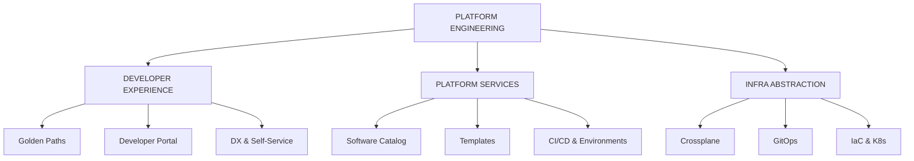

# Platform Engineering & Developer Experience -- Interview Preparation Guide

## Overview

This directory covers **platform engineering** -- the discipline of building and operating
Internal Developer Platforms (IDPs) that enable self-service infrastructure, streamlined
workflows, and golden paths for software delivery. Platform engineering emerged as the
hottest trend in DevOps (2023-2026), fundamentally changing how organizations scale
developer productivity.

## Table of Contents

| #  | File | Topic | Key Concepts |
|----|------|-------|--------------|
| 00 | [00-README.md](00-README.md) | This file | Overview |
| 01 | [01-FUNDAMENTALS.md](01-FUNDAMENTALS.md) | Platform Engineering Fundamentals | IDPs, platform-as-product, Team Topologies, cognitive load |
| 02 | [02-BACKSTAGE.md](02-BACKSTAGE.md) | Backstage (Spotify) | Software catalog, templates, TechDocs, plugins, entities |
| 03 | [03-GOLDEN-PATHS.md](03-GOLDEN-PATHS.md) | Golden Paths & Developer Experience | Paved roads, self-service, DX metrics (DORA, SPACE) |
| 04 | [04-INFRASTRUCTURE-ABSTRACTION.md](04-INFRASTRUCTURE-ABSTRACTION.md) | Infrastructure Abstraction | Crossplane, GitOps, Kubernetes operators, self-service provisioning |
| 05 | [05-BEST-PRACTICES.md](05-BEST-PRACTICES.md) | Best Practices & Adoption | Measuring success, adoption strategies, maturity model |
