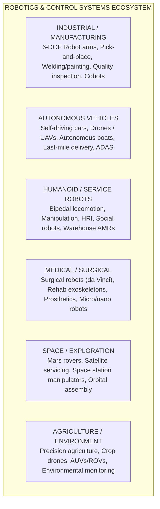
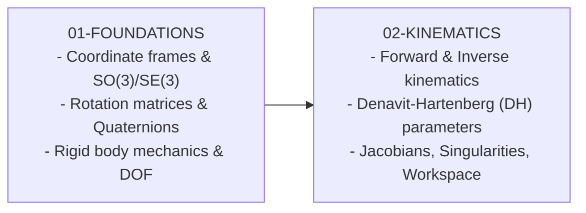
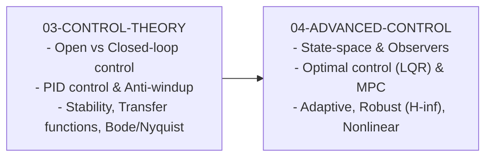
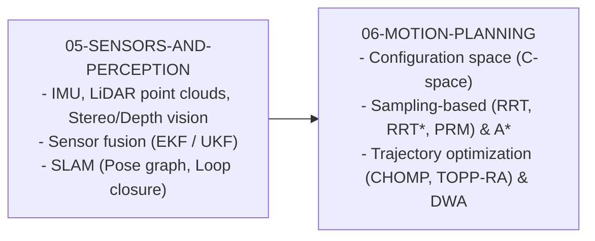
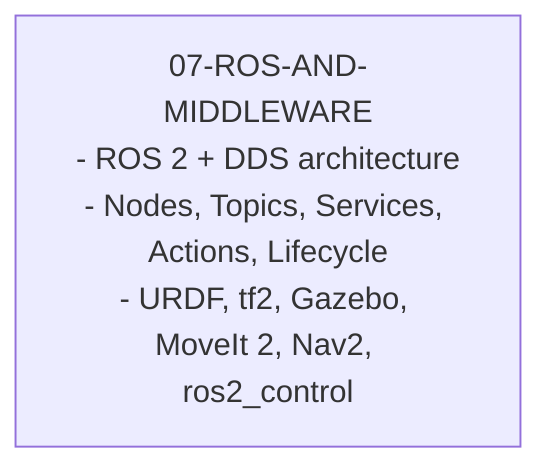
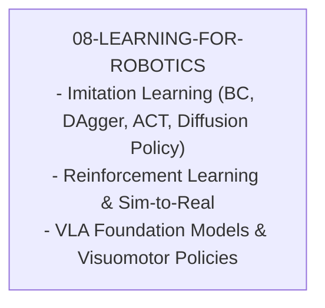
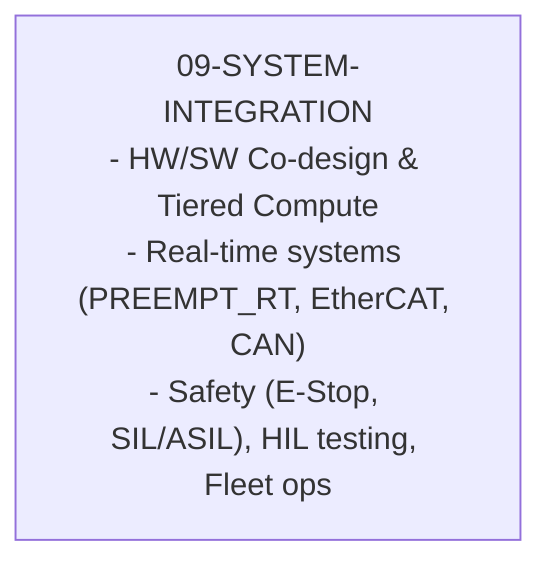

# Robotics & Control Systems: From Zero to Expert

## Why This Guide Exists

Robotics sits at the intersection of mechanical engineering, electrical engineering, and computer science. It is one of the few fields where software directly interacts with the physical world -- where a bug does not just crash a program but can crash a robot into a wall. This guide takes you from having zero robotics experience to understanding and building production-grade robotic systems that perceive, plan, and act in the real world.

---

## The Robotics Landscape

---

## Learning Path Overview

### Phase 1: Foundations (Chapters 01-02)

**Goal**: Understand the mathematical and physical foundations that underpin all robotic systems.

You cannot build a robot without understanding:

- **How** to represent position and orientation in 3D space
- **What** kinematics means and why inverse kinematics is hard
- **Why** singularities cause robots to lose control
- **How** the Jacobian maps joint velocities to end-effector velocities

### Phase 2: Control Theory (Chapters 03-04)

**Goal**: Learn to make robots move precisely where you want them, when you want them.

Control theory is the beating heart of robotics:

- **PID** is the most widely used controller in industry (90%+ of all control loops)
- **MPC** is behind every modern self-driving car
- **LQR** balances performance vs. control effort optimally
- **Stability** analysis tells you if your robot will oscillate or diverge

### Phase 3: Perception & Planning (Chapters 05-06)

**Goal**: Give robots the ability to perceive the world and plan actions.

### Phase 4: Software & Middleware (Chapter 07)

**Goal**: Master the software frameworks that tie robotic systems together.

### Phase 5: Intelligence & Learning (Chapter 08)

**Goal**: Apply machine learning to make robots smarter and more adaptive.

### Phase 6: System Integration (Chapter 09)

**Goal**: Put it all together to build complete robotic systems.

---

## How to Use This Guide

Each chapter follows a consistent structure:

1. **Conceptual Foundation** -- What is it and why does it matter?
2. **Mathematical Framework** -- The equations you need (with intuition)
3. **Implementation** -- Working code in Python / C++ / ROS 2
4. **Interview Questions** -- What you will be asked about this topic
5. **Exercises** -- Problems to solidify your understanding

The guide is designed for software engineers transitioning into robotics. We assume strong programming skills but zero robotics background. Each chapter builds on the previous one, so work through them in order.
