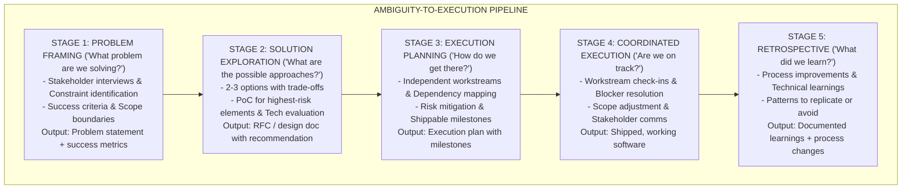
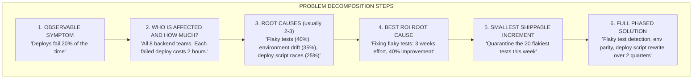
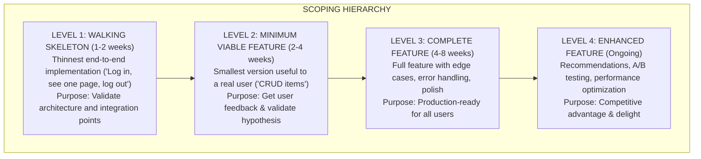
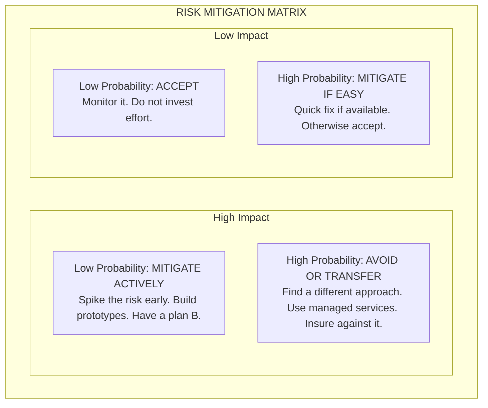
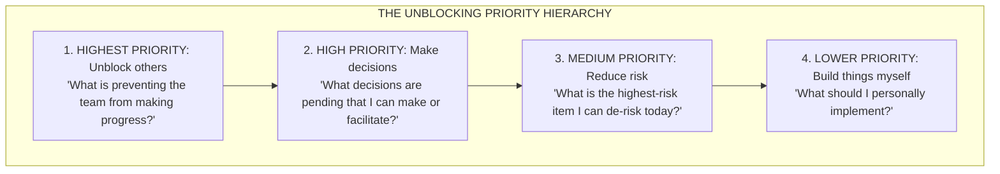
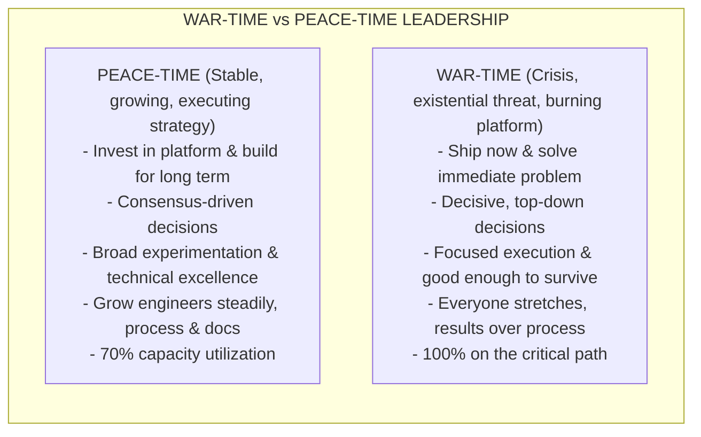

# Execution & Delivery

[Back to Overview](./00-README.md)

---

## What Interviewers Are Looking For

Execution at Staff+ level is fundamentally different from execution at senior level. Seniors execute well-defined tasks. Staff+ engineers take ambiguous, cross-team challenges and turn them into shipped outcomes. The execution surface area is organizational, not individual.

Interviewers assess whether you can:

- **Break down ambiguous problems** into tractable workstreams
- **Scope projects** to deliver incremental value, not big-bang releases
- **Manage technical risk** without being paralyzed by it
- **Estimate and manage scope** rather than time
- **Coordinate parallel workstreams** across teams
- **Unblock others** as a primary function of your role
- **Know when to cut scope** and when to push through
- **Operate differently in crisis vs steady-state** (war-time vs peace-time)

### Level Expectations

| Level          | Execution Signal                                                                                                                        |
| -------------- | --------------------------------------------------------------------------------------------------------------------------------------- |
| L5 (Senior)    | Breaks down features into tasks. Manages their own work. Delivers on time. Flags risks early.                                           |
| L6 (Staff)     | Scopes multi-team projects. Manages execution across 2-4 teams. Unblocks other engineers. Makes scope trade-offs with product.          |
| L7 (Principal) | Drives multi-quarter, multi-org programs. Makes judgment calls that carry enormous risk. Defines the execution framework others follow. |

---

## Framework: The Ambiguity-to-Execution Pipeline

Staff+ engineers are valued for their ability to take something vague and make it concrete. This pipeline describes the stages of turning ambiguity into delivery.



**Key insight:** Most execution failures happen in Stages 1-3, not Stage 4. Poor scoping, unclear success criteria, and missing risk identification cause more project failures than poor implementation.

---

## Breaking Down Ambiguous Problems

The signature skill of a Staff+ engineer. When the problem is "our systems are not reliable enough" or "we need to improve developer velocity," you need a systematic approach.

### The Decomposition Framework



### Ambiguity Reduction Techniques

| Technique                 | When to Use                                          | How It Works                                                                                     |
| ------------------------- | ---------------------------------------------------- | ------------------------------------------------------------------------------------------------ |
| **Constraint mapping**    | Problem has many possible solutions                  | List all constraints (time, money, people, technology, politics). Constraints eliminate options. |
| **User journey mapping**  | Problem is user-facing                               | Walk through the user's experience step by step. Where does it break down?                       |
| **Data gathering sprint** | Nobody agrees on the problem                         | Spend 1-2 weeks instrumenting and measuring before proposing solutions.                          |
| **Stakeholder alignment** | Multiple teams have different definitions of success | Interview all stakeholders. Write a shared problem statement. Get explicit agreement.            |
| **Timeboxed spike**       | Highest-risk element is unclear                      | Spend 1 week building a proof-of-concept for the riskiest part. Learn before committing.         |

---

## Scoping Projects for Incremental Delivery

Big-bang releases fail. The Staff+ skill is structuring work so that every increment ships value.

### The Scoping Hierarchy



**Rule:** Always know which level you are targeting. If the timeline is under pressure, cut from Level 4 toward Level 2. Never cut below the Walking Skeleton -- if you cannot ship end-to-end, you have not de-risked the architecture.

### Scope Negotiation with Product

Staff+ engineers negotiate scope, not timelines. This is a critical distinction.

| Instead Of                     | Say                                                                                                                                                                                  |
| ------------------------------ | ------------------------------------------------------------------------------------------------------------------------------------------------------------------------------------ |
| "We cannot do this in 6 weeks" | "In 6 weeks, here is what we can deliver. The remaining items would take an additional 4 weeks. Which items are most important to include?"                                          |
| "This will take 3 months"      | "I see three levels of scope. Level 1 ships in 3 weeks and gives us X. Level 2 ships in 6 weeks with Y. Level 3 is the full vision at 12 weeks. Which level should we target first?" |
| "We need more time"            | "We are on track for the core functionality. The risk items are A and B. I recommend cutting C to create a buffer. Here is the impact of cutting C."                                 |

---

## Managing Technical Risk

Risk management at Staff+ level is not about avoiding risk -- it is about identifying, quantifying, and mitigating risk so the organization can move fast with confidence.

### Risk Identification Framework

| Risk Category   | Questions to Ask                                                 | Example                                                                                      |
| --------------- | ---------------------------------------------------------------- | -------------------------------------------------------------------------------------------- |
| **Technical**   | What is the hardest technical problem? Have we solved it before? | "We have never built a real-time sync engine. The consistency model is unclear."             |
| **Integration** | What external dependencies do we have? What if they change?      | "This depends on the payments team shipping their API by week 4."                            |
| **Scale**       | Will this work at 10x current load? Where will it break?         | "The current design works for 1M users but not 10M."                                         |
| **People**      | Do we have the right skills? What if someone leaves?             | "Only one person understands the legacy system we are migrating from."                       |
| **Timeline**    | What is the critical path? What has no slack?                    | "If the database migration slips by 1 week, everything downstream shifts."                   |
| **Scope**       | Are requirements stable? Is there a risk of scope creep?         | "The PM has changed requirements twice. The third change could invalidate our architecture." |

### Risk Mitigation Strategies



### The Risk Register

Maintain a living document of identified risks for any multi-team project.

| Risk                                           | Probability | Impact | Mitigation                                                  | Owner         | Status     |
| ---------------------------------------------- | ----------- | ------ | ----------------------------------------------------------- | ------------- | ---------- |
| Database migration takes longer than estimated | High        | High   | Run parallel systems. Feature flag new writes.              | @you          | Active     |
| Partner API is not ready on time               | Medium      | High   | Build a mock service. Define contract early.                | @partner_lead | Monitoring |
| Key engineer leaves mid-project                | Low         | High   | Document all architecture decisions. Pair on critical work. | @you          | Accepted   |

---

## Parallel Workstreams and Coordination

Staff+ projects almost always involve multiple teams working in parallel. The coordination overhead is where most large projects fail.

### Workstream Design Principles

1. **Minimize dependencies between streams.** Each stream should be shippable independently.
2. **Define interfaces early.** Agreement on API contracts, data formats, and event schemas before implementation starts.
3. **One owner per stream.** Clear accountability, no ambiguity.
4. **Regular integration points.** Weekly integration testing or demo, not just at the end.
5. **Explicit escalation path.** When streams are blocked on each other, there must be a clear process to resolve.

### Coordination Cadence

| Meeting                | Frequency    | Purpose                                   | Attendees                    |
| ---------------------- | ------------ | ----------------------------------------- | ---------------------------- |
| **Stream standup**     | Daily        | Each stream's progress and blockers       | Stream members               |
| **Cross-stream sync**  | Twice weekly | Integration issues, dependency management | Stream leads + you           |
| **Stakeholder update** | Weekly       | Progress, risks, scope decisions          | Product, eng leadership, you |
| **Demo / integration** | Weekly       | End-to-end working software               | Everyone                     |
| **Risk review**        | Bi-weekly    | Update risk register, adjust mitigations  | Stream leads + you           |

---

## Unblocking Others

At Staff+ level, one of your most valuable activities is removing obstacles that prevent other engineers from making progress. This is not glamorous work, but it has enormous leverage.

### Types of Blockers and How to Remove Them

| Blocker Type              | Example                                                         | How to Unblock                                                                                                  |
| ------------------------- | --------------------------------------------------------------- | --------------------------------------------------------------------------------------------------------------- |
| **Technical uncertainty** | "I do not know how to design the caching layer"                 | Pair with them. Point to examples. Make the first design decision together.                                     |
| **Cross-team dependency** | "We are waiting on the auth team to expose an API"              | Talk to the auth team's lead directly. Define the interface together. Offer to build a mock.                    |
| **Decision paralysis**    | "We have been debating two approaches for a week"               | Facilitate a time-boxed decision meeting. Set criteria. Make the call if consensus fails.                       |
| **Process overhead**      | "The approval process for infrastructure changes takes 2 weeks" | Understand the process. Identify the bottleneck. Propose streamlining or get exceptions for your project.       |
| **Knowledge gap**         | "Nobody on the team has worked with Kafka"                      | Find someone in the org who has. Arrange a knowledge transfer session. Or spike it yourself and teach the team. |
| **Political blocker**     | "The platform team does not want to support our use case"       | Understand their concerns. Find a compromise. Escalate with data if needed.                                     |

### The Unblocking Mindset



**Key insight:** If you, as a Staff+ engineer, are heads-down coding all day, you are probably not operating at the right level. Your time is better spent ensuring 5 other engineers are productive than adding one more person to the building effort.

---

## Knowing When to Cut Scope

Cutting scope is not failure -- it is judgment. The best Staff+ engineers are decisive about what to cut and when.

### Scope Cutting Decision Framework

| Signal                                                                  | Action                                                                           |
| ----------------------------------------------------------------------- | -------------------------------------------------------------------------------- |
| Feature X is nice-to-have and timeline is tight                         | Cut it. Ship without it. Add it in the next iteration.                           |
| Requirement Y has unclear user value                                    | Validate with 3 users before building. If you cannot validate quickly, cut it.   |
| Technical approach Z is taking 3x longer than estimated                 | Step back. Is there a simpler approach? Can we use an existing solution for now? |
| Edge case handling covers 5% of users but takes 30% of development time | Ship the 95% case. Handle the 5% manually or in a follow-up.                     |
| Two teams disagree on a shared interface                                | Ship the simpler version. Iterate based on real usage data.                      |

### What to NEVER Cut

| Never Cut                             | Why                                                             |
| ------------------------------------- | --------------------------------------------------------------- |
| **Error handling for critical paths** | Silent failures in production are worse than missing features   |
| **Security for user data**            | The cost of a breach far exceeds the cost of delay              |
| **Basic observability**               | If you cannot monitor it, you cannot operate it                 |
| **Rollback capability**               | If you cannot undo a deployment, every deploy is a one-way door |
| **Core data integrity**               | Corrupted data is often unrecoverable                           |

---

## War-Time vs Peace-Time Engineering Leadership

Staff+ engineers need to operate differently depending on the organizational context.



### Recognizing War-Time

| Signal                                      | What It Means                                    |
| ------------------------------------------- | ------------------------------------------------ |
| Company has less than 12 months of runway   | Survival mode. Ship revenue-generating features. |
| Major customer threatening to leave         | All hands on the customer's blockers.            |
| Competitor just launched your roadmap       | Accelerate. Cut scope ruthlessly. Ship faster.   |
| Critical system is failing daily            | Reliability before features. Full stop.          |
| Recently acquired / major leadership change | Prove value quickly. Results over process.       |

### The Transition Back to Peace-Time

The hardest part: knowing when war-time is over and shifting back to sustainable practices. War-time practices sustained too long create massive technical debt and burn out teams. Staff+ engineers must advocate for the transition.

**Signal:** "We have stabilized the immediate crisis. Now we need to invest in the foundations that prevent the next one."

---

## Interview Questions & Strong Answers

### Q1: "Tell me about a project that was at risk of failing. What did you do?"

**Strong Answer (L6 Signal):**

**Situation:** "I was leading the technical execution of a billing system migration -- moving from a legacy in-house system to Stripe. The project involved 4 teams, had a hard deadline driven by a regulatory requirement, and was halfway through its 4-month timeline. At the midpoint review, we discovered three critical issues: the data migration was 3 weeks behind schedule because of data quality problems in the legacy system, the integration tests were failing 40% of the time due to Stripe sandbox limitations, and one of the two backend teams had been pulled to work on an urgent customer escalation."

**Task:** "As the technical lead of the migration, I needed to get the project back on track within the remaining 8 weeks or we would miss a regulatory deadline that would cost us $500K in penalties and block our European expansion."

**Action:** "I spent the first day doing a full reassessment. I mapped every remaining task, identified the true critical path, and categorized everything as must-have, should-have, or nice-to-have.

For the data migration, I discovered we were trying to migrate all historical data in a single pass. I changed the strategy: migrate only the last 12 months of active billing data for the deadline, and backfill historical data in a follow-up phase. This reduced the data migration scope by 70% and eliminated most of the data quality issues because recent data was cleaner.

For the integration tests, I proposed replacing the Stripe sandbox with a local mock server for CI/CD, keeping the real sandbox only for manual acceptance testing. I paired with the testing engineer for two days to build the mock server. This got test reliability to 98%.

For the lost team, I could not get them back. Instead, I reassigned their critical-path work to engineers from the other teams and deferred their non-critical work. I had to make a difficult scope cut: we dropped automatic retry logic for failed payments and planned to handle retries manually for the first month post-launch.

I communicated all of these changes to the product director, the regulatory team, and all four engineering leads in a single meeting. I was transparent about what we were cutting and why, and I got explicit agreement on the trade-offs.

I also introduced twice-weekly risk reviews for the remaining 8 weeks, where each workstream lead reported on their top risk and we addressed it in the meeting rather than letting it fester."

**Result:** "We shipped the billing migration 3 days before the regulatory deadline. The manual retry handling worked for the first month and only affected 0.3% of transactions. We automated retries in the follow-up phase. The regulatory team was satisfied, and we launched in Europe on schedule. The project retrospective identified that the midpoint assessment saved the project -- without it, we would have missed the deadline by at least 3 weeks."

---

### Q2: "How do you handle a project where the requirements keep changing?"

**Strong Answer:**

**Situation:** "I was leading the architecture for a new search feature. Over the first three weeks, the product manager changed the requirements significantly twice: first from a simple keyword search to faceted search, then adding real-time indexing as a requirement."

**Task:** "I needed to deliver a reliable search feature while managing the risk of further requirement changes."

**Action:** "After the second change, I scheduled a 1:1 with the PM. My goal was not to complain about changing requirements -- requirements change for good reasons -- but to align on a process that worked for both of us.

I proposed a tiered approach. We would agree on Tier 1 requirements (the absolute minimum that must ship) and lock them. Tier 2 requirements could change until a specific date, two weeks before the deadline. Tier 3 requirements were explicitly planned for the next iteration.

I also designed the search architecture with changeability in mind. I used an abstraction layer over the search engine so that whether we used Elasticsearch, OpenSearch, or a simpler solution, the application code would not change. This meant that even if the PM added more requirements, the core architecture could accommodate them.

The PM appreciated the tiered approach because it gave her flexibility to adjust while giving me a stable foundation to build on. We agreed to a weekly scope review where she could propose Tier 2 changes and I would assess the impact.

In practice, there was one more Tier 2 change (adding geolocation to the search), which the abstraction layer handled with 2 days of additional work instead of the week it would have taken without the flexible architecture."

**Result:** "We shipped on time with all Tier 1 and Tier 2 requirements met. The architecture proved its value again when we added ML-based ranking six months later -- the search abstraction layer meant we could swap the ranking algorithm without touching application code. The PM later adopted the tiered scope approach for other projects."

---

### Q3: "How do you coordinate execution across multiple teams?"

**Strong Answer:**

"My approach has three pillars: interfaces first, independent streams, and regular integration.

Interfaces first means that before any team writes a line of code, we agree on the API contracts, data formats, and event schemas that connect the workstreams. I facilitate a half-day session where stream leads co-design these interfaces. We document them as versioned contracts, and any change to the interface requires agreement from all affected streams.

Independent streams means I structure the work so each team can make progress without waiting on other teams. This requires careful dependency analysis upfront. Where dependencies are unavoidable, I identify them early and build mocks or stubs so teams can develop against the agreed interface without the real dependency.

Regular integration means we do not wait until the end to discover integration problems. I set up a weekly integration demo where we connect the workstreams and test end-to-end. These demos surface problems when they are small and fixable, not large and catastrophic.

My role in all of this is not to manage the teams -- they have their own leads. My role is to manage the interfaces, resolve cross-team blockers, escalate when needed, and maintain the overall picture of where we are versus where we need to be."

---

## Anti-patterns to Avoid

| Anti-pattern                   | Why It Fails                                            | What to Do Instead                                                                     |
| ------------------------------ | ------------------------------------------------------- | -------------------------------------------------------------------------------------- |
| **Big-bang delivery**          | Everything ships at once, nothing works                 | Deliver incrementally. Ship a walking skeleton first.                                  |
| **Time estimation**            | Asking "how long will this take?" sets up failure       | Manage scope, not time. "What can we ship in 6 weeks?"                                 |
| **Hero mode**                  | One person works 80 hours to save the project           | Sustainable pace. If the project requires heroics, the plan was wrong.                 |
| **Scope creep acceptance**     | Saying yes to every new requirement                     | Scope tiers. Lock Tier 1. Negotiate Tier 2. Defer Tier 3.                              |
| **Ignoring the critical path** | Working on non-critical items while blockers persist    | Identify the critical path on day 1. Protect it ruthlessly.                            |
| **Consensus paralysis**        | Debating for weeks without deciding                     | Time-box decisions. "We will decide by Friday. If no consensus, I will make the call." |
| **Invisible progress**         | Teams working hard but stakeholders cannot see progress | Weekly demos. Stakeholder updates. Make progress visible.                              |
| **War-time forever**           | Crisis culture as the norm                              | Explicitly declare when war-time ends. Transition back to sustainable practices.       |

---

## Quick Reference Cheat Sheet

```
EXECUTION & DELIVERY CHECKLIST
================================

BREAKING DOWN AMBIGUITY:
[ ] Define the observable symptom
[ ] Identify who is affected and how much
[ ] Find root causes (usually 2-3)
[ ] Prioritize by ROI
[ ] Define the smallest shippable increment
[ ] Phase the full solution

SCOPING:
[ ] Walking skeleton (validate architecture) - 1-2 weeks
[ ] Minimum viable feature (validate hypothesis) - 2-4 weeks
[ ] Complete feature (production-ready) - 4-8 weeks
[ ] Enhanced feature (optimization) - ongoing
[ ] Negotiate scope with product, not timeline

RISK MANAGEMENT:
[ ] Identify risks across all categories (technical, integration,
    scale, people, timeline, scope)
[ ] Classify by probability x impact
[ ] Mitigate high-impact risks early (spikes, prototypes)
[ ] Maintain a living risk register
[ ] Review risks bi-weekly

PARALLEL WORKSTREAMS:
[ ] Define interfaces before implementation
[ ] Make streams independently shippable
[ ] One clear owner per stream
[ ] Weekly integration demo
[ ] Explicit escalation path for cross-stream blockers

UNBLOCKING:
[ ] Prioritize: unblock others > make decisions > reduce risk > build
[ ] For each blocker: identify type, take action, follow up
[ ] Track open blockers. Follow up daily on high-impact ones.

SCOPE CUTTING:
[ ] Cut nice-to-haves first
[ ] Never cut error handling, security, observability, or rollback
[ ] Get explicit agreement on what is cut and why
[ ] Document cut items for future iterations

WAR-TIME vs PEACE-TIME:
[ ] Recognize which mode you are in
[ ] Adjust leadership style accordingly
[ ] Advocate for returning to peace-time when the crisis is resolved
[ ] Pay down the debt accumulated during war-time

COMMUNICATION TEMPLATE (weekly stakeholder update):
1. Where we are vs the plan (on track / at risk / off track)
2. What shipped this week
3. Top risks and what we are doing about them
4. Decisions needed from stakeholders
5. Next week's priorities
```

---

[<- Mentoring & Growing Engineers](./04-MENTORING-GROWING-ENGINEERS.md) | [Next: Interview Formats & Prep ->](./06-INTERVIEW-FORMATS.md)
