# System Design Interview Framework

A comprehensive, actionable guide for tackling any system design interview.

---

## Table of Contents

1. [The 4-Step Framework](#the-4-step-framework)
2. [Step 1: Understand the Problem & Establish Design Scope](#step-1-understand-the-problem--establish-design-scope)
3. [Step 2: Propose High-Level Design](#step-2-propose-high-level-design)
4. [Step 3: Design Deep Dive](#step-3-design-deep-dive)
5. [Step 4: Wrap Up](#step-4-wrap-up)
6. [Back-of-the-Envelope Estimation](#back-of-the-envelope-estimation)
7. [Common Building Blocks](#common-building-blocks)
8. [CAP Theorem](#cap-theorem)
9. [Database Selection Guide](#database-selection-guide)
10. [Communication Protocols](#communication-protocols)
11. [Scoring Rubric](#scoring-rubric)
12. [Quick Reference Checklists](#quick-reference-checklists)

---

## The 4-Step Framework

Every system design interview, regardless of the question, can be approached with this
4-step framework. The total interview is typically 45-60 minutes.

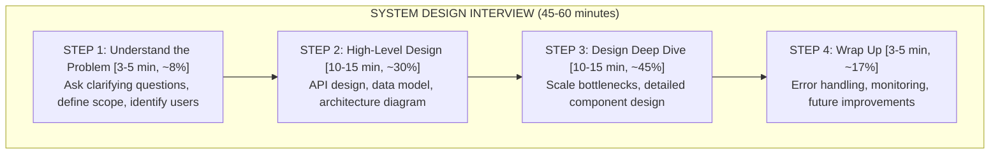

**Golden Rules:**

- Never jump straight to the solution. Always start with requirements.
- Communicate your thought process out loud at every step.
- Drive the conversation. The interviewer wants you to lead.
- There is no single correct answer. What matters is your reasoning.
- Trade-offs are the heart of system design. Acknowledge them explicitly.

---

## Step 1: Understand the Problem & Establish Design Scope

**Time Budget: 3-5 minutes**

This step is about demonstrating that you do not jump to solutions prematurely.
The biggest mistake candidates make is skipping this step.

### What to Do

1. **Restate the problem** in your own words to confirm understanding.
2. **Ask clarifying questions** about functional and non-functional requirements.
3. **Establish constraints** (scale, latency, availability, consistency).
4. **Define what is in and out of scope** for this interview.

### Questions to Ask

#### Functional Requirements

| Category | Example Questions |
|----------|-------------------|
| **Users** | Who are the users? Are there different user roles? |
| **Core Features** | What are the most important features to design? |
| **Input/Output** | What does the user input? What do they see? |
| **Existing Systems** | Are there existing services we can leverage? |
| **Edge Cases** | What happens if [unusual scenario]? |

#### Non-Functional Requirements

| Category | Example Questions |
|----------|-------------------|
| **Scale** | How many users? DAU/MAU? How many requests per second? |
| **Performance** | What is the expected latency? p50? p99? |
| **Availability** | What uptime is required? Is 99.9% sufficient? |
| **Consistency** | Is eventual consistency acceptable, or do we need strong consistency? |
| **Durability** | Can we afford to lose data? What is the data retention policy? |
| **Geography** | Are users in one region or globally distributed? |

#### Data Characteristics

| Category | Example Questions |
|----------|-------------------|
| **Volume** | How much data per day/month/year? |
| **Read/Write Ratio** | Is the system read-heavy or write-heavy? |
| **Data Shape** | What does a typical record look like? |
| **Access Patterns** | How is data queried? Hot vs cold data? |
| **Growth Rate** | How fast is data growing? |

### What to Write on the Whiteboard

Create a requirements box at the top of the board:

```
+------------------------------------------+
| REQUIREMENTS                             |
|                                          |
| Functional:                              |
| - Users can post short messages (280ch)  |
| - Users can follow other users           |
| - Home timeline shows followed posts     |
| - Search posts by keyword                |
|                                          |
| Non-Functional:                          |
| - 500M DAU                               |
| - Timeline load < 200ms                  |
| - Highly available (99.99%)              |
| - Eventual consistency is OK             |
| - Read-heavy (100:1 read/write)          |
|                                          |
| Out of Scope:                            |
| - Direct messages                        |
| - Media uploads                          |
| - Notifications                          |
+------------------------------------------+
```

### Example Dialogue

> **Interviewer:** Design a URL shortener like bit.ly.
>
> **You:** Great, let me make sure I understand the problem correctly. We need a
> service that takes a long URL and returns a short URL. When users visit the
> short URL, they are redirected to the original long URL. Is that right?
>
> **Interviewer:** Yes, exactly.
>
> **You:** Let me ask a few clarifying questions. First, what is the expected
> scale? How many URLs are shortened per day?
>
> **Interviewer:** About 100 million new URLs per day.
>
> **You:** Got it. And what is the read-to-write ratio? I imagine many more
> people click on short URLs than create them.
>
> **Interviewer:** Yes, roughly 10:1 read to write.
>
> **You:** Should the short URL be customizable, or is an auto-generated one
> sufficient?
>
> **Interviewer:** Auto-generated is fine for now.
>
> **You:** What about the length of the short URL? And should URLs expire?
>
> **Interviewer:** Keep it as short as possible. Let's say URLs expire after 5 years
> by default.
>
> **You:** OK, let me also confirm the non-functional requirements. We need high
> availability since this is a redirection service - if it goes down, all short
> links break. Latency should be very low for redirects. And I assume eventual
> consistency is acceptable?
>
> **Interviewer:** Yes, that all sounds right.
>
> **You:** Perfect. Let me summarize what we are building...

### Common Mistakes

- **Jumping to the solution** without asking any questions.
- **Asking too many questions** and spending 10+ minutes before designing.
- **Not confirming scale** - this changes the entire design.
- **Ignoring non-functional requirements** - this is what separates junior from senior.
- **Being too passive** - waiting for the interviewer to tell you what to do.

---

## Step 2: Propose High-Level Design

**Time Budget: 10-15 minutes**

This is where you lay out the overall architecture. Start simple and iterate.

### What to Do

1. **Define the API** - what endpoints or interfaces does the system expose?
2. **Define the data model** - what are the core entities and relationships?
3. **Draw the high-level architecture** - boxes and arrows showing major components.
4. **Walk through a key use case** end-to-end using the diagram.
5. **Get buy-in** from the interviewer before going deeper.

### API Design

Always start with the API because it forces you to think about the system from
the user's perspective.

```
API DESIGN (URL Shortener)
==========================

POST /api/v1/urls
  Request:  { "long_url": "https://example.com/very/long/path" }
  Response: { "short_url": "https://tny.im/abc123", "expires_at": "2031-01-01" }
  Status:   201 Created

GET /{short_code}
  Response: 301 Redirect to long_url
  Headers:  Location: https://example.com/very/long/path

GET /api/v1/urls/{short_code}/stats
  Response: { "clicks": 1234, "created_at": "...", "long_url": "..." }
  Status:   200 OK

DELETE /api/v1/urls/{short_code}
  Status:   204 No Content
```

**API Design Tips:**
- Use RESTful conventions or mention if you prefer GraphQL/gRPC and why.
- Include versioning (v1) from the start.
- Think about authentication and rate limiting.
- Mention pagination for list endpoints.
- Consider idempotency for write operations.

### Data Model

Define your core entities and their relationships:

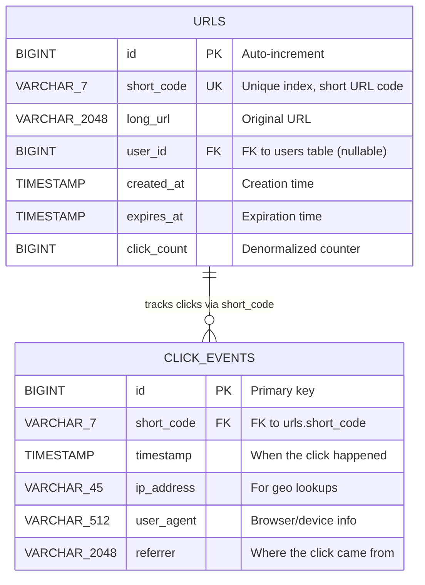

### High-Level Architecture Diagram

Draw the architecture as boxes and arrows. Start simple:

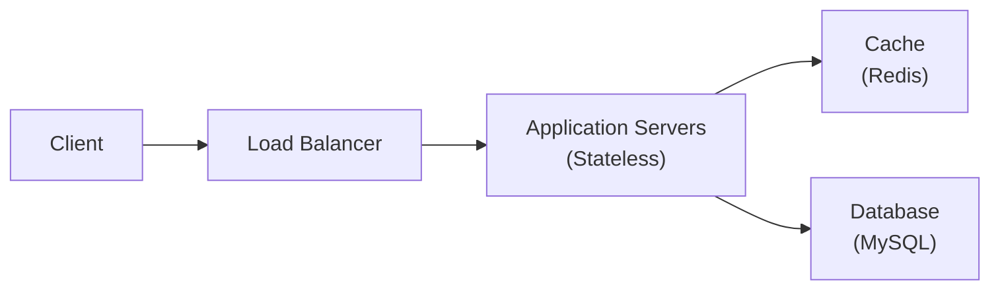

Then iterate and add more detail:

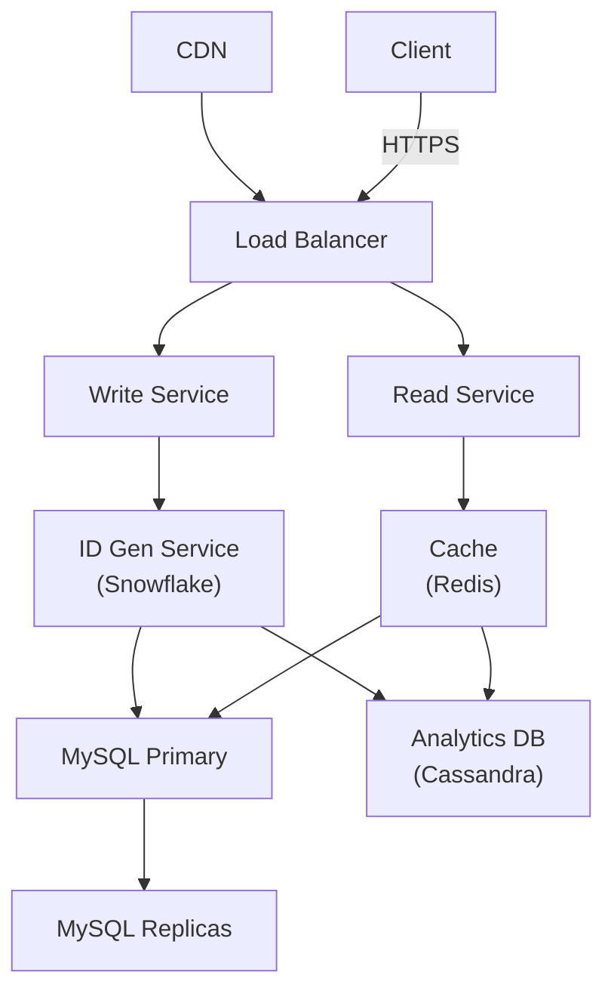

### Walking Through a Use Case

Always walk the interviewer through at least one key flow:

> **You:** Let me walk through the URL creation flow:
>
> 1. The client sends a POST request to `/api/v1/urls` with the long URL.
> 2. The request hits our load balancer and is routed to a Write Service instance.
> 3. The Write Service calls the ID Generation Service to get a unique short code.
> 4. We store the mapping (short_code -> long_url) in MySQL.
> 5. We also populate the Redis cache with this mapping.
> 6. We return the short URL to the client.
>
> Now for the redirect flow:
>
> 1. The client visits `https://tny.im/abc123`.
> 2. The request hits the load balancer and is routed to a Read Service instance.
> 3. The Read Service first checks the Redis cache for the short code.
> 4. If found (cache hit), we return a 301 redirect immediately.
> 5. If not found (cache miss), we query MySQL, cache the result, and redirect.
> 6. We asynchronously log the click event for analytics.

### Getting Interviewer Buy-In

Before moving to the deep dive, always check:

> **You:** Does this high-level design look reasonable? Is there any component
> you would like me to dive deeper into, or should I focus on [the area
> I think is most interesting/challenging]?

This is collaborative. Let the interviewer guide the deep dive.

### Common Mistakes

- **Over-engineering from the start** - start simple, then add complexity.
- **No API design** - jumping straight to architecture boxes.
- **No data model** - the schema reveals your understanding of the domain.
- **Drawing without explaining** - always narrate as you draw.
- **Monolithic diagram** - break complex systems into read/write paths.
- **Not walking through a use case** - the diagram alone is not enough.

---

## Step 3: Design Deep Dive

**Time Budget: 10-15 minutes**

This is where you demonstrate depth. The interviewer will typically guide you to
1-2 areas that they want to explore. If not, pick the most challenging or
interesting aspects.

### What to Do

1. **Identify bottlenecks** in your high-level design.
2. **Deep dive into 2-3 components** with detailed design.
3. **Discuss trade-offs** explicitly for every decision.
4. **Handle failure scenarios** and edge cases.
5. **Show scaling strategies** for the identified bottlenecks.

### Common Deep Dive Topics

#### Scaling the Database

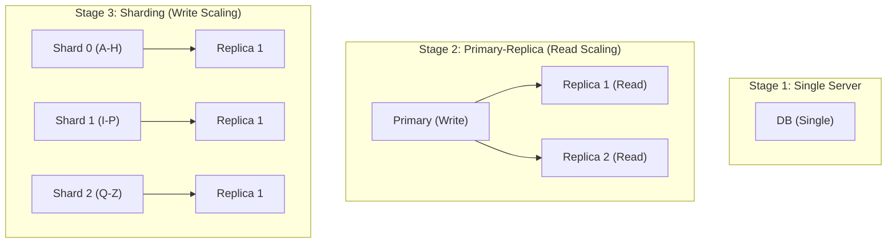

#### Caching Strategy

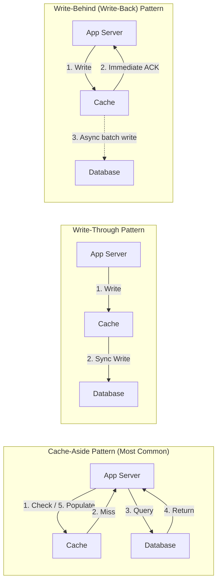

#### Rate Limiting

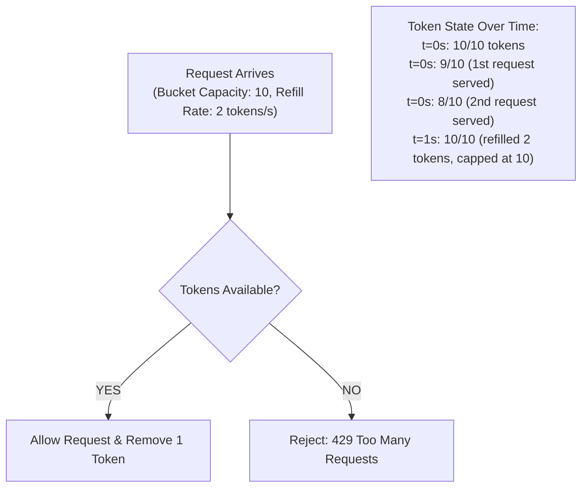

#### Unique ID Generation

| Approach | Pros | Cons | Use When |
|----------|------|------|----------|
| **UUID** | No coordination needed, simple | 128 bits (large), not sortable | IDs do not need to be short or ordered |
| **Auto-Increment** | Simple, sortable | Single point of failure, not distributed | Single database, low scale |
| **Snowflake ID** | Sortable, 64-bit, distributed | Requires clock synchronization | High-scale distributed systems |
| **TSID** | Like Snowflake but simpler | Same clock dependency | Modern alternative to Snowflake |
| **Zookeeper/etcd** | Strong consistency | Additional infrastructure, slower | When strong ordering guarantees needed |

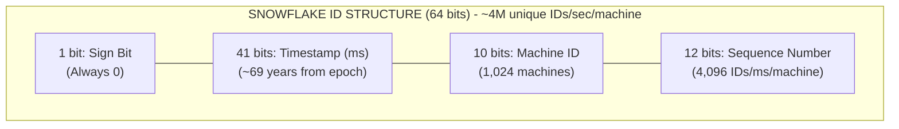

#### Consistent Hashing

```
CONSISTENT HASHING
==================

Traditional hashing problem:
  hash(key) % N   -->  When N changes, most keys remap!

Consistent hashing solution:
  Only K/N keys remap when a node is added/removed.

           Node A
            /\
           /  \
          /    \
    Node D      Node B
          \    /
           \  /
            \/
           Node C

Hash Ring:
    0 -------- Node A -------- Node B --------+
    |                                          |
    |                                          |
    +--- Node D -------- Node C ---------------+

    Key "user_123" hashes to position X on the ring.
    Walk clockwise to find the first node -> that node owns the key.

Virtual Nodes (solve hotspot problem):
    Each physical node maps to multiple virtual positions on the ring.

    Physical Node A  -->  A-1, A-2, A-3 (3 virtual nodes on ring)
    Physical Node B  -->  B-1, B-2, B-3

    0 -- A-1 -- B-2 -- A-3 -- B-1 -- A-2 -- B-3 --+
    |                                                |
    +------------------------------------------------+

    More virtual nodes = more uniform distribution.
    Typical: 100-200 virtual nodes per physical node.
```

### Discussing Trade-Offs

For every design decision, use this template:

> **You:** There is a trade-off here. We could use [Option A] or [Option B].
>
> Option A gives us [advantage], but the downside is [disadvantage].
> Option B gives us [advantage], but the downside is [disadvantage].
>
> Given our requirements of [requirement], I would go with [chosen option]
> because [reasoning].

**Example:**

> **You:** For caching, we could use cache-aside or write-through.
>
> Cache-aside is simpler and only caches data that is actually read, but it
> means the first read after a write will be a cache miss. Write-through
> ensures the cache is always in sync, but it adds write latency and caches
> data that might never be read.
>
> Given that our system is read-heavy with a 100:1 read-write ratio, and we
> can tolerate slightly stale data, I would go with cache-aside. The cache
> will naturally warm up with popular URLs.

### Handling Failures

Always address at least one failure scenario:

```
FAILURE SCENARIOS TO DISCUSS
=============================

1. Server crashes
   - Stateless services: Load balancer routes to healthy instances
   - Stateful services: Leader election, failover

2. Database failures
   - Primary down: Promote replica to primary
   - Replica down: Remove from read pool, remaining replicas handle load

3. Cache failures
   - Redis down: Fall back to database (increased latency)
   - Cache stampede: Use locking or request coalescing

4. Network partitions
   - Between services: Retry with exponential backoff, circuit breaker
   - Between data centers: CAP theorem applies

5. Data corruption
   - Checksums on stored data
   - Regular backup and verification
   - Point-in-time recovery

6. Cascading failures
   - Circuit breaker pattern
   - Bulkhead pattern (isolate resources)
   - Graceful degradation
```

### Common Mistakes

- **Going too broad** instead of deep on 1-2 topics.
- **Not discussing trade-offs** - just picking a technology without justification.
- **Ignoring failure modes** - real systems fail all the time.
- **Over-focusing on one technology** you know well instead of addressing the actual bottleneck.
- **Not quantifying** - use back-of-envelope math to support your decisions.

---

## Step 4: Wrap Up

**Time Budget: 3-5 minutes**

This step is often rushed or skipped, but it is your chance to show maturity.

### What to Do

1. **Summarize** the design briefly.
2. **Identify remaining bottlenecks** and how you would address them.
3. **Discuss operational concerns** (monitoring, alerting, deployment).
4. **Suggest future improvements** that are out of scope.
5. **Answer any remaining interviewer questions.**

### Operational Concerns Checklist

```
OPERATIONAL CHECKLIST
=====================

Monitoring & Observability:
  [ ] Metrics: latency (p50, p95, p99), throughput, error rate
  [ ] Logging: structured logs, correlation IDs, log aggregation
  [ ] Tracing: distributed tracing (Jaeger, Zipkin)
  [ ] Dashboards: real-time system health visualization
  [ ] Alerts: on-call rotation, escalation policies

Deployment:
  [ ] CI/CD pipeline
  [ ] Blue-green or canary deployments
  [ ] Feature flags for gradual rollout
  [ ] Rollback strategy

Security:
  [ ] Authentication and authorization
  [ ] Rate limiting per user/IP
  [ ] Input validation and sanitization
  [ ] Encryption at rest and in transit
  [ ] DDoS protection

Data Management:
  [ ] Backup strategy (frequency, retention)
  [ ] Disaster recovery plan (RPO, RTO)
  [ ] Data archival for old/cold data
  [ ] GDPR/compliance considerations
```

### Example Wrap-Up Dialogue

> **You:** Let me summarize what we have designed. We built a URL shortener
> that handles 100 million new URLs per day and 1 billion redirects per day.
> The system uses a write service with Snowflake-based ID generation for
> creating short URLs, and a read service backed by Redis caching for fast
> redirects.
>
> If I had more time, I would focus on:
>
> 1. **Analytics pipeline** - Using Kafka to stream click events to a
>    data warehouse for real-time analytics.
> 2. **Geo-distribution** - Deploying read replicas and cache nodes in
>    multiple regions to reduce latency globally.
> 3. **Abuse prevention** - Adding URL scanning for malware and phishing
>    before allowing URL creation.
> 4. **Monitoring** - Setting up dashboards for redirect latency, cache
>    hit ratio, database replication lag, and error rates.

### Common Mistakes

- **Not summarizing** - the interviewer may have lost track of the design.
- **Not mentioning monitoring** - production systems need observability.
- **Being defensive** about design choices instead of acknowledging trade-offs.
- **Not having future improvements ready** - this shows long-term thinking.

---

## Back-of-the-Envelope Estimation

Estimation is a critical skill. You will be asked to estimate capacity
requirements before designing the system.

### Powers of 2

| Power | Exact Value | Approximate | Common Name |
|------:|------------:|------------:|-------------|
| 10 | 1,024 | 1 Thousand | 1 KB |
| 20 | 1,048,576 | 1 Million | 1 MB |
| 30 | 1,073,741,824 | 1 Billion | 1 GB |
| 40 | 1,099,511,627,776 | 1 Trillion | 1 TB |
| 50 | ~1.13 x 10^15 | 1 Quadrillion | 1 PB |

### Useful Conversion Shortcuts

```
1 day   = 86,400 seconds    ~ 10^5 seconds (use 100,000 for easy math)
1 month = 2,592,000 seconds ~ 2.5 x 10^6 seconds
1 year  = 31,536,000 seconds ~ 3 x 10^7 seconds

Quick QPS trick:
  If you have X requests per day:
  QPS = X / 100,000 (approximately)
  Peak QPS = QPS x 2 (or x 3 for spiky traffic)
```

### Latency Numbers Every Programmer Should Know

```
LATENCY COMPARISON
==================

Operation                              Time          Notes
---------------------------------------------------------------------
L1 cache reference                     0.5 ns
Branch mispredict                      5 ns
L2 cache reference                     7 ns
Mutex lock/unlock                      25 ns
Main memory reference                  100 ns        RAM access
Compress 1K bytes with Zippy           3,000 ns      3 us
Send 1 KB over 1 Gbps network         10,000 ns     10 us
Read 4 KB randomly from SSD            150,000 ns    150 us
Read 1 MB sequentially from memory     250,000 ns    250 us
Round trip within same datacenter      500,000 ns    500 us    0.5 ms
Read 1 MB sequentially from SSD        1,000,000 ns  1 ms
HDD disk seek                          10,000,000 ns 10 ms
Read 1 MB sequentially from HDD        20,000,000 ns 20 ms
Send packet CA -> Netherlands -> CA     150,000,000 ns 150 ms
TLS handshake                          250,000,000 ns 250 ms  (rough)

VISUAL SCALE:
=============

1 ns   |
10 ns  |=
100 ns |==========
1 us   |==========|
10 us  |==========|=
100 us |==========|==========
1 ms   |==========|==========|
10 ms  |==========|==========|==========
100 ms |==========|==========|==========|==========

KEY TAKEAWAYS:
- Memory is fast (~100 ns), disk is slow (~10 ms for HDD)
- SSD is 10-100x faster than HDD for random reads
- Network within a datacenter is ~0.5 ms
- Cross-continent round trip is ~150 ms
- Avoid disk seeks and network round trips in hot paths
```

### Common QPS Calculations

```
QPS ESTIMATION TEMPLATE
========================

Given:
  DAU = Daily Active Users
  Actions per user per day = N
  Read:Write ratio = R:W

  Daily writes = DAU x N
  Write QPS = Daily writes / 86,400 (~100,000 for easy math)
  Peak Write QPS = Write QPS x 2 (or 3)
  Read QPS = Write QPS x R
  Peak Read QPS = Read QPS x 2 (or 3)


EXAMPLE: Twitter-like Service
==============================

Given:
  DAU = 300 million
  Average tweets per user per day = 2
  Read:Write = 100:1

  Daily writes = 300M x 2 = 600M tweets/day
  Write QPS = 600M / 100K = 6,000 QPS
  Peak Write QPS = 6,000 x 3 = 18,000 QPS
  Read QPS = 6,000 x 100 = 600,000 QPS
  Peak Read QPS = 600K x 3 = 1,800,000 QPS (1.8M)


EXAMPLE: URL Shortener
========================

Given:
  100 million new URLs per day
  Read:Write = 10:1

  Write QPS = 100M / 100K = 1,000 QPS
  Peak Write QPS = 1,000 x 2 = 2,000 QPS
  Read QPS = 1,000 x 10 = 10,000 QPS
  Peak Read QPS = 10,000 x 2 = 20,000 QPS
```

### Storage Estimation

```
STORAGE ESTIMATION TEMPLATE
============================

Step 1: Estimate average record size
  - Text fields: count characters x encoding size
  - IDs: 8 bytes (BIGINT) or 16 bytes (UUID)
  - Timestamps: 8 bytes
  - URLs: average 100-200 bytes
  - Overhead (indexes, metadata): +20-30%

Step 2: Calculate daily storage
  Daily storage = records_per_day x avg_record_size

Step 3: Project over time
  Yearly storage = daily_storage x 365
  5-year storage = yearly_storage x 5


EXAMPLE: URL Shortener
========================

Average URL record:
  short_code:  7 bytes
  long_url:    200 bytes (average)
  user_id:     8 bytes
  created_at:  8 bytes
  expires_at:  8 bytes
  click_count: 8 bytes
  --------------------------
  Total:       ~240 bytes
  With overhead: ~300 bytes

Daily: 100M x 300 bytes = 30 GB/day
Yearly: 30 GB x 365 = ~11 TB/year
5 years: 11 TB x 5 = ~55 TB

With replication (3x): 55 TB x 3 = ~165 TB
```

### Bandwidth Estimation

```
BANDWIDTH ESTIMATION TEMPLATE
===============================

Incoming bandwidth = Write QPS x average request size
Outgoing bandwidth = Read QPS x average response size


EXAMPLE: Image Hosting Service
================================

Write path:
  Write QPS = 100 requests/sec
  Average image = 500 KB
  Incoming = 100 x 500 KB = 50 MB/s

Read path:
  Read QPS = 10,000 requests/sec
  Average image = 500 KB
  Outgoing = 10,000 x 500 KB = 5 GB/s

  Note: This is why CDNs are essential for media-heavy services!


HANDY BANDWIDTH FACTS:
  1 Gbps = 125 MB/s
  10 Gbps = 1.25 GB/s
  A single server typically has 1-10 Gbps network
  A CDN can handle terabits per second across its edge nodes
```

### Number of Servers Estimation

```
SERVER ESTIMATION
==================

Assume:
  - A single application server handles ~10K-50K QPS (simple operations)
  - A single application server handles ~1K-5K QPS (complex operations)
  - Memory per server: 64-256 GB
  - Disk per server: 1-10 TB

  Number of servers = Peak QPS / QPS per server
  (Add buffer: multiply by 1.5-2x for redundancy)


EXAMPLE:
  Peak QPS = 100,000
  QPS per server = 10,000 (simple read operations)
  Servers needed = 100,000 / 10,000 = 10 servers
  With redundancy: 10 x 2 = 20 servers
```

---

## Common Building Blocks

These are the building blocks you will use in almost every system design.
Know them by heart.

### Load Balancer

```
LOAD BALANCER PATTERNS
======================

Layer 4 (Transport Layer):
  Routes based on IP + port
  Fast, but no content awareness
  Cannot do URL-based routing

Layer 7 (Application Layer):
  Routes based on HTTP headers, URL, cookies
  Slower, but more flexible
  Can do SSL termination, content-based routing


                    LAYER 7 LOAD BALANCER
                    =====================

    +--------+      +--------------+      +-----------+
    |        | ---->|              | ---->| /api/*    |
    | Client |      | Load         |      | API Svr   |
    |        |      | Balancer     |      +-----------+
    +--------+      | (Nginx/ALB)  |
                    |              | ---->+-----------+
                    |              |      | /static/* |
                    +--------------+      | CDN/Static|
                                          +-----------+

LOAD BALANCING ALGORITHMS:

1. Round Robin
   Server 1 -> Server 2 -> Server 3 -> Server 1 -> ...
   Simple, works when servers are identical

2. Weighted Round Robin
   Server 1 (w=3) -> Server 1 -> Server 1 -> Server 2 (w=1) -> ...
   When servers have different capacities

3. Least Connections
   Route to server with fewest active connections
   Good for long-lived connections (WebSockets)

4. IP Hash
   hash(client_IP) % num_servers
   Ensures same client always hits same server (session affinity)

5. Consistent Hashing
   Used for cache servers
   Minimizes redistribution when servers are added/removed
```

### Database Replication

```
PRIMARY-REPLICA REPLICATION
============================

Synchronous Replication:
  Primary waits for replica to acknowledge write before responding.
  + Strong consistency
  - Higher write latency
  - Write availability depends on replica health

         Write
    App ------> Primary
                  |
                  | sync replicate (wait for ACK)
                  |
                Replica 1 ---> ACK
                  |
    App <------ Primary (now responds to client)


Asynchronous Replication:
  Primary responds immediately, replicates in background.
  + Low write latency
  + Write availability not affected by replica health
  - Eventual consistency (replica lag)

         Write
    App ------> Primary ------> App (immediate response)
                  |
                  | async replicate (fire and forget)
                  |
                Replica 1 (may lag behind)


Semi-Synchronous:
  Wait for at least 1 replica to ACK, others are async.
  Good balance of consistency and performance.

    Primary --sync--> Replica 1 (must ACK)
       |
       +------async--> Replica 2 (best effort)
       +------async--> Replica 3 (best effort)
```

### Database Sharding

```
SHARDING STRATEGIES
===================

1. RANGE-BASED SHARDING
   Shard by ranges of the shard key.

   Shard 0: user_id 0 - 999,999
   Shard 1: user_id 1,000,000 - 1,999,999
   Shard 2: user_id 2,000,000 - 2,999,999

   + Simple to implement
   + Range queries within a shard are efficient
   - Can lead to hotspots (e.g., new users all go to last shard)
   - Uneven data distribution


2. HASH-BASED SHARDING
   shard_id = hash(shard_key) % num_shards

   + Even distribution
   + No hotspots (if hash is good)
   - Range queries require querying all shards (scatter-gather)
   - Adding/removing shards requires re-hashing (use consistent hashing)


3. DIRECTORY-BASED SHARDING
   A lookup service maps each key to its shard.

   +----------+      +-----------+      +---------+
   | App      | ---->| Directory | ---->| Shard N |
   | Server   |      | Service   |      |         |
   +----------+      +-----------+      +---------+

   + Flexible, can move data between shards
   + No constraints on shard key
   - Directory is a single point of failure
   - Additional network hop for every query


4. GEO-BASED SHARDING
   Shard by geographic region.

   Shard US: Users in North America
   Shard EU: Users in Europe
   Shard AP: Users in Asia-Pacific

   + Low latency for users (data is nearby)
   + Compliance with data residency laws
   - Cross-region queries are expensive
   - Uneven distribution (some regions have more users)


COMMON SHARD KEY SELECTION CRITERIA:
  - High cardinality (many unique values)
  - Even distribution across shards
  - Frequently used in queries (to avoid scatter-gather)
  - Immutable (changing shard key requires moving data)
```

### Caching Strategies

```
CACHING STRATEGIES COMPARISON
==============================

+------------------+-------------------+------------------+-----------------+
| Strategy         | Best For          | Consistency      | Complexity      |
+------------------+-------------------+------------------+-----------------+
| Cache-Aside      | Read-heavy, data  | Eventual (TTL)   | Low             |
| (Lazy Loading)   | that changes      |                  |                 |
|                  | infrequently      |                  |                 |
+------------------+-------------------+------------------+-----------------+
| Read-Through     | Read-heavy, want  | Eventual (TTL)   | Medium          |
|                  | transparent cache |                  | (cache manages  |
|                  |                   |                  |  DB reads)      |
+------------------+-------------------+------------------+-----------------+
| Write-Through    | Data that must    | Strong           | Medium          |
|                  | be consistent     | (sync writes)    |                 |
+------------------+-------------------+------------------+-----------------+
| Write-Behind     | Write-heavy       | Eventual         | High            |
| (Write-Back)     | workloads         | (async writes)   | (data loss risk)|
+------------------+-------------------+------------------+-----------------+
| Refresh-Ahead    | Predictable       | Strong-ish       | High            |
|                  | access patterns   | (proactive)      |                 |
+------------------+-------------------+------------------+-----------------+


CACHE EVICTION POLICIES:

  LRU (Least Recently Used)
    Evict the item that was accessed longest ago.
    Most commonly used. Good general-purpose policy.

  LFU (Least Frequently Used)
    Evict the item that was accessed least often.
    Good for stable access patterns. Slow to adapt to changes.

  FIFO (First In, First Out)
    Evict the oldest item regardless of access.
    Simple but often suboptimal.

  TTL (Time To Live)
    Items expire after a set duration.
    Often combined with LRU. Essential for consistency.


CACHE PROBLEMS AND SOLUTIONS:

  Cache Stampede (Thundering Herd):
    Problem: Popular key expires, 1000 requests all hit DB simultaneously.
    Solutions:
      - Mutex/lock: Only 1 request fetches from DB, others wait
      - Stale-while-revalidate: Serve stale data while refreshing
      - Probabilistic early expiration: Refresh before TTL expires

  Cache Penetration:
    Problem: Queries for data that does not exist bypass cache every time.
    Solutions:
      - Cache negative results (with short TTL)
      - Bloom filter: Check if key could exist before querying DB

  Hot Key:
    Problem: One key receives disproportionate traffic.
    Solutions:
      - Local cache on application servers (L1 cache)
      - Replicate hot key across multiple cache nodes
      - Add random suffix to split across shards
```

### Message Queues

```
MESSAGE QUEUE PATTERNS
======================

POINT-TO-POINT (Work Queue):
  Each message consumed by exactly one consumer.

    Producer --> [ Queue ] --> Consumer 1
                           --> Consumer 2 (load balanced)
                           --> Consumer 3

    Use case: Task distribution, job processing


PUBLISH-SUBSCRIBE (Pub/Sub):
  Each message delivered to all subscribers.

    Producer --> [ Topic ] --> Subscriber 1 (gets all messages)
                           --> Subscriber 2 (gets all messages)
                           --> Subscriber 3 (gets all messages)

    Use case: Event broadcasting, notifications


WHEN TO USE A MESSAGE QUEUE:

  +------------------------------------------+-----------------------------+
  | Scenario                                 | Why Queue Helps             |
  +------------------------------------------+-----------------------------+
  | Producer is faster than consumer         | Buffer / absorb spikes      |
  | Consumer processing is slow/unreliable   | Retry, dead letter queue    |
  | Decouple services                        | Services evolve independently|
  | Need guaranteed delivery                 | Persistence + acknowledgment|
  | Fan-out to multiple consumers            | One write, many reads       |
  | Order matters                            | FIFO queues, partitioning   |
  +------------------------------------------+-----------------------------+


POPULAR MESSAGE QUEUE COMPARISON:

  +-------------+------------------+------------------+------------------+
  | Feature     | Kafka            | RabbitMQ         | SQS (AWS)        |
  +-------------+------------------+------------------+------------------+
  | Model       | Pub/Sub + Log    | Pub/Sub + Queue  | Queue            |
  | Throughput  | Millions/sec     | Thousands/sec    | Thousands/sec    |
  | Ordering    | Per partition    | Per queue        | Best effort/FIFO |
  | Persistence | Disk (append)    | Memory + disk    | Managed          |
  | Replay      | Yes (offset)     | No               | No               |
  | Use Case    | Event streaming  | Task routing     | Simple decoupling|
  +-------------+------------------+------------------+------------------+


KAFKA ARCHITECTURE:
                                        +------------------+
                                        |   Partition 0    |
    +----------+     +--------+    +--->| [m1][m2][m3][m4] |
    | Producer | --> | Topic  | ---+    +------------------+
    +----------+     | "orders"|   |    +------------------+
                     +--------+    +--->|   Partition 1    |
                                   |    | [m5][m6][m7]     |
                                   |    +------------------+
                                   |    +------------------+
                                   +--->|   Partition 2    |
                                        | [m8][m9]         |
                                        +------------------+

    Consumer Group A:   Consumer 1 reads P0, Consumer 2 reads P1+P2
    Consumer Group B:   Consumer 3 reads P0+P1+P2 (independent)
```

### CDN (Content Delivery Network)

```
CDN ARCHITECTURE
================

Without CDN:
    User (Tokyo) ------- 150ms -------> Origin (US East)
    (Every request crosses the ocean)

With CDN:
    User (Tokyo) --- 5ms ---> Edge (Tokyo) --- cache hit ---> Response
                               |
                               | cache miss (rare)
                               |
                               +------- 150ms -------> Origin (US East)


PUSH CDN vs PULL CDN:

  Push CDN:
    You upload content to CDN proactively.
    + Content available immediately
    + You control what is cached
    - More operational overhead
    - May push content that is never accessed

  Pull CDN:
    CDN fetches from origin on first request, then caches.
    + Zero operational overhead
    + Only caches what is actually requested
    - First request is slow (cache miss)
    - Need to handle TTL and invalidation


CDN INVALIDATION:
  1. TTL-based: Content expires after set time
  2. Purge API: Explicitly invalidate specific URLs
  3. Versioned URLs: /style.v2.css (never invalidate, just change URL)
  4. Stale-while-revalidate: Serve stale, refresh in background
```

### Bloom Filter

```
BLOOM FILTER
=============

A space-efficient probabilistic data structure.
Answers: "Is this element in the set?"

  Possible answers:
    "Definitely NOT in the set"  (100% accurate)
    "PROBABLY in the set"        (may have false positives)

  NO false negatives. May have false positives.


How it works:
  Bit array of size m, with k hash functions.

  INSERT "apple":
    h1("apple") = 3  --> set bit 3
    h2("apple") = 7  --> set bit 7
    h3("apple") = 11 --> set bit 11

    Bit array: [0 0 0 1 0 0 0 1 0 0 0 1 0 0 0]
                       ^           ^           ^

  LOOKUP "banana":
    h1("banana") = 3  --> bit 3 is 1 (set by apple)
    h2("banana") = 5  --> bit 5 is 0 --> DEFINITELY NOT in set


USE CASES:
  - Cache penetration prevention (check before hitting DB)
  - Email spam detection
  - Avoiding recommending already-seen content
  - Web crawler: checking if URL was already visited

  Space: ~10 bits per element for 1% false positive rate
  Example: 1 billion elements -> ~1.2 GB (vs 10+ GB for a hash set)
```

---

## CAP Theorem

### The Three Guarantees

```
CAP THEOREM
============

In a distributed system, you can only guarantee 2 of 3 properties:

              Consistency (C)
                  /\
                 /  \
                /    \
               / CP   \
              / systems \
             /    CA     \
            / (impossible \
           /  in practice) \
          /________________\
    Availability (A) ---- Partition
                          Tolerance (P)
                     AP
                   systems

C = Consistency
    Every read receives the most recent write or an error.
    All nodes see the same data at the same time.

A = Availability
    Every request receives a (non-error) response,
    without guarantee that it contains the most recent write.

P = Partition Tolerance
    System continues to operate despite network partitions
    (messages between nodes being dropped or delayed).
```

### Why You Must Choose P

In any real distributed system, network partitions **will** happen. You cannot
avoid them. Therefore, you are really choosing between:

- **CP** (Consistency + Partition Tolerance): When a partition occurs, the system
  may reject requests to maintain consistency. Returns an error rather than
  stale data.

- **AP** (Availability + Partition Tolerance): When a partition occurs, the system
  continues to serve requests, but data may be stale or inconsistent.

**CA** (Consistency + Availability) is only possible if you have no network
partitions, which means a single-node system. Not a distributed system at all.

### Practical Examples

```
CP SYSTEMS (Consistency over Availability):
  - Banking/financial transactions
  - Inventory management (prevent overselling)
  - Leader election (Zookeeper, etcd)
  - Configuration management

  Technologies: HBase, MongoDB (default), Redis Cluster, Zookeeper, etcd

  Trade-off: During a partition, some requests will fail or timeout.
  Users may see: "Service temporarily unavailable. Please try again."


AP SYSTEMS (Availability over Consistency):
  - Social media feeds
  - Product catalog browsing
  - DNS
  - Shopping cart (eventually consistent)

  Technologies: Cassandra, DynamoDB, CouchDB, Riak

  Trade-off: During a partition, users may see stale data.
  Users may see: Slightly outdated follower count, old product price.


NEITHER STRICTLY CP NOR AP:
  Most real systems are tunable and exist on a spectrum.
  - Cassandra: Tunable consistency (ONE, QUORUM, ALL)
  - DynamoDB: Eventual or strong consistency per read
  - MongoDB: Read concern and write concern are configurable
```

### PACELC Theorem (Extension of CAP)

```
PACELC THEOREM
===============

If there is a Partition (P):
  Choose Availability (A) or Consistency (C)
Else (E) when system is running normally:
  Choose Latency (L) or Consistency (C)

This is more practical because partitions are rare.
Most of the time, the trade-off is between latency and consistency.

+-------------+-------------------+-------------------+
| System      | During Partition  | Normal Operation  |
+-------------+-------------------+-------------------+
| DynamoDB    | AP (available)    | EL (low latency)  |
| Cassandra   | AP (available)    | EL (low latency)  |
| MongoDB     | CP (consistent)   | EC (consistent)   |
| HBase       | CP (consistent)   | EC (consistent)   |
| MySQL (InnoDB) | CP (consistent)| EC (consistent)   |
+-------------+-------------------+-------------------+
```

### Consistency Models

```
CONSISTENCY SPECTRUM
=====================

Strong Consistency                              Eventual Consistency
|<------------------------------------------------------------>|
|                                                              |
| Linearizable  Sequential  Causal    Read-your  Eventual     |
|                                     -writes                 |
| (Strongest)                                    (Weakest)    |

Linearizable:
  All operations appear to occur in a single, global order.
  Every read sees the most recent write.
  Equivalent to having a single copy of the data.
  Example: Zookeeper, etcd

Sequential Consistency:
  Operations appear in a total order that is consistent with
  the order seen by each individual process.
  Example: Some database isolation levels

Causal Consistency:
  Causally related operations are seen in the same order by all.
  Concurrent operations may be seen in different orders.
  Example: Some distributed databases

Read-Your-Writes:
  A user always sees their own writes.
  Others may see stale data.
  Example: Social media (see your own post immediately)

Eventual Consistency:
  If no new writes, all replicas will eventually converge.
  No guarantees on when.
  Example: DNS, Cassandra with consistency level ONE
```

---

## Database Selection Guide

### Decision Framework

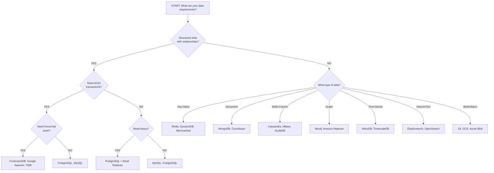

### SQL vs NoSQL Comparison

```
+-------------------+---------------------------+---------------------------+
| Criteria          | SQL (Relational)          | NoSQL                     |
+-------------------+---------------------------+---------------------------+
| Data Model        | Tables with rows/columns  | Document, KV, Wide-Col,  |
|                   | Fixed schema              | Graph (flexible schema)   |
+-------------------+---------------------------+---------------------------+
| Schema            | Rigid, predefined         | Flexible, schema-on-read  |
+-------------------+---------------------------+---------------------------+
| Relationships     | JOINs across tables       | Denormalized, embedded    |
+-------------------+---------------------------+---------------------------+
| Transactions      | Full ACID                 | Limited (some offer ACID) |
+-------------------+---------------------------+---------------------------+
| Scaling           | Vertical (scale up)       | Horizontal (scale out)    |
|                   | Read replicas for reads   | Native sharding           |
+-------------------+---------------------------+---------------------------+
| Query Language    | SQL (standardized)        | Varies by database        |
+-------------------+---------------------------+---------------------------+
| Consistency       | Strong by default         | Tunable, often eventual   |
+-------------------+---------------------------+---------------------------+
| Best For          | Complex queries, JOINs,   | High write throughput,    |
|                   | ACID transactions,        | flexible schema, massive  |
|                   | data integrity             | scale, low latency        |
+-------------------+---------------------------+---------------------------+
```

### When to Use What

| Use Case | Recommended DB | Reasoning |
|----------|---------------|-----------|
| **User accounts, orders, payments** | PostgreSQL, MySQL | ACID transactions, relational data |
| **Product catalog** | MongoDB, PostgreSQL | Flexible schema, varied attributes |
| **Session storage** | Redis | Fast reads, automatic expiry (TTL) |
| **Leaderboards, counters** | Redis | Atomic increments, sorted sets |
| **Social graph** | Neo4j, Amazon Neptune | Traversal queries, relationship-heavy |
| **Chat messages** | Cassandra | High write throughput, time-ordered |
| **Analytics, logs** | ClickHouse, Elasticsearch | Columnar storage, fast aggregation |
| **Time-series metrics** | InfluxDB, TimescaleDB | Optimized for time-series data |
| **Full-text search** | Elasticsearch, OpenSearch | Inverted index, relevance scoring |
| **File/media storage** | S3, GCS | Blob storage, CDN integration |
| **Shopping cart** | DynamoDB, Redis | Key-value access, high availability |
| **News feed, timeline** | Redis (cache) + Cassandra (storage) | Fast reads, write-heavy |
| **Configuration** | etcd, Consul | Strong consistency, distributed |
| **Geospatial queries** | PostGIS, MongoDB | Built-in geo indexes |

### Database Internals You Should Know

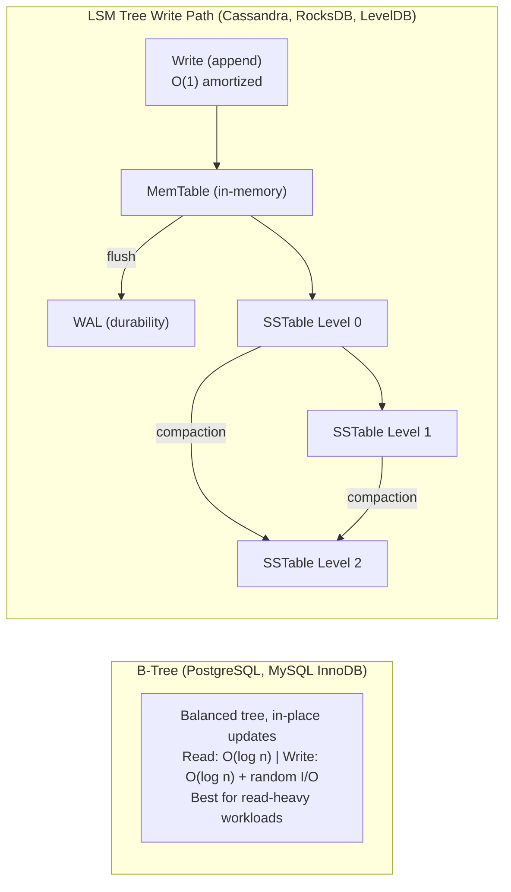

---

## Communication Protocols

### Protocol Comparison

```
+---------------+-------------+-----------+-------------+--------------+
| Feature       | HTTP/REST   | WebSocket | SSE         | gRPC         |
+---------------+-------------+-----------+-------------+--------------+
| Direction     | Request-    | Full      | Server to   | Bidirectional|
|               | Response    | Duplex    | Client      | streaming    |
+---------------+-------------+-----------+-------------+--------------+
| Connection    | Short-lived | Persistent| Persistent  | Persistent   |
|               | (per req)   |           |             | (HTTP/2)     |
+---------------+-------------+-----------+-------------+--------------+
| Protocol      | HTTP/1.1    | WS over   | HTTP/1.1    | HTTP/2       |
|               | or HTTP/2   | TCP       |             |              |
+---------------+-------------+-----------+-------------+--------------+
| Encoding      | JSON, XML   | Any       | Text        | Protobuf     |
|               |             |           | (event      | (binary)     |
|               |             |           |  stream)    |              |
+---------------+-------------+-----------+-------------+--------------+
| Browser       | Yes         | Yes       | Yes         | Via proxy    |
| Support       |             |           |             | (grpc-web)   |
+---------------+-------------+-----------+-------------+--------------+
| Overhead      | Medium      | Low (no   | Low         | Very Low     |
|               | (headers)   |  headers  |             | (binary)     |
|               |             |  per msg) |             |              |
+---------------+-------------+-----------+-------------+--------------+
| Reconnection  | Built-in    | Manual    | Built-in    | Manual       |
|               | (new req)   |           | (auto)      |              |
+---------------+-------------+-----------+-------------+--------------+
| Scalability   | Easy (LB)   | Harder    | Easy (LB)   | Easy (LB)    |
|               |             | (sticky)  |             |              |
+---------------+-------------+-----------+-------------+--------------+
```

### When to Use What

```
HTTP/REST:
  - Standard CRUD operations (create, read, update, delete)
  - Public APIs consumed by many different clients
  - Simple request-response patterns
  - When cacheability matters (GET requests)
  Examples: User profile API, product catalog, search


WebSocket:
  - Real-time bidirectional communication
  - Low-latency messaging
  - When both client and server need to push data
  Examples: Chat applications, multiplayer games, collaborative editing,
            live trading platforms


Server-Sent Events (SSE):
  - Server pushes updates to client
  - Client does not need to send data after initial connection
  - Simpler than WebSocket for one-way streaming
  Examples: Live score updates, stock tickers, notification streams,
            progress updates for long-running operations


gRPC:
  - Internal service-to-service communication
  - High-performance, low-latency requirements
  - Strongly typed contracts between services
  - Streaming (both server-streaming and bidirectional)
  Examples: Microservice communication, ML model serving,
            real-time data pipelines


Long Polling (legacy approach):
  - Client sends request, server holds it open until data available
  - Simpler than WebSocket but less efficient
  - Use when WebSocket/SSE are not supported
  Examples: Legacy systems, simple notification checks
```

### Protocol Deep Dives

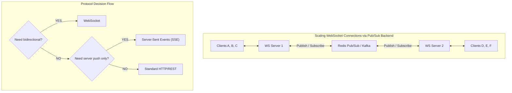

---

## Scoring Rubric

### What Interviewers Actually Evaluate

```
SYSTEM DESIGN SCORING RUBRIC
==============================

1. PROBLEM EXPLORATION (15%)
   +-----------+------------------------------------------------+
   | Strong    | Asks insightful clarifying questions. Identifies|
   |           | ambiguities. Defines clear scope and priorities.|
   +-----------+------------------------------------------------+
   | Adequate  | Asks basic questions. Mostly understands scope. |
   +-----------+------------------------------------------------+
   | Weak      | Jumps to solution. Makes assumptions without    |
   |           | confirming. Misunderstands the problem.         |
   +-----------+------------------------------------------------+

2. HIGH-LEVEL DESIGN (25%)
   +-----------+------------------------------------------------+
   | Strong    | Clean architecture. Sensible API and data model.|
   |           | Walks through key flows clearly. Gets buy-in.   |
   +-----------+------------------------------------------------+
   | Adequate  | Reasonable architecture. Some gaps in API or    |
   |           | data model. Covers main flow.                   |
   +-----------+------------------------------------------------+
   | Weak      | Unstructured diagram. Missing core components.  |
   |           | Cannot walk through a use case end-to-end.      |
   +-----------+------------------------------------------------+

3. DETAILED DESIGN (30%)
   +-----------+------------------------------------------------+
   | Strong    | Deep expertise in 2-3 areas. Quantifies with   |
   |           | math. Discusses alternatives and trade-offs.    |
   |           | Handles edge cases and failure modes.           |
   +-----------+------------------------------------------------+
   | Adequate  | Good depth in 1 area. Some trade-off discussion.|
   |           | Mentions scaling but without detailed plan.     |
   +-----------+------------------------------------------------+
   | Weak      | Surface-level on all topics. No trade-offs.     |
   |           | Cannot explain why a technology was chosen.     |
   +-----------+------------------------------------------------+

4. COMMUNICATION & COLLABORATION (20%)
   +-----------+------------------------------------------------+
   | Strong    | Drives the conversation. Structures thought     |
   |           | process clearly. Responds well to hints.        |
   |           | Explains complex ideas simply.                  |
   +-----------+------------------------------------------------+
   | Adequate  | Communicates ideas but needs prompting.         |
   |           | Sometimes jumps between topics.                 |
   +-----------+------------------------------------------------+
   | Weak      | Unclear explanations. Ignores interviewer cues. |
   |           | Cannot articulate reasoning.                    |
   +-----------+------------------------------------------------+

5. KNOWLEDGE BREADTH & DEPTH (10%)
   +-----------+------------------------------------------------+
   | Strong    | Demonstrates knowledge of distributed systems,  |
   |           | databases, caching, networking. Knows when to  |
   |           | use what and why.                               |
   +-----------+------------------------------------------------+
   | Adequate  | Knows common patterns. Some gaps but generally  |
   |           | reasonable choices.                             |
   +-----------+------------------------------------------------+
   | Weak      | Significant gaps in fundamental concepts.       |
   |           | Choices do not match requirements.              |
   +-----------+------------------------------------------------+
```

### Red Flags That Sink Candidates

```
INSTANT RED FLAGS
==================

1. Not asking any clarifying questions
   "Let me just start designing..."
   --> Shows you do not scope problems before solving them

2. Over-engineering immediately
   "First we need Kubernetes with 50 microservices..."
   --> Shows you cannot start simple and iterate

3. Naming technologies without understanding them
   "We will use Kafka" / "Why?" / "Because everyone uses it"
   --> Shows you follow trends without understanding trade-offs

4. Ignoring the interviewer's hints
   Interviewer: "What about the write path?"
   You: *continues talking about reads*
   --> Shows poor collaboration and listening skills

5. No quantitative reasoning
   "We need a lot of servers"
   --> Shows you cannot estimate or reason about scale

6. Single-point-of-failure ignorance
   Drawing a single database with no replication or backup plan
   --> Shows you have not worked with production systems

7. Not discussing trade-offs
   "We will use NoSQL because it scales"
   --> Shows binary thinking instead of nuanced reasoning

8. Cannot handle follow-up questions
   "I am not sure" (repeatedly) without attempting to reason through
   --> Shows you give up instead of reasoning from first principles
```

### Green Flags That Impress Interviewers

```
WHAT MAKES CANDIDATES STAND OUT
=================================

1. Structured approach
   "Let me break this into four parts..."
   --> Shows organized thinking

2. Quantitative reasoning
   "At 10K QPS, we need approximately 3 servers assuming
    each handles 4K QPS..."
   --> Shows practical estimation skills

3. Trade-off awareness
   "We could use SQL or NoSQL here. SQL gives us ACID
    transactions which we need for payments, but NoSQL
    would scale writes more easily. Given that payment
    consistency is critical, I would choose PostgreSQL."
   --> Shows nuanced decision-making

4. Failure mode awareness
   "What happens if this cache node goes down? We need
    a fallback to the database, and we should implement
    a circuit breaker to prevent cascade failures."
   --> Shows production experience

5. Iterative design
   "Let me start with the simplest design that works,
    then we can add complexity where needed."
   --> Shows practical engineering judgment

6. Responsive to feedback
   Interviewer: "What about consistency here?"
   You: "Great point. Let me reconsider..."
   --> Shows collaboration and intellectual humility

7. Domain awareness
   "In a payment system, we need idempotency keys
    because network retries can cause duplicate charges."
   --> Shows real-world experience

8. Clear communication
   "Let me summarize where we are before diving deeper..."
   --> Shows ability to manage complexity and communicate clearly
```

---

## Quick Reference Checklists

### Pre-Interview Preparation Checklist

```
BEFORE THE INTERVIEW
=====================

[ ] Review the 4-step framework
[ ] Practice back-of-envelope estimation (do 5 examples)
[ ] Know all common building blocks by heart
[ ] Practice drawing diagrams quickly (whiteboard or virtual)
[ ] Prepare 2-3 deep dive topics you can speak about for 10 minutes
[ ] Review CAP theorem and when to choose CP vs AP
[ ] Know SQL vs NoSQL decision criteria
[ ] Practice timing: 5 + 15 + 15 + 5 = 40 minutes
[ ] Have a shorthand for common components (LB, DB, Cache, MQ)
```

### During-Interview Checklist

```
DURING STEP 1 (Requirements):
  [ ] Restated the problem
  [ ] Asked about functional requirements (features)
  [ ] Asked about non-functional requirements (scale, latency, availability)
  [ ] Confirmed read/write ratio
  [ ] Defined what is in and out of scope
  [ ] Wrote requirements on the board

DURING STEP 2 (High-Level Design):
  [ ] Defined API endpoints
  [ ] Defined data model / schema
  [ ] Drew high-level architecture diagram
  [ ] Walked through at least one key flow end-to-end
  [ ] Got buy-in from interviewer before proceeding

DURING STEP 3 (Deep Dive):
  [ ] Identified 2-3 most interesting/challenging components
  [ ] Discussed scaling strategy with quantitative reasoning
  [ ] Mentioned caching strategy and eviction policy
  [ ] Addressed at least one failure scenario
  [ ] Discussed trade-offs for major design decisions
  [ ] Used back-of-envelope math to support decisions

DURING STEP 4 (Wrap Up):
  [ ] Summarized the design
  [ ] Mentioned monitoring and observability
  [ ] Suggested 2-3 future improvements
  [ ] Answered remaining interviewer questions
```

### Common System Design Topics

```
FREQUENTLY ASKED SYSTEM DESIGN QUESTIONS
==========================================

BEGINNER LEVEL:
  [ ] URL Shortener (bit.ly)
  [ ] Paste Bin
  [ ] Rate Limiter
  [ ] Key-Value Store
  [ ] Unique ID Generator

INTERMEDIATE LEVEL:
  [ ] Design Twitter / News Feed
  [ ] Design Instagram / Photo Sharing
  [ ] Design Chat System (WhatsApp/Slack)
  [ ] Design Web Crawler
  [ ] Design Notification System
  [ ] Design Search Autocomplete
  [ ] Design YouTube / Video Streaming

ADVANCED LEVEL:
  [ ] Design Google Maps / Proximity Service
  [ ] Design Distributed Cache (Memcached/Redis)
  [ ] Design Distributed Message Queue (Kafka)
  [ ] Design Stock Exchange / Trading System
  [ ] Design Google Docs / Collaborative Editing
  [ ] Design Payment System (Stripe)
  [ ] Design Ad Click Aggregation
  [ ] Design Hotel Reservation System
  [ ] Design Distributed File System (GFS/HDFS)
  [ ] Design S3-like Object Storage

FOR EACH QUESTION, KNOW:
  - What clarifying questions to ask
  - Core entities and relationships
  - Read vs write patterns
  - Key scaling challenges
  - Which building blocks to use
  - 2-3 deep dive topics specific to that system
```

### Estimation Quick Reference Card

```
QUICK ESTIMATION REFERENCE
============================

TIME:
  1 day    ~ 100K seconds
  1 month  ~ 2.5M seconds
  1 year   ~ 30M seconds

SCALE:
  1 Million     = 10^6  = 1M
  1 Billion     = 10^9  = 1B
  1 Trillion    = 10^12 = 1T

DATA SIZES:
  1 char (ASCII)  = 1 byte
  1 char (UTF-8)  = 1-4 bytes
  UUID             = 16 bytes (128 bits)
  Long/BigInt      = 8 bytes (64 bits)
  Timestamp        = 8 bytes
  Average URL      = 100-200 bytes
  Average tweet    = 300 bytes (with metadata)
  Average email    = 50 KB
  Average photo    = 500 KB - 2 MB
  Average video    = 50 MB (1 min, compressed)

DAILY ACTIVE USERS (DAU) for reference:
  Small app        = 10K - 100K
  Medium app       = 1M - 10M
  Large app        = 50M - 100M
  Massive (FB)     = 2B+

QPS QUICK MATH:
  DAU x actions/user/day / 100,000 = average QPS
  Peak = average x 2-3

STORAGE QUICK MATH:
  records/day x bytes/record x 365 = yearly storage
  Add 3x for replication

BANDWIDTH QUICK MATH:
  QPS x response_size = bandwidth
  1 Gbps = 125 MB/s
```

### ASCII Diagram Templates

These are reusable templates for common architectures. Practice drawing them
quickly during your interview.

```mermaid
flowchart TD
    subgraph T1["Template 1: Basic Web Application"]
        C1["Client"] --> CDN1["CDN"] --> LB1["Load Balancer"] --> App1["App Servers"]
        App1 --> Redis1["Cache (Redis)"]
        App1 --> DB1["Database (Primary)"] --> Rep1["Replicas"]
    end
    subgraph T2["Template 2: Microservices with Message Queue"]
        C2["Client"] --> GW["API Gateway"]
        GW --> SvcA["Service A"] --> MQ["Message Queue"] --> SvcC["Service C"] --> DBNoSQL["DB (NoSQL)"]
        GW --> SvcB["Service B"] --> DBSQL["DB (SQL)"]
    end
    subgraph T3["Template 3: Read-Heavy System with Caching Layers"]
        C3["Client"] --> CDN3["CDN (Static/Cached)"] --> LB3["Load Balancer"] --> App3["App Server"] --> L1["L1 Cache (In-Process Caffeine)"] --> L2["L2 Cache (Redis)"] --> DB3["Database + Replicas"]
    end
    subgraph T4["Template 4: Event-Driven Architecture"]
        P1["Producer Service 1"] & P2["Producer Service 2"] --> Kafka["Event Store (Kafka)"]
        Kafka --> CGA["Consumer Group A"]
        Kafka --> CGB["Consumer Group B"] --> ADB["Analytics DB"]
    end
    subgraph T5["Template 5: Global Multi-Region Deployment"]
        DNS["Global DNS / GeoDNS / GSLB"] --> US["US Region (App + Cache + DB Primary/Replica)"]
        DNS --> EU["EU Region (App + Cache + DB Primary/Replica)"]
        US -.->|"Async Replication"| EU
    end
```

---

## Appendix A: System Design Patterns Cheat Sheet

### Patterns for Specific Problems

```
PATTERN QUICK REFERENCE
=========================

Problem: Too many reads
  --> Add caching (Redis/Memcached)
  --> Add read replicas
  --> Add CDN for static content
  --> Denormalize data

Problem: Too many writes
  --> Async writes via message queue
  --> Write-behind cache
  --> Database sharding
  --> Use LSM-tree based DB (Cassandra)

Problem: Large files/media
  --> Object storage (S3)
  --> CDN for delivery
  --> Chunked upload/download
  --> Transcoding pipeline (for video)

Problem: Search functionality
  --> Elasticsearch/OpenSearch
  --> Inverted index
  --> Trie for autocomplete

Problem: Real-time updates
  --> WebSocket for bidirectional
  --> SSE for server push
  --> Long polling as fallback

Problem: Distributed coordination
  --> Zookeeper/etcd for leader election
  --> Distributed locks
  --> Consensus algorithms (Raft, Paxos)

Problem: Hotspots
  --> Consistent hashing with virtual nodes
  --> Rate limiting
  --> Request coalescing
  --> L1 cache for hot keys

Problem: Data consistency across services
  --> Saga pattern (choreography or orchestration)
  --> Two-phase commit (2PC) for strong consistency
  --> Outbox pattern for reliable event publishing
  --> CQRS for read/write separation

Problem: Idempotency
  --> Idempotency keys on write requests
  --> Deduplication table
  --> At-least-once delivery + idempotent processing

Problem: Global scale
  --> Multi-region deployment
  --> Geo-DNS / GSLB routing
  --> Regional data partitioning
  --> Conflict-free replicated data types (CRDTs)
```

### The Saga Pattern

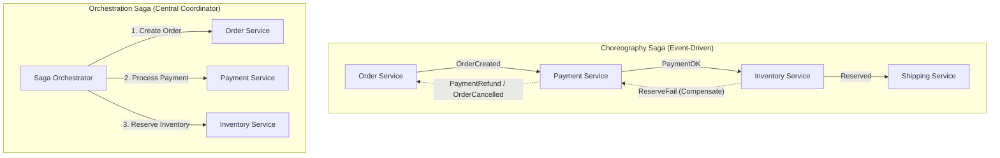

### CQRS Pattern

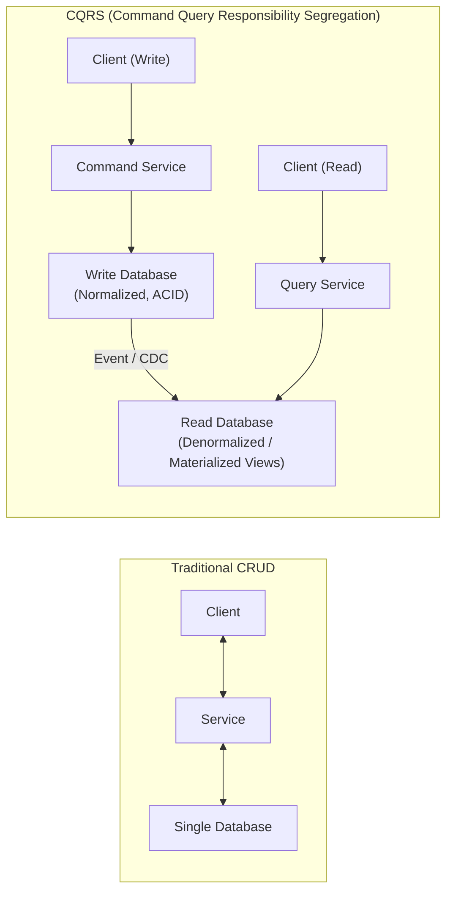

---

## Appendix B: Technology Reference

### Quick Technology Lookup

```
LOAD BALANCERS:
  Hardware:  F5, Citrix
  Software:  Nginx, HAProxy, Envoy
  Cloud:     AWS ALB/NLB, GCP Cloud LB, Azure LB

CACHES:
  In-process: Caffeine (Java), node-cache (Node.js)
  Distributed: Redis, Memcached
  CDN: CloudFront, Cloudflare, Akamai, Fastly

DATABASES:
  Relational:   PostgreSQL, MySQL, CockroachDB, Spanner
  Document:     MongoDB, Couchbase, DynamoDB
  Wide-Column:  Cassandra, HBase, ScyllaDB
  Key-Value:    Redis, DynamoDB, etcd
  Graph:        Neo4j, Amazon Neptune
  Time-Series:  InfluxDB, TimescaleDB
  Search:       Elasticsearch, OpenSearch
  Analytics:    ClickHouse, BigQuery, Redshift, Snowflake

MESSAGE QUEUES:
  Kafka, RabbitMQ, Amazon SQS/SNS, Google Pub/Sub, NATS

OBJECT STORAGE:
  Amazon S3, Google Cloud Storage, Azure Blob Storage, MinIO

COORDINATION:
  Zookeeper, etcd, Consul

MONITORING:
  Prometheus + Grafana, Datadog, New Relic, PagerDuty (alerting)

TRACING:
  Jaeger, Zipkin, AWS X-Ray, Honeycomb

API GATEWAY:
  Kong, AWS API Gateway, Apigee, Nginx
```

---

## Appendix C: Practice Problems with Hints

Use these as self-study. For each, practice the full 4-step framework.

### Problem 1: Design a Rate Limiter

```
Key Questions:
  - Client-side or server-side?
  - What is the rate limit (requests per second/minute)?
  - Per user, per IP, or per API key?
  - Distributed (multiple servers) or single server?

Key Concepts:
  - Token Bucket algorithm (most common)
  - Sliding Window Log
  - Sliding Window Counter
  - Fixed Window Counter
  - Redis for distributed rate limiting

Deep Dive Areas:
  - How to handle distributed rate limiting across multiple servers
  - Race conditions in token bucket with Redis
  - HTTP 429 response and Retry-After header
  - Rate limit headers (X-RateLimit-Remaining, X-RateLimit-Reset)
```

### Problem 2: Design a Chat System

```
Key Questions:
  - 1:1 chat, group chat, or both?
  - Maximum group size?
  - Online/offline indicator?
  - Message persistence? How long?
  - Media support (images, files)?
  - Read receipts? Typing indicators?

Key Concepts:
  - WebSocket for real-time messaging
  - Message queue for guaranteed delivery
  - Presence service (online/offline status)
  - Push notifications for offline users

Deep Dive Areas:
  - How to handle message ordering in distributed system
  - Group chat fan-out (small groups vs large channels)
  - Offline message storage and delivery
  - End-to-end encryption
  - Schema: messages, conversations, participants tables
```

### Problem 3: Design a News Feed

```
Key Questions:
  - How many friends/followers per user?
  - What content types (text, images, video)?
  - How is the feed ranked (chronological, algorithmic)?
  - How often is the feed refreshed?

Key Concepts:
  - Fan-out on write vs fan-out on read
  - Celebrity problem (users with millions of followers)
  - Feed ranking algorithm
  - Pre-computed feeds in cache

Deep Dive Areas:
  - Fan-out on write: Pre-compute feed for each user
    + Fast reads
    - Slow writes for celebrities
    - Wasted computation for inactive users
  - Fan-out on read: Compute feed on request
    + No wasted computation
    - Slow reads
  - Hybrid: Fan-out on write for normal users,
    fan-out on read for celebrities
```

### Problem 4: Design a Notification System

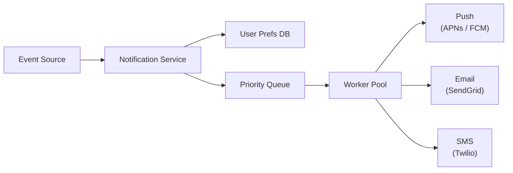

---

## Final Words

System design interviews test your ability to think through complex problems
methodically. There is no single correct answer. The interviewer cares about:

1. **How you think**, not what you memorize.
2. **How you communicate**, not how fast you draw.
3. **How you make trade-offs**, not how many technologies you name.
4. **How you handle ambiguity**, not how perfectly you know every detail.

Practice the 4-step framework until it becomes second nature. Practice
estimation until you can do it quickly. Practice drawing diagrams until they
are clean and readable. And most importantly, practice explaining your
reasoning out loud.

Good luck.
