# Design a Chat System (WhatsApp/Slack)

## Table of Contents

1. [Requirements Clarification](#1-requirements-clarification)
2. [Communication Protocols](#2-communication-protocols)
3. [High-Level Architecture](#3-high-level-architecture)
4. [Data Model](#4-data-model)
5. [Core Flows](#5-core-flows)
6. [Message Delivery Guarantees](#6-message-delivery-guarantees)
7. [Group Chat Design](#7-group-chat-design)
8. [Presence System](#8-presence-system)
9. [Media Handling](#9-media-handling)
10. [Scaling](#10-scaling)
11. [Deployment Architecture](#11-deployment-architecture)
12. [Common Interview Follow-ups](#12-common-interview-follow-ups)

---

## 1. Requirements Clarification

### Functional Requirements

| Feature            | Description                                                 |
| ------------------ | ----------------------------------------------------------- |
| 1-on-1 Chat        | Real-time messaging between two users                       |
| Group Chat         | Group conversations supporting up to 500 members            |
| Online/Offline     | Show user presence status in real time                      |
| Read Receipts      | Sent, delivered, and read indicators per message            |
| Media Sharing      | Images, videos, files, voice messages                       |
| Message History    | Persistent storage with scroll-back / search                |
| Push Notifications | Notify offline users of new messages                        |
| Multi-device Sync  | Messages available on phone, tablet, desktop simultaneously |
| Typing Indicators  | Show when a contact is typing                               |

### Non-Functional Requirements

| Requirement     | Target                                                        |
| --------------- | ------------------------------------------------------------- |
| Latency         | < 200ms end-to-end for message delivery                       |
| Reliability     | No message loss -- guaranteed delivery                        |
| Ordering        | Messages appear in the correct order within a conversation    |
| Offline Support | Queue messages for offline users, deliver when they reconnect |
| Availability    | 99.99% uptime (< 52 minutes downtime/year)                    |
| Security        | End-to-end encryption for 1-on-1, TLS everywhere              |
| Consistency     | Eventual consistency acceptable (within seconds)              |

### Scale Estimates

```
Daily Active Users (DAU):         500,000,000
Messages per user per day:        80
Total messages per day:           500M * 80 = 40,000,000,000 (40B)
Messages per second (avg):        40B / 86,400 ≈ 463,000 msg/s
Messages per second (peak 3x):   ~1,400,000 msg/s

Average message size:             200 bytes (text)
Daily text storage:               40B * 200B = 8 TB/day
Annual text storage:              8 TB * 365 = ~2.9 PB/year

Media messages (10% of total):    4B/day
Average media size:               500 KB
Daily media storage:              4B * 500KB = 2 PB/day

Concurrent WebSocket connections: ~150M (30% of DAU at any moment)
```

### Bandwidth Estimates

```
Incoming text bandwidth:    463K msg/s * 200B = ~93 MB/s = ~744 Mbps
Outgoing text bandwidth:    ~2x incoming (fan-out) = ~1.5 Gbps
Media ingress:              4B / 86400 * 500KB ≈ 23 GB/s
Media egress (with CDN):    Distributed, ~10 GB/s at origin
```

---

## 2. Communication Protocols

### Protocol Comparison

```
+------------------+----------+-----------+-------------+----------+
|   Protocol       | Latency  | Server    | Bidirectional| Browser  |
|                  |          | Load      |              | Support  |
+------------------+----------+-----------+-------------+----------+
| HTTP Polling     | High     | Very High | No           | Yes      |
| Long Polling     | Medium   | High      | No (hack)    | Yes      |
| Server-Sent      | Low      | Medium    | No (server   | Yes      |
|   Events (SSE)   |          |           |   -> client) |          |
| WebSocket        | Very Low | Low       | Yes          | Yes      |
+------------------+----------+-----------+-------------+----------+
```

### Why Each Falls Short (Except WebSocket)

**HTTP Polling:**

- Client sends requests at fixed intervals (e.g., every 3 seconds).
- Wasteful: most responses are empty; generates enormous load at scale.
- At 150M connections polling every 3s = 50M requests/second of pure overhead.

**Long Polling:**

- Client opens a request; server holds it until data is available or timeout.
- Better than polling, but still creates a new TCP connection per message cycle.
- Not truly bidirectional: client must send a new request after each response.
- Timeout management is complex.

**Server-Sent Events (SSE):**

- Unidirectional: only server-to-client. Client still needs HTTP for sending.
- Good for feeds/notifications, but chat requires true bidirectional flow.
- Limited to ~6 concurrent connections per domain in older browsers.

**WebSocket (Winner):**

- Full-duplex, persistent TCP connection.
- Minimal overhead after handshake (~2 bytes per frame header).
- True bidirectional communication on a single connection.
- Natively supported by all modern browsers and mobile platforms.

### WebSocket Handshake Flow

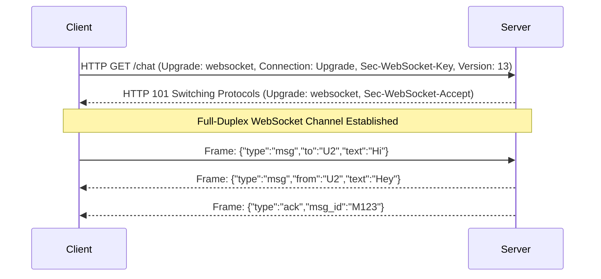

### Fallback Strategy

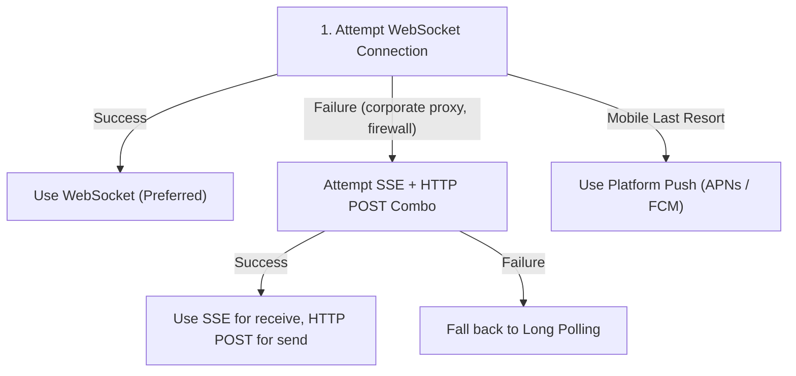

### Protocol Usage by Feature

```
+------------------------+-------------------+
| Feature                | Protocol          |
+------------------------+-------------------+
| Real-time messaging    | WebSocket         |
| Presence updates       | WebSocket         |
| Typing indicators      | WebSocket         |
| User profile updates   | REST API (HTTP)   |
| Media upload           | REST API (HTTP)   |
| Contact management     | REST API (HTTP)   |
| Authentication         | REST API (HTTP)   |
| Push notifications     | APNs / FCM        |
+------------------------+-------------------+
```

---

## 3. High-Level Architecture

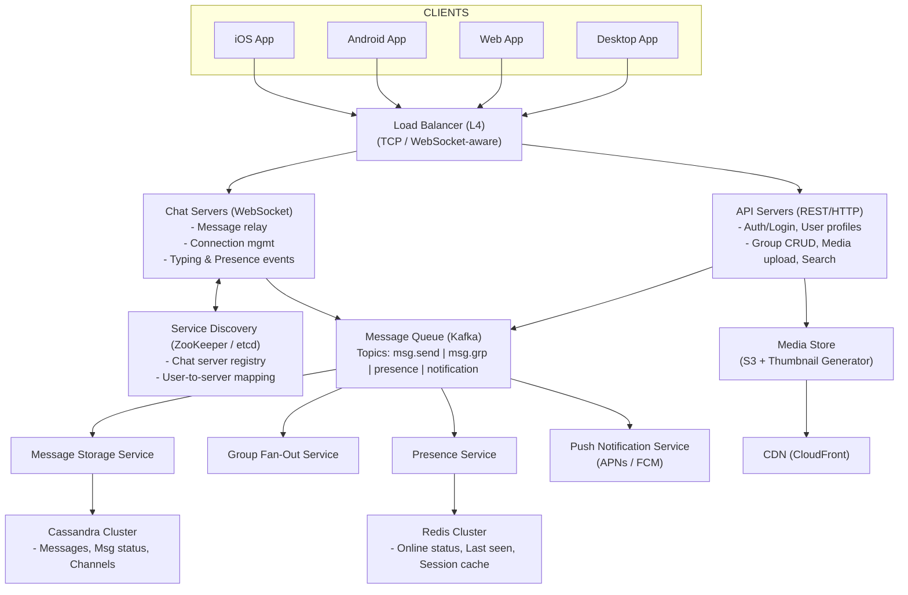

### Component Responsibilities

| Component          | Responsibility                                            |
| ------------------ | --------------------------------------------------------- |
| Load Balancer (L4) | Route TCP connections; sticky sessions for WebSocket      |
| Chat Servers       | Manage WebSocket connections, relay messages in real time |
| API Servers        | Handle REST requests: auth, profiles, groups, uploads     |
| Service Discovery  | Map user_id -> chat_server_id for message routing         |
| Kafka              | Decouple producers from consumers; buffer spikes          |
| Message Storage    | Persist messages to Cassandra; index for retrieval        |
| Group Fan-Out      | Expand group message to individual deliveries             |
| Presence Service   | Track online/offline; publish status changes              |
| Push Notification  | Deliver to offline users via APNs (iOS) / FCM (Android)   |
| Redis              | Cache sessions, presence, recent conversations            |
| S3 + CDN           | Store and distribute media files globally                 |

---

## 4. Data Model

### Why Cassandra / HBase for Messages?

| Characteristic      | Cassandra Fit                                              |
| ------------------- | ---------------------------------------------------------- |
| Write-heavy         | 463K writes/sec -- Cassandra excels at sequential writes   |
| Time-series data    | Messages are naturally time-ordered; perfect for LSM trees |
| Partition tolerance | AP system; tolerates network partitions gracefully         |
| Linear scalability  | Add nodes to handle more throughput, no resharding pain    |
| No complex joins    | Chat queries are simple: get messages by conversation+time |
| TTL support         | Auto-expire ephemeral messages (stories, disappearing)     |

### Users Table (PostgreSQL -- relational data)

```sql
CREATE TABLE users (
    user_id         BIGINT PRIMARY KEY,      -- Snowflake ID
    username        VARCHAR(32) UNIQUE NOT NULL,
    display_name    VARCHAR(64),
    email           VARCHAR(128) UNIQUE,
    phone           VARCHAR(20) UNIQUE,
    avatar_url      VARCHAR(512),
    public_key      TEXT,                     -- For E2E encryption
    status_message  VARCHAR(256),
    created_at      TIMESTAMP DEFAULT NOW(),
    updated_at      TIMESTAMP DEFAULT NOW()
);

CREATE INDEX idx_users_phone ON users(phone);
CREATE INDEX idx_users_email ON users(email);
```

### Conversations Table (PostgreSQL)

```sql
CREATE TABLE conversations (
    conversation_id   BIGINT PRIMARY KEY,     -- Snowflake ID
    type              VARCHAR(10) NOT NULL,    -- 'direct' or 'group'
    name              VARCHAR(128),            -- NULL for direct, set for group
    avatar_url        VARCHAR(512),
    creator_id        BIGINT REFERENCES users(user_id),
    created_at        TIMESTAMP DEFAULT NOW(),
    updated_at        TIMESTAMP DEFAULT NOW()
);
```

### Conversation Members Table (PostgreSQL)

```sql
CREATE TABLE conversation_members (
    conversation_id   BIGINT REFERENCES conversations(conversation_id),
    user_id           BIGINT REFERENCES users(user_id),
    role              VARCHAR(16) DEFAULT 'member',  -- 'admin', 'member'
    nickname          VARCHAR(64),
    joined_at         TIMESTAMP DEFAULT NOW(),
    muted_until       TIMESTAMP,
    PRIMARY KEY (conversation_id, user_id)
);

CREATE INDEX idx_members_user ON conversation_members(user_id);
```

### Messages Table (Cassandra)

```sql
CREATE TABLE messages (
    conversation_id   BIGINT,
    message_id        BIGINT,          -- Snowflake ID (time-ordered)
    sender_id         BIGINT,
    message_type      TEXT,            -- 'text', 'image', 'video', 'file', 'voice'
    content           TEXT,            -- Text content or media URL
    metadata          TEXT,            -- JSON: thumbnail, dimensions, duration, etc.
    reply_to_id       BIGINT,          -- For threaded replies
    is_deleted        BOOLEAN,
    created_at        TIMESTAMP,
    PRIMARY KEY (conversation_id, message_id)
) WITH CLUSTERING ORDER BY (message_id DESC);
```

**Partition Strategy:**

- **Partition key**: `conversation_id` -- all messages in a conversation on same node.
- **Clustering key**: `message_id` (DESC) -- newest messages retrieved first.
- For very active groups, use compound partition: `(conversation_id, time_bucket)` where `time_bucket = message_id / 1_000_000` to prevent hot partitions.

### Message Status Table (Cassandra)

```sql
CREATE TABLE message_status (
    conversation_id   BIGINT,
    message_id        BIGINT,
    user_id           BIGINT,
    status            TEXT,            -- 'sent', 'delivered', 'read'
    updated_at        TIMESTAMP,
    PRIMARY KEY ((conversation_id, user_id), message_id)
) WITH CLUSTERING ORDER BY (message_id DESC);
```

### User Conversations Table (Cassandra -- for inbox)

```sql
CREATE TABLE user_conversations (
    user_id             BIGINT,
    last_message_at     TIMESTAMP,
    conversation_id     BIGINT,
    last_message_preview TEXT,
    unread_count        INT,
    PRIMARY KEY (user_id, last_message_at)
) WITH CLUSTERING ORDER BY (last_message_at DESC);
```

### Index Strategy

```
+---------------------------+-----------------------------------+
| Query Pattern             | Index / Table Design              |
+---------------------------+-----------------------------------+
| Get messages in convo     | messages: partition=conversation_id|
| Get user's conversations  | user_conversations: partition=     |
|                           |   user_id, cluster=last_message_at|
| Get message delivery      | message_status: partition=         |
|   status                  |   (conversation_id, user_id)      |
| Search messages by text   | Elasticsearch (separate index)    |
| Find user by phone/email  | PostgreSQL secondary indexes      |
+---------------------------+-----------------------------------+
```

### Entity Relationship Overview

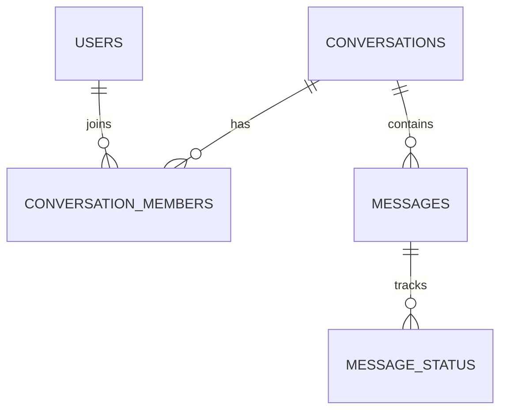

---

## 5. Core Flows

### 5.1 One-on-One Message Sending Flow

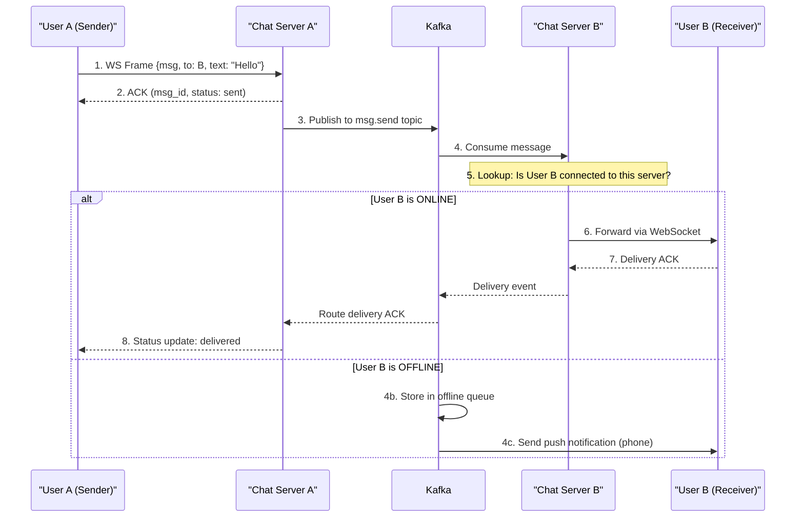

**Step-by-step explanation:**

1. User A sends a message over their WebSocket connection to Chat Server A.
2. Chat Server A generates a `message_id` (Snowflake ID), persists the message to Cassandra, and immediately sends an ACK back to User A with status `sent`.
3. Chat Server A publishes the message to the `msg.send` Kafka topic.
4. The consumer responsible for User B's partition picks up the message.
5. The consumer checks Service Discovery (ZooKeeper/etcd) or the Redis connection registry to find which Chat Server holds User B's WebSocket connection.
6. If User B is online, the message is forwarded through their Chat Server's WebSocket.
7. User B's client sends a delivery ACK back through the WebSocket.
8. The delivery status propagates back to User A, updating the UI from single-check to double-check.

### 5.2 Group Message Sending Flow

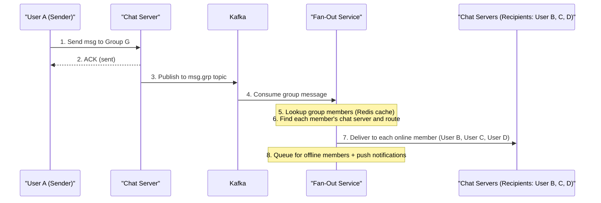

### 5.3 Online/Offline Presence Detection

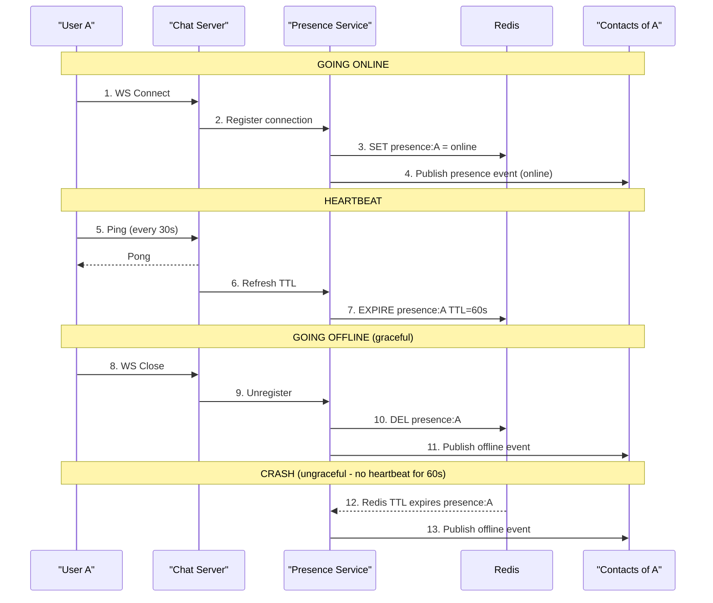

### 5.4 Message Synchronization (User Comes Online)

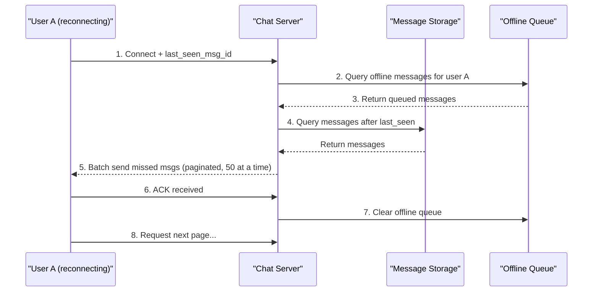

### 5.5 Read Receipt Flow

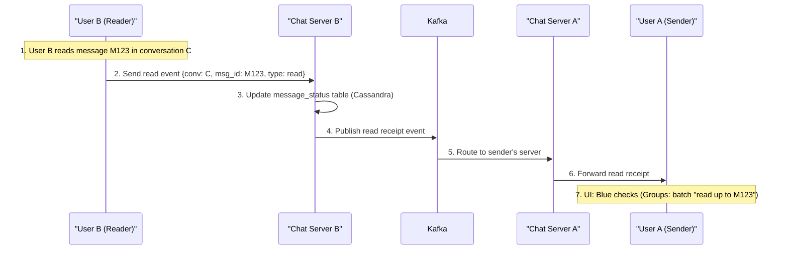

---

## 6. Message Delivery Guarantees

### Delivery Semantics Comparison

```
+-------------------+------------------+---------------------+
| Guarantee         | Behavior         | Use Case            |
+-------------------+------------------+---------------------+
| At-most-once      | Fire and forget. | Typing indicators   |
|                   | May lose msgs.   | (loss is OK)        |
+-------------------+------------------+---------------------+
| At-least-once     | Retry until ACK. | Chat messages       |
|                   | May duplicate.   | (with dedup)        |
+-------------------+------------------+---------------------+
| Exactly-once      | No loss, no dup. | Payment messages    |
|                   | Very expensive.  | (impractical at     |
|                   |                  |  chat scale)        |
+-------------------+------------------+---------------------+
```

**Our choice: At-least-once + idempotency = effectively exactly-once.**

### Message ID Generation (Snowflake ID)

```
64-bit Snowflake ID Structure:
┌──────────┬────────────┬──────────────┬──────────────┐
│  1 bit   │  41 bits   │   10 bits    │  12 bits     │
│  (sign)  │ (timestamp)│ (machine ID) │ (sequence)   │
│  unused  │ (ms since  │              │              │
│          │  epoch)    │              │              │
└──────────┴────────────┴──────────────┴──────────────┘

Properties:
- Time-ordered:     IDs generated later are always larger
- Globally unique:  No coordination needed between servers
- K-sortable:       Can be sorted chronologically
- Compact:          64 bits fits in a BIGINT column
- High throughput:  4096 IDs per ms per machine (12-bit seq)

Example:
  Timestamp (41 bits):  Current ms since custom epoch
  Machine ID (10 bits): Identifies the chat server (up to 1024)
  Sequence (12 bits):   Per-ms counter (up to 4096)

  Total capacity: 1024 machines * 4096 IDs/ms = ~4.2 billion IDs/second
```

### Idempotency Mechanism

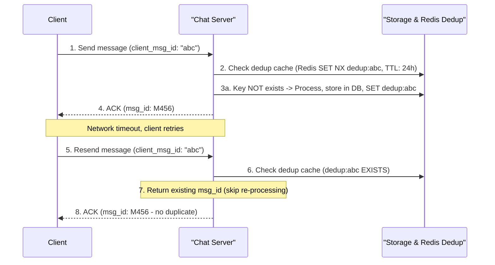

### Message Ordering

**Problem:** Distributed systems can deliver messages out of order.

**Solution:** Per-conversation sequence numbers.

```
Conversation C has a monotonically increasing counter:

  Message from A: seq=1, "Hey"
  Message from B: seq=2, "Hi there"
  Message from A: seq=3, "How are you?"
  Message from B: seq=4, "Good, you?"

Client rendering logic:
  1. Buffer incoming messages
  2. Sort by (conversation_id, sequence_number)
  3. If gap detected (received seq=5 but missing seq=4):
     a. Hold seq=5 in buffer
     b. Request missing seq=4 from server
     c. Display in order once gap filled
  4. Timeout: display out-of-order after 3 seconds with re-sort

Server-side ordering:
  - Each conversation has an atomic counter in Redis:
      INCR conversation:{conv_id}:seq
  - Assigned at the point of processing, not at send time
  - Guarantees strict ordering within a conversation
```

### Delivery Status State Machine

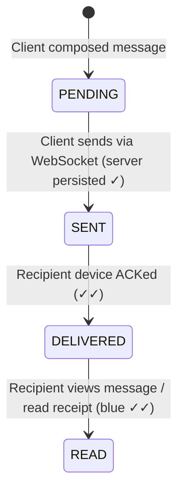

---

## 7. Group Chat Design

### Fan-out Strategies

```
Strategy 1: Fan-out on Write (WhatsApp-style for small groups)
=============================================================

When User A sends a message to Group G (100 members):

  1. Write message once to messages table
  2. Fan-out service writes to each member's inbox/queue:
     - Write to user_B's inbox
     - Write to user_C's inbox
     - ...
     - Write to user_100's inbox
  3. Each online member receives push through their WebSocket

Pros:
  + Reading is fast (pre-computed inbox)
  + Simple client logic
  + Low read latency

Cons:
  - Write amplification: 1 message -> N writes
  - Expensive for large groups (500 members = 500 writes)
  - Wasted writes for inactive users


Strategy 2: Fan-out on Read (Slack-style for channels)
=====================================================

When User A sends a message to Channel C (10,000 members):

  1. Write message once to the channel's message stream
  2. No fan-out at write time
  3. Each user reads from the channel stream when they open it

Pros:
  + Minimal write cost (1 write regardless of group size)
  + No wasted work for inactive users
  + Scales to very large channels

Cons:
  - Higher read latency (must query channel on every open)
  - More complex client logic (merge multiple channels)
  - Need push notification separate from message storage
```

### Hybrid Strategy (Recommended)

```
┌─────────────────┬────────────────────┬─────────────────────┐
│ Group Size      │ Strategy           │ Rationale            │
├─────────────────┼────────────────────┼─────────────────────┤
│ 1-on-1 (2)     │ Fan-out on write   │ Trivial cost         │
│ Small (3-100)   │ Fan-out on write   │ Acceptable write     │
│                 │                    │ amplification        │
│ Medium (100-500)│ Fan-out on write   │ With write batching  │
│                 │ (optimized)        │ and async processing │
│ Large (500+)   │ Fan-out on read    │ Write cost too high; │
│ channels        │                    │ most members idle    │
└─────────────────┴────────────────────┴─────────────────────┘
```

### Group Message Queue Architecture

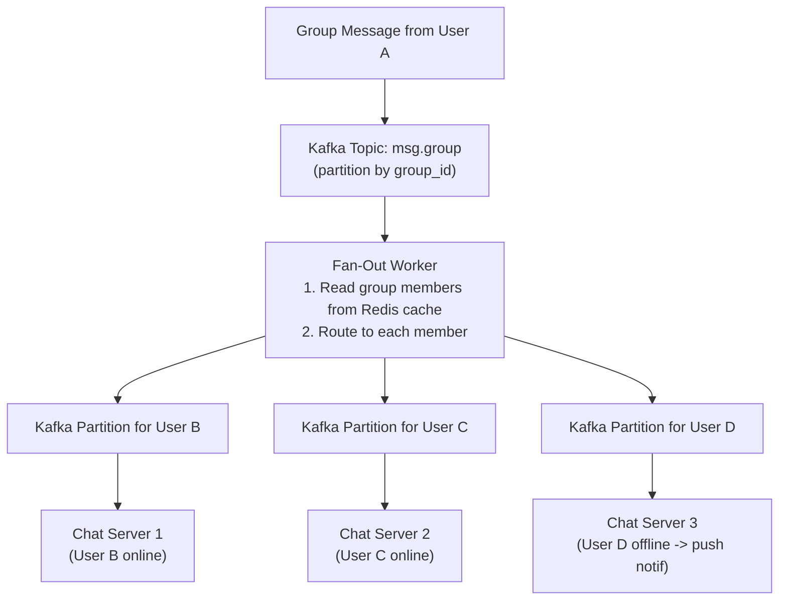

### Group Metadata Caching

```
Redis structure for group metadata:

  group:{group_id}:members   -> SET of user_ids
  group:{group_id}:info      -> HASH {name, avatar, created_by, ...}
  group:{group_id}:admins    -> SET of admin user_ids

Cache invalidation:
  - Member join/leave -> Update SET, publish event
  - Group info change -> Update HASH, publish event
  - TTL: None (actively managed); fallback read-through from PostgreSQL
```

---

## 8. Presence System

### Heartbeat Mechanism

```
┌────────────────────────────────────────────────────────────┐
│                    Heartbeat Protocol                       │
├────────────────────────────────────────────────────────────┤
│                                                            │
│  Client sends:  WebSocket PING every 30 seconds           │
│  Server replies: WebSocket PONG                            │
│                                                            │
│  Server-side:                                              │
│    - Each PONG refreshes Redis key TTL to 60s              │
│    - If no PING for 60s, Redis key expires -> offline      │
│    - If WebSocket closes, immediate cleanup -> offline     │
│                                                            │
│  Redis key:                                                │
│    presence:{user_id} = {server_id, last_active}          │
│    EXPIRE 60                                               │
│                                                            │
│  Timeline:                                                 │
│    t=0s   PING ──> PONG, TTL reset to 60s                 │
│    t=30s  PING ──> PONG, TTL reset to 60s                 │
│    t=60s  PING ──> PONG, TTL reset to 60s                 │
│    t=90s  (no PING -- user disconnected)                   │
│    t=120s Redis TTL expires -> user marked offline         │
│                                                            │
└────────────────────────────────────────────────────────────┘
```

### Presence Fan-out for Contacts

```
Problem: User A has 500 contacts. When A comes online,
         do we notify all 500? That is expensive.

Naive approach:
  A comes online -> notify all 500 contacts
  500 users * 500 contacts each = 250,000 presence events
  At 150M online users, this is unsustainable.

Optimized approach:

  1. LAZY PRESENCE LOADING
     - When User B opens a chat with User A,
       B subscribes to A's presence channel
     - Only active conversations get presence updates

  2. PRESENCE GROUPS
     - Maintain "active conversation partners" in Redis
     - Only fan out to users who have recently interacted

  3. BATCH PRESENCE QUERIES
     - When user opens contact list, batch-query presence
       for visible contacts only (not all 500)
     - GET presence:{user_id} for the 20 visible contacts

Implementation:
  ┌─────────────┐
  │  Redis Pub/ │
  │  Sub Channel│
  │             │
  │  Channel:   │
  │  presence:  │
  │  {user_id}  │
  └──────┬──────┘
         │
         │  Only subscribers receive updates:
         │
         ├──> User B (has chat with A open)       ✓ receives
         ├──> User C (has chat with A open)       ✓ receives
         ├──> User D (A is on D's contact list    ✗ does NOT receive
         │          but chat not open)                (will poll on demand)
         └──> User E (no relation to A)           ✗ not subscribed
```

### Presence State Machine

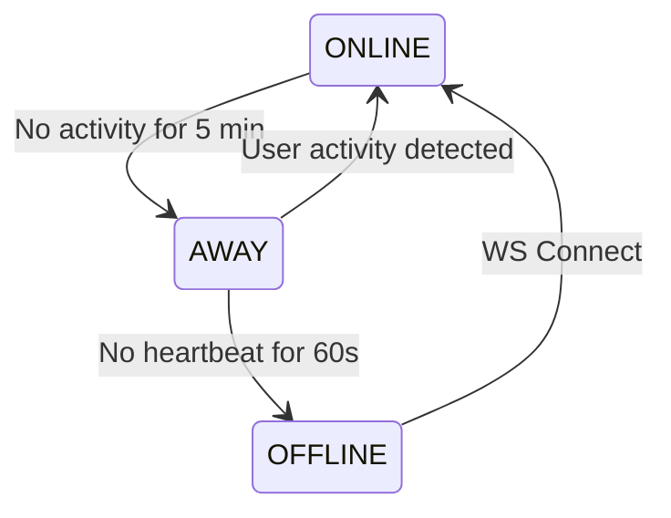

---

## 9. Media Handling

### Upload Flow (Pre-signed URL)

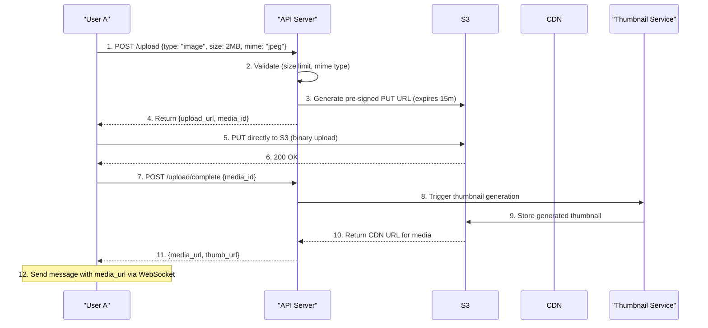

### Media Processing Pipeline

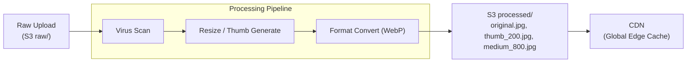

### Media Size Limits and Compression

```
+──────────────+──────────────+───────────────────+
│ Type         │ Max Size     │ Processing        │
+──────────────+──────────────+───────────────────+
│ Image        │ 16 MB        │ Resize, WebP,     │
│              │              │ strip EXIF,       │
│              │              │ thumbnail 200px   │
+──────────────+──────────────+───────────────────+
│ Video        │ 100 MB       │ Transcode H.264,  │
│              │              │ thumbnail frame,  │
│              │              │ multiple bitrates │
+──────────────+──────────────+───────────────────+
│ Voice Msg    │ 16 MB        │ Transcode to Opus,│
│              │              │ waveform preview  │
+──────────────+──────────────+───────────────────+
│ Document     │ 100 MB       │ Virus scan only   │
+──────────────+──────────────+───────────────────+
```

### End-to-End Encryption Considerations

```
Signal Protocol (used by WhatsApp):

  1. Each user generates:
     - Identity Key Pair (long-term)
     - Signed Pre-Key (medium-term, rotated monthly)
     - One-Time Pre-Keys (ephemeral, single use)

  2. Key exchange (X3DH):
     User A wants to message User B:
       a. A fetches B's public keys from server
       b. A performs Triple Diffie-Hellman to derive shared secret
       c. A encrypts message with shared secret
       d. Server cannot read the message (no access to private keys)

  3. Double Ratchet:
     - Each message uses a new symmetric key
     - Forward secrecy: compromising current key
       does not reveal past messages
     - Future secrecy: compromising current key
       does not reveal future messages

  Media encryption:
     a. Generate random AES-256 key for each media file
     b. Encrypt media with AES-256-CBC
     c. Upload encrypted blob to S3 (server sees only ciphertext)
     d. Send AES key + media URL in the E2E-encrypted message
     e. Recipient decrypts message to get AES key, then decrypts media

  ┌────────┐                ┌────────┐               ┌────────┐
  │ User A │                │ Server │               │ User B │
  │        │   Encrypted    │        │   Encrypted   │        │
  │ Plain  │───────────────>│ Cannot │──────────────>│ Plain  │
  │ Text   │   message      │  Read  │   message     │ Text   │
  └────────┘                └────────┘               └────────┘
```

---

## 10. Scaling

### WebSocket Server Scaling

```
Challenge: WebSocket connections are stateful and long-lived.
           Cannot simply round-robin like HTTP.

Solution: Connection Registry + Intelligent Routing

┌─────────────────────────────────────────────────────────────────┐
│                    Connection Registry (Redis)                   │
│                                                                 │
│  ws:conn:{user_id} -> {server_id, connected_at, client_info}   │
│                                                                 │
│  ws:server:{server_id} -> SET of user_ids                       │
│                                                                 │
│  ws:server:{server_id}:load -> connection_count                 │
│                                                                 │
└─────────────────────────────────────────────────────────────────┘

Load Balancer Strategy:
  1. New connection -> L4 LB routes to least-loaded chat server
  2. Chat server registers user in Redis connection registry
  3. To send message to User B:
     a. Lookup ws:conn:{user_B_id} -> server_id
     b. Route message to that specific server
     c. Server pushes to User B's WebSocket

Scaling chat servers horizontally:
  ┌──────────┐  ┌──────────┐  ┌──────────┐  ┌──────────┐
  │ Chat     │  │ Chat     │  │ Chat     │  │ Chat     │
  │ Server 1 │  │ Server 2 │  │ Server 3 │  │ Server N │
  │ 50K conn │  │ 50K conn │  │ 50K conn │  │ 50K conn │
  └──────────┘  └──────────┘  └──────────┘  └──────────┘

  150M concurrent connections / 50K per server = 3,000 chat servers

  Each server: ~50,000 WebSocket connections
  Memory per connection: ~10KB
  Memory per server: 50K * 10KB = 500MB (manageable)
```

### Graceful Server Drain

```
When taking a chat server offline for deployment:

  1. Mark server as "draining" in service discovery
  2. Stop accepting new connections (LB removes from pool)
  3. Send "reconnect" signal to all connected clients
  4. Clients reconnect to other healthy servers (with backoff)
  5. Wait for connection count to reach 0 (or timeout at 30s)
  6. Shut down server

  This enables zero-downtime deployments.
```

### Message Storage Sharding

```
Sharding strategy: by conversation_id

  shard = hash(conversation_id) % num_shards

  Why conversation_id and not user_id?
    - All messages in a conversation must be on the same shard
      for efficient range queries (scroll-back)
    - User-based sharding would scatter a conversation across shards

Cassandra ring with virtual nodes:

  ┌────────────────────────────────────────────────┐
  │                 Cassandra Ring                   │
  │                                                │
  │         Node A          Node B                  │
  │        ╱     ╲        ╱     ╲                   │
  │   vnode1  vnode2  vnode3  vnode4                │
  │                                                │
  │         Node C          Node D                  │
  │        ╱     ╲        ╱     ╲                   │
  │   vnode5  vnode6  vnode7  vnode8                │
  │                                                │
  │  Replication factor: 3                          │
  │  Each message stored on 3 nodes                │
  │  Consistency: QUORUM writes (2/3)              │
  │              ONE reads (fast, eventual)         │
  └────────────────────────────────────────────────┘
```

### Hot Partition Handling (Celebrity Groups)

```
Problem: A group with 500 members where one celebrity posts
         gets enormous read traffic on a single partition.

Solutions:

  1. BUCKETED PARTITIONS
     Instead of:  partition_key = conversation_id
     Use:         partition_key = (conversation_id, time_bucket)

     time_bucket = message_id / 1_000_000

     This spreads a single conversation across multiple partitions
     over time, preventing any single partition from growing too large.

  2. READ REPLICAS
     - Add Cassandra read replicas for hot conversations
     - Route read queries to replicas, writes to primary

  3. CACHING LAYER
     - Cache recent messages for hot conversations in Redis
     - TTL: 5 minutes, refresh on new message
     - Serves 95%+ of reads from cache

  4. RATE LIMITING
     - Limit message rate per user per conversation
     - e.g., max 30 messages per minute per user
     - Prevents spam and reduces load

  Architecture for hot groups:
  ┌────────────┐
  │   Client   │
  └─────┬──────┘
        │
  ┌─────▼──────┐     ┌──────────────┐
  │   Redis    │────>│  Cache HIT:  │──> Return cached messages
  │   Cache    │     │  95% of reads│
  └─────┬──────┘     └──────────────┘
        │
        │ Cache MISS (5%)
        ▼
  ┌────────────┐
  │ Cassandra  │
  │ (bucketed  │
  │  partition)│
  └────────────┘
```

### Multi-Region Deployment

```
Latency targets by region:

  US East <-> US West:     ~60ms
  US <-> Europe:           ~100ms
  US <-> Asia:             ~200ms
  Europe <-> Asia:         ~150ms

For < 200ms end-to-end, users should connect to nearest region.

Strategy: Active-Active Multi-Region

  ┌──────────────┐    Async      ┌──────────────┐
  │  US-EAST     │──────────────>│  EU-WEST     │
  │  Region      │<──────────────│  Region      │
  │              │   Replication  │              │
  │ Chat Servers │               │ Chat Servers │
  │ Kafka        │               │ Kafka        │
  │ Cassandra    │               │ Cassandra    │
  │ Redis        │               │ Redis        │
  └──────────────┘               └──────────────┘
        │                              │
        │         ┌──────────────┐     │
        └────────>│  AP-SOUTH    │<────┘
          Async   │  Region      │  Async
          Repl.   │              │  Repl.
                  │ Chat Servers │
                  │ Kafka        │
                  │ Cassandra    │
                  │ Redis        │
                  └──────────────┘

  Cross-region message routing:
  1. User A (US-EAST) sends message to User B (EU-WEST)
  2. US-EAST Chat Server processes and persists locally
  3. Message published to Kafka (local)
  4. Kafka MirrorMaker replicates to EU-WEST Kafka
  5. EU-WEST consumer delivers to User B
  6. End-to-end latency: ~150-250ms (cross-region + processing)

  For same-region messages: ~30-80ms end-to-end
```

---

## 11. Deployment Architecture

### Multi-Data-Center Setup

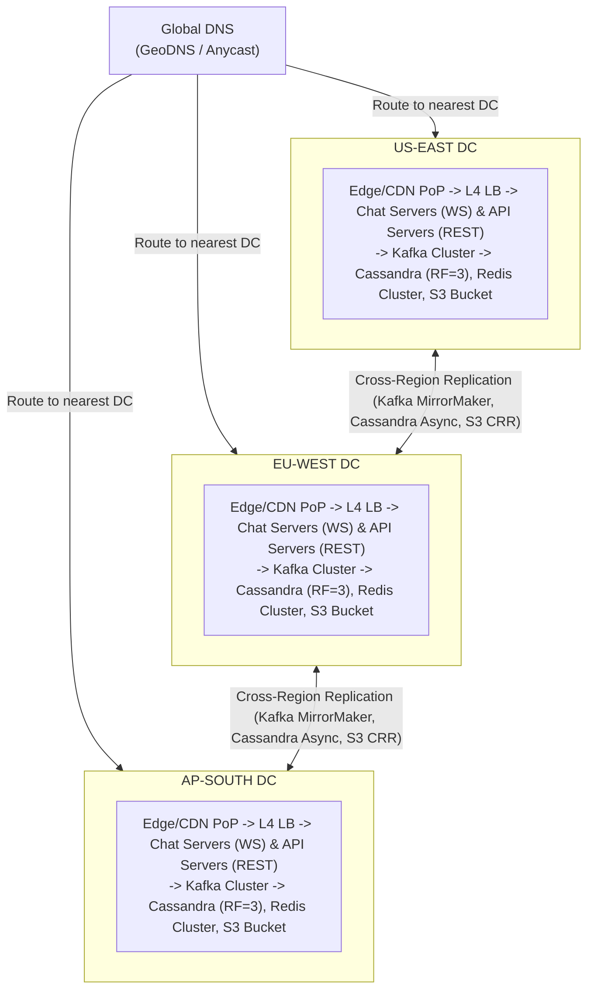

### Capacity Per Data Center

```
┌────────────────────────────────┬──────────────────┐
│ Component                      │ Per Data Center   │
├────────────────────────────────┼──────────────────┤
│ Chat Servers (WebSocket)       │ 1,000 instances  │
│   (50K connections each)       │ = 50M connections │
├────────────────────────────────┼──────────────────┤
│ API Servers (REST)             │ 200 instances    │
├────────────────────────────────┼──────────────────┤
│ Kafka Brokers                  │ 50 brokers       │
│   (100 partitions per topic)   │                  │
├────────────────────────────────┼──────────────────┤
│ Cassandra Nodes                │ 100 nodes        │
│   (RF=3, ~30TB per node)       │ = 1 PB usable    │
├────────────────────────────────┼──────────────────┤
│ Redis Cluster                  │ 30 nodes         │
│   (256GB RAM total)            │                  │
├────────────────────────────────┼──────────────────┤
│ S3 Storage                     │ Regional bucket  │
│                                │ (petabytes)      │
├────────────────────────────────┼──────────────────┤
│ Load Balancers                 │ HA pair (active/ │
│                                │ standby)         │
└────────────────────────────────┴──────────────────┘
```

### Monitoring and Alerting

```
Key metrics to monitor:

  Message Delivery:
    - p50/p95/p99 delivery latency
    - Message delivery success rate (target: 99.99%)
    - Undelivered message queue depth

  WebSocket Health:
    - Active connection count per server
    - Connection churn rate (connects/disconnects per second)
    - WebSocket error rate

  Infrastructure:
    - Kafka consumer lag per partition
    - Cassandra read/write latency
    - Redis memory usage and eviction rate
    - CPU/Memory/Disk per service

  Business Metrics:
    - Messages sent per second (global)
    - DAU / MAU ratio
    - Media upload success rate
    - Push notification delivery rate
```

---

## 12. Common Interview Follow-ups

### How to implement end-to-end encryption?

```
Use the Signal Protocol:

1. Key Generation (per device):
   - Identity Key Pair (permanent)
   - Signed Pre-Key (rotated monthly)
   - 100 One-Time Pre-Keys (single-use)

2. Initial Key Exchange (X3DH):
   Alice wants to message Bob:
   a. Alice fetches Bob's key bundle from server:
      {identity_key, signed_pre_key, one_time_pre_key}
   b. Alice computes shared secret using Triple DH:
      DH1 = DH(Alice_identity, Bob_signed_prekey)
      DH2 = DH(Alice_ephemeral, Bob_identity)
      DH3 = DH(Alice_ephemeral, Bob_signed_prekey)
      DH4 = DH(Alice_ephemeral, Bob_one_time_prekey)  [optional]
      SharedSecret = KDF(DH1 || DH2 || DH3 || DH4)

3. Double Ratchet (per message):
   - Symmetric ratchet: derive new key for each message
   - DH ratchet: new DH exchange periodically
   - Result: every message has a unique encryption key

4. Server never sees plaintext:
   - Server stores and forwards ciphertext only
   - No ability to comply with content-based warrants
   - Metadata (who, when, how much) is still visible

5. Group E2E (Sender Keys):
   - Each member generates a Sender Key
   - Sender Key distributed via pairwise E2E channels
   - Messages encrypted once with Sender Key (efficient)
   - Re-keying when member joins/leaves
```

### How to handle message search?

```
Architecture:

  ┌──────────┐     ┌──────────────┐     ┌───────────────┐
  │ Messages │────>│ Kafka topic: │────>│ Elasticsearch │
  │ (Cassan- │     │ msg.search   │     │ Cluster       │
  │  dra)    │     │              │     │               │
  └──────────┘     └──────────────┘     │ Index:        │
                                        │  - msg text   │
                                        │  - sender     │
                                        │  - conv_id    │
                                        │  - timestamp  │
                                        └───────┬───────┘
                                                │
                                        ┌───────▼───────┐
                                        │  Search API   │
                                        │               │
                                        │ GET /search?  │
                                        │   q=hello&    │
                                        │   conv_id=C1  │
                                        └───────────────┘

  Indexing strategy:
    - Index only conversations the user belongs to
    - Search scoped to user's conversations (authorization)
    - Tokenize with language-specific analyzers
    - Index on write (near real-time, ~1s delay)

  For E2E encrypted chats:
    - Server cannot index encrypted content
    - Client-side search: download and decrypt messages locally
    - Or: maintain client-side search index (SQLite on device)
```

### How to sync across multiple devices?

```
Multi-device sync protocol:

  1. DEVICE REGISTRATION
     Each device gets a unique device_id.
     User account has: [device_1, device_2, device_3]

  2. MESSAGE DELIVERY
     When a message arrives for User A:
       - Deliver to ALL of User A's connected devices
       - Each device independently ACKs delivery
       - Message marked "delivered" when ANY device ACKs

  3. SYNC CURSOR (per device)
     Each device maintains:
       last_synced_msg_id: {conversation_id -> message_id}

     On reconnect:
       Device sends its cursor -> server returns all newer messages

  4. READ SYNC
     When User A reads on Phone:
       - Read receipt sent to server
       - Server pushes "sync:read" event to User A's Tablet and Desktop
       - All devices update unread count

  5. CONFLICT RESOLUTION
     - Messages are append-only (no conflicts)
     - Read status: take the "most advanced" state
     - Typing indicators: per-device, no sync needed
     - Draft messages: last-write-wins or device-local only

  Device A (Phone)    Server    Device B (Tablet)    Device C (Desktop)
       |                |              |                    |
       | Read msg M5    |              |                    |
       |--------------->|              |                    |
       |                |              |                    |
       |                | Sync read    |                    |
       |                |------------->|                    |
       |                |              |                    |
       |                | Sync read    |                    |
       |                |----------------------------------->|
       |                |              |                    |
       |                |   All devices show M5 as read     |
```

### How to handle offline users?

```
Offline message handling:

  1. DETECTION
     - WebSocket disconnects or heartbeat times out
     - Presence key expires in Redis
     - User marked as offline in connection registry

  2. MESSAGE QUEUING
     When message arrives for offline user:
       a. Persist to Cassandra (always, regardless of status)
       b. Add to offline queue:
          Redis LIST: offline:{user_id} -> [msg_id_1, msg_id_2, ...]
       c. Increment unread counter:
          Redis HASH: unread:{user_id} -> {conv_id: count}
       d. Trigger push notification

  3. PUSH NOTIFICATION
     ┌────────────┐     ┌──────────────┐     ┌────────────┐
     │ Notif.     │────>│ APNs (iOS)   │────>│ User Phone │
     │ Service    │     └──────────────┘     └────────────┘
     │            │     ┌──────────────┐     ┌────────────┐
     │            │────>│ FCM (Android)│────>│ User Phone │
     └────────────┘     └──────────────┘     └────────────┘

     Notification payload:
       - Sender name
       - Message preview (first 100 chars)
       - Conversation context
       - Badge count (total unread)

     Notification collapsing:
       - Multiple messages from same conversation -> single notification
       - "Alice: 3 new messages"

  4. RECONNECTION SYNC
     When user comes back online:
       a. Client sends last_seen_msg_id per conversation
       b. Server computes delta from Cassandra
       c. Batch-deliver missed messages (paginated, 50 per batch)
       d. Client ACKs each batch -> server clears offline queue
       e. Reset unread counters as user opens conversations

  5. OFFLINE DURATION HANDLING
     - Short offline (< 1 hour): Full sync from offline queue
     - Medium offline (1-24 hours): Sync + background prefetch
     - Long offline (> 24 hours): Sync recent conversations first,
       lazy-load older conversations on scroll
     - Very long offline (> 30 days): Re-sync only last 30 days,
       older messages available on demand
```

### How to implement typing indicators?

```
Typing indicator protocol:

  Properties:
    - Fire-and-forget (at-most-once delivery)
    - NOT persisted (ephemeral)
    - Rate-limited (max 1 event per 3 seconds per user per conversation)
    - Auto-expires after 5 seconds of no update

  Flow:
  User A (typing)        Chat Server        User B (viewing)
       |                      |                    |
       | 1. {type:"typing",   |                    |
       |     conv_id:"C1",    |                    |
       |     action:"start"}  |                    |
       |--------------------->|                    |
       |                      |                    |
       |                      | 2. Forward         |
       |                      |    (no persistence,|
       |                      |     no Kafka)      |
       |                      |------------------->|
       |                      |                    |
       |                      |    3. UI shows     |
       |                      |    "Alice is       |
       |                      |     typing..."     |
       |                      |                    |
       | (User stops typing)  |                    |
       |                      |                    |
       | 4. {type:"typing",   |                    |
       |     conv_id:"C1",    |                    |
       |     action:"stop"}   |                    |
       |--------------------->|                    |
       |                      |                    |
       |                      | 5. Forward         |
       |                      |------------------->|
       |                      |                    |
       |                      |    6. UI hides     |
       |                      |    typing indicator|

  Optimization for groups:
    - Only send typing to members who have the conversation open
    - In large groups (>50), show "3 people are typing..."
      instead of individual indicators
    - Aggregate typing events server-side to reduce fan-out

  Client-side logic:
    - Start typing event: first keystroke, then throttle to 1 per 3s
    - Stop typing event: 5s after last keystroke OR message sent
    - Receiving side: auto-hide indicator after 5s without update
      (handles case where "stop" event is lost)
```

---

## Summary: Key Design Decisions

```
┌────────────────────────────┬──────────────────────────────────────────┐
│ Decision                   │ Choice & Rationale                        │
├────────────────────────────┼──────────────────────────────────────────┤
│ Real-time protocol         │ WebSocket (full-duplex, low overhead)    │
│ Message storage            │ Cassandra (write-heavy, time-series)     │
│ User/group metadata        │ PostgreSQL (relational, strong consistency)│
│ Caching layer              │ Redis (sessions, presence, hot data)     │
│ Message queue              │ Kafka (decouple, buffer, replay)         │
│ Media storage              │ S3 + CDN (scalable, global distribution) │
│ Message IDs               │ Snowflake (time-ordered, distributed)    │
│ Group < 500 strategy       │ Fan-out on write (low read latency)     │
│ Channel > 500 strategy     │ Fan-out on read (write efficiency)      │
│ Presence                   │ Heartbeat + Redis TTL (simple, reliable)│
│ Multi-region               │ Active-active with async replication    │
│ Delivery guarantee         │ At-least-once + idempotency             │
│ Ordering                   │ Per-conversation sequence numbers       │
│ Encryption                 │ Signal Protocol (E2E for 1-on-1)        │
│ Search                     │ Elasticsearch (full-text, near real-time)│
└────────────────────────────┴──────────────────────────────────────────┘
```

### Interview Tips

1. **Start with requirements.** Clarify scope before designing. Ask: "Is this more like WhatsApp (mobile, E2E) or Slack (channels, integrations)?"

2. **Mention WebSocket early.** This is the defining protocol choice. Explain why polling does not work at scale.

3. **Draw the high-level diagram first.** Show Chat Servers, API Servers, Kafka, Storage, Presence, and Push Notification as separate components.

4. **Deep-dive strategically.** Pick 2-3 areas to go deep: message delivery flow, group chat fan-out, and presence are the most impactful.

5. **Address scale explicitly.** Back-of-envelope calculations for connections, storage, and bandwidth show you think about real-world constraints.

6. **Do not forget offline.** A chat system that only works when both users are online is not a real chat system. Offline queuing and push notifications are essential.

7. **Mention E2E encryption.** Even if not asked, briefly mentioning the Signal Protocol shows awareness of security, a differentiator in senior-level interviews.

8. **Trade-offs matter.** For every decision (Cassandra vs MySQL, fan-out on write vs read), articulate the trade-off. There is no perfect answer, only well-reasoned choices.
