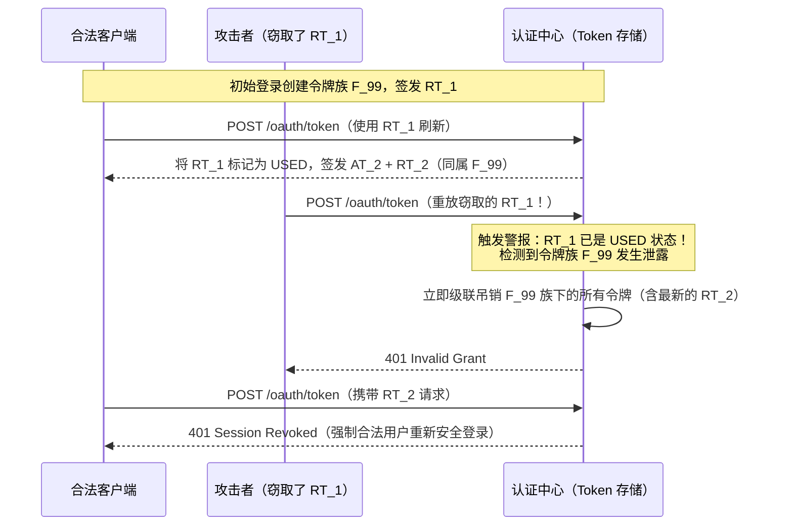

# 认证与授权

## 这是什么？

认证就是证明"你是谁"。授权就是决定"你能干什么"。几乎所有 Web 应用都需要这两样。你登录的时候，这是认证。系统判断你能不能看管理后台，这是授权。

## 为什么要懂？

认证是你应用的大门。搞砸了就是未授权访问、数据泄露、用户投诉。作为开发者，几乎每个项目都要碰认证代码——写登录页、保护 API 接口、对接第三方身份认证。不懂业务逻辑的话，你要么把所有人锁在门外，要么把大门敞开。

## 业务流程

### 注册流程

1. 用户填写注册表单（邮箱、密码，可能还有姓名）
2. 系统校验：邮箱是不是已经被注册了？密码够不够强？
3. 系统创建用户记录，对密码做哈希（绝对不能存明文）
4. 系统发一封验证邮件，里面有一次性链接
5. 用户点击链接 → 账号激活

### 登录流程

1. 用户输入邮箱 + 密码
2. 系统拿密码和存储的哈希值做比对
3. 如果匹配，创建 Session 或签发 JWT Token
4. Token/Session 返回给客户端，存在 Cookie 或 localStorage 里
5. 之后每次请求都带上这个 Token 来标识身份

### 授权检查

1. 用户尝试访问某个资源（比如 `/admin/dashboard`）
2. 系统读取 Token，识别出用户
3. 系统检查：这个用户有没有所需的角色/权限？
4. 有 → 放行。没有 → 返回 403 Forbidden

### 登出

1. 用户点"退出登录"
2. 客户端：删除 Token/Cookie
3. 服务端：销毁 Session（如果用 Session），或把 Token 加入黑名单（如果用 JWT）

## 常见术语

| 术语                      | 解释                                                                          |
| ------------------------- | ----------------------------------------------------------------------------- |
| **认证 (AuthN)**          | 验证身份——"你是谁？"                                                          |
| **授权 (AuthZ)**          | 检查权限——"你能干什么？"                                                      |
| **OAuth 2.0**             | 一种协议，让用户通过 Google、GitHub 等登录你的应用，而不需要把密码告诉你      |
| **OpenID Connect (OIDC)** | 在 OAuth 2.0 之上加了身份信息层（不光知道能访问什么，还知道用户是谁）         |
| **SSO（单点登录）**       | 登录一次，多个应用都能用。企业常见（Okta、Azure AD）                          |
| **MFA / 2FA**             | 多因素认证——除了密码还要第二个凭证（短信验证码、Authenticator App、硬件密钥） |
| **JWT**                   | JSON Web Token——自包含的令牌，携带用户信息和权限，有签名防篡改                |
| **Session**               | 服务端存储的用户状态。客户端只持有一个 Session ID（通常在 Cookie 里）         |
| **RBAC**                  | 基于角色的访问控制——给用户分配角色（管理员、编辑、只读），每个角色有特定权限  |
| **ABAC**                  | 基于属性的访问控制——按部门、地区、时间等属性判断权限。比 RBAC 灵活，也更复杂  |
| **Refresh Token**         | 长期有效的令牌，用于获取新的 Access Token，不需要重新登录                     |
| **SAML**                  | 一种较老的 SSO 协议，企业环境中仍然广泛使用                                   |
| **API Key**               | 一个简单的字符串，标识客户端应用（不是用户），用于服务端之间通信              |
| **预注册账户劫持 (Pre-ATO)** | 攻击者在真实用户使用 OAuth/SSO 登录前，先用受害者邮箱抢注未验证的密码账号，待受害者关联社交登录时利用残留密码控制账号 |
| **企业域名认领 (Domain Capture)** | 企业通过 DNS TXT 记录证明对邮箱域名（如 `@acme.com`）的所有权，从而将该域名下所有账号纳入企业 SSO 管控 |
| **Refresh Token 轮换 (RTR)** | 每次用 Refresh Token 换取新 Access Token 时同时签发新的 Refresh Token，并将旧令牌立即标记为已使用 |
| **令牌族 (Token Family)** | 从同一次初始登录衍生出的所有 Refresh Token 链条；一旦链条中任一历史令牌被重放，整族令牌全部吊销 |
| **阶梯式二次认证 (Step-Up Auth)** | 已登录用户在执行高危操作（如提现、生成生产密钥）前，要求在短时间窗口内重新验证密码或 MFA |
| **`amr` / `acr` 声明**    | OIDC 令牌中记录认证方式（如 `pwd`、`mfa`、`hwk`）与认证安全等级的标准字段 |

## 常见模式

### 模式一：基于 Session 的认证（传统方式）

用户登录 → 服务端创建 Session → 把 Session ID 存在 Cookie → 每次请求带上 Cookie → 服务端查找 Session。

**适用场景：** 传统 Web 应用、服务端渲染页面、需要方便地使 Session 失效的场景。

**取舍：** 需要服务端存储（内存、Redis、数据库）。水平扩展比较难，因为 Session 是有状态的。

### 模式二：基于 Token 的认证（JWT）

用户登录 → 服务端生成 JWT → 发给客户端 → 客户端每次请求在 `Authorization` 头里带上 → 服务端只验签名，不需要查任何东西。

**适用场景：** SPA、移动端应用、微服务。Token 是自包含的。

**取舍：** 在 JWT 过期前很难主动让它失效（没有服务端 Session 可删）。变通方案：短过期时间 + Refresh Token。

### 模式三：OAuth 2.0 / 社交登录

用户点"用 Google 登录" → 跳转到 Google 登录页 → 用户授权你的应用 → Google 跳回并带一个授权码 → 你的服务端用授权码换 Token → 你就有了用户信息。

**适用场景：** "用 Google/GitHub/Apple 登录"，代表用户访问第三方 API。

**取舍：** 流程复杂（多次跳转）。依赖第三方的可用性。

### 模式四：SSO（企业场景）

员工访问你的应用 → 跳转到公司的身份认证服务（Okta、Azure AD） → 在那里登录 → 跳回你的应用，带着 SAML 断言或 OIDC Token → 你的应用信任这个身份认证服务。

**适用场景：** B2B SaaS，企业客户希望员工用公司账号登录。

**取舍：** 集成比较复杂。每个客户可能用不同的身份认证服务。

## 踩坑提醒

- **密码重置流程**：不要透露某个邮箱是否在你的系统中注册过。应该说"如果该邮箱已注册，你将收到重置链接"——否则攻击者可以枚举用户。
- **Token 存储**：如果你的应用有 XSS 漏洞，不要把 JWT 存在 localStorage。HttpOnly Cookie 更安全。
- **Session 固定攻击**：登录后一定要重新生成 Session ID。否则攻击者可以预先设置一个 Session ID 来劫持用户会话。
- **OAuth state 参数**：OAuth 流程中一定要用 `state` 参数防止 CSRF 攻击。
- **角色膨胀**：从少量角色开始。创建几十个细粒度角色的公司最终会变成一团乱麻。
- **只保护了前端**：你给前端加了认证，但 API 接口是裸奔的。永远在服务端做认证检查。
- **硬编码密钥**：绝对不要把 API Key 或密钥放在前端代码里。打开 DevTools 就能看到。

## 行业实战经验与非显而易见的最佳实践

### 1. 预注册账户劫持（Pre-Account Takeover / 未验证邮箱抢注漏洞）

当系统支持"邮箱密码登录"与"第三方 OAuth/SSO 登录（如用 Google 登录）"并按邮箱地址自动合并账号时，极易踩中经典的 **Pre-ATO（Pre-Account Takeover）** 漏洞：

1. **抢注埋雷**：攻击者得知 `victim@company.com` 即将使用你的 SaaS 产品，先用 `victim@company.com` 和攻击者自己设定的密码注册一个账号。由于攻击者进不去受害者邮箱，该账号处于 `email_verified = false` 状态。
2. **受害者触发**：两周后，真正的受害者访问你的应用，点击**"通过 Google 继续"**。Google 返回的 OIDC 令牌包含 `email: "victim@company.com"` 且 `email_verified: true`。
3. **致命的自动合并**：你的后端发现数据库里已经有一条 `victim@company.com` 的记录，于是直接把 Google 身份绑定到这条记录上，顺手把 `email_verified` 改成了 `true`。
4. **静默劫持**：合并之后，攻击者当初设定的密码（或抢注时留下的活跃 Session）**依然有效**！受害者后续创建的所有工作空间、API 密钥和敏感数据，攻击者都能直接用密码登录查看。

| 存量账号状态 | 传入的 OAuth/SSO 声明 | 安全的生产级处理策略 |
| ------------ | --------------------- | -------------------- |
| `email_verified: true` | `email_verified: true` | 仅在身份提供商（IdP）权威可信时自动关联，或提示用户输入一次原密码确认关联 |
| `email_verified: false` | `email_verified: true` | **覆写隔离（Overwrite）**：清空未验证账号原先的密码哈希、吊销所有历史 Session，让已验证的 OAuth 身份干净地接管该邮箱 |
| 任意状态 | `email_verified: false` | **严禁自动关联**：直接拒绝，或强制走完一次邮箱验证邮件闭环后再允许绑定 |

### 2. 企业 SSO"域名认领（Domain Capture）"与存量影子 IT 账号的冲突

在 B2B SaaS 中，几乎所有企业客户在 IT 部门正式采购企业版并开启 SAML/OIDC SSO 之前，公司员工早就自己用 `@acme.com` 邮箱注册过零散的个人账号（即"影子 IT / Shadow IT"）。

当 Acme 公司的 IT 管理员通过 DNS `TXT` 记录验证了 `acme.com` 的域名所有权，并开启**"强制 `@acme.com` 全员走 SAML SSO"**时，考虑不周的系统会引发三大生产事故：

- **个人隐私泄露给雇主**：某员工在域名被公司认领前，用 `alice@acme.com` 创建了存放私人副业文档的工作空间。如果你直接把账号所有权静默划归给企业管理员，公司 IT 就能直接看到她的私人数据。
- **孤儿账单与重复扣费**：40 名员工之前用个人信用卡绑了 ¥150/月的 Pro 订阅。强制转入企业 SSO 时如果不自动取消或按比例退还这些 Stripe 个人订阅，会引发大量重复扣费投诉与拒付。
- **IdP 故障导致全员锁死**：如果公司的 Okta 宕机或 SAML 签名证书过期，IT 管理员自己也无法通过 SSO 登录你的后台去上传新证书。

**生产级最佳实践：**
1. **账号认领迁移向导**：域名被企业认领后，存量 `@acme.com` 用户下次登录时弹出向导，让用户二选一：*(a) 将账号并入 Acme 企业组织*，或 *(b) 将账号绑定邮箱修改为个人邮箱（如 `@gmail.com`）以保留私人工作空间*。
2. **应急破窗（Break-Glass）管理员通道**：为组织所有者保留一个受硬件密钥（WebAuthn MFA）和一次性恢复码保护的独立应急登录入口，确保在客户 IdP 崩溃或 SAML 证书过期时仍能进后台修复配置。

### 3. Refresh Token 轮换（RTR）、重放检测与令牌族（Token Family）级联吊销

由于无状态 JWT Access Token 在过期前难以主动吊销，现代 SPA 和移动端通常将 Access Token 有效期设得很短（5～15 分钟），配合长期有效的 Refresh Token 换取新令牌。但如果攻击者通过 XSS 或木马窃取了 Refresh Token，就能无限期续命。

**解决方案——Refresh Token 轮换与令牌族追踪（RFC 6819 / OAuth 2.1）：**
每次用户完成初始登录时创建一个 `token_family_id`。每当客户端用 `RT_1` 刷新令牌时，服务端将 `RT_1` 标记为 `status = used`（切记不要直接从数据库物理删除！），并在同一令牌族下签发 `RT_2`。

- **为什么不能用完即删？** 如果刷新时直接 `DELETE` 掉 `RT_1`，当攻击者拿着偷来的 `RT_1` 来请求时，你只能查到"令牌不存在"，无法区分这是普通的过期请求还是正在发生的盗用，也就无法顺藤摸瓜吊销攻击者可能已经拿到的衍生令牌 `RT_2`。保留 `used` 状态正是为了充当"绊发雷"。
- **弱网重试宽限窗口**：移动端在电梯或地铁等弱网环境下，可能因为未收到响应而对同一个 `RT_n` 发起并发重试。生产环境中通常会给相同 IP / TLS 指纹的同一枚 `RT_n` 留出 5～10 秒的幂等宽限窗口，避免因网络抖动误杀正常用户会话。

### 4. 高危写操作的阶梯式二次认证（Step-Up Authentication）

一个合法的 Session Cookie 或 JWT 只能证明用户在**过去某个时刻**（比如 14 天前勾选了"记住我"）通过了认证，既不能证明此刻坐在未锁屏电脑前的是号主本人，也不能证明会话在 10 分钟前没有被劫持。

对于高危变更操作——**生成生产环境 API Key、批量导出客户 PII 数据、修改收款银行卡、关闭 MFA、转让组织所有权**——必须强制执行**阶梯式二次认证（Step-Up Auth）**：

1. **在会话/JWT 中记录认证上下文**：写入 `auth_time`（最近一次交互式验证身份的 Unix 时间戳）和 `amr`（Authentication Methods Reference，如 `["pwd", "mfa", "hwk"]`）。
2. **网关/中间件策略拦截**：当调用 `POST /api/v1/payout-bank` 时，权限中间件不仅检查角色，还要校验：
   - `amr` 中是否包含 `"mfa"` 或硬件密钥 `"hwk"`？
   - 是否满足 `now() - auth_time < 300`（即 5 分钟内刚完成过核身）？
3. **平滑挑战升级（Challenge-Response）**：若不满足，接口**不会**把用户踢下线，而是返回 `403 Forbidden` 及结构化载荷 `{ "error": "step_up_required", "required_acr": "aal2", "max_age": 300 }`。前端捕获后原地弹出 Passkey 指纹或 TOTP 验证码弹窗，验证通过后换取带有最新 `auth_time` 的高权限令牌并自动重放刚才的请求。

## 速查表

| 场景                   | 推荐方案                                                       |
| ---------------------- | -------------------------------------------------------------- |
| 传统 Web 应用          | 基于 Session 的认证 + Cookie                                   |
| SPA / 移动端           | 短效 JWT（5–15 分钟）+ Refresh Token 轮换与令牌族重放检测      |
| "用 Google 登录"       | OAuth 2.0 + OpenID Connect（已验证邮箱匹配时覆写未验证密码态） |
| 企业 B2B               | SAML/OIDC SSO + DNS 域名认领迁移向导 + 管理员破窗应急登录      |
| API 对 API             | API Key 或 OAuth 2.0 Client Credentials Grant / mTLS           |
| 需要更高安全性         | 加 MFA（TOTP、WebAuthn 通行密钥）                              |
| 高危操作（改收款/密钥）| 阶梯式二次认证（校验 `amr` 含 MFA 且 `now - auth_time < 300s`）|
| 微服务                 | JWT 在服务间传递，网关验证                                     |

