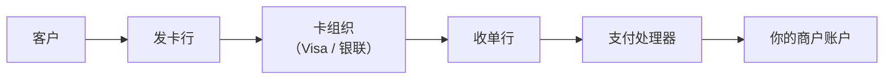
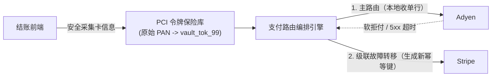

# 支付处理

## 这是什么？

支付处理就是在线交易中钱从买家到卖家的过程。这里面涉及多方——客户、商家（你）、支付网关、支付处理器、卡组织（Visa、Mastercard、银联）、以及双方的银行。作为 Web 开发者，你负责的是构建结账体验，并对接 Stripe、支付宝、微信支付等处理实际资金流动的服务。

## 为什么要懂？

钱是你应用里最敏感的东西。支付代码出 bug 意味着收入损失、重复扣款、愤怒的客户，甚至法律纠纷。即使你用 Stripe 从不碰原始卡号，你仍然需要理解业务流程——钱到底什么时候真正动了？退款是怎么回事？什么是拒付，为什么太多拒付会很可怕？

## 业务流程

### 结账流程

1. **购物车 → 结账**：用户点"购买" → 系统计算总额（商品 + 税 + 运费 - 折扣）
2. **选择支付方式**：信用卡、PayPal、支付宝、微信支付、银行转账等
3. **创建支付意图**：你的服务端向支付网关创建支付意图（如 Stripe 的 `PaymentIntent`）
4. **收集卡信息**：用户在网关的安全表单中输入卡号（绝不在你的服务器上）
5. **授权**：网关发送卡信息到处理器 → 处理器问发卡行"这张卡有 500 元吗？" → 银行说有或没有
6. **预扣**：如果授权通过，钱被冻结（还没转账）。订单状态是"待支付"
7. **捕获**：你确认订单 → 网关捕获冻结金额 → 钱开始流动
8. **结算**：通常 1-3 个工作日后，钱到达你的商户账户（扣除手续费）

### 钱的实际流向

每一跳都有人抽一小笔手续费。这就是为什么支付处理要收 2-3% 的费用。

### 退款

1. 客户请求退款（或你主动发起）
2. 你调用网关的退款 API
3. 网关通过相同链路反向操作
4. 钱退回客户的卡（3-10 个工作日）
5. 你失去交易金额，而且通常支付手续费不退

### 拒付（争议）

1. 客户打电话给银行说"我没授权这笔交易"或"我没收到商品"
2. 银行立即从你这里把钱扣回去
3. 你收到拒付通知，有一个截止日期来回应
4. 你必须提供证据（收据、物流证明、日志）来申诉
5. 银行决定谁赢。如果你输了，你要付金额 + 拒付手续费（约 100-200 元）
6. 拒付率太高（>1%）→ 你的支付账户会被标记或关停

## 常见术语

| 术语                | 解释                                                                       |
| ------------------- | -------------------------------------------------------------------------- |
| **支付网关**        | 你对接的服务（Stripe、PayPal、支付宝）。处理和银行之间的安全通信           |
| **支付处理器**      | 在卡组织网络中路由交易的后端。通常网关也是处理器                           |
| **商户账户**        | 专门用于接收卡交易款项的银行账户                                           |
| **授权**            | 检查卡是否有效且有余额。还没有扣款                                         |
| **捕获**            | 实际扣取已授权的金额。现在钱动了                                           |
| **授权 + 捕获**     | 两步流程。有些商家先授权后捕获（比如酒店）                                 |
| **结算**            | 钱实际到达你的账户（1-3 个工作日）                                         |
| **拒付**            | 客户通过银行对一笔交易提出争议。对商家非常不利                             |
| **PCI DSS**         | 支付卡行业数据安全标准——处理卡数据的规则。用 Stripe 的托管表单基本就合规了 |
| **3D Secure (3DS)** | 额外的身份验证步骤。把欺诈责任从商家转移到银行                             |
| **幂等键**          | 你随支付请求发送的唯一标识，防止重试导致重复扣款                           |
| **Webhook**         | 支付网关在事件发生时给你发 HTTP 回调（支付成功、退款完成、争议开启）       |
| **PSP（支付服务商）** | 整合了支付网关与收单处理能力的第三方服务商（如 Stripe、Adyen、Checkout.com） |
| **网络令牌 (VTS / MDES)** | 由卡组织（Visa Token Service / Mastercard MDES）签发的动态令牌，替代 16 位原始卡号（PAN），实体卡挂失补卡后依然有效 |
| **卡账户自动更新器 (CAU)** | 卡组织提供的自动同步服务，当用户信用卡到期续卡或补办新卡时自动推送新有效期与新卡号 |
| **CIT / MIT**       | 持卡人主动发起交易（CIT，结账页在线操作）与商户发起交易（MIT，后台周期性代扣或延迟发货扣款） |
| **VDMP / VAMP**     | Visa 拒付监控计划——当商户月拒付率超过约 0.9% 红线时触发高额罚金、滚动保证金冻结甚至关户拉黑 |
| **争议前自动拦截 (RDR / Ethoca)** | Visa Verifi RDR 与 Mastercard Ethoca 预警机制，允许商户在银行争议正式转为拒付前自动退款以保住拒付率 |
| **增量授权 (Incremental Auth)** | 在最终捕获前动态调高已冻结的预授权金额（常见于酒店杂费、网约车绕路、生鲜称重补差） |

## 常见模式

### 模式一：跳转到托管收银台

客户点"支付" → 跳转到 Stripe Checkout（或支付宝收银台） → 在那里完成支付 → 跳回你的成功页面。

**适用场景：** 最简单的集成。你永远不碰卡数据。适合小商户和 MVP。

**取舍：** 对 UI 控制有限。用户会短暂离开你的网站。

### 模式二：嵌入式支付表单

你把 Stripe Elements（或类似组件）直接嵌入你的页面。表单看起来像你网站的一部分，但卡数据直接发给 Stripe——永远不经过你的服务器。

**适用场景：** 大多数生产应用。你想要无缝的结账体验。

**取舍：** 集成工作更多，但仍然 PCI 安全，因为卡数据绕过了你的服务器。

### 模式三：服务端支付（基于 API）

你的服务端通过 API 创建支付意图并管理整个流程。用于订阅、市场平台或复杂流程。

**适用场景：** 循环计费、市场平台分账、自定义结账流程。

**取舍：** 最复杂。你需要健壮的错误处理、Webhook 处理和幂等性。

## 踩坑提醒

- **重复扣款**：如果支付请求超时，不要在没有幂等键的情况下重试。第一个请求可能已经成功了。
- **Webhook 才是真相来源**：不要只依赖客户端跳转。用户可能关了浏览器。永远通过 Webhook 确认支付状态。
- **币种问题**：$10.00 在大多数支付 API 中表示为 `1000`（分）。搞混元和分是经典 bug。
- **税费计算**：税务规则极其复杂（因州、国家、商品类型而异）。用 Stripe Tax 或类似服务，别自己算。
- **部分退款**：你可以退一笔支付的一部分。跟踪已退金额，避免退超了。
- **支付失败是正常的**：卡过期、余额不足、风控拦截。你的应用需要优雅地处理失败。
- **PCI 合规**：即使用 Stripe，你也有些责任（HTTPS、不记录卡数据、不存 CVV）。
- **测试**：用测试卡号。绝不在开发环境用真卡。
- **市场平台支付**：如果你在建市场平台（卖家也要收款），你需要分账或关联账户（Stripe Connect）。复杂度大幅增加。

## 行业实战经验与非显而易见的最佳实践

### 1. 多支付服务商（Multi-PSP）路由编排与级联故障转移

当交易规模上量后，单押一家支付通道（如只用 Stripe）不仅存在单点故障风险，还会因为跨境收单引起的**误拒（False Declines）**白白损失 2%～5% 的营收（发卡行对境外收单行的风控拦截率远高于本地收单行）。

成熟的生产级支付架构会在多个 PSP（Stripe、Adyen、Braintree、Checkout.com）前端部署一层独立的 **PCI 合规令牌保险库（PCI Token Vault）**（如 Basis Theory、Spreedly、Hyperswitch 或自建 PCI Level 1 隔离区）：

- **基于卡 BIN 与币种的智能路由**：解析银行卡前 6～8 位（**IIN/BIN**）识别发卡国与卡级别，将交易优先路由至在该国拥有**本地收单牌照（Local Acquiring）**的 PSP，可将授权通过率从跨境收单的约 82% 提升至本地收单的 94% 以上。
- **严禁对硬拒付（Hard Decline）做级联重试**：仅当主通道出现 5xx 超时或特定无欺诈嫌疑的软拒付（如 `issuer_unavailable`、普通 `do_not_honor`）时才切换备选 PSP。如果对 `stolen_card`（盗刷卡）或 `invalid_account`（无效账户）跨多个通道强行重试，会直接触发卡组织的风控速率警报并招致巨额罚款。

### 2. 卡组织网络令牌化（Visa VTS / Mastercard MDES）与卡账户自动更新器（CAU）

当用户在平台绑卡时，普通集成保存的是 PSP 内部生成的令牌（如 `pm_123`），其底层绑定的依然是静态的 16 位原始卡号（**FPAN**）和有效期。一旦用户的实体卡到期换新或遗失补办，旧卡号即刻作废，导致后续自动扣费全部失败（**非自愿流失 / Involuntary Churn**）。

两大卡组织原生机制可彻底解决这一痛点，并将整体授权通过率提升 **2%～4%**：

1. **网络令牌化（Network Tokenization：Visa VTS / Mastercard MDES）**：不再绑定静态的 16 位实体卡号，而是向 Visa 或 Mastercard 直接申请一枚与持卡人底层银行账户绑定的**网络令牌（DPAN）**。
   - 当用户挂失旧卡或到期换发新实体卡时，发卡行会在卡组织网络内部实时更新 FPAN 与 DPAN 的映射关系，你保存的网络令牌**无需用户任何操作即可继续成功扣款**。
   - 每次交易时网络令牌都会附带动态生成的加密签名（Cryptogram），因此发卡行信任度更高、交换费率（Interchange Fee）也更低。
2. **卡账户自动更新器（Card Account Updater, CAU）**：针对尚未支持网络令牌的存量卡，CAU 会在扣费周期前批量或实时查询卡组织的换卡目录，自动刷新过期年月或替换重发的新卡号，并通过 `payment_method.updated` Webhook 同步给你的业务库。

### 3. Visa/Mastercard 0.9% 拒付红线（VDMP / VAMP）与争议前自动退款拦截

许多开发者误以为遇到恶意拒付（Chargeback）只要提交物流签收记录去申诉（Representment），打赢了官司就不会留案底。**这两个认知在生产环境中会害死公司：**

- **哪怕申诉打赢，拒付依然计入你的拒付率！** 卡组织计算拒付率的公式是 $\text{当月发生的拒付总笔数} \div \text{当月交易总笔数}$。申诉成功只能帮你拿回那笔货款，**绝对不会把这笔拒付从你的 Visa/Mastercard 拒付率分子中抹掉**。
- **0.9% 死亡红线**：一旦单月拒付率突破 **0.9% 且满 100 笔**，商户就会被打入 **Visa 拒付监控计划（VDMP / VAMP）** 或 Mastercard 超额拒付计划（ECP），面临每笔 $25～$100+ 的额外罚金、强制整改审计、冻结 10%～25% 营收长达 90 天的滚动保证金（Rolling Reserve），甚至直接吊销收单账户并拉入全球收单黑名单（**MATCH List**）。

| 评估维度 | 硬刚拒付申诉（Representment） | 争议前自动退款拦截（Verifi RDR / Ethoca） |
| -------- | ----------------------------- | ----------------------------------------- |
| **对卡组织拒付率的影响** | **100% 计入 0.9% 红线指标**（赢了也算！） | **0% 影响**（在演变为正式拒付前已被拦截化解） |
| **费用成本** | $15–$25 拒付处理费 + 进入监控名单后的高额罚金 | $10–$20 预警拦截费，$0 拒付罚款 |
| **胜率与经济账** | 胜率仅 20%–40%，耗时 60 天且消耗大量人工审核成本 | 针对中小额订单（< $50–$75）毫秒级自动全额退款止损 |

**生产级铁律**：接入 **Visa Verifi RDR（快速争议解决）** 和 **Mastercard Ethoca Alerts**。配置自动化规则：只要争议金额低于设定阈值（例如 $< \$75$），在发卡行接到客户投诉电话的瞬间自动触发原路退款，将该笔投诉直接转化为普通退款，从源头阻止其写入卡组织的拒付账本。

### 4. 预授权过期、增量授权（Incremental Auth）与部分捕获的边界陷阱

把"预授权成功（Authorized）"等同于"钱已经稳稳锁住，等仓库发货再扣款就行"，在遇到实物电商缺货、预售延期或称重商品时会引发严重的资金事故：

1. **预授权冻结的 7 天过期悬崖**：标准的 Visa/Mastercard 线上无卡交易（CNP）预授权有效期通常只有 **7 个自然日**（部分借记卡网络甚至只有 24～72 小时；除非支付更高费率显式申请 30 天扩展预授权）。如果商品缺货延迟到第 10 天才发货，此时你去捕获（Capture）原先的 `auth_id`：
   - 银行侧的资金冻结早已静默解冻释放。
   - 捕获请求会直接报错失败，或者因逾期清算被卡组织收取惩罚性手续费。
   - **正确解法**：对于预计发货时间超过 5 天的预售/调拨订单，结账时应使用 0 元/1 元的 `SetupIntent`（配合 3DS 完成 CIT 强验证并安全存卡），待仓库实际扫码打包时再发起后台无感代扣（**MIT，商户发起交易**）；或者在 7 天窗口到期前定时滚动续期预授权。
2. **部分捕获（Partial Capture）必须显式释放剩余额度**：客户下单 3 件商品共冻结 ¥1000，仓库拣货时发现其中 1 件（¥300）缺货，于是你只捕获了 ¥700。如果你在调用捕获接口时没有显式传入 `final_capture: true`（或立即对剩余 ¥300 发送 **Authorization Reversal 预授权撤销**指令），客户银行卡里的 ¥300 会继续被死死冻结一周，导致客户看到"扣了 ¥1000 又扣了 ¥700"的账单短信而疯狂投诉。
3. **增量授权（Incremental Authorization）**：在生鲜配送（按实际称重计价）、酒店入住、网约车或充电桩场景中，最终结算金额往往高于初始预估金额（例如预授权 $100，称重后实付 $114）。不要试图单独再刷一笔 $14 的新交易（没有 CVV/3DS 极易被风控拒付），而应使用卡组织支持的**增量授权**接口，在最终捕获前将原预授权单的冻结额度从 $100 平滑追加至 $114。

## 速查表

| 场景                     | 推荐方案                                                               |
| ------------------------ | ---------------------------------------------------------------------- |
| 简单一次性购买           | 托管收银台（Stripe Checkout）                                          |
| 自定义结账 UI            | 嵌入式支付表单（Stripe Elements）                                      |
| 循环计费 / 绑卡代扣      | 订阅 API + 卡组织网络令牌（VTS/MDES）+ 卡账户自动更新器（CAU）         |
| 市场平台分账             | Stripe Connect / 支付宝分账                                            |
| 高可用与跨境高通过率     | PCI 令牌保险库 + 多 PSP 路由编排（按卡 BIN 走本地收单 + 软拒付故障转移）|
| 实物发货与预售大额订单   | 授权 + 捕获（超 7 天发货需用 CIT SetupIntent 存卡 + 发货时触发 MIT）   |
| 最终金额浮动（生鲜/酒店）| 捕获前发起增量授权（Incremental Auth）+ 部分捕获后显式撤销剩余冻结额度 |
| 防欺诈与拒付率控制（<0.9%）| 开启 3DS2 + 接入 Verifi RDR / Ethoca 对中小额争议自动退款拦截          |
| 退款                     | 始终通过带幂等键的 API 处理，永远不要手动调余额                        |

