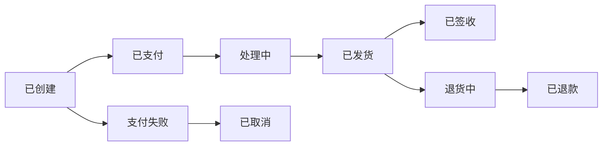
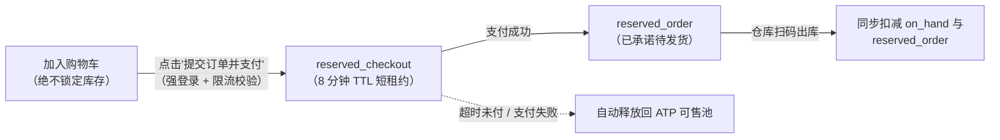

# 电商

## 这是什么？

电商就是在网上卖东西。作为开发者，你在搭建数字店铺——商品目录、购物车、结账流程、订单管理，以及连接客户点击和实际发货之间的一切。不管是淘宝级别的大规模零售还是小型独立站，底层的业务流程都是一样的。

## 为什么要懂？

电商是你最常碰到的 Web 应用类型之一。即使你的公司不是零售商，你也大概率会遇到电商模式：商品列表、购物车逻辑、订单状态机、库存跟踪、定价规则。理解业务流程能避免你写出"代码没问题但现实中用不了"的东西——比如一个不处理缺货的结账页，或者一个忘了运费的购物车。

## 业务流程

### 商品目录

1. **创建商品**：管理员添加商品，包含名称、描述、图片、价格、SKU
2. **规格/变体**：一件 T 恤有 S/M/L 和红/蓝两种颜色 → 6 个变体，每个有自己的 SKU 和库存
3. **分类与标签**：商品按分类组织（电子产品 > 手机），打上标签方便搜索
4. **定价**：原价、促销价、批发价、会员价——价格可以非常复杂
5. **可见性**：商品可以是草稿、上架或下架状态。只有上架的商品显示在店铺里

### 购物车

1. 用户点"加入购物车" → 商品加入购物车（存在 Session、Cookie 或数据库中）
2. 购物车显示商品、数量、小计
3. 用户可以修改数量或删除商品
4. 每次修改都重新计算：小计 + 税 + 运费 - 折扣 = 总计
5. 对于已登录用户，购物车通常跨设备同步

### 结账

1. **收货地址**：用户填写寄送地址
2. **配送方式**：不同选项有不同费用和时效（普通、快递、次日达）
3. **税费计算**：根据收货地和商品类型计算
4. **优惠码**：在支付前使用。验证在服务端进行
5. **支付**：参见[支付处理](02-PAYMENT.md)
6. **订单确认**：系统创建订单记录，发送确认邮件，清空购物车

### 订单生命周期

这是一个状态机——电商中最重要的概念之一：

- **已创建**：订单下了，等待支付
- **已支付**：支付确认
- **处理中**：仓库在拣货打包
- **已发货**：交给快递，有快递单号了
- **已签收**：快递确认送达
- **退货中**：客户发起了退货
- **已退款**：钱退回给客户
- **已取消**：订单被取消（客户或系统取消）

### 库存管理

1. 每个商品/变体有一个库存数量
2. 下单时，库存被**预留**（扣减或冻结）
3. 发货时，预留变成实际扣减
4. 取消订单时，库存释放回去
5. 低库存触发预警。零库存在店铺显示"已售罄"

### 退换货

1. 客户在退货期内（通常 7-30 天）申请退货
2. 系统生成退货授权（RMA 编号）
3. 客户把商品寄回
4. 仓库检查退回商品
5. 退款（全额或部分，取决于商品状态）
6. 库存更新（重新上架或报损）

## 常见术语

| 术语                 | 解释                                              |
| -------------------- | ------------------------------------------------- |
| **SKU**              | 库存单位——每个商品变体的唯一标识                  |
| **购物车放弃率**     | 用户加了购物车但没完成结账。大约 70% 的情况会这样 |
| **转化率**           | 完成购买的访客百分比。通常 2-3%                   |
| **客单价 (AOV)**     | 每笔订单的平均金额                                |
| **GMV**              | 总交易额——平台上卖出的商品总值                    |
| **履约**             | 拣货、打包、发货的过程                            |
| **第三方物流 (3PL)** | 帮你处理仓储和发货的公司（如菜鸟、京东物流）      |
| **一件代发**         | 卖自己不囤的货。供应商直接发给客户                |
| **RMA**              | 退货授权——退货的工单编号                          |
| **优惠码**           | 给折扣的代码（百分比折扣、固定减额、免运费）      |
| **交叉销售**         | "买了这个的人还买了……"——推荐相关商品              |
| **向上销售**         | "升级到 Pro 版本"——推荐更贵的选项                 |
| **预售/缺货预购**    | 客户购买缺货商品，承诺到货后发送                  |
| **ATP（可承诺库存）** | 前台页面当前真正允许售卖的库存数：`实物在库 - 预留锁定 - 安全库存` |
| **安全库存 (Safety Stock)** | 刻意不对线上开放售卖的缓冲库存，用于兜底仓库盘亏、破损或线下门店并发售出 |
| **恶意占库攻击**     | 竞争对手或黄牛脚本将秒杀商品全部塞入带锁定的匿名购物车，导致真实买家看到"已售罄"而无法下单 |
| **订单级优惠分摊**   | 在下单时将整单满减券（如"满 100 减 20"）按金额比例精确分摊到每个子订单行（以分为单位），确保部分退货时退还准确的实付净额 |
| **一分钱尾差分配**   | 整单折扣或税费按比例除不尽时产生的 1～2 分钱余数（如 `1000分 / 3 = 333分 × 3 = 999分`），必须兜底分配给最后一个商品行 |
| **拆单履约 (Split Shipment)** | 同一笔客户订单因跨仓或部分缺货被拆分为多个包裹在不同日期发货，并分批执行资金捕获或撤销 |

## 常见模式

### 模式一：一体化电商平台

一个应用处理所有事——商品、购物车、结账、订单、后台。像 Shopify、有赞。

**适用场景：** 中小商户。快速上线。

**取舍：** 难以深度定制，单独扩展某个组件也困难。

### 模式二：无头电商

后端（商品、购物车、结账 API）和前端解耦。你搭建自定义店铺，调用商业 API。

**适用场景：** 想要独特用户体验的品牌。通常搭配 CMS 使用。

**取舍：** 开发工作量更大，但前端完全自由可控。

### 模式三：市场平台

多个卖家在一个平台上架商品（淘宝、拼多多、亚马逊）。平台处理结账并分发款项。

**适用场景：** 连接买家和卖家的平台型业务。

**取舍：** 复杂度大得多：多卖家购物车、分账、卖家入驻、纠纷处理。

## 踩坑提醒

- **库存竞态条件**：两个人同时买最后一件。你需要原子扣减库存或预留机制。
- **购物车中途改价**：用户加了一个商品，结账前价格变了。你给老价还是新价？大多数网站在加购时锁定价格。
- **跨境运输**：不同国家有不同的关税、税收和限制商品。这会非常复杂。
- **购物车持久化**：游客用户清除 Cookie 就丢失购物车。合并游客购物车和已登录用户购物车是个常见难题。
- **折扣叠加**：用户能用多个优惠码吗？优惠码能和促销价叠加吗？提前定好规则。
- **欺诈检测**：注意异常模式——大批量新地址订单、多次支付失败、账单地址和收货地址不一致。
- **软删除**：永远不要硬删除已有订单的商品。订单引用了商品——删除会断开引用。改为下架。

## 行业实战经验与非显而易见的最佳实践

### 1. 五桶库存状态账本与防范秒杀"恶意加购占库（Cart-Hold DoS）"

在数据库里只放一个 `products.stock_count` 整数字段，在生产环境中必死无疑：你既分不清仓库货架上的实物与未付款锁定的库存，而且一旦做成**"加入购物车即锁定库存"**，竞争对手或黄牛只需写个脚本，用匿名小号把你 1,000 双限量球鞋全部加入购物车——不花一分钱就能让所有真实买家看到"已售罄"（**恶意占库拒绝服务攻击 / Inventory Hoarding DoS**）。

生产级电商系统会为每个仓库节点的每个 SKU 维护一套 **五桶库存状态账本（5-Bucket Inventory Ledger）**：

| 库存桶字段 | 业务定义 | 扣减与流转公式 |
| ---------- | -------- | -------------- |
| **实物在库 (`on_hand`)** | 此刻仓库货架上真实存放的物理件数 | 仅当包裹打包出库、移交快递揽收（**Shipped**）时才扣减 |
| **安全库存 (`safety_stock`)** | 刻意对线上隐藏的缓冲垫，应对仓库盘亏、残次品或门店同步售卖 | 按 SKU 独立配置（如保底留 5 件） |
| **结账短时预占 (`reserved_checkout`)** | 仅当用户**点击"去支付"生成支付单时**才创建的短时租约（5–10 分钟 TTL），加购绝不锁库存！ | 超时未付款通过 Redis TTL 或延时队列自动释放回 ATP |
| **已付款待履约 (`reserved_order`)** | 已完成付款/预授权、等待仓库拣货打包的订单锁定库存 | 支付成功时从 `reserved_checkout` 转入；仓库发货时与 `on_hand` 同步扣减 |
| **可承诺售卖库存 (`ATP`)** | 商品详情页真正展示并允许下单的可用件数 | $\text{ATP} = \text{on\_hand} - \text{safety\_stock} - \text{reserved\_checkout} - \text{reserved\_order}$ |

### 2. 订单级优惠分摊（Discount Proration）与"一分钱尾差（Penny-Rounding）"分配

假设客户买了三件商品，使用了一张整单满减券 **`SAVE20`（满 ¥100 减 ¥20）**：
- **商品 A（外套）**：¥50.00
- **商品 B（衬衫）**：¥30.00
- **商品 C（帽子）**：¥20.00
- **商品小计**：¥100.00 → **整单优惠**：-¥20.00 → **客户实付**：¥80.00

两周后，客户申请只退掉 **商品 A（外套）**，保留衬衫和帽子。系统应该退多少钱？
- **致命 Bug 1**：按吊牌原价退还 ¥50.00。这等于客户只花 ¥50 就白嫖了满 100 减 20 的优惠；更可怕的是，如果客户把三件商品分三次全部退掉，系统会按原价累计退还 ¥100.00，而客户总共才付了 ¥80.00（被羊毛党无限套现）！
- **致命 Bug 2**：一旦退货导致剩余商品不满 ¥100，就全额收回 ¥20 优惠券，只退给客户 ¥30（¥50 - ¥20）。这会让因为尺码不合而正常退换外套的真实客户暴怒投诉。

**生产级标准解法——下单时子订单行分摊 + 尾差兜底分配：**
在订单创建的瞬间，所有整单级别的优惠券、满减和税费必须**以整数"分（cents）"为单位按比例分摊固化到每一行 `order_line_items` 记录上**：

1. **按比例分摊公式**：对第 $i$ 个商品行，$\text{分摊优惠}_i = \text{round}\left(\text{总优惠} \times \frac{\text{商品原价}_i}{\text{订单小计}}\right)$。
   - 本例中：外套分摊 $¥20 \times \frac{50}{100} = ¥10.00$（可退实付净额 `net_refundable_cents = 4000` 分）；衬衫分摊 $¥6.00$（实付 `2400` 分）；帽子分摊 $¥4.00$（实付 `1600` 分）。退外套时精准退还 ¥40.00。
2. **"一分钱除不尽"尾差陷阱（Penny-Rounding Remainder）**：如果客户买了 3 件完全相同的 ¥33.33 商品，共享一张 ¥10.00（1000 分）的优惠券怎么办？
   - 每件按公式分摊 $\text{round}(1000 \times \frac{1}{3}) = 333\text{ 分}$（¥3.33）。
   - 三件加起来 $333 \times 3 = 999\text{ 分}$（¥9.99）——**凭空少算了 1 分钱！** 如果客户把 3 件全退了，按行累加退款会比他当初实付金额少退 1 分钱，或者导致财务总账借贷不平。
   - **修复法则（最大余数法 / 末行兜底法）**：前 $n-1$ 个商品行按四舍五入（或向下取整）计算，最后一个商品行严格用减法兜底：$\text{Discount}_n = \text{TotalDiscount} - \sum_{i=1}^{n-1} \text{Discount}_i$（即分摊为 `333分`、`333分`、`334分`），确保 $\sum \text{可退净额} \equiv \text{订单实付总额}$ 恒成立。

### 3. 拆单发货（Split-Shipment）与部分履约的支付捕获/撤销核算

在真实零售场景中，客户一笔包含 3 件商品的订单（`ORD-500`）往往要跨仓履约：华东仓今天发出商品 1，华南仓四天后发出商品 2，而商品 3 因为拣货员发现最后一件实物破损而被迫缺货取消。

如果你把支付状态和发货状态硬编码在同一张 `orders.status` 字段里，财务对账会彻底崩溃：

1. **严格拆分 `Order`（交易订单）、`FulfillmentOrder`（履约出库单）与 `PaymentTransaction`（资金流水）三层实体**：
   - `Order` 是面向客户的商业合同。
   - 下发仓库时拆分为 $N$ 张独立的 `FulfillmentOrder`（每仓/每包裹一张），各自独立流转（`已分配 -> 拣货中 -> 已打包 -> 已发货`）。
2. **按包裹发货分批捕获（Multi-Capture）与未发货撤销**：
   - 欧美消费法规与卡组织规则严禁在实物发货前直接划扣资金，因此结账时只做一笔 **$100 预授权冻结**（`capture_method: manual`）。
   - 当包裹 1（$40）出库时，发起第一笔**部分捕获（Partial Capture）** $40（标记 `final_capture: false`）。
   - 当包裹 2（$35）出库时，发起第二笔**部分捕获** $35。
   - 当商品 3（$25）因仓库破损在发货前被取消时，必须调用**预授权撤销（Authorization Reversal）**释放剩余的 $25 冻结额度——**千万不能调退款（Refund）接口！** 因为那 $25 你压根还没 Capture 入账，调 Refund 会白白从你商户可用余额里倒扣 $25，而客户卡上的 $25 预授权却还冻着。

| 业务事件 | 资金状态变更 | 支付网关 API 操作 |
| -------- | ------------ | ----------------- |
| 结账完成（总额 $100） | 冻结预授权 $100（`已捕获 = $0`） | `PaymentIntent.authorize(10000)` |
| 包裹 1 发货（$40） | 捕获入账 $40（`剩余预授权 = $60`） | `PaymentIntent.capture(4000, final=false)` |
| 商品 3 发货前缺货取消（$25） | 释放预授权冻结 $25（`剩余预授权 = $35`） | `PaymentIntent.increment_or_reverse(-2500)` |
| 包裹 2 发货（$35） | 捕获入账 $35（`剩余预授权 = $0`） | `PaymentIntent.capture(3500, final=true)` |
| 客户收到包裹 1 后退货（$40） | 从已结算资金中发起原路退款 $40 | `Refund.create(4000)` |

## 速查表

| 组件         | 关键考虑                                                                 |
| ------------ | ------------------------------------------------------------------------ |
| 商品目录     | 变体、价格层级、可见状态，有历史订单的 SKU 只能归档（软删除）            |
| 购物车       | 持久化、重新计算、游客与登录态合并，**加购绝不锁定库存**                 |
| 结账与优惠   | 税费、运费，整单优惠券以"分"为单位按比例分摊到商品行并做一分钱尾差兜底   |
| 订单与履约   | 将面向客户的 `Order` 与每个仓库包裹的 `FulfillmentOrder` 状态机解耦      |
| 库存账本     | 五桶账本（`on_hand`、`safety_stock`、`reserved_checkout`、`reserved_order`、`ATP`）|
| 拆单支付核算 | 结账预授权 -> 按包裹发货分批部分捕获 -> 发货前取消走预授权撤销而非退款   |
| 退换货       | RMA 流程、严格按商品行分摊后的实付净额（分）退款、质检通过后再加回实物库存 |
| 搜索与后台   | 全文多维筛选、商品 CRUD、订单/履约/支付三方对账、经营分析                |

