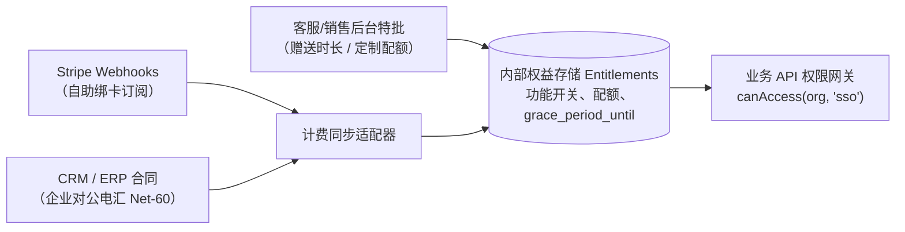
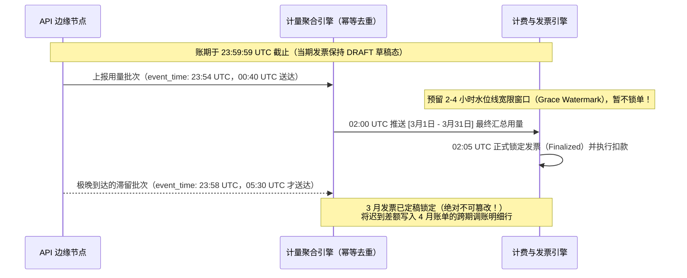

# 订阅与计费

## 这是什么？

订阅计费就是循环收费——客户按固定周期（月付、年付）持续付费来使用你的产品或服务。Netflix、Spotify、Slack、Notion 都是这种模式。作为开发者，你要搭建套餐选择、支付收取，以及处理支付失败、升级降级、试用到期等各种逻辑。

## 为什么要懂？

订阅是现代 SaaS 的主流商业模式。你做的大部分 Web 应用都会有某种形式的循环计费。这块业务逻辑看起来简单，但暗坑很多——按比例折算、失败支付重试、周期中途换套餐、税费计算、免费试用，每个都有微妙的边界情况，搞错了就是真金白银的损失。

## 业务流程

### 注册订阅

1. 用户选择套餐（免费、专业、企业）
2. 用户输入支付方式（通常是信用卡）
3. 系统在支付网关创建订阅（Stripe 等）
4. 首次付款立即收取（或在试用期结束后收取）
5. 用户获得对应套餐的功能权限

### 计费周期

1. 每到扣费日，网关自动扣款
2. 成功 → 生成发票 → 发送收据邮件 → 订阅保持活跃
3. 失败 → 进入重试逻辑（见下面的"催缴"）
4. 网关通过 Webhook 通知你每个事件（支付成功、失败等）

### 换套餐（升级/降级）

**周期中途升级（如基础版 → 专业版）：**

1. 客户点"升级"
2. 系统计算按比例折算："你已经用了基础版 15 天，这是抵扣金额。专业版多 X 元。"
3. 客户立即被收取差额（或下次出账时收取）
4. 立即获得专业版功能

**降级：**

1. 客户点"降级"
2. 通常在当前计费周期结束时生效（他们已经付了这个周期的钱）
3. 下期发票反映更低的套餐价格

### 免费试用

1. 用户注册试用（7 天、14 天、30 天）
2. 有些试用要求先绑卡，有些不需要
3. 试用期间，用户有完整（或有限）访问权限
4. 试用结束：有卡 → 自动扣款开始订阅。没卡 → 降级或锁定账户
5. 试用到期前发提醒邮件（提前 3 天、1 天）

### 取消

1. 客户点"取消订阅"
2. 两个选项：
   - **到期取消**：保留访问权限直到当前周期到期，然后停止计费
   - **立即取消**：立刻停止访问和计费，可能按比例退款
3. 大多数 SaaS 公司用"到期取消"——体验更温和，有些客户在到期前会回心转意

### 催缴（失败支付恢复）

1. 支付失败（卡过期、余额不足）
2. 系统自动重试（通常：3 天后重试、5 天后、7 天后）
3. 给客户发邮件："你的支付失败了，请更新信用卡"
4. 如果所有重试都失败 → 订阅暂停或取消
5. 好的催缴流程可以挽回 20-40% 的失败支付

## 常见术语

| 术语           | 解释                                                   |
| -------------- | ------------------------------------------------------ |
| **MRR**        | 月度经常性收入——订阅业务的核心指标                     |
| **ARR**        | 年度经常性收入——MRR × 12                               |
| **流失率**     | 每个周期取消的客户百分比。月流失 5% = 一年流失一半客户 |
| **按比例折算** | 客户在周期中途换套餐时调整费用                         |
| **催缴**       | 通过重试和邮件恢复失败支付的过程                       |
| **按席位定价** | 按用户数收费（如 ¥100/用户/月）。B2B SaaS 常见         |
| **按用量定价** | 按消耗量收费（API 调用次数、存储空间、计算时长）       |
| **阶梯定价**   | 不同用量区间有不同单价                                 |
| **固定价格**   | 一个价格包含所有功能。简单但不灵活                     |
| **免费增值**   | 免费版功能有限 + 付费版功能更多。和免费试用不一样      |
| **发票**       | 每次收费时发给客户的正式账单                           |
| **计费周期**   | 两次收费之间的时间（月、季、年）                       |
| **宽限期**     | 支付失败后，在切断访问之前额外给的时间                 |
| **权益**       | 一个套餐包含哪些功能/资源（如专业版有 100GB 存储）     |
| **独立权益引擎 (Entitlements Engine)** | 与支付网关状态解耦的内部权限与配额服务，统一合并标准套餐、试用、催缴宽限期与大客户定制合同特权 |
| **硬拒付 vs. 软拒付** | 永久性卡失败（`stolen_card`、`invalid_account`，严禁重试）与临时性失败（`insufficient_funds`，允许智能催缴重试） |
| **计费周期锚点日 (Billing Anchor)** | 决定后续每月扣款日的固定参考日期（如每月 31 日），防止经过 2 月后永久漂移到 28 日 |
| **计量水位线 (Metering Watermark)** | 按量计费周期结束时预留的延迟汇总结算窗口，用于划分计入本期发票的在途数据与滚入下期的迟到遥测数据 |
| **贷项通知单 (Credit Note)** | 在不篡改已定稿历史税票的前提下，合法冲减或退还已开票金额的正式财务凭证 |

## 常见模式

### 模式一：按套餐收费（最常见）

固定套餐固定价格。免费 → 专业 → 企业。每个套餐有一组确定的功能。

**适用场景：** 大多数 SaaS 产品。对客户来说简单易懂。

**取舍：** 重度用户可能觉得便宜了你，轻度用户可能觉得贵了。

### 模式二：按席位收费

按用户数计费。团队越大，账单越高。

**适用场景：** 协作工具（Slack、钉钉、飞书）。

**取舍：** 客户会玩花样（共享账号）。你得定义清楚什么算一个"席位"。

### 模式三：按用量收费

用多少付多少。像水电费一样。

**适用场景：** 基础设施（AWS）、API 服务（Twilio）、AI API（OpenAI）。

**取舍：** 收入不可预测。客户可能担心意外大账单。你需要用量计量基础设施。

### 模式四：混合模式

基础套餐 + 超量计费。"专业版包含 10,000 次 API 调用。超出后每次 ¥0.01。"

**适用场景：** 两全其美的方案。越来越流行。

**取舍：** 计费逻辑最复杂。需要清晰的沟通让客户明白他们会付多少。

## 踩坑提醒

- **按比例折算的数学很绕**：客户在 30 天周期的第 15 天从 ¥100/月升级到 ¥200/月，该收多少？（¥50 抵扣 + ¥100 收取 = 净收 ¥50）。让支付网关来算。
- **时区问题**：计费周期什么时候开始？哪个时区的午夜？保持一致。
- **年付转月付**：年付用户想转月付，怎么办？退剩余的年付余额吗？如果年付有折扣呢？
- **老用户保价**：涨价时，老用户通常保持原价。你的计费系统需要支持这个。
- **多个订阅**：一个用户能有多个活跃订阅吗？（比如个人套餐 + 团队套餐）。这增加了复杂度。
- **订阅税费**：订阅的税务规则因地区而异。数字服务在很多地方和实物商品的税不一样。
- **试用滥用**：用户注册试用、取消、创建新账号、循环往复。你需要设备指纹或信用卡唯一性检查。
- **Webhook 可靠性**：你的 Webhook 处理器必须是幂等的。Stripe 可能多次发送同一个事件。

## 行业实战经验与非显而易见的最佳实践

### 1. 将计费状态与内部独立权益引擎（Entitlements Engine）彻底解耦

在 SaaS 架构中，代价最惨重的设计错误就是在几十个业务 API 接口里直接写 `if (user.stripe_subscription_status === 'active' && user.stripe_plan === 'pro')`。

产品上线半年内，真实的商业场景就会把这个 `if` 判断彻底击穿：
- **企业对公电汇（Net-60 账期）**：年付 ¥100 万的头部大客户根本不刷 Stripe 信用卡，而是签完线下合同后走对公银行转账、开具增值税专票，账期 60 天。
- **销售谈判的定制配额覆盖（Sales Overrides）**：某企业客户购买了标准版 `Pro` 套餐，但销售在补充协议里答应额外赠送 `max_api_keys = 50` 并单独为其开启企业 `sso_enabled = true`。
- **Webhook 延迟与催缴宽限期（Grace Period）**：周五晚上自动续费因公司信用卡额度用满而扣款失败，`stripe_subscription_status` 变成 `past_due`。如果你的系统瞬间把这家 200 人公司的生产环境全部锁死，周一早上客户就会直接退订索赔。
- **客服补偿延期（Goodwill Comp）**：系统故障后，客服主管需要给受损客户免费延长 14 天专业版权限，而不需要去改动支付网关里的真实账单周期。

**生产级架构范式**：业务代码**永远不直接查询**支付网关状态或账单表，而是统一调用内部的**独立权益引擎（Entitlements Engine）**（如 `entitlements.check(org_id, 'max_seats')`）。权益引擎通过合并三层配置计算出当前生效的快照：
1. 基础套餐目录（`plan_id = 'pro'`）
2. 租户级定制覆盖（`override_json = {"sso": true, "max_seats": 25}`）
3. 有效访问时间窗（判断 `active_until` 或 `grace_period_until > now()`，为扣款失败处于 `past_due` 的老客户提供 7～14 天带顶部黄条提醒的宽限期，宽限期届满仍未补缴才降级只读）。

### 2. 智能催缴（Smart Dunning）：区分硬拒付（Hard Decline）与软拒付，规避卡组织重试罚款

初级工程师写的催缴定时任务，会对所有扣款失败的账单按固定间隔（第 1、3、5、7、14 天）无脑发起重试。**这种做法直接违反 Visa 和 Mastercard 的网络规则，会导致商户账户被处以高额罚款甚至封户。**

卡组织将拒付返回码（ISO 8583 / PSP Decline Codes）严格划分为两类：

| 拒付分类 | 典型返回码示例 | 卡组织强制作业规则与重试策略 |
| -------- | -------------- | ---------------------------- |
| **硬拒付（Hard Decline，永久失败）** | `stolen_card`（盗刷挂失）、`lost_card`、`invalid_account_number`（销户/空号）、`pickup_card`、`transaction_not_permitted` | **严禁任何自动重试（0 次）。** 必须立即停止对该卡的自动扣款，将其标记为失效，并发送邮件引导用户更换新卡。对硬拒付强行重试会触发 Visa/MC **"授权系统滥用（Misuse of Authorization System）"** 逐笔罚款（超限后每次重试罚 $0.10–$1.00+）。 |
| **软拒付（Soft Decline，临时失败）** | `insufficient_funds`（余额/额度不足）、`exceeds_withdrawal_limit`、普通 `do_not_honor`、`issuer_unavailable` | **允许执行智能催缴**（Visa 规定 **30 个自然日内最多重试 15 次**）。重试时间应对齐发薪日规律（如每月 1 号、15 号，或持卡人所在时区的周五上午）。 |

### 3. 计费周期锚点漂移（Jan 31 -> Feb 28 -> Mar 28）与周期中途升降级套利漏洞

两个与日历计算和按比例折算（Proration）相关的隐蔽漏洞，经常让 SaaS 公司损失惨重：

1. **`1月31日 -> 2月28日 -> 3月28日` 账单日永久漂移 Bug**：
   - 客户在 **1 月 31 日**开通包月订阅。
   - 2 月只有 28 天（平年），因此第二期账单正确地在 **2 月 28 日**扣款。
   - 如果你的定时调度器用 `上次扣款日 + 1 个月`（即 `2月28日 + 1个月`）计算下一期，第三期账单就会在 **3 月 28 日**触发！客户的账单日从此永久从每月底漂移到了 28 号（平白吞掉客户 3 天权益并违反合同约定）。
   - **正确解法**：在订阅记录上持久化不可变的**计费周期锚点日 `billing_cycle_anchor_day = 31`**。第 $N$ 个月的账单日永远按 $\min(\text{anchor\_day}, \text{当月总天数}(Y, M))$ 推算，确保 3 月份自动弹回 **3 月 31 日**。
2. **"周末升级导出、周日降级退费"的按比例折算套利漏洞**：
   - 一名处于 ¥50/月基础版的用户，在周五下午 5 点升级到 ¥3,000/月的企业版，利用企业版专属的"无限量线索批量导出"功能连夜爬走 10 万条商业数据，然后在周日晚上 6 点点"降级回基础版"。
   - 如果你的系统对**升级和降级都立即生效并按天退还差价抵扣金**，羊毛党只花 $\frac{2}{30} \times 3000 = ¥200$ 就搬空了价值 ¥3,000 的核心资产。
   - **正确解法**：**升级立即生效**（当场收取剩余天数的正向补差价），但**降级一律延迟到当前计费周期结束时（`current_period_end`）生效**（周期中途降级绝不退还当期差价）；同时对高价值批量消耗型功能绑定最低承诺周期或独立配额包。

### 4. 按量计费（Usage-Based）的水位线（Watermarks）与发票定稿后的迟到遥测数据

在按量计费或混合计费 SaaS（按 API 调用量、GB-小时存储或 AI Token 计费）中，高频计量事件不可能同步写支付库，而是经由 Kafka/Kinesis 流式汇总后定时上报给计费引擎。

当客户的月度账单周期在 **`2026-03-31 23:59:59 UTC`** 截止时，如果某个边缘节点的队列积压导致一批 3 月 31 日晚上的用量日志在 2 小时后（4 月 1 日凌晨）才到达，该如何处理？

1. **带事件时间戳的幂等采集（`idempotency_key` + `event_timestamp`）**：每条计量事件必须携带确定性的唯一键（`request_id`）以及业务实际发生的 `event_timestamp`（而非消息队列消费的时间），在聚合层通过唯一索引或滑动窗口严格去重。
2. **发票定稿水位线延迟（Finalization Grace Watermark）**：切勿在每月 1 号 `00:00:01` 秒就立刻锁单扣款。账期截止后，让上月发票保持 **`draft`（草稿）** 状态等待 **1～4 小时的水位线宽限期**，让所有 `event_timestamp <= period_end` 的在途分区消息全部排空入账后再正式定稿（Finalize）。
3. **严禁原地篡改已定稿发票**：一旦发票从 `draft` 变为 `finalized`/`paid`，它就是具有法律效力的不可变税务凭证。对于超过 4 小时水位线才送达的极个别滞留事件（Stragglers），要么作为跨期补录明细行顺延记入**下个月的发票**，要么在低于免计阈值时由平台吸收；若出现多扣款，则必须通过开具正式的**贷项通知单（Credit Note）**进行红字冲销。

## 速查表

| 场景                 | 推荐方案                                                                   |
| -------------------- | -------------------------------------------------------------------------- |
| 刚起步               | 简单的按套餐定价（2-3 个级别）                                             |
| B2B SaaS             | 按席位 + 套餐分级，底层由解耦的内部独立权益引擎（Entitlements Engine）驱动 |
| API / 基础设施       | 按用量或混合模式，采集端带幂等键 + 账期截止预留 2–4 小时水位线延迟定稿     |
| 免费试用             | 14 天 + 需要绑卡 → 转化率更高，配合卡指纹（Card Fingerprint）防重复白嫖    |
| 支付失败（催缴）     | 严格区分硬拒付（0 次重试防罚款）与软拒付（对齐发薪日，30 天内 ≤15 次重试） |
| 换套餐               | 升级立即生效并补差价；降级一律排期在 `current_period_end` 到期生效防套利   |
| 月度账单日计算       | 绑定不可变的 `billing_cycle_anchor_day`，确保 1月31日 -> 2月28日后回弹 3月31日 |
| 取消与财务合规       | 到期取消 + 挽回序列；已定稿发票不可篡改，调账一律开具贷项通知单（Credit Note）|
| 收入追踪             | 跟踪 MRR、ARR、自愿流失率 vs. 非自愿（扣款失败）流失率、LTV、CAC           |

