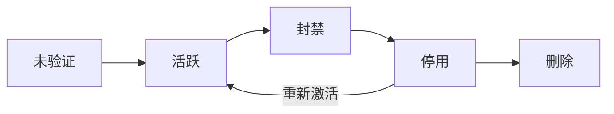
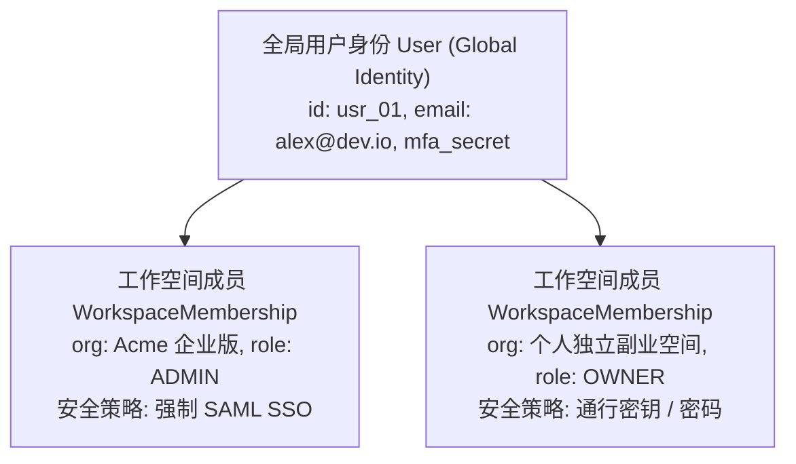

# 用户管理

## 这是什么？

用户管理是围绕用户账号发生的一切——从注册到注销（甚至注销之后，因为法律上你可能还需要保留一些数据）。包括注册、个人资料、角色权限、偏好设置、账号状态，以及用户与你产品之间关系的完整生命周期。

## 为什么要懂？

每个 Web 应用都有用户。不管你做社交网络、SaaS 工具还是内部后台，用户管理都是地基。而且它不只是一张有邮箱和密码的 `users` 表。验证、账号状态、角色、数据保留、账号注销都有业务规则，直接影响用户信任和法律合规。漏掉什么，你就得在生产环境里顶着压力修补。

## 业务流程

### 注册

1. 用户填写注册表（邮箱 + 密码，或社交登录）
2. 系统校验：邮箱已被注册？密码符合要求？
3. 系统创建用户记录，状态 = `未验证`
4. 发送验证邮件，里面有一次性链接（24 小时过期）
5. 用户点击链接 → 状态变为 `活跃`
6. 链接过期了，可以请求重发

### 个人资料管理

1. 用户编辑资料：姓名、头像、简介、偏好设置
2. 某些字段修改需要重新验证（改邮箱需要确认新邮箱）
3. 敏感修改（邮箱、密码）通常需要先输入当前密码
4. 资料更新保存后立即生效

### 账号状态

用户账号是一个状态机：



- **未验证**：注册了但没确认邮箱
- **活跃**：正常使用的账号
- **封禁**：被管理员暂时禁用（违规、可疑活动）
- **停用**：用户自己选择停用。数据保留，可以重新激活
- **删除**：永久删除。可能有宽限期，之后清除数据

### 密码管理

1. **密码重置**：用户点"忘记密码" → 系统发重置链接 → 用户设新密码 → 所有现有 Session 失效
2. **修改密码**：已登录用户改密码（需要输入当前密码）
3. **密码要求**：最小长度、复杂度规则。不要过度限制（不要设最大长度，允许特殊字符，允许粘贴）
4. **泄露检测**：有些系统会检查密码是否在已知泄露数据库中（HaveIBeenPwned API）

### 角色与权限

1. 用户被分配一个或多个角色（所有者、管理员、成员、只读）
2. 每个角色有一组权限（can_create、can_edit、can_delete、can_invite）
3. 角色通常按组织/工作空间划分（一个用户在 A 组织是管理员，在 B 组织是只读）
4. 权限检查在 API 层做，不只是 UI 层

### 账号注销

因为隐私法律，这个流程出人意料地复杂：

1. 用户请求注销
2. 系统展示什么会被删除、什么必须保留
3. 宽限期（通常 30 天）——账号停用，不是删除
4. 宽限期过后，清除个人数据
5. 某些数据必须保留（财务记录、法律要求）——但要匿名化
6. 用户的内容需要特殊处理（他们的帖子消失？还是变成"已注销用户"发的？）

## 常见术语

| 术语                   | 解释                                                     |
| ---------------------- | -------------------------------------------------------- |
| **用户生命周期**       | 从注册到注销的完整旅程                                   |
| **引导流程**           | 注册后的初始体验——欢迎邮件、设置向导、引导教程           |
| **KYC**                | 了解你的客户——金融/监管行业要求的身份验证                |
| **SSO 配置**           | 当员工在公司身份认证系统中被添加时，自动创建用户账号     |
| **组织/工作空间/团队** | 用户分组。一个用户可以属于多个组织                       |
| **邀请流程**           | 现有用户邀请他人 → 系统发送邀请邮件 → 被邀请人注册或加入 |
| **身份模拟**           | 管理员以某个用户的身份登录，用于调试。需要审计日志       |
| **软删除**             | 标记记录为已删除，但不从数据库中移除                     |
| **硬删除**             | 从数据库（最终还有备份）中真正删除数据                   |
| **PII**                | 个人可识别信息——姓名、邮箱、手机、地址。必须谨慎处理     |
| **数据主体请求 (DSR)** | 用户根据 GDPR/个保法正式请求访问或删除其数据             |
| **SCIM 2.0**           | 跨域身份管理系统协议——企业 IdP（Okta、Azure AD、飞书）与 SaaS 自动同步员工入职、调岗与离职销户的标准协议 |
| **即时配置 (JIT Provisioning)** | 员工首次通过企业 SAML/OIDC SSO 登录时，系统按断言属性动态为其创建工作空间成员记录 |
| **SCIM 熔断器 (Circuit Breaker)** | 当企业目录同步在短时间内尝试批量停用或新增超过安全比例（如 >10%）的组织成员时，自动暂停同步并告警的防误伤机制 |
| **服务账号 (Service Account)** | 归属于组织而非具体员工的非人类身份主体，专门用于绑定生产环境 API 密钥、Webhook 与定时任务 |
| **ReBAC（基于关系的访问控制）** | 源自 Google Zanzibar 的权限模型（`主体, 关系, 客体` 三元组），天然支持文件夹层级继承与单文档跨部门共享 |

## 常见模式

### 模式一：简单用户模型

一个用户 = 一个账号。没有团队没有组织。每个用户有个角色（普通用户、管理员）。

**适用场景：** C 端应用、简单 SaaS、个人工具。

**取舍：** 需要多人协作时就不够用了。

### 模式二：用户 + 组织

用户属于组织。角色按组织划分。

```
用户 ← 属于 → 组织（带角色）
```

**适用场景：** B2B SaaS（Slack、Notion、GitHub）。

**取舍：** 查询更复杂。需要处理：用户没有组织、用户有多个组织、组织没有用户。

### 模式三：用户 + 组织 + 团队

组织下有团队。权限可以在组织级别或团队级别。

**适用场景：** 大型企业 SaaS（Jira、Azure DevOps）。

**取舍：** 权限模型会变得复杂。尽量保持简单。

## 踩坑提醒

- **邮箱唯一性**：如果有人用 `john@gmail.com` 注册了邮箱账号，后来又用同一邮箱点了"用 Google 登录"？你需要一个账号关联策略。
- **用户名修改**：如果用户名出现在 URL 里（`/users/john`），改用户名就会断开链接。要么不允许改，要么维护重定向。
- **时区处理**：用 UTC 存储日期，用用户时区显示。让用户在偏好设置中设定时区。
- **头像存储**：不要把 base64 图片存数据库。上传到对象存储（S3），数据库里存 URL。
- **注销用户的内容**：在论坛里，用户注销了，他们的帖子消失吗？通常不会——标注为"已注销用户"。
- **管理员锁死**：如果唯一的管理员注销了或被封禁，谁来管理组织？阻止最后一个管理员离开。
- **合并账号**："我不小心创建了两个账号"是常见的客服请求。账号合并很难——需要协调所有关联数据（订单、帖子、设置）。
- **Session 失效**：当用户改密码或管理员封禁账号时，所有活跃 Session 必须立即失效。

## 行业实战经验与非显而易见的最佳实践

### 1. SCIM 2.0 目录同步熔断器（防范"误绑全员 5,000 人用户组"与批量误删灾难）

企业客户非常依赖 **SCIM 2.0** 自动化同步：在 Okta、Azure AD 或飞书管理后台把员工拉进某个部门群，你的 SaaS 就会自动为其开通席位；员工离职从 AD 移除，你的系统立即吊销其会话并收回席位。

但在真实生产环境中，大客户那边的 IT 管理员迟早会在 Okta 里犯下两个灾难性失误：
1. **误绑"全员（Everyone）"大群导致天价账单**：管理员本来只想把 `前端研发组（40 人）` 同步到你的产品，手滑选成了 `公司全员（8,500 人）`。如果你的 SCIM 接口来者不拒，并且直接在后台触发 Stripe 自动扩席位扣款（瞬间增购 8,460 个席位、刷走上百万元），客户 CFO 当天就会找上门索赔。
2. **写错 LDAP 过滤规则引发全员瞬间踢下线**：管理员改错了一条目录过滤表达式，Okta 在 90 秒内向你的服务狂发 1,200 条 `PATCH /scim/v2/Users/{id} { "active": false }`——大白天直接把客户整家公司 100% 的员工全部封禁踢下线。

**生产级防御设计：**
- **批量停用爆炸半径熔断器（Blast-Radius Circuit Breaker）**：按租户维护 10 分钟滑动窗口计数器。一旦 SCIM 在 10 分钟内请求停用超过组织活跃人数 **10%（或 > 25 人）**，立即**触发 SCIM 熔断**：拦截后续停用请求，将其挂起至 `pending_admin_confirmation` 待确认队列，并通过邮件/短信紧急呼叫组织所有者。
- **席位自动扩容软上限（Soft-Cap）**：设置可配置的 `max_auto_provision_seats` 阈值（例如合同购买席位数 + 15% 弹性余量），绝对不要在 SCIM `POST /Users` 请求链路里同步刷客户的信用卡。
- **SCIM 停用一律走"软挂起（Soft-Suspend）"，严禁物理硬删除**：收到 SCIM 的 `DELETE` 或 `active: false` 时，立即清空该员工的登录 Session 并释放计费席位，但**将其成员记录与历史归属关系保留在 `scim_suspended` 状态**。15 分钟后当客户 IT 管理员发现配错组并重新在 Okta 里加回该员工时，系统只需按 `scim_external_id` 恢复激活，其名下的项目权限、历史评论和配置即可毫发无损地瞬间还原。

### 2. 核心管理员离职引发的"孤儿资产（Orphaned Assets）"、Webhook 与 API Key 断联事故

在早期数据库设计中，开发者习惯写出 `api_keys.created_by_user_id`、`webhooks.owner_user_id` 或 `dashboards.user_id` 这样的外键关联。

两年后，当初负责对接系统的客户方运维主管（`bob@acme.com`）离职，IT 通过 SCIM 停用了 Bob 的账号。半夜两点事故爆发：
- 客户公司的生产 CI/CD 流水线全部瘫痪，因为调用接口的生产 API Key 绑在 `bob@acme.com` 名下，随他的账号停用而一起失效了。
- 核心告警 Webhook 停止推送，45 个全公司共用的数据看板因为所有者被删而变成无人能编辑的"死档（孤儿资产）"。

**生产级架构准则：**
1. **生产级凭证与基础设施资源严禁绑定自然人（Human User）**：生产 API Key、OAuth 应用、Webhook 和定时任务必须归属于一等公民实体——**服务账号（Service Account）** 或直接归属于 `Organization` / `Workspace`；自然人仅作为 `created_by_actor_id` 记录在审计日志中。
2. **引导式离职交接与资产自动过户流水线**：当自然人成员被停用或移除时，执行原子化的离职过户逻辑：
   - 立即吊销其个人登录会话、Refresh Token 及个人访问令牌（PAT）。
   - 保持组织级 Service Account、生产 API Key 与共享 Webhook 正常运转。
   - 将其名下的私有草稿、文件夹、定时报表自动过户给预设的**兜底管理员（Fallback Admin）**，或自动提取 SCIM 企业扩展属性（`urn:ietf:params:scim:schemas:extension:enterprise:2.0:User.manager`）中的直属上级完成所有权转移。

### 3. 多租户工作空间成员身份（`WorkspaceMembership`）与全局个人身份（`User`）解耦

绝对不要把 `organization_id` 或 `role` 字段直接建在 `users` 表上。一名外部顾问、投资人或跳槽的开发者需要用同一个邮箱加入多个组织，或者在离开老东家时保留自己的私人工作空间。



- **全局 `User` 与租户级 `WorkspaceMembership` 分离**：`User` 表只存全局自然人身份（`id`、已验证邮箱、密码哈希、WebAuthn 硬件凭证）；中间表 `WorkspaceMembership` 存储 `user_id`、`org_id`、`role`、`scim_external_id`、成员状态及该租户下的计费席位占用标志。
- **按工作空间隔离会话安全策略**：用户用普通密码登录了自己的"个人空间"，并不代表他切到 `Acme 企业版` 空间时可以直接放行。当切换当前活跃的 `org_id` 时，鉴权中间件会检查目标 `WorkspaceMembership` 绑定的组织安全策略（如 `SAML_REQUIRED` 或 `MFA_REQUIRED`），若当前会话认证等级不足，则立即触发企业 IdP 重定向或阶梯式二次认证挑战。

### 4. 从扁平 RBAC 演进到 Google Zanzibar 风格的 ReBAC（层级资源权限模型）

扁平的组织级 RBAC（`Owner`、`Admin`、`Editor`、`Viewer`）在产品初期很好用，但一旦你的产品引入了**团队（Teams）、项目（Projects）、无限嵌套文件夹（Folders）和单篇文档外部协作共享**（如飞书文档、Notion、Google Drive、Figma），传统 RBAC 就会彻底失灵。

在嵌套资源下，回答*"Alice 能否编辑文档 D？"*需要同时判断：
- Alice 是不是组织管理员？
- 或者 Alice 属于研发群组 T，而群组 T 对项目 P 有 `editor` 权限，项目 P 包含文件夹 F1，F1 包含子文件夹 F2，F2 里存放着文档 D？
- 又或者有人单独把文件夹 F1 的编辑权限直接分享给了 Alice 个人？

如果用传统 SQL 跨 6 张表写 `JOIN` 和递归 CTE 查询，不仅代码难以维护，接口延迟也会随嵌套深度指数级恶化。现代协作 SaaS 普遍采用受 **Google Zanzibar** 启发的 **ReBAC（基于关系的访问控制，Relationship-Based Access Control）**（可通过 OpenFGA、SpiceDB、Ory Keto 或统一关系三元组表实现）：

| 主体 Subject（谁） | 关系 Relation | 客体 Object（什么资源） | 业务语义 |
| ------------------ | ------------- | ----------------------- | -------- |
| `user:alice` | `member` | `team:eng` | Alice 是研发团队的成员 |
| `team:eng#member` | `editor` | `folder:roadmap` | 研发团队的所有成员都是 `roadmap` 文件夹的编辑者 |
| `folder:roadmap` | `parent` | `doc:q3_spec` | 文档 `q3_spec` 从父文件夹 `roadmap` 继承访问权限 |
| `user:bob` | `viewer` | `doc:q3_spec` | Bob 被单独授予了该文档的只读查看权限 |

所有复杂的权限校验最终都收敛为一次极速的图可达性判定：**`check(user:alice, can_edit, doc:q3_spec)`**，在一套统一的模型下优雅兼容组织角色、部门群组、目录树继承与单文档外部协作者分享。

## 速查表

| 场景                     | 推荐方案                                                               |
| ------------------------ | ---------------------------------------------------------------------- |
| 简单 C 端应用            | 用户 + 角色（普通/管理员）                                             |
| B2B 多租户 SaaS          | 全局 `User` 自然人身份与租户级 `WorkspaceMembership` 成员表解耦        |
| 嵌套文件夹 / 文档级共享  | Zanzibar 风格 ReBAC（基于 OpenFGA / SpiceDB 的 `主体, 关系, 客体` 三元组）|
| 企业 SCIM 2.0 目录同步   | 停用走软挂起（Soft-Suspend）+ 爆炸半径熔断器（10 分钟停用 >10% 自动暂停告警）|
| 生产 API 密钥与 Webhook  | 绑定到组织级 `ServiceAccount`（服务账号），严禁挂在具体员工个人账号下  |
| 员工离职销户交接         | 吊销个人会话与 PAT；名下孤儿私有资产自动过户给直属上级或兜底组织管理员 |
| 账号注销（GDPR/个保法）  | 30 天宽限期 → 软删除 → 硬删除 PII 并对财务与审计日志做去标识化匿名保留 |
| 客服身份模拟（Impersonation）| 强制二次 MFA 核身、全程写不可篡改审计日志、默认只读、UI 顶部常驻醒目横幅 |

