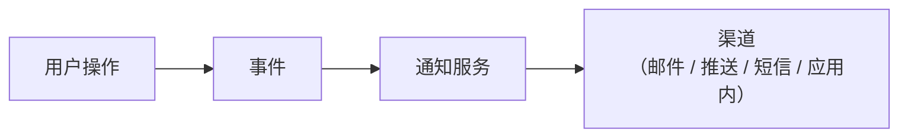
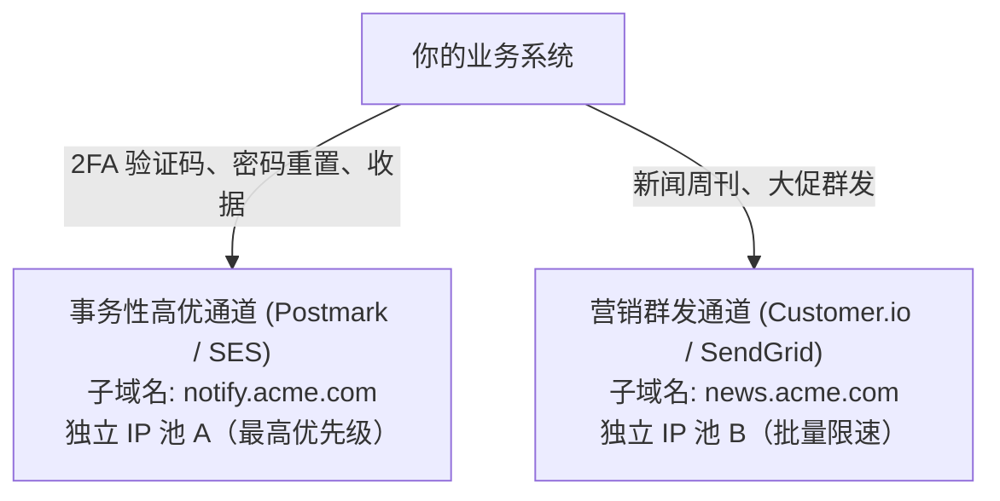

# 邮件与通知

## 这是什么？

邮件和通知是你的应用在用户没盯着屏幕时与他们沟通的方式。订单确认、密码重置、支付失败、新消息提醒——这些都是通知。渠道包括邮件、推送通知、短信和应用内消息。做好通知很关键，因为它往往是你的应用和用户之间唯一的接触点。

## 为什么要懂？

一个好产品配上烂通知 = 一个被遗忘的产品。反过来，通知发太多的产品会被卸载。作为开发者，你几乎每个应用都要搭建通知系统。你需要理解：什么时候发、用什么渠道、怎么尊重用户偏好、发送失败怎么办。搞砸事务性邮件意味着客户收不到收据。搞砸营销邮件意味着你被标记为垃圾邮件。

## 业务流程

### 事务性邮件

由用户行为触发，是预期中的：

1. 用户做了某个操作（注册、下单、重置密码）
2. 你的后端创建一个通知事件
3. 通知服务拿到事件，选择正确的模板
4. 模板用动态数据渲染（用户名、订单详情）
5. 通过投递服务商发送（SendGrid、Postmark、SES）
6. 投递服务商反馈结果：已送达、被退回、或被投诉

**举例：** 欢迎邮件、订单确认、密码重置、支付收据、物流更新。

### 营销邮件

由业务方发起，不是用户行为触发的：

1. 市场团队创建活动（新闻通讯、促销、功能公告）
2. 选择受众（所有用户、某个分群）
3. 设计和测试邮件（A/B 测试标题、预览文本）
4. 定时或立即发送
5. 系统跟踪打开率、点击率、退订率

**关键区别：** 营销邮件必须包含退订链接（法律要求）。事务性邮件不需要（但也不应该夹带营销内容）。

### 推送通知

1. 用户在浏览器或移动 App 中授权通知权限
2. 生成设备 Token 并存到你的服务器
3. 事件发生时，你的服务端通过 APNs（Apple）或 FCM（Firebase/Google）发送推送
4. 即使 App 关了，通知也会出现在用户设备上
5. 用户点击通知 → App 打开到对应页面

### 短信通知

1. 用户提供手机号并同意接收
2. 系统通过短信服务商发送（Twilio、阿里云短信）
3. 只用于高优先级消息：验证码、安全提醒、物流通知
4. 短信很贵（每条 0.05-0.1 元），且有严格的同意要求

### 应用内通知

1. 用户在你的应用内时，通知角标或下拉列表显示新消息
2. 通常由数据库中的通知表支撑
3. 可以是实时的（WebSocket）或定期轮询
4. 用户可以标记已读、关闭或点击跳转

## 常见术语

| 术语                   | 解释                                                                     |
| ---------------------- | ------------------------------------------------------------------------ |
| **事务性邮件**         | 由用户操作触发，预期中且必要的（收据、密码重置）                         |
| **营销邮件**           | 用于推广。需要用户同意和退订链接                                         |
| **退回**               | 邮件投递失败。软退回 = 临时的（邮箱已满）。硬退回 = 永久的（地址不存在） |
| **投诉/垃圾邮件举报**  | 收件人把你的邮件标记为垃圾邮件。对发件人信誉非常不利                     |
| **发件人信誉**         | 邮件服务商给你发送域名的评分。信誉低 = 邮件进垃圾箱                      |
| **SPF / DKIM / DMARC** | 邮件认证协议，证明邮件确实来自你的域名。对投递率至关重要                 |
| **打开率**             | 打开邮件的收件人百分比。越来越不可靠（Apple 邮件隐私保护）               |
| **点击率 (CTR)**       | 点击邮件中链接的百分比                                                   |
| **退订率**             | 收到邮件后选择退订的百分比。高退订率 = 发太多或内容不相关                |
| **通知偏好**           | 用户设置接收什么、通过什么渠道接收                                       |
| **免打扰时段**         | 不发通知的时间窗口（如晚 10 点到早 8 点不推送）                          |
| **IP 池与子域名隔离**  | 将验证码/密码重置等核心事务邮件（`auth.acme.com`）与营销群发邮件（`news.acme.com`）拆分到完全独立的子域名和发送 IP 池 |
| **SafeLinks / 安全链接扫描器** | 企业邮件安全网关（如微软 Defender SafeLinks、Mimecast、Proofpoint）在邮件进收件箱前自动用无头浏览器预抓取邮件内所有链接的防护机制 |
| **RFC 8058 一键退订**  | Gmail 与 Yahoo 强制要求的 `List-Unsubscribe-Post` 邮件头标准，支持邮箱客户端在顶部直接发起后台无状态 `POST` 退订请求 |
| **Apple MPP（邮件隐私保护）** | 苹果邮件客户端默认开启的代理预加载机制，邮件送达瞬间自动通过代理 IP 下载所有追踪像素，导致打开率虚高至接近 100% |
| **全局抑制列表 (Suppression List)** | 内部持久化的硬退回（Hard Bounce）与垃圾举报地址黑名单，防止系统再次向这些地址发信而摧毁域名信誉 |

## 常见模式

### 模式一：事件驱动通知

应用事件发布到消息队列。通知服务消费事件，决定发什么、给谁、通过哪个渠道。



**适用场景：** 大多数生产应用。把通知逻辑和业务逻辑解耦。

**取舍：** 需要消息队列或事件总线。更多基础设施。

### 模式二：基于模板的邮件

邮件内容定义为模板（带变量的 HTML）。发送时用事件数据填充变量。

**适用场景：** 所有邮件系统。模板存在邮件服务商那里或你的代码库里。

**取舍：** HTML 邮件渲染是噩梦（Outlook 用 Word 的渲染引擎）。用 MJML 或 React Email 之类的框架。

### 模式三：多渠道 + 偏好设置

每种通知类型可以通过多个渠道发送。用户选择每种类型用哪些渠道。

```
订单已发货 → 用户偏好：邮件 ✓、推送 ✓、短信 ✗ → 发邮件 + 推送
```

**适用场景：** 有多种通知类型的成熟产品。

**取舍：** 偏好管理比较复杂。需要一个好的 UI 让用户控制通知。

## 踩坑提醒

- **邮件投递率是门学问**：配置 SPF、DKIM、DMARC。新发送域名要预热。监控退回率。一次垃圾邮件投诉飙升可能毁掉你几周的投递率。
- **别用 noreply@**：用户会回复事务性邮件。把回复路由到某个地方，或至少用一个有人看的地址。
- **通知疲劳**：如果每个功能都触发通知，用户会关掉所有通知。要有选择性——什么值得打扰用户。
- **去重**：如果一个事件触发了两次（队列重试），不要发两封邮件。用幂等键去重。
- **时机**：用户刚离开 5 分钟就发"你购物车里还有商品"太急了。等 1-24 小时。也别在凌晨 3 点发。
- **退订必须立即生效**：如果有人退订了第二天又收到一封（因为队列延迟），他们会举报你垃圾邮件。
- **推送 Token 会过期**：设备 Token 可能变。处理好 Token 刷新，清理无效的。
- **法规差异**：不同地区法律不同。中国、欧盟、美国对营销通知的要求各不相同。

## 行业实战经验与非显而易见的最佳实践

### 1. 独立 IP 池与子域名隔离（防止营销群发炸毁 2FA 验证码与密码重置投递率）

初创公司最经典的线上P0事故：市场部在"黑五"用 `hello@acme.com` 给 25 万个冷启动潜客群发了一波促销邮件。几千名收件人顺手点了"举报垃圾邮件（Report Spam）"，外加大量失效邮箱触发硬退回（Hard Bounce）。20 分钟后，Gmail 和 Outlook 直接将你的主域名 `acme.com` 和共享发信 IP 降权拉黑——结果**所有存量付费客户收不到登录二次验证码（2FA）和密码重置邮件，全员无法登录系统**。

生产环境铁律：**严禁将事务性邮件与营销邮件混用同一个发信子域名或同一个 IP 池**：



| 邮件流级别 | 发信子域名（`Return-Path` 与 DKIM 签名） | 发送 IP 池 | 队列优先级与隔离策略 |
| ---------- | ---------------------------------------- | ---------- | -------------------- |
| **核心认证与安全告警** | `auth.acme.com` | 专用事务 IP 池 1 | P0（< 3 秒送达）；绝不与任何批量任务共用队列 |
| **普通交易通知 / 账单收据** | `notify.acme.com` | 专用事务 IP 池 1 或 2 | P1（< 15 秒送达）；严格同步硬退回抑制列表 |
| **营销推广与新闻通讯** | `news.acme.com` 或 `mail.acme.com` | 独立批量营销 IP 池 | P3（速率受控、渐进预热）；信誉受损绝不波及主站 |

因为各大邮箱服务商（Gmail、Outlook）是在**子域名粒度**结合 IP 评估 SPF/DKIM 发件人信誉的，将 `auth.acme.com` 隔离在独立的 IP 池上，能确保哪怕市场部把 `news.acme.com` 的信誉彻底玩砸，用户的登录验证码依然能在 2 秒内稳稳进收件箱。

### 2. 企业安全网关（微软 SafeLinks / Mimecast）预抓取导致一次性免密登录链接（Magic Link）秒失效

你开发了丝滑的"免密魔法链接（Magic Link）"或邮箱激活一次性链接：
`https://app.acme.com/auth/verify?token=one_time_xyz`

在测试环境用 `@gmail.com` 测得完美无瑕。结果卖给第一家使用 **Microsoft 365（Defender SafeLinks）**、**Mimecast** 或 **Proofpoint** 的企业大客户时，**客户公司所有员工点击邮件里的登录链接全部报错："链接已过期或已被使用"！**

**幕后真凶：**
企业级邮件安全网关在把邮件真正投递到员工收件箱之前，会先启动自动化沙箱/无头爬虫，**把邮件正文里所有的 `GET` 链接全部请求一遍**（甚至会自动跟随 `302` 重定向），检测目标网页是否是钓鱼网站。如果你的 `GET /auth/verify?token=one_time_xyz` 接口在收到 `GET` 请求时直接核销了一次性 Token，**安全机器人在人类看到这封邮件前 500 毫秒就已经把你的 Token 吃掉了！**

**三大生产级防御手段：**
1. **`GET` 请求绝不修改状态或消耗一次性 Token（强制 `GET -> POST` 两步确认）**：
   - `GET /auth/verify?token=xyz` 只返回一个极简的静态确认页，内含 `<form method="POST" action="/auth/verify">` 和一个"点击确认登录"按钮（**切勿**用 JavaScript `window.onload` 自动提交表单，因为高级安全沙箱也会执行 `onload` 脚本！）。
   - 只有用户真人点击按钮触发的 `POST` 请求，才真正去数据库核销一次性 Token 并签发登录 Cookie。
2. **无副作用响应 `HEAD` 请求**：许多扫描器会先发 `HEAD` 探测，确保 Web 框架不会在 `HEAD` 请求里触发 `GET` 控制器的核销逻辑。
3. **邮件中同时附带 6 位纯文本验证码（OTP）**：在魔法链接下方同时写出"点击上方按钮登录，或在原浏览器窗口直接输入验证码：`482-910`"。这样即便企业内网完全封锁外链跳转，员工也能顺利完成验证。

### 3. RFC 8058 一键退订邮件头（One-Click Unsubscribe）与 Gmail/Yahoo 的 0.3% 垃圾投诉率红线

自 2024 年起，Google（Gmail）和 Yahoo 对日发信量 > 5,000 封的发件人实施了严苛的新规：一旦你在 Google Postmaster Tools 中的**用户垃圾邮件举报率达到 0.3%**（即**每发 1,000 封邮件只要有 3 个人点"举报垃圾邮件"**！），Gmail 就会直接拒收或将你域名下的邮件批量送进垃圾箱。

为了将投诉率压制在安全的 0.1% 以下，你必须让"退订"比"点举报"更顺手——在所有营销和推广邮件的 Header 中植入 **RFC 8058 标准的一键退订头**：

```http
List-Unsubscribe: <https://api.acme.com/v1/unsubscribe?token=opaque_signed_jwt>, <mailto:unsub@news.acme.com?subject=unsub_123>
List-Unsubscribe-Post: List-Unsubscribe=One-Click
```

- **工作机制**：当这两个 Header 同时存在且被包含在你的 **DKIM 加密签名字段**中时，Gmail、Apple Mail 和 Yahoo 会在邮件客户端顶部发件人名称旁边，直接渲染一个极其显眼的原生**"退订（Unsubscribe）"**按钮。
- **后端接口必须接受无 Cookie 的裸 `POST` 请求**：当用户点击邮箱客户端顶部的原生退订按钮时，Gmail 服务器会向你的 URL 发送一条携带 `List-Unsubscribe=One-Click` 请求体的后台 `POST` 请求。你的退订接口**绝对不能要求用户处于登录态或校验 Session Cookie**，必须仅凭 URL 中的签名 `token` 直接完成退订落库并返回 `200 OK`。

### 4. 苹果邮件隐私保护（Apple MPP）代理预加载与"打开率（Open Rate）"指标的失真

传统的邮件打开追踪依赖在 HTML 底部塞入一个 $1\times1$ 像素的透明图片（``）。过去只有当用户点开邮件时，客户端才会加载这张图，从而记录"已打开"、真实 IP 和阅读时间。

但在 **Apple 邮件隐私保护（MPP，Mail Privacy Protection）** 推出后（超过 90% 的 iOS/macOS 原生邮件用户默认开启，且 Gmail 也有类似的图片缓存代理）：
1. 只要邮件一到达苹果服务器——**哪怕凌晨 3 点用户的 iPhone 还锁屏揣在兜里**——苹果的隐私中继代理（Relay Proxy）就会立即通过随机的 Cloudflare/Apple 代理 IP，把邮件里的所有图片（包括你的 $1\times1$ 追踪像素）全部提前下载缓存一遍。
2. **引发的连锁故障**：
   - 你的数据后台会显示所有 Apple Mail 用户的邮件**打开率高达 95%～100%**，全部是机器预加载产生的假打开。
   - **基于 IP 的地理定位与最佳发送时间预测彻底失效**：请求像素的 IP 是苹果中继机房的 IP，时间戳是邮件送达服务器的时间而非用户真人阅读的时间。
   - **自动化营销滴灌工作流（Drip Campaigns）大面积误判**：任何诸如*"发送欢迎信 48 小时后 -> 若用户【未打开】邮件，则补发提醒信"*或*"自动清理 90 天内【未打开】过任何邮件的沉睡用户"*的规则都会被彻底搞乱。
3. **生产级修正策略**：在追踪服务端识别并剥离已知代理的 User-Agent 与 ASN 段（如 Apple 预抓取特征），将其单独归类为 `proxy_prefetched`；所有自动化触达分支、沉睡用户清理（Sunset Policy）和 A/B 测试胜出判定，必须转向真实的**人工点击率（CTR）**或应用内实际转化事件。

## 速查表

| 渠道 / 机制                | 适用场景                         | 成本               | 核心生产级准则                                                       |
| -------------------------- | -------------------------------- | ------------------ | -------------------------------------------------------------------- |
| 邮件（认证与核心事务）     | 2FA 验证码、密码重置、收据、告警 | 低（约 ¥0.01/封）  | 使用独立子域名（`auth.`）+ 专用高优 IP 池，与营销流量物理隔离        |
| 邮件（营销与批量推广）     | 新闻通讯、促销、生命周期召回     | 低                 | 必须携带 RFC 8058 `List-Unsubscribe-Post` 一键退订头；投诉率控在 <0.1%|
| 一次性魔法链接 / 激活链接  | 免密登录、注册邮箱验证           | 低                 | `GET` 请求绝不核销 Token（用 `GET->POST` 两步确认防御 SafeLinks 预抓）|
| 邮件打开率分析与自动化工作流| 衡量活动效果与清理沉睡用户列表   | 免费               | 剥离 Apple MPP 代理预加载造成的假打开率，以真实链接点击（CTR）为判据 |
| 推送通知（Push）           | 时效性强的更新、新消息提醒       | 免费               | 严格遵守用户所在时区的免打扰时段；定时清理失效的 APNs/FCM 设备 Token |
| 短信（SMS）                | 验证码、盗刷提醒、物流派送通知   | 高（¥0.05-0.1/条） | 强制图形/滑块验证 + 按手机号/IP/国家 ASN 严格限流，防御短信轰炸刷量  |
| 应用内通知（In-App）       | 非紧急更新、系统动态流           | 免费               | 通知表持久化 + WebSocket/SSE 实时推送；多端实时同步已读状态          |

