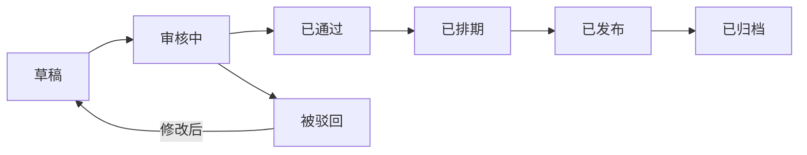
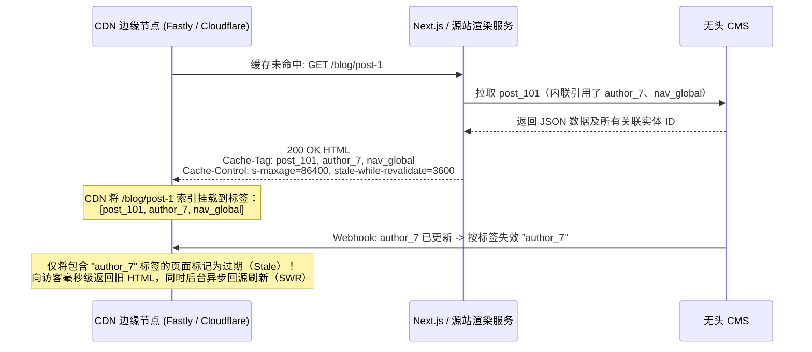

# 内容管理

## 这是什么？

内容管理是非技术人员在网站或应用上创建、编辑、组织和发布内容的方式。博客文章、产品描述、营销页面、帮助文档、新闻更新——都通过 CMS（内容管理系统）来管理。作为开发者，你要么在搭建 CMS，要么在对接 CMS，要么在 CMS 之上构建功能。理解业务工作流（草稿、审批、定时发布）和技术实现一样重要。

## 为什么要懂？

几乎每个超出个人项目范围的网站都需要内容管理。市场团队想更新着陆页但不想提 Jira 工单。客服团队想发布帮助文档。产品团队想管理功能公告。如果你建的系统每次改内容都需要开发介入，你就创造了一个瓶颈。理解 CMS 业务流程帮你搭建（或选择）正确的系统，赋能内容团队的同时维护质量。

## 业务流程

### 内容生命周期

每段内容都有生命周期：

1. **草稿**：作者写内容。随时保存。不对外公开
2. **审核中**：作者提交审核。编辑收到通知
3. **已通过/被驳回**：编辑通过（进入发布流程）或打回并附上反馈
4. **已排期**：设定在未来某个时间发布（如周二上午 9 点产品上线）
5. **已发布**：上线了。所有人可见
6. **已归档**：从网站撤下但在系统中保留。可以恢复

### 内容建模

内容被结构化为带有定义字段的类型：

- **博客文章**：标题、作者、正文、特色图片、分类、标签、发布日期
- **产品**：名称、描述、价格、图片、规格、分类
- **FAQ**：问题、答案、分类
- **着陆页**：大标题、主图、分区（灵活布局）

内容模型定义了编辑能输入什么。保证一致性，让内容可查询。

### 媒体管理

1. 编辑上传图片、视频、文档
2. 媒体库存储和组织资源，带元数据（alt 文本、尺寸、标签）
3. 图片自动生成多个版本（缩略图、中图、大图）
4. CDN 分发媒体，全球快速加载
5. 旧的未使用媒体可以标记清理

### 版本控制与修订历史

1. 每次保存创建一个新版本
2. 编辑可以查看完整的修改历史
3. 任何历史版本都可以一键恢复
4. 回答"谁改了这个？什么时候？为什么？"以及犯错后回滚

## 常见术语

| 术语                     | 解释                                                   |
| ------------------------ | ------------------------------------------------------ |
| **CMS**                  | 内容管理系统                                           |
| **无头 CMS**             | 通过 API 提供内容。没有内置前端。你自己搭建展示层      |
| **传统 CMS**             | 有内置前端的 CMS（WordPress、Drupal）。内容和展示耦合  |
| **所见即所得 (WYSIWYG)** | 富文本编辑器，输入时显示格式化后的效果                 |
| **内容类型/模型**        | 一种内容的结构定义（如博客文章有标题、正文、作者）     |
| **Slug**                 | URL 友好版本的标题。"我的第一篇文章" → `my-first-post` |
| **分类体系**             | 内容的分类系统——类目、标签、层级结构                   |
| **区块/组件**            | 编辑可以拼装成页面的可复用内容模块                     |
| **内容预览**             | 发布前查看内容在正式页面上的效果                       |
| **工作流**               | 内容发布前经过的审批流程                               |
| **Webhook**              | 内容变更时 CMS 给你的应用发通知（用于触发静态站重建）  |
| **CDN**                  | 内容分发网络——将静态页面与媒体资源缓存到全球边缘节点以实现就近极速访问 |
| **原子内容发布集 (Content Release)** | 将多篇相互关联的页面、导航栏、横幅打包为一个发布批次，在单次事务中原子化同时切换上线 |
| **Surrogate-Key / Cache-Tag** | HTTP 响应头（如 `Cache-Tag: entry_42,author_7`），让 CDN 能精确剔除引用了某条变更数据的页面缓存，避免全站清空 |
| **Stale-While-Revalidate (SWR)** | 缓存指令，让 CDN 在缓存过期或软失效时先毫秒级返回旧页面，同时在后台异步回源拉取新页面 |
| **字段级多语言回退链**   | 按预设语言继承链（如 `zh-HK -> zh-TW -> zh-CN -> en-US`）逐字段兜底缺失翻译，同时共享非文本结构字段 |
| **源文本哈希漂移检测 (Drift Detection)** | 在译文记录上保存源语言字段的 SHA-256 哈希，当源语言正文修改时自动将旧译文标记为"过期需重译" |

## 常见模式

### 模式一：传统 CMS（WordPress、Drupal）

内容由同一系统管理和渲染。编辑用内置后台。CMS 生成 HTML 页面。

**适用场景：** 博客、企业官网、高频内容的媒体网站。

**取舍：** 搭建快但前端定制受限。PHP 生态。大规模可能有性能问题。

### 模式二：无头 CMS（Contentful、Strapi、Sanity）

CMS 通过 REST 或 GraphQL API 提供内容。前端是独立应用（React、Next.js 等），从 API 获取内容。

**适用场景：** 现代网站、多平台内容分发（网页 + 移动端）。

**取舍：** 开发工作量更大。但前端完全自由，配合 SSG/ISR 性能更好。

### 模式三：基于 Git 的 CMS（Netlify CMS、Tina）

内容以文件形式（Markdown、JSON）存在 Git 仓库。编辑用网页界面操作，改动会提交到 Git。

**适用场景：** 开发者博客、文档站点、JAMstack 项目。

**取舍：** 版本控制好。但不适合非技术内容团队或高频发布。

### 模式四：页面搭建器（Notion 风格）

编辑用区块拼页面——文字、图片、视频、分栏、按钮。非常灵活。

**适用场景：** 着陆页、布局需要频繁变化的营销网站。

**取舍：** 难以保证一致性。编辑可能搭出混乱的布局。渲染也更复杂。

## 踩坑提醒

- **富文本很乱**：所见即所得编辑器产生的 HTML 不一致。保存时就做清洗和规范化，别只在展示时做。
- **Slug 冲突**：两篇标题都叫"介绍"的文章会生成同样的 slug `introduction`。追加数字或日期来避免。
- **定时发布时区**："上午 9 点发布"——哪个时区？编辑的？服务器的？读者的？要明确。
- **断裂引用**：内容 A 引用了内容 B。如果 B 被删除，A 就有断裂引用。删除前检查引用关系。
- **SEO 影响**：改了 URL（slug）但没做重定向，Google 排名就废了。始终创建 301 重定向。
- **大文件上传**：别通过你的 API 服务器上传。用直传到 S3 的预签名 URL。
- **无头 CMS 的预览**：因为 CMS 不渲染页面，预览需要在你的前端搭一个特殊端点来获取草稿内容。
- **发布后缓存失效**：内容发布后，CDN 缓存需要清除。用 Webhook 触发重建或缓存失效。

## 行业实战经验与非显而易见的最佳实践

### 1. 原子化"内容发布集（Content Releases）"：20 个相互依赖的营销页与导航栏如何零死链同时上线

想象苹果或 Stripe 在周二上午 9:00 准时发布年度新品。这次上线需要同时改动 20 处内容：
- 全站顶部导航栏（新增指向 `/products/vision` 的菜单项）
- 首页首屏大图横幅（Hero Banner）
- 价格对比矩阵表
- 12 个语种的新品着陆页与 5 篇帮助文档

如果编辑手动逐篇点击"发布"（或者后台定时任务用 `for` 循环花 45 秒逐条更新），在 `09:00:12` 访问网站的用户就会看到顶部导航栏已经出现了新品链接，点进去却因为着陆页还没排到发布而报 **404 Not Found**；或者首页横幅换成了新品，底下的价格表却还是老套餐。更糟的是，如果循环到第 14 篇时因为某个必填字段校验失败而中断，整个线上官网就会卡在"半发布"的撕裂状态。

**生产级架构——原子内容发布集（Content Releases）与不可变快照指针：**
1. **发布批次实体（`content_releases`）**：编辑将这 20 篇草稿版本打包进一个命名发布集（如 `rel_spring_launch_2026`）。
2. **上线前引用图完整性预检（Pre-Flight Reference Graph Validation）**：在定时任务触发前，校验器会遍历这 20 个目标版本的全部引用关系图：
   - 是否存在某个链接指向了既未在线上发布、又没被包含在本次 `rel_spring_launch_2026` 批次里的 `draft` 草稿？
   - 所有目标语种的必填字段与媒体资源是否均已就绪？
3. **单事务指针原子切换（Atomic Pointer Flip）**：CMS 底层将每次编辑保存为不可变的 `entry_versions` 版本行。到了 9:00 整点，系统在单个串行化数据库事务中同时切换这 20 个条目的 `published_version_id` 指针（或直接推进全局数据集快照版本号），随后只发出一封合并后的 `release.published` 批量 Webhook 事件。

### 2. 细粒度 `Surrogate-Key` / `Cache-Tag` CDN 缓存失效（告别"全站清缓存雪崩"）

当编辑修改了**作者 #7 的个人简介**（`author_7`）中的一个错别字时，你怎么知道全站哪几个 URL 的 CDN 缓存需要刷新？
- `author_7` 的名字和头像同时出现在 `/about-us`、`/blog/post-1`、`/blog/post-84` 以及 `/category/engineering` 列表页上。
- **初级做法的灾难（`Purge Everything` 全站清空）**：因为搞不清到底哪些页面引用了 `author_7`，开发在收到 CMS Webhook 时直接调 `cdn.purgeAll()`。对于拥有 5 万个页面的高并发网站，编辑每改一个标点符号就清空全站 CDN，会瞬间引发**缓存雪崩（Cache Stampede / 惊群效应）**，海量回源请求直接把源站渲染服务器和数据库打挂。

**生产级标准——基于依赖追踪的 `Cache-Tag` / `Surrogate-Key` 与软失效（Soft Purge）：**

1. **渲染期自动收集内容依赖图**：源站渲染 `/blog/post-1` 时，数据请求层自动收集本次页面渲染所触碰到的每一个 CMS 实体 ID（`post_101`、`author_7`、`nav_global`）。
2. **输出 `Cache-Tag` / `Surrogate-Key` 响应头**：源站向 CDN 返回 `Cache-Tag: post_101,author_7,nav_global`（Cloudflare / Vercel）或 `Surrogate-Key: post_101 author_7 nav_global`（Fastly）。CDN 在把 HTML 发给浏览器前会自动剥离该内部头，并在边缘节点内存中建立"实体标签 -> URL 集合"的倒排索引。
3. **按标签软失效（Soft Purge）+ `stale-while-revalidate`（SWR）**：当 `author_7` 更新时，Webhook 仅触发 `purgeByTag('author_7')`。配合 SWR 机制，CDN **不会物理删除**旧缓存让下一个访客干等 800ms 回源，而是将关联页面标记为 `stale`，继续在 10ms 内把旧 HTML 返回给当前访客，同时在后台发起单飞（Singleflight）异步回源把新页面替换进去。

### 3. 字段级多语言回退链（Fallback Chains）与源文本改动引发的"译文过期漂移（Translation Drift）"检测

在支持 15 种以上语言区域（`en-US`、`en-GB`、`fr-FR`、`fr-CA`、`de-DE`、`zh-CN`、`zh-HK`）的跨国站点中，如果每增加一种语言就把整篇文档复制一份副本，维护成本会指数级爆炸：

1. **字段级本地化 vs. 文档级克隆**：
   - 一个产品页或着陆页同时包含**语言无关字段**（`price_usd`、`sku`、`hero_video_id`、栅格列数）和**语言相关字段**（`title`、`body_markdown`、`seo_description`、法务免责声明）。
   - 语言无关字段在父条目上只存一份；语言相关字段按区域键存储在多语言字典中（`title: { "en-US": "...", "zh-CN": "..." }`）。
2. **确定性多级回退链（Fallback Chain）与合规禁回退例外**：
   - 配置显式的区域继承树：`fr-CA`（加拿大法语）$\rightarrow$ `fr-FR`（标准法语）$\rightarrow$ `en-US`（默认英语）；或 `zh-HK` $\rightarrow$ `zh-TW` $\rightarrow$ `zh-CN`。如果加拿大运营只改了当地促销标题，正文会自动继承 `fr-FR`。
   - **致命的合规例外**：对于**强地域监管的法务/医疗/金融合规声明字段**（如欧盟 GDPR 隐私条款、特定国家禁售提示），严禁静默回退到默认的 `en-US` 美国条款！必须在 Schema 上标记 `allow_fallback: false`，一旦当地语种缺失该字段，宁可阻断发布或隐藏对应模块，也绝不能在德国站点上渲染美国的免责条款。
3. **基于源哈希的译文过期漂移检测（`source_version_hash`）**：
   - 假设英文源文案 `en-US` 写着 *"支持 **30 天**无理由退款"*，德语 `de-DE` 翻译成了 *"Rückerstattungen innerhalb von **30 Tagen**"*。
   - 半年后，美国产品经理把英文源文案改成了 *"支持 **14 天**无理由退款"* 并直接点了发布。
   - 因为德语字段本来就有值（非空），傻瓜式 CMS 会认为德语翻译完成度依然是 "100%"——导致德国官网上继续挂着具有法律约束力的"30 天退款"旧承诺！
   - **生产级解法**：每当译员保存某语种 $L$ 的字段 $F$ 时，在翻译元数据里同步记录当时源语言文本的哈希值：`translated_from_source_hash = sha256(F["en-US"])`。一旦 `en-US` 原文发生任何修改，其最新 SHA-256 哈希改变，所有 `translated_from_source_hash != current_source_hash` 的下游语种字段会自动变为 **`status = stale_needs_review`（原文已改，译文过期）**，并在编辑器和翻译工单系统中亮起黄灯告警。

## 速查表

| 需求                   | 推荐方案                                                                     |
| ---------------------- | ---------------------------------------------------------------------------- |
| 简单博客               | WordPress 或无头 CMS + 静态生成器                                            |
| 企业官网               | 无头 CMS + Next.js（按需 ISR + `Cache-Tag` 精确失效）                        |
| 多页面协同营销大促上线 | 原子化**内容发布集（Content Releases）** + 上线前引用图无死链预检            |
| 高并发 CDN 缓存架构    | 渲染时输出关联实体 ID 到 `Surrogate-Key` / `Cache-Tag` + 软失效配合 SWR      |
| 电商内容               | 无头 CMS + 电商平台集成                                                      |
| 文档                   | 基于 Git 的 CMS + Markdown                                                   |
| 营销着陆页             | 带严格组件 Schema 约束的页面搭建器 / 区块式 CMS                              |
| 跨国多语言（10+ 语种） | 字段级本地化 + 多级回退链（法务字段禁回退）+ `source_hash` 译文过期漂移检测  |
| 编辑工作流             | 内置多级审批流、RBAC 角色与显式 UTC 时区定时发布批次的 CMS                   |
| 实时多人协同编辑       | 基于 CRDT 或 OT（操作转换）的 Notion / 飞书文档风格编辑器                    |

