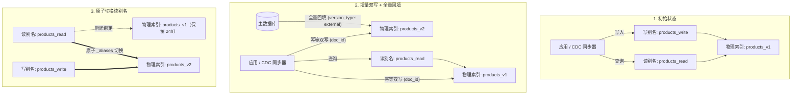
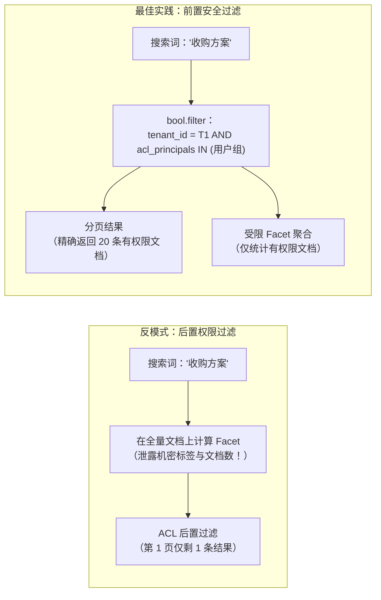
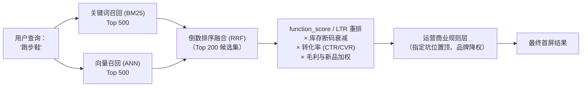

# 搜索与筛选

## 这是什么？

搜索和筛选是用户在你的应用里找到他们要的东西的方式。搜索框、筛选侧栏、排序下拉、自动补全建议——都是搜索。不管是有上万商品的电商网站、招聘平台，还是有几千条记录的内部后台，搜索就是用户浏览内容的核心方式。从外面看很简单，但背后的相关性、排名和多维筛选逻辑可以非常深。

## 为什么要懂？

烂搜索赶走用户。有人搜"蓝色跑步鞋"却看到雪地靴，他就走了。数据表明，使用站内搜索的用户转化率是不使用的 2-3 倍——他们知道自己要什么，也准备好行动了。作为开发者，你在几乎每个数据密集的应用里都要搭搜索功能。理解业务面（什么叫"相关"、多维筛选怎么运作、为什么自动补全重要）帮你搭建真正有用的搜索。

## 业务流程

### 基本搜索流程

1. 用户在搜索框输入关键词
2. 客户端把查询发到服务端（带上当前筛选条件）
3. 服务端在索引/数据库中搜索匹配结果
4. 结果按相关性排序
5. 结果页展示商品，带高亮、分页和筛选选项
6. 用户用筛选条件精炼，或尝试新的搜索词

### 全文搜索

和数据库的 `LIKE` 查询不同，全文搜索理解语言：

1. **建索引**：写入时对内容做处理——分词、词干提取（running → run），存入倒排索引
2. **查询**：用户的搜索词经过同样的处理
3. **匹配**：引擎找到包含处理后查询词的文档
4. **打分**：结果按相关性排名（匹配了多少词、在哪里出现、词有多稀有）

### 多维筛选（Faceted Filtering）

就是电商网站上的筛选侧栏：

```
分类：    [电子产品] [服装] [书籍]
价格区间：[¥0-100] [¥100-300] [¥300-500] [¥500+]
品牌：    [Nike (42)] [Adidas (38)] [Puma (15)]
颜色：    [红色 (12)] [蓝色 (28)] [黑色 (55)]
评分：    [4星以上 (120)]
```

每个筛选维度显示可选值和匹配数量。选中一个筛选条件会缩小结果范围，同时更新其他维度的计数。

### 自动补全与建议

1. 用户开始在搜索框输入
2. 输入 2-3 个字后，系统返回建议
3. 建议来源：热门搜索、商品名、分类名、用户近期搜索
4. 用户可以点击建议或继续输入
5. "你是不是想找……" 处理拼写错误（模糊匹配）

### 排序

结果可以按不同标准排序。默认通常是"相关性"（最佳匹配优先），用户可以切换为：

- **价格：从低到高 / 从高到低**
- **最新上架**
- **最热门**（销量、浏览量）
- **评分**（最高评分）
- **距离**（最近的，适用于地理位置搜索）

## 常见术语

| 术语              | 解释                                                       |
| ----------------- | ---------------------------------------------------------- |
| **全文搜索**      | 按词/短语搜索内容，带语言感知（词干提取、同义词）          |
| **倒排索引**      | 一种数据结构，把词映射到文档。快速搜索的核心               |
| **相关性**        | 结果与用户意图的匹配程度。搜索中最难的部分                 |
| **Facet（维度）** | 数据的一个可筛选维度（分类、价格区间、品牌），带计数       |
| **分词**          | 把文本拆分成独立的词或词条用于建索引                       |
| **词干提取**      | 把词还原为词根形式（running、runs、ran → run）             |
| **同义词**        | 把不同的词当等价处理（沙发 = 长沙发，笔记本 = 笔记本电脑） |
| **模糊匹配**      | 查询有拼写错误也能找到结果（iphne → iPhone）               |
| **权重提升**      | 给某些字段或文档更高的排名权重（标题匹配比正文匹配权重高） |
| **零结果**                       | 搜索什么都没返回。严重的用户体验问题——一定要提供替代方案                                            |
| **搜索分析**                     | 追踪人们搜了什么、点了什么、在哪里放弃了                                                            |
| **Elasticsearch**                | 最流行的开源搜索引擎。基于 Apache Lucene                                                            |
| **索引别名（Index Alias）**      | 指向物理索引（如 `products_v2`）的虚拟指针（如 `products_read`），支持零停机蓝绿切换                |
| **BM25**                         | Lucene 默认的词法相关性打分算法，结合词频饱和度（TF）与文档长度归一化                               |
| **倒数排序融合（RRF）**          | 将关键词检索（BM25）和向量检索（ANN）的多路排序结果按名次融合，无需困难的跨模型分数归一化           |
| **后置过滤（Post-Filter）**      | 在聚合计数计算完成后才过滤搜索结果——适合多选筛选 UI，但严禁用于权限（ACL）过滤                      |
| **查询放宽（Query Relaxation）** | 当严格匹配返回零结果时，自动降低匹配门槛（如 `AND` 降级为按比例匹配）以召回候选结果                 |
| **商业干预（Merchandising）**    | 通过固定坑位（Pinning）、加权（Boosting）及库存/毛利因子覆盖纯文本相关性排序                        |

## 常见模式

### 模式一：数据库搜索（SQL LIKE / 全文索引）

用数据库自带的搜索能力。PostgreSQL 的全文搜索（`tsvector` + `tsquery`）就很不错。

**适用场景：** 小数据量（<10 万条记录）、简单搜索需求、不想额外加基础设施。

**取舍：** 相关性排名有限，不支持多维筛选，大数据量时较慢。

### 模式二：专用搜索引擎（Elasticsearch / OpenSearch）

数据被索引到独立的搜索引擎。你的应用查搜索引擎来搜索，查主数据库来做其他操作。

**适用场景：** 有严肃搜索需求的应用——电商、内容平台、数据量大的 SaaS。

**取舍：** 额外的基础设施。数据需要在数据库和搜索索引之间同步。

### 模式三：搜索即服务（Algolia、Typesense、Meilisearch）

托管的搜索服务。你把数据推给他们的 API，他们处理建索引、排名和服务。

**适用场景：** 想要好搜索但不想管基础设施的团队。

**取舍：** 成本随用量增长。对排名算法控制较少。供应商锁定。

### 模式四：AI/向量搜索

用 Embedding 做语义搜索。不是匹配关键词，而是理解含义（"舒适的鞋子"能找到"人体工学运动鞋"）。

**适用场景：** 商品发现、知识库、"和你的文档聊天"功能。

**取舍：** 需要 Embedding 生成、向量数据库（Pinecone、pgvector）。有时"太智能"了——有些用户就想精确的关键词匹配。

## 踩坑提醒

- **零结果页**：永远不要显示空白页。提供：拼写建议、热门商品、放宽筛选。"没有找到'bule 鞋子'的结果。你是不是想找'blue 鞋子'？"
- **搜索索引延迟**：添加商品后，可能几秒/几分钟后才能在搜索中找到（等索引更新）。用户看到商品页面却搜不到会很困惑。
- **筛选计数要准确**：计数必须准确否则用户会失去信任。显示"Nike (42)"但筛选后只有 38 条，肯定有 bug。
- **太多筛选维度的性能**：每个维度需要聚合。维度太多 = 查询慢。限制在最有用的 5-8 个。
- **URL 驱动搜索**：把搜索状态编码到 URL 里（`?q=shoes&brand=nike&sort=price_asc`）。这样搜索结果可以分享和收藏。
- **搜索滥用**：有人会搜索 SQL 注入、XSS 载荷和乱码。清洗查询并设长度限制。
- **多语言搜索**：英文的词干提取对中文、日文不适用。不同语言需要不同的分析器。中文需要专门的分词器。

## 行业实战经验与非显而易见的最佳实践

### 1. 零停机索引别名切换（蓝绿重建索引与双写回填）

在关系型数据库里，你通常可以在线 `CREATE INDEX CONCURRENTLY`。但在基于 Lucene 的搜索引擎（Elasticsearch、OpenSearch）中，**已有字段的分词器（Analyzer）或类型映射（Mapping）一旦写入磁盘就无法原地修改**。如果你发现 `product_sku` 字段被默认分词器拆成了零散词条（把 `AX-900-B` 拆成了 `ax`、`900`、`b`），或者中文商品名需要从标准分词切换到 `ik_max_word`，你不能执行 `ALTER TABLE`——必须重建整个索引。

**常见故障场景：** 直接删掉 `products` 索引并从数据库重新灌入 2000 万条商品需要 45 分钟。在这 45 分钟里，站内搜索要么直接报 `404 IndexNotFoundException`，要么只能搜到残缺不全的数据。更隐蔽的坑是：如果在全量回填期间没有开启实时增量双写，这 45 分钟内发生的商品改价、库存扣减和上下架变更会在切流瞬间全部丢失。

**生产环境最佳实践：** 业务代码永远不要直接读写物理索引名，必须通过**索引别名（Index Alias）**（如 `products_read` 和 `products_write`）进行解耦，并执行四阶段双写迁移：



1. **创建新索引 `products_v2`**：配置新的分词器和 Mapping。在全量导入前临时设置 `refresh_interval: -1` 和 `number_of_replicas: 0`，将写入吞吐量最大化。
2. **开启增量双写**：让 CDC 消费者或应用层索引器同时向 `products_v1` 和 `products_v2` 写入增量变更。使用业务主键作为文档 ID（`doc_id = product.id`），并携带数据库的 `updated_at` 时间戳作为外部版本号（`version_type: external`），确保较旧的全量回填数据绝不会覆盖更新的实时增量写入。
3. **全量回填与追平**：从主库流式扫描全量记录灌入 `products_v2`。完成后恢复 `number_of_replicas: 2` 和 `refresh_interval: 1s`，等待所有分片副本同步变为 Green。
4. **原子切换别名**：调用 `_aliases` 接口，在同一个集群状态事务中将 `products_read` 从 `products_v1` 摘除并挂载到 `products_v2`。保留 `products_v1` 24 小时以便随时秒级回滚，确认无误后再清理旧索引。

### 2. ACL 权限过滤与 Facet 聚合计数泄密

在 B2B SaaS、医疗系统或企业知识库（如飞书文档、Notion、Jira）中，搜索结果必须严格遵循细粒度的访问控制列表（ACL）——用户 A 只能搜到自己所在部门或被明确授权的文档。

**两个典型的生产反模式：**

1. **在业务代码里做后置权限过滤（分页彻底崩坏）**：开发者先向 Elasticsearch 请求匹配 `"Q4 裁员"` 的前 `size: 20` 条文档，然后在 Node.js/Go 代码里调用权限服务过滤。如果用户对前 20 条中的 18 条都没有权限，**第一页就只能渲染出 2 条结果（甚至 0 条空白页）**，哪怕第 2 页以后有 500 条该用户有权查看的文档。
2. **滥用 `post_filter` 或未限定聚合范围（敏感统计计数泄密）**：在 Elasticsearch 中，顶层 `post_filter` 会在**聚合（Aggregations）计算完成之后**才过滤命中文档列表。这意味着虽然无权访问的文档不会出现在结果列表里，但侧边栏的 Facet 计数依然会暴露全局统计：`部门：[并购目标-泰坦计划 (14)]` 或 `标签：[证监会调查 (8)]`。攻击者甚至可以通过组合 `salary_band`（薪资带宽）筛选条件并观察侧边栏计数，精确推算出高管薪资分布。



**生产环境最佳实践：**
- **将 ACL 权限主体压入 `bool.filter` 子句**：在索引文档时写入 `acl_principals` 数组（如 `["user:42", "dept:eng", "role:admin"]`）。查询时先解析当前用户所属的全部群组和角色，在 `bool.filter` 中注入强制 `terms` 过滤（在算分和聚合之前执行，且可充分利用 Lucene 的 Bitset 缓存）。
- **网关层强制包裹安全上下文**：绝不允许前端直接透传原始 Elasticsearch DSL。在后端统一查询中间件中强制拼装 `bool.filter` 安全边界，确保命中列表、`total` 总数、高亮片段和所有 Facet 桶计数都严格限制在授权文档集内。

### 3. 商业排序干预（Merchandising） vs. 纯算法相关性（BM25 / 向量相似度）

纯粹的信息检索算法（基于词频的 BM25 或基于 Embedding 余弦相似度的向量检索）只关心**字面或语义相似度**——它们对毛利率、库存深度、履约时效和商业目标一无所知。

**纯文本相关性在生产中的翻车现场：**
- 用户搜索 `"iPhone 手机壳"`。纯 BM25 把一款清仓的 iPhone 6 手机壳排在第一名，只因为它的标题里重复了三次 `"iPhone 手机壳"`；而毛利高达 80% 的新款旗舰手机壳却排在第 3 页。
- 库存为 0 或断码（只剩 XXS 码）的商品霸占首屏，用户点进去发现没法买，转化率暴跌。
- 纯向量搜索把 `"便宜的防水外套"` 匹配到了 8000 元的始祖鸟冲锋衣，因为它们在向量空间里距离很近。

**生产环境最佳实践：多路混合召回 + 商业重排（Rescoring）**



1. **库存与尺码完备度硬过滤/衰减**：下架或无货商品直接过滤，断码商品（如核心尺码缺货）在算分时乘以衰减系数。
2. **乘法型 `function_score` 融合业务信号**：使用对数平滑（`log1p`）和高斯衰减曲线，将文本相关性与商业指标做**乘法耦合**（而非简单相加，防止全站爆款礼品卡霸占不相关的搜索词）：
   $$\text{FinalScore} = \text{TextScore} \times (1 + w_1 \log(1 + \text{近30天销量})) \times (1 + w_2 \cdot \text{平滑转化率}) \times \text{库存系数}$$
3. **可视化的运营干预规则（Pinning & Boosting）**：为运营团队提供白盒规则引擎，支持针对特定搜索词固定前排坑位（例如搜 `"年货节"` 时将主推礼盒固定在第 1、2 位）或批量调权，无需改代码发版。

### 4. 零结果自愈级联（同义词环、前缀回退与查询放宽）

搜索返回 `0 条结果` 是电商和内容平台用户流失率最高的瞬间。生产环境中通常有 5%–12% 的查询因为词汇鸿沟（搜 `"笔电"` 但商品名叫 `"笔记本电脑"`）、长尾多词过度约束（`"男士防水宽楦越野跑鞋黑色"`）或拼写错误而在严格匹配下返回空集。

**生产环境最佳实践：单次请求内的自动降级瀑布流**

不要让用户手动删词重试。在搜索编排层实现确定性的四级自动降级策略：

1. **第一级——严格精确匹配（`minimum_should_match: 100%` + 短语加权）**：要求所有核心词条全部命中，同时挂载双向**同义词环**（`球鞋 <=> 运动鞋`）和单向**上下位词扩展**（`AirPods => 无线蓝牙耳机`，确保搜 AirPods 能召回同类耳机，但搜蓝牙耳机不会只出现苹果）。
2. **第二级——部分词条放宽（Query Relaxation，`minimum_should_match: "75%"`）**：若第一级返回 0 条结果，自动放宽布尔约束（例如 5 个词只需命中 3–4 个词），并在前端醒目提示 `"未找到完全匹配，已为您展示包含大部分关键词的结果"`，同时标注被忽略的修饰词（如 ~~`宽楦`~~）。
3. **第三级——模糊纠错与前缀回退（Fuzzy + Edge N-Gram）**：开启编辑距离容错（`fuzziness: AUTO`）与拼音/前缀匹配，兜底拼写错误和输入法选词失误。
4. **第四级——语义向量兜底（Dense Vector Fallback）**：当词法放宽依然无果（例如用户搜索自然语言描述 `"放在办公桌上给咖啡保温的东西"`），自动回退到向量语义检索 + 类目热销榜，确保页面永远有高相关内容可逛。

## 速查表

| 数据规模     | 推荐方案                           |
| ------------ | ---------------------------------- |
| <1 万条      | 数据库 LIKE / 全文搜索             |
| 1-100 万条   | PostgreSQL 全文搜索 或 Meilisearch |
| 100 万+      | Elasticsearch / OpenSearch         |
| 需要托管服务 | Algolia 或 Typesense               |
| 语义/AI 搜索 | 向量搜索（pgvector、Pinecone）     |
| 只做自动补全 | 前缀索引或 Trie 结构               |

| 生产环境典型故障                 | 根本原因                                         | 架构级解决方案                                                    |
| -------------------------------- | ------------------------------------------------ | ----------------------------------------------------------------- |
| 修改分词器/字段类型导致搜索中断  | 应用直接读写物理索引名，无法原地修改倒排索引     | 读写索引别名解耦 + 增量双写 + `version_type: external` 全量回填   |
| 每页设 20 条却只显示 2 条结果    | 在业务代码中对搜索结果做 ACL 权限后置过滤        | 将 `acl_principals` 压入 `bool.filter`，在分页和聚合前过滤        |
| 侧边栏筛选项泄露无权限的机密项目 | 使用了 `post_filter` 但未限制 Aggregation 的范围 | 所有查询与聚合统一包裹在网关层强制注入的 `bool.filter` 安全条件内 |
| 缺货断码或低毛利清仓品排在第一   | 纯 BM25 / 向量相似度打分完全忽略商业与库存指标   | 使用 `function_score` 将文本分与库存、转化率、毛利做平滑乘法融合  |
| 4 个词以上的长尾查询频繁返回空白 | 严格 `AND` 匹配只要差一个修饰词就全盘落空        | 自动触发查询放宽（`minimum_should_match: "75%"`）与语义向量兜底   |

