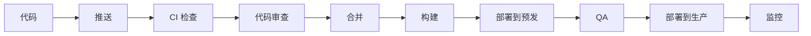
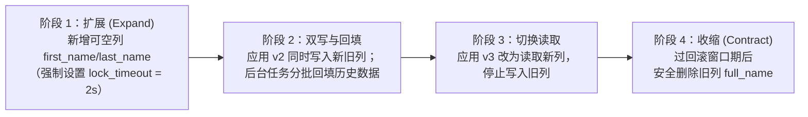
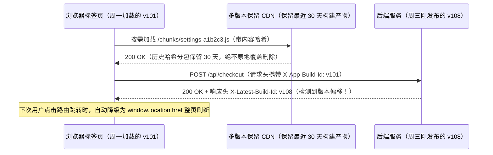
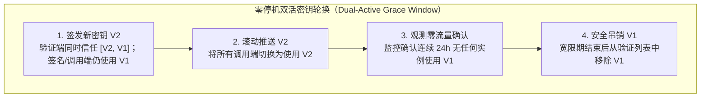

# DevOps 流水线

## 这是什么？

DevOps 流水线是你的代码从开发者电脑到生产环境的自动化路径。涵盖你 `git push` 之后的一切：代码审查、自动测试、构建、安全扫描、预发布部署、生产部署和监控。目标是快速且安全地发布代码——在 bug 到达用户之前抓住它们，让部署变得无聊而不是令人恐惧。

## 为什么要懂？

每个专业开发团队都在用某种形式的 CI/CD 流水线。不管你在创业公司还是大企业，你每天都在和流水线打交道。理解业务流程——为什么有这些检查、部署时发生了什么、怎么安全回滚——能避免你成为那个周五下午搞崩生产环境又不知道怎么撤销的人。

## 业务流程

### 完整流水线

### 1. 编码与提交

1. 开发者在功能分支上写代码
2. 本地跑检查（lint、测试、类型检查）
3. 用有意义的提交信息提交
4. 推送到远程仓库（GitHub、GitLab）

### 2. 持续集成（CI）

推送或创建 Pull Request 时自动触发：

1. **Lint**：代码风格和格式检查（ESLint、Prettier）
2. **类型检查**：TypeScript 编译、类型安全验证
3. **单元测试**：验证单个函数和组件的快速测试
4. **集成测试**：验证组件协同工作的测试
5. **构建**：编译应用，验证能成功构建
6. **安全扫描**：检查依赖中的已知漏洞（Snyk、Dependabot）
7. **代码覆盖率**：测量多少代码被测试覆盖

所有检查必须通过才能合并 PR。这由分支保护规则强制执行。

### 3. 代码审查

1. 开发者提交 Pull Request，附上变更说明
2. 审查者被分配（自动或手动）
3. 审查者检查：正确性、可读性、性能、安全性、测试覆盖
4. 留评论，讨论
5. 开发者处理反馈，推送更新
6. 获得批准后（通常需要 1-2 个人批准），PR 可以合并

### 4. 合并与构建

1. PR 合并到主分支（通过 merge commit、squash 或 rebase）
2. CI 再次在合并后的代码上运行
3. 创建构建产物（Docker 镜像、编译资源、打包文件）
4. 产物打上版本标签（git SHA、语义化版本、构建号）
5. 产物推送到仓库（Docker Hub、ECR）

### 5. 部署

**预发布（预生产）：**

1. 构建产物部署到镜像生产环境的预发布环境
2. QA 团队（或自动化 E2E 测试）验证一切正常
3. 可能在这里做性能测试
4. 发现问题就停下——修复后重试

**生产：**

1. 预发布验证通过后，产物部署到生产环境
2. 执行部署策略（见下面的常见模式）
3. 健康检查验证新版本正常服务流量
4. 监控面板观察异常

### 6. 部署后

1. **监控**：关注错误率、延迟和关键指标
2. **告警**：出问题就通知团队（PagerDuty、企业微信、钉钉）
3. **回滚**：如果部署引发问题，回退到上一个版本
4. **发布说明**：告诉利益相关者改了什么

## 常见术语

| 术语                     | 解释                                                                 |
| ------------------------ | -------------------------------------------------------------------- |
| **CI**                   | 持续集成——每次推送自动测试代码                                       |
| **CD**                   | 持续部署/交付——CI 通过后自动部署代码                                 |
| **流水线**               | 从代码到生产的自动化步骤序列                                         |
| **构建产物**             | 构建的输出（Docker 镜像、编译后的二进制、打包的 JS）                 |
| **分支保护**             | 检查不通过、审查不批准就不能合并的规则                               |
| **功能分支**             | 为特定功能或修复创建的分支，完成后合并回去                           |
| **蓝绿部署**             | 两套相同的环境。部署到闲置的那套，然后切换流量                       |
| **金丝雀部署**           | 先部署给小比例用户。指标正常再推广给所有人                           |
| **滚动部署**             | 逐个替换旧实例为新实例                                               |
| **回滚**                 | 出问题时恢复到之前的版本                                             |
| **环境**                 | 应用的不同实例（开发、预发布、生产）                                 |
| **基础设施即代码 (IaC)** | 用代码定义基础设施（Terraform、CloudFormation）                      |
| **SLA**                                     | 服务等级协议——承诺的可用性（如 99.9% = 每年最多 8.7 小时停机）                                        |
| **热修复**                                  | 不走正常发布流程的紧急修复部署                                                                        |
| **功能开关**                                | 不用部署就能启用/禁用功能的开关。参见[功能开关](19-FEATURE-FLAGS.md)                                  |
| **扩展与收缩迁移（Expand-and-Contract）**   | 零停机数据库结构变更的四步法（新增兼容列 → 双写与回填 → 切换读取 → 清理旧列）                         |
| **前后端版本偏移（Version Skew）**          | 长期未刷新的前端页面（如开了三天的 SPA 标签页）请求新发布的后端接口或已清理的静态分包                 |
| **配置漂移（Configuration Drift）**         | 生产环境因人工上控制台临时改配置（ClickOps），导致实际运行状态与 Git 中的 IaC 代码不一致              |
| **双活密钥轮换（Dual-Active Rotation）**    | 在宽限期内同时信任新旧两把密钥/双数据库账号，待所有实例平滑切换后再吊销旧密钥的零停机轮换机制         |

## 常见模式

### 模式一：蓝绿部署

两套相同的生产环境（蓝和绿）。任何时候只有一套服务流量。

1. 蓝色在线，服务所有流量
2. 新版本部署到绿色
3. 在绿色环境做充分测试
4. 负载均衡器切换到绿色
5. 绿色上线。蓝色待命（备用）
6. 出问题就瞬间切回蓝色

**取舍：** 需要双倍基础设施。换来的是即时回滚。

### 模式二：金丝雀部署

把新版本部署给一小部分用户。观察。没问题就扩大。

1. 新版本部署到 5% 的服务器/用户
2. 监控错误率、延迟、业务指标
3. 如果 15-30 分钟后指标健康，扩大到 25%、50%、100%
4. 如果指标恶化，立刻回滚金丝雀

**取舍：** 路由逻辑更复杂。但减少了爆炸半径——一个坏部署最初只影响 5% 用户。

### 模式三：滚动部署

逐个替换实例。在任何时刻，一些实例运行旧版本，一些运行新版本。

**取舍：** 不需要额外基础设施。但回滚更慢。

### 模式四：Serverless / JAMstack

不用管服务器。构建静态资源，部署到 CDN。

1. 推送到 main → CI 构建站点 → 部署静态文件到 CDN（Vercel、Netlify）
2. 动态功能通过 Serverless 函数（API 路由、边缘函数）
3. 回滚 = 重新部署上一次的构建

**取舍：** 最简单的部署模型。但对复杂服务端逻辑有限制。

## 踩坑提醒

- **数据库迁移**：代码部署是即时的。数据库变更不是。始终让迁移向后兼容。先部署迁移，再部署代码。
- **周五不部署**：既是玩笑也是好建议。出问题了你想在工作日修，不是周末。
- **不稳定的测试**：时过时不过的测试会侵蚀对流水线的信任。人们开始忽略失败。立即修复不稳定的测试。
- **密钥管理**：绝不把密钥放在代码、提交到 git 的环境文件或 CI 日志里。用密钥管理器。
- **部署权限**：不是每个人都应该能部署到生产。在 CI/CD 工具中使用基于角色的访问控制。
- **可观测性缺口**：部署成功了但你没办法知道新版本是否真的在正常工作。始终把部署和监控配对。
- **数据不能回滚**：你能回滚代码，但不能轻松回滚数据。如果新代码用新格式写了数据，回滚代码不会撤销数据变更。

## 行业实战经验与非显而易见的最佳实践

### 1. 零停机滚动发布下的"扩展与收缩"（Expand-and-Contract）数据库迁移

在 Kubernetes 或容器集群执行滚动部署（Rolling Update）或金丝雀发布时，**旧版本 `v1` 容器和新版本 `v2` 容器会在长达数分钟甚至数小时内同时连接同一个生产数据库**。

**破坏性 Schema 变更的经典翻车现场：**
假设你要把 `users.full_name` 字段拆分为 `first_name` 和 `last_name`，或者执行 `ALTER TABLE orders ADD COLUMN tenant_id UUID NOT NULL`：
1. 如果你在 `v2` 容器全量上线前先执行了重命名或非空约束迁移，线上正在运行的 `v1` 容器会瞬间大面积报错：`column "full_name" does not exist` 或每次 `INSERT` 触发非空约束失败。
2. 更致命的是锁表雪崩：在 PostgreSQL 中对一张 5000 万行的大表执行需要 `ACCESS EXCLUSIVE` 排他锁的 `ALTER TABLE`，如果恰逢一个慢查询未结束，DDL 语句会排队等待锁，而排在 DDL 后面的**所有普通业务读写请求都会被连带阻塞**，几秒钟内打满数据库连接池导致全站瘫痪。

**生产环境最佳实践：四阶段"扩展与收缩"（Parallel Change）模式**

绝不在同一次发布中同时做破坏性 DDL 和依赖它的代码变更。将任何不兼容的字段修改拆解为四个完全向后兼容的阶段：

1. **阶段 1——扩展（仅做增量操作）**：新增允许为 `NULL` 的新列（`first_name TEXT NULL, last_name TEXT NULL`）。所有迁移脚本开头必须声明 `SET lock_timeout = '2s';`——如果 2 秒内拿不到表锁就立即自动放弃并重试，绝不阻塞线上读写。建索引必须使用 `CREATE INDEX CONCURRENTLY`。
2. **阶段 2——应用双写 + 幂等分批回填**：发布应用 `v2`，继续从 `full_name` 读取，但在每次写入/更新时**同时写入新旧字段**。启动限速后台任务（每批 `LIMIT 5000` 并休眠 50ms 防止主从复制延迟）回填历史存量数据。此时哪怕 `v2` 出现问题需要一键回滚到 `v1`，旧字段的数据也是 100% 完整的！
3. **阶段 3——切换读取与无锁约束校验**：存量数据 100% 补齐后，先添加 `CHECK (... IS NOT NULL) NOT VALID` 约束，再执行 `VALIDATE CONSTRAINT`（仅需 `SHARE UPDATE EXCLUSIVE` 锁，不阻塞线上读写），随后发布应用 `v3` 切换为从新列读取并停止写旧列。
4. **阶段 4——收缩（清理历史包袱）**：确认不再需要回滚到 `v2` 后，在下一次发布中安全执行 `DROP COLUMN full_name`。

### 2. 发布期间的前后端版本偏移防护（Version Skew 与 `ChunkLoadError`）

在单页应用（React、Next.js、Vue 等 SPA）中，用户经常在周一早上打开你的网页，然后把这个浏览器标签页一直挂到周四都不刷新。而在这四天里，你的 CI/CD 流水线可能已经发布了 15 个版本。

**两个高频生产故障：**
1. **按需加载的 JS 分包 404（`ChunkLoadError`）**：用户周一加载的 `index.html` 引用的是构建版本 `v101` 的路由清单。周三发布了 `v108` 并清理了旧静态资源后，用户点击页面上的"设置"菜单，前端路由尝试按需加载 `/_next/static/chunks/settings-a1b2c3.js`（属于 `v101`），结果收到 `404 Not Found`，直接触发未捕获异常导致白屏崩溃。
2. **前后端接口契约偏移**：周一的前端代码拿着旧版请求体格式去调用周四刚发布的后端 API，或者后端返回了旧版前端无法解析的新数据结构。

**生产环境最佳实践：**
1. **CDN / 对象存储多代静态产物保留（Multi-Generation Retention）**：部署新版本时，绝不要清空上一版带内容哈希的静态分包（`/static/chunks/*-[hash].js`）。采用增量上传并在 S3/CDN 中保留最近 30 天的所有历史哈希分包（设置 `Cache-Control: public, max-age=31536000, immutable`），同时对入口 `index.html` 设置 `Cache-Control: no-cache, no-store, must-revalidate`。
2. **构建版本号握手与无感硬刷新降级**：在前端构建时注入 Git SHA（`X-Client-Build-Id`），每次 API 请求或定时轮询 `/version.json` 时与服务端最新构建号比对。一旦发现当前标签页版本落后，设置内存标记 `needsHardReload = true`——当用户**下一次点击路由链接跳转页面**时，路由守卫自动拦截 SPA 软跳转，改为执行 `window.location.href = targetUrl` 整页刷新，在用户完全无感知的情况下平滑升级到最新版本。
3. **`ChunkLoadError` 异常自愈边界**：在动态 `import()` 外层包裹错误边界，一旦捕获 `ChunkLoadError`，结合 `sessionStorage` 防死循环标记自动触发一次页面刷新。

### 3. 配置漂移（Configuration Drift）与双活窗口零停机密钥轮换

**"昨天还好好的，今天没人发版，生产环境怎么突然挂了？"**
在成熟工程团队的事故复盘中，超过 40% 的线上故障并非由代码提交引起，而是源于**配置变更、人工控制台热修（ClickOps）或密钥过期轮换**。

**两个典型的运维陷阱：**
- **ClickOps 配置漂移地雷**：凌晨两点排障时，值班工程师直接登录 AWS/阿里云控制台手动调大了数据库连接数或修改了安全组规则，但忘了同步回 Git 仓库的 Terraform 代码。两周后，另一位同事提交了一个微小的变更触发 `terraform apply`，自动化流水线瞬间把两周前的手工救火配置覆盖回旧值，导致故障二次爆发。
- **单槽位密钥轮换导致的短暂瘫痪**：安全合规要求每 90 天轮换一次数据库密码、JWT 签名密钥或第三方 API Key。如果直接在密钥管理服务里作废旧密钥、换上新密钥并触发 50 个 Pod 滚动重启，在滚动重启耗时 5 分钟的过程中，尚未重启的旧 Pod 拿着失效的旧密钥疯狂报错 `401 Unauthorized`。

**生产环境最佳实践：**

1. **双活宽限期密钥轮换（Dual-Active Secret Rotation）**：所有密钥验证端（JWT 验签器、Webhook HMAC 校验器、内部服务鉴权）必须支持**有效密钥数组 `[Key_V2, Key_V1]`**；数据库账号则采用蓝绿双账号交替授权（`app_user_blue` 与 `app_user_green`）。轮换严格遵循四步：
   - **第一步（只增不删）**：生成 `Key_V2`，让验证端同时认可 `Key_V2` 和 `Key_V1`。
   - **第二步（平滑切流）**：滚动更新调用方配置，使其使用 `Key_V2` 发起请求或签名。
   - **第三步（流量归零验证）**：通过监控指标确认没有任何旧实例或异步任务仍在使用 `Key_V1`。
   - **第四步（安全退役）**：在 24 小时宽限期后正式吊销 `Key_V1`。
2. **定时自动化配置漂移巡检**：在 CI 中配置每小时运行的只读巡检任务（`terraform plan -detailed-exitcode`）。一旦在非发布时段检测到线上真实设施与 Git 代码存在差异（Exit Code 2），立即向运维群发送漂移告警。

## 速查表

| 场景              | 推荐策略                         |
| ----------------- | -------------------------------- |
| 小团队，简单应用  | 推送到 main → 自动部署到生产     |
| 成长中的团队      | 功能分支 + PR 审查 + 预发布环境  |
| 大团队，关键应用  | 金丝雀部署 + 功能开关 + 自动回滚 |
| 静态站 / JAMstack | 推送到 main → 构建 → 部署到 CDN  |
| 重大变更          | 功能开关把部署和发布解耦         |
| 数据库变更        | 单独跑迁移，确保向后兼容         |

| 生产环境典型故障                     | 根本原因                                           | 架构级解决方案                                                      |
| ------------------------------------ | -------------------------------------------------- | ------------------------------------------------------------------- |
| 数据库改列名/加非空列导致旧容器崩溃  | 滚动发布期间新旧代码同时运行，破坏性 DDL 不兼容旧版| 四阶段"扩展与收缩"（新增可空列 → 双写回填 → 切换读取 → 删除旧列）   |
| `ALTER TABLE` 引发全站数据库锁死雪崩 | 排他锁等待慢查询释放，阻塞后续所有表读写请求       | 迁移脚本强制设置 `lock_timeout = '2s'`，使用 `CONCURRENTLY` 建索引  |
| 未刷新页面的老用户点击菜单白屏报错   | 新版本发布时清空了旧版本按需加载的 JS 分包文件     | CDN 保留最近 30 天的哈希静态分包 + 版本偏移检测自动降级为整页硬刷新 |
| 轮换数据库密码或密钥导致 5 分钟报错  | 滚动重启尚未完成时旧密钥已被立即吊销               | 验证端支持 `[Key_V2, Key_V1]` 双活数组 + 数据库蓝绿双账号交替轮换   |

