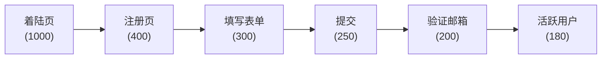
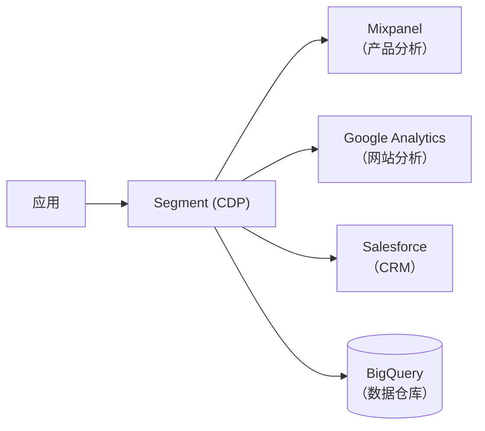
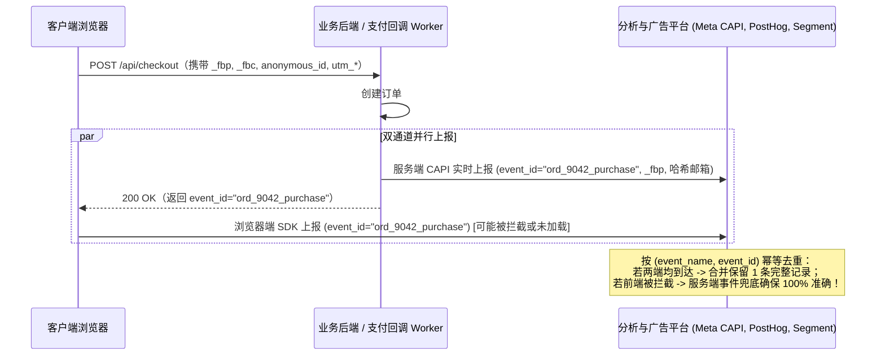
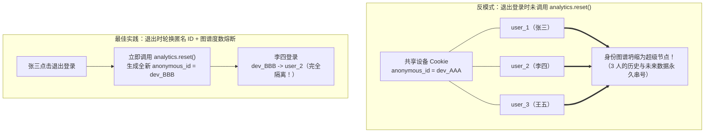

# 数据分析与埋点

## 这是什么？

数据分析是衡量用户在你的应用里做了什么，以便做出更好的决策。埋点是记录的机制——记录页面浏览、按钮点击、注册、购买等事件。它们回答的问题比如：用户在哪里流失了？哪个功能用得最多？新的着陆页转化效果好不好？作为开发者，你负责在代码中植入埋点，把数据输送到产品经理和市场团队可以分析的工具里。

## 为什么要懂？

产品决策应该基于数据，不是凭感觉。产品经理问"多少用户完成了新手引导？"如果没人埋这个点，就没有答案。作为开发者，你几乎每次构建功能都会被要求加埋点。你需要理解：埋什么事件、怎么组织事件数据、发到哪里、以及怎么做到不影响性能也不违反隐私法规。

## 业务流程

### 事件埋点

一切皆事件。一个事件有名字和属性：

```
Event: "按钮点击"
Properties:
  button_name: "注册"
  page: "/pricing"
  user_id: "abc123"
  timestamp: "2026-03-01T10:30:00Z"
```

事件从客户端（浏览器/移动端）或服务端发送到分析平台（Mixpanel、Amplitude、Google Analytics、PostHog）。

### 埋点方案

在写任何埋点代码之前，先定义埋点方案——一份列出所有事件的文档：

| 事件名   | 触发时机         | 属性                         | 埋在哪 |
| -------- | ---------------- | ---------------------------- | ------ |
| 页面浏览 | 每次页面加载     | page_url, referrer           | 客户端 |
| 开始注册 | 用户打开注册表单 | source（自然流量/广告/推荐） | 客户端 |
| 注册完成 | 用户完成注册     | method（邮箱/Google/GitHub） | 服务端 |
| 购买完成 | 支付成功         | amount, currency, plan_name  | 服务端 |

有埋点方案才不会混乱。没有的话，你会得到重复事件、不一致的命名和缺失的数据。

### 漏斗分析

漏斗追踪用户经过多步流程的情况：



每一步有一个转化率。掉得最多的地方就是你应该重点优化的地方。

### 留存分析

按注册时间（或其他特征）分组用户，对比他们的行为：

- "1 月注册的用户" vs "2 月注册的用户"
- 追踪留存：7 天后、30 天后、90 天后还有多少比例的用户活跃？

### A/B 测试

1. 随机把用户分成两组
2. A 组看到当前版本（对照组）
3. B 组看到新版本（实验组）
4. 追踪你关心的指标（转化率、点击率、收入）
5. 数据够了之后，用统计显著性判断哪个版本赢了
6. 把赢的版本推给所有人

## 常见术语

| 术语           | 解释                                                                 |
| -------------- | -------------------------------------------------------------------- |
| **事件**       | 一个被追踪的用户行为（页面浏览、点击、购买）                         |
| **属性**       | 附在事件上的元数据（页面 URL、按钮名、金额）                         |
| **漏斗**       | 用户经过的一系列步骤，每步都有流失率                                 |
| **转化率**     | 完成目标行为的用户百分比                                             |
| **留存**       | 经过一段时间后回来的用户百分比                                       |
| **DAU/MAU**    | 日活/月活——最基本的用户活跃度指标                                    |
| **归因**       | 判断哪个营销渠道（广告、邮件、自然流量）促成了转化                   |
| **UTM 参数**   | URL 参数（`utm_source`、`utm_medium`、`utm_campaign`），追踪流量来源 |
| **LTV / CLV**                        | 用户终身价值——一个用户整个生命周期贡献的总收入                                              |
| **CAC**                              | 获客成本——获取一个客户花了多少钱                                                            |
| **统计显著性**                       | A/B 测试结果是真实的而非随机偶然的置信度。通常 p < 0.05                                     |
| **转化 API（CAPI）**                 | 服务端到服务端的事件上报接口，配合浏览器端埋点与共享 `event_id` 去重实现 100% 转化率回收    |
| **身份解析（Identity Resolution）**  | 将登录前的匿名设备 ID（`anonymous_id`）与登录后的实名 `user_id` 合并为统一用户画像图谱      |
| **样本比例失衡（SRM）**              | A/B 测试中实测分流比例（如 50.8% : 49.2%）显著偏离预设 50:50 的卡方检验告警，代表实验已失效 |
| **曝光埋点（Exposure Logging）**     | 仅当用户真正看到或触发实验变体 UI 时才记录分流曝光，避免未触达用户稀释实验效应              |

## 常见模式

### 模式一：客户端埋点

浏览器中的 JavaScript SDK 捕获事件并发到分析平台。

**适用场景：** 页面浏览、点击、表单交互、UI 互动。

**取舍：** 会被广告拦截器拦截（30-40% 的用户）。受客户端 bug 和竞态条件影响。

### 模式二：服务端埋点

你的服务器把事件发到分析平台。由 API 调用、数据库变更或业务逻辑触发。

**适用场景：** 收入事件、注册、必须准确的关键业务指标。

**取舍：** 不会被广告拦截器拦截。更可靠。但无法追踪 UI 交互。

### 模式三：事件管道（数据流水线）

事件发到一个中央数据管道（Segment、Rudderstack），再分发到多个目的地。



**适用场景：** 使用多个分析工具并想要单一数据源的公司。

**取舍：** 额外基础设施成本。但换分析工具变得很简单（加/减一个目的地就行）。

## 踩坑提醒

- **命名规范**：`signUp`、`sign_up`、`Sign Up`、`user_signed_up`——选一种并强制执行。不一致的命名让数据分析成为噩梦。
- **别什么都埋**：埋每个点击很诱人。但数据太多和太少一样没用。聚焦在能回答特定业务问题的事件上。
- **事件中的个人信息**：永远不要把邮箱、姓名或其他个人可识别信息放在事件属性里，除非你的分析平台为此做了配置。
- **广告拦截器**：30-40% 的用户拦截分析脚本。关键指标用服务端埋点。
- **同意管理**：GDPR 要求在追踪前获得同意。实现 Cookie 同意弹窗，用户同意后才触发分析。
- **归因很难**：用户周一看了广告，周三搜了你，周五点了朋友的链接，周六买了。谁该得到功劳？没有完美答案——这就是为什么有不同的归因模型。

## 行业实战经验与非显而易见的最佳实践

### 1. 客户端 + 服务端混合转化上报（CAPI）与确定性 `event_id` 幂等去重

如果你只依赖浏览器端的 JavaScript SDK（如 `analytics.track("Order Completed")`）来统计订单转化和广告归因，**你的分析平台会系统性地漏掉 25%–35% 的真实成交数据**：
1. **广告拦截器与浏览器隐私限制（Safari ITP）**：uBlock Origin、Brave 浏览器以及 iOS Safari 的智能防追踪（ITP）会直接拦截发往第三方分析域名的请求，并将前端 `document.cookie` 写入的设备标识有效期强制缩短至 7 天（若 URL 带有广告追踪参数甚至缩短至 24 小时）。
2. **第三方支付跳转后秒关标签页**：用户跳转到微信支付、支付宝、Stripe Checkout 或银行 3DS 验证页完成付款后，服务端虽然收到了支付成功的异步回调（Webhook），但用户在手机浏览器跳回 `/checkout/success` 成功页并加载完前端埋点脚本之前，就已经随手划掉了浏览器标签页。

反过来，如果只做纯服务端埋点，你又会丢失浏览器上下文（如广告点击 Cookie `_fbp`/`_fbc`、User-Agent、落地页 Referrer 和前端会话状态）。

**生产环境最佳实践：双通道混合上报 + 确定性 `event_id` 去重**

对核心转化事件同时开启**客户端 Pixel 上报**与**服务端 CAPI（Conversion API）上报**，并共享同一个确定性的 `event_id`，由下游分析引擎或广告平台在 48 小时窗口内自动去重：



1. **第一方反向代理与 `HttpOnly` 匿名标识**：将前端埋点请求发往自家主域名路径（如 `https://yourapp.com/ingest/...`），并由服务端通过 `Set-Cookie`（`HttpOnly; Secure; SameSite=Lax`）种下第一方 `anonymous_id` Cookie，绕过 Safari ITP 对纯前端脚本 Cookie 的 7 天清理限制。
2. **下单时持久化归因上下文**：用户在前端发起结账时，将当前的 `anonymous_id`、`utm_*` 参数、广告点击 ID（`gclid`/`fbclid`）、客户端 IP 和 User-Agent 一并存入数据库订单会话表。
3. **确定性 `event_id` 生成法则**：绝不要在前端和后端各自调用随机 `uuidv4()`。必须基于业务主键派生唯一确定性 ID（如 `sha256("purchase:" + order.id)`），从而实现既不漏单、也绝不双倍计数的精准闭环。

### 2. 共享设备与公共终端引发的"超级节点（Super-Node）"身份合并爆炸

现代数据分析平台（Segment、神策数据、Amplitude、Mixpanel）都依赖**身份解析图谱（Identity Graph）**：当用户登录时调用 `analytics.identify(user_id)`，系统会将当前设备的匿名 ID（`anonymous_id`）与实名 `user_id` 绑定，从而把登录前的浏览行为归因到该用户头上。

**真实生产事故：**
在医院护士站公用电脑、门店收银平板、高校机房或家庭共用的 iPad 上，一个月内先后有 150 名不同员工在同一个浏览器上登录和退出。
- **事故是如何发生的**：员工 1 登录 → 设备 `anonymous_id: dev_AAA` 与 `user_1` 绑定。员工 1 点击"退出登录"，**但前端开发者只清理了业务 Token，忘了调用 `analytics.reset()` 重置设备匿名 ID**。
- 15 分钟后，员工 2 在同一台电脑上登录 → `anonymous_id: dev_AAA` 又与 `user_2` 绑定。由于身份图谱具有传递性（`user_1 <-> dev_AAA <-> user_2`），分析系统把 `user_1` 到 `user_150` 的全部历史和未来行为永久合并成了一个庞大的**"弗兰肯斯坦超级用户（Super-Node）"**！
- 更常见的是代码 Bug：后端在未登录态误传了字符串 `"null"`、`"undefined"` 或公司内网 NAT 网关 IP 作为标识，瞬间把全站几十万未登录访客焊死在同一个用户画像上，导致留存率、漏斗和自动化营销邮件彻底错乱。



**生产环境最佳实践：**
1. **登出与切换账号时强制调用 `analytics.reset()`**：在退出登录、Session 过期或切换账号的代码路径中，必须第一时间调用 `analytics.reset()` 清除本地缓存并生成全新的随机 `anonymous_id`。
2. **网关层拦截非法空值字面量**：在埋点接入层硬编码黑名单，严禁 `"null"`、`"undefined"`、`""`、`"0"`、`"anonymous"` 或 `"guest"` 进入 `user_id` 或 `anonymous_id` 字段。
3. **身份图谱最大连接度数熔断（Degree Cap）**：在数仓或 CDP 的 Identity Stitching 规则中设置度数上限（如 `MAX_USERS_PER_DEVICE = 3`）。一旦某个 `anonymous_id` 关联了超过 3 个不同的实名 `user_id`，立即将该设备标记为**公共共享终端（Shared Kiosk）**，停止通过该设备节点进行跨用户图谱合并。

### 3. A/B 测试中的样本比例失衡（SRM）与过早曝光稀释（Assignment Dilution）

即使拥有成熟的 A/B 实验平台，研发团队依然经常因为两个隐蔽的埋点工程缺陷而得出完全错误的实验结论：

#### 陷阱 A：过早曝光导致的样本稀释（Pre-Exposure Dilution）
产品经理想要测试结账页（`/checkout`）上的一个**新优惠券弹窗**，预期能将结账转化率提升 5%。然而工程师图省事，在全局顶部导航栏 `<Navbar>` 或用户刚登录进首页时就提前调用了实验分流接口 `getVariant("checkout_coupon_exp")`，导致 SDK 立即为**全站 100% 的访客**上报了实验曝光事件——但实际上 85% 的访客只逛了首页，压根没走到 `/checkout` 页面。
- **统计学灾难**：那 85% 根本没见过优惠券弹窗的访客在对照组和实验组表现完全一致，向分母注入了巨大的白噪声。结账页原本高达 +5% 的真实提升被全站流量稀释成了 +0.75%，要达到统计显著性所需的**样本量暴增 44 倍**（$N \propto 1/\Delta^2$），导致原本 1 周能跑完的实验跑了大半年还显示"无显著差异"。
- **工程修复**：严格解耦**分流计算（Bucketing）**与**曝光上报（Exposure Logging）**。只有当代码真正执行到渲染或触发新旧分支差异的那一行时，才发送 `$experiment_started` 曝光事件。

#### 陷阱 B：样本比例失衡（Sample Ratio Mismatch, SRM）
你配置了一个严格 50% 对照组 / 50% 实验组的实验。跑满 10 万用户后，后台显示**对照组进了 50,820 人（50.82%），实验组进了 49,180 人（49.18%）**，且实验组的付费转化率"大涨 8%（p = 0.001）"。
- **为什么必须立即作废该实验**：对 `(50820, 49180)` 与期望值 `(50000, 50000)` 做皮尔逊卡方检验（$\chi^2$ Test），得出 $\chi^2 = 26.89$，$p = 2.1 \times 10^{-7}$。抛一枚均匀硬币 10 万次出现这种偏差的概率不到 470 万分之一！
- **SRM 背后的真实工程原因**：实验组新增的 JS 代码在低端安卓机型上触发了兼容性报错，导致页面在埋点 SDK 初始化完成前就直接崩溃退出了。那消失的 1,640 名低端安卓用户从实验组分母中被彻底抹除，留下的实验组样本全集中在高消费能力的 iOS 和桌面端用户上，从而制造了"转化率暴涨 8%"的虚假繁荣！
- **工程修复**：在实验看板中内置自动化 **SRM 卡方检验熔断器**。一旦任何实验的 $p_{\text{SRM}} < 0.001$，系统自动锁定看板并标红告警"样本比例失衡，实验结论无效"，强制排查客户端崩溃、重定向丢失或爬虫污染。

## 速查表

| 追踪什么             | 在哪追踪           | 为什么         |
| -------------------- | ------------------ | -------------- |
| 页面浏览、点击、滚动 | 客户端             | UI 互动        |
| 注册、购买、订阅     | 服务端             | 准确的业务指标 |
| 功能使用             | 两端都有           | 产品决策       |
| 错误和异常           | 两端都有           | 可靠性监控     |
| 营销归因             | 客户端（UTM 参数） | 营销投入回报   |

| 生产环境典型埋点与实验故障         | 根本原因                                           | 架构级解决方案                                                    |
| ---------------------------------- | -------------------------------------------------- | ----------------------------------------------------------------- |
| 分析后台订单数比财务账单少 30%     | 广告拦截器、Safari ITP 或支付跳转后用户秒关标签页  | 客户端 Pixel + 服务端 CAPI 双通道上报，基于确定性 `event_id` 去重 |
| 上百个不同用户被合并成同一个画像   | 共享设备退出登录时未调用 `analytics.reset()`       | 退出登录强制重置 `anonymous_id` + 拦截 `"null"` 字面量 + 度数上限 |
| 局部页面 A/B 实验跑几个月都不显著  | 在首页/登录时过早触发分流曝光，未触达用户稀释分母  | 延迟曝光（Lazy Exposure）：仅在渲染变体 UI 的代码分支处记录曝光   |
| 50/50 分流实测为 50.8% : 49.2%     | 实验组前端报错崩溃或重定向耗时导致样本非随机脱落   | 自动运行卡方检验（$\chi^2$ SRM 检测），一旦 $p < 0.001$ 立即熔断  |

