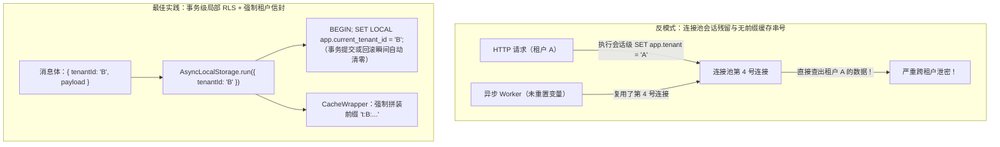
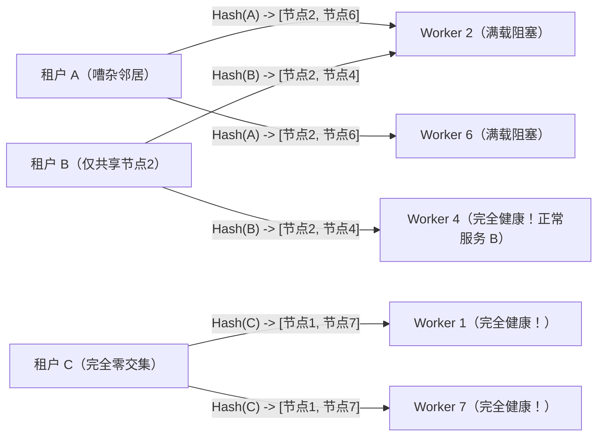
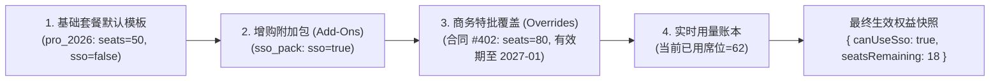

# 多租户（SaaS）

## 这是什么？

多租户是用一套应用服务多个客户（租户），每个租户的数据彼此隔离。想想钉钉——成千上万的公司在用钉钉，每个公司有自己的组织、成员、群组和消息。它们都跑在同一套钉钉基础设施上，但 A 公司永远看不到 B 公司的数据。作为搭建 SaaS 的开发者，多租户是你产品的架构基石。

## 为什么要懂？

如果你在做 B2B SaaS 产品，多租户不是可选项——它是核心模式。每个查询、每个 API 调用、每个页面渲染都必须限定在正确的租户范围内。一个泄露跨租户数据的 bug 就是灾难性的安全事件。理解业务模型（租户怎么创建、计费、隔离、管理）帮你在早期就做出正确的架构决策。

## 业务流程

### 租户生命周期

1. **注册**：一家新公司注册 → 创建租户，包含组织名、管理员用户和计费信息
2. **引导**：管理员邀请团队成员、配置设置、导入数据
3. **活跃使用**：租户每天使用产品。数据增长。添加更多用户
4. **换套餐**：租户升级/降级订阅。功能权限变化
5. **退出**：租户取消 → 数据保留期 → 数据删除

### 租户识别

每个请求必须知道它属于哪个租户。常见方式：

- **子域名**：`acme.yourapp.com` → 租户是 "acme"
- **路径**：`yourapp.com/acme/dashboard` → 租户是 "acme"
- **请求头/Token**：API 请求在 Header 或 JWT 中包含租户 ID
- **数据库查找**：已认证用户 → 从用户-租户关系中查出租户

### 数据隔离

每个数据库查询必须限定在当前租户范围内。租户 A 的用户永远不能看到租户 B 的数据。

```sql
-- 错误：返回所有租户的发票
SELECT * FROM invoices WHERE status = 'paid';

-- 正确：限定到当前租户
SELECT * FROM invoices WHERE tenant_id = 'acme' AND status = 'paid';
```

看起来简单，但在复杂查询、后台任务和报表中很容易遗漏。

### 功能分级

不同租户有不同套餐，对应不同功能：

```
免费版：  5 个用户，1GB 存储，基础功能
专业版：  50 个用户，100GB 存储，高级功能 + API 访问
企业版：  无限用户，无限存储，SSO + 审计日志 + 自定义品牌
```

你的代码需要在允许访问前检查租户的套餐。

## 常见术语

| 术语            | 解释                                                               |
| --------------- | ------------------------------------------------------------------ |
| **租户**        | 使用你 SaaS 产品的一个客户组织                                     |
| **租户隔离**    | 确保一个租户不能访问另一个租户的数据                               |
| **单租户**      | 每个客户有自己独立的应用实例（独立服务器、数据库）                 |
| **多租户**      | 所有客户共享同一套基础设施，通过逻辑隔离                           |
| **共享数据库**  | 所有租户的数据在一个数据库，用 `tenant_id` 列区分                  |
| **独立数据库**  | 每个租户有自己的数据库（更强隔离，更高运维复杂度）                 |
| **Schema 隔离** | 每个租户在共享数据库中有自己的 Schema（折中方案）                  |
| **租户上下文**  | 当前租户，从请求中解析出来，在整个请求生命周期中可用               |
| **跨租户**      | 跨多个租户的操作（统计报表、管理员操作）。少见且需谨慎控制         |
| **嘈杂邻居**    | 一个租户的重度使用降低其他租户的性能                               |
| **自定义域名**                 | 企业租户想要 `app.acme.com` 而不是 `acme.yourapp.com`                                                 |
| **白标**                       | 租户的品牌（Logo、颜色、域名）在你的产品上，看起来像他们自己的产品                                    |
| **数据驻留**                   | 要求把租户数据存在特定地理区域（欧盟、中国等）                                                        |
| **行级安全策略（RLS）**        | 数据库底层强制执行的隔离策略（如 PostgreSQL `CREATE POLICY`），按当前事务 `tenant_id` 自动过滤行       |
| **洗牌分片（Shuffle Sharding）**| 为每个租户分配独特的组合节点子集（如 8 选 2），将"嘈杂邻居"故障的爆炸半径压缩到极小比例               |
| **权益（Entitlement）**        | 与计费套餐（Plan）解耦的细粒度功能开关与配额（如 `max_seats: 120`、`sso: true`），支持企业定制合同     |
| **异步上下文污染（Context Bleed）**| 在 HTTP 请求生命周期之外（消息队列、定时任务、连接池、缓存）因遗漏或残留租户上下文导致的跨租户泄密 |

## 常见模式

### 模式一：共享数据库 + Tenant ID

所有租户共用一个数据库。每张表有 `tenant_id` 列。每个查询都带 `WHERE tenant_id = ?`。

**适用场景：** 大多数 SaaS 创业公司。简单、省钱、易管理。

**取舍：** 忘了加租户过滤就会数据泄露。嘈杂邻居问题。用 PostgreSQL 的行级安全（RLS）来在数据库层面强制隔离。

### 模式二：独立数据库

每个租户有自己的数据库实例。基础设施级别的完全数据隔离。

**适用场景：** 有严格合规/安全要求的企业客户。金融、医疗等强监管行业。

**取舍：** 运维成本高。Schema 迁移要跑在每个数据库上。跨租户分析困难。

### 模式三：Schema 隔离

共享数据库服务器，但每个租户有自己的 Schema。

**适用场景：** 共享表和独立数据库之间的折中。

**取舍：** 隔离比共享表好，开销比独立数据库小。但 Schema 迁移仍然要逐租户执行。

### 模式四：混合模式

大多数租户共享基础设施。企业租户获得独立数据库甚至独立应用实例。

**适用场景：** 既有自助服务（小租户）又有企业服务（大租户）的 SaaS 产品。

**取舍：** 运维最复杂，但匹配业务现实。

## 踩坑提醒

- **后台任务忘了租户上下文**：定时任务或队列 Worker 处理数据时必须知道是哪个租户。不知道就可能处理错误租户的数据或泄露数据。
- **搜索索引泄露数据**：搜索索引必须按租户隔离。共享的 Elasticsearch 索引如果没有正确过滤就是等着泄露的数据。
- **管理后台需要切换租户**：你的内部管理工具需要能"模拟"某个租户来调试。必须有审计日志。
- **在线迁移**：加新列或改 Schema 时，对所有租户同时生效（共享数据库）或逐个执行（独立数据库）。大规模下都很痛苦。
- **租户删除**：租户取消后，你需要删除他们所有的数据——用户、文件、数据库记录、搜索索引、缓存、备份。比想象中难。
- **按租户限流**：不让一个租户的 API 使用量影响其他租户。设置按租户的限流。
- **测试**：你的测试套件应该验证租户隔离。创建两个测试租户，在 A 中创建数据，断言 B 永远看不到。

## 行业实战经验与非显而易见的最佳实践

### 1. 异步上下文污染（脱离 HTTP 请求生命周期的跨租户数据泄露）

大多数团队在写 HTTP 接口时都会认真检查租户隔离（如中间件提取 `req.tenantId`），但在真实的 SaaS 安全事故复盘中，**绝大多数跨租户数据泄露都发生在同步 HTTP 请求之外**——集中在 Kafka/MQ 消费者、夜间定时任务（Cron）、数据库连接池复用以及 Redis 缓存中。

**三个最致命的跨租户串号场景：**
1. **缺失租户前缀的缓存键**：开发者把企业配置或报表汇总缓存为 `redis.get("dashboard:summary")` 或 `redis.get("user:" + userId)`，却忽略了外部财务顾问（`userId: 99`）同时受雇于租户 A 和租户 B，或者 `"dashboard:summary"` 根本没有拼入 `tenant_id`。结果租户 B 打开首页直接看到了租户 A 的核心财务大盘。
2. **连接池会话变量残留（Session Bleed）**：在使用 PostgreSQL 行级安全（RLS）时，如果代码在连接池（PgBouncer / `pg.Pool`）借出的连接上执行了会话级 `SET app.current_tenant_id = 'tenant_a'`，一旦请求抛异常提前返回、或者某个后台任务未显式覆盖该变量，连接归还池中后依然残留着 `'tenant_a'` 的身份，下一个借到该连接的任务就会直接读取租户 A 的数据。
3. **定时批处理未按租户分组聚合**：每晚运行的账单汇总脚本执行 `SELECT * FROM usage_logs WHERE billed = false`，在内存里聚合后忘了按 `tenant_id` 分桶，结果把租户 B 的消费明细写进了发给租户 A 财务总监的 PDF 账单里。



**生产环境最佳实践：**
- **PostgreSQL RLS 必须使用事务内的 `SET LOCAL`**：严禁在连接池环境中使用会话级的 `SET`。必须将查询包裹在事务中并执行 `SET LOCAL app.current_tenant_id = 'acme'`——PostgreSQL 保证 `SET LOCAL` 只在当前事务内有效，无论事务 `COMMIT` 还是异常 `ROLLBACK` 都会自动销毁该上下文，彻底杜绝连接池污染。
- **封装强制携带 `TenantEnvelope` 的缓存与消息客户端**：通过 ESLint 规则禁止业务代码直接调用原生 `redis.get()` 或消息发送接口。统一封装 `TenantCache` 和 `TenantQueue`，底层自动从 `AsyncLocalStorage`（Node.js）或 `context.Context`（Go）读取 `tenantId`，若上下文缺失则直接抛异常中断执行，并强制将所有缓存键重写为 `t:{tenant_id}:{namespace}:{key}`。

### 2. 洗牌分片（Shuffle Sharding）与租户级公平队列：制服"嘈杂邻居"

假设你的后台有 8 个 Worker 节点负责处理导出 PDF、发送 Webhook 或生成 AI 向量。
- **共享 FIFO 队列的饥饿灾难**：上午 10:00，大客户租户 A 批量导入了 50 万行 CSV，瞬间向队列塞入 50 万个任务。10:01，小客户租户 B 点击"导出 1 页发票 PDF"。在普通的先进先出（FIFO）队列中，租户 B 这个只需 200 毫秒的任务被死死堵在租户 A 的 50 万个任务后面，足足卡死 45 分钟。
- **单纯加机器无法解决"毒丸租户"**：即便触发自动扩缩容，如果租户 A 提交的任务带有触发高内存占用的极端数据，它会迅速把集群里所有 Worker 节点全部拖垮（OOM），导致全体租户陪葬。

**生产环境最佳实践：洗牌分片（Shuffle Sharding）+ 赤字轮询公平调度（DRR）**

1. **洗牌分片（组合数学隔离爆炸半径）**：不要让每个租户的流量打满全部 $N=8$ 个节点，而是通过两个独立的哈希函数，为每个租户固定分配 $k=2$ 个节点的虚拟组合分片（Virtual Shard）。
   - 在 $N=8$ 个节点中任选 $k=2$ 个节点，共有 $\binom{8}{2} = 28$ 种不同的双节点组合。
   - 假如租户 A 突发流量洪峰或触发 Bug 搞垮了分配给它的两个节点（例如节点 2 和节点 6），**高达 96.4% 的其他租户**（$\frac{27}{28}$）至少还有一个完全健康的节点可用，而 **53.6% 的租户**（$\binom{6}{2}/28 = \frac{15}{28}$）与租户 A 的节点**零交集**，完全感知不到任何抖动！



2. **按租户公平队列（Fair Queuing / Deficit Round-Robin）**：将逻辑队列按 `tenant_id` 分桶，并配合单租户最大并发信号量（如 `MAX_CONCURRENT_PER_TENANT = 5`）。Worker 采用轮询（Round-Robin）方式依次从租户 A 取 1 个任务、从租户 B 取 1 个任务、从租户 C 取 1 个任务。租户 A 的 50 万个任务在后台平稳消化，而租户 B 的单页 PDF 在 200 毫秒内秒级完成。

### 3. 将"租户权益（Entitlements）"与"计费套餐（Plans）"彻底解耦

在 SaaS 创业初期，几乎所有团队都会写出下面这种权限判断代码：
```typescript
// 反模式：把业务功能判断直接硬编码绑定在套餐名字上
if (tenant.plan === 'pro' || tenant.plan === 'enterprise') {
  allowSsoConfiguration();
}
```
**为什么这种写法在 B2B 业务增长期会彻底崩盘？**
1. **企业大单的定制合同（Sales Exceptions）**：销售签下了一个年付 30 万的客户，合同约定：*"采购专业版（Pro），但额外赠送 SAML 单点登录，且席位上限从 50 人调整为 80 人。"* 如果代码里写死了 `tenant.plan === 'enterprise'`，研发就只能被迫在代码里塞满恶心且无法维护的 `if (tenant.id === 'org_acme')` 特判并重新发版。
2. **老客户历史套餐兼容（Grandfathering）**：2027 年公司调整定价，新版 `pro_2027` 不再包含"审计日志"，但承诺 2025 年签约的老 `pro_2025` 客户继续保留该功能。硬编码套餐名的代码会迅速膨胀成十几个分支的布尔逻辑泥潭。
3. **客户成功团队（CS）的临时试用与挽留赠礼**：客户成功经理希望给某个面临流失风险的租户临时开通 14 天的"高级分析"功能或赠送 50GB 存储包，如果耦合了 Stripe 订阅套餐，这种操作根本无法在不改动账单的情况下完成。

**生产环境最佳实践：四层权益合成引擎（Entitlement Engine）**

业务代码**永远不要**直接读取 `tenant.plan`。所有业务模块只允许向统一的**权益服务**发起询问：`entitlements.check(tenantId, "feature.saml_sso")` 或 `entitlements.getQuota(tenantId, "limits.max_seats")`。



权益引擎按优先级从低到高合并四层数据，并将计算结果缓存在 Redis 中（仅在套餐变更或特批操作时失效更新）：
1. **基础套餐目录（`plan_entitlements`）**：定义 `free`、`pro_2026`、`enterprise_2026` 的默认布尔开关与配额基线。
2. **已购增值包（`tenant_addons`）**：客户自助叠加购买的扩容包（如 `+100GB 存储包`、`独立 SSO 插件`）。
3. **租户级特批覆盖表（`tenant_entitlement_overrides`）**：支持商务合同定制或临时赠予，带有必填的 `expires_at`（过期自动失效）、`reason`（商务审批单号）和 `granted_by` 审计记录。
4. **实时计量账本（`tenant_usage`）**：将最终生效的配额上限与当前实时用量比对，精准返回剩余可用额度。

## 速查表

| 因素 | 共享数据库          | Schema 隔离   | 独立数据库       |
| ---- | ------------------- | ------------- | ---------------- |
| 成本 | 低                  | 中            | 高               |
| 隔离 | 逻辑（tenant_id）   | Schema 级别   | 完全隔离         |
| 运维 | 简单                | 中等复杂      | 复杂             |
| 合规 | 可能需要 RLS        | 审计更方便    | 最适合合规       |
| 规模 | 百万级租户          | 千级          | 百级             |
| 适合 | 创业公司、自助 SaaS | 中端市场 SaaS | 企业、强监管行业 |

| 多租户生产环境典型事故               | 根本原因                                           | 架构级解决方案                                                      |
| ------------------------------------ | -------------------------------------------------- | ------------------------------------------------------------------- |
| 异步任务或报表出现跨租户数据串号     | 连接池残留会话变量或 Redis 缓存 Key 漏加租户前缀   | 事务内使用 `SET LOCAL` RLS + 强制 `t:{tenantId}:*` 缓存与消息封装层 |
| 某大客户导入 50 万条数据卡死全站队列 | 所有租户共享单一 FIFO 队列，无单租户并发与分片隔离 | 赤字轮询公平队列（DRR）+ 洗牌分片（Shuffle Sharding 组合隔离）      |
| 销售签下定制合同后研发被迫改代码发版 | 业务代码直接判断 `tenant.plan === 'enterprise'`    | 将套餐（Plan）与权益（Entitlement）解耦，支持增值包与带有效期的特批 |

