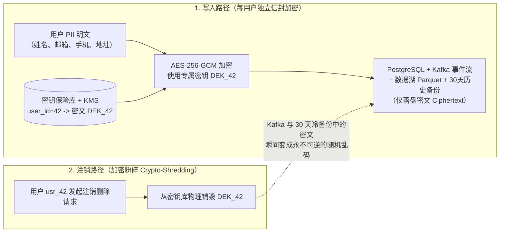
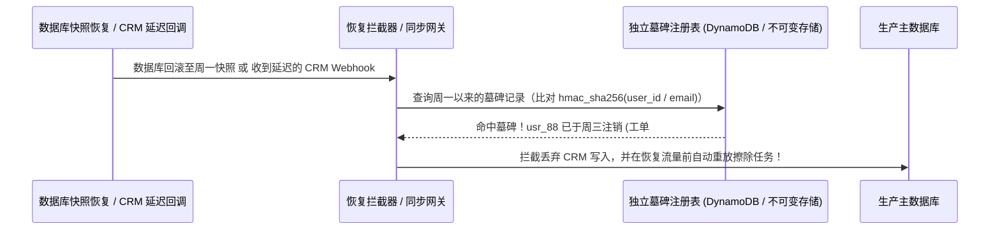
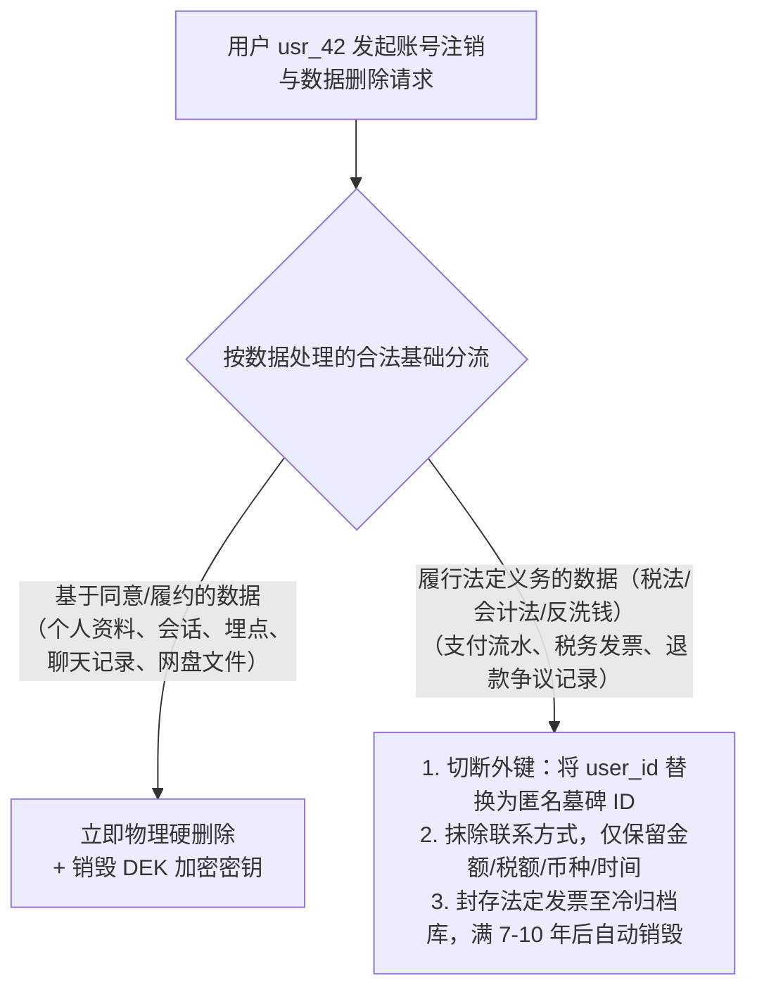

# 数据隐私与合规

## 这是什么？

数据隐私是保护你的应用收集、存储和处理的个人信息。合规是遵守管理数据处理方式的法律——欧盟的 GDPR、加州的 CCPA、中国的《个人信息保护法》(PIPL)，等等。作为开发者，你是实际搭建收集、存储和（被请求时）删除个人数据的系统的人。如果你的代码不遵守隐私规则，你的公司面临巨额罚款。

## 为什么要懂？

GDPR 罚款最高可达全球年收入的 4% 或 2000 万欧元（取高者）。亚马逊被罚了 7.46 亿欧元。Meta 被罚了 12 亿欧元。这不是纸上谈兵。中国的个保法对违规处罚也非常严厉。除了罚款，数据泄露会摧毁用户信任和公司声誉。作为开发者，隐私要求直接影响你设计数据库、API、分析和数据流的方式。这不是你能忽略的法律问题——它体现在你的代码里。

## 业务流程

### 什么算个人数据？

任何能直接或间接识别一个人的信息：

- **明显的**：姓名、邮箱、手机号、地址、出生日期、照片
- **不那么明显的**：IP 地址、设备 ID、Cookie ID、位置数据、浏览历史
- **敏感数据（需要额外保护）**：种族、健康数据、生物特征、性取向、政治观点

如果你能把它和特定的人联系起来，它就是个人数据。

### 处理数据的合法基础

你需要一个法律理由来收集和使用个人数据。主要的几个：

1. **同意**：用户明确同意（勾选框、Cookie 横幅）。必须是自由给予、具体且可撤销的
2. **合同**：你需要这些数据来履行合同（如收货地址用于发货）
3. **合法利益**：你有合理的业务需要（如欺诈检测）。需与用户权利平衡
4. **法律义务**：法律要求你保留数据（如税务记录）

### 用户权利

用户对自己的数据有权利。你的系统必须支持这些：

| 权利                   | 含义                       | 你的系统要能...                     |
| ---------------------- | -------------------------- | ----------------------------------- |
| **知情权/访问权**      | "给我看你有我的所有数据"   | 导出用户数据为可读格式              |
| **更正权**             | "修正我的错误数据"         | 允许用户编辑个人信息                |
| **删除权（被遗忘权）** | "删除我的所有数据"         | 删除用户数据（法律要求保留的除外）  |
| **数据可携带权**       | "把我的数据给我，让我带走" | 导出数据为机器可读格式（JSON、CSV） |
| **限制处理权**         | "别用我的数据了但先留着"   | 标记账号防止处理但保留数据          |
| **反对权**             | "别用我的数据做营销"       | 退出特定处理活动                    |

### 数据泄露应对

如果个人数据被泄露：

1. 调查泄露范围（什么数据、多少用户）
2. 72 小时内通知监管机构（GDPR 要求）
3. 如果泄露风险较高，通知受影响的用户
4. 记录一切——发生了什么、你做了什么
5. 采取措施防止再次发生

## 常见术语

| 术语              | 解释                                                   |
| ----------------- | ------------------------------------------------------ |
| **GDPR**          | 通用数据保护条例——欧盟隐私法。全球最有影响力的隐私法规 |
| **CCPA / CPRA**   | 加州消费者隐私法——美国加州的隐私法                     |
| **个保法 (PIPL)** | 中国的《个人信息保护法》                               |
| **PII**           | 个人可识别信息——能识别特定人的数据                     |
| **数据控制者**    | 决定为什么和怎么处理数据的实体（通常是你的公司）       |
| **数据处理者**    | 代表控制者处理数据的实体（如你的云服务商、分析工具）   |
| **DPA**           | 数据处理协议——控制者和处理者之间的数据处理规则合同     |
| **DPO**           | 数据保护官——负责隐私合规的人                           |
| **数据最小化**    | 只收集你真正需要的数据。别"以防万一"地囤数据           |
| **目的限制**      | 数据只用于收集时的目的。不能未经同意把邮箱转用于营销   |
| **隐私设计**                        | 从一开始就把隐私构建到系统中，而不是事后补救                                                 |
| **匿名化**                          | 删除所有可识别信息，使数据永远无法关联到个人。不可逆                                         |
| **伪匿名化**                        | 用令牌替换标识符。有映射密钥可以重新识别                                                     |
| **加密粉碎（Crypto-Shredding）**    | 为每个用户的 PII 分配独立数据密钥（DEK），注销时直接销毁密钥，使不可变日志和历史备份永久失效 |
| **信封加密（Envelope Encryption）** | 用每用户独立的 DEK 加密个人数据，再用 KMS 中的主密钥（KEK）加密保存 DEK                      |
| **墓碑注册表（Tombstone Registry）**| 独立于主库的不可变注销哈希账本（存 `hmac_sha256(user_id)`），防止备份恢复或 CRM 同步复活死魂 |
| **法定留存豁免（Statutory Hold）**  | 税法/反洗钱法规定的强制留存期（如发票流水留存 5–10 年），优先于用户的删除权请求              |

## 常见模式

### 模式一：隐私优先架构

从第一天就在数据模型中考虑隐私。

- 个人数据被标记并与非个人数据分开存储
- 每个数据字段有定义的保留期限
- 每个数据存储都构建了删除能力
- 对个人数据的访问都有日志

**适用场景：** 新项目、重视隐私的公司。

**取舍：** 更多前期设计工作。但在法规变化或用户行使权利时省下大量后续工作。

### 模式二：同意驱动的数据收集

没有明确同意就不收集数据。不同的同意类型启用不同的数据处理。

```
分析同意     → 启用追踪
营销同意     → 启用邮件营销、重定向
个性化同意   → 启用推荐引擎
```

**适用场景：** 在有同意要求的地区运营的任何面向用户的应用。

**取舍：** 部分用户不会同意，减少你的数据。但这是法律要求，不是可选项。

### 模式三：数据保留自动化

自动执行保留策略的定时任务：

1. 按数据类型定义保留期限（交易记录：7 年，分析事件：2 年，Session 数据：90 天）
2. 定时任务每晚运行，找到过期数据，删除或匿名化
3. 删除操作有日志，用于合规审计

**适用场景：** 任何存储个人数据的应用（基本上是每个应用）。

## 踩坑提醒

- **备份里有个人数据**：你从生产数据库删了用户数据，但上周的备份里还有。需要有备份数据保留策略。
- **第三方数据共享**：如果你把用户数据发给分析工具、邮件服务商或广告网络，你和每个供应商都需要 DPA。你对处理者怎么用数据负责。
- **日志里有 PII**：你的应用日志可能包含用户邮箱、IP 地址、包含个人数据的请求体。从日志中清洗 PII 或将日志存储视为个人数据存储。
- **分析 vs 隐私**：产品团队想追踪一切。隐私法律说收集最少的。这种矛盾是真实的，需要业务层面的决策。
- **跨境数据传输**：欧盟用户的数据存在中国/美国服务器上是法律问题。使用标准合同条款或确保云服务商有当地数据中心。
- **儿童数据**：如果你的应用可能被 14 岁以下（中国个保法）或 16 岁以下（欧盟）的儿童使用，你需要家长同意和额外保护。
- **删除权 vs 法律义务**：用户要求删除，但你法律上需要保留他们的税务记录 7 年。你必须同时满足——删除个人数据但保留法律要求的记录（尽可能匿名化）。
- **撤回同意**：如果用户撤回同意，你必须停止处理并删除基于该同意收集的数据。这是回溯性的。

## 行业实战经验与非显而易见的最佳实践

### 1. 加密粉碎（Crypto-Shredding：攻克不可变 Kafka 日志与历史备份的"被遗忘权"）

当用户依据 GDPR 第 17 条或《个人信息保护法》发起注销与删除权（Right to Erasure）请求时，在生产主数据库里执行一句 `DELETE FROM users WHERE id = 'usr_42'` 只解决了最简单的 5%。
**真正让架构师头疼的 95% 在于不可变存储：**
1. **不可变事件流与数据湖**：你的 Kafka 队列、对象存储 Parquet 数据湖和审计日志采用只追加（Append-Only）架构，保留长达 1 年的历史事件（如 `UserRegistered`、`OrderShipped`）。每来一个用户注销就去重写几个 PB 的压缩 Parquet 文件或修改 Kafka 底层分段文件，在工程和成本上根本不可行。
2. **只读历史数据库备份**：RDS 自动快照和 WAL 归档日志会保留 30–90 天。你不可能为了删除一个用户的手机号，把过去 30 天每天 4TB 的二进制冷备份逐个挂载起来修改再重新打包。

**生产环境最佳实践：按用户粒度的信封加密与加密粉碎（Crypto-Shredding）**

与其在用户注销时去 40 个下游系统里大海捞针式地物理擦除数据，不如**在个人敏感信息（PII）写入 Kafka、数据湖和数据库之前，先用该用户专属的数据加密密钥（`DEK`）加密**：



1. **注册时签发每用户专属 `DEK`**：当 `usr_42` 注册时，生成一把独立的 256 位对称密钥 `DEK_42`，通过云厂商 KMS 主密钥（`KEK`）信封加密后存入独立高权限的**主体密钥库（Subject Key Vault）**。
2. **事件流与备份中仅存密文**：向 Kafka 发送业务事件时，非个人统计字段（如 `order_amount: 299.00`、`province: "GD"`、`user_id: "usr_42"`）保持明文供数仓报表聚合；而姓名、邮箱、收货地址等 PII 字段统一加密放入 `pii_ciphertext` 字段。
3. **秒级销毁密钥即完成全局擦除**：当 `usr_42` 要求行使被遗忘权时，删除主库业务记录，并**从主体密钥库中永久物理删除 `DEK_42`**。一瞬间，散落在 Kafka、数据湖以及过去 90 天所有冷备份快照中的该用户密文全部沦为数学上无法解密的随机噪声，完美满足监管机构对不可变存储的合规要求。

### 2. 墓碑注册表（Tombstone Registry）：防止备份回滚与双向同步导致"僵尸 PII 复活"

生产环境中曾多次发生两类导致巨额合规罚单的**"死魂灵复活（Zombie PII Resurrection）"**事故：
- **场景 A（数据库故障按时间点恢复 PITR）**：用户 `usr_88` 在周二申请注销账号，系统在周三完成了数据清除并向用户发送了"您的个人数据已永久删除"的确认邮件。周五下午，一次错误的运维操作导致数据库故障，SRE 团队将生产库回滚恢复到了周一的备份快照。结果，**周二到周五之间注销的所有用户在生产库中全部"死而复生"**——第二天一早，营销系统自动给 `usr_88` 发了一封促销邮件，用户当场向监管机构举报欺诈！
- **场景 B（CRM / 第三方工具延迟双向同步）**：你在主数据库删掉了 `usr_88`，但 10 分钟后，Salesforce、HubSpot 或企微外部联系人同步队列里一条积压的 `contact.updated` Webhook 姗姗来迟，你的 Webhook 处理器执行 `UPSERT INTO users ...`，又把刚删掉的用户重新插回了生产库。

**生产环境最佳实践：独立于主库的不可变墓碑注册表（Tombstone Registry）**



1. **在主库之外维护只追加的哈希墓碑账本**：每次执行完用户注销，向一个完全独立于主业务数据库的存储（如独立的 DynamoDB 表或开启 Object Lock 的 S3 桶）写入一条墓碑记录：
   `{ user_id_hash: hmac_sha256(pepper, user_id), email_hash: hmac_sha256(pepper, lower(email)), erased_at: "2026-11-04T12:00Z", ticket_id: "DSAR-9912" }`。
   *（注：只存储带密钥的 HMAC-SHA256 哈希值，既能作为响应删除请求的合规审计铁证，墓碑表本身又绝不残留任何明文 PII！）*
2. **灾备恢复后的强制墓碑重放门禁（Post-Restore Replay Gate）**：在自动化灾备恢复脚本中设置硬门禁——任何从备份快照恢复出来的数据库实例，在重新挂载接入线上流量之前，**必须先自动拉取快照时间点之后的所有墓碑记录并重放擦除指令**。
3. **外部数据流入网关拦截**：所有 CRM、客服工单和第三方同步消费者在执行 `INSERT` / `UPSERT` 前必须先查墓碑表，一旦命中已注销哈希，立即静默丢弃。

### 3. 法定税务/反洗钱留存豁免 vs. 用户删除权（去标识化财务存根）

系统设计面试与生产实战中的高频两难困境：*"一个用户昨天刚付了 5000 元买软件订阅并开了发票，今天立刻要求行使 GDPR / 个保法删除权抹除他的全部数据。你能直接执行 `DELETE FROM invoices WHERE user_id = 42` 吗？"*

**为什么在财务表上执行 `DELETE CASCADE` 是严重违法行为？**
无论是 GDPR 第 17(3)(b) 条还是中国《个人信息保护法》第 47 条，都明确规定：当数据处理是**"为了履行法定职责或者法定义务所必需"**时，绝对删除权不适用。《会计法》《税收征收管理法》《电子商务法》及各国反洗钱（AML）法规强制要求企业将交易流水、发票和账目凭证完整保存 **5 至 10 年**。如果你在用户注销时顺手删掉了订单和发票行，公司财务总账直接平不了账，税务稽查立刻违规；但如果你以此为借口拒绝注销请求，保留用户的聊天记录、行为埋点和营销画像，又违反了隐私法。

**生产环境最佳实践：业务数据彻底物理删除 + 财务账本去标识化剥离**



1. **严禁在 `users` 与 `orders`/`invoices`/`ledger_entries` 之间设置 `ON DELETE CASCADE`**：财务账本表必须在表结构上允许脱离用户主表独立存在。
2. **精细化字段级脱敏（Field-Level Anonymization）**：当 `usr_42` 注销时：
   - **彻底硬删除**：用户资料表、登录凭证、绑定社交账号、浏览行为日志、上传附件和营销偏好。
   - **在线订单与账本表去标识化**：保留会计核算必需的不可变字段（`order_id`、`amount_cents`、`tax_cents`、`currency`、`paid_at`），将关联外键更新为伪匿名标识（如 `user_id = 'erased_usr_9f8a'`），并将表内冗余的收件人手机、邮箱擦除为 `'redacted@erased.invalid'`。
3. **高权限隔离的法定税务冷归档库（Tax Hold Vault）**：对于税法明确要求必须保留原始购买方抬头/税号的电子发票凭证，将其迁入与线上业务完全隔离的**合规冷归档库**——对产品、客服、营销系统彻底不可见，仅授予财务审计角色（`tax-auditor`）只读权限，并绑定 `created_at + 10 年` 的自动化到期销毁策略。

## 速查表

| 法规          | 地区            | 核心要求                                             |
| ------------- | --------------- | ---------------------------------------------------- |
| GDPR          | 欧盟/欧洲经济区 | 同意、数据主体权利、72 小时泄露通知、DPA、数据最小化 |
| CCPA/CPRA     | 加州            | 知情权、删除权、退出数据出售的权利                   |
| 个保法 (PIPL) | 中国            | 同意、数据本地化、跨境传输限制、个人权益保护         |
| PIPEDA        | 加拿大          | 同意、限制收集、准确性、问责                         |

| 操作     | 合规要求                           |
| -------- | ---------------------------------- |
| 收集数据 | 有合法基础 + 隐私声明              |
| 存储数据 | 加密、访问控制、定义保留期         |
| 共享数据 | 与处理者签 DPA、必要时获得用户同意 |
| 删除数据 | 30 天内响应删除请求                |
| 发生泄露 | 72 小时内通知监管机构（GDPR）      |

| 生产环境典型隐私合规难题             | 根本原因                                           | 架构级解决方案                                                    |
| ------------------------------------ | -------------------------------------------------- | ----------------------------------------------------------------- |
| 无法从 Kafka 或 30 天冷备份中删数据  | 事件流与历史数据库快照属于不可变存储               | 加密粉碎（Crypto-Shredding）：每用户独立 `DEK` 加密，注销即毁钥   |
| 数据库故障恢复后已注销用户重新复活   | 按时间点恢复（PITR）回滚了备份之后的删除操作       | 独立墓碑注册表（存 `hmac_sha256(user_id)`），恢复后强制重放擦除   |
| 外部 CRM 同步把已注销用户重新写回主库| Salesforce/企微延迟到达的 Webhook 触发了 `UPSERT`  | 所有外部数据同步入口先校验墓碑注册表，命中已注销用户直接丢弃      |
| 删除用户导致财务总账不平或税务违规   | 级联删除（`CASCADE`）误删了受税法保护的交易流水    | 物理删除个人资料与行为；财务流水解绑去标识化并移入隔离税务归档库  |

