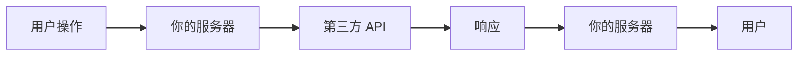
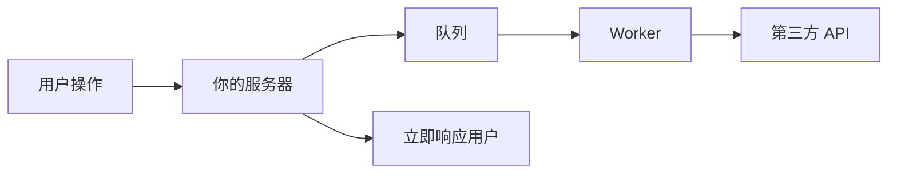
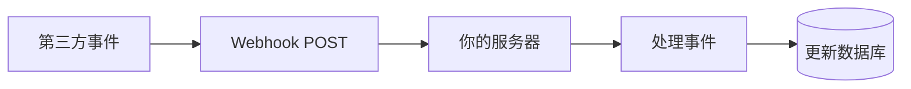
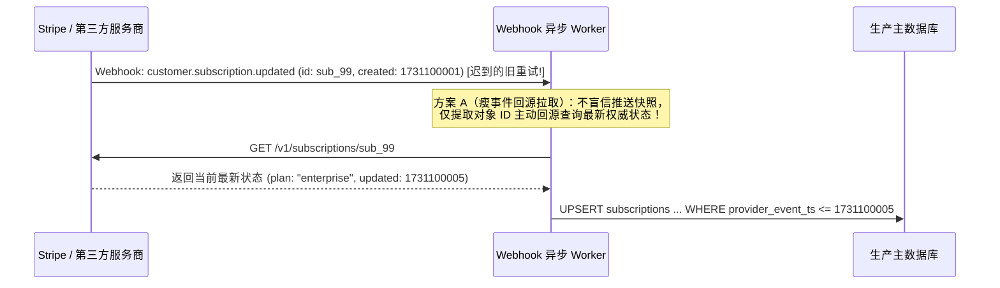
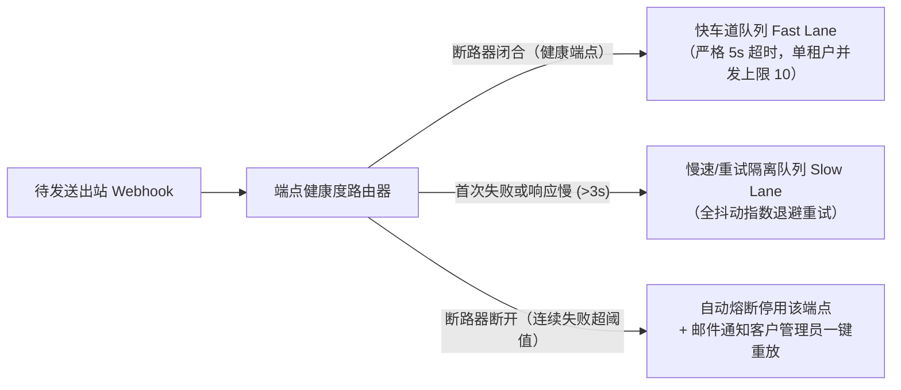
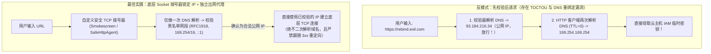

# 第三方集成

## 这是什么？

第三方集成是把你的应用和外部服务连接起来——支付处理器（Stripe）、邮件服务商（SendGrid）、身份认证（Auth0）、云存储（AWS S3）、通讯工具（Slack、企业微信）、分析平台（Mixpanel）等等。不从零开始造轮子，而是通过 API 利用专业服务。作为开发者，你的工作很大一部分就是把这些服务可靠地连接在一起。

## 为什么要懂？

现代应用是建立在集成之上的。一个典型的 SaaS 产品可能对接 10-20 个外部服务。理解集成模式——怎么认证、怎么处理失败、怎么处理 Webhook、怎么应对 API 变更——是核心技能。烂集成会导致级联故障、数据不一致和安全漏洞。好的集成是弹性的、可监控的、易维护的。

## 业务流程

### API 集成流程

1. **评估**：研究第三方服务。查看文档、定价、可靠性、限流
2. **认证**：获取 API Key 或配置 OAuth。安全存储凭证
3. **集成**：写代码调用 API。处理响应和错误
4. **测试**：使用服务的沙箱/测试环境
5. **监控**：在生产中追踪 API 调用、延迟、错误率
6. **维护**：处理 API 版本变更、弃用和故障

### Webhook（入站）

不用轮询 API 问"有变化吗？"，服务主动告诉你发生了什么：

1. 你在服务那里注册一个 Webhook URL（如 `https://yourapp.com/webhooks/stripe`）
2. 事件发生时（支付成功、邮件退回），服务向你的 URL 发送 HTTP POST
3. 你的服务器收到载荷，验证真实性（签名验证），然后处理
4. 你在超时时间内（通常 5-30 秒）回复 `200 OK`
5. 如果你没响应，服务会重试（指数退避，通常 3-5 次）

### OAuth 集成（连接用户账号）

当你的应用需要代表用户操作另一个服务时：

1. 用户在你的应用里点"连接 Slack"
2. 用户被重定向到 Slack 的授权页面
3. 用户批准："允许 YourApp 发送消息？"
4. Slack 跳回你的应用，带一个授权码
5. 你的服务端用授权码换 Access Token + Refresh Token
6. 你存储这些 Token，用它们代表用户调用 Slack 的 API
7. Access Token 过期后，用 Refresh Token 获取新的

### 数据同步

当你的应用和第三方服务需要保持数据同步时：

1. **单向同步**：你的应用推送数据到服务（如新客户 → CRM）
2. **双向同步**：任何一方的变更都反映到另一方（复杂且容易出错）
3. **事件驱动同步**：Webhook 触发近实时的同步操作
4. **批量同步**：定时任务对账两个系统之间的数据（每小时、每天）

## 常见术语

| 术语              | 解释                                                            |
| ----------------- | --------------------------------------------------------------- |
| **API**           | 应用程序编程接口——与服务通信的约定                              |
| **REST API**      | 用 HTTP 方法（GET、POST、PUT、DELETE）和 URL 路径表示资源的 API |
| **GraphQL**       | API 的查询语言，客户端精确指定需要什么数据                      |
| **Webhook**       | HTTP 回调——事件发生时服务推送数据到你的服务器                   |
| **API Key**       | 标识你应用的凭证。通常是一个长随机字符串                        |
| **OAuth 2.0**     | 委托授权协议——你的应用代表用户操作                              |
| **限流**          | 时间窗口内允许的最大 API 调用数（如 100 次/分钟）               |
| **沙箱/测试模式** | 独立的开发/测试环境，不影响真实数据或真金白银                   |
| **SDK**           | 软件开发工具包——服务提供的便于集成的库                          |
| **幂等性**        | 确保同一操作可以安全重试而不产生重复效果                        |
| **熔断器**        | 停止调用失败服务以防止级联故障的模式                            |
| **指数退避重试**  | 以递增延迟重试失败请求（1s、2s、4s、8s）                        |
| **API 版本化**                  | 服务发布新版本（`v1`、`v2`）。旧版本最终会被弃用                                              |
| **弃用**                        | 服务宣布某个 API 端点或版本将被移除                                                           |
| **瘦事件拉取模式（Thin-Event）**| 仅将 Webhook 视为"状态变更通知"，收到后主动调用对方 GET API 拉取最新权威状态，免疫乱序问题     |
| **事件水位线（Watermarking）**  | 在数据库记录最后一次事件时间戳，拒绝时间戳早于当前水位的迟到/乱序 Webhook 覆盖新状态          |
| **SSRF（服务端请求伪造）**      | 攻击者将回调 URL 填为内网地址（如云元数据 `169.254.169.254`），诱骗你的服务器抓取并返回内网机密|
| **DNS 重绑定（DNS Rebinding）** | 域名在校验阶段解析为合法公网 IP，但在毫秒级 `TTL=0` 过期后实际发起请求时瞬间切换为内网 `127.0.0.1` |
| **舱壁隔离（Bulkhead）**        | 按租户限制出站并发数并划分快慢队列，防止单个客户宕机的回调地址拖垮全站任务池                  |

## 常见模式

### 模式一：直接 API 调用

你的服务器在需要时直接调用第三方 API。



**适用场景：** 简单集成、同步操作（验证支付、发送邮件）。

**取舍：** 你的响应时间取决于第三方的响应时间。它们慢了，你的用户就等着。

### 模式二：基于队列的集成

用消息队列把 API 调用和用户请求解耦。



**适用场景：** 非紧急操作（发邮件、同步 CRM、生成报表）。

**取舍：** 更多基础设施（队列、Worker）。但用户请求快了，失败也可以重试。

### 模式三：Webhook 接收器

第三方把数据推给你，而不是你去拉。



**适用场景：** 支付事件、邮件投递状态、订阅变更。

**取舍：** 你需要一个可靠的、公开可访问的端点。必须验证 Webhook 真实性。必须处理重复投递。

### 模式四：抽象层

把第三方 API 包装在你自己的接口后面，这样换服务商不用改应用代码。

**适用场景：** 当你可能会换服务商，或同一功能使用多个服务商（故障转移）。

**取舍：** 多了一层抽象。只有你确实可能换时才值得。

## 踩坑提醒

- **别指望第三方永远在线**：每个外部服务都会有故障。你的应用必须优雅地处理不可用——入队重试、显示降级状态、回退到缓存数据。
- **Webhook 签名验证**：始终验证 Webhook 确实来自声称的服务。不验证的话，任何人都能向你的 Webhook 端点 POST 假事件。
- **Webhook 处理要快**：迅速回复 `200 OK`，然后异步处理事件。如果太慢，服务会超时并重试，导致重复处理。
- **Webhook 处理器要幂等**：Webhook 可能被投递多次。用事件 ID 去重。已经处理过 `evt_123` 就跳过。
- **API Key 轮换**：API Key 应该能在不停机的情况下轮换。从环境变量读取，不要硬编码。
- **限流处理**：尊重 `429 Too Many Requests` 响应。读取 `Retry-After` 头。实现退避。不要疯狂锤一个被限流的 API。
- **沙箱 vs 生产 Key**：在开发环境用生产 API Key 意味着发真邮件、扣真钱、发到真的 Slack 频道。开发中永远用测试/沙箱 Key。
- **成本监控**：第三方 API 调用要花钱。一个发了百万封邮件或百万次 API 调用的 bug 会产生巨额账单。设置计费警报。

## 行业实战经验与非显而易见的最佳实践

### 1. 乱序 Webhook 水位线防护与 Stripe "瘦事件回源拉取（Thin-Event Pull）"模式

所有主流 Webhook 提供商（Stripe、微信支付、支付宝、GitHub、Shopify）都在官方文档中明确警告：**它们绝不保证 Webhook 事件的到达顺序**。

**生产环境中最常见的两类乱序灾难：**
1. **`updated` 比 `created` 先到**：用户在 Stripe 完成订阅结账时，Stripe 会在 40 毫秒内先后发出 `customer.subscription.created` 和 `customer.subscription.updated` 两个事件。由于网络抖动或负载均衡调度，`updated` 事件比 `created` 提前 100 毫秒到达你的服务器。如果你的 `updated` 处理器执行 `UPDATE subscriptions SET status = 'active' WHERE stripe_id = 'sub_99'`，此时数据库里根本还没有这行记录，更新影响行数为 `0` 并静默返回 `200 OK`——结果后续 `created` 事件写入的仍是初始未激活状态，用户付了钱却被锁在门外！
2. **迟到的历史重试覆盖最新状态（Stale Overwrite）**：12:00:01 用户升级为 `pro` 套餐（事件 `evt_1`，因网络抖动超时进入重试）；12:00:05 用户紧接着又升级为 `enterprise` 企业版（事件 `evt_2`，立刻处理成功）。12:02:00，Stripe 自动重发迟到的 `evt_1`（`pro`）。如果你的代码无脑信任 Webhook 请求体里的快照执行覆盖，**这记迟到的重试会直接把企业版客户降级回专业版！**

**生产环境最佳实践：瘦事件回源拉取（Thin-Event Pull）+ 时间戳高水位线（Watermarking）**



1. **瘦事件回源拉取模式（Thin-Event Pull Pattern）**：不要信任 Webhook 消息体里携带的历史数据快照，仅把 Webhook 当作一个"缓存脏标记通知"（只从中读取 `object_id = 'sub_99'`）。Worker 收到通知后，主动调用 `stripe.subscriptions.retrieve('sub_99')` 拉取服务商当前的最新权威状态，并在本地执行 `UPSERT`（不存在则插入，存在则更新）。这样无论 `updated` 是否早于 `created` 到达，还是十几次历史重试乱序涌入，本地数据库永远收敛到最新真实状态！
2. **单调时间戳水位线（Optimistic Watermarking）**：如果第三方不支持高频回源查询、必须直接消费 Webhook 载荷，则必须全面使用 `UPSERT`（消除 `created`/`updated` 先后依赖），并在 SQL `WHERE` 子句中加上单调递增的事件时间戳水位线校验：
   ```sql
   INSERT INTO subscriptions (stripe_id, plan, status, provider_event_ts)
   VALUES ($1, $2, $3, $4)
   ON CONFLICT (stripe_id) DO UPDATE
     SET plan = EXCLUDED.plan,
         status = EXCLUDED.status,
         provider_event_ts = EXCLUDED.provider_event_ts
   WHERE subscriptions.provider_event_ts < EXCLUDED.provider_event_ts;
   ```

### 2. 构建企业级出站 Webhook 引擎：租户并发舱壁与死链熔断器

当你的 B2B 产品发展到一定阶段，你不仅要*接收*别人的 Webhook，还需要**作为平台方向你的客户服务器主动推送出站 Webhook**（例如客户配置了 `https://hooks.customer.com/order-events`）。

**把初创公司出站队列拖垮的典型事故：**
客户 A 的接收服务器挂了（或者代码写死循环，每次请求都卡满 29 秒才返回 `504 Gateway Timeout`）。与此同时，客户 A 的业务触发了 5 万条事件。每个任务死死占用一个 Worker 协程 29 秒，失败后又重新塞回队列重试。不到 3 分钟，**你全站 100% 的 Worker 线程池全部被客户 A 的僵尸连接占满**，导致完全健康的客户 B、客户 C 的实时回调全部被连带堵塞延迟 6 小时。

**生产环境最佳实践：快慢双队列隔离 + 单端点并发舱壁 + 自动断路器**



1. **快慢车道物理隔离与激进超时（Fast / Slow Lanes）**：主干**快车道队列**强制执行严格的 `5 秒` 总超时（含连接与读取）。任何首次投递失败或 P95 响应耗时超过 2 秒的慢端点，后续事件立即降级路由到独立线程池的**慢车道重试队列**，确保健康客户的毫秒级实时送达绝不受慢客户干扰。
2. **按端点并发舱壁限制（Per-Endpoint Concurrency Bulkhead）**：发送 HTTP 请求前先获取基于 Redis 的分布式信号量（如每个目标 Webhook URL 最多允许 `10` 个并发在途请求）。即使客户 A 瞬间产生 10 万条事件，也最多只能占用 10 个并发槽位，其余事件在客户 A 自己的分区内排队。
3. **死链自动熔断与自服务重放（Dead-Endpoint Circuit Breaker）**：采用带全抖动（Full Jitter）的指数退避重试（`15s → 2m → 15m → 2h → 6h`）。若某个客户端点连续 72 小时全部失败，自动将断路器切换为 `DISABLED`（停止无效外呼浪费资源），记录落盘日志并向客户管理员发送告警邮件，支持客户修复服务器后在后台点击"一键重放漏接事件"。

### 3. 客户自定义 Webhook URL 的 SSRF 防护（拦截 `169.254.169.254` 与 DNS 重绑定攻击）

只要你的系统允许用户输入一个 URL 并由你的后端服务器发起请求——无论是**配置 Webhook 回调地址**、**从 URL 导入头像/图片**、**富文本链接卡片预览抓取**，还是**企业 OIDC 发现端点**——你就暴露了极高危的**服务端请求伪造（SSRF）**攻击面。

**攻击者是如何轻易绕过普通正则校验的？**
1. **窃取云厂商元数据凭证**：攻击者在 Webhook URL 设置里填入 `http://169.254.169.254/latest/meta-data/iam/security-credentials/`（AWS/阿里云/腾讯云实例元数据地址）或内网未设密码的组件 `http://127.0.0.1:6379/`，点击"发送测试 Webhook"，然后直接在你贴心提供的"Webhook 响应报文调试器"页面里完整读出生产服务器的云账号临时密钥！
2. **DNS 重绑定攻击（DNS Rebinding，`TTL = 0`）**：为了防 SSRF，你在发请求前写了一段校验函数：先 `dns.lookup(hostname)` 拿到 IP → 检查不是内网 IP → 调用 `fetch(url)`。攻击者架设一个恶性 DNS 服务器，将 `hook.evil.com` 的 `TTL` 设为 `0`：
   - **第 1 次解析（你的校验函数调用）**：返回合法的公网 IP `93.184.216.34`，顺利通过安全校验！
   - **第 2 次解析（5 毫秒后 `fetch(url)` 内部发起连接时）**：由于 `TTL=0` 缓存已失效，HTTP 客户端重新发起 DNS 解析，攻击者的 DNS 瞬间切换返回 `169.254.169.254` 或内网 `10.0.1.25`，直接击穿防线！



**生产环境最佳实践：三层纵深 SSRF 防御架构**
1. **在底层 Socket 拨号器（Custom Dialer）中"一次解析并锁定 IP"**：严禁在业务层先调一次 `dns.lookup()` 校验再把域名传给 `fetch()`。必须定制 HTTP 客户端的底层 TCP `connect` 钩子（或直接使用 Stripe 开源的 `smokescreen` 出站代理）：在建立 TCP 套接字的那一刻执行**唯一一次** DNS 解析，拦截所有非公网保留网段（`127.0.0.0/8`、`10.0.0.0/8`、`172.16.0.0/12`、`192.168.0.0/16`、`169.254.0.0/16`、`100.64.0.0/10`、`::1`、`fc00::/7`），校验通过后**直接向该 IP 发起 TCP 握手**，彻底消灭 DNS 重绑定时间窗。
2. **严禁自动跟随 HTTP 3xx 重定向（`redirect: "error"`）**：如果允许跟随 `301`/`302` 跳转，攻击者只需填入一个返回 `Location: http://169.254.169.254/` 的公网链接即可绕过首次校验。Webhook 投递应直接禁止重定向。
3. **DMZ 隔离出站代理与强制 IMDSv2**：将所有由外部 URL 触发的出站请求统一路由至部署在独立 DMZ 子网的出站代理（物理路由表上彻底切断通往业务内网 VPC 的路由），并在云主机上强制开启 **IMDSv2**（要求先携带自定义 Header 发送 `PUT` 请求获取会话 Token，且限制 IP 包跳数 `TTL = 1`）。

## 速查表

| 集成类型 | 模式           | 举例                                      |
| -------- | -------------- | ----------------------------------------- |
| 支付     | Webhook + API  | Stripe：创建支付意图 → 收到成功 Webhook   |
| 邮件     | 队列 + API     | SendGrid：入队邮件 → Worker 通过 API 发送 |
| 认证     | OAuth 2.0      | Google：重定向 → 授权 → 换码 → 使用 Token |
| 存储     | 直接 API       | S3：生成预签名 URL → 客户端直接上传       |
| 通讯     | Webhook        | Slack：收到 Webhook → 处理 → 响应         |
| 分析     | 事件流         | Segment：发送事件 → 分发到各目的地        |
| CRM 同步 | 批量 + Webhook | Salesforce：变更 Webhook + 每晚批量对账   |

| 生产环境典型集成故障与安全威胁       | 根本原因                                           | 架构级解决方案                                                    |
| ------------------------------------ | -------------------------------------------------- | ----------------------------------------------------------------- |
| `updated` 早于 `created` 到达或旧覆盖| Webhook 乱序投递，或迟到的历史重试覆盖了新状态     | 瘦事件回源拉取（`GET` 最新权威状态）+ 带时间戳水位线的 `UPSERT`   |
| 单个客户回调地址超慢拖垮全站推送队列 | 所有租户共用线程池，30 秒超时与重试耗尽全部连接    | 快慢车道队列分离 + 单端点并发信号量上限 + 72 小时死链自动熔断     |
| 攻击者通过自定义回调地址窃取内网密钥 | SSRF 请求云主机元数据 `169.254.169.254` 或 DNS 重绑定| 底层 Socket 拨号器一次解析锁定 IP + 禁止 3xx 跳转 + DMZ 出站代理  |

