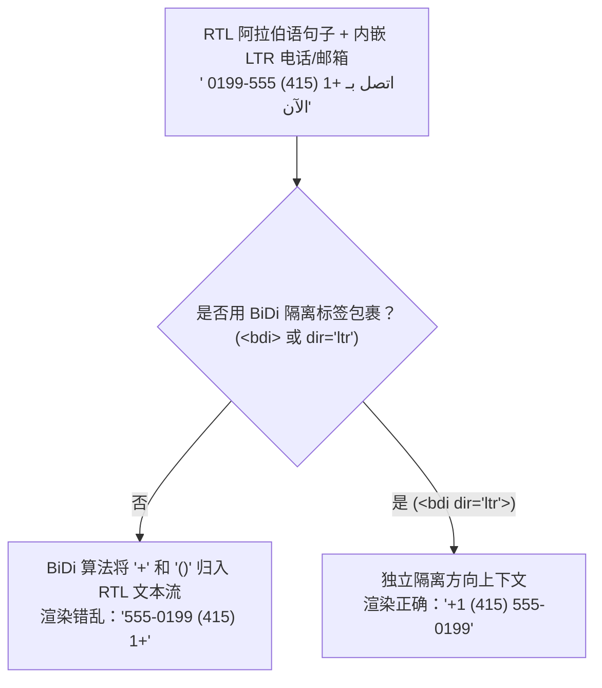

# 国际化

## 这是什么？

国际化（i18n）是让你的应用为全球用户服务——不同的语言、货币、日期格式、数字格式、文字方向和文化习惯。本地化（l10n）是针对特定地区的适配工作（翻译文字、按德国格式显示日期等）。作为开发者，i18n 是搭建让本地化成为可能的基础设施。你搭框架，翻译人员填内容。

## 为什么要懂？

出海是业务增长策略，开发者决定了这条路能不能走通。如果你的应用把英文字符串、美国日期格式和美元价格硬编码在代码里，加一种新语言意味着重写大量代码。如果你从一开始就按 i18n 模式搭建，加新语言基本上就是翻译工作。即使你的应用今天只有中文/英文，按 i18n 模式搭建也能为以后省下巨大的痛苦。

## 业务流程

### 文本翻译

i18n 的核心——所有面向用户的文本来自翻译文件，不是硬编码字符串。

```
// 错误：硬编码
<h1>欢迎回来！</h1>

// 正确：翻译键
<h1>{t('welcome_back')}</h1>
```

翻译文件：

```json
// zh.json
{ "welcome_back": "欢迎回来！" }

// en.json
{ "welcome_back": "Welcome back!" }

// de.json
{ "welcome_back": "Willkommen zurück!" }
```

### 语言检测与选择

应用怎么决定显示哪种语言：

1. **URL 路径**：`/zh/about`、`/en/about` — 语言在 URL 路径中
2. **子域名**：`zh.yourapp.com`、`en.yourapp.com`
3. **浏览器偏好**：读取 `Accept-Language` 头
4. **用户设置**：用户在个人设置中选择语言
5. **Cookie/Storage**：记住用户上次的选择

优先级通常是：用户设置 > URL > Cookie > 浏览器 > 默认。

### 日期、时间和数字格式化

不同地区差异很大：

| 格式 | 美国 (en-US) | 德国 (de-DE) | 中国 (zh-CN) | 日本 (ja-JP) |
| ---- | ------------ | ------------ | ------------ | ------------ |
| 日期 | 03/01/2026   | 01.03.2026   | 2026/03/01   | 2026年3月1日 |
| 数字 | 1,234.56     | 1.234,56     | 1,234.56     | 1,234.56     |
| 货币 | $1,234.56    | 1.234,56 €   | ¥1,234.56    | ¥1,234       |

用 JavaScript 内置的 `Intl` API 来正确格式化。

### 货币处理

货币不只是"加个 ¥ 号"：

1. 用最小单位（分）以整数存储金额——永远不用浮点数
2. 金额旁边存货币代码（CNY、USD、EUR）
3. 按地区的格式规则显示
4. 汇率是外部数据——从服务获取
5. 货币转换应该在服务端进行，明确标明汇率

### 复数形式

不同语言有不同的复数规则：

- **英语**：1 item, 2 items（2 种形式）
- **中文**：1 个项目（1 种形式——没有复数区分）
- **阿拉伯语**：0、1、2、少数、多数、其他（6 种形式！）

你的 i18n 库必须处理这个。ICU MessageFormat 是标准。

### 从右到左（RTL）语言

阿拉伯语、希伯来语、波斯语是从右到左书写的。这影响：

- 文本对齐翻转
- 布局镜像（侧栏在右边，返回按钮在右边）
- 图标可能需要翻转（方向性箭头）
- CSS 使用 `direction: rtl` 和逻辑属性（`margin-inline-start` 代替 `margin-left`）

## 常见术语

| 术语                  | 解释                                                               |
| --------------------- | ------------------------------------------------------------------ |
| **i18n**              | 国际化——搭建支持多地区的系统                                       |
| **l10n**              | 本地化——针对特定地区适配产品                                       |
| **Locale**            | 语言 + 地区的组合（en-US、zh-CN、pt-BR）。决定格式化规则           |
| **翻译键**            | 映射到翻译文本的标识符（如 `welcome_back`）                        |
| **翻译文件**          | 包含某个语言所有翻译的文件（JSON、YAML）                           |
| **ICU MessageFormat** | 处理复杂翻译模式（复数、性别、选择）的标准                         |
| **RTL**               | 从右到左——像阿拉伯语和希伯来语这样从右往左阅读的语言               |
| **Locale 回退**       | 如果 `zh-TW` 翻译缺失，回退到 `zh`，再回退到 `en`                  |
| **字符串提取**        | 自动在代码中找到可翻译字符串并生成翻译文件                         |
| **TMS**               | 翻译管理系统——翻译人员工作的平台（Crowdin、Phrase、Lokalise）      |
| **机器翻译**          | 用 AI 生成初始翻译（Google 翻译、DeepL）。通常需要人工审校         |
| **伪本地化**          | 用带重音的字符替换英文文本（Ŵéĺçöḿé）来测试 i18n 而不需要真的翻译 |
| **CLDR**              | Unicode 通用区域数据仓库——行业标准的区域规则、复数与格式数据库     |
| **BiDi 双向隔离**     | 用 `<bdi>` 或 Unicode 隔离符包裹内嵌的 LTR/RTL 子串，防止排版错乱  |
| **CSS 逻辑属性**      | 与书写方向无关的 CSS 属性（如 `margin-inline-start`），在 RTL 自动镜像 |
| **Unicode 规范化**    | 将视觉相同但字节不同的字符序列（NFC vs NFD）统一为标准字节表示     |
| **Collation（排序规则）** | 特定语言区域的字符比较与排序规则（`Intl.Collator`）            |

## 常见模式

### 模式一：JSON 翻译文件

每个语言一个 JSON 文件，和应用打包在一起。构建时或按需加载。

**适用场景：** 大多数 Web 应用。Next.js、React（react-i18next、next-intl）都用这个。

**取舍：** 实现简单。但更新翻译需要代码部署。

### 模式二：远程翻译（CMS 驱动）

翻译存在 CMS 或 TMS 中，运行时获取。翻译人员不用部署就能更新文字。

**适用场景：** 大型应用、频繁改文案、营销内容多的场景。

**取舍：** 运行时依赖翻译服务。需要缓存策略。

### 模式三：基于 Locale 的路由

每个语言有自己的 URL 路径。Locale 是路由的一部分，不只是 Cookie。

```
/en/pricing
/zh/pricing
```

**适用场景：** 对 SEO 重要的网站（搜索引擎分别索引不同语言版本）。

**取舍：** 路由更复杂。但对 SEO 和分享性最好。

## 踩坑提醒

- **文本膨胀**：德文比英文长约 30%。中文比英文短约 30%。你的 UI 必须兼容两种。英文的 "Submit" 在德文是 "Formular absenden"。文本元素不要设固定宽度。
- **不要拼接字符串**：`"你好" + name + "，你有" + count + "条消息"` — 这在语序不同的语言中会断裂。用模板变量：`"你好 {name}，你有 {count} 条消息"`。
- **图片中的文字**：如果你的图片包含文字（横幅、图表），每个语言需要单独的版本。更好的做法：用 CSS 文字覆盖在图片上。
- **排序和比较**：不同语言的字母顺序不同。用 `Intl.Collator` 做语言感知的排序。
- **输入验证**：邮箱可以包含国际字符（IDN）。姓名可以有重音、变音符号。不要用纯 ASCII 正则验证。
- **时区不是语言**：一个在纽约的中文用户需要中文文本但美国东部时间。不要假设语言 = 时区。
- **法律内容**：隐私政策、服务条款在某些地区法律要求必须用当地语言提供。
- **翻译中的数字**：`"你有 5 条消息"` — 数字 5 应该按地区格式化（英文是 5，阿拉伯语是 ٥）。

## 行业实战经验与非显而易见的最佳实践

### 1. ICU MessageFormat 复数规则与性别选择（Gender Select）

习惯了中文（无复数词尾变化）或英文（仅区分单数 `1` 和复数 `other`）的开发者，经常写出下面这种代码：

```javascript
// 错误示范：假设全世界只有单数（1）和复数（其他）两种形态
const label = count === 1 ? `${count} file` : `${count} files`;
```

这种写法在斯拉夫语系、波罗的语系和闪米特语系（遵循 Unicode CLDR 规范）中会彻底崩溃：

- **俄语 / 波兰语 / 乌克兰语（4 种复数类别：`one`、`few`、`many`、`other`）**：以俄语为例，以 1 结尾（但非 11）的数字用 `one`（`1 файл`、`21 файл`）；以 2–4 结尾（但非 12–14）的数字用 `few`（`2 файла`、`24 файла`）；0、5–20 以及以 5–9 或 0 结尾的数字用 `many`（`5 файлов`、`11 файлов`）；小数用 `other`（`1.5 файла`）。
- **阿拉伯语（6 种复数类别：`zero`、`one`、`two`、`few`、`many`、`other`）**：拥有专门的双数形态（`two`，恰好 2 个物品）、3–10 的少量形态（`few`）、11–99 的多数形态（`many`）以及 100 以上的 `other`。

此外，法语、西班牙语、俄语、希伯来语、阿拉伯语等语言会根据主语的**语法性别**改变动词和形容词词尾，且同一个句子往往同时包含**性别变化 + 复数变化**。如果把句子拆成碎片拼接（如 `t('user_invited') + count + t('guests')`），译者根本无法完成符合语法的翻译。

**最佳实践**：始终将**完整句子**交给 **ICU MessageFormat**，让译者在同一个翻译键内自主控制所有性别与复数分支：

```icu
{gender, select,
  female {
    {count, plural,
      =0 {{host} не пригласила гостей.}
      one {{host} пригласила # гостя.}
      few {{host} пригласила # гостей.}
      many {{host} пригласила # гостей.}
      other {{host} пригласила # гостя.}
    }
  }
  male {
    {count, plural,
      =0 {{host} не пригласил гостей.}
      one {{host} пригласил # гостя.}
      few {{host} пригласил # гостей.}
      many {{host} пригласил # гостей.}
      other {{host} пригласил # гостя.}
    }
  }
  other {
    {count, plural,
      =0 {{host} не пригласил(а) гостей.}
      other {{host} пригласил(а) # гостей.}
    }
  }
}
```

### 2. 双向文本（BiDi）隔离与 CSS 逻辑属性

在适配阿拉伯语（`ar`）、希伯来语（`he`）、波斯语（`fa`）等从右到左（RTL）语言时，生产环境最容易踩中两个深坑：物理方向样式硬编码，以及 Unicode 双向算法（UBA）导致的文本乱序。

#### CSS 逻辑属性 vs. 物理方向属性

如果 CSS 里写死了 `margin-left: 16px`、`text-align: left` 或 `right: 0`，切换到 `<html dir="rtl">` 后，间距和角标都会停留在错误的一侧，迫使你维护大量脆弱的 `[dir="rtl"]` 覆盖样式。现代 CSS 原生提供了**逻辑属性**，通过 `inline-start`（LTR 下为左，RTL 下为右）和 `inline-end`（LTR 下为右，RTL 下为左）自动完成镜像：

```css
/* 错误：物理属性在 RTL 模式下无法自动镜像 */
.sidebar-item {
  margin-left: 12px;
  padding-right: 8px;
  border-left: 3px solid var(--accent);
  text-align: left;
}

/* 正确：逻辑属性在 dir="rtl" 下自动左右翻转 */
.sidebar-item {
  margin-inline-start: 12px;
  padding-inline-end: 8px;
  border-inline-start: 3px solid var(--accent);
  text-align: start;
}
```

#### 内嵌 LTR 数据的 BiDi 乱序问题

即使正确设置了 `<html dir="rtl">`，当你在阿拉伯语/希伯来语句子中间插入从左到右（LTR）的字符串——例如电话号码（`+1 (415) 555-0199`）、邮箱地址、文件路径（`/var/log/nginx.log`）或带标点的英文用户名——浏览器的 BiDi 双向算法会把中性符号（`+`、`-`、`/`、`@`、括号）误判为归属于周围的 RTL 文本流。结果 `+1 (415) 555-0199` 在页面上会被倒序渲染成 `555-0199 (415) 1+`！



**最佳实践**：
- 将所有动态用户输入变量（用户名、商品名）包裹在 `<bdi>`（Bidirectional Isolate，双向隔离）标签中，防止其字符方向污染周围的标点符号。
- 将天然从左到右的技术标识（电话号码、URL、代码片段、序列号、脱敏银行卡号）包裹在 `<span dir="ltr" class="unicode-bidi-isolate">` 中。
- 在不支持 HTML 标签的纯文本场景（邮件标题、App 推送通知、CSV 导出）中，使用 Unicode 方向隔离控制符包裹动态子串：`U+2068`（First Strong Isolate，`⁨`）与 `U+2069`（Pop Directional Isolate，`⁩`）。

### 3. 语言感知排序（Collation）、土耳其语带点/无点 I 陷阱与 Unicode 规范化

许多开发者默认 `.toLowerCase()`、`.toUpperCase()`、`===` 和 `.sort()` 在所有语言下行为一致，这往往会引发极其隐蔽的生产事故。

#### 土耳其语大小写转换陷阱（`tr-TR` 与 `az-AZ`）

在英语中，小写 `i` 对应大写 `I`。但在土耳其语和阿塞拜疆语中，这是**两个完全不同的字母**：
- 无点小写 `ı`（`U+0131`）↔ 无点大写 `I`（`U+0049`）
- 带点小写 `i`（`U+0069`）↔ 带点大写 `İ`（`U+0130`）

如果后端或前端代码在土耳其语区域设置下，使用区域敏感的大小写转换去处理枚举值、HTTP 头或 SQL 关键字：

```javascript
// 在土耳其语区域 (tr-TR) 下：
'id'.toLocaleUpperCase('tr-TR'); // 返回 "İD" (U+0130 + D)，而不是 "ID"！
'IMAGE'.toLocaleLowerCase('tr-TR'); // 返回 "ımage" (U+0131 + mage)，而不是 "image"！
```

诸如 `header.toUpperCase() === 'AUTHORIZATION'` 或 `role.toLowerCase() === 'admin'` 的校验会静默返回 `false`，直接导致土耳其用户无法登录或鉴权失败。
- **黄金法则**：处理内部标识符、协议头和数据库枚举时，必须使用与区域无关的大小写转换（JS 中的 `.toLowerCase()` / `.toUpperCase()`，Java 中的 `String.toLowerCase(Locale.ROOT)`，Go 中的 `strings.ToLower`）；仅在对面向用户的展示文本做转换时才调用 `.toLocaleLowerCase(locale)`。

#### Unicode 规范化（`NFC` vs. `NFD`）

带重音符号的字符（如 `é`、`ö`）或日文浊音假名（如 `が`）在 Unicode 中有两种截然不同的字节编码方式：
- **NFC（标准合成形式）**：单个码点 `é`（`U+00E9`，长度为 1）。Windows、Linux、Android 和普通网页输入法默认使用 NFC。
- **NFD（标准分解形式）**：基础字母 `e`（`U+0065`）加上组合重音符 `◌́`（`U+0301`，长度为 2！）。**macOS（HFS+/APFS 文件系统）会将所有文件名强制转换为 NFD。**

```javascript
const nfc = 'café'; // 'café' (length: 4)
const nfd = 'café'; // 'café' (length: 5)

console.log(nfc === nfd); // false！导致对象存储 Key、数据库唯一索引、搜索匹配全部失效！
console.log(nfc.normalize('NFC') === nfd.normalize('NFC')); // true
```

当 Mac 用户上传名为 `résumé.pdf` 的文件时，其文件名是 NFD 编码。如果 API 入口层没有对所有入站字符串统一执行 `str.normalize('NFC')`，用户用网页搜索框（NFC）搜索 `résumé.pdf` 将永远搜不到结果。

#### 语言感知排序（Locale-Aware Collation）

JavaScript 默认的 `array.sort()` 按 UTF-16 码点排序（导致 `"Z" < "a"`，且 `"ä"` 排在 `"z"` 后面）。更重要的是，不同语言对相同字母的字典序定义完全不同：
- 在**德语（`de-DE`）**中，`ä` 紧挨着 `a` 排序。
- 在**瑞典语（`sv-SE`）**中，`ä` 是字母表末尾排在 `z` 之后的独立字母（`x, y, z, å, ä, ö`）。
- 在**中文（`zh-CN`）**中，用户期望按拼音排序（`Intl.Collator('zh-CN-u-co-pinyin')`），而不是按汉字生僻程度的 Unicode 码点乱排。

在渲染前端表格或下拉列表排序时，务必复用预实例化的 `Intl.Collator(locale, { sensitivity: 'base', numeric: true })`。

## 速查表

| 方面           | 实现方式                                                           |
| -------------- | ------------------------------------------------------------------ |
| 文本           | 翻译键 + 每个语言一个 JSON 文件                                    |
| 日期           | `Intl.DateTimeFormat` 加 locale 参数与显式 `timeZone`              |
| 数字           | `Intl.NumberFormat` 加 locale 参数                                 |
| 货币           | 用最小整数单位（分）+ ISO 4217 货币代码存储，用 `Intl` 格式化      |
| 复数与性别     | 整句 ICU MessageFormat（`plural`、`select`、`selectordinal`）      |
| RTL 与双向文本 | CSS 逻辑属性（`margin-inline-start`）、`<bdi>` / `dir="ltr"` 隔离  |
| 字符串规范化   | 在 API 边界对所有用户输入和文件名执行 `.normalize('NFC')`          |
| 字典排序       | `new Intl.Collator(locale, { numeric: true }).compare`             |
| URL 路由       | `/[locale]/path` 模式                                              |
| 回退           | 具体 locale → 语言 → 默认 locale                                   |
