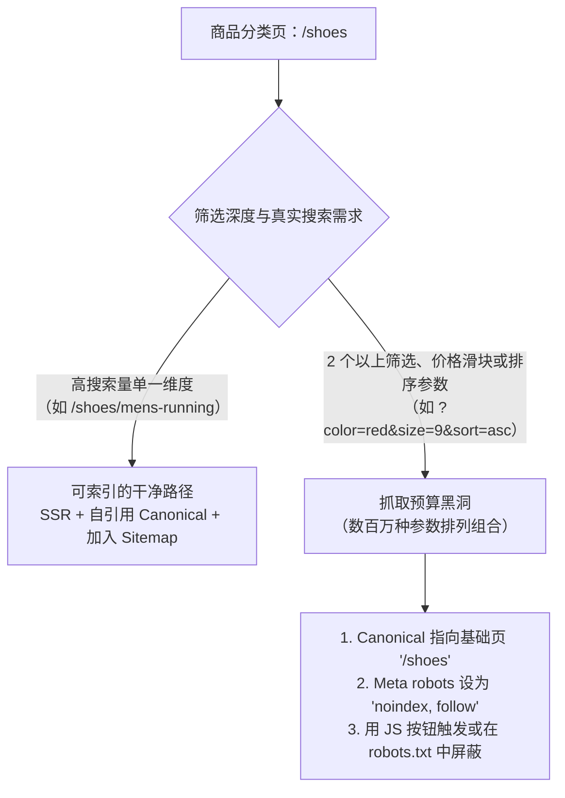

# SEO

## 这是什么？

SEO（搜索引擎优化）是让你的网站能被搜索引擎（Google、百度、Bing）找到并获得好排名。当有人搜"最好的项目管理工具"，SEO 决定了你的网站出现在第 1 页还是第 50 页。它涵盖技术因素（Google 能爬到你的网站吗？）、内容因素（你的页面回答了搜索意图吗？）和权威因素（其他网站链接到你吗？）。作为开发者，你负责技术 SEO——代码层面决定网站搜索可见性的那些决策。

## 为什么要懂？

自然搜索流量是免费的，通常是网站最大的流量来源。一个优化好的网站可以在不花广告费的情况下带来数百万访问。但一个技术错误——屏蔽了 Google 的爬虫、缺少 meta 标签、页面加载太慢——可以让网站排名一夜之间暴跌。开发者犯这些错是因为不懂 SEO 基础。你不需要成为 SEO 专家，但你需要知道足够多，不至于不小心搞砸。

## 业务流程

### 搜索引擎的工作原理

1. **抓取**：Googlebot 访问你的网站，沿着链接发现页面
2. **索引**：Google 读取页面内容，存入它的索引（一个巨大的数据库）
3. **排名**：用户搜索时，Google 从索引中找到相关页面，按质量/相关性排序
4. **展示**：排序后的结果显示在搜索结果页（SERP）上

### 技术 SEO（开发者的职责）

**可爬取性——Google 能找到你的页面吗？**

- 你的网站必须对搜索引擎爬虫可访问
- `robots.txt` 告诉爬虫哪些部分可以爬、哪些跳过
- XML 站点地图列出所有你想被索引的页面（通过 Google Search Console 提交）
- 内链确保所有重要页面都能从其他页面到达
- JavaScript 渲染的内容必须可被爬取（SSR/SSG 优于纯客户端渲染）

**可索引性——Google 能理解你的页面吗？**

- 每个页面需要唯一的、描述性的 `<title>` 标签（50-60 个字符）
- 每个页面需要 `<meta name="description">`（150-160 个字符）
- 使用正确的标题层级（每页一个 `<h1>`，然后 `<h2>`、`<h3>`）
- 规范 URL（`<link rel="canonical">`）防止重复内容问题
- `noindex` meta 标签告诉 Google 不要索引某个页面（用于管理页面、感谢页面）

**性能——你的网站快吗？**

- **Core Web Vitals**：Google 的性能指标，影响排名
  - **LCP**（最大内容绘制）：主要内容在 2.5 秒内加载
  - **INP**（交互到下一次绘制）：页面在 200 毫秒内响应交互
  - **CLS**（累积布局偏移）：布局不要跳来跳去（分数 < 0.1）
- 快的网站排名更好。优化图片、减少 JavaScript、使用 CDN

**移动优先**

- Google 优先索引你网站的移动版本
- 响应式设计是必须的——不是单独的移动站
- 触摸目标要足够大，文字不用缩放就能阅读

### 结构化数据（Schema 标记）

机器可读的元数据，帮助 Google 理解你的内容：

```html
<script type="application/ld+json">
  {
    "@context": "https://schema.org",
    "@type": "Product",
    "name": "跑步鞋",
    "image": "https://example.com/shoes.jpg",
    "description": "轻量跑步鞋",
    "offers": {
      "@type": "Offer",
      "price": "89.99",
      "priceCurrency": "CNY"
    }
  }
</script>
```

这能在 Google 中启用富文本结果——星级评分、价格信息、FAQ 折叠、食谱卡片等。

## 常见术语

| 术语                | 解释                                                               |
| ------------------- | ------------------------------------------------------------------ |
| **SERP**            | 搜索引擎结果页——你 Google 某个东西看到的页面                       |
| **自然流量**        | 通过搜索找到你的访客（不是广告）                                   |
| **关键词**          | 你想排名的搜索词（"项目管理工具"）                                 |
| **外链**            | 从其他网站链接到你的网站。质量外链越多 = 权威越高                  |
| **域名权威**        | 估算一个域名排名可能性的分数（不是 Google 的官方指标，但广泛使用） |
| **抓取预算**        | Google 在给定时间内会爬取你网站的页面数量。对大网站很重要          |
| **索引**            | Google 的网页数据库。"被索引" = 出现在 Google 的数据库中           |
| **规范 URL**        | 当存在重复版本时，某个页面的"官方"版本                             |
| **301 重定向**      | 从旧 URL 永久重定向到新 URL。传递 SEO 价值                         |
| **404 页面**        | 页面未找到。太多 404 = 差的用户体验 = 排名惩罚                     |
| **富文本结果**      | 带额外视觉信息的增强搜索结果（星级、价格、图片），由结构化数据驱动 |
| **Core Web Vitals** | Google 的页面体验指标（LCP、INP、CLS）                             |
| **站点地图**        | 列出网站所有 URL 的 XML 文件，提交给搜索引擎                       |
| **robots.txt**      | 告诉爬虫哪些 URL 可以爬、哪些跳过的文件                            |
| **分面导航（Faceted Nav）** | 多选分类筛选器（颜色、尺码、价格、排序），极易衍生出数百万个排列组合 URL |
| **软 404（Soft 404）** | 页面内容为空或显示"未找到"，但 HTTP 状态码却返回 `200 OK`，污染搜索索引 |
| **hreflang**        | 告知搜索引擎某个 URL 针对哪种语言或国家/地区用户的 HTML 标签或响应头 |
| **x-default**       | `hreflang` 的兜底回退值，指向语言选择页或默认的全球通用版本        |
| **noindex**         | Meta robots 指令（`<meta name="robots" content="noindex">`），指示爬虫不要将该页编入索引 |

## 常见模式

### 模式一：服务端渲染（SSR）/ 静态站生成（SSG）

HTML 在服务端生成，搜索引擎收到完整内容。

**适用场景：** 内容密集的网站、电商、博客。Next.js、Nuxt.js、Astro。

**取舍：** 对爬虫更友好（不需要执行 JavaScript）。比纯 SPA 稍微复杂。

### 模式二：客户端渲染 + 预渲染

SPA 使用预渲染服务（Prerender.io）给爬虫提供 HTML 快照。

**适用场景：** 无法切换到 SSR 但需要 SEO 的 SPA。

**取舍：** 多一个要维护的服务。爬虫看到的内容可能是过时的。

### 模式三：无头 CMS + 静态生成器

内容在 CMS 中管理，构建时静态生成页面。

**适用场景：** 博客、文档站点、营销网站。

**取舍：** 性能最好（静态 HTML 在 CDN 上）。但内容更新需要重新构建。

## 踩坑提醒

- **SPA 对 SEO 天生不友好**：一个纯客户端渲染的 React SPA 给 Google 看的是空的 `<div>`。用 SSR/SSG 或确保内容是服务端渲染的。
- **改 URL 不做重定向**：把 `/blog/my-post` 移到 `/articles/my-post` 不做 301 重定向会丢掉该 URL 积累的所有 SEO 价值。始终做重定向。
- **在 robots.txt 里屏蔽 JavaScript**：如果你屏蔽了 CSS/JS 文件，Google 无法正确渲染你的页面，可能不会正确索引。
- **重复内容**：同一内容在多个 URL（http vs https、www vs 非 www、带斜杠 vs 不带）会分散排名信号。设置规范 URL。
- **页面加载慢**：5 秒的页面加载不只是差的用户体验——直接影响排名。优化 Core Web Vitals。
- **图片缺少 alt 文本**：Google 看不到图片。alt 文本为搜索引擎和屏幕阅读器描述图片。始终包含。
- **多语言内容**：多语言网站要用 `hreflang` 标签告诉 Google 给哪些用户显示哪个语言版本。
- **软 404**：页面内容显示"未找到"但返回 200 状态码。Google 会困惑。返回正确的 404 状态码。

## 行业实战经验与非显而易见的最佳实践

### 1. 分面导航（Faceted Navigation）的抓取预算黑洞

在电商、房产或招聘网站中，**分面导航**（侧边栏按颜色、品牌、尺码、价格区间、评分、排序方式的多选筛选器）是吞噬自然搜索流量的头号隐形杀手。

假设一个商品分类页（`/shoes`）有 15 个筛选项复选框和 4 种排序方式。如果每次点击筛选都生成一个可被爬虫顺着 `<a href="/shoes?color=black&size=10&sort=price_asc">` 抓取的链接：
- 仅仅 15 个二元筛选项就会产生 $2^{15} = 32,768$ 种 URL 组合——如果查询参数的顺序不固定（`?a=1&b=2` 与 `?b=2&a=1`），每个分类下的 URL 排列组合会直接突破**数百万个**。
- Googlebot 会把给你网站分配的 99% **抓取预算（Crawl Budget）** 浪费在爬取毫无搜索价值的空筛选组合（如 `/shoes?color=purple&size=14&brand=acme`）上，导致真正高毛利的新上架商品页几周都无法被发现和收录。



**生产级防御策略**：
1. **将高搜索意图的单维筛选提升为干净路径**：仅对确实有用户搜索量的单层品类词开放索引（如 `/shoes/running` 或 `/shoes/nike`）。
2. **严格拦截多维组合筛选与排序参数**：一旦激活了 2 个及以上筛选项、价格区间或 `sort=` 参数：
   - 将 `<link rel="canonical" href="https://example.com/shoes">` 指回干净的父级分类页。
   - 添加 `<meta name="robots" content="noindex, follow">`，或者直接在 `robots.txt` 中封禁无 SEO 价值的查询参数（`*?sort=*`、`*?price_min=*`），从源头阻止爬虫发请求。
   - 在前端 URL 构造函数中强制按字母序排列 Query 参数，杜绝 `?b=2&a=1` 与 `?a=1&b=2` 并存。
   - 将纯粹交互性质的筛选控件（如排序下拉框、多选框）渲染为 `<button>` 并通过 `history.pushState` 更新地址栏，而不是渲染成爬虫会盲目跟进的 `<a href>` 标签。

### 2. SPA 中的软 404（Soft-404）与流式 SSR 状态码陷阱

当某个 URL 实际不存在（商品已下架、职位已过期、路径拼写错误），页面渲染了友好的*"抱歉，未找到该商品"*提示，**但服务器却返回了 HTTP `200 OK` 状态码**时，就发生了**软 404（Soft 404）**。

为什么现代前端技术栈频繁出现这个问题？
1. **纯客户端 SPA 的 `index.html` 兜底重写**：S3/CloudFront 或 Nginx 通常配置了将所有未知路径（`/* -> /index.html`）以 `200` 状态码返回，交给前端 React Router 渲染 404 组件。当 Googlebot 请求 `/products/deleted-item-999` 时，它收到了 `HTTP 200 OK`，执行 JS 后发现页面只有薄薄一行"未找到"，就会在 Google Search Console 中报出大量 Soft-404 警告，并持续浪费抓取预算反复重爬死链。
2. **React 18/19 流式 SSR（`renderToPipeableStream`）的时序陷阱**：在流式 SSR 中，服务器会**立即**向客户端刷出 HTTP 响应头（`HTTP 200 OK`）和首屏 `<head>` 外壳，同时让 `<Suspense>` 边界异步等待数据库查询。如果某个嵌套的异步服务端组件稍后发现数据库中没有该商品并抛出 `notFound()`，**此时 `200 OK` 响应头早已通过 TCP 套接字发出，根本无法再撤回改成 `404`！**

**最佳实践**：
- **在开启流式传输前先校验核心实体是否存在**：在 Next.js App Router 中（如在 `generateMetadata` 或 `<Suspense>` 之前的顶层 Server Component 中），先查询主资源是否存在；若不存在立即调用 `notFound()`，确保服务器在刷出流之前返回真正的 HTTP `404 Not Found`（若是永久删除的内容则返回 `410 Gone`）。
- **动态注入 `<meta name="robots" content="noindex">`**：如果响应头已经发出、流式边界内部才捕获到"资源不存在"，框架会在 HTML 流中动态插入 `<meta name="robots" content="noindex">`，明确告知 Googlebot 不要将该错误页面编入索引。
- **零结果站内搜索页**：站内搜索无结果页（`/search?q=asdfghjkl`）同样会被 Google 判定为软 404——当 `results.length === 0` 时务必输出 `noindex`。

### 3. 国际化 `hreflang` 双向互惠原则与 Geo-IP 自动重定向事故

将网站扩展到多语言或多地区（`example.com/en/`、`example.com/de/`、`example.com/fr/`）时，有两个反直觉的工程错误经常导致所有非英语页面在一夜之间从 Google 索引中消失：

#### 陷阱 A：根据 Geo-IP 自动重定向导致 Googlebot 被关在门外

产品经理经常提需求：*"如果检测到用户来自美国 IP，自动 `302` 重定向到 `/en/`。"*
- **为什么这会摧毁国际站 SEO**：Googlebot 绝大部分时间都是从**美国加州（Mountain View）的数据中心 IP** 发起抓取的！如果你的中间件把所有美国 IP 强制重定向到 `/en/`，那么每当 Googlebot 尝试抓取 `/de/pricing`（德语）或 `/fr/pricing`（法语）时，你的服务器都会把它强行踢回 `/en/pricing`！结果 Googlebot 永远看不到你的德语、法语、日语页面，最终将所有非英语页面全部从索引中剔除。
- **正确做法**：**绝不要在可索引的公开 URL 上根据 IP 或 `Accept-Language` 做强制自动跳转。** 应当直接渲染用户所请求的 URL（`/de/pricing`），并在页面顶部展示一个可关闭的非侵入式提示条（*"检测到您位于美国，是否切换到英文版？"*）。

#### 陷阱 B：缺失 `hreflang` 双向互惠（Return Tags）与自引用 Canonical 错误

`hreflang` 标签用于告诉搜索引擎某个页面的各语言/地区对应版本（例如让美国用户搜到显示美元的 `/en-us/`，英国用户搜到显示英镑的 `/en-gb/`，同时避免重复内容惩罚）。但 Google 强制要求**双向互惠确认（Reciprocity）**：
- 如果页面 A（`/en/`）通过 `hreflang="de"` 指向页面 B（`/de/`），那么页面 B（`/de/`）**必须**同样包含指向页面 A（`/en/`）的 `hreflang="en"`。只要有一方漏掉了回链，**Google 就会直接忽略整组 `hreflang` 声明**。
- 此外，每个页面都必须包含**指向自身的 `hreflang`** 以及一个兜底的 **`x-default`** 标签：

```html
<!-- 位于 https://example.com/de/pricing 的 <head> 中 -->
<link rel="canonical" href="https://example.com/de/pricing" />
<link rel="alternate" hreflang="en" href="https://example.com/en/pricing" />
<link rel="alternate" hreflang="de" href="https://example.com/de/pricing" />
<link rel="alternate" hreflang="zh-Hans" href="https://example.com/zh/pricing" />
<link rel="alternate" hreflang="x-default" href="https://example.com/en/pricing" />
```

特别注意：德语页面的 `canonical` 必须指向**德语页面自己**（`/de/pricing`），**千万不能**指回 `/en/pricing`——一旦把 `/de/pricing` 的 canonical 写成 `/en/pricing`，就等于告诉 Google"德语页是英文页的重复副本，请把德语页从索引里删掉"！

## 速查表

| SEO 因素      | 开发者操作                                                       |
| ------------- | ---------------------------------------------------------------- |
| 页面标题      | 每页唯一的 `<title>`，50-60 字符，包含目标关键词                 |
| Meta 描述     | 每页唯一的 `<meta description>`，150-160 字符                    |
| 标题          | 每页一个 `<h1>`，逻辑层级                                        |
| URL           | 干净、描述性、小写（`/blog/seo-guide` 不是 `/page?id=123`）      |
| 分面筛选器    | 2 个以上筛选或排序参数使用 `noindex` + Canonical 指向基础分类页  |
| 图片          | 压缩、懒加载（首屏 LCP 主图除外）、带描述性 alt 文本             |
| 性能          | LCP < 2.5s、INP < 200ms、CLS < 0.1                               |
| 移动端        | 响应式设计、可读文字、可点击按钮                                 |
| 渲染与 404    | 内容页用 SSR/SSG；流式输出响应头前先校验资源存在性以返回真 `404` |
| 站点地图      | 自动生成 XML 站点地图（仅含 `200 OK` 规范 URL），提交到 GSC      |
| 重定向        | URL 永久变更用 301；绝不按 Geo-IP 强制重定向搜索引擎爬虫         |
| 结构化数据    | 商品、文章、FAQ 用 JSON-LD schema 标记                           |
| 规范与多语言  | 每个页面加自引用 `canonical` + 双向互惠 `hreflang` + `x-default` |
