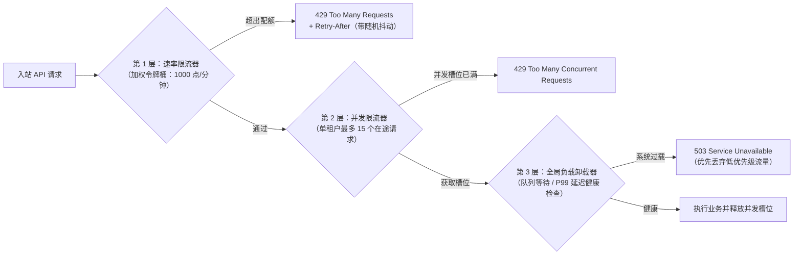

# 限流与 API 管理

## 这是什么？

限流是控制客户端在一定时间内能向你的 API 发多少请求。API 管理是更广泛的学科——设计、发布、保护和监控 API，包括内部 API 和对外暴露给开发者的 API。它们一起保护你的系统免受滥用，确保公平使用，并把你的 API 变成一个别人可以可靠使用的产品。

## 为什么要懂？

没有限流，一个行为异常的客户端（或攻击者）就能拖垮你的整个服务。一个爬虫在抓你的数据、客户端代码的 bug 在循环发请求、或者 DDoS 攻击——都会打你的 API。限流是第一道防线。除了防护，如果你的公司把 API 作为产品（像 Stripe、OpenAI），你还需要完善的 API 管理：文档、认证、版本控制、按套餐的限流和用量追踪。

## 业务流程

### 限流流程

1. 客户端发请求到你的 API
2. 限流器检查：这个客户端在当前时间窗口内发了多少请求？
3. 没超限 → 正常处理请求
4. 超限了 → 返回 `429 Too Many Requests` 加一个 `Retry-After` 头
5. 客户端应该尊重 `Retry-After` 头并减速

### 限流响应头

API 通常在响应头中返回限流信息：

```
X-RateLimit-Limit: 100        // 每个窗口最大请求数
X-RateLimit-Remaining: 73     // 当前窗口剩余请求数
X-RateLimit-Reset: 1709312400 // 窗口重置时间（Unix 时间戳）
```

这让客户端能主动管理请求速率，而不是撞墙了才知道。

### API Key 管理

1. 开发者注册你的 API → 获得 API Key
2. 每个请求都带上 API Key（在 Header 或查询参数里）
3. 你的服务器通过 Key 识别客户端，应用对应的限流规则
4. Key 可以被撤销、轮换或限制到特定端点
5. 按 Key 追踪用量，用于计费和监控

### API 版本控制

API 会演化。你需要在不破坏现有客户端的情况下改端点：

1. **URL 版本化**：`/v1/users`、`/v2/users` — 最常见、最直观
2. **Header 版本化**：`Accept: application/vnd.yourapi.v2+json` — URL 更干净
3. **查询参数**：`/users?version=2` — 简单但不太规范

发布 `v2` 时：

- `v1` 继续工作（有弃用期，通常 6-12 个月）
- 新功能只加到 `v2`
- 清晰地沟通迁移时间线

## 常见术语

| 术语                      | 解释                                                               |
| ------------------------- | ------------------------------------------------------------------ |
| **限流**                  | 在时间窗口内允许的最大请求数                                       |
| **节流**                  | 降慢请求而不是直接拒绝                                             |
| **429 Too Many Requests** | 超过限流时返回的 HTTP 状态码                                       |
| **API 网关**              | 在你 API 前面的代理，处理认证、限流、路由（Kong、AWS API Gateway） |
| **API Key**               | API 消费者的唯一标识                                               |
| **配额**                  | 更广泛的使用限制（如每月 10,000 次 API 调用、1GB 存储）            |
| **突发限制**              | 短期限制（如每秒 10 个请求）vs 持续限制（每小时 1,000 个）         |
| **令牌桶**                | 一种限流算法：令牌以固定速率添加，每个请求消耗一个令牌             |
| **滑动窗口**              | 考虑滚动时间窗口而不是固定间隔的限流方式                           |
| **DDoS**                  | 分布式拒绝服务——用大量请求淹没你的 API 使其瘫痪                    |
| **WAF**                   | Web 应用防火墙——在恶意流量到达你的 API 之前过滤它                  |
| **API 版本化**            | 同时维护多个 API 版本                                              |
| **弃用**                  | 宣布某个 API 版本将被移除，给客户端迁移时间                        |
| **SLA**                   | 服务等级协议——保证的正常运行时间和性能（如 99.9%）                 |
| **按计算成本限流**        | 按查询/计算复杂度扣减点数（如 GraphQL 查询复杂度、LLM Token 数量） |
| **并发限流器**            | 限制客户端**同一时刻正在处理中（In-Flight）**的最大请求数          |
| **负载卸载（Load Shedding）** | 当服务器 CPU 或延迟超过危险水位时，主动以 `503` 丢弃低优先级流量 |
| **GCRA 算法**             | 通用信元速率算法——仅需存储单个时间戳的高效令牌桶/漏桶实现          |
| **密钥轮换（Key Rotation）** | 通过新旧双 Key 并存的宽限期窗口，实现零停机更换 API 密钥        |

## 常见模式

### 模式一：固定窗口

在固定时间窗口内计算请求数（如每分钟 100 个请求，每分钟边界重置）。

**适用场景：** 最简单的实现。对大多数情况够用。

**取舍：** 突发问题——客户端可能在 11:59:59 发 100 个请求，12:00:00 又发 100 个（2 秒内 200 个请求）。

### 模式二：滑动窗口

用滚动时间窗口代替固定边界。缓解突发问题。

**适用场景：** 需要更一致的限流执行时。

**取舍：** 实现稍微复杂。使用更多内存。

### 模式三：令牌桶

令牌以固定速率添加到桶中。每个请求消耗一个令牌。桶空了就拒绝请求。允许短时突发同时控制平均速率。

**适用场景：** 大多数生产级限流器。允许突发到桶容量。

**取舍：** 最灵活但要管理更多状态。

### 模式四：分级限流

不同套餐不同限流：

```
免费版：    100 次/小时
专业版：    1,000 次/小时
企业版：    10,000 次/小时
```

**适用场景：** API 即产品的业务（Stripe、OpenAI）。

**取舍：** 需要按客户追踪用量来计费。升级路径要清晰。

## 踩坑提醒

- **按什么限流？**：按 API Key？按 IP 地址？按用户 ID？各有不同影响。IP 限流可能影响 NAT 后面的多个用户。Key 限流抓不住未认证的滥用。
- **别限流健康检查**：监控系统频繁请求你的健康端点。把它排除在限流之外。
- **优雅降级**：与其在限额时硬拒绝，考虑先降低服务质量（返回缓存数据、减少响应详情），然后再切断。
- **Webhook 不理你的限流**：如果第三方突然给你发 10,000 个 Webhook，你的 Webhook 端点需要自己的保护。用队列缓冲入站 Webhook。
- **客户端重试风暴**：如果你的 API 返回 429 然后很多客户端同时重试，你就遭遇了"雷群效应"。在 `Retry-After` 值中加入随机抖动。
- **内部 API 也要限流**：即使是内部服务也应该有限流。服务 A 的 bug 不应该能压垮服务 B。
- **分布式限流**：如果你的 API 跑在多台服务器上，限流需要共享（通常通过 Redis）。每台服务器单独限流不准确。
- **文档是产品的一部分**：如果开发者看不懂你的 API 文档，他们就不会用。投入精力写清楚的示例、错误说明和快速入门指南。

## 行业实战经验与非显而易见的最佳实践

### 1. 按计算成本 / Token 预算限流 vs. 简单请求计数（以及企业 NAT 共享 IP 陷阱）

在真实生产环境中，把每个 HTTP 请求都一视同仁记为 `cost = 1`（例如"每分钟 100 次请求"）会因为两个原因彻底失效：

1. **请求算力成本极度不对称**：`GET /api/v1/users/123` 是一次 0.5ms 的主键查询（`cost = 1`），而 `POST /api/v1/reports/export` 需要扫描 200 万行数据（`cost = 500`），一个深度嵌套的 GraphQL 查询会触发 80 个 Resolver，一次带 100k 上下文的 LLM `/v1/chat/completions` 调用更会独占数秒的 GPU 算力。在简单的"每分钟 100 次请求"规则下，攻击者或有 bug 的脚本每分钟发 100 个重型导出请求，完全没有触发限流阈值，却已经把你的数据库彻底打挂了。
2. **企业级 NAT / 高校校园网 / 运营商级 NAT（CGNAT）的共享 IP 误伤**：如果你在业务接口上按原始 IP 做严格限流（如单 IP 每分钟 60 次），一家大型企业客户总部（2,000 名员工共用同一个出口网关 IP）或科技大会酒店 Wi-Fi 下的所有用户，会在几秒钟内集体收到 `429 Too Many Requests` 而无法办公。

**最佳实践**：
- **加权计算成本令牌桶（Cost-Based Token Bucket）**：为每个客户端分配每时间窗口的**算力点数预算**（例如 1,000 点/分钟）。按端点静态赋权（`GET /item` = 1 点，`GET /search` = 10 点，`POST /export` = 250 点），或动态计算成本（如在执行前分析 GraphQL AST 节点复杂度，或对大模型接口同时限制 `RPM` 每分钟请求数与 `TPM` 每分钟 Token 数）。在请求执行完毕后，还可以根据实际消耗退还多预扣的点数。
- **复合限流键（Composite Rate-Limit Keys）**：已认证接口绝不要仅按 IP 限流，应按 `tenant_id` 或 `api_key_id` 限流。对于未认证接口（如 `/login` 登录），采用**双层限流**：对 `(ip, username)` 组合施加严格限制（如 10 分钟最多失败 5 次），同时对纯 `ip` 设置宽得多的总上限（如 10 分钟 500 次），防止企业内某一个员工输错密码导致整栋办公楼被封 IP。

### 2. 并发在途请求限流器（Concurrency Limiter）与主动负载卸载（Load Shedding）

基于时间窗口的限流器（如 1,000 次/分钟）**在数据库发生延迟抖动时根本保护不了你的系统**。

设想你的数据库因为锁等待或慢查询，单次查询耗时从 10ms 恶化到了 8,000ms。某个客户端依然按完全合法的 10 次/秒速率发请求（远低于 1,000 次/分钟的限流线），但因为请求迟迟不返回，瞬间就会在服务端堆积 **80 个并发在途（In-Flight）请求**，占满 80 个数据库连接！短短几秒内，单一租户就能耗尽整个 Postgres 连接池（`max_connections = 100`），引发全站级联雪崩。



**生产级防御架构（Stripe / AWS 模式）**：
1. **单租户并发限流器（In-Flight Concurrency Cap）**：使用带短安全 TTL 的 Redis 原子计数器或租约，追踪每个 API Key 当前正在执行中的请求数（例如单租户最多允许 20 个并发在途请求）。请求进入时 `+1`，在 `finally` 块中 `-1`。一旦某个租户的查询卡死，它最多只能占用 20 个工作线程/数据库连接，实现故障舱壁隔离（Bulkhead Pattern）。
2. **基于优先级的主动负载卸载（Priority-Aware Load Shedding）**：当服务器整体 CPU、事件循环延迟或数据库连接池利用率超过 85% 时（可通过基于 Little's Law 的自适应算法监测），在网关层主动以 `503 Service Unavailable` 快速拒绝低优先级流量（埋点上报、后台同步、免费版批量任务），死保核心交易链路（`POST /checkout`、`POST /payments`）存活。

### 3. 零停机双 Key 密钥轮换（Dual-Key Rotation）与细粒度权限作用域（Scoped Tokens）

API Key 的生成、存储和轮换方式，决定了密钥泄露时只是一次普通告警，还是演变成灾难性的数据泄露事故。

#### 绝不在数据库中明文存储 API Key

必须像对待用户密码一样对待 API Secret Key。如果攻击者通过 SQL 注入或备份泄露拖库拿到了你的 `api_keys` 表，明文存储的 Key 会让他们立即冒充所有企业客户。
- **前缀 + 哈希模式（GitHub / Stripe / Slack 标准实践）**：将密钥设计为"可读前缀 + 密钥 ID + 随机密钥 + 校验和"格式，例如 `sk_live_7f9a2b_98xK2mP4qR7vL1nZ...`。
  - 固定前缀（`sk_live_`、`sk_test_`）让 GitHub Secret Scanning 和本地 pre-commit 钩子能通过正则瞬间识别误提交到代码仓库的密钥。
  - 数据库中仅存储 `key_prefix`（`sk_live_7f9a2b`）和完整密钥的 `SHA-256`（或 HMAC-SHA256）哈希值。完整密钥仅在创建成功的那一次向开发者展示。

#### 零停机双活密钥轮换（Rolling Key Rotation）

在生产环境中，如果客户需要轮换疑似泄露或即将过期的 API Key，若在生成新 Key 的瞬间立刻作废旧 Key，客户尚未完成滚动发布的服务端实例会立刻大面积报错停机。

```
零停机密钥轮换时间线：
1. 旧密钥 Key A 正在生产环境运行。
2. 客户在控制台点击"轮换密钥（Roll Key，设置 24 小时宽限期）"：
   - 服务端生成新密钥 Key B（立即生效）。
   - 服务端将 Key A 的过期时间设为 `expires_at = NOW() + 24 小时`（此时 Key A 与 Key B 同时有效！）。
3. 客户将 Key B 灰度部署到所有服务器集群，并在监控面板确认 Key A 的调用量降为 0。
4. 客户点击"立即作废 Key A"（或等待 24 小时倒计时结束后自动作废）。
```

#### 细粒度权限作用域（Scoped Fine-Grained Tokens）

永远不要只给账户签发一把拥有全站最高权限的"万能钥匙"。应允许客户创建多把独立的 API Key 并绑定：
- **资源与操作作用域（Scopes）**：如 `orders:read`、`payments:write`、`webhooks:manage`（确保嵌入在数据分析脚本里的只读 Key 即使泄露也无法发起退款）。
- **环境严格隔离**：严格区分测试沙箱密钥 `sk_test_...` 与生产密钥 `sk_live_...`。
- **可选 IP 白名单**：支持企业客户将高权限 Key 绑定到固定的服务器出口 CIDR 网段（如 `203.0.113.0/24`）。

## 速查表

| 场景               | 限流与防护策略                                                    |
| ------------------ | ----------------------------------------------------------------- |
| 公开 / 合作伙伴 API | 按计算成本的加权令牌桶 + 单租户并发在途请求上限                   |
| LLM / AI 接口      | 双桶限流：`RPM`（每分钟请求数）+ `TPM`（每分钟 Token 数）+ 并发上限 |
| 登录 / 认证端点    | 双层限流：按 `(IP, 用户名)` 严格限制 + 按纯 IP 宽松上限（防 NAT 误伤） |
| Webhook 接收端     | 快速返回 `202 Accepted` → 持久化消息队列（SQS/Kafka）→ 限速消费   |
| 数据库慢查询保护   | 单租户在途并发上限（舱壁隔离）+ 基于优先级的 `503` 负载卸载       |
| API Key 存储与轮换 | 前缀（`sk_live_`）+ 数据库存 SHA-256 哈希 + 轮换时新旧双 Key 宽限期 |

| 算法 / 限流器 | 适用场景                                     |
| ------------- | -------------------------------------------- |
| 固定窗口      | 简单内部计数器、粗粒度的每小时/每日配额      |
| 滑动窗口      | 消除边界双倍突发的平滑限流                   |
| 令牌桶 / GCRA | 允许短时突发、控制平均速率并支持按点数的加权扣费 |
| 并发限流器    | 保护数据库连接池与工作线程池不被慢查询拖垮   |
