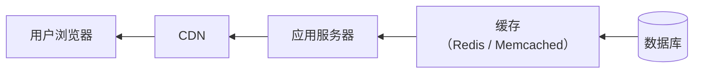
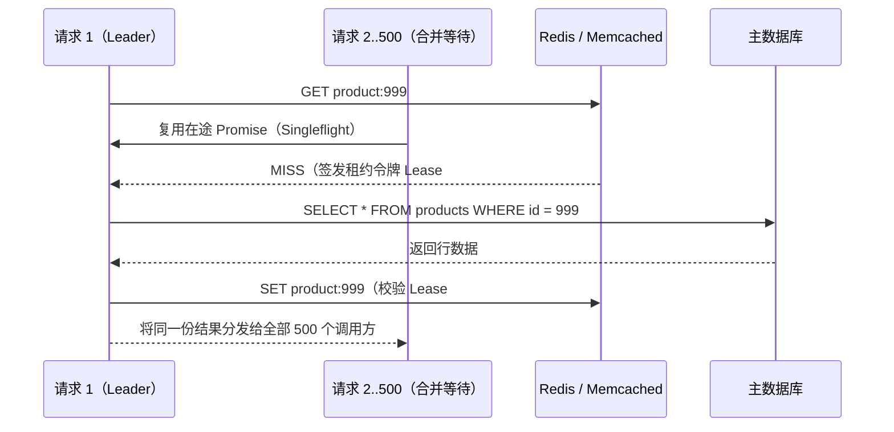

# 缓存策略

## 这是什么？

缓存是把数据的副本存在更快的位置，这样就不用每次都去原始来源取。数据库查询不用每个请求都跑，浏览器不用每次加载页面都重新下载图片。缓存存在于 Web 应用的每一层——浏览器、CDN、应用服务器、数据库。它是让东西变快的最有效方式。

## 为什么要懂？

缓存能把一个 500ms 的数据库查询变成 1ms 的缓存命中。能把昂贵的 API 调用变成瞬间获取数据。能减少 90% 的服务器负载。但缓存做错了会造成让人抓狂的 bug——过期数据、不一致、缓存雪崩，还有经典的"你试过清缓存吗？"。作为开发者，理解什么时候缓存、缓存什么、怎么失效是基本功。

## 业务流程

### 缓存层级



每一层都更快、离用户更近。数据从后往前流（从数据库到用户），缓存在每一步都会发生。

### 浏览器缓存

1. 用户请求页面。服务器响应页面 + 缓存头
2. 浏览器把响应存在本地
3. 下次用户访问，浏览器检查："我缓存的版本还有效吗？"
4. 有效 → 用缓存版本（瞬间，无网络请求）
5. 过期了 → 重新从服务器请求

通过 HTTP 头控制：

- `Cache-Control: max-age=3600` — 缓存 1 小时
- `Cache-Control: no-cache` — 用缓存前先问服务器
- `Cache-Control: no-store` — 永远不缓存（用于敏感数据）
- `ETag` — 内容的指纹。服务器可以说"没变，用你的缓存"

### CDN 缓存

1. CDN 在全球有服务器（边缘节点）
2. 首次请求：CDN 从你的源站获取，存一份副本
3. 之后附近用户的请求：从 CDN 边缘提供（快，不打源站）
4. CDN 遵守你的 `Cache-Control` 头或有自己的 TTL 设置
5. 内容更新时：清除 CDN 缓存或等 TTL 过期

### 应用缓存（Redis/Memcached）

1. 应用需要数据（如用户资料）
2. 先查缓存：`cache.get("user:123")`
3. **缓存命中**：缓存中找到数据 → 立即返回
4. **缓存未命中**：缓存中没有 → 查数据库 → 存入缓存 → 返回
5. 缓存条目有 TTL（存活时间）——自动过期

## 常见术语

| 术语                | 解释                                                 |
| ------------------- | ---------------------------------------------------- |
| **缓存命中**        | 请求的数据在缓存中找到了。快                         |
| **缓存未命中**      | 数据不在缓存中。必须从源头取。慢                     |
| **命中率**          | 从缓存提供服务的请求百分比。越高越好（目标 90%+）    |
| **TTL（存活时间）** | 缓存数据在过期前的有效时长                           |
| **缓存失效**        | 当源数据变了，移除或更新缓存数据。"CS 中最难的问题"  |
| **过期数据**        | 缓存数据已经不是最新的了。源已经变了但缓存还没更新   |
| **Cache-Through**   | 应用从缓存读；未命中时，缓存从源获取并存储           |
| **Write-Through**   | 每次写同时写缓存和源                                 |
| **Write-Behind**    | 先写缓存，异步同步到源（有风险——数据可能丢失）       |
| **缓存雪崩**        | 热门缓存条目过期，数百请求同时打到数据库             |
| **缓存预热**        | 预加载预计需要的数据到缓存（流量高峰前、部署时）     |
| **淘汰策略**        | 缓存满了时决定移除什么（LRU、LFU、FIFO）             |
| **LRU**             | 最近最少使用——淘汰最久没被访问的数据。最常见的策略   |
| **Redis**           | 常用于应用缓存的内存数据存储                         |
| **CDN**             | 内容分发网络——在全球边缘节点缓存静态和有时动态的内容 |
| **Singleflight（请求合并）** | 将针对同一缓存键的多个并发未命中请求合并为单次数据库查询 |
| **缓存穿透**        | 恶意或异常请求持续查询数据库中根本不存在的 ID，绕过缓存直接打穿数据库 |
| **缓存击穿**        | 某个极热点 Key 过期的瞬间，海量并发请求同时未命中并瞬间压垮数据库 |
| **负缓存（Negative Cache）** | 将查询结果为空（`null` / `404`）的结论也以短 TTL 写入缓存 |
| **租约令牌（Lease Token）** | 缓存未命中时签发的单调递增令牌，防止慢读取线程把旧数据回写覆盖新缓存 |
| **CDC 变更捕获失效** | 通过监听数据库 Binlog/WAL（如 Debezium）异步可靠地驱动缓存失效 |

## 常见模式

### 模式一：Cache-Aside（懒加载）

应用先查缓存。未命中时从数据库取并存入缓存。

```
读取：
1. 查缓存 → 命中？返回。
2. 未命中 → 查数据库 → 存入缓存 → 返回。

写入：
1. 更新数据库 → 删除缓存（或更新缓存）。
```

**适用场景：** 最常见的缓存模式。适用于任何读多的场景。

**取舍：** 过期后的首次请求慢（缓存未命中）。写入和缓存失效之间可能有过期数据的风险。

### 模式二：Write-Through

每次写入同时更新缓存和数据库。

**适用场景：** 需要缓存和数据库始终一致时。

**取舍：** 写入更慢（两次写入）。但读取始终是新鲜的。

### 模式三：Stale-While-Revalidate

立即提供过期数据，然后在后台刷新缓存。

```
Cache-Control: max-age=60, stale-while-revalidate=300
```

意思是："缓存 60 秒。60 秒后，提供过期数据同时后台获取新数据。300 秒后，必须先验证再提供。"

**适用场景：** 应该快但最终一致的内容（新闻流、仪表盘、商品列表）。

**取舍：** 用户可能看到稍微过时的数据。但没有加载延迟。

## 踩坑提醒

- **缓存失效真的很难**：Phil Karlton 说过"计算机科学中只有两个难题：缓存失效和命名。"源数据变了，你必须更新或移除所有缓存副本。漏了一个就是过期数据。
- **缓存雪崩**：一个热门缓存键过期 → 1000 个并发请求全部未命中 → 1000 个数据库查询同时发出 → 数据库崩了。解决方案：用锁（只一个请求查数据库，其他等）或 stale-while-revalidate。
- **缓存键设计**：烂的键导致低命中率。包含所有相关参数：`user:123:profile:v2` 而不只是 `user`。但也别太具体以至于什么都匹配不到。
- **缓存错误响应**：如果数据库查询失败了你缓存了错误响应，后续每个请求都拿到缓存的错误。不要缓存失败。
- **内存限制**：缓存内存有限。如果你缓存所有东西，缓存会淘汰重要的条目。有选择地缓存——热数据、昂贵查询、频繁读取。
- **序列化开销**：在 Redis 中存储复杂对象需要序列化（JSON、MessagePack）。大对象的序列化/反序列化可能比直接查数据库还慢。
- **多区域缓存**：如果你的应用跑在多个区域，每个区域有自己的缓存。美东的写入不会使欧西的缓存失效。跨区域缓存失效很复杂。

## 行业实战经验与非显而易见的最佳实践

### 1. Singleflight（请求合并）与租约令牌（Lease Tokens）防御缓存击穿

当某个极高并发的热点 Key（例如顶流明星资料或秒杀商品库存）在 10,000 QPS 下恰好过期或被失效时，10,000 个请求会同时遭遇**缓存未命中（Cache Miss）**，并在同一毫秒内向数据库发起 10,000 条完全相同的慢 SQL 查询——这就是经典的**缓存击穿 / 惊群效应（Cache Stampede / Thundering Herd）**。

工业界通过两项互补机制彻底解决该问题：

1. **进程内 Singleflight（请求合并）**：源自 Go 标准扩展库 `golang.org/x/sync/singleflight`（在 Node.js 中可通过按 Key 复用未决 `Promise` 的 Map 实现）。如果同一台应用服务器上有 500 个并发请求同时拉取 `product:999`，且第一个请求已经在查询途中，那么**只有第 1 个请求**会真正去查 Redis/Postgres，其余 499 个请求直接等待同一个 Promise 并共享返回结果。
2. **分布式租约令牌（Lease Tokens —— 源自 Facebook Memcache 论文）**：如果慢读取线程 A 在 $t=1$ 缓存未命中去查库，写入线程 B 在 $t=2$ 更新了数据库并删除了缓存，随后慢读取线程 A 在 $t=3$ 才拿到 $t=1$ 的旧数据并执行 `SET` 写回缓存，就会导致缓存被永久污染为脏数据！
   - 当缓存向读取线程 A 返回未命中时，会同时签发一个 10 秒有效期的**租约令牌（Lease Token，如 `#42`）**。
   - 如果写入线程 B 在 $t=2$ 更新数据并删除了缓存，缓存服务端会立即作废该 Key 身上的租约 `#42`。
   - 当慢读取线程 A 在 $t=3$ 携带租约调用 `cas_set(key, staleValue, lease=#42)` 时，缓存发现租约 `#42` 已作废，直接拒绝写入！



此外，在批量预热或写入缓存时务必加上 **TTL 随机抖动（TTL Jitter，如 `baseTTL + random(0, 60s)`）**，防止大促预热的 10 万个 Key 在一小时后的同一秒集体过期引发真·缓存雪崩。

### 2. 负缓存（Negative Caching）与布隆过滤器防御缓存穿透

**缓存穿透（Cache Penetration）**是指客户端持续请求数据库中**根本不存在**的 ID（例如 `GET /api/products/-1` 或爬虫生成的随机 UUID）。由于数据库查不出记录，朴素的 Cache-Aside 模式不会往 Redis 写任何东西，导致 100% 的此类请求全部穿透缓存、直击数据库。

**双层纵深防御：**
1. **负缓存（Negative Caching —— 短 TTL 空值哨兵）**：当数据库查询返回 `null` / `0 行`时，显式地向 Redis 写入一个空值哨兵（如 `"__NULL__"`），并设置较短的 TTL（如 `30–120 秒`）。后续针对该不存在 ID 的重复请求都会在 Redis 层命中并在 0.5ms 内直接返回 `404 Not Found`。设置短 TTL 是为了保证如果 1 分钟后该记录被真正创建，缓存能快速自愈。
2. **边缘布隆过滤器（Bloom Filter / Cuckoo Filter）**：如果攻击者每次请求都换一个全新的随机 UUID 怎么办？由于每个随机 ID 只查一次，负缓存命中率为 0。此时应在内存或 Redis 中维护一个紧凑的**布隆过滤器**，纳入所有合法存在的实体 ID（1,000 万个 ID 在 1% 误判率下仅占约 12 MB 内存）。在查 Redis 和数据库之前先调 `bloom.mightContain(id)`——若返回 `false`，说明该 ID 100% 不存在，直接在内存中毫秒级拦截并返回 `404`。

### 3. 多级缓存一致性（L1 + L2 + L3）与 CDC 异步失效机制

高并发系统通常会叠加三级缓存架构：
- **L1（进程内本地缓存，如每个 Node/Go/JVM 实例内的 LRU 内存缓存）**：耗时 ~100ns，零网络与反序列化开销，专门吸收会把单台 Redis 分片网卡打爆的超热点 Key。
- **L2（分布式 Redis / Memcached 集群）**：耗时 ~1ms，所有应用实例共享。
- **L3（CDN 边缘缓存，配合 `stale-while-revalidate`）**：耗时 ~10ms，贴近终端用户运营商。

#### 为什么"先删缓存再更数据库"依然会产生并发脏数据？

在 Cache-Aside 模式中，工程师经常争论写操作时应该先删缓存还是先更新数据库：
- **先删缓存 → 再更新数据库**：在高并发下必出脏数据。线程 A 删除缓存后、数据库事务提交前，线程 B 恰好读未命中，从数据库读出**旧值**并重新写回缓存，导致缓存一直脏到 TTL 过期。
- **先更新数据库 → 再删缓存（Cache-Aside 标准推荐）**：安全得多，但若业务代码里手写双写（`await db.update(); await redis.del()`），一旦第二步 `redis.del()` 因网络抖动失败，缓存同样会无限期滞留旧值。

**生产级强一致解决方案：**
1. **更新数据库 + 基于 CDC（变更数据捕获）的异步失效**：业务代码只管开启事务更新数据库。通过 **Debezium 订阅 Postgres WAL / MySQL Binlog → 发送至 Kafka**，由专门的缓存失效消费者（带无限重试与死信队列）负责删除 L2 Redis 中的 Key，同时通过 **Redis Pub/Sub（或 Redis 6+ Client-Side Caching 广播机制）** 通知所有应用节点清空各自进程内的 L1 本地缓存。
2. **延迟双删（无 CDC 基础设施时的折中方案）**：先删缓存（或先更 DB）→ 更新数据库 → 异步等待 `200–500ms` 后**再次删除缓存**，从而抹掉更新窗口期内可能被并发慢读取线程回写的脏副本。

## 速查表

| 缓存什么                      | 在哪缓存                  | TTL                                       | 失效方式                                          |
| ----------------------------- | ------------------------- | ----------------------------------------- | ------------------------------------------------- |
| 静态资源（CSS、JS、图片）     | CDN + 浏览器              | 长（1 年，`immutable`）                   | 文件名内容哈希（`app.8f9a2.js`）                  |
| 超热点配置 / 元数据           | L1 进程内存 + L2 Redis    | L1: 5–30 秒，L2: 10 分钟                  | Redis Pub/Sub 广播或客户端缓存失效协议            |
| API 响应（读多写少）          | L2 Redis/Memcached        | 5 分钟 - 1 小时（加随机 TTL 抖动）        | 先更 DB 再删缓存（或基于 Binlog/WAL 的 CDC 失效） |
| 不存在的 ID（`404` / 空结果） | L2 Redis（负缓存）        | 短（30 秒 - 2 分钟）                      | 自动过期或实体创建时删除                          |
| 用户 Session                  | Redis                     | Session 时长                              | 登出或修改密码时删除                              |
| HTML / 准静态页面             | CDN 边缘节点              | `s-maxage=60, stale-while-revalidate=600` | 内容发布时按 `Cache-Tag` / `Surrogate-Key` 清除   |

| 典型问题               | 生产级解决方案                                                |
| ---------------------- | ------------------------------------------------------------- |
| 热点 Key 缓存击穿      | Singleflight（进程内请求合并）+ 租约令牌（Lease）+ TTL 抖动   |
| 不存在 ID 的缓存穿透   | 负缓存（缓存 `"__NULL__"` 哨兵 60s）+ 内存布隆过滤器前置拦截  |
| 并发读写导致的脏缓存   | 先更新 DB 再删缓存 + 基于 Debezium CDC 的事务日志异步失效     |
| 单 Redis 分片网卡被打满 | 在 L2 Redis 前置有界 L1 进程内 LRU 缓存（5–15s 短 TTL）       |
| 跨区域多机房缓存不一致 | 跨机房复制 CDC 变更事件流，在各区域本地异步清除 Redis 与 CDN  |
