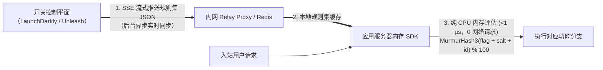

# 功能开关与灰度发布

## 这是什么？

功能开关（也叫 Feature Toggle）是代码中的开关，让你不用部署新代码就能开启或关闭功能。不再一次性把功能推给所有人，而是把代码带着功能开关部署上去，然后逐步启用——先给内部测试人员，然后 Beta 用户，然后 10% 的所有用户，然后所有人。它把"部署代码"和"发布功能"分开，这种分离非常强大。

## 为什么要懂？

没有功能开关，发布新功能意味着部署代码然后祈祷不出事。如果出了事，你得回滚整个部署。有了功能开关，你可以瞬间关闭一个坏掉的功能而不用动部署。你可以在生产环境用真实用户测试、跑 A/B 实验、给企业客户提前体验。Facebook、Netflix、字节跳动就是这样安全地给数十亿用户发布功能的。

## 业务流程

### 基本功能开关

```javascript
if (featureFlags.isEnabled('new-checkout-flow', user)) {
  renderNewCheckout();
} else {
  renderOldCheckout();
}
```

开关判断在运行时发生。开关状态可以在不重新部署的情况下改变。

### 开关生命周期

1. **创建**：开发者为新功能创建一个开关（默认：关闭）
2. **开发**：代码在开关后面写。只有开发者能看到（开发环境开关打开）
3. **内测**：给内部用户/QA 团队开启
4. **Beta / 内测体验**：给一组 Beta 用户开启
5. **灰度发布**：给 5% → 25% → 50% → 100% 的用户开启
6. **全量发布**：所有人都开启。功能完全发布了
7. **清理**：从代码中移除开关。这步经常被遗忘（见踩坑提醒）

### 定向规则

开关不只是开和关。可以针对特定用户或群组：

- **用户 ID**：给用户 "abc123" 开启（QA 测试）
- **邮箱域名**：给 `@yourcompany.com` 开启（内部测试）
- **国家**：先给加拿大用户开启（区域发布）
- **套餐等级**：只给企业版客户开启
- **百分比**：给 10% 的所有用户开启（随机但每个用户固定）
- **自定义属性**：给 2026 年 1 月之后注册的用户开启

### 用开关做 A/B 测试

1. 创建一个多变体的开关（不只是开/关）
2. 变体 A：当前设计。变体 B：新设计
3. 用户被随机分配到一个变体（而且一直在这个变体——"粘性分桶"）
4. 追踪你关心的指标（转化率、互动、收入）
5. 达到统计显著性后，选出赢家推给 100%

### 紧急关停

功能开关最基本的用途——给出问题的功能一个紧急关闭按钮。

1. 功能上线正常运行
2. 出了问题（性能问题、bug、第三方依赖故障）
3. 值班工程师在功能开关面板中把开关关掉
4. 功能对所有用户瞬间禁用
5. 不需要部署。事故在几秒内解决。

## 常见术语

| 术语                          | 解释                                                      |
| ----------------------------- | --------------------------------------------------------- |
| **功能开关 / Feature Toggle** | 控制功能可见性的条件开关                                  |
| **开关判断**                  | 判断某个开关对特定用户/请求是开还是关的过程               |
| **定向规则**                  | 决定谁看到功能的条件（用户 ID、百分比、属性）             |
| **灰度发布**                  | 逐步增加看到功能的用户百分比                              |
| **金丝雀发布**                | 先给极小百分比发布，监控，再扩大                          |
| **紧急关停**                  | 不用部署就能在生产环境瞬间禁用功能                        |
| **变体**                      | 一个开关中的多个选项（对照组、变体 A、变体 B）            |
| **粘性分桶**                  | 确保用户一旦被分配就一直看到同一个变体                    |
| **开关债务**                  | 代码中遗留的旧的、未使用的开关。必须清理的技术债          |
| **暗发布**                    | 把功能部署到生产但不展示给用户（后端处理在进行，UI 隐藏） |
| **百分比灰度**                | 给 X% 用户启用功能，逐步增加                              |
| **功能门控**                  | 控制功能访问的开关（通常和套餐或权限挂钩）                |
| **本地评估 SDK**              | 将完整规则集缓存在服务端内存中、以 `< 1 µs` 零网络开销完成判断的 SDK |
| **一致性哈希分桶**            | 通过确定性哈希（`MurmurHash3(flag + salt + id) % 100`）保证分桶粘性 |
| **分桶键（Bucketing Key）**   | 参与灰度哈希计算的标识（C 端用 `user_id`，B 端用 `organization_id`） |
| **中继代理（Relay Proxy）**   | 部署在内网的规则缓存代理，防止外部开关 SaaS 故障影响业务实例启动 |
| **僵尸开关（Zombie Flag）**   | 已全量或废弃却未从代码中清理的遗留开关，导致测试组合爆炸与事故隐患 |

## 常见模式

### 模式一：布尔开关（简单开/关）

最简单的开关。功能要么启用要么禁用。

**适用场景：** 紧急关停、功能发布、隐藏未完成的功能。

**取舍：** 没有细粒度。不能针对特定用户或做实验。

### 模式二：百分比灰度

给 X% 的用户启用。逐步增加。

```
第 1 天：5%（监控指标）
第 3 天：25%（还行）
第 5 天：50%
第 7 天：100%（全量发布）
```

**适用场景：** 任何有风险的功能发布。减小 bug 的爆炸半径。

**取舍：** 需要一致性哈希，保证用户不会在看到和看不到功能之间来回跳。

### 模式三：用户分群定向

按用户属性（套餐、国家、角色、注册日期）启用。

**适用场景：** Beta 计划、企业专属功能、区域发布。

**取舍：** 定向规则更复杂。需要在判断时有最新的用户属性。

### 模式四：多变体开关（A/B/C 测试）

开关有多个变体，不只是开/关。用于实验。

**适用场景：** 测试不同设计、定价、文案、算法。

**取舍：** 需要实验追踪基础设施和统计分析。

## 踩坑提醒

- **开关清理很重要**：每加一个开关就是技术债。全量发布后设提醒来移除开关。公司会积累几百个死开关，让代码越来越难读难维护。
- **测试所有路径**：5 个活跃开关就有 32 种组合。测试变成指数级。减少活跃开关数量，测试最重要的组合。
- **服务端 vs 客户端判断**：服务端判断更安全（用户看不到也改不了开关值）。客户端判断更快（不用请求服务端），但暴露了开关配置。
- **开关依赖链**：开关 A 启用的功能依赖开关 B 也打开。记录依赖关系并测试。
- **数据库迁移和开关**：你可以给代码加开关，但不能轻松给数据库 Schema 变更加开关。数据库变更要兼容开关的两种状态。
- **一致的体验**：如果用户周一看到新结账（开关开了），周二看到旧结账（维护时关了），会很困惑。开关状态的变更要深思熟虑。
- **开关服务宕机**：如果你的功能开关服务（LaunchDarkly、Split）挂了怎么办？你的应用必须有合理的默认值。大多数 SDK 会在本地缓存开关值。
- **权限 vs 开关**：不要用功能开关当永久的授权系统。开关是临时的。长期的访问控制用正经的 RBAC。

## 行业实战经验与非显而易见的最佳实践

### 1. 本地规则评估 SDK（零网络跳数架构）

很多初学者的误区是：以为每次调用 `featureFlags.isEnabled('new-checkout', user)` 都会向 LaunchDarkly、Unleash 或配置中心发起一次实时 HTTP 请求。如果一个 API 请求内部要判断 15 个功能开关，每次耗时 20ms 网络往返，接口延迟就会凭空增加 300ms——更可怕的是，一旦开关服务商宕机，你的整个核心业务就会陪葬。

**生产级服务端 SDK 的真实工作机制：**
1. **流式规则集同步（Streaming Ruleset Sync）**：应用服务器启动时，服务端 SDK 会将所有活跃开关的**完整规则集 JSON**（例如 `"当 user.plan == 'enterprise' 或 murmurhash3(user.id) < 25% 时返回 true"`）拉取到进程内存中，并通过长连接 **SSE（Server-Sent Events）** 实时接收增量变更推送。
2. **亚微秒级纯内存计算**：当用户请求到达时，`isEnabled('new-checkout', userContext)` 只是拿着内存里的规则树做一次纯 CPU 计算，耗时 **`< 1 微秒（µs）`**，**网络 I/O 为 0**。
3. **内网中继代理（Relay Proxy）与持久化兜底**：为了应对 Serverless 函数冷启动或防止外部开关 SaaS 宕机时新扩容的 Kubernetes Pod 拉不到初始配置，大型架构会在内网部署基于 Redis 的 **Relay Proxy**。即使外部云服务彻底断网，新启动的容器依然能从内网 Redis 秒级加载规则集，并在极端情况下回退到代码中显式声明的安全默认值。



*（注：浏览器/移动端等客户端 SDK 机制完全不同——为了防止把未公开的客户邮箱名单或内部规则暴露在浏览器 DevTools 中，客户端 SDK 在会话初始化时将当前用户信息发给评估节点，只拉取计算好的布尔结果列表。）*

### 2. B2B 多租户一致性分桶（按 `organization_id` 而非 `user_id` 哈希）

在 C 端消费级应用中，百分比灰度通常对 `user_id` 做一致性哈希：
$$\text{bucket} = \text{MurmurHash3}(\text{flag\_key} + \text{salt} + \text{user\_id}) \bmod 10000$$

但如果你在 **B2B 企业级 SaaS 应用**（如飞书、钉钉、Notion、Jira、Figma）中上线一套新的协作流程或账单界面，并盲目按 `user_id` 开启 20% 灰度，就会引发灾难：
- 在同一家客户公司（如 `Acme Corp`）内部，员工 **Alice**（`bucket = 1400`，`< 20%`）命中了灰度，看到了**新版审批流 v2** 并创建了 v2 格式的单据。
- 坐在她工位旁边的同事 **Bob**（`bucket = 8200`，`>= 20%`）未命中灰度，停留在**旧版审批流 v1**——他不仅打不开 Alice 发来的文档，在投屏开会时两人看到的界面完全不同，甚至在保存设置时互相覆盖搞坏整个企业工作区的共享数据！

**最佳实践：**
- 在多租户 B2B 产品中，凡是涉及共享数据模型、团队协作工作流或企业级 UI 的功能开关，其**分桶键（Bucketing Key / `by` 属性）必须设为 `organization_id` / `tenant_id` / `workspace_id`**，绝不能用 `user_id`。
- 哈希计算必须拼入每个开关独立的随机盐值（`salt`），确保命中 `flag_A` 的前 5% 租户与命中 `flag_B` 的前 5% 租户是独立打散的，避免多个并行实验集中叠加在同一批"小白鼠"客户身上造成样本偏差。

### 3. 开关技术债、"僵尸开关"生产事故与 AST 自动清理

2012 年，华尔街高频交易巨头 **Knight Capital（骑士资本）** 在 **45 分钟内巨亏 4.6 亿美元**并直接破产。事故根源正是工程师在部署新功能时，复用了代码库中一个遗留了 **8 年未删的废弃功能开关（`Power Peg`）**，而集群中有一台服务器漏更了新代码，导致这个开关意外唤醒了 8 年前早已废弃的测试下单死代码，每秒向市场疯狂发送数千笔错误订单。

将已 100% 全量或已放弃的**僵尸开关（Zombie Flags）**留在代码库中会带来两大致命隐患：
1. **测试组合指数级爆炸**：模块中每增加 $N$ 个布尔开关，就会产生 $2^N$ 条执行路径（仅 10 个开关就有 $1,024$ 种状态组合）。CI 单元测试和端到端测试通常只测"全开"或"全关"，导致混合开关状态成为测试盲区。
2. **旧分支被意外唤醒**：如果某天配置中心重置、或者代码里的兜底默认值还是两年前写的 `default = false`（实际上生产环境已经开了两年 `true`），一旦配置拉取失败回退到默认值，系统会瞬间切回两年前早已与当前数据库表结构不兼容的废弃代码分支！

**生产级治理规范：**
- **按生命周期严格分类**：
  - **发布 / 实验开关（临时开关，TTL：14–30 天）**：创建时必须强制绑定负责人（Owner）和过期时间。全量 100% 稳定运行 7 天后，由 CI 机器人自动发提醒或生成清理 PR。
  - **运维熔断开关 / 降级开关（永久 Kill Switch）**：显式标记为永久运维开关；代码中的默认回退值**必须**对应正常健康的生产状态，且 CI 自动化测试必须在每次构建时同时覆盖其 `ON` 和 `OFF` 两个分支。
- **基于 AST 的死代码自动清理**：大厂（如 Uber 开源的 `Piranha`，或基于 `ts-morph` / Babel Codemod 的脚本）会在开关全量后自动扫描抽象语法树（AST），删掉 `if (flags.isEnabled('rolled-out-flag'))` 判断外壳并只保留胜出的代码分支。

## 速查表

| 业务场景               | 开关类型与分桶键                         | 举例                                                    |
| ---------------------- | ---------------------------------------- | ------------------------------------------------------- |
| 主干开发隐藏未完成代码 | 临时发布开关（布尔：关）                 | `new-dashboard: false`（设置 30 天过期清理 SLA）        |
| C 端功能安全渐进发布   | 百分比灰度（按 `user_id` 分桶）          | `new-player: 5% → 25% → 100%`                           |
| B2B SaaS 团队功能灰度  | 百分比灰度（按 `organization_id` 分桶）  | `team-approval-v2: 10% 企业工作区`                      |
| 企业客户 Beta 内测     | 分群规则定向                             | `ai-copilot: org.plan == 'enterprise' OR org.beta`      |
| A/B 增长实验           | 多变体（按 `user_id` + 独立随机 Salt）   | `checkout-cta: [control: 50%, var-a: 25%, var-b: 25%]`  |
| 非核心子系统故障熔断   | 永久运维紧急关停（Kill Switch）          | 数据库压力飙升时 `enable-recommendations: true → false` |

| 工具                  | 类型            | 说明                                                 |
| --------------------- | --------------- | ---------------------------------------------------- |
| LaunchDarkly          | SaaS            | 行业标杆，支持 SSE 流式同步与 Relay Proxy，价格较贵  |
| OpenFeature           | CNCF 标准规范   | 供应商中立的统一 SDK 接口标准，方便无痛切换底层平台  |
| Unleash / Flagsmith   | 开源 / SaaS     | 支持私有化自托管，服务端 SDK 原生支持本地内存评估    |
| PostHog               | SaaS + 自托管   | 将功能开关、会话录屏（Session Replay）与产品分析合一 |
| 自建（Redis + SSE）   | DIY             | 适合轻量级熔断开关与租户白名单控制                   |
