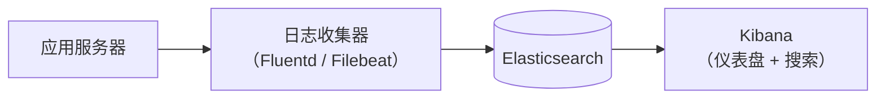
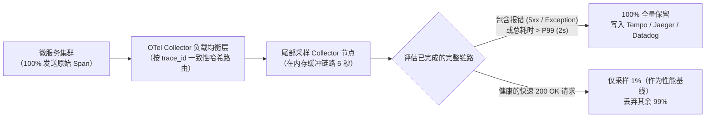

# 日志与监控

## 这是什么？

日志是记录你的应用做了什么——每个处理的请求、每个抛出的错误、每个重要的操作。监控是实时观察这些日志和指标，在用户发现问题之前检测到问题。它们是你在生产环境的眼睛和耳朵。凌晨 3 点出了故障，日志告诉你发生了什么，监控是叫醒你去修的那个人。

## 为什么要懂？

你不能在生产环境挂调试器。你不能让用户在他们的电脑上复现问题。你有的只是日志和指标。如果你的日志太少、太吵、或没有结构，你就是在盲飞。如果你的监控没有告警，你只有等用户投诉才能发现问题。作为开发者，你的日志质量直接决定了你诊断和修复生产问题的速度。

## 业务流程

### 应用日志

你的应用为重要事件写日志条目：

```
[2026-03-01T10:30:15Z] INFO  request_id=abc123 method=POST path=/api/orders status=201 duration_ms=145 user_id=user456
[2026-03-01T10:30:16Z] ERROR request_id=def789 method=POST path=/api/payments error="卡被拒绝" user_id=user456 payment_id=pay_xyz
[2026-03-01T10:30:17Z] WARN  request_id=ghi012 message="接近限流" client_id=client_a remaining=5
```

### 日志级别

| 级别      | 什么时候用                   | 举例                                         |
| --------- | ---------------------------- | -------------------------------------------- |
| **ERROR** | 不该失败的东西失败了         | 支付处理失败、数据库连接断了                 |
| **WARN**  | 不寻常的东西，可能会变成问题 | 接近限流、磁盘空间不足                       |
| **INFO**  | 值得记录的正常操作           | 用户注册了、订单下了、部署完成               |
| **DEBUG** | 排查问题用的详细信息         | SQL 查询执行、缓存命中/未命中、请求/响应载荷 |

生产环境通常记录 INFO 及以上。DEBUG 在生产中太啰嗦，但排查问题时非常有价值。

### 结构化日志

没用的日志和有用的日志的区别：

```
// 没用：非结构化
"处理用户支付时出错"

// 有用：结构化
{
  "level": "error",
  "message": "支付处理失败",
  "user_id": "user456",
  "payment_id": "pay_xyz",
  "amount": 4999,
  "error": "卡被拒绝",
  "error_code": "card_declined",
  "timestamp": "2026-03-01T10:30:16Z",
  "request_id": "def789"
}
```

结构化日志（JSON）可以搜索、过滤和聚合。非结构化文本日志只能 grep。

### 指标

日志记录单个事件，指标追踪随时间的聚合度量：

- **请求速率**：500 次/秒（这正常还是流量突增？）
- **错误率**：0.5% 的请求返回错误（这在上升吗？）
- **延迟**：P50 = 100ms、P95 = 500ms、P99 = 2000ms（变慢了吗？）
- **资源使用**：CPU 70%、内存 4GB、磁盘 80%
- **业务指标**：每小时注册数、每分钟订单数、每日收入

### 告警

监控没有告警就是看仪表盘然后希望有人注意到。告警在指标超过阈值时触发：

1. 定义告警规则："如果错误率 > 5% 持续 5 分钟，通知值班人员"
2. 告警触发 → 发通知（PagerDuty、企业微信、钉钉、短信）
3. 值班工程师确认告警
4. 工程师用日志、指标和链路追踪来排查
5. 问题解决（或升级）
6. 事后复盘：发生了什么、为什么、怎么防止再发生

### 分布式链路追踪

在微服务架构中，一个用户请求可能经过 5+ 个服务。链路追踪跟随请求穿过每个服务：


每个服务把自己的 Span 加到链路中。你可以看到完整的请求旅程，包括时间花在哪里、错误在哪里发生。

## 常见术语

| 术语                | 解释                                                             |
| ------------------- | ---------------------------------------------------------------- |
| **日志聚合**        | 把所有服务器的日志收集到一个可搜索的系统（ELK、Datadog、Splunk） |
| **ELK Stack**       | Elasticsearch + Logstash + Kibana——流行的开源日志栈              |
| **APM**             | 应用性能监控——追踪请求延迟、错误、依赖关系（Datadog、New Relic） |
| **链路追踪**        | 记录请求穿过多个服务的旅程                                       |
| **Span**            | 链路中的单个操作（如"数据库查询耗时 50ms"）                      |
| **P50 / P95 / P99** | 百分位延迟。P99 = 99% 的请求比这个值快                           |
| **SLA**             | 服务等级协议——合同保证（99.9% 可用性）                           |
| **SLO**             | 服务等级目标——内部目标（99.95% 可用性，P99 延迟 < 500ms）        |
| **SLI**             | 服务等级指标——实际测量的指标                                     |
| **错误预算**        | SLO 允许多少停机时间。错误预算耗尽 = 冻结新功能，先修可靠性      |
| **值班**            | 在轮值期间负责响应生产告警的工程师                               |
| **事故**            | 影响用户的生产问题。被正式追踪和复盘                             |
| **事后复盘**        | 事故后的回顾：发生了什么、时间线、根因、行动项。不追责           |
| **MTTD**            | 平均检测时间——多快发现问题                                       |
| **MTTR**            | 平均恢复时间——多快修好问题                                       |
| **仪表盘**          | 关键指标的可视化展示（Grafana、Datadog 仪表盘）                  |
| **Runbook**         | 响应特定告警的分步操作说明                                       |
| **高基数（High Cardinality）** | 指标标签组合产生的唯一时间序列数量失控（如把 `user_id` 放进标签导致 OOM） |
| **Trace Exemplar（链路样本）** | 挂载在指标直方图分桶上的代表性 `trace_id`，支持从延迟曲线一键跳转到具体慢链路 |
| **头部采样（Head Sampling）** | 在请求刚进入网关时决定是否采集链路（如随机采样 1%）             |
| **尾部采样（Tail Sampling）** | 先缓冲 Span，等请求结束时再决策，从而 100% 保留报错与慢请求链路 |
| **燃烧率告警（Burn Rate）** | 基于长短双窗口监控 SLO 错误预算消耗速度的告警机制，消除静态阈值误报 |

## 常见模式

### 模式一：集中式日志（ELK / 云日志）

所有服务把日志发到一个中央系统，可以在那里搜索和分析。



**适用场景：** 超过单台服务器的任何应用。分布式系统必备。

**取舍：** 基础设施成本随日志量增长。设置保留策略来控制成本。

### 模式二：指标 + 告警（Prometheus/Grafana 或 Datadog）

应用暴露指标。监控系统抓取。仪表盘可视化。告警在阈值时触发。


**适用场景：** 每个生产系统都应该有。

**取舍：** 需要定义测量什么和什么阈值重要。太多告警 = 告警疲劳。

### 模式三：可观测性全栈（日志 + 指标 + 链路）

"可观测性三大支柱"协同工作：

- **日志**：发生了什么（详细的事件记录）
- **指标**：系统表现如何（聚合数字）
- **链路**：请求怎么在系统中流动（分布式路径）

**适用场景：** 微服务架构。复杂的分布式系统。

**取舍：** 完整的可观测性栈很贵。按你的规模优先处理重要的。

### 模式四：错误追踪（Sentry / Bugsnag）

专门捕获应用错误的服务，带完整上下文（堆栈追踪、用户、浏览器、请求数据）。

**适用场景：** 每个 Web 应用都应该用。捕获你不知道正在发生的错误。

**取舍：** 可能很吵。把相似错误分组，按影响排优先级。

## 踩坑提醒

- **记太少**："出错了"什么都没告诉你。包含上下文：哪个用户、哪个请求、输入是什么、预期 vs 实际结果是什么。
- **记太多**：在生产中记录每个数据库查询可以产生 TB 级日志，让真正的问题难以找到。用适当的日志级别。
- **日志中的个人信息**：用户邮箱、地址和信用卡号经常意外出现在日志消息中。记录前清洗敏感数据。这也是 GDPR/个保法问题。
- **告警疲劳**：如果你的团队每天收到 50 个告警而大多数是噪声，他们会开始忽略告警。然后真正的事故被错过。积极调优告警阈值。每个告警必须是可行动的。
- **关联 ID**：没有一个在所有服务间流转的请求 ID，你无法把同一个请求在不同服务中的日志关联起来。在入口处生成请求 ID，贯穿传递。
- **日志保留成本**：云日志服务按 GB 收费。高流量应用每天可以产生几百 GB 日志。设保留策略，归档旧日志。
- **大规模采样**：在极高流量下，你无法记录或追踪每个请求。采样（追踪 1% 的请求）来在控制成本的同时仍然捕获问题。
- **没人看的仪表盘**：仪表盘只有有人看才有用。把仪表盘和告警配对。仪表盘是告警触发后用来排查的，不是被动监控用的。
- **缺少业务视角**：技术指标（CPU、内存、延迟）重要，但业务指标更重要。在系统指标旁边追踪注册数、购买数和每用户操作错误数。

## 行业实战经验与非显而易见的最佳实践

### 1. Prometheus / Datadog 高基数指标爆炸（High-Cardinality Explosion）与 Trace Exemplars

后端工程师在可观测性上最昂贵的事故，莫过于把无界的高基数标识符（如 `user_id`、`order_id`、`email`、`ip_address`，或者未归一化的原始 URL 路径 `/users/94812/profile`）塞进 **指标标签（Metric Labels / Tags）** 中：

```javascript
// 灾难级错误：每个独立用户和动态路径都会在 TSDB 内存中新建一条永久时间序列！
httpRequestDuration.labels({
  method: req.method,
  path: req.originalUrl, // "/api/orders/ord_991823" -> 数百万个不同值！
  user_id: req.user.id,  // 200 万独立用户！
}).observe(duration);
```

**为什么这会把 Prometheus 搞到 OOM 崩溃，或在 Datadog 产生 5 万美元的天价账单？**
- 时序数据库（TSDB，如 Prometheus、VictoriaMetrics、Datadog Custom Metrics）会为每一组唯一的标签组合（Label Set）在内存中维护独立的倒排索引和时间序列块：
  $$\text{总时间序列数} = |\text{methods}| \times |\text{status\_codes}| \times |\text{直方图分桶}| \times |\text{paths}| \times |\text{users}|$$
- 哪怕只有 5 种 HTTP 方法 $\times$ 5 种状态码 $\times$ 10 个延迟分桶 $\times$ 10 万活跃用户 = **2,500 万条活跃时间序列（Active Time Series）**！Prometheus 节点会在几分钟内内存溢出（OOM）宕机，而按自定义序列条数计费的云厂商（如每条 `$0.05/月`）更会直接开出数十万美元的惊悚账单。

**最佳实践：**
1. **严格限制指标标签基数**：指标标签只允许放有穷枚举值：`method`（`GET`、`POST`）、**路由模板** `route`（`/api/orders/:id`，绝不能放原始带 ID 的 URL！）、`status_class`（`2xx`、`4xx`、`5xx`）、`region`。单个指标的标签组合总数应控制在 10,000 以内。
2. **使用 OpenTelemetry / Prometheus Trace Exemplars（链路样本）**：如果不把 `user_id` 放进指标标签，看到 P99 延迟毛刺时怎么知道是哪个用户或哪个请求慢？答案是 **Trace Exemplars**！在记录延迟直方图时，顺带把当前请求的 `trace_id="4bf92f3577b34da6"` 作为样本挂载到对应的延迟分桶上。它几乎不增加内存开销，却能让你在 Grafana 的 P99 延迟波峰上直接点击圆点，一键跳转到对应的慢请求链路追踪和带有 `user_id` 的结构化日志。

### 2. 分布式链路追踪中的尾部采样（Tail-Based Sampling）vs. 头部采样（Head-Based Sampling）

在 20,000 QPS 的生产集群中，100% 全量存储所有分布式链路追踪（Traces）的成本甚至超过业务服务器本身。因此必须采样——但**在什么时机做采样决策**，决定了故障发生时你的链路系统到底有没有用：

- **头部采样（Head-Based Sampling —— 在请求入口做决定）**：API 网关在收到请求的第一毫秒掷骰子（例如保留 1%，丢弃 99%），并通过 W3C `traceparent` 请求头向后传递 `sampled=0/1`。
  - *致命缺陷*：在请求刚开始时，你根本不知道这个请求接下来是会在 5ms 内正常返回 `200`，还是会在 10 秒后因为数据库死锁抛出 `500` 错误！如果线上偶发了一个影响 50 笔支付的致命 bug，1% 的头部采样会把 **99% 的故障现场直接丢弃**。
- **尾部采样（Tail-Based Sampling —— 在请求结束时做决定）**：所有微服务先将 Span 发送到中间层的 **OpenTelemetry Collector 集群**（按 `trace_id` 一致性哈希路由到同一节点），在内存中暂存几秒钟直到整条调用链结束，再按规则决策：
  - 整条链路中是否有任何 Span 返回了 `HTTP 5xx`、抛出异常、或总耗时超过 `2000ms`？**100% 全量保留！**
  - 只是一个耗时 15ms、完全健康的普通 `200 OK` 请求？**仅保留 0.5% 作为基线对比，其余 99.5% 直接丢弃。**



### 3. 自动化 PII / 密钥脱敏流水线与多窗口错误预算燃烧率（Burn-Rate）告警

有两个运维陷阱最容易毁掉研发团队的安全合规与睡眠质量：敏感凭据误打进日志，以及静态阈值导致的凌晨 3 点误报轰炸。

#### 在日志序列化边界自动脱敏（PII & Secret Scrubbing）

开发者在排查问题时难免写出 `logger.error("下单失败", { reqBody, headers })`。如果没有自动化脱敏，用户的明文密码、`Authorization: Bearer eyJ...` JWT 令牌、API 密钥、银行卡号和身份证号就会直接写进 Elasticsearch，严重违反《个人信息保护法》、GDPR 和 PCI-DSS。
- **双层纵深脱敏机制**：
  1. **Logger 序列化层字段黑名单（零正则开销）**：在应用日志库中配置路径脱敏（如 Node.js `pino({ redact: ['req.headers.authorization', 'req.headers.cookie', '*.password', '*.token', '*.cvv', '*.idCard'] })`），在 JSON 序列化阶段直接将敏感字段替换为 `[REDACTED]`。
  2. **采集 Agent 层正则清洗（Vector / FluentBit / OTel Collector）**：在日志离开宿主机发往存储端之前，由采集器运行高速正则扫描，兜底拦截意外散落在错误堆栈字符串中的信用卡号、Bearer Token、手机号和邮箱。

#### 多时间窗口、多燃烧率 SLO 告警（Google SRE 标准实践）

像*"当 5xx 错误率 > 1% 持续 5 分钟就电话呼叫值班人员"*这样的传统静态阈值告警有两个严重缺陷：
1. **凌晨低峰期误报**：凌晨 3 点全站每分钟只有 10 个请求，某一个用户连续刷新了 2 次报错页面，错误率瞬间飙到 `20%`，立刻把值班工程师从睡梦中叫醒，其实根本不是系统级故障。
2. **温水煮青蛙漏报**：0.2% 的慢性错误泄漏不会触发 1% 阈值，但在两周内就会悄悄耗尽整个月 99.9% SLO 的全部错误预算。

**Google SRE 多窗口燃烧率（Multi-Window Burn-Rate）告警公式：**
不再按静态百分比告警，而是监控**错误预算燃烧率（Burn Rate）**——定义 `Burn Rate = 1` 表示按当前错误速度会在恰好 30 天内用完月度错误预算；`Burn Rate = 14.4` 表示仅需 **1 小时就会烧光全月 2% 的错误预算**。同时要求**长窗口（看趋势）与短窗口（确认故障仍在持续）同时超标**（并附加最小请求量门槛）：
- **电话告警（P1 紧急故障）**：`过去 1 小时燃烧率 > 14.4x` **且** `过去 5 分钟燃烧率 > 14.4x`（既过滤掉毛刺，又保证故障恢复后 5 分钟内告警立刻自动解除）。
- **工单/群通知（P3 次日处理）**：`过去 6 小时燃烧率 > 6x` **且** `过去 30 分钟燃烧率 > 6x`。

## 速查表

| 监控对象               | 生产级告警策略                                                      | 为什么这么设计                                        |
| ---------------------- | ------------------------------------------------------------------- | ----------------------------------------------------- |
| 可用性 / 5xx SLO       | 双窗口燃烧率（`1h > 14.4x 且 5m > 14.4x` + 最小请求数门槛）         | 彻底消除凌晨低流量误报，且故障恢复后 5 分钟内快速消警 |
| P99 接口延迟           | 直方图指标（仅限 `route_template` 标签）+ **Trace Exemplars**       | 零高基数内存爆炸风险，支持从监控图直接跳进慢请求链路  |
| 分布式链路追踪         | **尾部采样（Tail Sampling）**：100% 留存报错与慢请求，1% 留存正常请求 | 保留 100% 故障现场的同时节省约 95% 链路存储成本       |
| 数据库与连接池         | 连接池利用率 `> 85%` 或等待队列持续增长 3 分钟                      | 在数据库发生级联锁死雪崩前提前预警                    |
| 消息队列消费积压       | 最老未处理消息的滞留时长（`oldest_message_age > 5m`）               | 比单纯看积压条数更准确（条数受吞吐量波峰波谷影响）    |
| 日志中的敏感信息（PII）| Logger 字段路径脱敏（`pino redact`）+ 采集器正则二次清洗            | 防止 JWT、密码、银行卡号和手机号泄露到日志检索系统    |

| 工具                            | 类别            | 用途                                                       |
| ------------------------------- | --------------- | ---------------------------------------------------------- |
| OpenTelemetry (OTel)            | CNCF 行业标准   | 供应商中立的统一采集 SDK 与 Collector（支持尾部采样与清洗）|
| Grafana + Prometheus + Tempo    | 开源 LGTM 栈    | 指标监控 + Trace Exemplars 跳转 + 分布式链路存储           |
| Datadog                         | 一体化 SaaS     | 日志 + APM + 前端 RUM + SLO 燃烧率告警（需严控自定义标签基数）|
| ELK / OpenSearch + Vector       | 日志流水线      | 高吞吐日志脱敏清洗、路由分发与全文检索                     |
| Sentry                          | 错误追踪        | 前后端异常聚合、Source Map 还原堆栈与用户操作面包屑        |
| PagerDuty / 飞书 / 钉钉值班     | 事故响应管理    | 告警降噪分组、升级策略与 On-Call 轮值排班                  |
