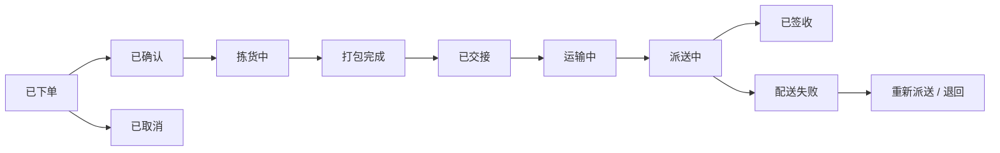

# 配送与供应链

## 这是什么？

配送与供应链是指商品从仓库到达客户手中的整个过程，以及支撑这个过程的系统和流程。作为开发者，你搭建的不只是一个"发货"按钮——而是从订单创建、仓库拣货打包、承运商交接、运输跟踪，到末端配送签收的完整链路。每个环节都有对应的系统：WMS（仓储管理系统）管仓库，TMS（运输管理系统）管物流，OMS（订单管理系统）串联一切。

在电商场景中，用户点击"提交订单"之后发生的所有事情，基本都属于供应链的范畴。这条链路上的任何一个环节出问题——拣错货、丢包裹、配送超时——都会直接影响客户体验和公司营收。

## 为什么要懂？

大多数开发者对"写代码"很熟，但对"货怎么到客户手里"一头雾水。问题是，供应链直接决定了用户体验的下半场。你的前端做得再漂亮，用户下单后三天没收到货，什么 NPS 都白搭。

理解供应链能帮你做出更好的技术决策：订单状态机该怎么设计？库存扣减是实时还是异步？配送失败后重试逻辑是什么？COD（货到付款）的对账流程怎么走？这些问题不懂业务流程你根本没法回答。尤其在东南亚市场（比如 Shopee），COD 占比极高、物流基础设施参差不齐，供应链知识更是刚需。

## 业务流程

### 订单生命周期

一个订单从下单到签收的完整状态机：

1. **已下单**：用户提交订单，支付完成（或选择 COD）
2. **已确认**：系统校验库存、地址、支付状态，确认订单有效
3. **拣货中**：仓库工人根据拣货单到货架上取货（Pick）
4. **打包完成**：商品装箱、贴运单、称重（Pack）
5. **已交接**：包裹交给承运商，承运商扫描运单确认收件（Handover）
6. **运输中**：包裹在干线运输网络中流转（中转仓 → 分拨中心 → 末端站点）
7. **派送中**：骑手/司机拿到包裹，开始末端配送
8. **已签收**：客户签收，POD（签收证明）上传。订单完成

### 入库物流 vs 出库物流

- **入库物流（Inbound）**：货从供应商/工厂运到你的仓库。涉及采购单（PO）、质检（QC）、上架入库
- **出库物流（Outbound）**：货从你的仓库运到客户手中。就是上面说的订单生命周期
- 两者用不同的流程和系统管理，但共享同一个库存池

### 逆向物流（退货）

退货不是简单地把正向流程倒过来：

1. 客户发起退货申请 → 系统生成退货单（RMA）
2. 承运商上门取件，或客户自行寄回
3. 包裹运回仓库或退货处理中心
4. 仓库质检：商品完好 → 重新上架；损坏 → 报废
5. 退款给客户（扣除运费或不扣，看退货原因）
6. 库存更新

逆向物流成本通常是正向的 2-3 倍，因为流程更碎片化、处理更复杂。

### 越库作业（Cross-docking）

货物到达仓库后不入库存储，直接在月台上分拣、重新组合后装车发出。

**适用场景：** 高周转商品、生鲜、促销爆品。减少仓储时间和成本。

**技术要点：** 需要精确的到货时间预测和出库订单匹配，系统协调要求极高。

### WMS 核心功能

WMS 是仓库的"大脑"，核心功能包括：

- **库位管理**：每件商品存放在哪个货架、哪个格子，精确到库位编号
- **拣货策略**：单品拣货（一单一拣）、波次拣货（多单合拣）、区域拣货（按货架区域分配工人）
- **库存水位**：设置安全库存线（Safety Stock）。库存低于阈值 → 自动触发补货预警或采购单
- **效期管理**：食品、药品等有保质期的商品需要 FIFO（先进先出）策略，防止过期
- **盘点**：定期或循环盘点，对比系统库存和实际库存，处理差异

### TMS 核心功能

TMS 管理"包裹离开仓库之后"的一切：

- **承运商选择**：根据目的地、包裹重量/体积、时效要求、价格，自动选择最优承运商
- **运费计算**：按重量、体积重（取大值）、距离、区域分区计算。大促期间可能有额外附加费
- **路径优化**：骑手一次带 30 个包裹，系统要规划最优配送路线（TSP 旅行商问题的变种）
- **物流跟踪**：对接承运商 API，实时拉取或通过 Webhook 接收包裹状态更新
- **异常管理**：滞留、丢件、破损的自动识别和工单生成

### 供应链计费

钱的流向在供应链中格外复杂：

- **运费计算**：首重 + 续重模式。例：首重 1kg 内 8 元，每续重 0.5kg 加 2 元。不同区域不同价格
- **承运商结算**：按月或按账期结算。承运商出账单 → 你核对运单数量和金额 → 确认付款
- **COD 回款**：承运商代收的货款，按 T+N 天结算给你。需要逐笔核对每个 COD 订单的金额
- **账期管理**：大客户通常有账期（月结 30 天、月结 60 天），需要跟踪应收/应付
- **赔付**：丢件、破损的理赔流程。需要保留证据（照片、重量记录）并在账期内提出

## 常见术语

| 术语         | 解释                                                                              |
| ------------ | --------------------------------------------------------------------------------- |
| **WMS**      | 仓储管理系统（Warehouse Management System）——管理库存、拣货、打包、发货           |
| **TMS**      | 运输管理系统（Transportation Management System）——路径规划、承运商选择、运费计算  |
| **OMS**      | 订单管理系统（Order Management System）——订单状态机、拆单合单、渠道管理           |
| **3PL**      | 第三方物流（Third-Party Logistics）——外包仓储和配送给专业公司（如菜鸟、极兔）     |
| **SKU**      | 库存单位（Stock Keeping Unit）——每个商品变体的唯一编码                            |
| **AWB**      | 运单号（Air Waybill）——每个包裹的唯一追踪编号                                     |
| **COD**      | 货到付款（Cash on Delivery）——客户收到货才付钱。东南亚主流支付方式                |
| **SLA**      | 服务等级协议（Service Level Agreement）——承诺的配送时效，如"下单后 48 小时内送达" |
| **OTD**      | 准时交付率（On-Time Delivery）——在 SLA 内送达的订单占比                           |
| **POD**      | 签收证明（Proof of Delivery）——照片、签名或 OTP 验证                              |
| **履约率**   | 成功完成配送的订单占比（= 已签收 / 总订单）                                       |
| **逆向物流** | 退货、换货、拒收包裹的回流处理                                                    |
| **越库**     | Cross-docking——货物不入库直接转运                                                 |
| **拆单**     | 一个订单拆成多个包裹发出（不同仓库、不同承运商）                                  |
| **波次拣货** | 把多个订单合并成一个批次一起拣货，提高仓库效率                                    |

## 常见模式

### 模式一：自建仓配一体

自己建仓库、雇拣货员、对接承运商。完全掌控整个链路。

**适用场景：** 大型电商平台（京东、亚马逊 FBA）。对时效和质量有极高要求。

**取舍：** 前期投入巨大（仓库租金、人力、系统开发）。但一旦规模化，成本和体验都能做到最优。

### 模式二：第三方物流（3PL）

把仓储和配送外包给 3PL 服务商。你只管把商品发到 3PL 仓库，后续由他们完成。

**适用场景：** 中小卖家、出海品牌、不想自建仓配的公司。

**取舍：** 降低运营成本和复杂度，但对配送体验的掌控力弱。需要通过 API 对接 3PL 系统来同步库存和物流状态。

### 模式三：中心辐射模型（Hub-and-Spoke）

包裹从卖家发出 → 汇集到中心仓/分拨中心（Hub） → 分发到各区域站点（Spoke） → 末端配送。

**适用场景：** 东南亚跨境物流（Shopee、Lazada）。地理分散、岛屿众多的市场。

**取舍：** 网络效率高，但 Hub 是单点瓶颈。需要精细的路由算法和容量规划。

### 模式四：众包配送

不养自己的骑手团队，用众包模式让兼职骑手接单配送（类似美团众包、Grab Express）。

**适用场景：** 即时配送（外卖、生鲜、闪购）。订单量波动大的场景。

**取舍：** 弹性好、成本灵活，但服务质量不稳定。需要实时调度系统和激励机制。

### 模式五：东南亚电商物流（Shopee/Lazada 模式）

东南亚物流有其独特挑战，值得单独讲：

- **COD 占比高**：在越南、菲律宾等市场，COD 占订单的 60-80%。这意味着承运商不只送货，还要收钱。收款失败 = 配送失败
- **岛屿地理**：印尼有 17000 多个岛屿、菲律宾有 7000 多个。跨岛配送依赖海运和空运，时效波动大
- **地址不标准**：很多地区没有标准地址系统。"XX 村口第三棵树左转"这种地址真实存在。需要经纬度坐标辅助定位
- **多承运商策略**：不同区域由不同承运商覆盖（极兔覆盖 A 区域、Flash 覆盖 B 区域），TMS 要做智能路由
- **跨境保税仓**：中国卖家的货先放到东南亚保税仓，用户下单后从保税仓发出，缩短配送时间

## 踩坑提醒

1. **库存不一致**：WMS 的库存和电商前台显示的库存对不上。根因通常是异步同步延迟或并发扣减没做好。一定要用幂等操作和最终一致性策略。

2. **运单号延迟回传**：承运商扫描运单后，状态回传到你的系统可能有几分钟到几小时的延迟。不要让用户看到"已发货"但查不到物流信息——加个缓冲状态或提示。

3. **COD 对账噩梦**：COD 订单的钱先到承运商手里，承运商按账期（T+3、T+7）结算给你。这期间可能出现：骑手收了钱但没上报、客户拒收但承运商标记为已签收、金额对不上。需要完善的对账系统和异常处理流程。

4. **配送失败处理不当**：客户不在家、地址错误、电话打不通——配送失败率在某些市场可达 10-20%。你需要明确的重试策略（最多重试几次？间隔多久？）和回流处理。

5. **拆单逻辑复杂**：一个订单的商品可能分布在不同仓库，需要拆成多个包裹。拆单后每个子单有独立的物流状态，但用户看到的应该是聚合视图。状态机设计要考虑"部分发货"和"部分签收"。

6. **末端配送时段冲突**：用户选了"上午 10-12 点"配送，但骑手线路优化后安排在下午。承诺了做不到比不承诺更糟糕——确保你的时段选项是承运商真正能兑现的。

7. **逆向物流被忽视**：很多系统把正向物流做得很好，但退货流程像是后来补丁上去的。退货需要独立的状态机、独立的库存操作、独立的财务对账。一开始就要设计进去。

8. **跨境清关卡住**：跨境包裹需要报关、交税。如果商品信息（品名、数量、价值）和申报不一致，包裹会被海关扣留。系统要能自动生成合规的清关文件。

## 行业实战经验与非显而易见的最佳实践

### 1. 承运商 DWS（量方、称重、扫码）激光重计费与自动化物流账单审计

**实战教训：** 某高速增长的电商平台在结账计算运费和 TMS 选承运商时，直接使用商品主数据（SKU Master）里录入的净重和裸装尺寸。三个月后，财务团队发现 TMS 预估运费与顺丰、极兔、FedEx 发来的月结账单（EDI 210 / 对账 CSV）之间存在高达 18 万美元的差额。原因是仓库打包员为了图快，经常把小件商品塞进大号纸箱并塞满气泡枕，而每个包裹进入承运商分拨中心时都会经过自动化 **DWS（Dimensioning, Weighing, Scanning）激光龙门架**。一旦激光测出的**体积重**（$\frac{\text{长} \times \text{宽} \times \text{高}}{\text{体积重系数}}$，如空运除以 $5000\text{ cm}^3/\text{kg}$ 或快递除以 $6000$）大于申报实重，承运商系统会自动按更高档位重计费（Re-rating），甚至加收“超规/尺寸申报不符附加费”。

**非显而易见的最佳实践：**
- **打包台装箱推荐算法（Cartonization Engine）：** 绝不能仅靠商品裸尺寸调承运商接口。WMS 应在打包环节运行 3D 装箱算法，向打包员推荐匹配的最小耗材箱型（如 `BOX-S2`），并在调取面单 API 前強制采集**包装箱外径尺寸**与电子秤实重。
- **自动化物流对账与差异审计流水线（Freight Bill Audit）：** 将承运商月结账单按运单号（`awb_number`）自动导入对账引擎，逐单比对“发货申报重量/体积/预估运费”与“承运商激光复秤重量/体积/实际扣费”：
  - **自动放行：** 差异在容差阈值内（如 $\le 0.5$ 元或 $\le 2\%$）直接核销。
  - **主数据反向修正闭环：** 若同一个单品订单（Single-SKU Order）连续 5 次触发承运商 DWS 体积重上调，系统自动冻结该 SKU 的尺寸置信度，并向 WMS 下发复测工单（通常是供应商换了新包装盒但未通知仓库）。
  - **异常申诉队列：** 对超出物理纸箱上限的离谱激光读数（常见于两个包裹在传送带上紧贴被激光扫成一个大包裹）或违规加收的偏远地区附加费，自动提取打包台称重日志与监控视频时间戳，在承运商 15 天申诉窗口期内自动生成拒付索赔单。

### 2. 拆单导致的毛利吞噬 vs. 跨区干线集拼（Zone-Skipping）的权衡

**实战教训：** 为了追求极致的发货速度，某 OMS 配置了一条贪心路由规则：“优先从有现货且离客户最近的仓库发货”。当用户趁“满 99 元包邮”活动下了一笔包含 3 件小商品（35 元、34 元、30 元）的订单时，没有任何一个区域仓同时拥有这 3 个 SKU。OMS 自动将订单拆成了 3 个包裹，从全国 3 个不同仓库分别发出。每单触发承运商首重保底运费 6 元（合计 18 元运费 + 3 份包材人工），直接把整单毛利吃光并倒亏 8 元。

**非显而易见的最佳实践：**
- **利润感知的多目标寻源算法（Margin-Aware Order Routing）：** 订单寻源绝不是单纯的“最短路径问题”。OMS 寻源求解器必须引入综合成本目标函数：
  $$\text{总履约成本} = \sum_{\text{包裹}} \text{承运商运费}(\text{发件仓}, \text{目的地}, \text{计费重}) + \text{拣货包材成本} + \text{SLA 超时惩罚成本}$$
  如果等待 12 小时通过仓间调拨或由中心大仓一单集中发出，依然能满足对客户承诺的送达时效（OTD），则优先合单发货；当拆单导致订单净毛利跌破止损线（如 $-5$ 元）时，系统应自动抑制拆单，优先选择单仓慢发或人工审批。
- **高密度流向的跨区直送（Zone Skipping）：** 对于发往远端核心城市群的海量包裹，不要逐单交由快递公司跨省中转。仓库按目的地分拨中心预先打好末端快递面单，将同一目的地的包裹集中打板，用整车/零担干线卡车（FTL/LTL）直接拉到目的地城市的承运商本地分拨中心（跳过干线计费区直接入网）。在干线运输途中，轨迹展示为“干线集拼发往目的地分拨中心”，落地扫描后无缝切换为末端派送——单票物流成本可降低 30%–45%。

### 3. 逆向物流质检分级与“首扫即退（Instant Refund on First Scan）”信任评分

**实战教训：** 传统退货流程需要 7–14 天等待包裹寄回仓库、拆包、人工质检后才触发退款，导致大量“我的退款到哪了”客服工单，且严重拖累复购率。团队随后上线了“寄出即退（揽收首扫秒退款）”功能：一旦承运商 Webhook 回传揽收扫描（`FIRST_SCAN`），立即原路退回货款。结果上线两周内，黑产团伙批量购买高价数码产品，退货时往快递盒里塞入等重的石头或大米，在快递网点扫码的瞬间拿到全额退款并提现走人，等仓库收到石头时早已无法追回。

**非显而易见的最佳实践：**
- **基于风险评分的动态退款触发引擎（Risk-Gated Refund Timing）：** 将逆向物流状态与财务退款解耦，通过实时计算**退货信任分（Return Trust Score）**决定退款节点：
  - **Tier 1（高信用 + 低风险品类）：** 账号注册 $> 180$ 天、历史退货率 $< 8\%$、客单价 $< 200$ 元的非标服饰/家居品 $\rightarrow$ 承运商回传 `FIRST_SCAN`（且揽收称重与发货重量偏差在 $\pm 15\%$ 内）立即触发极速退款。
  - **Tier 2（中等风险）：** 需等待包裹抵达退货仓月台完成入库卸货扫描（`RETURN_DOCK_RECEIVED`）后触发退款。
  - **Tier 3（高风险 / 序列号高价值商品）：** 新账号、3C 数码/奢侈品、或曾有退货异常记录 $\rightarrow$ 必须等待退货工作台完成**拆包录像、SN 序列号核验与质检定级**后才释放退款。
- **退货库存隔离与多级处置子账本（Disposition Grading）：** 退货包裹入库时严禁直接加回“可售库存（Available-to-Sell）”，必须先进入隔离态 `returned_pending_grading`。质检台扫码定级后按去向分流：
  - **A 级（全新未拆封/吊牌完好）：** 消毒换袋后转入正常 `available_to_sell`。
  - **B 级（拆封微瑕/包装破损）：** 自动映射为尾货/官翻专属 SKU（如 `SKU-123-OPENBOX`）进入折扣频道销售。
  - **C/D 级（功能损坏 / 掉包欺诈）：** 转入 `vendor_rtv`（退供索赔）、`scrap`（报损销毁）或 `fraud_evidence_hold`（自动关联开箱监控视频发起资金追缴与账号封禁）。

## 速查表

| 系统/环节       | 关键考虑                                          |
| --------------- | ------------------------------------------------- |
| OMS（订单管理） | 状态机设计、拆单合单、COD/在线支付区分            |
| WMS（仓储管理） | 库存准确性、拣货效率（波次/单品）、库存水位预警   |
| TMS（运输管理） | 承运商选择算法、运费计算、路径优化、物流跟踪      |
| 末端配送        | 骑手调度、配送时段、POD 采集、失败重试            |
| 逆向物流        | 退货状态机、质检流程、退款触发、库存回补          |
| COD 对账        | 承运商结算周期、金额核对、异常订单处理            |
| 跨境物流        | 清关文件、关税计算、跨境承运商对接                |
| 库存同步        | 多渠道库存统一、安全库存、超卖防护                |
| SLA 监控        | OTD 看板、超时预警、承运商绩效评分                |
| 数据对接        | 承运商 API 对接、Webhook 物流状态回调、运单号回传 |

### 末端配送关键指标

| 指标              | 说明                   | 行业基准                  |
| ----------------- | ---------------------- | ------------------------- |
| OTD（准时交付率） | SLA 时效内送达的比例   | > 95%                     |
| 履约率            | 成功签收 / 总订单      | > 90%（COD 市场可能更低） |
| 首次配送成功率    | 第一次尝试就成功签收   | > 85%                     |
| 平均配送时长      | 从交接到签收的平均时间 | 因市场差异大（1-7 天）    |
| 丢件率            | 丢失包裹占比           | < 0.1%                    |
| 破损率            | 到达时破损的包裹占比   | < 0.5%                    |
| COD 回款周期      | 承运商结算代收款的天数 | T+3 到 T+14               |
