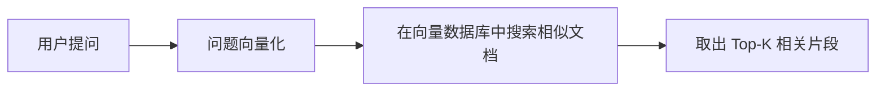
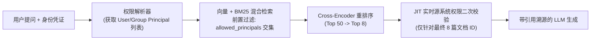

# 大语言模型与 RAG 的商业应用

## 这是什么？

大语言模型（LLM）是经过海量文本训练的 AI 模型，能理解和生成自然语言。GPT-4、Claude、Llama 都属于 LLM。企业用它来做客服自动化、内容生成、代码辅助、数据分析等。但 LLM 有个致命问题——它只知道训练数据里的东西，对你公司内部的知识一无所知，而且会"编造"看起来正确但实际上错误的内容（幻觉）。

RAG（Retrieval-Augmented Generation，检索增强生成）就是为了解决这个问题。核心思路：用户提问时，先从企业知识库中检索相关文档，把检索到的内容和用户问题一起喂给 LLM，让模型"有据可依"地回答。这样既能利用 LLM 强大的语言能力，又能确保回答基于真实的企业数据，大幅减少幻觉。

## 为什么要懂？

AI 正在改变每个行业的工作方式。作为开发者，你不需要从头训练模型，但你必须懂得如何把 LLM 能力集成到业务系统中。哪些场景适合用 AI？成本怎么控制？自建还是买 API？数据安全怎么保障？这些都是业务决策，不只是技术问题。懂这些的开发者能帮公司少走弯路、少花冤枉钱，同时避开隐私合规的地雷。

## 业务流程

### 数据准备与导入

1. 梳理企业知识来源（内部文档、FAQ、产品手册、工单历史、代码库）
2. 数据清洗：去掉重复、过时、格式错乱的内容
3. 文档分块（Chunking）：把长文档切成适合检索的小段（通常 200-1000 Token）
4. 通过 Embedding 模型把每个文本块转换成向量（数字表示）
5. 向量存入向量数据库（Pinecone、Weaviate、Milvus、pgvector）

### 索引与存储

1. 选择向量数据库或在现有数据库上加向量扩展
2. 建立索引以支持快速相似度搜索
3. 设置元数据（来源、时间、权限标签）方便后续过滤
4. 配置定期更新管道——企业数据在变，索引也得跟着变

### 用户提问与检索

1. 用户通过聊天界面或 API 提交问题
2. 系统把问题转换为向量（用同一个 Embedding 模型）
3. 在向量数据库中做相似度搜索，取回最相关的 K 个文档片段
4. 可选：混合搜索（向量搜索 + 关键词搜索）提升召回率

### 生成回答

1. 把检索到的文档片段 + 用户问题组装成 Prompt
2. 发送给 LLM（OpenAI API、Anthropic API 或自建模型）
3. LLM 根据提供的上下文生成回答
4. 可选：在 Prompt 中加入指令，如"如果上下文中找不到答案，请说不知道"

### 反馈与优化循环

1. 用户对回答点赞/点踩或补充纠正
2. 收集低质量回答用于分析
3. 定期评估：回答准确率、用户满意度、检索命中率
4. 根据数据调整：Chunking 策略、Prompt 模板、检索参数、模型选择

## 常见术语

| 术语                               | 解释                                                                           |
| ---------------------------------- | ------------------------------------------------------------------------------ |
| **LLM（大语言模型）**              | 经过大规模文本训练的 AI 模型，能理解和生成自然语言                             |
| **RAG（检索增强生成）**            | 先检索相关文档，再让 LLM 基于检索内容生成回答的架构                            |
| **幻觉（Hallucination）**          | LLM 编造看起来合理但实际不正确的内容。RAG 的核心目标就是减少它                 |
| **接地（Grounding）**              | 让 LLM 的回答"落地"到真实数据上，而不是凭空生成                                |
| **Embedding（向量嵌入）**          | 把文本转换成数字向量，语义相近的文本在向量空间中距离近                         |
| **向量数据库**                     | 专门存储和检索向量的数据库（Pinecone、Weaviate、Milvus、pgvector）             |
| **Token**                          | LLM 处理文本的最小单位。1 个英文单词约 1-2 个 Token，1 个中文字约 1-2 个 Token |
| **上下文窗口（Context Window）**   | LLM 一次能处理的最大 Token 数。GPT-4 Turbo 为 128K，Claude 为 200K             |
| **提示工程（Prompt Engineering）** | 设计和优化给 LLM 的指令，以获得更好的输出                                      |
| **微调（Fine-tuning）**            | 在特定数据集上继续训练模型，让它适应特定任务或风格                             |
| **Chunking（文档分块）**           | 把长文档切成适合检索和处理的小段                                               |
| **Top-K 检索**                     | 从向量数据库中取回与查询最相似的 K 个结果                                      |
| **混合搜索（Hybrid Search）**      | 同时使用向量语义搜索和传统关键词搜索，合并结果以提升召回率                     |
| **护栏（Guardrails）**             | 限制 LLM 输出范围的规则，防止生成有害、不合规或离题的内容                      |

## 常见模式

### 模式一：先 RAG 后微调

先用 RAG 快速上线，收集用户反馈和真实问答数据。等积累够了高质量数据，再考虑微调模型提升特定领域的效果。

**适用场景：** 大多数企业项目的起步阶段。RAG 不需要训练数据，上线快、成本低。

**取舍：** RAG 的效果依赖检索质量。如果企业文档质量差、结构乱，RAG 效果会打折扣。微调成本高但能学到 RAG 难以传递的"风格"和"判断力"。

### 模式二：人工审核（Human-in-the-Loop）

LLM 生成初稿，人工审核后再发布。适用于高风险场景。

**适用场景：** 医疗、法律、金融等容错率极低的领域。客户对外的正式回复。

**取舍：** 速度慢，无法全自动。但出错代价太高时，这是必须的。

### 模式三：混合搜索

向量语义搜索擅长理解意思（"怎么退货" 和 "退款流程" 语义相近），关键词搜索擅长精确匹配（产品型号、错误代码）。混合搜索两者结合。

**适用场景：** 文档中既有自然语言描述又有精确标识符（技术文档、工单系统、产品目录）。

**取舍：** 需要维护两套索引，排序逻辑更复杂。但检索质量显著提升。

### 模式四：护栏与安全层

在 LLM 输入和输出两端加过滤：输入端检测恶意 Prompt（Prompt 注入攻击），输出端过滤敏感信息、不合规内容、离题回答。

**适用场景：** 面向外部用户的任何 AI 应用。尤其是客服机器人、公开问答。

**取舍：** 过于严格的护栏会降低用户体验（正常问题被拦截）。需要持续调优平衡安全和可用性。

### 模式五：自建 vs 买 API

| 维度       | 用 API（OpenAI/Anthropic/Cohere） | 自建（开源模型 Llama/Mistral）      |
| ---------- | --------------------------------- | ----------------------------------- |
| 上手速度   | 几小时就能跑通                    | 几周到几个月                        |
| 成本结构   | 按 Token 或按次计费，初期低       | 硬件/GPU 成本高，规模大后单位成本低 |
| 数据隐私   | 数据经过第三方服务器              | 数据完全在自己手里                  |
| 模型质量   | 顶级模型，持续更新                | 开源模型稍弱，但进步很快            |
| 运维负担   | 零运维，厂商管一切                | 需要 ML 工程团队                    |
| 供应商锁定 | 有一定锁定风险                    | 完全自主                            |

**判断标准：** 如果日均请求量低于 10 万次、没有严格的数据驻留要求、团队没有 ML 工程师——用 API。如果日均请求量极高、有严格的数据合规要求、有 ML 团队——考虑自建。

## 踩坑提醒

1. **数据时效性**：企业知识在不断变化，但向量索引不会自动更新。必须建立定期数据同步管道，否则 AI 回答的是过时信息。很多团队上线时忘了这一步。
2. **成本爆炸**：LLM API 按 Token 计费。一个看似简单的客服机器人，每次对话带上检索到的文档上下文，Token 消耗可能是纯对话的 5-10 倍。上线前必须做成本估算和预算监控。
3. **质量评估困难**：不像传统软件有明确的对错，AI 回答的"好不好"很主观。需要建立评估体系——自动化指标（检索召回率、回答相关性评分）加人工抽检。
4. **隐私合规**：企业数据发给第三方 LLM 服务商有数据泄露风险。需要确认：数据是否用于模型训练？是否符合 GDPR/个保法？敏感信息是否脱敏？
5. **Prompt 注入攻击**：用户可能通过恶意输入让 LLM 做出意料之外的行为（泄露系统 Prompt、绕过限制）。面向外部用户的系统必须做输入过滤。
6. **过度依赖 AI**：不是所有问题都需要 LLM。简单的 FAQ 用关键词匹配就够了，确定性的业务逻辑用规则引擎。LLM 适合模糊、复杂、需要语言理解的场景。
7. **幻觉无法完全消除**：RAG 能大幅减少幻觉，但不能 100% 消除。高风险场景必须有人工审核。不要对外宣传"AI 绝不出错"。
8. **Chunking 策略决定成败**：文档切太小丢失上下文，切太大检索不精确。没有万能策略，需要根据文档类型反复测试调优。
9. **厂商锁定**：过度依赖某个 LLM 厂商的特有功能会增加切换成本。尽量用标准化的接口抽象层，保留切换空间。

## 行业实战经验与非显而易见的最佳实践

### 1. 权限感知的 RAG（ACL 必须在向量检索*之前*过滤，绝不能在检索后凑数）

在对接企业内部 Notion、Google Drive、飞书或 Confluence 构建企业级 RAG 时，最致命的生产事故是**跨用户越权数据泄露**。如果你先从向量数据库检索 Top-$K$（如 `K = 10`）最相似的分块，然后再剔除当前用户无权查看的文档（后置过滤 Post-Filtering），会引发两个灾难：
1. **召回率归零（Recall Starvation）**：如果高管群里的 10 份机密并购文档恰好占据了向量相似度前 10 名，普通员工提问时这 10 条结果会被全部过滤掉，最终返回空结果，尽管知识库里明明有公开文档可以回答。
2. **权限吊销滞后泄露**：当源系统的文件夹权限变更（例如某员工被移出项目组），向量索引里的切片元数据往往存在同步延迟。

- **非显而易见的最佳实践**：采用**“前置元数据过滤 + 最终候选集 JIT（Just-In-Time）实时权限复核”**双保险架构。在 HNSW 向量检索阶段通过 `allowed_principals` 进行前置过滤保证召回数量；在重排序选出最终 5~8 个切片、即将拼入 Prompt 发送给大模型前的最后一刻，拿这几个文档 ID 对源权限中心做一次毫秒级的实时权限校验。

### 2. 两阶段额度预扣（冻结 `Freeze` -> 结算 `Settle` / 解冻 `Refund`）与消息早到竞态

长耗时 AI 任务（如翻译 200 页 PDF、深度研究 Agent）无法在请求发起时直接扣死费用，因为实际消耗的 Token 数和成功与否在执行完之前是未知的。
- **生产级踩坑（事务未提交消息已消费）**：许多团队在同一个 `@Transactional` 数据库事务里执行“冻结用户积分 -> 写入 `PENDING` 任务记录 -> 发送 Kafka 消息”。在高并发下，Kafka 消费者往往在**数据库事务彻底 Commit 之前的几毫秒**就已经拉取到了消息，此时去查数据库会报 `Task Not Found`，或者在异常回滚时导致用户被冻结的积分永远无法解冻（幽灵冻结）。
- **实战解法**：
  1. **事务发件箱（Transactional Outbox）或 `afterCommit` 钩子**：严禁在未提交的数据库事务内部直接向消息队列发消息，加上定时对账任务扫描超时未完结的冻结单。
  2. **下游健康预检（Pre-Flight Probe）**：Worker 消费长任务前，先对下游 OCR/LLM 服务做轻量级存活与配额探测；若下游处于限流或熔断状态，直接重入队列退避，避免消费到第 90 页时失败造成高昂的废弃 Token 成本。
  3. **流式生成中断信号传递（`AbortSignal`）**：用户在网页端点击“停止生成”或直接关掉标签页时，后端必须将 HTTP 连接断开的 `AbortSignal` 一路透传给上游大模型连接，立即中断流式推理并按已生成 Token 精确结算，否则上游模型会在后台把剩余几千个昂贵的推理 Token 跑完。

### 3. Prompt Caching 前缀纪律与“语义缓存（Semantic Cache）”投毒陷阱

主流大模型提供高达 50%~90% 的 Prompt 前缀缓存折扣，但**只要你在 System Prompt 开头放了一个动态时间戳、`request_id` 或当前用户名，整个前缀缓存命中率就会瞬间变成 0%**。
- **严格的前缀分层律**：Prompt 组装必须严格按照“从静态到动态”排序：`[全局静态系统指令与 Tool 定义] -> [长文档 / 代码库共享上下文] -> [多轮对话历史] -> [当前轮次动态用户属性与当前时间]`。
- **为什么多租户业务严禁盲目开启“语义缓存”**：很多开源框架吹捧 Semantic Cache（当新问题的向量与历史问题的余弦相似度 `> 0.96` 时直接返回缓存答案）。但在真实业务中，`“我三季度的营收是多少？”`与`“我四季度的营收是多少？”`（或者两个不同客户问`“帮我总结最新那张发票”`）的向量余弦相似度高达 `0.985`！在业务系统中，任何缓存都必须以 `(tenant_id, user_permission_hash, 强校验结构化参数)` 作为前置隔离键。

## 速查表

| 场景                    | 推荐方案               | 说明                        |
| ----------------------- | ---------------------- | --------------------------- |
| 内部知识库问答          | RAG + API              | 最常见的起步场景，ROI 高    |
| 客服机器人              | RAG + 护栏 + 人工兜底  | 面向客户必须有安全层        |
| 文档摘要/翻译           | 直接用 LLM API         | 不需要检索，Prompt 工程即可 |
| 代码助手                | RAG（代码库索引）+ LLM | 需要理解项目上下文          |
| 数据分析报告            | LLM + 结构化数据       | Text-to-SQL 或 LLM 解读数据 |
| 高合规场景（医疗/法律） | RAG + 人工审核         | 绝不能全自动                |

| 厂商                  | 特点                     | 定价参考                         |
| --------------------- | ------------------------ | -------------------------------- |
| OpenAI（GPT-4o）      | 生态最完善，应用最广     | 按 Token 计费，输入/输出价格不同 |
| Anthropic（Claude）   | 超长上下文窗口，安全性强 | 按 Token 计费                    |
| Cohere                | 企业搜索和 RAG 专长      | 按 Token 计费                    |
| Google（Gemini）      | 多模态能力强             | 按 Token 计费                    |
| 开源（Llama/Mistral） | 免费，可私有部署         | 硬件/GPU 成本自负                |

| 问题        | 解决方案                                           |
| ----------- | -------------------------------------------------- |
| AI 回答不准 | 改进 Chunking 策略、优化 Prompt、增加检索文档数量  |
| 成本太高    | 缓存常见问答、用小模型处理简单问题、压缩上下文     |
| 数据过时    | 建立定期索引更新管道、事件驱动的增量更新           |
| 隐私顾虑    | 私有部署开源模型、数据脱敏、确认厂商数据政策       |
| 用户体验差  | 加载状态提示、流式输出、提供引用来源链接           |
| 幻觉问题    | 加强接地策略、限制模型在无据时承认不知道、人工抽检 |
