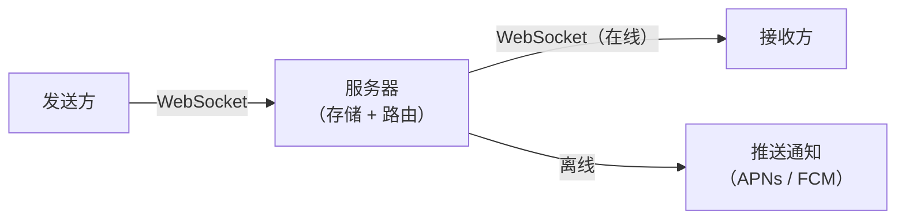
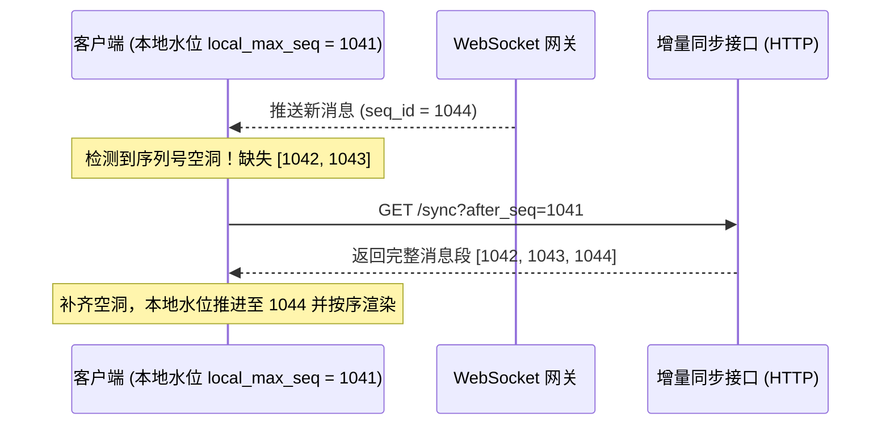

# 即时通讯与实时聊天

## 这是什么？

即时通讯（IM，Instant Messaging）是让用户之间实时交换文本、图片、视频、文件等消息的系统。微信、WhatsApp、Slack、Discord 都属于 IM 产品。作为 Web 开发者，你可能需要在应用中嵌入聊天功能（客服聊天、团队协作、社区互动），也可能需要从零构建一个完整的通讯系统。

IM 的核心技术挑战是"实时性"——消息必须在毫秒级别送达。传统的 HTTP 请求-响应模式做不到这一点，所以 IM 系统普遍采用 WebSocket 长连接或类似技术来维持客户端与服务器之间的持久通道。除了消息传递本身，一个成熟的 IM 系统还要处理在线状态、已读回执、正在输入提示、消息存储、多端同步、推送通知、端到端加密等一系列复杂功能。

## 为什么要懂？

几乎所有现代应用都有实时通讯需求：电商的客服聊天、SaaS 的团队协作、社交平台的私信、在线教育的师生互动。即使你不从零造轮子，接入第三方 IM SDK（如融云、环信、SendBird、Firebase）也需要理解底层概念，否则无法做出正确的架构决策。面试中 IM 系统设计也是高频题目——它涉及长连接管理、消息可靠投递、分布式架构、存储策略、安全加密等核心知识点，能全面考察候选人的系统设计能力。

## 业务流程

### 建立连接

1. 用户登录后，客户端通过 WebSocket 与服务器建立长连接
2. 服务器验证身份（Token 鉴权），将连接注册到连接管理器
3. 服务器推送离线期间的未读消息和状态更新
4. 客户端维持心跳（Heartbeat），定期告诉服务器"我还活着"
5. 连接断开时自动重连，保证消息不丢失

### 单聊消息流转

1. 发送方通过 WebSocket 将消息发送到服务器
2. 服务器生成全局唯一消息 ID，写入消息存储
3. 服务器查询接收方连接状态——在线则通过 WebSocket 直接推送
4. 接收方收到后发送 ACK（确认收到），服务器更新消息状态为"已送达"
5. 若接收方离线，服务器触发推送通知（APNs / FCM）
6. 接收方上线后拉取离线消息（Pull 模式兜底）

### 群聊消息流转

1. 发送方将消息发送到服务器，标注目标群组 ID
2. 服务器查询群成员列表（可能几百甚至几千人）
3. 对于小群（<200 人）：写扩散——为每个成员生成一条消息副本存入各自收件箱
4. 对于大群（>200 人）：读扩散——消息只存一份，成员读取时按群时间线拉取
5. 在线成员通过 WebSocket 实时收到，离线成员下次上线时拉取

### 多媒体消息处理

1. 发送方先将文件上传到对象存储（OSS / S3），获取文件 URL
2. 消息体中只存文件元信息（URL、类型、大小、缩略图 URL）
3. 接收方根据元信息按需加载——先显示缩略图，点击再下载原图/原文件
4. 图片/视频自动生成缩略图和多分辨率版本，节省带宽

### 消息搜索

1. 消息写入存储时同步写入搜索引擎（Elasticsearch）
2. 用户搜索时按关键词、发送人、时间范围、消息类型等维度过滤
3. 搜索结果高亮匹配词，点击可跳转到对话上下文
4. 注意：端到端加密的消息无法在服务端做全文搜索，只能在本地搜索

## 常见术语

| 术语                               | 解释                                                                |
| ---------------------------------- | ------------------------------------------------------------------- |
| **WebSocket**                      | 全双工通信协议，客户端和服务器可以随时互相发消息，IM 的基础通信方式 |
| **长连接（Long Connection）**      | 客户端与服务器之间持续保持的 TCP 连接，避免每次通信都重新握手       |
| **心跳（Heartbeat）**              | 客户端定期发送的小数据包，告诉服务器连接还活着，通常 30-60 秒一次   |
| **ACK（确认应答）**                | 接收方确认收到消息的回执，是消息可靠投递的关键机制                  |
| **消息 ID（Message ID）**          | 全局唯一标识，用于去重、排序和状态追踪。通常用 Snowflake 算法生成   |
| **写扩散（Fan-out on Write）**     | 发消息时为每个接收方各写一份副本，读取快但写入放大                  |
| **读扩散（Fan-out on Read）**      | 消息只存一份，接收方读取时聚合，写入少但读取慢                      |
| **已读回执（Read Receipt）**       | 告诉发送方对方已经查看了消息，单聊和群聊实现复杂度差异很大          |
| **正在输入（Typing Indicator）**   | 告诉对方"我正在打字"，通过 WebSocket 发送短暂状态信号实现           |
| **在线状态（Presence）**           | 用户当前是在线、离线、忙碌还是隐身，需要实时广播给好友列表          |
| **推送通知（Push Notification）**  | 用户离线时通过 APNs（iOS）或 FCM（Android/Web）发送系统通知         |
| **E2EE（端到端加密）**             | 消息在发送端加密、接收端解密，服务器只看到密文，无法读取内容        |
| **消息漫游（Message Roaming）**    | 用户换设备后仍能看到历史消息，需要服务端持久存储                    |
| **多端同步（Multi-device Sync）**  | 同一账号在手机、电脑、平板上保持消息状态一致                        |
| **聊天审核（Content Moderation）** | 对消息内容进行合规检测，过滤违规信息（色情、暴力、垃圾广告）        |

## 常见模式

### 模式一：消息可靠投递三板斧

确保消息"不丢、不重、不乱序"是 IM 系统的核心难题。

1. **不丢**：发送方 → 服务器 ACK（确认服务器收到）；服务器 → 接收方 ACK（确认接收方收到）。任一环节超时未收到 ACK 则重发。
2. **不重**：每条消息带全局唯一 ID，接收方对同一 ID 去重。
3. **不乱序**：使用递增的序列号（Sequence Number），接收方按序列号排序显示。

**适用场景：** 所有 IM 系统的基础要求。

**取舍：** ACK 机制增加了网络开销和实现复杂度，但没有它消息就不可靠。

### 模式二：写扩散 vs 读扩散

| 维度     | 写扩散                   | 读扩散                       |
| -------- | ------------------------ | ---------------------------- |
| 发消息   | 慢（N 个成员写 N 次）    | 快（只写 1 次）              |
| 读消息   | 快（直接读自己的收件箱） | 慢（需要聚合多个群的时间线） |
| 存储成本 | 高（消息被复制 N 份）    | 低（消息只存 1 份）          |
| 适用场景 | 小群、单聊               | 大群、频道、直播聊天室       |

**业界做法：** 小群用写扩散，大群用读扩散，混合使用。微信、钉钉都是这个思路。

### 模式三：在线状态管理

用户量大时，在线状态是个高频更新的数据。常见方案：

- **小规模**：WebSocket 连接本身就是在线标志，断开即离线。状态存 Redis，好友列表订阅状态变更。
- **大规模**：采用"拉取 + 订阅"混合模式。打开聊天窗口时拉取对方当前状态，同时订阅后续变更。不活跃的好友不主动推送，减少广播压力。

**取舍：** 状态的"准确性"和"及时性"需要平衡。状态更新太频繁会造成带宽浪费，更新太慢用户体验差。

### 模式四：端到端加密（E2EE）

消息在发送方设备上用接收方公钥加密，只有接收方的私钥能解密。服务器全程只传递密文。

**典型协议：** Signal Protocol（WhatsApp、Signal 使用）。核心概念包括双棘轮算法（Double Ratchet）、预共享密钥（Pre-Key Bundle）。

**取舍：** E2EE 意味着服务端无法做内容审核、无法做服务端全文搜索、无法帮用户恢复丢失的消息。安全与便利之间必须做取舍。

### 模式五：聊天机器人与自动化

在 IM 系统中嵌入 Bot，处理常见的自动化场景：

- **客服机器人**：自动回答 FAQ，复杂问题转人工
- **通知机器人**：系统事件（部署完成、告警、审批提醒）推送到群聊
- **工作流机器人**：在聊天中触发操作（/approve、/deploy、/create-ticket）

**实现方式：** Bot 以特殊用户身份接入 WebSocket，监听特定消息模式或指令，通过 Webhook 或 API 与外部系统交互。

## 踩坑提醒

1. **WebSocket 不是万能的**：移动端网络不稳定，WebSocket 会频繁断开。必须实现自动重连 + 指数退避（Exponential Backoff），同时用 HTTP 轮询作为降级方案。重连后要拉取离线消息补齐。
2. **消息顺序比你想的复杂**：分布式环境下，不同服务器的时钟不一致，不能用时间戳排序。要用服务端分配的递增序列号。群聊中"谁的消息先到"取决于网络延迟，可能出现 A 看到的顺序和 B 看到的不一样。
3. **群聊已读回执是性能杀手**：单聊已读回执简单——告诉对方"我读了"。但群聊中 500 人的群，每条消息要追踪 500 个人的已读状态，存储和计算成本巨大。常见做法是只显示"已读人数"而非"谁读了"。
4. **推送通知的合并问题**：用户离线时收到 100 条消息，不能推 100 条通知。需要合并通知（"你有 3 个对话的 15 条新消息"），并且已在其他端读过的消息不应再推送。
5. **消息存储策略决定成本**：永久保存所有消息成本高昂。需要分层存储——热数据（近期消息）放数据库/缓存，冷数据（历史消息）转到对象存储或归档库。明确告知用户消息保留期限。
6. **多端同步的幽灵问题**：用户在手机上删了一条消息，但电脑端还显示。多端同步要用操作日志（Operation Log），每个操作带序列号，各端按日志回放保持一致。
7. **正在输入提示的滥发**：每敲一个字都发 Typing 事件会造成大量无意义的网络流量。应该做节流（Throttle）——首次触发立刻发，之后每 3-5 秒最多发一次，停止输入后发送"停止输入"事件。
8. **大文件传输阻塞消息通道**：文件上传走 WebSocket 会阻塞正常消息。文件一定要走单独的 HTTP 上传通道到对象存储，WebSocket 只传文件元信息。
9. **聊天审核的延迟**：内容审核（AI 检测 + 人工复审）需要时间。先发后审可能让违规内容短暂可见，先审后发会让正常用户感到消息延迟。需要根据业务场景选择策略。
10. **加密消息的密钥管理**：E2EE 中如果用户丢失私钥（换手机、卸载 App），历史消息将永久无法解密。需要提供密钥备份方案（如 iCloud 备份、安全密码导出），但这又削弱了 E2EE 的安全性。

## 行业实战经验与非显而易见的最佳实践

### 1. 会话级严格单调递增 `seq_id` 与空洞检测（为什么绝对不能用时间戳排消息）

新手往往用 `created_at` 时间戳给聊天消息排序，并认为只要 WebSocket 在线就不会丢消息。在真实移动网络下，电梯、地铁和 Wi-Fi/蜂窝切换会导致处于半开状态（Half-Open TCP）的 WebSocket 静默丢包，且分布式服务器节点之间存在毫秒级 NTP 时钟漂移。
- **微信 / Slack / Discord 的工业级同步机制**：每个会话（或每个用户的同步信箱 Timeline）维护一个严格单调递增的整数序列号（`seq_id = 1041, 1042, 1043...`）。
- **确定性空洞自愈（Gap Detection）**：客户端本地 SQLite / IndexedDB 记录已同步的最大水位线 `local_max_seq = 1041`。如果下一帧 WebSocket 推过来的消息是 `seq_id = 1044`，客户端立刻识别出中间缺失了 `[1042, 1043]` 的空洞，自动触发一次 HTTP 增量拉取 `GET /sync?after_seq=1041`，补齐空洞后再推进本地水位线——从根本上杜绝“静默丢消息”。

### 2. 万人大群的“已读回执与在线状态扇出风暴（Fan-Out Storm）”

在单聊中，一条“已读回执”或“正在输入 / 在线状态变更”只需要通知 1 个人。但在一个 10,000 人的企业大群或 Discord 频道里，如果管理员发了一条全员公告，3,000 人在同一秒打开查看，系统若把每个人的已读回执广播给群内全部 10,000 人，单条消息就会瞬间产生 $3,000 	imes 10,000 = 30,000,000$ 条 WebSocket 推送，直接把网关集群打崩。
- **经过实战检验的分级降级法则**：
  - **已读水位线（Read Watermark）与按需拉取**：每个用户在每个会话只存一个 `last_read_seq_id` 整数（而不是给每条消息存一张已读用户关联表）。当群人数超过阈值（如 100 人）时，关闭实时已读列表广播，改为发送方点开“查看已读详情”抽屉时再按需分页查询。
  - **视口订阅（Viewport-Scoped Presence）**：进入万人社区时，客户端绝不全量订阅所有成员的在线状态，而是仅向网关订阅当前屏幕滚动视口（Viewport）内可见的那 30 个头像的实时状态。

### 3. 链接预览（Link Unfurling）引发的万人 DDoS 与服务端 SSRF 漏洞

当用户在 5,000 人的群里发了一个网址 `https://example.com/news`，标题和缩略图卡片由谁去抓取？
- **陷阱一（客户端直接抓取）**：如果让群里 5,000 个接收者的手机客户端各自去请求这个 URL 生成预览，不仅你的用户会瞬间变成攻击目标网站的 DDoS 肉鸡，而且攻击者只要在群里发一个自己搭建的探针链接，就能瞬间拿到群里所有人的真实家庭 IP 地址！
- **陷阱二（业务后端直接抓取）**：如果由业务后端直接请求用户发来的 URL，攻击者会发送 `http://169.254.169.254/latest/meta-data/`（窃取云主机 IAM 密钥）或通过 DNS 重绑定攻击内网 Redis/数据库（SSRF 服务端请求伪造）。
- **生产标准架构**：必须由后端异步去重抓取一次（同一 URL 结果全局缓存），且抓取器必须部署在**完全物理隔离、无法访问任何内网网段与云元数据接口的沙箱出口代理（Egress Sandbox Proxy）**中，同时将外链图片转存至自有安全图片 CDN。

## 速查表

| 场景            | 推荐方案                       | 说明                   |
| --------------- | ------------------------------ | ---------------------- |
| 基础单聊        | WebSocket + Redis + MySQL      | 最简方案，适合中小规模 |
| 大规模群聊      | 读扩散 + 消息队列 + 分库分表   | 减少写放大，水平扩展   |
| 客服聊天        | 第三方 SDK（Intercom/Zendesk） | 成熟方案，自建性价比低 |
| 团队协作        | 自建 + WebSocket + Bot 生态    | 需要深度定制时才自建   |
| 高安全场景      | E2EE + Signal Protocol         | 合规要求严格时使用     |
| 直播弹幕/聊天室 | 读扩散 + 消息丢弃策略          | 允许丢消息，优先实时性 |

| 消息状态            | 含义                   | 实现方式                      |
| ------------------- | ---------------------- | ----------------------------- |
| 已发送（Sent）      | 消息到达服务器         | 服务器返回 ACK 给发送方       |
| 已送达（Delivered） | 消息到达接收方设备     | 接收方客户端返回 ACK 给服务器 |
| 已读（Read）        | 接收方打开并查看了消息 | 接收方发送 Read Receipt 事件  |

| 技术选型                  | 适用场景         | 说明                         |
| ------------------------- | ---------------- | ---------------------------- |
| WebSocket                 | 双向实时通信     | IM 首选，浏览器原生支持      |
| SSE（Server-Sent Events） | 单向推送         | 只需要服务器推消息的场景     |
| 长轮询（Long Polling）    | 降级方案         | WebSocket 不可用时的备选     |
| Socket.IO                 | 快速开发         | 自动降级、房间管理、开箱即用 |
| MQTT                      | IoT / 低带宽场景 | 轻量协议，适合移动端弱网环境 |

| 问题         | 解决方案                                     |
| ------------ | -------------------------------------------- |
| 消息丢失     | 双 ACK 机制 + 离线消息补拉 + 消息去重        |
| 消息乱序     | 服务端分配递增序列号，客户端按序列号排序     |
| 连接频繁断开 | 自动重连 + 指数退避 + HTTP 降级              |
| 群消息延迟   | 大群改用读扩散 + 消息队列异步分发            |
| 存储成本高   | 冷热分离 + 消息过期策略 + 对象存储归档       |
| 多端不同步   | 操作日志（Op Log）+ 全局序列号 + 增量同步    |
| 搜索性能差   | Elasticsearch 索引 + 异步写入 + 缓存热门查询 |
