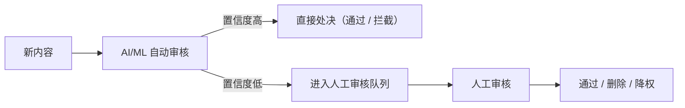
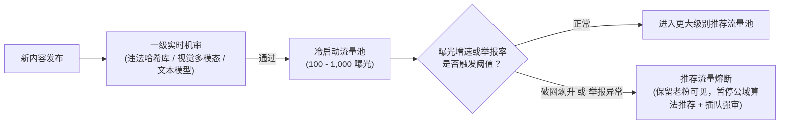

# 社交信息流与内容审核

## 这是什么？

社交信息流（Social Feed）是用户打开 App 看到的那条由帖子、图片、视频组成的内容流。微博首页、朋友圈、抖音推荐页都是信息流。背后有两个核心难题：一是如何高效地把内容分发给数百万用户（信息流生成），二是如何确保平台上不出现违规内容（内容审核）。

信息流的技术挑战在于规模——一个大 V 发一条动态，可能有几千万粉丝需要看到。内容审核的挑战在于平衡——审太严伤害创作者积极性，审太松平台会被有害内容淹没，还可能面临法律风险。两者结合，构成了社交产品最核心的业务逻辑。

## 为什么要懂？

几乎所有带"社交"属性的产品都要面对这两个问题：电商的评论区、在线教育的讨论区、企业内部的动态流、游戏社区的帖子。不是只有微博和抖音才需要信息流和审核。作为开发者，你需要理解 Fan-out 策略对系统架构的影响、UGC 审核流程对产品体验的影响、以及社区治理决策背后的商业考量。这些知识直接影响你的系统设计和技术选型。

## 业务流程

### 内容创作与发布

1. 用户创建内容（文字、图片、视频、链接）
2. 客户端上传媒体文件至对象存储（OSS/S3），获取 URL
3. 提交内容到后端，写入数据库，状态标记为"待审核"或"已发布"（取决于审核策略）
4. 触发内容审核流水线（异步）
5. 审核通过 → 进入信息流分发；审核不通过 → 通知用户并标记原因

### 信息流生成与分发

```
写扩散（Fan-out on Write）：发布时推送到每个粉丝的 Feed 缓存
读扩散（Fan-out on Read）：用户刷新时实时拉取关注者的最新内容
```

1. **写扩散**：用户发布内容后，系统将内容 ID 写入每个粉丝的 Feed 列表（通常用 Redis Sorted Set）
2. **读扩散**：用户请求 Feed 时，系统实时从所有关注者的发布列表中拉取、合并、排序
3. **混合策略**：普通用户用写扩散，大 V（粉丝数超阈值）用读扩散，避免写扩散的爆炸开销

### 互动系统

1. **点赞/反应**：用户对内容表达态度（点赞、爱心、大笑等），写入计数器和关系表
2. **评论**：支持一级评论和嵌套回复，需要独立的审核流水线
3. **分享/转发**：生成新的 Feed 条目，保留原始内容引用
4. **关注/粉丝**：维护关注关系图谱，影响 Feed 生成和推荐

### 内容审核流水线



1. **第一层：自动化审核**——AI/ML 模型对文本、图片、视频进行分类（正常/违规/可疑）
2. **第二层：规则引擎**——关键词过滤、URL 黑名单、重复内容检测
3. **第三层：人工审核**——AI 不确定的内容交给审核员，按优先级排队
4. **第四层：用户举报**——社区成员举报触发二次审核

### 举报与申诉

1. 用户点击举报按钮，选择举报原因（色情、暴力、虚假信息、骚扰等）
2. 举报写入队列，按类型和紧急程度排优先级
3. 审核员处理举报，做出判定（删除内容/警告用户/封禁账号/驳回举报）
4. 被处罚用户收到通知，可发起申诉
5. 申诉进入高级审核队列，由资深审核员复审

## 常见术语

| 术语                                     | 解释                                                         |
| ---------------------------------------- | ------------------------------------------------------------ |
| **Fan-out on Write（写扩散）**           | 内容发布时主动推送到所有粉丝的 Feed 缓存，读取快但写入开销大 |
| **Fan-out on Read（读扩散）**            | 用户请求 Feed 时实时拉取并合并关注者内容，写入轻但读取慢     |
| **UGC（用户生成内容）**                  | 用户自己创作的内容，区别于平台官方生产的 PGC（专业生成内容） |
| **Feed Ranking（信息流排序）**           | 决定用户看到内容顺序的算法，基于时间、互动率、用户兴趣等信号 |
| **内容审核（Content Moderation）**       | 检测和处理违规内容的流程，包括自动化和人工两种方式           |
| **NSFW（不适合工作场合）**               | 包含色情、暴力等不宜公开展示的内容标签                       |
| **影子封禁（Shadow Ban）**               | 用户不知道自己被限制，发的内容只有自己能看到，但不通知用户   |
| **社区准则（Community Guidelines）**     | 平台制定的内容规范，定义什么可以发、什么不能发               |
| **Trust & Safety**                       | 负责平台安全与合规的团队或系统，涵盖审核、反欺诈、反骚扰     |
| **置信度（Confidence Score）**           | AI 审核模型对判定结果的确定程度，低置信度的交给人工          |
| **降权（Demotion/Downrank）**            | 不删除内容但降低其在 Feed 中的排名，减少曝光                 |
| **创作者系统（Creator Program）**        | 平台为网红/内容创作者提供的变现、分析、流量扶持等工具        |
| **Engagement（互动率）**                 | 衡量内容被点赞、评论、分享、停留的程度，是 Feed 排序核心信号 |
| **热门检测（Trending/Viral Detection）** | 识别短时间内互动量激增的内容，用于推荐或风控                 |

## 常见模式

### 模式一：混合 Fan-out 策略

普通用户（粉丝 < 1 万）用写扩散，大 V（粉丝 > 1 万）用读扩散。用户刷 Feed 时，先读缓存中的写扩散结果，再实时拉取大 V 的最新内容，合并排序后返回。

**适用场景：** 所有中大规模社交平台。Twitter/X、Instagram 都采用类似策略。

**取舍：** 架构复杂度高，需要维护两套逻辑。但这是唯一能同时兼顾读写性能的方案。大 V 的粉丝阈值需要根据系统负载动态调整。

### 模式二：多层审核流水线

AI 自动审核处理 90%+ 的内容（毫秒级），可疑内容进入人工队列（分钟到小时级），用户举报触发复审。三层形成漏斗。

**适用场景：** 任何 UGC 平台。日活越高，对自动化的依赖越强。

**取舍：** AI 审核有误判（正常内容被误删、违规内容漏网）。需要持续用人工审核的标注数据反哺模型训练。审核员的心理健康也是必须关注的问题。

### 模式三：发布后审核（Post-first, Review-later）

内容先发布让用户看到，AI 异步审核。如果发现违规，几秒到几分钟内下架。

**适用场景：** 注重创作者体验和内容时效性的平台（Twitter/X、抖音）。

**取舍：** 违规内容可能在审核完成前被大量传播。需要配合热门检测——互动量激增的内容优先审核。

### 模式四：预发布审核（Review-first, Post-later）

内容必须通过审核才能展示。用户发布后看到"审核中"状态。

**适用场景：** 合规要求严格的平台（国内部分平台、儿童社交产品、企业内部社区）。

**取舍：** 延迟高，影响用户体验和创作积极性。但在某些法律环境下是强制要求。

### 模式五：基于互动信号的 Feed 排序

不再纯按时间倒序，而是用算法综合用户兴趣、内容质量、互动预测、时效性等信号排序。

**适用场景：** 追求用户留存和参与度的平台。Facebook、抖音、Instagram 都是算法排序。

**取舍：** 算法排序能提高 Engagement，但可能造成信息茧房、放大争议内容。需要在商业目标和社会责任之间找平衡。部分用户强烈偏好时间序。

### 模式六：影子封禁与渐进式处罚

不直接封号，而是逐步降低违规用户的内容可见度：降权 → 影子封禁 → 限时禁言 → 永久封禁。

**适用场景：** 需要温和处理擦边行为、避免激怒用户的场景。

**取舍：** 影子封禁有伦理争议——用户不知道自己被限制，缺乏透明度。部分司法管辖区可能要求平台告知用户处罚情况。

## 踩坑提醒

1. **写扩散的大 V 问题**：如果不做混合策略，一个千万粉丝的大 V 发一条内容，写扩散要写千万次 Redis，直接拖垮系统。这是面试和实际生产中最经典的坑。
2. **审核延迟与病毒传播**：违规内容一旦成为热门，传播速度远超审核速度。必须建立热门内容快速通道——互动量异常增长的内容自动提升审核优先级。
3. **AI 审核的偏见**：模型可能对特定语言、文化、肤色产生偏见（比如把正常的母乳喂养照片标为 NSFW）。需要多样化的训练数据和定期审计。
4. **审核员心理健康**：长期看违规内容（暴力、色情、虐待）对审核员的心理伤害巨大。需要轮岗机制、心理辅导、限制每日审核量。
5. **举报武器化**：用户恶意举报竞争对手或不喜欢的人，导致正常内容被误删。需要举报者信誉系统——频繁虚假举报的用户降低其举报权重。
6. **Feed 缓存一致性**：用户删除内容后，写扩散已经推给所有粉丝的缓存不会自动更新。需要异步清理或标记删除机制。
7. **创作者流失**：审核过于严格或不透明，创作者会迁移到其他平台。必须提供清晰的社区准则、及时的申诉通道、透明的处罚说明。
8. **年龄限制难执行**：未成年人可以轻松谎报年龄。仅靠注册时填写生日是不够的，需要结合行为分析、家长控制功能、特定内容的年龄门控。
9. **跨语言审核**：平台国际化后，审核模型需要支持多语言。中文谐音梗、英文俚语、阿拉伯语的从右到左排版，都会给审核带来额外挑战。
10. **法律差异**：同一内容在不同国家可能合法或违法。需要根据用户所在地区应用不同的审核策略，这极大增加了系统复杂度。

## 行业实战经验与非显而易见的最佳实践

### 1. 影子封禁（Shadowbanning / 自见他不见）与延迟封禁：打破黑产的规则探测闭环

如果黑产脚本注册账号、发了一条引流黑话，你的接口立刻返回 `403 账号已被封禁` 或提示“包含敏感词”，这等于给黑产提供了一个**毫秒级的免费探测预言机（Oracle）**：攻击者会在几分钟内通过二分法不断微调谐音字、图片噪点或代理 IP，直到试出绕过你风控规则的精确边界。
- **主流内容社区的对抗策略**：
  1. **自见他不见（Shadowban / Ghosting）**：当高风险账号或擦边内容命中策略时，接口照常返回 `200 OK`，且**作者本人（甚至同一设备指纹/局域网 IP 下的关联小号）刷新页面时能看到帖子正常展示、点赞数正常跳动**；但该内容实际上已被拦截在个人沙箱中，不会进入任何公域推荐流、搜索索引或粉丝时间线。黑产脚本会以为发送成功，在死胡同里空耗数天算力。
  2. **随机抖动与批次封禁（Ban Waves）**：对于非紧急的机器养号团伙，风控系统只打标不立即处罚，通过随机延迟（15 分钟~数小时）或定期批次收网，彻底斩断“动作 -> 处罚”之间的因果关联。

### 2. 爆款流量熔断器（Viral Velocity Circuit Breaker：“高互动 ≠ 安全”）

普通人工审核队列的平均响应时间（SLA）可能是 15 分钟。但在短视频或算法推荐信息流（For You Page）中，一条漏过机审的猎奇违规内容往往因为极高的完播率和评论争议，在**人工审核员看到的这 15 分钟内就已经被算法推爆了 200 万次曝光**！



- **生产级护栏（发布与放大解耦）**：把“允许发布（Freedom of Speech）”与“允许算法放大（Freedom of Reach）”彻底解耦。任何新内容一旦跨过曝光增速阈值（例如每分钟新增曝光破万，或即将进入二级大流量池），或者单位曝光举报率偏离基线 $3\sigma$，立即触发**推荐流熔断（Distribution Hold）**——老粉丝和直接链接依然可见，但公域推荐引擎暂停加推，同时工单自动置顶到高优人工复核队列（先审后推）。

### 3. 零宽字符/同形异义字清洗（UTS #39）与审核员双盲校准

- **对抗性文本归一化**：灰产常用零宽空格（`​`）、双向文本翻转控制符（`‮`）或西里尔字母同形字（用俄文字母 `а` 替代英文字母 `a`）绕过分词与敏感词匹配。生产环境在进入任何正则或模型前，必须强制执行 **Unicode NFKC 标准归一化 + 剥离不可见控制字符 + Unicode Confusables 骨架映射（UTS #39）**。
- **审核员保护与多审一致性（Inter-Annotator Agreement）**：不同审核员对边缘社区规则的理解差异极大。成熟平台一方面对高危血腥画面默认开启灰度模糊与静音保护，另一方面将 5% 的边缘工单同时分发给 3 名审核员进行“双盲交叉标注”，实时监控策略漂移与模型误判率。

## 速查表

| 场景                    | 推荐方案                  | 说明                                 |
| ----------------------- | ------------------------- | ------------------------------------ |
| 小型社区（< 10 万用户） | 纯写扩散 + 时间序         | 规模小时写扩散完全够用，不必过早优化 |
| 中大型平台（百万级）    | 混合 Fan-out + 算法排序   | 大 V 读扩散，普通用户写扩散          |
| UGC 审核起步            | 第三方 AI API + 人工兜底  | 不必自建模型，用现成服务快速上线     |
| 高合规场景              | 预发布审核 + 双人复核     | 宁可慢也不能出事                     |
| 创作者平台              | 创作者分级 + 流量扶持工具 | 留住头部创作者是核心竞争力           |
| 直播场景                | 实时 AI 审核 + 关键帧抽检 | 直播无法预审，必须实时处理           |

| 技术组件  | 常用选型                                           | 备注                         |
| --------- | -------------------------------------------------- | ---------------------------- |
| Feed 存储 | Redis Sorted Set / Cassandra                       | 按时间戳排序，支持分页拉取   |
| 关系图谱  | Redis / Neo4j / 图数据库                           | 关注/粉丝/好友关系           |
| 内容存储  | MySQL / PostgreSQL + OSS                           | 结构化数据 + 媒体文件分离    |
| 消息队列  | Kafka / RabbitMQ                                   | Fan-out 异步处理、审核流水线 |
| AI 审核   | Google Cloud Vision / AWS Rekognition / 自建模型   | 图片和视频分类               |
| 文本审核  | OpenAI Moderation API / Perspective API / 自建 NLP | 文本分类和毒性检测           |
| NSFW 检测 | Yahoo Open NSFW / 自建 CNN 模型                    | 色情内容图片分类             |
| 搜索/热门 | Elasticsearch                                      | 热门话题发现、内容搜索       |

| 问题             | 解决方案                                         |
| ---------------- | ------------------------------------------------ |
| Feed 加载慢      | 预计算 Feed 缓存、分页加载、CDN 加速媒体         |
| 大 V 发帖延迟高  | 切换为读扩散、异步处理、拆分写入批次             |
| 误删正常内容     | 降低 AI 阈值进人工队列、建立快速申诉通道         |
| 违规内容漏网     | 提高 AI 敏感度、增加人工抽检比例、优化举报入口   |
| 审核积压         | 提升 AI 自动处理比例、增加审核人员、按优先级分流 |
| 用户恶意举报     | 举报者信誉评分、频繁误报降权、反向处罚           |
| 热门违规内容扩散 | 热门检测 + 自动提升审核优先级 + 临时限流         |
