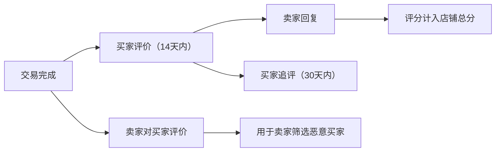
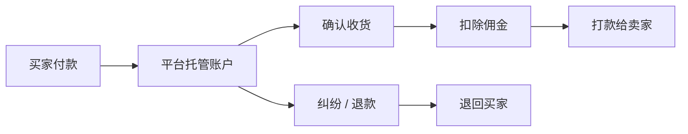

# 电商平台与双边市场

## 这是什么？

双边市场（Two-Sided Marketplace）是连接买方和卖方（或供给方和需求方）的平台。平台自己不拥有商品或提供服务，而是撮合交易、提供基础设施、建立信任机制，从中抽取佣金。淘宝连接商家和消费者，Airbnb 连接房东和房客，Uber 连接司机和乘客，Shopee 连接东南亚的卖家和买家——本质上都是同一个模式。

和自营电商（京东自营、Amazon 自营）不同，平台型业务的核心挑战不是"怎么卖东西"，而是"怎么让买卖双方都来，并且信任这个平台"。

## 为什么要懂？

全球最值钱的互联网公司大多是平台型业务。作为开发者，你大概率会遇到平台型产品——即使你的公司不是 marketplace，也可能有类似的双边撮合场景（B2B 采购平台、内部服务市场、内容创作者平台等）。理解双边市场的动态能帮你做出正确的技术决策：为什么要先做卖家端？为什么评价系统不能马虎？为什么资金不能直接打给卖家？这些都是业务逻辑驱动的技术选型。

## 业务流程

### 冷启动：鸡生蛋问题（Chicken-and-Egg Problem）

没有卖家就没有买家，没有买家就没有卖家——这是所有双边平台的第一个死亡陷阱。

1. **单边先行**：先搞定一边。Uber 先在每个城市补贴司机，有了足够运力再拉乘客。淘宝早期免费让商家入驻
2. **自建供给**：平台自己充当早期供给方。Amazon 早期自营为主，有了流量再开放第三方卖家
3. **垂直切入**：从一个小品类打透。Shopee 早期主攻女装和美妆，做透了再扩品类
4. **补贴策略**：对价格敏感的一方进行补贴。外卖平台烧钱补贴用户，打车平台烧钱补贴司机

### 卖家入驻与验证（Seller Onboarding）

1. **注册申请**：卖家提交基本信息（公司名、联系方式、经营类目）
2. **资质审核**：平台验证营业执照、身份证、品牌授权书等
3. **保证金缴纳**：部分平台要求卖家缴纳保证金（用于赔付纠纷）
4. **店铺开通**：审核通过后开通店铺，卖家可以上架商品
5. **分级体系**：根据销量、评分、违规记录给卖家分级（普通→优选→旗舰）

### 商品上架与目录管理

1. **类目体系（Category Taxonomy）**：平台定义标准类目树（电子产品 > 手机 > 智能手机），卖家选择对应类目
2. **商品属性**：每个类目有标准化属性模板（手机：品牌、屏幕尺寸、内存、颜色）
3. **SKU 管理**：每个变体（颜色+尺寸组合）生成唯一 SKU，绑定库存和价格
4. **内容审核**：平台审核商品图片、标题、描述，过滤违禁品和虚假信息
5. **商品状态**：草稿 → 待审核 → 已上架 → 已下架 → 已删除

### 买卖撮合与搜索排名

1. **搜索引擎**：买家输入关键词，平台返回匹配商品
2. **排序算法**：综合考量相关性、销量、评分、转化率、广告竞价
3. **推荐系统**：基于浏览历史、购买记录、相似用户行为推荐商品
4. **广告竞价**：卖家付费购买关键词排名（类似 Google Ads），是平台重要收入来源
5. **个性化**：不同用户看到不同排序结果——千人千面

### 信任与安全系统（Trust & Safety）

1. **实名认证**：买卖双方实名，降低欺诈风险
2. **评价系统**：交易完成后双方互评（评分 + 文字评价 + 图片）
3. **刷评检测**：识别虚假好评——异常购买模式、同 IP 批量好评、评价内容高度相似
4. **风控系统**：实时监控异常行为（批量注册、异常下单、价格异常）
5. **举报机制**：用户举报假货、侵权、违规行为，平台介入处理

### 评价与评分系统

- **评分维度**：商品描述相符、物流速度、服务态度（Shopee/淘宝模式）
- **加权平均**：近期评价权重更高，防止老店"吃老本"
- **刷评惩罚**：检测到刷评，删除虚假评价 + 降权 + 罚款甚至封店

### 纠纷处理与退款

1. **买家发起纠纷**：商品与描述不符、未收到货、质量问题
2. **双方协商**：平台提供聊天窗口，限时协商（通常 3-5 天）
3. **平台介入**：协商失败，平台客服介入仲裁，查看聊天记录和物流信息
4. **退款决定**：全额退款、部分退款、仅退款不退货（低价商品常见）
5. **保证金扣除**：严重违规从卖家保证金中扣款赔付买家

### 资金托管（Escrow）

资金不直接从买家到卖家，而是经过平台托管：

这是平台建立信任的核心机制。没有 Escrow，买家怕付了钱收不到货，卖家怕发了货收不到钱。

### 佣金与费用模式

平台的盈利方式通常是多元组合：

| 收入类型                  | 说明               | 案例                                         |
| ------------------------- | ------------------ | -------------------------------------------- |
| **交易佣金（Take Rate）** | 每笔交易抽成       | Shopee 5-10%，Airbnb 3%（房东）+ 14%（房客） |
| **广告收入**              | 卖家付费买曝光     | 淘宝直通车，Amazon Sponsored Products        |
| **入驻费/年费**           | 卖家定期缴纳       | Amazon Professional 月费 $39.99              |
| **增值服务**              | 物流、仓储、金融   | Amazon FBA，Shopee 物流                      |
| **保证金利息**            | 托管资金的利息收入 | 大体量平台的隐性收入                         |

## 常见术语

| 术语                                | 解释                                                        |
| ----------------------------------- | ----------------------------------------------------------- |
| **GMV（Gross Merchandise Volume）** | 平台总交易额，衡量平台规模的核心指标                        |
| **Take Rate**                       | 佣金率——平台从每笔交易中抽取的百分比                        |
| **Escrow**                          | 资金托管——买家的钱暂存平台，确认收货后才给卖家              |
| **SKU**                             | 库存单位——每个商品变体的唯一编码                            |
| **MAU/DAU**                         | 月活/日活用户数——衡量平台活跃度                             |
| **鸡生蛋问题**                      | 双边平台冷启动困境：没买家就没卖家，没卖家就没买家          |
| **网络效应（Network Effect）**      | 用户越多平台越有价值，形成正反馈循环                        |
| **流动性（Liquidity）**             | 买家能快速找到想要的商品，卖家能快速成交                    |
| **DSR（Detail Seller Rating）**     | 卖家详细评分——商品描述、物流、服务的分项评分                |
| **Buy Box**                         | Amazon 独有概念——同一商品多个卖家中，谁获得"加入购物车"按钮 |
| **FBA（Fulfillment by Amazon）**    | 卖家把货发到 Amazon 仓库，Amazon 负责仓储和发货             |
| **SLA（Service Level Agreement）**  | 服务等级协议——平台对卖家的履约时效要求                      |
| **C2C / B2C / B2B**                 | 消费者对消费者 / 企业对消费者 / 企业对企业                  |

## 常见模式

### 模式一：轻量撮合型

平台只负责信息展示和匹配，不介入交易履约。早期的 58 同城、Craigslist。

**优点：** 开发简单，运营轻。
**缺点：** 信任差，欺诈多，平台难以变现。用户倾向于绕开平台私下交易（跳单）。

### 模式二：托管交易型

平台介入交易全流程：支付托管、纠纷仲裁、评价体系。淘宝、Shopee、Airbnb。

**优点：** 信任度高，用户粘性强，平台有清晰的佣金收入。
**缺点：** 运营复杂，需要客服团队、风控系统、资金合规。

### 模式三：全托管型（Fully Managed）

平台深度介入：统一定价、统一仓储物流、统一客服。Amazon FBA、Temu、拼多多全托管。

**优点：** 用户体验一致，品控有保障。
**缺点：** 平台运营成本极高，卖家自主权低，对卖家吸引力可能下降。

### 模式四：服务市场型

撮合的不是实物商品而是服务。Uber（出行）、Airbnb（住宿）、猪八戒（设计服务）。

**优点：** 无库存，边际成本低。
**缺点：** 服务质量难标准化，依赖评价系统维持质量。

## 踩坑提醒

- **Take Rate 定太高**：卖家会跳单（加微信私下交易）或转去竞品平台。Shopee 早期靠零佣金抢 Lazada 的卖家就是经典案例
- **只看 GMV 不看 Take Rate**：GMV 1000 亿但 Take Rate 只有 1% 和 GMV 100 亿但 Take Rate 10% 的平台，实际收入一样。别被 GMV 唬住
- **刷评放任不管**：评价系统一旦失去可信度，整个平台的信任基础崩塌。Amazon 为打击刷评投入了大量机器学习资源
- **Escrow 资金合规**：托管资金涉及金融牌照，不同国家法规不同。没有牌照做资金托管是违法的
- **卖家体验被忽视**：很多平台只关注买家体验，忘了卖家也是用户。卖家后台难用、提现慢、规则不透明会导致优质卖家流失
- **类目体系没规划好**：类目树一旦上线就很难改，因为大量商品已经挂在上面了。前期要花足够时间设计
- **纠纷处理不公平**：偏向买家太多（无脑退款）会伤害卖家，偏向卖家太多会伤害买家。需要平衡
- **多卖家购物车**：一个订单包含多个卖家的商品，运费分别计算、分别发货、分别退款——复杂度指数级增长
- **跨境结算**：涉及汇率、外汇管制、不同国家的税务规则。Shopee 在东南亚多国运营，每个国家的支付和结算都不一样

## 行业实战经验与非显而易见的最佳实践

### 1. 平台代扣代缴连带税责（Marketplace Facilitator）与 KYB / 1099-K / 欧盟 DAC7 法定申报

**实战教训：** 某出海双边平台早期将自己定位为“纯信息撮合与技术服务方”，在结算时仅扣除 10% 平台佣金，将剩余 90% 连同买家支付的税费全额打给卖家，默认由卖家自行向税务局申报。两年后，美国各州税务局与欧盟税务稽查部门开出数百万美元罚单：根据美国 **Marketplace Facilitator（平台促进者法案）**、欧盟 VAT **视同供应商规则（Deemed Supplier）** 以及东南亚数字税法规，一旦平台交易额达到经济联结阈值（Economic Nexus），**平台本身在法律上就是法定纳税义务人**，必须直接计算、代扣并直接向税局解缴消费税/VAT。更糟的是，数千名活跃卖家入驻时未完成税号（TIN/SSN/VAT）强校验，年底平台试图补收 W-9 表格以向 IRS 申报 **1099-K**（以及向欧盟申报 **DAC7** 卖家跨境收入报告）时，大批卖家直接弃店跑路或填写虚假税号，导致平台被迫自行承担高达 24% 的法定预扣税（Backup Withholding）兜底责任。

**非显而易见的最佳实践：**
- **收单即分账的税务隔离账本（Tax Split at Capture）：** 严禁让代收税款进入卖家可提现余额。在买家支付成功（Capture）的瞬间，一笔 100 美元商品 + 8.25 美元消费税的订单必须在复式账本中拆分为三条完全隔离的分录：
  1. 贷记 `卖家待结算账户（Seller_Payable）`：$\$90.00$（商品净价减去 $\$10.00$ 佣金）
  2. 贷记 `平台佣金收入账户（Platform_Revenue）`：$\$10.00$
  3. 贷记 `代扣税款托管专户（Tax_Liability_Escrow）`：$\$8.25$（由平台直接对接 Avalara / Stripe Tax 向各州/各国税局解缴，完全独立于卖家结算流）
- **渐进式 KYB 提现熔断门禁（Progressive KYB Gates）：** 绝不要等到年底报税季才收集税务信息。将卖家累计 GMV 与法定申报线挂钩设置双层门禁：当卖家年内累计收款达 $\$400$ 时弹窗预警要求补充税号；达到 $\$550$（低于美国 1099-K 申报阈值或欧盟 DAC7 2000 欧元/30 笔订单门槛）且未通过 IRS TIN 实时核验或欧盟 VIES VAT 校验时，**自动冻结提现通道**（允许继续接单但资金只进不出），彻底消除平台兜底税责。

### 2. 滚动保证金（Rolling Reserves）与长尾拒付（Chargeback）下的卖家负余额追偿

**实战教训：** 某演出票务与数码预售平台采用固定 `T+2` 结算策略（发货或出票后 2 天即可提现）。某不法商家上架了总价值 40 万美元的 60 天后音乐节门票与预售游戏机，通过上传廉价钥匙扣的真实快递单号骗过系统的“物流已签收自动放款”规则，在 `T+2` 提走全部 40 万美元后销声匿迹。60 天后演出临近，数千名买家向发卡行发起“未收到商品/服务（Services Not Rendered）”信用卡拒付（卡组织允许在交易后 **120 天**内发起拒付，远期票务/旅游甚至长达 **540 天**）。此时卖家平台余额为 `0`，绑定的银行卡也已清空，平台只能自掏腰包赔付全部 40 万美元本金及每笔 15 美元的卡组织拒付罚金。

**非显而易见的最佳实践：**
- **动态滚动保证金（Rolling Reserves）与履约日锚定托管：** 切勿对所有品类和卖家一刀切使用固定 `T+N` 打款。为每位卖家设立独立的**滚动保证金子账户（Reserve Sub-Ledger）**，从每笔结算款中动态截留 10%–25% 锁定 30–90 天，滚动释放以覆盖长尾退货与信用卡拒付风险。对于预售、演出票务、酒店旅游等远期履约品类，打款锚定基准必须是 `实际履约完成日（Event Date） + 7 天`，而非下单日或发货日。
- **提现速率熔断与负余额四级追偿瀑布（Recovery Waterfall）：** 当卖家单周 GMV 突增至过去 30 天均值的 $3$ 倍以上，或纠纷率突破 $1.5\%$ 时，风控引擎应自动将其结算周期从 `T+2` 降级为 `T+30`。一旦发生拒付导致卖家可用余额扣穿为负数（Negative Balance），系统按以下瀑布流自动追偿：
  1. 优先抵扣 `在途待结算资金（Pending Settlement）`；
  2. 划扣 `滚动保证金与店铺押金（Rolling Reserve & Security Deposit）`；
  3. 触发签约绑定的企业对公账户 **ACH Direct Debit / SEPA 直接借记协议**或备用信用卡代扣。

### 3. 双边合谋与三角欺诈（Triangulation Fraud：黑卡洗钱与补贴套利）

**实战教训：** 传统风控往往假设“坏买家骗好卖家”或“坏卖家骗好买家”。但在一次“新客满 100 减 30”大促中，平台 GMV 暴涨，一个月后却迎来 8% 的毁灭性信用卡盗刷拒付。复盘发现黑产正在利用双边市场进行**自买自卖合谋**与**三角欺诈**：
1. **黑卡洗钱与套补（Collusion / Wash Trading）：** 黑产同时注册“卖家店铺”（上架 500 元的虚拟壁纸或高溢价数据线）和几百个“买家小号”，用暗网买来的盗刷信用卡（或叠加平台新客满减券）在自己店里下单，秒点发货并确认收货，将黑卡资金和平台补贴洗成干净的平台结算款提现跑路。
2. **三角欺诈（Triangulation Fraud）：** 骗子在你的平台上开店，以 8 折低价挂售正品乐高玩具。真实买家在你的平台下单付款后，骗子拿着真实买家的收货地址，去沃尔玛官网用**盗刷的他人信用卡**原价买下乐高并直接寄给你的买家。真实买家收到了正品乐高并给出五星好评；骗子从你的平台提走干净的货款；而沃尔玛收到失主拒付报警后，警方顺着收货地址直接找上了你平台上完全不知情的真实买家！

**非显而易见的最佳实践：**
- **二分图闭环团伙检测（Bipartite Graph Collusion Detection）：** 将买家、卖家、设备指纹、IP 自治域（ASN）、收款卡、收货地址构建成实时二分交易图。在放款前拦截**高排他性闭环子图**：若某新店铺 $>30\%$ 的 GMV 来自“只在该店消费”的买家集群，或买卖双方存在设备环境熵重合、同基站/同 Wi-Fi BSSID、收发货直线距离 $<500$ 米等特征，立即冻结打款并转入反洗钱（AML）调查。
- **补贴不倒挂铁律（Subsidy-to-Payout Invariant）：** 架构层强制校验：对于任何普通第三方卖家订单，**卖家最终实得结算款必须严格小于买家实际自付现金（即 $\text{Seller Payout} < \text{Buyer Cash Paid}$）**，或严格限制单店单日可核销的平台出资补贴总额，从数学上消灭“空手套取平台补贴”的套利空间。
- **反三角欺诈物流溯源：** 校验卖家回传运单的发件人账号归属与始发地一致性。若某个人卖家频繁上传带有亚马逊自营物流（TBA）或大型零售商大客户月结前缀的运单，或同一家小店的发货始发仓遍布全国几十个毫无关联的城市，自动触发进货发票与库存实拍核验，阻断三角盗刷销赃链路。

## 速查表

| 组件       | 关键考虑                             |
| ---------- | ------------------------------------ |
| 冷启动     | 先搞定哪一边？补贴策略、垂直切入点   |
| 卖家入驻   | 资质审核、保证金、分级体系           |
| 商品管理   | 类目体系、属性标准化、内容审核       |
| 搜索排名   | 相关性、销量权重、广告竞价、千人千面 |
| 信任安全   | 实名认证、风控规则、举报处理         |
| 评价系统   | 多维评分、刷评检测、加权算法         |
| 纠纷处理   | 协商 → 仲裁 → 退款/赔付流程          |
| 资金托管   | Escrow 机制、打款周期、金融合规      |
| 佣金模式   | Take Rate 设计、广告收入、增值服务   |
| 平台治理   | 规则制定、违规处罚、卖家申诉通道     |
| 多卖家订单 | 拆单逻辑、分别计算运费、分别退款     |
| 跨境合规   | 汇率、税务、支付牌照、数据隐私       |
