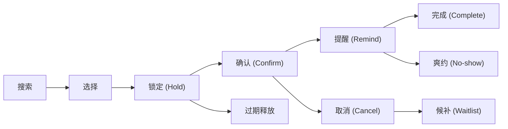

# 预订与预约系统

## 这是什么？

预订系统就是让用户在未来某个时间锁定某个资源的应用。资源可以是酒店房间、餐厅座位、医生门诊、会议室、机票座位、健身课程——任何有容量限制且按时间分配的东西。你作为开发者要解决的核心问题是：在同一个时间段内，多个人想要同一个资源，怎么公平、准确、可靠地分配。

## 为什么要懂？

预订系统几乎无处不在。SaaS 日历排期、医疗挂号、酒旅平台、共享办公、美容美发——你迟早会碰到。这类系统的难点不在 CRUD，而在并发控制、时间计算、状态管理和业务规则的复杂交织。不理解业务流程，你很容易写出"技术上能跑但现实中全是 bug"的东西——比如不处理时区的跨国预订、忘了缓冲时间导致背靠背排期、或者没有超卖策略让航空公司亏钱。

## 业务流程

### 预订生命周期

这是预订系统的核心状态机：



1. **搜索**：用户输入日期、时间、人数、地点等条件，系统返回可用选项
2. **选择**：用户挑选合适的时段/资源
3. **锁定 (Hold)**：系统临时预留该资源（通常 10-30 分钟），防止其他人同时预订。这一步至关重要——没有锁定就会出现 double booking
4. **确认 (Confirm)**：用户完成支付或提交最终确认，预订正式生效
5. **提醒 (Remind)**：系统在预订前发送提醒（邮件、短信、Push），减少爽约率
6. **完成 (Complete)**：用户如约到达，服务完成
7. **取消 (Cancel)**：用户或系统取消预订，资源释放回可用池

### 可用性管理

可用性是预订系统的基础——用户能订什么、什么时候能订。

- **时段 (Time Slot)**：把一天切成固定时段（30 分钟、1 小时）。适合门诊、美发等场景
- **日历视图 (Calendar)**：按天/周/月展示可用性。每个格子显示剩余容量
- **库存 (Inventory)**：酒店有 100 间房、航班有 200 个座位——这就是库存。每次预订消耗一个单位
- **容量控制**：一个时段可以容纳多个预订（比如瑜伽课 20 人），也可以只能一个（比如 1v1 咨询）

### 超卖策略

航空公司和酒店故意卖出超过实际容量的票/房间，因为历史数据表明一定比例的人会取消或爽约。

- **航空超卖**：一架 180 座的飞机可能卖 190 张票。如果所有人都来了，就要花钱请人自愿改签（补偿 + 改下一班）
- **酒店超卖**：100 间房卖 105 个预订。如果全到了，把溢出客人安排到附近同等级酒店（walk 客人）
- **超卖率**：根据历史 no-show 率和取消率动态调整。通常 5-15%
- **风险**：超卖过头会损害品牌声誉，超卖不够会浪费库存。这是个数据驱动的平衡

### 取消政策

取消政策直接影响预订转化率和商家收入：

- **免费取消 (Free Cancellation)**：预订后 X 小时内或入住前 Y 天可免费取消。转化率最高，但商家风险也最大
- **灵活取消 (Flexible)**：可以取消但收取部分费用（比如首晚房费、20% 手续费）
- **严格取消 (Strict / Non-refundable)**：不可退款或只退很小一部分。价格通常更低，用折扣换确定性
- **阶梯式取消**：离预订日期越近，取消费越高（7 天前免费，3 天前 50%，当天 100%）

### 候补名单 (Waitlist)

当所有时段/库存已满时：

1. 用户加入候补名单，留下联系方式
2. 有人取消或新增库存时，系统按顺序通知候补用户
3. 候补用户在限定时间内确认（通常 30 分钟到几小时），否则名额给下一位
4. 候补优先级可以基于：先到先得、会员等级、出价高低

### 爽约处理与罚金

用户预订了但没出现（No-show）是预订系统的大敌：

- **罚金**：收取全部或部分费用。餐厅可能收取每人 50-200 元的 no-show 费
- **积分惩罚**：扣减会员积分或降级
- **限制未来预订**：多次爽约后限制预订权限或要求预付
- **宽限期 (Grace Period)**：迟到 15 分钟内不算爽约，超过自动取消

### 动态定价

价格根据供需实时变动：

- **需求驱动**：周末、节假日、旺季价格上涨；工作日、淡季打折
- **剩余库存**：剩余越少价格越高（机票越晚买越贵）
- **提前预订折扣 (Early Bird)**：提前 30/60/90 天预订享受折扣
- **最后时刻优惠 (Last Minute)**：临近日期的空余库存低价甩卖
- **算法定价**：基于历史数据、竞品价格、当前需求的机器学习模型

### 周期性预订

用户定期预订同一资源（每周二下午 3 点的会议室、每周四的私教课）：

- 生成规则：RRULE 格式（类似 iCalendar 标准），定义频率、间隔、结束条件
- 冲突检测：生成所有实例后检查每个实例是否与已有预订冲突
- 单次修改：允许修改或取消单次实例而不影响整个系列
- 批量操作：一次取消整个系列，或从某个日期起取消后续所有实例

### 多资源调度

有些预订需要同时锁定多个资源：

- **医疗场景**：一个手术需要同时预订手术室 + 麻醉师 + 主刀医生 + 护理团队
- **会议场景**：会议室 + 投影设备 + 茶歇服务
- **调度算法**：找到所有资源同时可用的时段交集
- **原子性**：要么全部资源都锁定成功，要么全部回滚。不能只订到房间没订到设备

### 团体预订

多人一起预订（旅行团、公司团建、婚宴）：

- **名额管理**：团体占用大块库存，需要特殊审批流程
- **部分确认**：先锁定一个预估人数，后续逐步确认实际参加人数
- **分账**：团体预订可以由组织者统一付款，也可以让每个成员分别付款
- **最低人数**：低于最低人数取消活动或加收费用

### 预订修改

已确认的预订需要改时间、改资源或改人数：

- 把修改当作"取消旧预订 + 创建新预订"的原子操作
- 检查新时段的可用性
- 计算差价（升级补差价、降级退差价）
- 保留原始预订 ID 以维护审计记录

## 常见术语

| 术语                    | 解释                                                   |
| ----------------------- | ------------------------------------------------------ |
| **Availability**        | 可用性——某资源在某时段是否可预订                       |
| **Time Slot**           | 时段——可预订的最小时间单位                             |
| **Hold / Tentative**    | 临时锁定——资源被预留但尚未正式确认                     |
| **Confirmed**           | 已确认——预订正式生效                                   |
| **No-show**             | 爽约——用户预订了但没有出现                             |
| **Overbooking**         | 超卖——故意售出超过实际容量的预订                       |
| **Waitlist**            | 候补名单——满员后排队等待空位                           |
| **Buffer Time**         | 缓冲时间——两个预订之间的间隔（清洁、准备）             |
| **Lead Time**           | 提前时间——最早可以提前多久预订                         |
| **Cut-off Time**        | 截止时间——最晚可以在多久前预订                         |
| **Cancellation Window** | 取消窗口——允许免费取消的时间范围                       |
| **Dynamic Pricing**     | 动态定价——根据供需变动的价格                           |
| **RRULE**               | 循环规则——iCalendar 标准中定义周期性事件的格式         |
| **Double Booking**      | 重复预订——同一资源在同一时段被预订两次（通常是 bug）   |
| **Walk (酒店)**         | 因超卖将客人转移到其他酒店                             |
| **Yield Management**    | 收益管理——通过调整价格和库存最大化总收入               |
| **Channel Manager**     | 渠道管理器——同步多个 OTA 平台库存的工具                |
| **OTA**                 | 在线旅行社 (Online Travel Agency)——如携程、Booking.com |

## 常见模式

### 模式一：基于时段的预订

把一天分成固定时段，用户选择一个时段。适合门诊、美发、餐厅、健身课。

**实现要点：** 定义营业时间和时段长度，计算每天的可用时段列表，用状态标记每个时段（空闲/已占/锁定）。

**取舍：** 简单直观，但灵活性低。不同服务时长不同时（剪发 30 分钟 vs 染发 2 小时），需要跨时段预订。

### 模式二：基于库存的预订

不按时段，按可用数量。某一天有 50 间房、200 张票——用户预订消耗一个单位。适合酒店、机票、活动门票。

**实现要点：** 每天/每班次维护一个库存计数器，用原子操作（数据库事务或乐观锁）扣减库存，防止超卖。

**取舍：** 不需要精确到分钟，但需要处理超卖策略和渠道同步。

### 模式三：基于资源的调度

每个具体资源（某间会议室、某位医生、某台设备）有自己的时间表。预订指定绑定到具体资源。

**实现要点：** 为每个资源维护独立日历，查询可用性时遍历所有符合条件的资源，多资源预订需要计算时段交集。

**取舍：** 最灵活但最复杂。资源之间的依赖关系和冲突检测是难点。

### 模式四：市场平台模式

平台聚合多个服务提供者（Airbnb、美团、携程），用户在平台上浏览和预订。

**实现要点：** Channel Manager 同步多平台库存、统一取消政策映射、评价体系、分账逻辑。

**取舍：** 库存同步是最大挑战——一间房在携程和 Booking.com 同时被订会造成 double booking。

## 踩坑提醒

- **时区陷阱**：用户在北京选了东京酒店的"3月5日"——是北京时间还是东京时间？所有时间必须存储为 UTC，展示时转换为用户本地时区或资源所在时区。明确标注时区。
- **缓冲时间遗漏**：两个 1 小时的预订背靠背排在 10:00-11:00 和 11:00-12:00。中间没留打扫/准备时间。每个预订后面必须加 Buffer Time（15 分钟清洁、30 分钟翻台等）。
- **锁定超时不释放**：用户选了时段进入支付页面，然后关掉浏览器。如果没有超时释放机制，这个时段就永远被占着。用定时任务（cron job）或 TTL 清理过期的 Hold。
- **并发竞争**：两个用户同时点击同一个时段的"预订"按钮。必须用数据库事务、乐观锁（version 字段）或分布式锁来保证只有一个人成功。
- **跨天预订**：酒店入住 3 月 5 日，退房 3 月 7 日——占用的是 5 号和 6 号两晚，7 号的房间是可用的。日期范围计算要用"左闭右开"区间 `[checkIn, checkOut)`。
- **夏令时问题**：美国/欧洲有夏令时切换。3 月某天凌晨 2 点跳到 3 点——如果你预订了 2:30 的时段，它不存在。用 IANA 时区库（如 `date-fns-tz`、`luxon`）处理。
- **周期性预订与假期冲突**：每周二的定期预订碰上节假日闭馆。需要维护假期日历，自动跳过或提前通知用户。
- **修改不是简单的 UPDATE**：改预订时间不能直接改数据库字段。要检查新时段可用性、重新计算价格、处理差价——把它当作取消+重建的原子操作。
- **多渠道库存不同步**：房间在自有网站和 OTA 同时可订，两边同时卖出最后一间。必须用 Channel Manager 实时同步，或者给不同渠道分配固定配额。

## 行业实战经验与非显而易见的最佳实践

### 1. 跨日期库存防超卖：按“入住晚（Room-Night）”拆行锁 vs PostgreSQL 区间排他约束

新手做酒店、民宿或租车预订时，喜欢只建一张订单表 `bookings(resource_id, start_date, end_date)`，下单前执行 `SELECT COUNT(*) ... WHERE start_date < :end AND end_date > :start`。在数据库默认的 `READ COMMITTED` 隔离级别下，两个并发请求分别预订 `6月1日–6月4日` 和 `6月3日–6月6日`（在 6月3日 发生交叉重叠），两个事务同时查出 `COUNT = 0`，随后双双写入成功——瞬间发生**交叉日期超卖**！
- **两种经过大规模生产验证的解法**：
  1. **按天/按晚拆分的库存格子表（酒旅行业标准）**：预先按 `(room_type_id, stay_date)` 为每一晚生成一行库存记录。用户预订 `6月1日入住、6月4日离店`（共 3 晚）时，严格按日期升序（防止交叉死锁）执行一条原子更新：`UPDATE room_night_inventory SET available = available - 1 WHERE room_type_id = $1 AND stay_date IN ('2026-06-01', '2026-06-02', '2026-06-03') AND available > 0`，并校验受影响行数是否严格等于 `3`；若不足 3 行则立即回滚。
  2. **PostgreSQL `EXCLUDE USING gist` 区间排他约束（特定会议室/医生/球场）**：如果必须绑定具体物理个体与任意起止时间戳，直接在数据库层对 `(resource_id, tstzrange(start_at, end_at, '[)'))` 建立 GiST 排他索引，由存储引擎从数学底层拒绝任何时间段重叠的写入。

```mermaid
flowchart LR
    Req["预订 6月1日入住 -> 6月4日离店<br/>(共 3 个间夜)"] --> Sort["按日期升序锁定间夜行<br/>2026-06-01, 2026-06-02, 2026-06-03"]
    Sort --> Check{"是否全部 3 行均扣减成功<br/>且 available >= 0？"}
    Check -->|是 (影响 3 行)| Hold["生成 10 分钟待支付锁库单"]
    Check -->|否 (< 3 行)| Rollback["回滚事务并提示所选日期已满房"]
```

### 2. “售卖房型容量”与“分配物理房间号”解耦（防日历碎片化 / 俄罗斯方块排房）

如果一家酒店有 50 间豪华大床房，允许客人在预订时提前 3 个月选定具体房间号（例如 `304 房`），日历很快就会变成“瑞士奶酪”：`304 房`周一周二有人住，`305 房`周二周四有人住，`306 房`周四周五有人住——此时一个想连住 4 晚（周一至周五）的高价值客人来搜索，系统会提示**“全部满房”**，哪怕酒店每一晚都有空房间！
- **酒旅与航司的收益管理铁律**：预订阶段永远只售卖**同质化的房型容量池（Category Pool，如“豪华大床房”）**，绝不提早锁死具体物理房间号；直到入住前 24 小时，才由后台排房引擎运行**区间装箱算法（Tetris Bin-Packing）**，将零散订单紧凑拼接到同一间物理房，把连续空置天数腾出来卖给长住客。

### 3. 未来预约为什么绝对不能只存 UTC 时间戳？（Wall-Clock Local Time + IANA 时区）

几乎所有后端教科书都教导“数据库里的时间一律转成 UTC 存储”。**但在未来线下预约场景（看病、理发、航班、酒店入住）中，只存 UTC 时间是一个经典的线上事故源。**
- **真实故障场景**：用户在 1 月份预约了伦敦或纽约某诊所 `4月15日 上午 9:00` 的门诊。如果服务端在 1 月份按当时的冬令时偏移量把时间转成 UTC 存进数据库，到了 3 月份进入夏令时（或者某国政府临时宣布废除/调整夏令时切换日），当 4 月 15 日到来时，原本存的 UTC 时间换算回当地钟表时间就变成了 `上午 10:00`——导致全院患者集体迟到或早到 1 小时！
- **黄金准则**：对于未来的本地事件，数据库必须原样存储**当地挂钟时间（Wall-Clock Time，如 `2026-04-15T09:00:00`）+ IANA 时区标识符（如 `Europe/London`）**，并根据最新的时区规则库（`tzdata`）动态计算 UTC 触发时刻。

## 速查表

| 组件       | 关键考虑                                      |
| ---------- | --------------------------------------------- |
| 可用性引擎 | 时段 vs 库存 vs 日历，容量上限，营业时间规则  |
| 锁定机制   | Hold 超时时长，TTL 自动释放，并发控制         |
| 确认流程   | 支付集成，确认邮件/短信，日历同步（.ics）     |
| 取消政策   | 免费/灵活/严格，阶梯式费率，退款逻辑          |
| 提醒系统   | 多渠道（邮件、短信、Push），提前 24h/2h/30min |
| 爽约处理   | 宽限期，罚金规则，未来预订限制                |
| 超卖策略   | 超卖比例，补偿方案，风险控制                  |
| 候补名单   | 排队逻辑，限时确认，优先级规则                |
| 动态定价   | 供需模型，早鸟/尾单折扣，竞品对标             |
| 时区处理   | UTC 存储，本地化展示，夏令时兼容              |
| 周期预订   | RRULE 解析，冲突检测，单次修改 vs 批量操作    |
| 多资源调度 | 时段交集计算，原子锁定，回滚机制              |
| 渠道同步   | Channel Manager，配额分配，实时库存更新       |
| 预订修改   | 可用性检查，差价计算，审计日志                |
