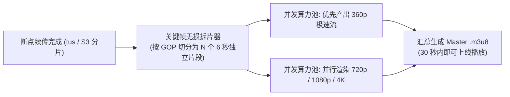

# 视频与直播

## 这是什么？

视频与直播就是让用户在你的平台上**看视频**和**看直播**。点播（VOD）是用户随时看已经录好的内容，比如 B 站、YouTube、Netflix；直播是实时的，主播推流、观众拉流，比如抖音直播、Twitch、快手。作为 Web 开发者，你可能需要构建视频上传转码流水线、接入直播协议、实现弹幕系统、对接 CDN 分发，甚至处理 DRM 版权保护。

与普通的图文内容不同，视频文件**巨大**（一分钟 1080p 视频约 100-200MB），传输和存储成本高出几个数量级。直播还多了**实时性**要求——延迟超过 3 秒，观众和主播就没法互动了。这两个特点决定了视频业务的技术栈和架构与常规 Web 应用截然不同。

## 为什么要懂？

视频业务踩坑的代价极高。一个转码配置错误，可能导致几万条视频全部无法播放；CDN 没配好，用户看视频卡顿，直接流失；直播推流协议选错，延迟从 1 秒变成 30 秒，弹幕互动完全废掉；DRM 没做好，付费内容被盗版，版权方找你索赔。

更重要的是，视频是**吃带宽和算力的怪兽**。转码一个小时的 4K 视频需要几十分钟 GPU 时间，一场百万人观看的直播每秒消耗几十 Gbps 带宽。不懂业务逻辑就开发，要么烧钱烧到关服务器，要么用户体验差到没人用。

## 业务流程

### 视频上传流水线

1. 用户在客户端选择视频文件，前端做格式和大小校验
2. 向服务端申请上传凭证（预签名 URL 或 STS 临时令牌）
3. 客户端通过**分片上传**直传到对象存储（S3、OSS），避免视频经过应用服务器
4. 上传完成后，对象存储触发回调通知，后端记录原始视频元信息
5. 自动触发转码任务（见下一步）

### 转码（Transcoding）

1. 消息队列收到转码任务，分配给转码集群（FFmpeg / 云转码服务）
2. **多码率转码**：将原始视频转为多个分辨率和码率版本（如 360p / 720p / 1080p / 4K）
3. **编码格式**：主流使用 H.264（兼容性最好）、H.265/HEVC（压缩率高 50%）、AV1（开源免费但编码慢）
4. 生成自适应码率清单文件（HLS 的 `.m3u8` 或 DASH 的 `.mpd`）
5. 转码完成后通知后端，更新视频状态为"可播放"

### HLS/DASH 自适应码率

1. 播放器请求清单文件，获取所有可用码率列表
2. 根据用户当前网络带宽，自动选择合适的码率版本
3. 播放过程中持续监测网速，**无缝切换**码率（网络差降到 360p，恢复后升到 1080p）
4. HLS（HTTP Live Streaming）：苹果主推，兼容性最好，延迟约 10-30 秒
5. DASH（Dynamic Adaptive Streaming over HTTP）：开放标准，灵活性更强
6. 低延迟方案：LL-HLS、LL-DASH、WebRTC（可做到亚秒延迟）

### CDN 分发

1. 转码后的视频切片分发到全球 CDN 节点（边缘缓存）
2. 用户请求时就近返回视频内容，减少回源延迟
3. 热门视频会被 CDN 主动预热（预先推送到边缘节点）
4. 长尾视频采用按需回源策略，节省存储成本
5. 防盗链：通过签名 URL、Referer 白名单、Token 鉴权防止未授权访问

### 直播推流/拉流

1. **推流**：主播端通过 OBS 等工具，使用 RTMP 协议将音视频流推送到直播服务器
2. **媒体服务器**：接收 RTMP 流，实时转码为多码率，切片为 HLS/FLV 格式
3. **拉流**：观众端通过 HTTP-FLV（低延迟约 2-5 秒）或 HLS（兼容性好但延迟 10 秒+）拉取直播流
4. **连麦互动**：使用 WebRTC 实现主播间或主播与观众的实时音视频通话（延迟 < 500ms）
5. **流状态管理**：推流开始/中断/恢复的回调通知，断流自动重连，直播间状态同步

### 弹幕/实时聊天

1. 弹幕消息通过 WebSocket 长连接实时推送
2. 消息结构：发送者、内容、时间戳、颜色/位置等样式信息
3. **消息分发架构**：WebSocket 网关 → 消息中间件（Redis Pub/Sub 或 Kafka） → 房间内所有连接
4. **弹幕密度控制**：高峰时段采样或合并展示，防止屏幕被刷爆
5. **敏感词过滤**：消息发送前过关键词库 + AI 审核，拦截违规内容
6. 直播结束后弹幕归档，点播回放时按时间轴重放

### 变现模式

1. **打赏/礼物**：观众购买虚拟礼物赠送给主播，平台抽成（通常 30%-70%）
2. **会员/订阅**：付费会员解锁高清画质、独家内容、免广告等特权
3. **广告插入**：
   - 前贴片（Pre-roll）：播放前的广告
   - 中插（Mid-roll）：播放中间插入
   - 后贴片（Post-roll）：播放结束后
   - 服务端广告插入（SSAI）：广告拼接在视频流中，广告拦截器无法屏蔽
4. **付费点播**：单片购买或租借（如 iTunes、Amazon Prime Video）
5. **电商带货**：直播间内挂商品链接，观众边看边买

### 点播回放管理

1. 直播结束后自动生成回放视频（录制原始流）
2. 回放视频进入转码流水线，生成多码率版本
3. 编辑功能：裁剪精彩片段、添加字幕、合并多机位
4. 弹幕数据与视频时间轴关联，回放时同步展示
5. 回放视频可设置为公开、仅粉丝可看、付费观看等不同权限

### DRM 内容保护

1. **加密切片**：视频切片使用 AES-128 或 Sample AES 加密
2. **许可证服务器**：播放器向许可证服务器请求解密密钥，服务器验证用户权限后下发
3. **主流 DRM 方案**：
   - Widevine（Google，Android/Chrome）
   - FairPlay（Apple，Safari/iOS）
   - PlayReady（Microsoft，Edge/Windows）
4. **多 DRM 集成**：通常需要同时支持三家，根据客户端自动选择
5. **防录屏**：通过硬件级 DRM（L1）保护，软件层面加水印追踪泄露源

### 缩略图生成

1. 转码完成后自动按固定间隔（如每 10 秒）截取关键帧生成缩略图
2. 生成**雪碧图**（Sprite Sheet）：将多张缩略图拼成一张大图，减少 HTTP 请求
3. 播放器进度条悬停时展示对应时间点的缩略图预览
4. 封面图可由系统自动选取（画面质量评分最高的帧）或由上传者手动选择
5. AI 辅助：自动检测精彩画面、人脸、文字，智能推荐封面

## 常见术语

| 术语          | 含义                                                                     |
| ------------- | ------------------------------------------------------------------------ |
| **VOD**       | Video on Demand，点播。用户随时观看已录制好的视频                        |
| **转码**      | Transcoding。将视频从一种编码/分辨率转换为另一种，适配不同设备和网速     |
| **码率**      | Bitrate。视频每秒传输的数据量（如 5Mbps），码率越高画质越好但文件越大    |
| **HLS**       | HTTP Live Streaming。苹果推出的自适应码率流媒体协议，业界最广泛使用      |
| **DASH**      | Dynamic Adaptive Streaming over HTTP。开放标准的自适应码率协议           |
| **RTMP**      | Real-Time Messaging Protocol。直播推流最常用的协议（Adobe 开发）         |
| **WebRTC**    | Web Real-Time Communication。浏览器原生的实时音视频通信协议，超低延迟    |
| **CDN**       | Content Delivery Network。内容分发网络，将视频缓存到离用户最近的边缘节点 |
| **DRM**       | Digital Rights Management。数字版权管理，防止内容被非法复制和传播        |
| **ABR**       | Adaptive Bitrate。自适应码率，播放器根据网速自动切换视频质量             |
| **推流/拉流** | Push/Pull Stream。主播端上传音视频叫推流，观众端获取叫拉流               |
| **弹幕**      | Danmaku。实时滚动在视频画面上的用户评论，源自日本 niconico               |
| **GOP**       | Group of Pictures。两个关键帧之间的画面组，影响视频切片大小和 seek 精度  |
| **前贴片**    | Pre-roll。视频播放前插入的广告                                           |
| **SSAI**      | Server-Side Ad Insertion。服务端广告插入，广告拼在视频流里，无法被拦截   |
| **雪碧图**    | Sprite Sheet。多张缩略图拼成一张大图，用于进度条预览                     |
| **水印**      | Watermark。叠加在视频上的标识，用于版权保护或追踪泄露源                  |

## 常见模式

### 模式一：上传-转码-分发流水线

这是所有视频平台的核心架构。用户上传原始视频 → 对象存储 → 消息队列触发转码 → 生成多码率 HLS/DASH → 分发到 CDN → 播放器自适应播放。

**关键设计**：转码是异步的，上传成功不等于可以播放。前端需要展示"处理中"状态，通过轮询或 WebSocket 通知用户视频就绪。

**适用场景：** YouTube、B 站、抖音等一切有用户上传视频功能的平台。

### 模式二：直播 + 实时互动

推流端（RTMP）→ 媒体服务器（转码 + 切片）→ CDN 分发（HLS/HTTP-FLV）→ 拉流端播放。弹幕和聊天走独立的 WebSocket 通道。

**延迟选择**：

- **普通直播**（HLS，10-30 秒延迟）：适合体育赛事、演唱会，对互动要求不高
- **互动直播**（HTTP-FLV，2-5 秒延迟）：适合带货、游戏直播，需要弹幕互动
- **实时互动**（WebRTC，< 1 秒延迟）：适合连麦 PK、在线教育、视频会议

### 模式三：混合变现

成熟平台通常组合多种变现方式：免费用户看广告 + 会员免广告 + 直播打赏 + 电商带货。每种变现方式需要独立的后端系统（广告引擎、会员体系、虚拟货币系统、电商交易系统），通过统一的用户账户和数据平台串联。

### 模式四：多级内容审核

UGC 平台必须做内容审核：上传后先过 AI 审核（黄暴恐检测、OCR 文字识别、音频识别），高风险自动拦截，中风险进入人工审核队列，低风险直接发布。直播内容需要**实时截帧审核**，发现违规立即断流。

### 模式五：个性化推荐

视频平台的命脉是推荐算法。用户画像（年龄、兴趣标签）+ 行为数据（观看时长、完播率、点赞、评论）→ 推荐模型 → 个性化首页和"接下来播放"列表。推荐效果直接决定用户留存和平台收入。

## 踩坑提醒

- **视频不能经过应用服务器中转**：几百 MB 的视频如果走你的 Node.js 服务器，内存直接爆掉。必须用预签名 URL 让客户端直传对象存储。
- **转码不能同步执行**：一个视频转码可能耗时几分钟到几十分钟，放在 API 请求里会直接超时。必须走异步任务队列。
- **不要只转一个码率**：用户的网络环境千差万别，只提供 1080p 的视频在弱网下完全无法播放。至少提供 360p/720p/1080p 三档。
- **HLS 延迟是天生的**：HLS 需要先生成完整的切片才能分发，标准配置下延迟 10-30 秒。如果业务需要低延迟互动，不要选标准 HLS。
- **CDN 费用是最大成本项**：视频带宽费远超计算和存储费用。必须做好码率控制、冷热分离和成本监控，否则月账单会吓死人。
- **弹幕系统要限流**：百万人同时发弹幕，不限流会导致 WebSocket 网关和客户端双双崩溃。必须做采样、合并和优先级排序。
- **DRM 要覆盖三大平台**：只接 Widevine 的话 Safari 和 iOS 用户看不了。Widevine + FairPlay + PlayReady 三家都要接。
- **直播断流处理要完善**：主播网络不稳导致断流是家常便饭。需要自动重连、断流占位图、观众端无缝恢复。
- **视频存储要做生命周期管理**：原始文件转码后可以转低频存储或删除，冷门视频可以归档到冰川存储，否则存储成本会线性增长到失控。
- **缩略图生成别忘了**：没有缩略图预览的进度条体验极差，这个小功能常常被遗漏但用户感知很强。

## 行业实战经验与非显而易见的最佳实践

### 1. 告别“上传后转码苦等 90 分钟”：GOP 切片并行转码与按内容复杂度编码（Per-Title Encoding）

如果创作者上传了一个 2 小时的 4K 视频，后端单机串行跑 `ffmpeg` 生成 `1080p / 720p / 480p / 360p` 多码率切片，用户要等一个半小时才能看到视频发布。
- **YouTube / B站 / Netflix 的秒级开播流水线**：
  1. **极速低清快通车（Fast-Path Rendition）**：优先以最高优先级跑出单路 `360p/480p` 流，确保上传完成后 30 秒内视频即可上线播放，高清档位在后台静默追赶并在完成后热更新主索引（Master `.m3u8`）。
  2. **按关键帧/场景边界拆片并行转码（GOP Chunking）**：先用毫秒级无损解复用（Demux）在关键帧（I-Frame）边界将原片切分为数百个独立的 6 秒小片段，瞬间调度上百个 Serverless / 竞价实例并发转码所有片段，最后直接零重编码拼接生成 HLS/DASH 分片清单。
  3. **按镜头复杂度动态码率（Per-Shot Convex Hull）**：绝不给所有视频套用死板的固定码率表——PPT 录屏网课用 `600 kbps` 就能跑出满帧超清，而漫天彩带的演唱会画面给 `6 Mbps` 都会糊。转码前先做轻量级复杂度探针，按目标 VMAF 画质得分动态分配码率，可直接节省 30%~45% 的全网 CDN 带宽成本。

### 2. 顶流开播“千万粉丝涌入风暴”：CDN 回源合并与弹幕分级采样

当头部主播开播触发全网 Push 通知，150 万观众会在 10 秒内同时点进直播间：
- **CDN 回源合并（Request Coalescing / Origin Shield）**：在低延迟直播（LL-HLS）中，150 万个播放器每秒都会请求最新的 `.m3u8` 索引和刚刚生成的 `chunk_1042.m4s` 分片。如果 CDN 边缘节点发现缓存未命中时直接把 10 万个并发请求透传给源站，源站瞬间就会雪崩。生产级媒体 CDN 必须开启**回源合并（在边缘挂起同一 URL 的并发 Miss 请求，仅向源站发出 1 次请求，拿到数据流后边收边向 10 万个等待连接广播）**。
- **弹幕与公屏的优先级隔离与房间分片（Chat Sharding）**：人眼每秒最多只能看清 4~5 条弹幕。当直播间突破万人在线时，严禁将每条普通弹幕全量广播给所有人（$O(N^2)$ 扇出爆炸）。必须拆分为两条通道：**高优保序通道**（付费礼物、SC 醒目留言、主播/房管发言，100% 必达）与**普通弹幕采样分片通道**（按地域或哈希将观众分入 2,000 人虚拟子房间，并在服务端限流至每秒下发 5~8 条高赞/代表性弹幕）。

### 3. 为什么只给 `.m3u8` 链接加签名防不住盗录？（分片级短效 Cookie 与盲水印溯源）

很多团队以为给主 `.m3u8` 地址加上 2 小时有效期的 URL 签名就能防盗链。实际上，盗版者只需从浏览器抓包复制这一个链接丢进 `yt-dlp` 或发到盗版群，就能把整部付费课程下完——因为 `.m3u8` 列表里面的几千个 `.ts`/`.m4s` 分片地址要么没签名，要么签名不校验会话上下文！
- **生产级防盗链与版权保护三板斧**：
  - **心跳续期边缘 Cookie（Edge Token Rotation）**：播放器每 60 秒通过鉴权接口心跳续期一次 CDN 边缘 `HttpOnly` 签名 Cookie（绑定用户 IP 段/ASN 与 TLS 指纹），一旦停止网页心跳，后续的 `.m4s` 分片在 60 秒后全部失效。
  - **硬件级 DRM（Widevine L1 / FairPlay）+ 频域暗水印（Forensic Watermarking）**：高价值赛事与付费网课不仅通过硬件 DRM 阻断录屏软件（录出来全黑），还会在服务端或客户端利用 A/B 分片组合技术将当前用户的 `user_id` 编码进肉眼不可见的频域暗水印中——哪怕盗版者拿手机对着显示器翻拍，提取 30 秒画面即可精确反查出泄露账号。

## 速查表

| 场景           | 推荐方案                                                                      |
| -------------- | ----------------------------------------------------------------------------- |
| 视频上传       | 预签名 URL + 分片上传直传对象存储（S3 / OSS）                                 |
| 视频转码       | 异步任务队列 + FFmpeg / 云转码（AWS MediaConvert、阿里云 MPS）                |
| 自适应码率播放 | HLS（兼容性优先）或 DASH（灵活性优先）+ 至少三档码率                          |
| CDN 分发       | CloudFront / 阿里云 CDN + 签名 URL 防盗链 + 热门内容预热                      |
| 直播推流       | RTMP 推流 + 媒体服务器转码 + HLS 或 HTTP-FLV 分发                             |
| 低延迟直播     | WebRTC（亚秒延迟）或 HTTP-FLV（2-5 秒延迟）                                   |
| 弹幕/实时聊天  | WebSocket + Redis Pub/Sub + 敏感词过滤 + 密度控制                             |
| 内容审核       | AI 自动审核（截帧识别）+ 人工复审 + 直播实时截帧                              |
| DRM 版权保护   | Widevine + FairPlay + PlayReady 三端覆盖                                      |
| 缩略图预览     | 转码时按间隔截帧 + 雪碧图拼合 + 播放器进度条集成                              |
| 打赏/虚拟礼物  | 虚拟货币系统 + 复式记账 + 平台抽成结算                                        |
| 会员与广告     | 会员体系（免广告/高清）+ SSAI 服务端广告插入                                  |
| 点播回放       | 直播录制 → 转码 → 弹幕时间轴关联 → 权限控制                                   |
| 成本控制       | 冷热分离存储 + 码率优化 + CDN 带宽监控 + 原始文件生命周期管理                 |
| 推荐系统       | 用户行为埋点 + 特征工程 + 推荐模型（协同过滤 / 深度学习）                     |
| 参考实现       | YouTube（全球点播标杆）、Twitch（直播互动）、B 站（弹幕文化）、抖音（短视频） |
