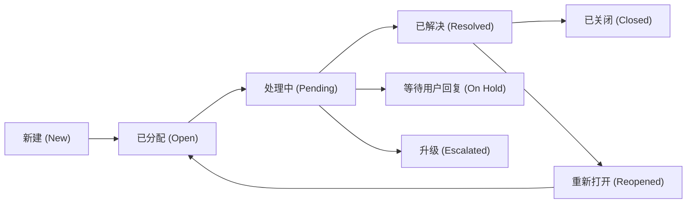

# 客户支持与工单系统

## 这是什么？

客户支持系统就是用户遇到问题时，企业用来接收、追踪、处理和解决这些问题的平台。核心载体是"工单"（Ticket）——每个用户问题变成一条有编号、有状态、有负责人的记录，从创建到关闭走完整个生命周期。你用过的 Zendesk、Freshdesk、Intercom、飞书服务台，底层都是工单系统。作为开发者，你可能需要从零搭建内部工单系统、对接第三方客服平台的 API，或者为产品加入自助服务（知识库、聊天机器人）来减少人工客服压力。

## 为什么要懂？

客户支持看似简单——用户提问题，客服回答。但实际上它是一个复杂的状态机 + 路由引擎 + SLA 监控 + 多渠道聚合系统。不理解业务流程，你会写出"能提交工单但没人处理"的系统——比如没有 SLA 超时告警导致用户等了三天没人理、工单分配逻辑不合理导致一个客服堆了 200 条而另一个闲着、没有升级机制导致严重问题被当普通问题处理。更要命的是，客户支持直接影响用户留存和口碑——处理不好，用户就走了。

## 业务流程

### 工单创建渠道

用户从多个渠道提交问题，系统统一汇聚成工单：

- **邮件**：用户发邮件到 support@company.com，系统自动创建工单
- **Web 表单**：用户在帮助中心填写表单提交
- **在线聊天**：实时对话结束后自动生成工单记录
- **社交媒体**：Twitter/微博 @提及、Facebook/微信消息转化为工单
- **电话**：客服接听后手动或自动创建工单
- **应用内反馈**：App 内"帮助与反馈"入口
- **API**：第三方系统通过 API 直接创建工单（如监控告警自动生成）

### 工单生命周期与状态

这是工单系统的核心状态机：



1. **新建 (New)**：工单刚创建，尚未分配给任何客服
2. **已分配 (Open)**：工单被分配给具体客服，等待处理
3. **处理中 (Pending)**：客服正在调查或协调内部资源
4. **等待用户回复 (On Hold)**：客服已回复，等待用户提供更多信息
5. **已解决 (Resolved)**：问题已解决，等待用户确认
6. **已关闭 (Closed)**：用户确认解决或超时自动关闭（通常 3-7 天无回复自动关闭）
7. **重新打开 (Reopened)**：用户对解决方案不满意，重新打开

### SLA 管理

SLA（Service Level Agreement）定义了响应和解决问题的时间承诺：

- **首次响应时间 (First Response Time)**：工单创建到客服第一次回复的时间。通常承诺 1-4 小时
- **解决时间 (Resolution Time)**：工单创建到最终解决的时间。通常承诺 4-24 小时
- **SLA 分级**：不同优先级对应不同 SLA。P1 工单 1 小时响应、4 小时解决；P4 工单 24 小时响应、72 小时解决
- **SLA 倒计时**：只计算工作时间（如 9:00-18:00，排除周末和节假日）
- **SLA 即将超时告警**：在 SLA 到期前 30 分钟自动通知客服和主管
- **SLA 违规处理**：超时后自动升级、记录违规次数、纳入客服考核

### 优先级与严重级别

| 级别      | 定义                         | 示例                      | SLA 响应 | SLA 解决 |
| --------- | ---------------------------- | ------------------------- | -------- | -------- |
| P1 - 紧急 | 系统完全不可用，影响所有用户 | 支付系统崩溃、数据泄露    | 15 分钟  | 4 小时   |
| P2 - 高   | 核心功能受损，影响大量用户   | 登录异常、订单无法创建    | 1 小时   | 8 小时   |
| P3 - 中   | 非核心功能问题，有替代方案   | 报表导出失败、UI 显示异常 | 4 小时   | 24 小时  |
| P4 - 低   | 轻微问题或功能建议           | 文案错误、UI 优化建议     | 24 小时  | 72 小时  |

### 升级策略

当问题超出一线客服能力或 SLA 即将超时时触发升级：

- **功能升级 (Functional Escalation)**：一线客服 → 高级客服 → 技术支持 → 工程师 → 产品经理
- **层级升级 (Hierarchical Escalation)**：客服 → 客服主管 → 客服总监 → VP
- **自动升级触发条件**：SLA 即将超时、用户多次回复表达不满、工单被重新打开超过 2 次
- **升级后处理**：指定更高级别的负责人、缩短 SLA 时间、增加关注人

### 客服分配与路由

工单如何分配给合适的客服：

- **轮询分配 (Round Robin)**：按顺序依次分配给在线客服，保证负载均衡
- **技能路由 (Skill-based Routing)**：根据工单类型匹配有对应技能的客服（支付问题 → 支付专家）
- **负载均衡 (Load Balancing)**：分配给当前处理工单最少的客服
- **语言路由**：根据用户语言匹配对应语种的客服
- **VIP 路由**：高价值客户自动分配给资深客服或专属客户经理
- **手动指派**：主管根据具体情况手动分配或转派

### 知识库与 FAQ

自助服务是降低工单量的核心手段：

- **知识库 (Knowledge Base)**：结构化的帮助文章库，按分类和标签组织
- **FAQ**：常见问题及答案，通常放在帮助中心首页
- **智能推荐**：用户提交工单时，根据输入内容自动推荐相关文章
- **内部知识库**：仅客服可见的内部操作手册和排障指南
- **版本管理**：文章更新后保留历史版本，方便回溯
- **效果追踪**：统计文章阅读量、"是否有帮助"反馈、阅读后是否仍提交工单

### 聊天机器人

用 AI 或规则引擎自动处理简单问题：

- **意图识别**：分析用户输入，判断是查物流、退款、修改密码还是其他问题
- **流程式机器人 (Flow Bot)**：按预设决策树引导用户逐步解决问题
- **AI 机器人**：基于 LLM 理解自然语言，从知识库中检索答案
- **人机协作**：机器人无法解决时无缝转接人工客服，并传递上下文
- **机器人拦截率**：机器人独立解决的工单占比，通常目标 30%-60%

### CSAT 与 NPS 满意度

工单关闭后衡量服务质量：

- **CSAT (Customer Satisfaction)**：工单解决后弹出评分（1-5 星或满意/不满意），衡量单次服务体验
- **NPS (Net Promoter Score)**：定期调查"你有多大可能推荐我们？"（0-10 分），衡量整体忠诚度
- **NPS 计算**：推荐者(9-10) 占比 - 贬损者(0-6) 占比 = NPS 值（-100 到 100）
- **满意度关联分析**：将 CSAT 与客服个人、工单类型、响应时间关联，找出改进方向

### 全渠道支持

用户在任何渠道的历史交互记录都能无缝衔接：

- **统一用户画像**：合并同一用户在邮件、聊天、电话等渠道的所有记录
- **上下文传递**：用户从聊天切换到电话时，客服能看到之前的聊天记录
- **渠道偏好**：记住用户偏好的沟通渠道，优先使用

### 模板与话术

标准化客服回复，提高效率和一致性：

- **快捷回复 (Canned Response)**：预设常用回复模板，一键插入
- **动态变量**：模板中插入用户名、订单号、工单编号等动态字段
- **多语言模板**：同一模板的多语言版本，根据用户语言自动选择
- **话术审核**：新模板需主管审批后才能上线使用

### 数据报表

用数据驱动客服运营优化：

- **工单量趋势**：按天/周/月统计工单创建量，发现高峰期
- **SLA 达标率**：各优先级 SLA 达标百分比
- **平均响应/解决时间**：衡量客服效率
- **客服个人绩效**：处理量、CSAT 评分、SLA 达标率
- **工单分类分布**：哪类问题最多（引导产品优化）
- **积压量 (Backlog)**：当前未解决的工单总数

## 常见术语

| 术语                    | 含义                                                     |
| ----------------------- | -------------------------------------------------------- |
| **Ticket**              | 工单——用户问题的标准化记录，有唯一编号和完整生命周期     |
| **SLA**                 | 服务等级协议——承诺的响应和解决时间                       |
| **First Response Time** | 首次响应时间——从工单创建到客服首次回复的耗时             |
| **Resolution Time**     | 解决时间——从工单创建到问题最终解决的耗时                 |
| **Escalation**          | 升级——将工单转交给更高级别的人员处理                     |
| **CSAT**                | 客户满意度——单次服务后的评分                             |
| **NPS**                 | 净推荐值——衡量用户整体忠诚度的指标                       |
| **Canned Response**     | 快捷回复——预设的标准化回复模板                           |
| **Knowledge Base**      | 知识库——帮助文章的结构化集合                             |
| **Omnichannel**         | 全渠道——多渠道统一管理和无缝切换                         |
| **Backlog**             | 积压工单——当前未解决的工单总量                           |
| **Deflection Rate**     | 拦截率——用户通过自助服务解决问题而未创建工单的比例       |
| **Agent**               | 客服坐席——处理工单的客服人员                             |
| **Macro**               | 宏——一键执行多个操作的自动化规则（如回复+改状态+加标签） |
| **Tag**                 | 标签——给工单打标分类，便于筛选和统计                     |
| **Requester**           | 请求人——提交工单的用户                                   |
| **Assignee**            | 受理人——被分配处理工单的客服                             |
| **Internal Note**       | 内部备注——仅客服团队可见的工单备注，用户看不到           |

## 常见模式

### 模式一：分层支持模型

将客服团队分成多层，逐级处理复杂问题。

- **L1 一线客服**：处理常见问题（重置密码、查订单状态、退换货流程），解决 60-70% 的工单
- **L2 高级客服**：处理需要调查的问题（支付异常、账户异常），有数据库查询和后台操作权限
- **L3 技术支持/工程师**：处理 bug 报告、系统故障、需要代码修复的问题

**取舍：** 结构清晰、培训成本低，但层层升级会增加用户等待时间。

### 模式二：自助优先策略

尽量让用户自己解决问题，减少人工工单量。

- **搜索优化**：帮助中心搜索体验直接影响自助解决率
- **智能推荐**：用户输入问题描述时，实时推荐相关文章
- **引导式排障**：交互式流程图引导用户逐步排查（如"网络不通 → 检查 WiFi → 重启路由器 → ..."）
- **社区论坛**：用户互助，官方客服只在必要时介入

**效果指标：** Deflection Rate（拦截率）——越高说明自助服务越有效。优秀的帮助中心拦截率可达 40-60%。

### 模式三：全渠道统一工作台

客服在一个界面处理来自所有渠道的工单。

- **统一收件箱**：邮件、聊天、社交媒体、电话记录全部汇入同一个队列
- **用户 360 视图**：显示该用户的订单历史、过往工单、会员等级、产品使用情况
- **上下文保持**：无论用户从哪个渠道进来，客服都能看到完整的交互历史

**取舍：** 用户体验最好，但技术实现复杂，需要对接多个渠道 API 并统一数据模型。

### 模式四：AI + 人工混合模式

聊天机器人处理简单问题，复杂问题无缝转人工。

- **机器人前置**：所有用户先跟机器人对话，机器人尝试解决
- **无缝转接**：机器人判断无法解决时，把完整对话上下文传给人工客服
- **AI 辅助人工**：客服处理工单时，AI 实时建议回复内容、推荐相关知识库文章
- **自动分类打标**：AI 根据工单内容自动设置分类、优先级和标签

**取舍：** 大幅降低人力成本，但机器人回答不当会让用户更加恼怒。

## 踩坑提醒

- **SLA 计时忽略工作时间**：SLA 承诺 4 小时响应，但如果用户周五晚上 11 点提工单，下周一早上 9 点才算 SLA 开始计时。必须考虑工作时间、时区、节假日。很多开发者直接用 `createdAt + 4h` 计算截止时间，这是错的。
- **工单状态流转不加校验**：允许从"已关闭"直接跳到"新建"、或者任意状态间随意切换。状态机必须有明确的合法转换规则，后端要校验。
- **全渠道用户身份合并失败**：同一用户用邮箱提了一个工单、用微信又提了一个，系统当成两个人。需要基于邮箱、手机号、用户 ID 做身份合并。
- **没有内部备注功能**：客服想和同事讨论工单但不想让用户看到。如果所有回复都对用户可见，客服只能用其他工具沟通，信息就散落了。必须区分"公开回复"和"内部备注"。
- **知识库和工单系统脱节**：知识库是一套系统，工单是另一套，互相不关联。客服回答完问题后应该能一键将回复转为知识库文章，用户提工单时应该能看到相关推荐文章。
- **满意度调查时机不对**：工单状态刚变成"已解决"就弹满意度调查，但用户可能还没验证问题是否真的解决了。应该等 24-48 小时后再发调查，或在用户确认后触发。
- **升级后原客服失去上下文**：工单升级给高级客服后，原客服的处理记录和内部备注没有传递。升级必须带上完整的工单历史。
- **报表只看平均值不看分布**：平均响应时间 2 小时看似达标，但可能有 10% 的工单超过 24 小时。必须看 P50、P90、P95 分位值。
- **没有防重复提交**：用户连续点击两次提交按钮，创建了两个相同的工单。需要前端防抖和后端幂等性检查。

## 行业实战经验与非显而易见的最佳实践

### 1. 高可用邮件转工单线程聚合（VERP 动态地址、RFC 5322 邮件头解析与历史关闭工单自动分叉）

**实战教训：** 某 B2B SaaS 团队实现邮件转工单（Email-to-Ticket）时，仅靠正则匹配邮件标题（`Subject`）中的 `[Ticket #10492]` 来把回复归并到已有工单。上线后遭遇三大灾难：
1. 客户企业的安全网关或非英文邮件客户端经常篡改标题、把 `Re:` 替换成 `答复:` 或截断长标题，导致客户的每一次回复都裂变成一条全新的孤儿工单；
2. 客户把工单邮件转发给公司内部法务（`CC: legal@client.com`），法务修改邮件标题为《合同条款审核意见》后回复，系统完全丢失上下文，当成新工单处理；
3. 反过来，许多老客户习惯在邮箱里随便搜出一封半年前已解决的“重置密码”工单邮件，直接点“回复”咨询全新的“账单扣款故障”。系统机械地将半年前已关闭的旧工单重新打开（Reopen），不仅把工单分给了早已离职的前任客服，还把历史工单的 MTTR（平均解决时长）统计瞬间拉爆到 4300 小时。

**非显而易见的最佳实践：**
- **四级瀑布流邮件线程匹配（4-Signal Threading Waterfall）：** 严禁仅依赖邮件标题做工单聚合，必须按优先级依次校验以下四重信号：
  1. **VERP 动态加号地址（`Reply-To: support+t_8f92a1c4@company.com`）：** 系统发出的每封工单通知邮件，都在 `Reply-To` 地址中嵌入带 HMAC 签名的工单专属 Token。无论客户如何篡改标题或抹除邮件头，收件人地址本身就能 100% 锁定原工单。
  2. **RFC 5322 标准邮件头（`In-Reply-To` 与 `References`）：** 在数据库中记录每封进出邮件的 `Message-ID`（如 `<msg_99182@support.company.com>`）。收到新邮件时，解析其 `In-Reply-To` 及 `References` 链表，只要命中历史 `Message-ID` 即可精准归并。
  3. **邮件正文隐藏签名锚点：** 在发出的 HTML 邮件底部或引用区嵌入隐藏特征码（`Ref:MSG_8f92a1c4`）。
  4. **标题正则 + 发件人域名兜底：** 仅当前三项均缺失时，才回退到匹配标题中的工单号，且必须校验发件人邮箱或企业域名与原工单一致。
- **已归档工单（Closed）回复自动分叉（Auto-Forking）：** 状态机必须严格区分 `已解决（Solved，软关闭，7 天内回复可重新打开 Reopen）` 与 `已关闭（Closed，终态归档，不可逆）`。当用户回复一封处于 `Closed` 状态的陈年工单时，**绝不能重开原工单**，而应自动派生一条**关联新工单（Follow-up Ticket，`parent_ticket_id = #10492`）**，自动挂载历史工单摘要供新客服参考，并重新进入当前在线分流队列与全新 SLA 计时。
- **自动回复死循环熔断（Auto-Responder Loop Breaker）：** 自动识别并拦截包含 `Auto-Submitted: auto-replied`、`X-Autoreply` 或空 `Return-Path: <>` 的邮件，并对同一发件箱设置滑动窗口限流（如 10 分钟最多创建 3 条工单/回复），防止客户的“休假自动回复”与客服系统的“工单创建确认信”互相触发，一夜之间刷出十万条垃圾工单。

### 2. 跨时区、工作时间与节假日感知的 SLA 计时引擎（暂停/恢复与变级重算）

**实战教训：** 某团队在设计 SLA 时，直接在数据库里写入 `sla_due_at = created_at + 4 hours`。周五下午 17:50（客服工作时间为周一至周五 9:00–18:00），一位客户提交了 P2 工单（4 小时响应 SLA）。结果周五晚上 21:50，系统准时触发 P1 级全员告警，把客服总监从睡梦中叫醒。更棘手的是，当工单在“等待客户补充截图（Pending Customer）”状态下停滞了 3 天、跨越了一个法定节假日、且中途被客服从 P3 升级为 P1 时，用简单时间戳加减法写的 SLA 逻辑彻底算出一团乱麻。

**非显而易见的最佳实践：**
- **基于“累计消耗有效工作秒数”的停表状态机（Stopwatch State Machine）：** 切勿把 SLA 仅仅存为一个静态截止时间。应将每个 SLA 指标（首次响应 FRT、下次响应 NRT、最终解决时长）建模为绑定特定**工作历（Business Schedule：时区 + 每日工作时段 + 地区法定节假日表）**的状态停表：
  - 核心字段：`target_business_seconds`（目标工作秒数，如 $4\text{h} = 14,400\text{s}$）、`accumulated_business_seconds`（已消耗工作秒数）、`clock_state`（`RUNNING` | `PAUSED` | `COMPLETED`）以及 `last_resumed_at`。
  - **暂停计时（如转入 `等待用户回复 On Hold`）：** 计算 `[last_resumed_at, now()]` 时间段与工作历有效工作区间的交集秒数，累加进 `accumulated_business_seconds`，将状态置为 `PAUSED`，并将索引字段 `effective_due_at` 置空（避免后台告警任务误扫）。
  - **恢复计时（用户回复后重回 `处理中 Open`）：** 计算剩余可用秒数 $\text{remaining} = \text{target} - \text{accumulated}$，从当前时刻起沿着工作历向未来推演（自动跳过夜间、周末与节假日），算出精确的 `effective_due_at` 并建立索引，供定时轮询或延迟队列提前 30 分钟触发临期预警。
- **优先级动态变更时的溯源重算：** 当工单从中优先级 P3（目标 24 小时）被紧急提级为 P1（目标 1 小时）时，不能从零开始重新算 1 小时，而必须用 P1 的目标秒数减去已消耗的 `accumulated_business_seconds`；若已消耗时长超过新目标，立即触发超时升级路由。

### 3. 实时坐席碰撞检测（Agent Collision Detection）与草稿乐观锁

**实战教训：** 某次支付通道抖动引发大量客诉，40 多条高优工单同时涌入待领队列。客服 A 和客服 B 同时从列表点开了工单 `#8821`。客服 A 花了 8 分钟排查后台日志，手动给客户补发了 200 元补偿金并点击“发送回复并解决”。仅隔 20 秒，一直停留在同一页面编写回复的客服 B 也点击了提交——不仅给客户**重复打款了第二个 200 元**，发出了前后矛盾的回复话术，而且客服 B 的表单提交直接用旧状态覆盖了数据库，把工单状态又改回了 `处理中`。

**非显而易见的最佳实践：**
- **实时在场感知与输入态广播（WebSocket / Redis Presence）：** 为每个活跃工单维护一个带 15 秒 TTL 的 Redis 在场集合（`ticket:8821:presence`），由客服工作台前端每 5 秒发送心跳维持。将坐席状态细分为 `正在查看（VIEWING）` 与 `正在输入公开回复（TYPING_REPLY）`，在工单顶部实时展示协作者头像与醒目黄条警示（“客服李雷正在编写公开回复…”）。
- **工单变更与回复提交的乐观并发控制（Optimistic Concurrency Locking）：** 工单主表必须维护单调递增的 `version` 版本号（或 `last_event_id`）。坐席提交状态变更或发送外部回复时，请求体必须携带打开页面时的 `expected_version`：
  ```sql
  UPDATE tickets
  SET status = $1, assignee_id = $2, version = version + 1
  WHERE id = $3 AND version = $4;
  ```
  一旦返回 `rows_affected == 0`（说明期间已有其他客服回复或客户发来了新消息），后端必须拒绝直接覆盖，前端自动将最新时间线消息流式插入页面，**完整保留当前客服已敲好的草稿内容**，并弹窗提示：“工单刚刚被更新，请先审阅最新回复再决定是否发送”。

## 速查表

| 组件       | 关键考虑                                           |
| ---------- | -------------------------------------------------- |
| 工单创建   | 多渠道汇聚、自动分类、防重复提交、关联用户身份     |
| 状态管理   | 有限状态机、合法转换校验、自动关闭规则             |
| SLA 引擎   | 工作时间计算、时区处理、即将超时告警、违规自动升级 |
| 优先级     | P1-P4 分级、不同 SLA 标准、动态调整规则            |
| 路由分配   | 轮询/技能/负载均衡、VIP 专属通道、语言匹配         |
| 升级机制   | 功能升级 vs 层级升级、自动触发条件、上下文传递     |
| 知识库     | 分类与搜索、智能推荐、内部 vs 外部、效果追踪       |
| 聊天机器人 | 意图识别、人机转接、拦截率监控、上下文传递         |
| 满意度     | CSAT 单次评分、NPS 定期调查、关联分析              |
| 全渠道     | 统一用户画像、上下文无缝衔接、渠道偏好             |
| 模板话术   | 快捷回复、动态变量、多语言、审批流程               |
| 数据报表   | 工单量趋势、SLA 达标率、分位值分析、积压监控       |
