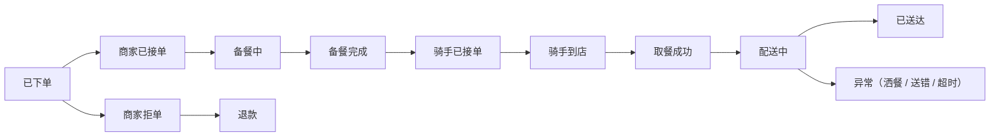

# 外卖与即时配送

## 这是什么？

外卖平台就是帮用户在手机上点餐、帮商家接单出餐、帮骑手完成配送的三边撮合系统。你作为开发者要做的不只是"下单→送餐"那么简单——而是要协调用户、商家、骑手三方的实时状态，在30分钟内把一份热腾腾的饭从后厨送到用户手上。这背后涉及动态定价、智能派单、GPS追踪、库存同步、配送围栏等一系列复杂系统。

即时配送不限于外卖——买药、送花、跑腿代购、生鲜到家都属于这个范畴。核心逻辑相通：用户下单 → 商家备货 → 骑手取货配送 → 用户签收，全程30-60分钟搞定。

## 为什么要懂？

外卖系统的时效性极强——超过45分钟饭菜凉了、用户退单、平台赔钱。不像传统电商可以给你几天的缓冲期，外卖每一分钟的延迟都直接转化为差评和退款。

不懂业务流程的开发者最容易犯的错：把外卖当成普通电商来做。实际上，外卖的库存是实时变化的（一道菜今天能做50份，材料用完就没了），定价是动态波动的（下雨天加价、高峰期加价），派单是算法驱动的（不是用户选骑手，是系统算出来的）。你不理解这些，写出来的系统在午高峰会直接崩掉。

## 业务流程

### 商家入驻

商家要在平台上卖东西，首先要入驻审核：

1. 商家提交营业执照、食品经营许可证、门店照片、法人身份证
2. 平台审核资质（自动OCR识别 + 人工复核）
3. 审核通过后商家配置门店信息：营业时间、配送范围、起送价
4. 商家签订合作协议，确认佣金比例（通常15-25%）
5. 门店上线，开始接单

### 菜单管理与库存

外卖的"库存"和电商完全不同：

- **菜品管理**：每道菜有名称、描述、图片、价格、分类（主食/小吃/饮品）、规格（大份/小份）、加料选项（加蛋+3元、加辣免费）
- **实时库存**：商家可以随时设置某道菜的日限量（今天只做30份酸菜鱼），卖完自动下架
- **临时售罄**：午高峰某个食材用完了，商家一键标记售罄，用户端实时更新
- **营业状态**：商家可以暂停接单（后厨忙不过来）、设置自动接单时段

### 下单与校验

用户提交订单时，系统需要做一系列校验：

1. **地址校验**：用户地址是否在商家配送范围内（地理围栏判断）
2. **起送价校验**：订单金额是否达到商家设置的起送价
3. **库存校验**：所点菜品是否仍然可售（可能刚被别人买完）
4. **营业时间校验**：商家当前是否在营业时间内
5. **优惠券校验**：优惠券是否有效、是否满足使用条件
6. **支付处理**：在线支付成功后订单才正式生效

### 骑手派单与匹配算法

这是外卖平台的核心技术壁垒。系统要在几秒内决定哪个骑手去取哪个订单：

- **就近匹配**：优先选离商家最近的骑手
- **顺路匹配**：骑手手上已有订单，新订单和已有订单顺路，可以拼单
- **负载均衡**：避免某个骑手手上积压太多单，其他骑手闲着
- **预计到店时间**：计算骑手到达商家的时间，不能比出餐时间晚太多也不能早太多（早了骑手干等，影响效率）
- **骑手画像**：新手骑手派近单、简单单；熟练骑手派远单、多拼单
- **抢单 vs 派单**：有些平台让骑手自己抢单（灵活但低效），有些平台系统强制派单（高效但骑手抵触），主流做法是"系统派单为主、骑手可转单"

### GPS 实时追踪

用户下单后最关心的就是"骑手到哪了"：

- 骑手App每3-5秒上报GPS坐标
- 服务端接收后写入时序数据库或Redis
- 用户端通过WebSocket或轮询获取骑手位置，在地图上实时展示
- GPS漂移处理：室内、隧道、高楼峡谷会导致定位偏差，需要做轨迹平滑和异常点过滤
- 到店/到达判定：骑手进入商家/用户地址一定半径范围内，自动触发"已到店"/"已送达"状态

### 动态定价与高峰加价

外卖的价格不是固定的：

- **配送费动态调整**：距离越远配送费越高；高峰时段（午餐11:30-13:00、晚餐17:30-19:30）配送费上涨
- **恶劣天气加价**：下雨、下雪、极端高温时骑手出勤意愿降低，平台加收天气附加费来激励骑手接单
- **供需定价**：某区域订单暴增但骑手不足，系统自动上调该区域配送费
- **用户端 vs 骑手端**：用户多付的配送费不一定全给骑手——平台会截留一部分作为利润

### 订单状态流转

外卖订单的状态机比传统电商复杂得多：

关键点：商家接单和骑手接单是两条并行的线——系统在商家接单的同时就开始派骑手，让骑手在出餐完成时刚好到店。这个时间差的计算直接影响整体配送效率。

### 预计送达时间（ETA）计算

ETA 是用户体验的核心指标，计算涉及多个因子：

- **出餐时间**：根据商家历史出餐数据 + 当前排队订单数预估
- **骑手到店时间**：骑手当前位置到商家的距离 / 预估速度
- **配送时间**：商家到用户的距离 / 预估速度 + 楼层等待时间
- **路况因子**：高峰拥堵、天气影响、道路施工
- **实时修正**：骑手取到餐后，根据实际轨迹动态修正 ETA

ETA 不准的后果很严重：说30分钟结果45分钟才到，用户体验极差；说60分钟结果30分钟就到，用户可能不在家。

### 双向评分系统

外卖平台的评分是双向的：

- **用户评价商家**：口味、分量、包装、出餐速度（1-5星 + 文字 + 图片）
- **用户评价骑手**：配送速度、服务态度、餐品完整性
- **商家评价骑手**：取餐等待时间、沟通态度
- **评分影响**：商家评分影响搜索排名和推荐权重；骑手评分影响派单优先级和奖惩
- **恶意差评防护**：识别竞对恶意刷差评、用户因非商家原因（如骑手洒餐）给商家差评

### 配送范围与围栏

不是所有地址都能送：

- **配送半径**：商家设置最大配送距离（通常3-5公里）
- **地理围栏（Geofence）**：用多边形而非简单圆形定义配送范围，可以排除河对岸、山那边等看起来近但实际绕路很远的区域
- **区域限制**：某些区域不配送（军事区、工地、交通管制区）
- **动态调整**：恶劣天气或运力不足时，临时缩小配送范围

### 厨房显示系统（KDS）

商家后厨接单后需要高效管理订单：

- 订单按时间排列显示在厨房屏幕上
- 不同菜品高亮提示（加急单红色标记）
- 每道菜完成后勾选，全部完成后标记"备餐完成"
- 自动估算每单出餐时间并反馈给平台
- 高峰期自动限流：排队订单超过阈值时暂停接新单

### 多店拼单

一个骑手同时取多个订单或从多个商家取餐：

- **同店拼单**：两个用户从同一家店下单且送餐方向顺路，骑手一次取两单
- **跨店拼单**：两家相邻的店，骑手先后取餐再分别送达
- **拼单风险**：第一单可能因为等第二单出餐而延迟。系统要权衡效率和时效的平衡
- **用户感知**：要告知用户"骑手正在顺路送其他订单"，管理预期

### 小费

部分市场支持用户给骑手小费：

- 下单时或送达后均可给小费
- 小费100%给骑手（平台不抽成，否则舆论风险极大）
- 恶劣天气时引导用户加小费
- 小费不影响订单排序和派单优先级（至少不应该）

### 优惠券与促销

外卖的促销体系极其复杂：

- **满减**：满30减5、满50减10——商家最常用的促销方式
- **平台补贴**：新用户首单立减、平台红包——平台出钱买流量
- **商家折扣**：特价菜、第二份半价——商家自行设置
- **配送费减免**：会员免配送费、新人免配送费
- **凑单逻辑**：用户为了凑到满减门槛加菜——你的系统要能智能推荐凑单商品
- **叠加规则**：哪些券可以叠加、哪些互斥——这是优惠券系统最复杂的部分

## 常见术语

| 术语         | 含义                                           |
| ------------ | ---------------------------------------------- |
| **ETA**      | 预计送达时间（Estimated Time of Arrival）      |
| **派单**     | 系统自动将订单分配给骑手                       |
| **抢单**     | 骑手自主选择接哪个订单                         |
| **拼单**     | 一个骑手同时配送多个订单                       |
| **围栏**     | 地理围栏（Geofence），定义配送范围的多边形区域 |
| **KDS**      | 厨房显示系统（Kitchen Display System）         |
| **起送价**   | 商家设置的最低订单金额                         |
| **满减**     | 满一定金额减免部分费用的促销方式               |
| **高峰加价** | 订单高峰或运力不足时上调配送费                 |
| **骑手池**   | 某区域内当前可用的骑手集合                     |
| **出餐时间** | 商家从接单到备餐完成的时间                     |
| **超时赔付** | 配送超过承诺时间后平台自动给用户的补偿         |
| **运力**     | 某区域某时段可调度的骑手数量                   |
| **客单价**   | 每个订单的平均金额                             |
| **佣金**     | 平台从每笔订单中抽取的比例（通常15-25%）       |
| **履约**     | 从接单到送达的整个配送执行过程                 |
| **众包骑手** | 非全职、按单计费的兼职骑手                     |
| **自配送**   | 商家自己安排骑手配送，不用平台骑手             |

## 常见模式

### 模式一：平台全托管

美团、饿了么模式。平台提供用户端App、商家端系统、骑手调度、支付结算全套能力。商家只管做菜。

**取舍：** 平台掌控全链路，体验一致性好。但佣金高（15-25%），商家利润空间被压缩。

### 模式二：商家自配送

商家有自己的骑手团队（如麦当劳、必胜客）。平台只负责流量入口和下单，配送由商家完成。

**取舍：** 商家掌控配送质量和速度，但需要自建调度系统。适合连锁品牌。

### 模式三：聚合模式

平台不养骑手，对接第三方运力（顺丰同城、达达、闪送）。平台做撮合和调度，运力外包。

**取舍：** 轻资产运营，但配送体验不可控。出了问题用户骂平台，平台骂运力商，互相推诿。

### 模式四：前置仓模式

叮咚买菜、朴朴超市模式。在社区周边建小型仓库（前置仓），提前备货。用户下单后从最近的前置仓出发，30分钟内送达。

**取舍：** 时效极快，但对选品和库存预测要求极高。预测不准 = 要么缺货要么损耗。生鲜损耗率控制在5%以内才能盈利。

## 踩坑提醒

1. **库存不实时同步**：用户看到菜品可售，下单后商家才说没了。必须用WebSocket或短轮询实时同步菜品状态，不能只靠用户刷新页面。

2. **ETA 算法过于乐观**：为了好看把ETA算短，结果频繁超时。ETA要留buffer（实际预估+5分钟），宁可提前到不要迟到。

3. **并发下单扣库存**：午高峰同一秒几百人下单，热门菜品库存扣减必须用原子操作（Redis DECR 或数据库行锁），否则超卖。

4. **骑手GPS造假**：部分骑手用虚拟定位工具伪造位置。需要做GPS反作弊：检测瞬移、速度异常、模拟器特征。

5. **高峰期系统雪崩**：午餐和晚餐高峰订单量是平时的5-10倍。派单系统、支付系统、商家推送必须做好限流和降级方案。

6. **退款逻辑不清晰**：餐洒了谁赔？送错了谁赔？超时了谁赔？商家问题商家赔、骑手问题骑手赔、平台问题平台赔——但现实中责任归属往往模糊，需要完善的判责系统。

7. **忽略异常订单流程**：用户取消但骑手已取餐、商家出错但骑手已出发、用户不在家无人签收——这些异常场景的处理流程必须提前设计，不能等上线了再补。

8. **配送范围用圆形而非围栏**：直线距离3公里但要绕过一条河实际路程10公里。配送范围必须用真实路网距离或多边形围栏，不能用简单的半径计算。

## 行业实战经验与非显而易见的最佳实践

### 1. 餐饮 POS 中间件碎片化（Olo/Otter/Chowly/客如云）与菜品估清/加料税费漂移

**实战教训：** 外卖平台接入大型连锁餐饮品牌时，订单往往要跨越三层链路：`外卖平台` $\rightarrow$ `聚合中间件（如美国的 Otter / Chowly / Olo，或国内的客如云 / 美团收银网关）` $\rightarrow$ `门店本地 POS 收银机（如 Toast / Micros / NCR Aloha）`。在周五晚高峰期间，两类隐蔽的集成故障导致连锁大牌门店出现高达 11% 的卡单与退单率：
1. **加料项（Modifier）估清状态漂移：** 门店后厨牛油果用完了，店员在本地 POS 机上将加料项“加牛油果泥（`PLU_409`）”标记为估清（86'd / 售罄）。但由于中间件每 4 小时才轮询同步一次全量菜单树，外卖 App 上该加料项依然可点。用户下单付款成功 3 分钟后，订单通过 Webhook 注入门店本地 POS 时直接触发硬拒绝 `POS_REJECT_86D_MODIFIER`，导致整单被系统自动取消，用户骂娘。
2. **一分钱税费/加料差价尾差拒单（Penny-Rounding Reject）：** 外卖平台按“主菜 + 多层嵌套加料 + 本地餐饮税率”四舍五入算出应收总额 `$24.18` 并下发给门店 POS。然而门店老旧的 NCR Aloha 收银系统按单行独立算税再求和，算出的结果是 `$24.19`。因为两边相差 **1 美分**，门店 POS 校验 `实付金额 != 应收总额` 直接拒单抛错，而此时平台已经扣了用户的钱、甚至已经派了骑手往店里赶，后厨却根本没打出厨打单！

**非显而易见的最佳实践：**
- **显式引入 `POS 注入确认中（POS_INJECTING）` 中间态与自动估清熔断器：** 对接第三方 POS 的连锁门店，绝不能在用户支付成功后直接将状态置为 `商家已接单（Accepted）`。必须先进入 `POS_INJECTING`，直到收到门店本地 POS 打印出后厨单的同步 ACK 回执才推进状态并展示给用户。若某菜品或加料编码（PLU）在 10 分钟内连续触发 $\ge 2$ 次 POS 端 `ITEM_UNAVAILABLE` 拒单，无需等待中间件全量同步，立即在平台侧自动熔断下架该 SKU/加料项。
- **注入“一分钱平账虚拟菜品项（Rounding Adjustment PLU）”：** 针对本地 POS 严苛的金额恒等式校验，平台在与 POS 对接时预置一个免税的平账专用虚拟编码（如 `PLU_PLATFORM_DIFF_ADJ`）。下发订单前先对齐金额，若存在 $\pm \$0.01$ 的税费舍入尾差，自动塞入一条 `-$0.01` 或 `+$0.01` 的平账明细行，确保 POS 100% 顺畅接单落库。

### 2. 利用骑手地理围栏驻留遥测（Dwell-Time Telemetry）反推餐厅“隐形后厨拥堵度”

**实战教训：** 派单算法的核心是让骑手在餐品做好的那一刻刚好到店（`派单时间 = 下单时间 + 预估出餐时长 - 骑手到店骑行时长`）。起初，算法团队用商家在平板上点击“备餐完成（Order Ready）”按钮的时间戳作为训练标签来预测出餐时长，结果模型在线上一塌糊涂：
1. 许多店员为了关掉平板烦人的催单提示音，接单后一秒钟就随手点掉“备餐完成”；或者忙起来根本不点按钮，直到骑手取走餐 20 分钟后才批量点完。
2. 更致命的是，你的外卖平台**只能看到自己平台在这家店的订单量**（比如当前只有 2 单），却完全不知道此时此刻店里刚进来一个 50 人的堂食旅游团，外加隔壁竞品平台的 20 个外卖单！结果系统以为后厨很闲，立刻派单，导致大批骑手到店后干等 35 分钟，引发骑手集体弃单与全片区运力瘫痪。

**非显而易见的最佳实践：**
- **基于多传感器融合（Wi-Fi BSSID + 蓝牙信标 + 惯导加速度计）还原真实出餐真值：** 彻底放弃将商家的手动按钮作为唯一真值。通过骑手 App 采集高频轨迹与传感器数据还原物理真相：
  - 利用门店周边 **Wi-Fi MAC 地址指纹（BSSID）** 与手机加速度计步态识别（骑行 $\rightarrow$ 步行进店 $\rightarrow$ 原地静止驻留 $\rightarrow$ 步行出门骑车），精准判定骑手真实进店时刻 `T_enter` 与拿到餐离店时刻 `T_exit`（有效规避高楼室内 GPS 漂移 100 米的痛点）。
  - 若骑手在 `T_enter` 进店后，在店内 Wi-Fi 信号覆盖下原地静止驻留了 14 分钟才在 `T_exit` 取餐离开，则真实出餐完成时刻必为 `T_exit`，骑手真实等餐损耗为 14 分钟。
- **实时“后厨隐形负载”卡尔曼滤波探测器：** 把当前正在该门店驻留等餐的**每一个骑手**，都视为探测该餐厅物理后厨真实拥堵度（含堂食与竞对平台订单）的实时传感器。一旦检测到某门店当前在店驻留超过 6 分钟仍未取到餐的骑手数 $\ge 2$ 人，实时流计算引擎立即在秒级上调该门店的**实时出餐拥堵乘数（Kitchen Congestion Multiplier）**——不仅对新下单用户动态拉长前端展示的 ETA，同时对已接单但尚未派骑手的在途订单自动推迟派单（Hold Dispatch），让骑手先去跑别的顺路单，实现运力零空转。

### 3. 生鲜商超称重温差与缺货替换场景下的银行卡“超额预授权（Over-Authorization）”与增量授权

**实战教训：** 当即时配送平台从餐饮外卖扩展到生鲜买菜与商超代购（如美团买菜、Instacart、DoorDash Grocery）时，大量非标商品需要现场称重计价（例如用户下单 `1.5 斤肋眼牛排 @ 60元/斤 = 90元`，拣货员实际切出的一块重 `1.68 斤 = 100.80元`），或者某款 15 元的鲜奶缺货，用户在线沟通后同意替换为 22 元的有机奶。起初支付系统在下单时只按购物车原价（`100.00元`）发起刚好相等的支付预授权冻结；等拣货完成实际应收变成 `117.80元` 时，卡组织直接拒绝超额请款（`CAPTURE_EXCEEDS_AUTH`）；而如果让系统对多出来的 `17.80元` 发起第二笔补扣款，高达 18% 的订单会因为用户借记卡余额不足、银行风控拦截二次无密扣款或 Apple Pay 单次令牌失效而扣款失败，形成平台坏账！

**非显而易见的最佳实践：**
- **动态超额预授权缓冲（Adaptive Pre-Auth Markup）与增量预授权（Incremental Auth）：**
  1. **含称重/可替换商品的自适应上浮冻结：** 结账时若购物车包含生鲜称重商品或开启了“缺货允许同类替换”，支付网关自动按品类风险上浮 **15%–20% 的预授权额度**（例如 100 元订单实际向发卡行申请冻结 118 元，并在收银台清晰提示：*“含称重/替换缓冲金，拣货完成后仅按小票实收金额扣款，多冻部分立即原路解冻”*）。
  2. **卡组织增量预授权（ISO 8583 Incremental Authorization）：** 当用户在拣货中途通过 App 聊天窗确认换购更贵的商品时，立即调用支持增量授权的收单接口，在原交易流水号（`network_transaction_id`）基础上追加冻结差额，避免产生第二笔独立扣款流水。
- **拣货枪/拣货 App 端的硬性金额天花板（Hard Capture Ceiling）：** 将该笔订单当前的最大可请款上限 `max_capturable_cents` 实时下发到拣货员手持终端（Picker App）。如果称重后的重量或替换商品的价格导致整单总额超出预授权上限（且实时追加授权失败），拣货终端在扫码装袋时直接弹窗硬拦截，要求拣货员换一块重量更接近的肉或降级替换品，从源头杜绝骑手送达后无法请款的资损。

## 速查表

| 模块       | 关键考虑                                    |
| ---------- | ------------------------------------------- |
| 商家入驻   | 资质审核、佣金协议、门店配置、营业时间      |
| 菜单与库存 | 实时售罄同步、SKU规格管理、日限量、加料选项 |
| 下单校验   | 围栏判定、起送价、库存锁定、优惠券叠加规则  |
| 派单算法   | 就近/顺路/负载均衡、骑手画像、出餐时间对齐  |
| GPS追踪    | 上报频率、漂移过滤、轨迹平滑、到达判定      |
| 动态定价   | 高峰加价、天气附加费、供需模型、距离梯度    |
| 订单状态机 | 商家线与骑手线并行、异常分支、超时自动处理  |
| ETA计算    | 出餐时间+骑行时间+路况因子+动态修正         |
| 评分系统   | 双向评分、恶意差评识别、评分影响权重        |
| 围栏管理   | 多边形围栏、路网距离、动态缩放              |
| KDS        | 订单队列、出餐标记、限流阈值                |
| 拼单策略   | 顺路判定、时效权衡、用户知情                |
| 优惠促销   | 满减/折扣/红包/配送费减免、叠加互斥规则     |
| 异常处理   | 退款判责、取消流转、无人签收、餐品损坏      |
