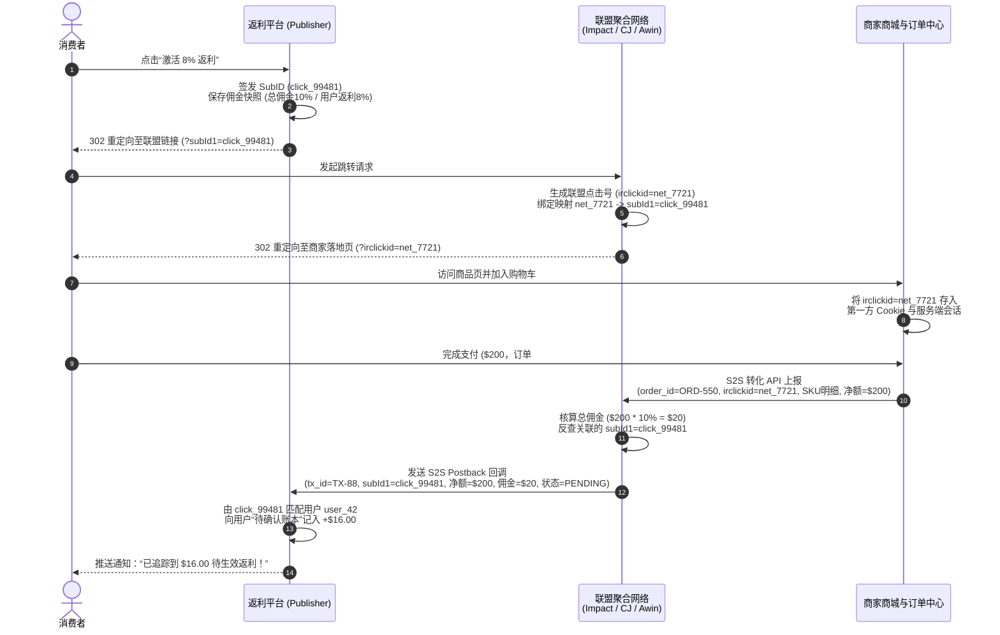
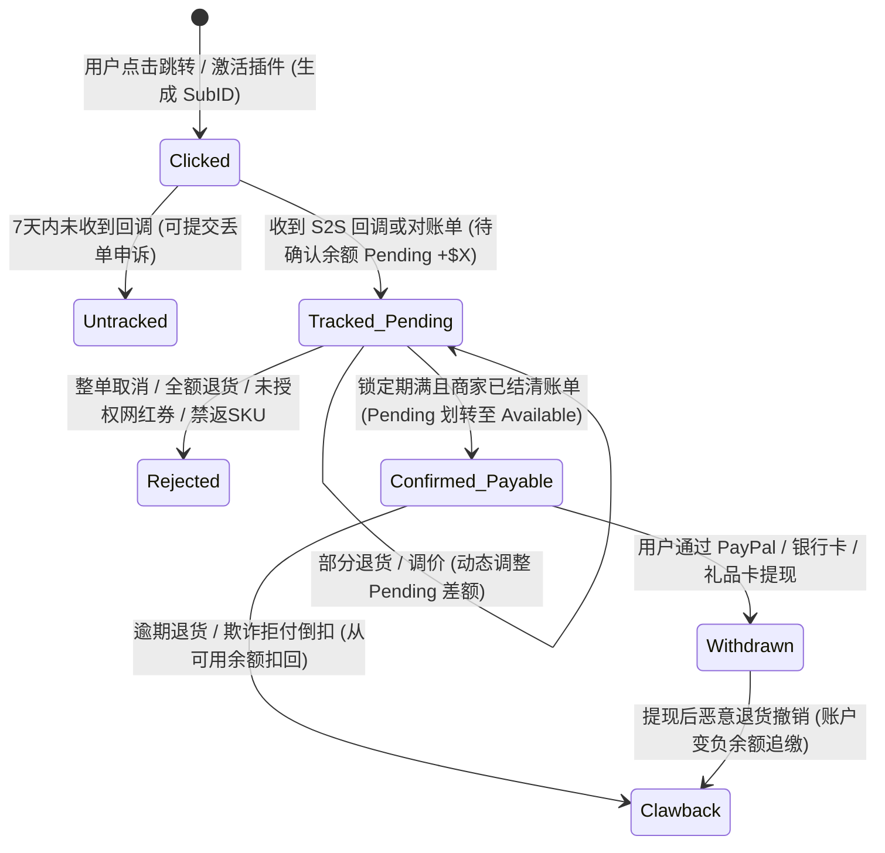

# 返利网、联盟营销归因与优惠聚合系统

## 这是什么？

返利网与联盟营销（Affiliate Marketing）系统是连接消费者、流量主（返利平台、自动试券浏览器插件、优惠导购社区、测评媒体）、联盟聚合网络（Affiliate Network）及电商商家的多边效果营销平台。典型代表包括海外的 Rakuten、PayPal Honey、TopCashback、Capital One Shopping、ShopBack、Slickdeals，以及国内的淘宝客（阿里妈妈）、京东联盟、多多进宝、什么值得买、返利网等。与按曝光（CPM）或点击（CPC）收费的广告不同，联盟营销基于 **CPA（按转化付费）或 CPS（按销售额分成）**：只有当被追踪的用户完成有效购买并度过退货期后，商家才支付佣金。

返利平台将从商家赚取的 CPS 佣金按比例分给消费者。例如：耐克为一双 $100 的球鞋向流量主支付 10% 佣金（$10），返利平台留存 $3 作为毛利，将 $7（7% 返利）计入用户的返利钱包。从工程视角看，你构建的是**跨不可控第三方收银台的分布式归因追踪器、多联盟异步对账管道、跨越 30～120 天退货锁定期的复式记账账本、浏览器插件自动试券引擎，以及防御优惠码截胡与“提现后退货”欺诈的风控系统**。

## 为什么要懂？

联盟归因与返利系统支撑着电商庞大的获客基本盘，但面临极严苛的技术约束：**你对商家最终的结账页面（Checkout）没有任何服务端控制权**。用户点击外跳链接或激活插件后即离开你的域名，全靠 HTTP 302 重定向链、商家落地页第一方 Cookie、移动端深度链接（Universal Links），以及联盟网络异步推送的服务端回调（S2S Postback）或 T+1 批处理对账单维持追踪。

若归因链路设计不当，用户付了钱却丢单（Missing Cashback），平台信任会迅速崩塌；若佣金状态机与账本隔离有漏洞，黑产会在提现真金白银后立刻去商家退货，直接薅穿平台资金池。理解点击归因、SKU 阶梯佣金、插件 Stand-Down 退让合规及延迟清算，是构建增长引擎、达人分销、银行卡绑定返现（Card-Linked Offers）或积分商城的必修课。

## 业务流程

### 四方价值链与资金流向

绝大多数返利平台通过**联盟聚合网络（Affiliate Network Aggregators）**与海量商家完成标准化对接：

1. **消费者（Shopper）**：通过“隐藏优惠券 + 购物返现”获取最低到手价。
2. **流量主 / 返利平台（Publisher）**：输送高意向流量，并在每次外跳点击时签发全局唯一的追踪号（`SubID` / `ClickID`）。
3. **联盟聚合网络（Impact、CJ Affiliate、Rakuten Advertising、Awin、Partnerize，或阿里妈妈/京东联盟）**：提供追踪基础设施、标准化合同、向商家收取总佣金（Gross Commission），扣除 10%～20% 平台服务费后向流量主结算净佣金。
4. **电商商家（Merchant）**：在收银台接入转化上报 API（S2S Orders API），在退货锁定期结束后核验订单并支付月度佣金账单。

### 点击生成、SubID 签发与 302 跳转链

当已登录用户点击“去购物拿 8% 返利”或在插件中点击“激活返利”时：

1. **快照锁定佣金契约（Rate Snapshot）**：记录点击瞬间的佣金率快照（如“服饰 8%、折扣区 3%、礼品卡 0%”），防止商家几小时后下调佣金导致已进店用户权益受损。
2. **签发唯一标识 `ClickID`（`SubID`）**：生成高熵唯一 ID（UUIDv7 或 ULID），落盘不可篡改的点击日志：`(click_id, user_id, merchant_id, network_id, rate_snapshot_id, ip_hash, created_at)`。
3. **拼接联盟透传参数**：CJ 使用 `sid`，Impact 使用 `subId1`，Rakuten 使用 `u1`，Awin 使用 `clickref`，Partnerize 使用 `pubref`。
4. **执行 302 跳转并落盘第一方凭据**：浏览器经历 `返利网 -> 联盟追踪网关 -> 商家落地页`。商家第一方脚本读取 URL 中的联盟点击号（如 `?irclickid=...` 或 `?cjevent=...`），存入第一方 Cookie 与服务端购物车会话。

### 点击到 S2S Postback 服务端归因全链路

因 Safari ITP、Firefox ETP 及广告拦截器封杀第三方 Cookie，生产级联盟系统均采用**“第一方落地参数 + 服务端回调（S2S Postback）”**架构：

### 佣金生命周期状态机（Commission Lifecycle）

由于消费者可能取消订单、部分退货或发起拒付，每笔返利交易必须在 30 至 120 天内流转完严谨的资金状态机：

联盟行业普遍适用**顺位免责条款（Sequential Liability）**：锁定期（Locking Period）结束仅代表商家确认未退货，但若商家在 45 天后破产拖欠联盟账单，联盟有权拒付流量主佣金。成熟平台要么等联盟资金实际交割（`Cleared`）后才解锁用户提现，要么计提**返利负债准备金（Cashback Liability Reserve）**兜底坏账。

### SKU 级阶梯佣金、插件自动试券与礼品卡套利

- **净计佣金额（Net Commissionable Subtotal）**：计佣前必须剔除增值税/消费税（VAT/Tax）、运费与包装费。同一订单内不同品类佣金率不同（美妆 12%、包袋 4%、苹果 iPad 0%），且**品牌首购新客（New-to-File, NTF）**佣金通常是老客的 2～5 倍。
- **插件自动试券（Auto-Apply Coupons）**：插件通过后台同步商家域名与优惠码输入框选择器，在满足 Stand-Down 合规前提下提醒激活返利，并在结账页自动遍历候选优惠码填入测试，保留折后净价最低的最优券。
- **礼品卡溢价兑换套利**：平台以 88～94 折从 Tango Card、Blackhawk 批量采购数字礼品卡。用户用 $50 可提现返利兑换“$53 亚马逊礼品卡（额外赠 6%）”，用户多得实惠，平台省去提现手续费并净赚 2%～4% 批零差价。

## 常见术语

| 术语 | 含义 |
| --- | --- |
| **SubID / ClickID** | 流量主在每次外跳点击时生成的唯一追踪号（透传至 `sid`、`u1`、`subId1`、`clickref`），将成交订单归因回具体用户。 |
| **S2S Postback** | 订单成交时由商家服务器发往联盟、再由联盟发往返利平台的 HTTP Webhook，绕过浏览器 Cookie 拦截。 |
| **Affiliate Network** | 如 Impact、CJ、Rakuten、Awin、阿里妈妈、京东联盟，连接海量商家与流量主的追踪与结算中枢。 |
| **Last-Click vs. Multi-Touch** | **末次点击归因**下最后写入凭据的渠道独吞 100% 佣金；**多触点归因**按种草、比价、促单角色分佣。 |
| **EPC（每百次点击收益）** | `(总佣金 / 总外跳点击数) × 100`，衡量商家转化效率与首页推荐权重的核心指标。 |
| **Clawback（佣金倒扣）** | 因用户退货、取消或拒付，商家将此前已追踪甚至已结算的佣金予以撤销或从后续账单中倒扣。 |
| **Cashback Liability Reserve** | 资产负债表上计提的受限准备金，用于兑付用户未提现余额及吸收提现后倒扣坏账。 |
| **Stand-Down Rule（退让规则）** | 联盟强制合规准则：若当前会话已有其他联盟引流标记，浏览器插件必须静默退让，严禁弹窗或覆盖 Cookie。 |
| **Universal Link Deep-Linking** | 借助 Branch、Button、AppsFlyer 等 MMP 将含 `SubID` 的点击无缝带入商家原生 App。 |
| **Locking Window（锁定期）** | 合同约定的退货核验期（30～90 天），期间商家可修改或拒绝待定佣金。 |

## 常见模式

### 模式一：多联盟适配器与幂等归一化管道

Impact 推实时 JSON Webhook，CJ 轮询 GraphQL/REST 接口，Awin/Rakuten 结合 S2S 与每日 SFTP 报表。构建统一 **Adapter Layer** 转化为标准 `ConversionEvent`，以 `(network_id, network_transaction_id, order_id, line_item_seq)` 为复合幂等键入账。

### 模式二：快照隔离的佣金契约引擎

商家常办限时 2 小时的“双倍返利闪促”。必须在点击瞬间将 `click_id` 绑定到不可变的 `rate_card_version_id` 快照，后续收到转化回调时严格按点击快照核算。

### 模式三：双桶隔离复式记账账本 + 90 天滑动对账巡检

严禁用单个浮点字段存余额。采用仅追加的复式记账科目：`USER_PENDING`（退货锁定期内）、`USER_AVAILABLE`（已交割可提现）、`USER_PAYOUT_HOLD`（提现冻结）。同时配合每 6 小时拉取过去 90 天状态差集的对账巡检器（Reconciliation Sweeper），兜底 Webhook 丢包与线下门店退货。

## 行业实战血泪史与非显性最佳实践

### 1. 网红私享优惠码冲掉返利归因（Promo-Code Attribution Wipeout）

**故障现场**：用户从返利网跳转购买 $300 破壁机，`ClickID` 已种下。结账时用户填入在 TikTok 搜到的网红专属码 `FITNESS20`。订单支付成功，但返利网**收到 $0 佣金**（或 30 天后被拒），引发用户强烈投诉。

**底层原因**：电商后台启用**免点击优惠码归因（Clickless Attribution）**与渠道排他规则。`FITNESS20` 被强绑定给特定红人机构，填入后商家系统直接将 100% 功劳改判给红人（覆盖点击 Cookie），或判定“违规叠加非联盟优惠码”直接作废佣金。

**生产级解法**：每小时同步联盟官方 **授权优惠码库（Approved Coupon Feed）**；在插件中监听商家优惠码输入框 DOM，一旦用户粘贴非白名单外部码，立即弹出实时警告：*“使用优惠码 `FITNESS20` 未获商家返利授权，将导致 8% 返利失效”*，并在遥测日志中记录所填券码备查。

### 2. 浏览器插件劫持末次点击与 Stand-Down 退让合规

**故障现场**：早期部分激进插件在用户到达 `/checkout` 页时弹窗提示“未找到优惠券”，并在后台用隐藏标签页静默刷一次插件自己的联盟链接，在付款前几毫秒覆盖 `last_click` Cookie，抢走测评博主的佣金，最终招致集体诉讼、创作者抵制及被各大联盟全面封号。

**生产级解法**：在插件后台 Service Worker 中实现确定性的 **联盟流量检测器与 Stand-Down 状态机**。监听 `chrome.webNavigation` 中的联盟域名与参数（`anrdoezrs.net`、`awin1.com`、`irclickid`、`cjevent`、`awc`、`utm_medium=affiliate`）。一旦检测到其他联盟引流信号，立即将该商家域名锁定为 30～60 分钟的 `STAND_DOWN` 静默状态，严禁自动弹窗或后台刷链接（除非用户主动点击浏览器工具栏插件图标），并留存带签名的触发审计日志应对联盟审查。

### 3. 移动端 WebView 唤起原生 App 导致 Universal Link 归因丢失

**故障现场**：PC 网页端跟单率达 96%，但在返利 App 内点击跳转到 Nike、沃尔玛等商家时，**超 40% 的移动端订单完全收不到回调**。

**底层原因**：手机端点击落到商家 URL 时，iOS **Universal Links** 或 Android **App Links** 直接在系统层拦截并拉起商家原生 App。若商家 App 未集成支持解析透传联盟参数的 MMP SDK（Branch、Button、AppsFlyer），`irclickid` 会在系统切换瞬间丢失。

**生产级解法**：接入 **Button / Branch Affiliate** 移动深度链接路由；实时监控各商家的 `移动端转化率 / PC端转化率` 健康度；对原生 App 会丢参数的“盲区商家”，强制在内置浏览器（`SFSafariViewController` / `Chrome Custom Tabs`）中闭环或弹窗提醒用户“切勿跳转打开商家 App”。

### 4. 丢单申诉对账与高信誉用户“极速垫付”机制（Instant Credit Tiers）

**故障现场**：受去广告插件、Safari ITP 存储清理及跨设备下单影响，3%～8% 的真实订单会丢单。走联盟人工查单通道耗时 **45～90 天**，导致高价值用户大量流失。

**生产级解法**：构建 **丢单智能初审与极速垫付引擎**：校验订单时间前 24 小时内是否存在真实 `click_id`、通过邮件 DKIM 签名校验或发票 OCR 提取订单明细、结合用户历史 `Confirmed_Payable` 履约记录计算实时信誉分。对高信誉用户的小额申诉（如 $\le$ $25），直接从内部**先行垫付预算池（Goodwill Pool）**秒级发放返利，后台异步向联盟追偿回充。

### 5. 自推自买套利与“提现后退货”黑产欺诈（Return-After-Payout Fraud）

**故障现场**：黑产批量注册小号互相邀请骗取 $30 拉新奖，或购买锁定期 30 天但支持 90 天线下退货的电子产品/远期可取消酒店，第 31 天提现跑路后第 35 天去线下退货。

**生产级解法**：酒旅票务严禁按下单日解锁，必须冻结至**实际离店/出行日（`consumption_date`）+ 14 天**；大促超长退货季在内部账本动态延长解锁期以对齐商家真实消费者退货截止日；强制提现收款账户（PayPal/银行卡/手机号）终生唯一绑定，并基于 `(设备指纹, IP子网, 收货地址哈希, 卡BIN后四位)` 跑连通图聚类拦截自推自买团伙。

## 踩坑提醒

1. **去广告插件拦截跳转域名**：EasyList/AdGuard 默认拦截 `dpbolvw.net` 等联盟域名导致报错，需在前端捕获异常并引导加白名单。
2. **礼品卡双重禁返**：购买礼品卡及使用礼品卡抵扣的订单金额通常均无佣金，跳转前需显著告知。
3. **拆单发货幂等键丢单**：亚马逊等商家按包裹发货（Shipment）分批发送相同 `order_id` 的回调，幂等键必须精确到 `(network_id, network_tx_id, line_item_id)`。
4. **税务分类合规**：购物返现属免税价格折扣（`REBATE_NON_TAXABLE`），而拉新与注册奖金在美满 $600 属应税收入（`BOUNTY_TAXABLE`，需报 1099-MISC），入账科目必须严格分离。

## 速查表

| 模块 | 关键设计要点 |
| --- | --- |
| **四方生态角色** | 消费者 ↔ 返利平台/插件（Publisher） ↔ 联盟聚合网络（Network） ↔ 电商商家（Merchant） |
| **核心归因标识** | 平台 `SubID/ClickID` ↔ 联盟 `Network ClickID`（`irclickid`/`cjevent`/`awc`） ↔ 商家 `OrderID` |
| **主流联盟透传参数** | Impact: `subId1` \| CJ: `sid` \| Rakuten: `u1` \| Awin: `clickref` \| Partnerize: `pubref` |
| **佣金状态机** | `Clicked` → `Tracked_Pending` → `Confirmed_Payable` → `Withdrawn`（异常：`Untracked`/`Amended`/`Rejected`/`Clawback`） |
| **净计佣金额公式** | `计佣基数 = 实付总额 - 税费 - 运费 - 包装费 - 禁返SKU - 礼品卡抵扣额` |
| **复式记账三桶模型** | `USER_PENDING`（退货锁定期内） → `USER_AVAILABLE`（已交割可提现） → `USER_PAYOUT_HOLD`（提现冻结） |
