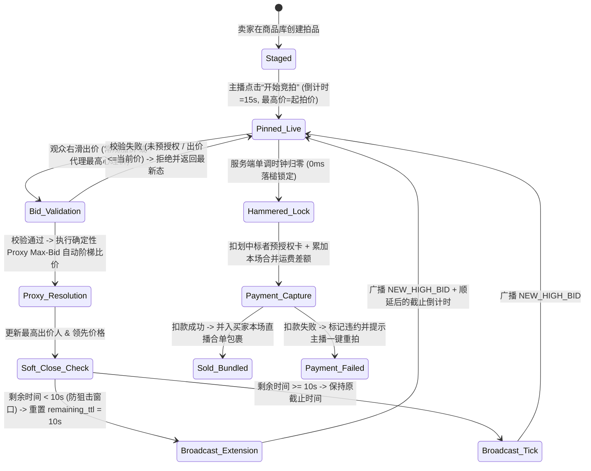
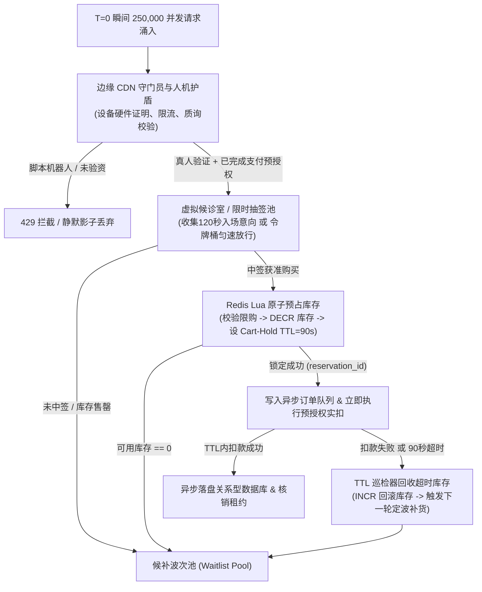

# 直播电商、实时竞拍与高并发秒杀系统

## 这是什么？

直播电商、实时竞拍与高并发秒杀（Flash Sales / Drops）位于超低延迟音视频流媒体、亚秒级实时竞价状态机与极限并发库存分配的交汇点。典型代表包括海外的 Whatnot、TikTok Shop Live、Palmstreet、eBay Live、Nike SNKRS、Shopify Flash Drops，以及国内的抖音电商直播、淘宝直播、快手电商、得物抽签发售等。传统货架电商中，用户异步浏览、花几分钟结账，极少在同一毫秒争抢数据库同一行记录；而在直播间与限量秒杀场景下，主播举起孤品球星卡或宣布 1,000 双联名球鞋上架，对着 10 万在线观众喊出“3、2、1，上链接！”，数万次出价（Bid）或抢购请求会在 200 毫秒内同时砸向同一个商品 ID。

从工程视角看，你正在构建两套紧密耦合的实时交易引擎：
1. **亚秒级实时竞拍引擎（Live Auction Engine）**：在内存中串行裁决高频出价、确定性解析代理最高出价（Proxy/Max Bidding）、执行防狙击的 **延时拍/爆米花竞价（Soft-Close / Popcorn Bidding）** 顺延逻辑、将竞价浮层与视频显示时间戳（PTS）对齐，并在落槌瞬间完成预授权扣款。
2. **高并发秒杀与抽签管道（Flash-Sale & Drop Pipeline）**：通过边缘虚拟候诊室（Virtual Waiting Room）拦截黄牛脚本，执行公平抽签或令牌桶准入，利用 Redis Lua 原子锁库与有效期租约（Cart-Hold TTL），并对同场直播连续拍中多件商品的买家自动执行合并发货计费（Live Bundled Shipping）。

## 为什么要懂？

传统 CRUD 电商架构在直播竞拍与秒杀流量下会瞬间雪崩。若让 50,000 个并发直接对数据库同一行执行 `UPDATE inventory SET stock = stock - 1`，行锁争用（Hot-Key Contention）会瞬间耗尽连接池。就算服务未挂，粗糙的业务逻辑也会引发严重事故：黄牛脚本在 80 毫秒内把 100% 库存锁进未付款购物车，真用户全部看到“已售罄”；视频流缓冲延迟 3 秒导致观众听到主播喊“还有 5 秒”时出价却报错“竞拍已结束”；或买家在一场直播拍中 10 张 $5 卡牌，却被收了 10 次 $6 首重运费（合计 $60 运费）而当场弃单。

掌握单写者内存 Actor 竞拍模型、音视频 PTS 时间戳同步、预验资入列（Pre-Verified Queue）及直播间合单运费累加器，是设计任何高争用实时交易系统（演唱会抢票、潮玩抽签、收藏品竞拍）的核心基本功。

## 业务流程

### 直播前排品（Run-of-Show）与“小黄车”置顶（Pinning）

开播前，卖家编排本场商品清单（Show Catalog，含 50～300 个拍品），分为四种交易模式：
- **实时竞拍（Live Auctions）**：孤品或非标品（球星卡、中古奢侈品、绿植），$1 起拍，倒计时 10～30 秒。
- **限时秒杀（Flash Drops）**：标品限量库存（如 500 件卫衣），主播点击“开抢”瞬间解锁。
- **拆卡/盲盒拼团（Box Breaks）**：观众购买随机卡位（如 30 支 NBA 球队随机一支），满员后主播在镜头前现场拆盒。
- **福袋与买家专属抽奖（Giveaways）**：用于拉升留存率或回馈本场已购买家的免费抽奖。

主播点击某拍品的**“置顶讲解（Pin to Stage）”**时，服务端广播 `LOT_PINNED` 事件，在所有观众播放器底部实时渲染交互式出价/抢购卡片。

### 实时竞拍：绝杀模式（Sudden-Death）vs. 延时防狙击（Soft-Close）

- **绝杀拍（Sudden-Death）**：15 秒倒计时归零立即落槌，不顺延。出货效率高，但极度偏袒低延迟网络与抢拍脚本（Sniping Bots）。
- **延时拍 / 爆米花竞价（Soft-Close / Popcorn Bidding）**：高价值拍品的防狙击标准。当剩余时间小于阈值（`soft_close_window`，如最后 10 秒）时，每收到有效新出价，服务端自动将倒计时重置回 10 秒（如 `00:02` 出价跳回 `00:10`），直到连续 10 秒无人加价才落槌。

### 确定性代理最高出价（Proxy / Custom Max Bidding）

观众可输入保密的**代理最高心理价（Proxy Max Bid）**（如当前价 $10、加价幅度 $2 时，直接设定上限 $100）：
1. 引擎在内存中保密存储上限 $100，对外仅将领先价推至最小领先额（$12）。
2. 若他人出价 $20，引擎在同一次原子内存计算中自动替代理买家跟价至 $22，无需客户端网络往返。
3. **同价时间戳优先（Tie-Breaking）**：若第二位买家也提交 $100 上限，**先提交 $100 的买家**在 $100 价位保持领先。

### 高并发秒杀与虚拟候诊室抽签流转（Virtual Waiting Room Flow）

当 25 万人争抢 1,000 双限量球鞋时，生产级秒杀采用边缘**虚拟候诊室 / 公平抽签队列**配合 Redis Lua 原子锁库租约：

### 即时支付预授权与直播间合并发货计费

- **竞价前置验资与落槌秒扣**：观众必须先绑定地址并通过银行卡 `$0`/`$1` 验卡或**竞价预授权冻结（Pre-Auth Bid Hold）**才能解锁“右滑出价”；落槌瞬间服务端直接计算 `中标价 + 增量合单运费 + 税费` 并静默完成实扣，杜绝中标弃单。
- **有状态的直播间合并发货累加器（Live Bundled Shipping）**：按 `(livestream_id, seller_id, buyer_id)` 维护 `OPEN_BUNDLE` 合单包裹：第 1 单收首重运费（$4.50），第 2～8 单仅收续重差额（$0.00～$0.50），播后合并打印一张总面单。

## 常见术语

| 术语 | 含义 |
| --- | --- |
| **Soft-Close / Popcorn Bidding** | **延时拍 / 爆米花竞价**：倒计时最后 $N$ 秒（如 10 秒）内每有新出价，时钟重置回 $N$ 秒，防御尾盘毫秒级抢拍脚本。 |
| **Sudden-Death Auction** | **绝杀拍**：倒计时到 `00:00` 硬截断落槌，不顺延。 |
| **Proxy / Max Bidding** | **代理最高出价**：买家预设保密心理上限，系统自动以最小加价幅度代出价以维持领先。 |
| **Pre-Auth Bid Hold** | **竞价预授权**：出价前强制校验或冻结支付额度，消灭中标后不付款的跑单党。 |
| **Virtual Waiting Room Lottery** | **虚拟候诊室抽签**：如 Nike SNKRS Draw，在边缘等待室清洗机器人并按公平抽签分配稀缺库存。 |
| **Cart-Hold TTL** | **锁库有效期**：秒杀预占库存的短期租约（60～120 秒），超时未付自动回收。 |
| **Live Bundled Shipping** | **直播间合并发货**：将同一买家同场直播多次拍中的订单归集为一个包裹，仅收边际续重或升箱差价。 |
| **LL-HLS / WebRTC PTS Sync** | **流媒体显示时间戳同步**：将 WebSocket 竞价状态与播放器画面 **PTS** 在 LL-HLS（2～4s）或 WebRTC（<500ms）下对齐。 |
| **Swipe-to-Bid UX** | **右滑出价交互**：用滑动滑块替代单点按钮，防止看直播时大拇指误触引发“口袋误拍”。 |
| **Shill Bidding（托儿抬价）** | 卖家利用同伙或小号假装出价，试探真实买家代理上限或恶意哄抬成交价的欺诈行为。 |

## 常见模式

### 模式一：单写者内存 Actor 竞拍引擎（零锁争用）

严禁用数据库 `SELECT ... FOR UPDATE` 处理高频出价。按 `auction_id` 一致性哈希将同一拍品的所有出价路由至**单写者内存 Actor**（Elixir GenServer、Orleans Actor、Durable Object 或单线程 Redis Lua）。单事件循环微秒级串行处理比价、同价判定与 Soft-Close 顺延，状态变更异步落盘并通过边缘 WebSocket 广播单调 `seq_id` 与相对剩余时间 `remaining_ms`。

### 模式二：Redis Lua 两阶段预占 + 消息队列削峰管道

开抢前将库存预热至 Redis；抢购时用单条 Lua 脚本原子完成限购集合校验（`SISMEMBER`）、库存扣减（`DECR`）及 90 秒预占锁写入；随后发送 Kafka/SQS 消息由下游消费者匀速写入关系型数据库。

### 模式三：服务端单调相对时间差与 RTT 时钟校准

绝不广播绝对截止时间（`ends_at`）依赖手机本地 `Date.now()` 计算倒计时。在 WebSocket 建连时完成 RTT 时钟偏移握手，每次广播下发服务端相对剩余毫秒数 `remaining_ms`。

## 行业实战血泪史与非显性最佳实践

### 1. 视频流与 WebSocket 时钟漂移导致的“幽灵截胡”与 PTS 时间戳同步

**故障现场**：WebSocket 竞价消息 50ms 到达手机，但直播视频流（HLS/LL-HLS）存在 **3.5 秒缓冲延迟**。结果：(1) 竞拍刚结束，WebSocket 立即弹出**“恭喜 @Alex 拍中！”**横幅，而视频里主播才刚喊到*“最后 3 秒！”*，剧透毁掉悬念；(2) 观众听主播喊*“还有 5 秒”*赶紧出价，却收到 `ERR_AUCTION_CLOSED` 报错（服务端 2 秒前已截标），观众愤怒投诉平台暗箱操作或被“幽灵机器人截胡”。

**生产级解法**：
- **分层低延迟传输**：10 秒高频竞拍房强制采用 **WebRTC**（端到端延迟 <400ms），使音画与 WebSocket 误差控制在人类感知阈值内；LL-HLS 仅用于 60 秒长窗口秒杀大场。
- **SEI / ID3 显示时间戳（PTS）注入**：推流端将服务端单调时间戳写入视频帧 **H.264/H.265 SEI** 单元或 HLS ID3 标签，播放器实时计算画面滞后量 `video_lag_ms = server_clock - frame_pts`。
- **延迟感知 UI 分离渲染**：将中标撒花、转盘动画等视觉浮层按 `video_lag_ms` 延迟渲染以对齐主播口型；而权威倒计时始终对齐真实服务端 `remaining_ms`，并在画面滞后 >1s 时提示*“视频延迟 2.1s，请以顶部计时器为准”*。

### 2. 黄牛机器人恶意锁库攻击（Cart-Hold DoS）与“预验资入列”机制

**故障现场**：限量发售 2,000 件潮玩，若点击“去结算”即锁库 10 分钟，黄牛在开售 80ms 内启动 2 万个脚本把 2,000 件库存全部锁进未付款订单。真玩家在 12:00:01 看到**“已售罄”**离场；随后 10 分钟黄牛只挑转卖成功的 300 件付款，其余 1,700 件在 12:10 超时静默回流时已无人问津。

**生产级解法**：
- **前置预授权验资入列（零未付锁库窗口）**：严禁加购扣库存。进入抽签候诊室前，强制用户选好尺码地址并完成**支付预授权 + 3DS / Apple Pay 生物验资**。中签瞬间服务端直接实扣生成已支付订单，将无成本锁库时间压缩为 **0**。
- **底层卡指纹与定波回流**：基于支付网关返回的底层实体卡指纹（`card_fingerprint`）、标准化地址哈希及 `DeviceCheck`/`Play Integrity` 硬件证明去重；扣款失败回收的库存严禁单件静默回流，必须归集后每 3 分钟发起公告式**“第二波返场抽签（Wave 2 Drop）”**。

### 3. 直播间合单发货的体积重突变与拆单计费陷阱（Dimensional Weight Cliff）

**故障现场**：平台承诺*“首单运费 $5，同场后续每件仅加 $0.50”*。买家先拍中 8 个小摆件（共 1.2 磅），第 9 单以 $15 拍下一件超大号玩偶。9 件合箱（`20"×16"×14"`）瞬间触发物流商**体积重（DIM Weight / 抛重）**罚款（按 33 磅计费），快递成本飙至 **$29.50**，而买家只付了 $9 运费，卖家血本无归。

**生产级解法**：
- **结构化物流画像与出价前边际运费预览**：每个拍品绑定重量、预设箱型档位与可否合单属性。内存维护 `(stream_id, buyer_id)` **装箱累加器**，出价前实时计算 `边际运费 = Cost(已购包裹 + 当前拍品) - Cost(已购包裹)` 并在出价滑块下方直接展示（`"+ $0.00 合单免邮"` vs `"+ $6.50 大件升箱运费"`）。
- **超抛重自动拆单与中途打单锁定**：若合箱触发体积重导致比拆成两个独立包裹更贵，或卖家在直播中途已提前打印前 8 件面单（置为 `LOCKED_PRINTED`），系统自动为第 9 件开启 `合单包裹 #2`。

### 4. 福袋羊毛党女巫攻击与卖家“托儿哄抬价格（Shill Bidding）”检测

**故障现场**：(1) 群控脚本监测全网免费福袋倒计时，最后 10 秒塞入 3,000 个小号卷走 75% 奖品，微改地址格式（`Apt 4B`、`#4B`）发往同一转运仓；(2) 不良卖家让同伙小号每次加价 $10，精准试探并逼迫设定了 $300 代理上限的真实买家以最高价成交；若托儿不小心出到 $310 超越真买家，托儿虚拟卡便故意扣款失败或播后撤单。

**生产级解法**：
- **真实流媒体遥测与地址归一化**：福袋参与者必须有连续 HLS/WebRTC 分片拉取记录（拒绝空挂 WebSocket），并通过 Libpostal/CASS 邮政地址标准化与经纬度聚类，使同一物理住址的 50 个小号共享 1 张抽奖权重。
- **实时托儿抬价图谱检测**：实时监控每一对 `(seller_id, bidder_id)` 的四大特征：**专场出价集中度**（>70% 出价集中在该卖家房内却极少成交）、**代理上限试探指纹**（频繁在他人隐藏 `Proxy Max Bid` 下方 1～2 个阶梯精准停手）、**中标违约率**（中标后异常高比例扣款失败或撤单）以及 **网络/设备/地理邻近关联**，实时拦截关联出价。

## 踩坑提醒

1. **单点按钮引发“口袋误拍”**：必须采用**长距离右滑出价滑块（Swipe-to-Bid，拖动 >75% 行程）**，且自定义出价超当前价 3 倍时弹窗二次确认（防 $50 手滑输成 $500）。
2. **弹幕洪峰卡死出价 UI**：万人直播间每秒 300+ 条弹幕会卡死手机 DOM 主线程。必须将 `AUCTION_STATE` 走高优独立通道，服务端对弹幕采样限流（如 10 条/秒），并用虚拟列表隔离弹幕组件树。
3. **主播中途断网保护**：实时监控主播 WebRTC 关键帧心跳；活跃竞拍中视频中断超 3 秒，立即将拍品冻结为 `PAUSED_HOST_DISCONNECT`。
4. **合单跨单税费重算**：部分州对运费征税且设有单价免税门槛，多次落槌累加运费时需按每次新增边际运费精准计税。

## 速查表

| 模块 | 关键设计要点 |
| --- | --- |
| **四大直播交易模式** | 1. 延时防狙击竞拍（Soft-Close）；2. 绝杀拍（Sudden-Death）；3. 高并发限量秒杀（Flash Drop）；4. 直播拆卡/拼团（Box Break）与福袋 |
| **权威竞拍引擎架构** | 右滑出价 → 按 `auction_id` 一致性哈希 → 单写者内存 Actor → 校验预授权 → 代理最高价自动比价（同价先出者赢） → Soft-Close 顺延 → 落槌秒扣 |
| **秒杀防刷与锁库管道** | 边缘 CDN 硬件证明 → **入列前强制完成支付预授权验资** → 候诊室抽签/令牌桶 → Redis Lua 原子扣减与限购校验 → Kafka 异步落库 → 超时库存定波返场 |
| **直播间合单运费公式** | 合单键 `(stream_id, seller_id, buyer_id)` \| `边际运费 = Cost(已购累计重量体积 + 当前拍品) - Cost(已购包裹)` \| 超抛重或已打单自动拆为包裹 #2 |
| **四大生产风控防线** | 1. WebRTC (<400ms) + SEI/ID3 PTS 时间戳对齐防剧透与幽灵截胡；2. 预验资入列消灭未付款恶意锁库；3. 3D 装箱预演防抛重倒贴；4. 图谱识别托儿抬价与地址归一化防群控 |
