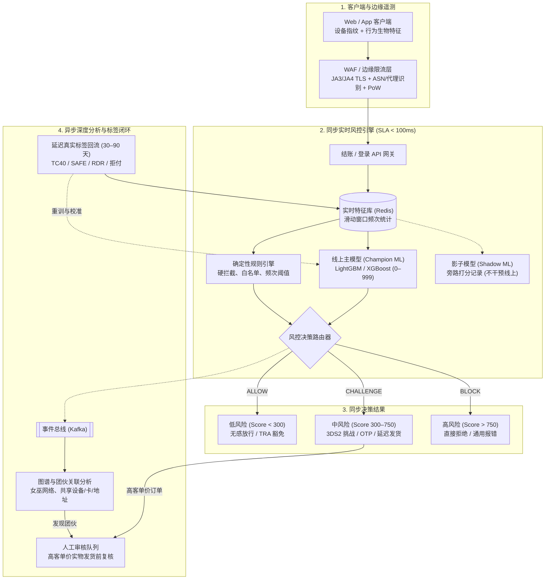
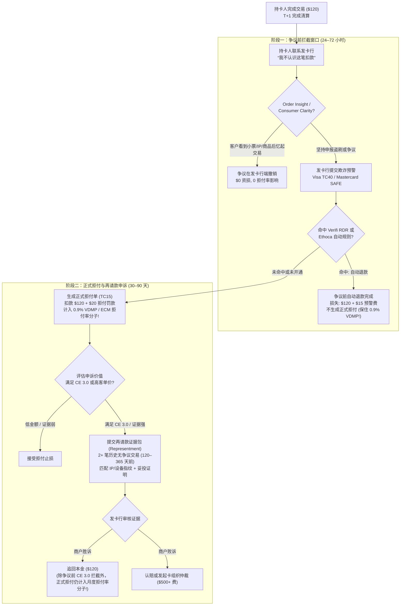

# 反欺诈风控引擎、信任安全与拒付经济学

## 这是什么？

任何在线收款、发放补贴或维护账户余额的互联网平台，都全天候面临自动化黑产、跨国盗刷团伙和恶意消费者的攻击。**反欺诈风控引擎、信任安全与拒付经济学**涵盖了实时风控决策流水线、身份核验协议以及交易争议（拒付）全生命周期管理——其核心是在最大化正常用户支付转化率的同时，将欺诈资损和卡组织罚款控制在生存红线内。

在许多开发者看来，支付只是调一次 Stripe 或 Adyen 接口，拿到 `200 OK` 即可发货。但事实上，**银行卡授权成功绝不等于资金落袋为安**。Visa、Mastercard 等卡组织赋予持卡人长达 120 天（特定场景达 540 天）的争议发起权。一旦发生**拒付（Chargeback）**，发卡行会强制从商户账户划走本金，加收不可退还的拒付处理费（$15–$50），并将该笔争议计入商户月度拒付率。

除盗刷外，风控与信任安全（Trust & Safety）团队还要守护全业务链路：防御撞库引起的**账户劫持（ATO）**、拦截几分钟刷爆数万美元网关费的**测卡攻击（Card Testing / BIN Attack）**、拆解利用模拟器群控和猫池薅光预算的**羊毛党团伙（Promo/Referral Abuse Rings）**，以及应对真实买家收货后谎称“未授权交易”的**友好欺诈（Friendly Fraud）**。

## 为什么要懂？

普通 Bug 仅影响体验，而风控与拒付失守会**直接导致公司破产或被永久剥夺信用卡收款资格**。

1. **每笔欺诈损失接近订单金额的 2 倍**：黑产用盗刷卡买走 $100 实物商品，商户不仅损失 $100 本金，还倒贴 $60 货值、$10 运费、不退还的通道费（~$3.20）及 $15–$25 拒付罚金。一单 $100 欺诈净亏超 $190，按 10% 净利率需 19 单正常交易才能填平。
2. **突破 0.9% 拒付红线会触发卡组织制裁**：一旦月度拒付率突破 **Visa VDMP/VAMP 的 0.9%** 或 **Mastercard ECM 的 1.0%**，收单行会启动监控计划、按单加收 $50–$100 罚金、冻结 10%–20% 流水作为 180 天滚动保证金（Rolling Reserve），甚至关停商户号并将法人列入全球黑名单 **MATCH 列表（TMF）**，5 年内无法在任何银行开户收款。
3. **误杀（False Positives）吞噬的营收高于欺诈本身**：若风控过严误拦 5% 正常用户（Insult Rate），不仅当次流失，更有 30%–50% 被拒买家永久流失。风控本质是欺诈资损与转化率的精确率-召回率博弈。
4. **申诉证据采集决定后端表结构设计**：依据 **Visa Compelling Evidence 3.0（CE 3.0）** 赢下友好欺诈申诉，必须关联同卡在 120–365 天前的两笔无争议交易并匹配设备指纹或 IP。若研发未持久化这些字段或过早清理日志，财务将彻底无法申诉。

## 业务流程

### 1. 实时同步风控与异步深度分析流水线

结账主链路无法容忍慢查询，成熟架构采用**同步快路径（SLA < 100ms）**与**异步深路径（秒级至天级）**双层解耦：



### 2. 设备指纹与行为生物特征

黑产会清空 Cookie、轮换住宅代理并伪造 `User-Agent`。客户端 SDK 需采集多维信号识别真实身份：
- **软硬件指纹**：通过隐藏 Canvas 2D/WebGL 渲染哈希、`AudioContext` 振荡器特征、字体列表、WebRTC 局域网 IP、屏幕分辨率及系统时区与 IP 归属地交叉比对生成唯一 `device_id`。
- **TLS 握手特征（JA3 / JA4）与 ASN**：边缘网关提取 TLS ClientHello 加密套件与 HTTP/2 帧参数。伪装成 Chrome 的 Python 脚本会被 JA4 指纹瞬间识破；结合 ASN 可识别机房 IP、VPN 与住宅代理。
- **反指纹浏览器与模拟器**：针对 Multilogin、Dolphin Anty 及安卓模拟器，SDK 会检测 `HTMLCanvasElement.prototype.toDataURL` 等原生原型链是否被 Hook 注入噪点，以及手机陀螺仪/加速度计是否呈绝对静止的“零微颤”异常。
- **行为生物特征**：正常用户输卡号有停顿、偶发 `Backspace` 和弧形鼠标轨迹；盗刷者常在卡号框直接触发粘贴事件（`Ctrl+V` / `paste`）或使用自动化脚本（`webdriver=true`）。**“陌生设备指纹 + 卡号框粘贴事件”**是极高置信度的盗刷信号。

### 3. 规则引擎与影子机器学习（Shadow ML）

- **实时特征库（滑动窗口频次）**：利用 Redis `ZSET` 或 Flink 在 10ms 内计算特征，如 `单设备1h尝试不同卡数`、`单IP 24h登录账号数`、`单用户15m CVV错误次数`、`IP与账单邮编距离`。
- **确定性规则引擎**：执行可解释布尔逻辑（如 `IF 单设备1h换卡 > 3 AND IP国 != 发卡国 THEN BLOCK`），应对凌晨突发攻击可在 30 秒内热更新生效。
- **GBDT 模型与影子模式（Shadow Mode）**：LightGBM / XGBoost 综合 200+ 维特征输出风险分（`0–999`）。新模型上线前必须以**影子模式**旁路运行，实时记录预测分但不干预交易，验证无误杀漂移后再切流转正。
- **标签延迟与拒绝推断**：拒付标签滞后 30–90 天，且被拦订单无真实标签。团队利用 TC40 预警等早期信号作代理标签，并放行 0.5% 随机探索流量（Control Group）测算真实误杀率。

### 4. 3DS2 责任转移与 PSD2 TRA 豁免

- **无感（Frictionless）与挑战（Challenge）流程**：3DS2 在后台向发卡行传输 100+ 项设备与订单遥测数据。发卡行信任则静默通过（**无感流程**）；存疑则拉起银行 App 生物识别或短信验证（**挑战流程**）。
- **责任转移（Liability Shift）与 ECI 编码**：通过 3DS2（Visa 返回 **ECI 05**、Mastercard 返回 **ECI 02**，或尝试认证返回 **ECI 06/01**）后，欺诈类拒付（如 Visa 10.4）的财务损失责任从**商户**转移至**发卡行**（注：不覆盖“未收到货”等消费纠纷；若 3DS 欺诈率超标，卡组织会吊销保护）。
- **欧盟 PSD2 SCA 与 TRA 豁免**：为避免弹窗拉低 8%–15% 转化率，可申请豁免：
  1. **小额豁免**：单笔 **< €30**（连续 ≤ 5 次或累计 ≤ €100）。
  2. **MIT（商户发起交易）**：首次 3DS2 认证并记录 `scheme_transaction_id` 后的周期性订阅扣款。
  3. **TRA（交易风险分析）豁免**：按收单行整体欺诈率分档免除挑战：**€100**（欺诈率 `< 0.13%`）、**€250**（`< 0.06%`）、**€500**（`< 0.01%`）。申请 TRA 豁免时欺诈责任仍由商户承担。

### 5. 争议前拦截与拒付再请款（Representment）全流程



### 6. 卡组织 0.9% 阈值、早期预警与 Visa CE 3.0

- **Visa VDMP / VAMP 与 Mastercard ECM 红线**：**Visa VDMP 标准红线**为月拒付率 **≥ 0.9%** 且月拒付 **≥ 100 笔**（$\text{当月拒付笔数} \div \text{当月清算总笔数}$）；**Mastercard ECM** 为 **1.0%–1.5%** 且 **≥ 100 笔**（分母为上月交易数）。Visa 统一后的 **VAMP** 计划将 TC40 欺诈与 TC15 拒付合并考核。达 **1.8% 且 ≥ 1,000 笔**即触发严重违规，面临按单 $50–$100 重罚及 **MATCH 黑名单**清退。
- **早期欺诈预警（TC40 / SAFE）与争议前自动退款（Verifi RDR / Ethoca）**：**TC40 / SAFE** 是非财务欺诈通知，早于正式拒付数天到达，后端需立即封号、截停未发货包裹。**Verifi Order Insight & RDR**（Visa）与 **Ethoca**（Mastercard）在正式拒付（TC15）生成前介入，按规则自动退款（仅付 $15–$25 预警费），**避免计入 0.9% VDMP/ECM 拒付率**。
- **Visa Compelling Evidence 3.0（CE 3.0）**：针对 **10.4（无卡欺诈）** 友好欺诈，提供**同卡在争议前 120–365 天内清算的至少 2 笔无争议交易**，在 `User ID`、`IP 地址`、`收货地址`、`设备指纹 Device ID` 4 项中**至少匹配 2 项**，且**其中至少 1 项必须是 `IP 地址` 或 `设备指纹`**，即可强制逆转责任由发卡行买单。

## 常见术语

| 术语 | 解释 |
| --- | --- |
| **Chargeback（拒付）** | 发卡行强制撤回交易本金，加收 $15–$50 罚金并计入卡组织拒付率。 |
| **Representment（再请款）** | 商户提交妥投证明、日志或 CE 3.0 证据包抗辩拒付以追回本金。 |
| **Friendly Fraud（友好欺诈）** | 真实持卡人消费后向银行谎称“未授权交易”或“未收到货”白嫖商品。 |
| **ATO（账户劫持）** | 通过撞库、钓鱼或会话劫持登录老用户账号，盗刷绑卡或提现余额。 |
| **Card Testing（测卡/BIN 攻击）** | 脚本利用卡库或按 6/8 位 BIN + Luhn 算法生成卡号，批量测试活卡。 |
| **Promo / Sybil Abuse（羊毛党）** | 用模拟器群控、猫池虚拟号与代理批量注册假号，套取新客券与拉新奖。 |
| **3DS2 & Liability Shift** | EMV 3DS2 认证（`ECI 05`/`02`）将盗刷拒付责任从商户转移给发卡行。 |
| **TRA Exemption** | 欧盟 PSD2 下低欺诈率收单行对 €100/€250/€500 内交易免除 3DS 挑战。 |
| **VDMP / VAMP / ECM** | Visa 与 Mastercard 监控计划，突破 0.9% 或 1.0% 将面临重罚与清退。 |
| **TC40 / SAFE** | Visa（TC40）与 Mastercard（SAFE）早于正式拒付下发的欺诈预警通知。 |
| **Verifi RDR / Ethoca** | 卡组织争议前拦截网，通过自动退款阻止争议变成正式 TC15 拒付单。 |
| **Visa CE 3.0** | 凭 120–365 天前 2 笔以上同卡无争议交易匹配 IP/设备指纹击败 10.4 拒付。 |
| **Shadow Mode（影子模式）** | 新模型线上旁路打分落库但不拦截真实用户，安全验证误杀率。 |
| **MATCH List（TMF 黑名单）** | 因拒付超标被清退的商户及法人 5 年期全球收单禁入黑名单。 |

## 常见模式

### 模式一：防御测卡攻击（Card Testing / BIN Attacks）

脚本用 Luhn 算法枚举卡号冲击绑卡或小额接口。即使 99% 失败，网关仍按次收 **$0.05–$0.15 授权费**。
- **防御**：严禁未登录或无 Cloudflare Turnstile / PoW 令牌直接创建 `PaymentIntent`；Redis 按 `user_id`（15m 限败 3 次）、`device_id`、`/24 IPv4` 限流；设 **BIN 熔断器**（单 BIN 5m 全站失败超 20 次强制开启 3DS2 + 验证码）；对硬拒绝码（`stolen_card`）本地拉黑卡指纹，严禁重复提交。

### 模式二：拆解促销与拉新羊毛党团伙（Sybil Defense）

- **防御**：归一化邮箱别名（`u.s.e.r+1@gmail.com`）并拦截 VoIP 猫池虚拟号；凭硬件 `device_id` 与网关 `card.fingerprint` 唯一去重；对收货地址做标准化 + **Jaro-Winkler / 编辑距离模糊匹配**与 Geohash 聚类，揪出篡改门牌号（`"Apt 4B"` vs `"#4-B"`）的集运点；构建“账号-设备-卡-地址”连通图拦截星型女巫网络，并将拉新返现设为**冻结托管态（Pending Escrow）**，待妥投满 14 天无退款后再解冻。

### 模式三：防御账户劫持（ATO）与资产洗劫

- **防御**：登录检测**不可能的位移（时速 > 900 km/h）**与新设备，强制二次验证（Passkey/TOTP）；对买礼品卡、改手机/邮箱、换提现卡实行**零信任动作门禁**；修改凭据后自动触发 **24–72 小时提现冷静期**，并向**旧邮箱/手机**发送一键冻结链接。

### 模式四：动态 3DS2 路由与 RDR 弹性防御

- **策略**：`风险分 < 250` 走无感或 **TRA 豁免**；`250–700` 触发 **3DS2** 拿责任转移；`> 700` 直接网关前**硬拦截**（避免污染 3DS 欺诈率）。同时动态调节 **RDR**：拒付率 `< 0.45%` 时仅自动退 `< $50` 争议（大额走 CE 3.0 申诉）；逼近 `0.65%` 时将自动退款上限提至 `$500+` 死守 0.9% 红线。

## 踩坑提醒

- **按 IP 一刀切封禁**：移动网络 **CGNAT** 会让同城数千名正常用户共用一个公网 IP，必须结合 `device_id` 与 JA4 指纹。
- **拒付后客服又手动退款（双重退款）**：拒付发生时银行已划走资金，收到 `chargeback.created` 或 `rdr.alert` Webhook 必须毫秒级锁死后台退款按钮。
- **报错信息泄露风控规则**：切勿返回 `"单设备换卡超 3 次"`，对外统一返回通用支付失败。
- **重试硬拒绝码（Hard Declines）**：重试 `stolen_card`、`invalid_account` 会被卡组织按次罚款 $0.10–$1.50。
- **误以为申诉赢了就不算拒付率**：正式拒付（TC15）一旦生成，无论申诉输赢都计入 0.9% 分子（除非在争议前通过 RDR 或 CE 3.0 拦截）。
- **日志只留 30 天导致丧失 CE 3.0 资格**：CE 3.0 要求匹配 **120–365 天前**的订单，需依据 GDPR 第 6(1)(f) 条将 IP 与设备指纹留存 13–18 个月。

## 速查表

```
实时风控 SLA 与分层架构：
  同步快路径 (< 100ms)：边缘 WAF (JA4+ASN) → Redis 滑动窗口特征 → 规则引擎 + GBDT 主模型
  决策分档：0–299 ALLOW (无感/TRA) | 300–749 CHALLENGE (3DS2/OTP) | 750–999 BLOCK (硬拦截)
  异步深路径：Kafka → 图计算女巫团伙聚类 → 人工审核台 → 30-90 天拒付标签回流

卡组织拒付监控红线（VDMP / VAMP / ECM）：
  公式：当月拒付笔数 / 当月清算总笔数（Mastercard 分母为上月交易笔数）
  安全区：< 0.50% | 预警：0.65% (≥75笔) | 违规：0.90% (Visa ≥100笔) / 1.0% (MC)
  严重违规：1.80% (≥1,000笔) → $50-$100/笔罚款 + 180天滚动保证金 + MATCH 黑名单清退

欧盟/英国 PSD2 SCA 与 TRA 豁免档位：
  小额豁免：< €30 | TRA €100 (< 0.13%) | TRA €250 (< 0.06%) | TRA €500 (< 0.01%)

Visa Compelling Evidence 3.0 (CE 3.0) 必存清单（应对 10.4 友好欺诈）：
  [x] 同卡至少 2 笔历史无争议交易，且清算时间在争议日前 120 至 365 天之间
  [x] 4 项匹配至少 2 项：User ID / IP 地址 / 收货地址 / 设备指纹（必含 IP 或 设备指纹 之一）
```
