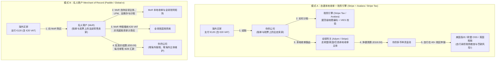
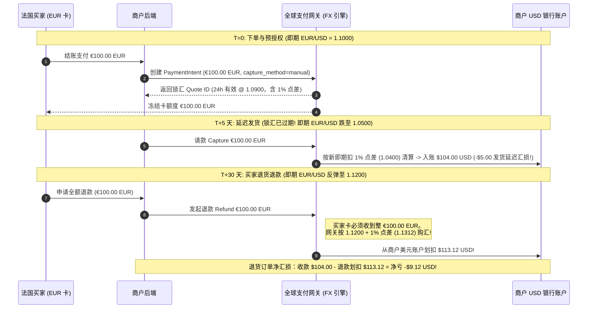

# 跨境电商、全球税务合规（VAT/Sales Tax）、外汇与清关

## 这是什么？

把实物商品或 SaaS 订阅卖给海外用户，表面看只是翻译文案、展示欧元或日元价格、给 Stripe 传个币种代码。但在冰山之下，**跨境电商、全球税务合规（VAT/Sales Tax）、外汇（FX）与海关清关**交织成一张由各国主权税法、本地支付清算轨、汇率点差及边境清关协议构成的复杂网络，直接决定出海业务是盈利扩张还是陷入合规灾难。

当企业向德国、巴西或日本买家收款时，四个底层系统同时碰撞：
1. **全球间接税合规（Sales Tax / VAT / GST）**：各国税法要求远程卖家根据**买家所在地**计算、代扣并申报消费税——哪怕你在当地没有员工或服务器。
2. **本地收单与本地支付方式（LPMs）**：用美国或香港主体直接刷欧洲、拉美买家的卡，不仅承担 1.5%–2.0% 跨境交换费罚金、面临低 15%–30% 的授权通过率，还会流失超 50% 习惯非卡支付的海外消费者（巴西 **PIX**、荷兰 **iDEAL**、印度 **UPI**、日本便利店付现 **Konbini**）。
3. **全生命周期外汇滑点（FX Slippage）**：订单经历定价、预授权（Auth）、请款（Capture）、清算与退款。若买家付欧元（`展示币种 Presentment`），商户收美元（`结算币种 Settlement`），延迟请款或跨月退款时的汇率波动与通道换汇点差会造成无对冲汇损。
4. **海关编码（HS Code）与到岸总成本（Landed Cost）**：跨境实物包裹必须申报 **HS 编码**、完税价格、关税与进口增值税，并选择 **DDP（完税后交货）** 或 **DDU/DAP（未完税交货）**——直接决定包裹顺畅妥投还是在买家门口被拒收。

## 为什么要懂？

工程师常在结账、发票和订单状态机里硬编码本土假设，出海时极易踩雷：
1. **漏收税款直接从公司营收硬扣（外加 20%–50% 罚金）**：突破美国各州税务关联（Nexus）或欧盟阈值后若漏收 20% 英国 VAT 或 8.25% 德州销售税，你无法事后找客户补税。税局审计会直接从公司账户划扣应缴税额与高额滞纳金。
2. **政府税务验证接口（如欧盟 VIES）每周都在宕机**：欧洲 B2B 客户输入有效欧盟 VAT 税号后依法享受 **0% 逆向征收（Reverse Charge）**。但欧盟 **VIES 接口**实时转发请求至 27 国税局数据库，多国节点每周停机维护。若结账页同步强依赖 VIES 且无降级策略，欧洲 B2B 结账将频繁瘫痪。
3. **异步本地支付（Konbini / Boleto）击穿同步库存锁**：信用卡 2 秒出结果，而日本 **Konbini** 和巴西 **Boleto** 允许买家在 **1–5 天内**线下付现，巴西 **PIX** 二维码也有 15–60 分钟有效期。若下单即硬锁稀缺库存 5 天，竞对可零成本锁空全站库存；若过早释放库存，3 天后收到现金到账 Webhook 就会严重超卖。
4. **DDU 未完税发货与退款汇损静默掏空毛利**：用 **DDU** 发实物包裹，快递员会在买家门口索要关税 + **$15–$25 代垫手续费**，导致 15%–30% 包裹被拒收，商户倒贴往返国际运费并输掉“未收到货”拒付。

## 业务流程

### 1. 本地直连收单 vs. 名义商户（Merchant of Record, MoR）

在写计税或支付代码前，必须选定合规模式：自建税务收单栈（**Direct Local Acquiring + Tax Engine**），或外包给 **名义商户（MoR，如 Paddle、Global-e、Lemon Squeezy、FastSpring）**。



- **名义商户 MoR（SaaS 用 Paddle / Lemon Squeezy；实物电商用 Global-e）**：MoR 在法律上以批发价向你买断商品并以自己名义转售给消费者（账单显示 `PADDLE.NET*ACME`），全包全球税号注册、季度 VAT 申报、VIES 校验、本地支付和拒付。综合费率较高（**5%–8% + $0.50**），但零海外税务负担。
- **自建本地收单 + 税务引擎**：年海外 GMV 超 **$500 万–$1,000 万**后，自建会计申报 + **Stripe Tax / Avalara**（通道费 2.2%–2.9% + 计税 0.5%）更具性价比。常见**混合演进策略**是在美、英、欧前三大市场用本地主体直连，长尾国家走 MoR。

### 2. 美国经济关联法案（`South Dakota v. Wayfair`）与屋顶级计税

美国**无联邦销售税**，而是由 45 个州（仅 **NOMAD 五州** NH、OR、MT、AK、DE 无州级税）、县、市及特别税区构成 **13,000+ 个重叠税区**。
- **`South Dakota v. Wayfair`（2018）经济关联（Economic Nexus）**：2018 年前仅在当地有办公室、员工或 FBA 仓库（物理关联）才需收税；*Wayfair* 案裁定无物理存在但远程销售额达标即构成**经济关联**。
- **标准阈值（$100,000 或 200 笔交易）**：多数州规定过去 12 个月在该州总营收超 **$100,000 或达 200 笔交易**（加州、德州、纽约为 **$500,000**，且多州已取消 200 笔限制），即须注册州税号并代收 Sales Tax。
- **SaaS 各州应税差异**：纽约、华盛顿、宾州、麻省对 SaaS **100% 征税**；德州对 SaaS **按账单 80% 征税**（20% 免税）；加州、佛罗里达对纯云端 SaaS **免税**。
- **为何 5 位邮编（ZIP Code）计税必出 Bug**：在科罗拉多或华盛顿州，共用同一 5 位邮编（`80111`）的对门两栋房可能分属不同市政或体育馆税区，**税率相差 2.5%**。严禁查静态邮编表，必须传完整街道地址 + `ZIP+4` 做**屋顶级经纬度编码（Rooftop Geocoding）**。

### 3. 欧盟 VAT OSS、IOSS 与 B2B 逆向征收（及 VIES 宕机降级）

- **含税价 vs. 不含税价**：美加展示不含税价；欧盟（19%–27% VAT）、英国（20%）、日澳法律强制要求 B2C 从首页起展示**含税价**。
- **B2C 位置证据与 VAT OSS（一站式申报）**：向欧盟个人销售数字服务须采集**两项不冲突位置证据**（如 `IP 国` + `卡 BIN 国`）按买家国税率计税。泛欧跨境 B2C 年销超 **€10,000** 后，可通过 **OSS（或 Non-Union OSS）** 在**单一欧盟国**注册，每季度提交**一份汇总申报表**清缴 27 国 VAT。
- **B2B 逆向征收（Reverse Charge）与 VIES 三级降级**：跨境企业买家提供有效欧盟 VAT 税号（如 `DE123456789`）时免收 **0% VAT**，发票需印双方税号及 *"Reverse Charge — Article 196 Council Directive 2006/112/EC"*，并调欧盟 **VIES API** 保存 `consultationNumber`。针对 VIES 成员国节点频繁返回 `MS_UNAVAILABLE` 超时，需实现**三级降级**：
  1. **本地正则与模校验位**：格式非法直接同步拒绝。
  2. **本地缓存（7–30 天）**：复用近期已验证结果。
  3. **`MS_UNAVAILABLE` 异步队列**：税局宕机时**绝不阻断 B2B 结账**，临时按 0% 放行（`PENDING_ASYNC_VERIFY`）并由后台指数退避队列在 48 小时内重试核验。

### 4. HS 海关编码、最低免税额（De Minimis）与 DDP vs. DDU 到岸成本

跨境实物商品须归类 **HS 编码**（前 6 位全球通用，后 2–4 位各国扩展，如美国 10 位 **HTS**、欧盟 **TARIC**）。
- **最低免税额（De Minimis）**：**美国 $800 USD**（Section 321，受原产国贸易政策限制）；**欧盟进口 VAT 免税额为 €0**，**关税免税额 €150**（货值 ≤ €150 可走 **IOSS** 在结账时预收 VAT 快速清关）；**英国 £135 GBP**（≤ £135 由商户在结账时代收 20% 英国 VAT）。
- **复合到岸总成本（Landed Cost）税上加税公式**：关税按 **CIF（货值+运费+保险）** 计算，而**进口 VAT 以（CIF + 关税 + 清关费）之和为基数计算**：

$$\text{CIF 完税价} = \text{商品价} + \text{国际运费} + \text{保险}$$

$$\text{关税} = \text{CIF 完税价} \times \text{HS 关税率} \quad | \quad \text{进口 VAT} = (\text{CIF} + \text{关税} + \text{清关费}) \times \text{VAT 税率}$$

$$\text{到岸总成本 (Landed Cost)} = \text{CIF 完税价} + \text{关税} + \text{进口 VAT} + \text{清关费}$$

- **DDU 门口拒收陷阱 vs. DDP 完税交货**：**DDU/DAP** 在派件时由快递员向买家当面索要进口税 + **€15 快递代垫费**，引发 20%+ 拒收率与拒付；**DDP** 在结账页收齐 **Landed Cost** 并通过电子报关单（**ETD**）由商户月结账号付税，实现零阻碍派送。

### 5. 本地支付方式（LPMs）与异步过期状态机

| 本地支付 | 地区 | 支付机制 | 确认时效 | 拒付风险？ | 原路退款？ |
| --- | --- | --- | --- | --- | --- |
| **PIX** | 巴西 | 央行实时二维码/推送 | 10 秒 – 60 分钟 | **无**（推送） | 支持 |
| **iDEAL** | 荷兰 | 网银重定向（占 70% 份额） | 实时（15m 超时） | **无**（不可撤） | 支持 |
| **UPI** | 印度 | 移动端实时推送/唤起 | 实时（5m 超时） | **无** | 支持 |
| **Konbini** | 日本 | 便利店线下现金扫码 | **异步：1–7 天** | **无**（付现） | **无**（需收集银行卡转账） |
| **Boleto** | 巴西 | 线下/网银条码账单 | **异步：1–3 工作日** | **无** | **无**（需收集银行账户） |
| **SEPA DD** | 欧元区 | 银行账户拉取式代扣 | **异步：2–5 工作日** | **极高！**（8 周无理由撤回） | 支持 |

### 6. 预授权-请款-退款全链路外汇滑点生命周期



## 常见术语

| 术语 | 解释 |
| --- | --- |
| **MoR（名义商户）** | 作为法定卖家出现在买家账单上（Paddle、Global-e），全包全球报税与拒付责任。 |
| **Economic Nexus** | 美国 *Wayfair* 规则：远程年销超 $10 万或 200 笔即须在当地州注册代收销售税。 |
| **VAT OSS / IOSS** | 欧盟**一站式申报**（单国注册季度申报 27 国 VAT）与**进口一站式服务**（≤ €150 预收 VAT）。 |
| **Reverse Charge** | 跨境 B2B 买家提供经 **VIES** 验证的有效税号后免收 0% VAT，由买家自行申报。 |
| **HS Code（海关编码）** | 6–10 位国际标准商品税则编码，决定进口关税率。 |
| **De Minimis（最低免税额）** | 进口免关税/进口税的货值上限（美国 $800、欧盟关税 €150、英国 £135）。 |
| **Landed Cost（到岸成本）** | 商品到手总费用：$\text{CIF 完税价} + \text{关税} + \text{进口 VAT} + \text{清关代垫费}$。 |
| **DDP vs. DDU (DAP)** | **完税后交货**（结账预收税费）vs. **未完税交货**（派件时向买家收税，极易拒收）。 |
| **LFL（原币同币种清算）** | `EUR` 交易直接清算进 `EUR` 账户，消除单笔 1%–2% 换汇费与退款双向汇损。 |

## 常见模式

### 模式一：高可用 VIES 税号校验与 B2B 逆向征收降级

先跑本地国家正则与校验位，再查 7–30 天本地缓存（保存 `consultationNumber`）。若欧盟 VIES 返回 `MS_UNAVAILABLE`，临时按 0% 放行（`PENDING_ASYNC_VERIFY`）并由后台异步队列在 48 小时内补验。

### 模式二：异步现金凭条（Konbini / Boleto）防恶意锁库存

区分**短周期实时支付**（PIX / UPI：15–30m 过期，绑 Redis TTL 硬库存锁）与**跨天现金凭条**（Konbini / Boleto：1–5 天过期，严禁未付款时硬锁限量秒杀库存）。因现金凭条无原路退回通道，退款须触发**收集买家本地银行卡打款（Payout）**流程。

### 模式三：同币种原币清算（LFL）多币种资金池对冲汇损

开通 **Like-for-Like（LFL）原币账户**（Stripe 多币种、Adyen、Airwallex）：`EUR` 货款原币入账，`EUR` 退款直接从欧元池扣付（**0 汇损、0 换汇费**），每月仅将盈余资金按银行间批发汇率（0.05%–0.15% 点差）集中换汇。

### 模式四：本地化心理定价价格簿（Price Books）与含税倒算

维护各币种整数**价格簿**（`$99 USD`、`€95 EUR`、`£85 GBP`、`¥14,800 JPY`）。在欧盟含税区保持前台总价 `€95` 不变，后台按目的国税率动态倒算净收入（德国 `€95 / 1.19`，瑞典 `€95 / 1.25`）。

## 踩坑提醒

- **在零小数位币种（`JPY`、`KRW`、`VND`、`CLP`）上盲目乘以 100**：网关要求传最小货币单位整数（`$10.00` 传 `1000`）。但**日元（`JPY`）和韩元（`KRW`）是 0 位小数币种**（`¥1,000` 必须传 `1000`），写死 `amount * 100` 会刷走日本买家 **100 倍金额**！科威特第纳尔（`KWD`）则是 **3 位小数**（`1000` = `1.000 KWD`）。必须查 ISO 4217 小数指数表。
- **漏算运费税款**：欧盟、英国及美国多数州要求**运费同样按商品税率计征 VAT / Sales Tax**。
- **误以为欧元区 SEPA Direct Debit 无拒付**：SEPA 直接借记允许消费者在扣款后 **8 周（56 天）内无条件强制撤回资金**（未授权代扣达 13 个月），且商户无法申诉。
- **退款时直接篡改已开具的历史税票**：欧盟税法严禁修改或删除已开具的连续编号税票（`INV-2026-00412`），退款必须保持原发票不可变并单独开具连续编号的**红字贷项通知单（Credit Note `CN-2026-00089`）**。

## 速查表

```
MoR 名义商户 vs. 自建全球税务收单选型：
  年 GMV < $5M 或精简团队 → MoR (Paddle / Global-e)：5%-8% 费率，0 海外报税
  年 GMV > $10M 高频交易  → 自建本地收单 + Stripe Tax/Avalara + LFL 原币清算池

全球核心税务与海关免税额（De Minimis）红线：
  美国经济关联：单州年营收 > $100k 或 ≥ 200 笔 (CA/TX/NY 为 $500k) | 屋顶级经纬度计税
  美国进口免税：$800 USD (Section 321) | 英国进口：≤ £135 结账代收 20% UK VAT
  欧盟 VAT：    B2C 泛欧超 €10,000 走 OSS 单国申报 | 实物进口免税额 €0，≤ €150 走 IOSS

跨境实物 DDP 复合到岸总成本（Landed Cost）公式：
  CIF = 货值 + 国际运费 + 保险 | 关税 = CIF × HS 税率
  进口 VAT = (CIF + 关税 + 清关费) × VAT 税率 | 到岸总成本 = CIF + 关税 + 进口 VAT + 清关费

ISO 4217 最小货币单位指数表（防 100 倍扣款事故）：
  0 位小数（传 1000 = 1,000）：JPY, KRW, VND, CLP, ISK
  2 位小数（传 1000 = 10.00）：USD, EUR, GBP, CAD, AUD, SGD, BRL, CNY, INR
  3 位小数（传 1000 = 1.000）：KWD, BHD, OMR, JOD, TND
```
