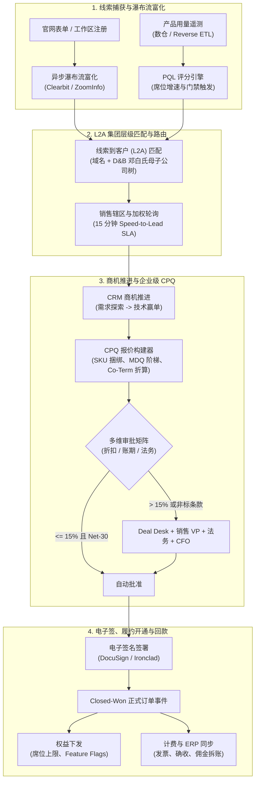

# CRM、营收运营（RevOps）与企业级 CPQ（从线索到回款）

## 这是什么？

**从线索到回款（Lead-to-Cash，L2C）** 系统将获客引擎（**CRM** 与 **RevOps 营收运营自动化**）与商业签约引擎（**CPQ —— 配置 Configure、定价 Price、报价 Quote**）及下游计费、权限开通（Provisioning）和 ERP 总账连接起来。相比固定月费的自助式 B2C 订阅，企业级 B2B 销售涉及集团母子公司层级、跨年阶梯递增合同（**Multi-Year Ramp Deals**）、期中增购共期对齐（**Co-Terming**）、多级折扣审批矩阵，以及业务库与 Salesforce / HubSpot 的双向同步。

从系统工程视角看，构建 RevOps 与 CPQ 的本质是设计一套事件驱动、金融级精度的状态机：让市场归因、产品遥测、销售动作、法务红线与账单计划保持严格一致，彻底杜绝双向 Webhook 回声死循环（Echo Loops）与期中折算的分币精度漂移。

## 为什么要懂？

B2B SaaS 从自助订阅迈向大客户销售（年客单价 $50,000–$5,000,000）时，固定 Stripe 套餐无法表达企业采购条款。采购方要求 **跨年阶梯协议（Ramp Deals）**（第 1 年 100 席位、第 2 年 250 席位、第 3 年 500 席位）、**期中增购共期对齐（Co-Termed Add-Ons）**（年中增购 100 席位且与主合同同日到期）及非标账期（Net-60、季付）。

若把 CRM 同步和 CPQ 当成简单 CRUD：
- **双向 Webhook 死循环** 会在数分钟内耗尽 Salesforce API 配额（Governor Limits），导致销售系统瘫痪。
- **缺失母子公司层级匹配（L2A）** 会把子公司（Instagram LLC）线索分给初级电销，而大客户总监正与母公司（Meta Platforms, Inc.）谈判百万美元级主协议，引发内部撞单。
- **粗糙的期中折算算法** 会算错增购发票、污染 ARR（年度经常性收入）口径并导致审计失败。

## 业务流程

### 1. 线索到回款（Lead-to-Cash）与 PQL 全生命周期



### 2. 线索捕获与多源瀑布流富化（Waterfall Enrichment）

潜客提交表单或注册时，接入层采集首/末触点归因参数（`utm_source`、`utm_campaign`、`gclid`）及企业邮箱，并触发**异步瀑布流富化**：
1. **邮箱归一化与幂等去重**：剥离别名后缀（`alice+test@acme.com` $\rightarrow$ `alice@acme.com`），过滤个人免费邮箱域名（`gmail.com`、`qq.com`），生成幂等键。
2. **多供应商瀑布流查询**：优先请求 Clearbit（1,500ms 超时）；若缺失画像字段（`employee_count`、预估 ARR、行业、总部国家、邓白氏编码 `duns_number`），自动降级调用 ZoomInfo 与 Apollo。
3. **域名级缓存**：按企业主域名（`acme.com`）缓存富化结果 30 天，避免同一企业多名员工注册触发重复 API 调用。

### 3. 线索到客户（L2A）与邓白氏（D&B）母子公司层级匹配

跨国集团拥有数百个独立域名的子公司与收购品牌（如 Alphabet 旗下的 `youtube.com`、`deepmind.com`）。为防止多名销售跟进同一集团造成撞单，L2A 引擎利用 9 位 **邓白氏编码（D&B DUNS Number）** 解析企业族谱树：

```
全球终极母公司: Alphabet Inc. (DUNS: 00-123-4567) [全球战略 AE]
 ├── 境内母公司: Google LLC (DUNS: 00-234-5678) [北美西区 AE]
 │    └── 区域分支: Google Cloud EMEA (DUNS: 00-345-6789) [欧洲区 AE]
 └── 全资子公司: Looker Data Sciences, Inc. (DUNS: 00-888-9999)
```

确定性 L2A 匹配按四个优先级执行：
1. **精确域名与联系人匹配**：比对存量 Contact 邮箱及 Account 的 `website_domains` 数组。
2. **DUNS 编码精确匹配**：将富化得到的 `duns_number` 与存量 Account 的 `duns_number` 对齐。
3. **D&B 母公司族谱向上回溯**：若子公司 DUNS 未建档，沿族谱向上回溯（`parent_duns` $\rightarrow$ `domestic_ultimate_duns` $\rightarrow$ `global_ultimate_duns`）。命中父级 Account 后检查 `buying_policy`：**集团集采（Centralized）** 挂载至全球母公司并路由给全球战略 AE；**区域自治（Regional Autonomy）** 创建关联 `parent_account_id` 的子客户并路由给区域销售。
4. **法定名称清洗与地理校验**：剥离公司后缀（`Inc.`、`GmbH`、`股份有限公司`），结合 Jaro-Winkler 相似度与总部国家校验。

### 4. 销售辖区划分、加权轮询与 Speed-to-Lead SLA 路由

线索完成 L2A 归属后，路由状态机分配负责人：
- **战略点名客户优先（Named Account Override）**：命中战略白名单客户或其终极母公司时，直接指派给专属 AE。
- **多维辖区切片**：按 `地理大区`（AMER / EMEA / APAC）$\times$ `规模段`（SMB / Mid-Market / Enterprise）$\times$ `行业垂直线` 定位销售池。
- **日历感知加权轮询（Weighted Round-Robin）**：综合 **新人爬坡权重**（试用期 `0.5`，正式 `1.0`）、**日历休假状态**（跳过 PTO 请假或会议中的销售）及 **在途容量上限**（`New` 未跟进线索达 25 条时暂停派单）。
- **15 分钟黄金响应 SLA**：高意向线索落库即启动 **15 分钟工作时间计时器**——**T+10 分钟**未跟进发送高优告警；**T+15 分钟**违约则原子性收回所有权、记录 `sla_breach_event`，并改派给轮询池下一位销售。

### 5. 产品合格线索（PQL）与反向 ETL

在产品驱动销售（PLS，如 Slack、Datadog）模式中，**PQL 引擎**通过 Kafka 或数仓反向 ETL（Census / Hightouch）评估三维信号：
1. **画像匹配度（Fit）**：注册域名是否属于 >500 人的目标行业企业？
2. **用量裂变斜率（Usage Velocity）**：周活跃席位环比增长是否 $>40\%$、跨越 $\ge 3$ 个部门，或消耗超过免费配额的 $80\%$？
3. **高意向门禁触发（Feature Gate Hits）**：管理员是否高频访问企业定价页，或点击锁定的 **SAML SSO / SCIM / 审计日志导出** 按钮？

跨越复合阈值（`Fit >= 70 AND (Usage >= 80 OR IntentGateHit)`）时，系统自动在 CRM 创建 **PQL 商机**，将实时遥测 JSON 快照注入销售面板，并抑制通用营销邮件。

### 6. CPQ（配置、定价、报价）与多维审批矩阵

进入报价阶段后，**CPQ 引擎** 强制保障产品结构与财务毛利合规：
- **配置规则（Configure DAG）**：校验 *依赖规则*（安全合规包依赖企业主套餐）、*互斥规则*（私有化许可与全托管集群互斥）与 *配比规则*（每 500 席位绑定 1 名专属 TAM）。
- **定价与毛利底线（Price & Margin Floor）**：应用阶梯折扣与多币种价目表，并扣减底层 COGS（LLM Token 或专属云成本）校验实时毛利率。
- **多维报价审批矩阵**：按阈值触发并行/串行混合 DAG 审批（修改任何报价行即作废已签批节点并重置审批流）：

| 审批维度 | 销售自批 (AE) | 一线主管 / 总监 | Deal Desk + 销售 VP | 法务 + CFO 终审 |
| :--- | :--- | :--- | :--- | :--- |
| **软件折扣率** | $0\% - 15\%$ | $15.01\% - 25\%$ | $25.01\% - 40\%$ | $> 40\%$ 或跌破毛利底线 |
| **付款周期与账期** | 年付预付, Net-30 | Net-45 | 半年付, Net-60 | 季付/月付, Net-90+ |
| **法务主协议 (MSA)** | 标准模板无修改 | 管辖地微调 | 自定义 SLA 赔付 | 无限连带责任 / IP 兜底 |
| **跨年阶梯与解约权** | 标准跨年递增 | 首年占比 $\le 20\%$ | 陡峭阶梯递增 | 含无理由解约权 (Opt-Out) |

### 7. 跨年阶梯合同（Ramp Deals）与期中增购共期（Co-Terming）折算数学

企业常签署按年递增的 **多维分段报价（MDQ Ramp Deal）**，并在期中发起与主合同同日到期的 **共期增购（Co-Termed Amendment）**。

```mermaid
gantt
    title 3 年期企业阶梯递增合同 (MDQ Ramp) + 第 18 个月期中增购共期对齐 (Co-Term)
    dateFormat  YYYY-MM-DD
    axisFormat  %Y-%m

    section 主合同阶梯 (Master Ramp)
    第 1 年: 100 席位 @ $1,200/年 ($120k)      :active, y1, 2025-01-01, 2025-12-31
    第 2 年: 250 席位 @ $1,140/年 ($285k)      :active, y2, 2026-01-01, 2026-12-31
    第 3 年: 500 席位 @ $1,080/年 ($540k)      :active, y3, 2027-01-01, 2027-12-31

    section 期中增购修正单 (Amendment)
    期中增购: +100 席位 (第 2 年按 184/365 天折算) :crit, add2, 2026-07-01, 2026-12-31
    增购延续至第 3 年 (+100 席位 @ $1,080/年)      :crit, add3, 2027-01-01, 2027-12-31
```

- **主合同阶梯指标**：第 1 年（`2025`）：$100 \times \$1,200 = \$120,000$；第 2 年（`2026`）：$250 \times \$1,140 = \$285,000$；第 3 年（`2027`）：$500 \times \$1,080 = \$540,000$。**TCV**：$\$945,000$ | **年均 ACV**：$\$315,000/\text{年}$ | **Exit ARR**：$\$540,000$。
- **第 18 个月共期增购折算**：客户在 `2026-07-01` 增购 **100 席位** 并对齐至主合同到期日 `2027-12-31`：
  - 第 2 年剩余有效天数（`2026-07-01` 至 `2026-12-31` 含首尾）$= 184\text{ 天}$（平年 $365\text{ 天}$）：
    $$\text{第 2 年折算费} = 100 \times \$1,140 \times \frac{184}{365} = \$57,468.49$$
  - 增购席位延续至 **第 3 年分段**（完整 365 天，按第 3 年单价 $\$1,080$ 计算）：$\text{第 3 年增量费} = 100 \times \$1,080 = \$108,000.00$。
  - **修正单总额**：$\$57,468.49 + \$108,000.00 = \$165,468.49$，第 3 年 Exit ARR 升至 $600 \times \$1,080 = \$648,000$。

### 8. 双向 CRM 同步防环与销售佣金拆账（Commission Splits）

- **双向同步防死循环（Vector Clocks / 变更源标记）**：
  1. **变更源与事务 ID 过滤**：回写 CRM 时使用专属集成账号并写入 `Last_Sync_Tx_Id__c = <uuid>`；Webhook 监听器遇到集成账号触发或命中本地事务 ID 的回声事件直接丢弃。
  2. **字段级权威所有权**：用量为产品库单向同步至 CRM；负责人与辖区为 CRM 单向同步至产品库；共享字段维护单调递增版本号 `version_seq`。
  3. **规范化 `SHA-256` 短路与微批聚合**：映射字段哈希无变化则跳过；出站更新按父级 `AccountId` 分组排序后通过 **Salesforce Bulk API 2.0** 批量提交，规避 `UNABLE_TO_LOCK_ROW` 锁冲突。
- **销售佣金拆账与追回（Clawbacks）**：不可变佣金账本按角色拆分业绩——**主签 AE**（$100\%$ 新签 ACV 配额，超额触发 $15\%$ 加速器提成）、**SDR**（立项与赢单激励）、**售前 SE**（$2\% - 3\%$ 技术赢单叠加提成）及 **跨区联合拆账（Co-Sell $60\%/40\%$）**。若客户在 90–180 天 **追回窗口** 内坏账或解约，自动生成红字冲销分录从下期佣金扣回。

## 常见术语

| 术语 | 含义 |
| :--- | :--- |
| **L2C (Lead-to-Cash)** | 串联线索捕获、CRM 商机、CPQ 报价、电子签约、计费与 ERP 确收的架构 |
| **L2A (Lead-to-Account)** | 基于域名与邓白氏企业族谱，将个人线索匹配并挂载到母/子公司客户档案 |
| **DUNS Number (邓白氏编码)** | 9 位全球唯一企业标识，串联子公司、境内母公司与全球终极母公司 |
| **PQL (产品合格线索)** | 用量增速、席位裂变或企业门禁触发达阈值的高转化自助工作区 |
| **CPQ (配置、定价、报价)** | 校验 SKU 依赖互斥规则、计算阶梯/跨年价格、驱动审批并生成订单的引擎 |
| **MDQ (多维分段报价)** | 将多年期合同拆分为按年/按季分段，支持各分段配置不同数量与单价 |
| **Co-Terming (共期对齐)** | 期中增购时将到期日与主合同对齐，并按当前分段剩余有效天数折算费用 |
| **ACV / TCV / ARR** | **ACV**：年化合同额；**TCV**：多年期合同总额；**ARR**：年度经常性收入 |
| **Deal Desk (交易审查台)** | 横跨 RevOps、财务与法务的治理团队，审批非标折扣、账期与跨年阶梯 |
| **Clawback (佣金追回)** | 客户在留存窗口期内坏账或解约时，向销售追回已发提成的红字扣款机制 |

## 常见模式

### 模式一：期中增购共期（Co-Terming）整数分币折算引擎

严禁原地修改历史订单行，基于 UTC 纯日期算术与 `BigInt` 美分生成不可变的 **修正单增量行**：

```typescript
interface SubscriptionSegment {
  segmentIndex: number;
  startDate: string;          // YYYY-MM-DD
  endDate: string;            // YYYY-MM-DD (含当日)
  unitAnnualPriceCents: bigint;
}

function daysInclusive(a: string, b: string): number {
  const s = Date.UTC(+a.slice(0, 4), +a.slice(5, 7) - 1, +a.slice(8, 10));
  const e = Date.UTC(+b.slice(0, 4), +b.slice(5, 7) - 1, +b.slice(8, 10));
  return Math.round((e - s) / 86_400_000) + 1;
}

export function calculateCoTermAmendment(
  schedule: SubscriptionSegment[],
  amendDate: string,
  addedSeats: number
) {
  return schedule.filter((s) => s.endDate >= amendDate).map((s) => {
    const start = amendDate > s.startDate ? amendDate : s.startDate;
    const totalDays = daysInclusive(s.startDate, s.endDate);
    const activeDays = daysInclusive(start, s.endDate);
    const num = BigInt(addedSeats) * s.unitAnnualPriceCents * BigInt(activeDays) + BigInt(totalDays >> 1);
    return { segmentIndex: s.segmentIndex, start, end: s.endDate, activeDays, totalDays, proratedCents: num / BigInt(totalDays) };
  });
}
```

**实现要点：** `Date.UTC` 纯日历运算消除夏令时误差，兼容闰年（366 天），并将共期增购席位自动传导至后续分段。若客户要求 **30/360 计日惯例**，通过 `day_count_convention` 枚举切换。

### 模式二：幂等双向 CRM 同步状态账本

```sql
CREATE TABLE crm_sync_ledger (
  entity_type          VARCHAR(32) NOT NULL,
  internal_entity_id   UUID NOT NULL,
  crm_external_id      CHAR(18) NOT NULL,     -- 18 位大小写安全 Salesforce ID
  payload_sha256       CHAR(64) NOT NULL,     -- 映射字段规范化 SHA-256
  last_mutation_origin VARCHAR(16) NOT NULL,  -- 'APP' 或 'CRM'
  last_sync_tx_id      UUID NOT NULL,
  version_seq          BIGINT NOT NULL DEFAULT 1,
  PRIMARY KEY (entity_type, internal_entity_id)
);
```

收到 CRM Webhook 时，若 `event.Last_Sync_Tx_Id__c == last_sync_tx_id`（回声）或 `sha256(mapped_fields) == payload_sha256`（无变更）则丢弃；否则落库并将 `last_mutation_origin` 设为 `'CRM'`，出站 Worker 自动忽略 `'CRM'` 源记录。

## 踩坑提醒

- **混用 Salesforce 15 位大小写敏感 ID**：15 位 ID 在大小写不敏感 SQL Join 时会碰撞，必须统一存储 **18 位大小写安全 ID**。
- **凭商机阶段变更直接开通权益**：仅由完成双签且经 Deal Desk 核验的 **CPQ Order 激活事件** 触发权益下发与佣金计提。
- **自动化 L2A 覆写战略大客户负责人**：切勿对已锁定 `ownership_locked = true` 或有在途商机的母公司 Account 重跑轮询派单。
- **忽视 Salesforce 父级行锁冲突（`UNABLE_TO_LOCK_ROW`）**：并发更新同一 Account 下多个 Contact 会锁死父行，需按 `AccountId` 分组微批并按 ID 排序提交。
- **将一次性实施服务费混入 ARR**：实施服务包（SOW）混入 `ARR` 会虚增估值并多发佣金，每个 SKU 需标注 `revenue_type = 'RECURRING' | 'USAGE' | 'ONE_TIME'`。

## 速查表

| 架构层次 | 推荐实现方案 |
| :--- | :--- |
| **线索富化** | 采集 UTM 与企业邮箱；幂等去重；异步瀑布流（Clearbit $\rightarrow$ ZoomInfo）按主域名缓存 30 天 |
| **L2A 匹配** | 精确域名 $\rightarrow$ 9 位 DUNS $\rightarrow$ 回溯母公司树 $\rightarrow$ 区分集采与区域自治路由 |
| **SLA 路由** | 战略白名单校验 $\rightarrow$ 辖区切片 $\rightarrow$ 日历感知加权轮询 $\rightarrow$ 15 分钟 SLA 倒计时与超时改派 |
| **PQL 引擎** | 融合画像匹配度 + 用量裂变斜率 + 企业门禁触发；通过 Reverse ETL 注入 CRM 卡片 |
| **CPQ 审批** | SKU 依赖/互斥 DAG + 毛利底线拦截 + 并行/串行混合审批矩阵（编辑报价即重置审批） |
| **阶梯与共期** | 显式建模 MDQ 分段；基于 UTC 日期与 `BigInt` 美分计算当期折算额并传导至后续分段 |
| **双向同步** | 强制 18 位 Salesforce ID、`last_sync_tx_id` 回声过滤、规范化 `SHA-256` 比对、按父客户分组微批 |
| **佣金拆账** | 不可变多角色拆账账本（AE / SDR / SE / 渠道）、跨年分段确权，以及 90–180 天坏账自动冲销 |
