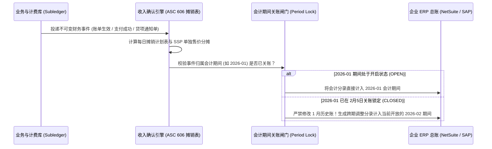

# 企业财务核算、ERP 对接与收入确认准则（ASC 606 / IFRS 15）

## 这是什么？

通过支付网关成功扣款（`02-PAYMENT.md`）或创建周期性订阅账单（`04-SUBSCRIPTION-BILLING.md`），在财务上只叫**现金收款（Cash Collection）**，绝不等于公司的**营业收入（Recognized Revenue）**。根据全球通用的权责发生制会计准则（美国 **ASC 606** 与国际 **IFRS 15**），企业只有在**随着时间推移实际向客户交付了所承诺的服务后**，才能将对应的金额确认为收入。

举个例子：客户在 1 月 1 日一次性付清了 `1,200 元` 的年度 SaaS 会员费。在 1 月 1 日当天，你公司银行账户多了 `1,200 元` 现金，但利润表上的**营业收入是 `0 元`**，资产负债表上则多了一笔 `1,200 元` 的**递延收入（Deferred Revenue / 合同负债）**——因为你还欠客户一整年的服务。之后每平稳提供一个月服务，系统才能将 `100 元` 从“递延收入负债”转入“已确认营业收入”。企业财务核算与收入确认系统，正是连接业务订单数据库与财务 **ERP 总账系统（NetSuite、SAP、金蝶、用友、Stripe RevRec）** 的核心桥梁，确保公司每月能准确完成“月结关账（Book Close）”并通过四大事务所的外部审计。

## 为什么要懂？

早期创业公司看营收只需要看一眼 Stripe 后台的“总流水（Gross Volume）”。但一旦公司进入 B 轮以后或开始筹备上市（IPO），财务总监（Controller / CFO）和外部审计师进场，研发团队往往会遭遇灵魂拷问：*“业务库根本查不出 3 月 31 日晚 23:59:59 时点我们到底还欠用户多少未履约余额；更致命的是，上周研发跑了个历史数据修复脚本，导致已经向董事会汇报过的 2 月份历史收入总额凭空变动了 1.4 万元！”*

收入确认与财务系统的 Bug 不会只引发普通客诉——它会直接导致融资尽调卡壳、触发审计报告中的**重大内控缺陷（Material Weakness）**、迫使公司发布财务重述公告甚至阻断上市进程。理解权责发生制、不可变会计分录、关账周期锁（Period Lock）以及合同变更摊销逻辑，是区分普通 CRUD 程序员与资深 B2B/金融级架构师的分水岭。

## 业务流程

### ASC 606 / IFRS 15 收入确认五步法模型

1. **识别与客户订立的合同（Identify the Contract）**：客户完成自助结账或签署企业级采购订单，形成具有法律约束力的服务周期与付款条款。
2. **识别合同中的单项履约义务（Identify Performance Obligations）**：拆解你向客户承诺了哪些可明确区分的商品或服务？（例如：`12 个月 SaaS 软件订阅` + `40 小时驻场私有化部署实施服务` + `10 万次按量 API 调用额度`）。
3. **确定交易价格（Determine Transaction Price）**：合同总金额扣除折扣、返利、优惠券及预计可变对价（如 SLA 违约赔付额度）。
4. **将交易价格分摊至各单项履约义务（Allocate Price by SSP）**：必须按照各项义务的**单独售价（SSP，Standalone Selling Price）**比例分摊总合同款——哪怕销售为了签单在合同上写“驻场实施服务免费赠送”。
5. **在履行每一项履约义务时（或过程中）确认收入（Recognize Revenue）**：
   - **按时间段摊销（Ratable / Over Time）**：SaaS 订阅按服务起止日期（按天或按月）均匀摊销确认收入。
   - **按时点或按消耗量确认（Point-in-Time / Consumption）**：API 算力包按实际调用消耗确认（过期作废部分按 Breakage 规则确认）；实施服务或硬件在客户签署验收单时一次性确认。


### 从业务子账本（Subledger）到 ERP 总账（General Ledger）的关账流水线

你的生产数据库（或 Stripe Billing）扮演的是**业务子账本（Subledger）**角色，记录每一笔细粒度订单与支付流水。每天凌晨（或月末关账时），收入确认引擎会将千万条子账本明细汇总为借贷必相等的**总账汇总日记账分录（Summary Journal Entries）**，同步至 ERP 总账系统。



### 周期中途升级、降级与退款冲销处理

1. **中途升级（Mid-Cycle Upgrade）**：客户在 4 月中旬从 `100 元/月` 升级到 `300 元/月`。系统自动对老套餐未使用的后半个月生成 `-50 元` 冲抵额度，对新套餐后半个月收取 `+150 元` 差价，并从变更生效时刻起重算剩余递延收入摊销计划。
2. **红字冲销与贷项通知单（Credit Note）**：账单（Invoice）一旦正式生效，**绝对禁止执行 `UPDATE` 或 `DELETE`**。若发生多收款或协商退订，必须签发一张不可变的**贷项通知单（Credit Note / 红字发票）**，冲减应收账款或递延收入负债。
3. **坏账核销（Bad Debt Write-Off）**：企业客户签了“月结 30 天（Net-30）”账单，用了两个月软件后破产跑路。此前已按履约确认的收入不能直接删单抹平，而必须计提**坏账准备 / 坏账费用（Bad Debt Expense）**冲销应收账款。

## 常见术语

| 术语 | 解释 |
| --- | --- |
| **收付实现制 vs 权责发生制** | 收付实现制（Cash）以收到钱为准；权责发生制（Accrual）以服务是否实际交付履约为准，是所有正规企业的法定准则 |
| **ASC 606 / IFRS 15** | 规范软件订阅、分期合同、捆绑销售该如何分步确认收入的国际强制会计准则 |
| **递延收入 (Deferred Revenue)** | 钱已收（或账单已开）但服务尚未交付的部分。在资产负债表上属于**负债（Liability）**，又称合同负债 |
| **合同资产 / 未开票应收 (Unbilled A/R)** | 服务已经交付、按准则已确认收入，但因账期约定尚未向客户正式开具账单的资产 |
| **应收账款 (Accounts Receivable, A/R)** | 已向客户开具正式账单（如 Net-30 企业账单），但客户尚未打款的债权资产 |
| **履约义务 (Performance Obligation)** | 合同中向客户承诺转让可明确区分商品或服务的独立履约单元 |
| **单独售价 (SSP)** | 企业单独售卖某项商品或服务时的市场基准价，用于对打包套餐进行收入分摊 |
| **贷项通知单 (Credit Note / 红字凭证)** | 用于合法冲减已生效账单金额的不可变财务单据，替代直接修改原账单 |
| **月结关账 (Book Close / Period Close)** | 每月初（通常为次月第 3~5 个工作日）锁定上月财务账目的动作，关账后历史期间严禁任何篡改 |
| **子账本 vs 总账 (Subledger vs GL)** | 子账本存每一笔用户订单流水；总账按会计科目存汇总余额（银行存款、应收账款、递延收入、主营收入） |
| **会计科目表 (Chart of Accounts, COA)** | ERP 中所有财务账户的编码体系（如 `1010 银行存款`、`1200 应收账款`、`2400 递延收入`、`4000 订阅收入`） |
| **沉淀收入 (Breakage)** | 客户充值购买的积分、礼品卡或算力包到期未用完作废的部分，按精算比例或到期时点转入营业收入 |

## 常见模式

### 模式一：双时态不可变财务事件（Bitemporal Financial Ledger）

每一条财务与摊销记录必须同时保存两个维度的不可变时间戳：
- **业务生效时间（`effective_at` / `service_period`）**：该笔经济活动实际归属的服务周期。
- **系统记账时间（`recorded_at` / `posted_at`）**：系统获知该事件并写入账本的物理时间，以及它被归入的开放会计期间（`accounting_period`）。

**为什么有效：** 让财务团队随时能运行“时间旅行查询”：*“请还原 2026 年 2 月 5 日下午 17:00 我们关闭 1 月份账期那一刻所看到的 1 月份总收入”*——哪怕 3 年后上市审计时再跑一次，结果也分毫不差。

### 模式二：子账本按日汇总过账总账（Daily Summary Journal Posting）

千万级 C 端用户的产品绝不能把每天 200 万笔 `10 元` 的订单明细逐条塞进 NetSuite 或 SAP（这会直接打挂 ERP 接口并产生天价行数授权费）。标准做法是在业务库维护细粒度**收入子账本**，每天凌晨按 `(日期, 币种, 法人主体, 借贷科目代码)` 聚合生成一张借贷平衡的**日汇总记账凭证**推入 ERP，并保留 `batch_id` 供审计师穿透反查底层明细。

### 模式三：企业级捆绑合同的 SSP 自动重分摊

当企业销售签下一份 `10 万元` 的年度合同，为了迎合客户采购习惯，在合同上写“SaaS 年费 `10 万元`，定制化数据迁移服务（单独市场价 `2.5 万元`）`0 元赠送`”时，收入确认引擎会自动按单独售价（SSP）比例将合同拆分为：`8 万元` 计入 SaaS 订阅（按 12 个月均匀摊销），`2 万元` 计入专业实施服务（在交付验收单签署当日确认收入）。

## 行业实战经验与非显而易见的最佳实践

### 1. “篡改已关账历史月份”引发的审计风暴（为什么关账后严禁 `UPDATE` 历史账单）

在普通业务研发看来，如果 2 月 12 日发现 1 月 29 日有 500 张订单因为 Bug 算错了税率或服务起止日期，最直接的修法就是写个 SQL 脚本：`UPDATE invoices SET amount = ... WHERE created_at >= '2026-01-29'`。
- **为什么这在财务上属于一级事故**：财务部已经在 2 月 5 日完成了 1 月份的**月结关账（Book Close）**，并向投资人、银行和税务局报送了 1 月份报表。当外部审计师在 3 月份重新拉取 1 月份数据，发现总额比 2 月 5 日锁定的报表少了 `4,200 元` 时，会直接判定公司财务系统存在**数据可篡改的重大内控缺陷（SOX Audit Failure）**！
- **生产级铁律（会计期间锁 + 跨期追补调整分录）**：
  - 系统中必须维护显式的 `accounting_periods` 状态表（如 `2026-01: CLOSED`，`2026-02: OPEN`）。
  - 在数据库触发器与应用层双重拦截任何试图向 `CLOSED` 期间写入或修改记录的操作。
  - 若 2 月 12 日需要修正 1 月份的错单，必须生成一张 `posted_at = '2026-02-12'`（计入当前开放的 2 月账期）、但标注 `prior_period_reference = '2026-01'` 的**红字冲销单与前期差错调整分录（Catch-Up Adjustment Entry）**。

### 2. 按天摊销的“闰年与一分钱尾差漂移（Penny Drift）”陷阱

假设客户支付了 `1,000.00 元`（`100,000 分`）购买 365 天的年度会员，每天理论摊销额为 `273.9726027... 分`。
- **初级代码的致命错误**：如果每天定时任务独立计算 `round(100000 / 365) = 274 分/天`，跑满 365 天后累计确认了 `365 × 274 = 100,010 分`（`1,000.10 元`）——凭空多造出了 `1 毛钱` 虚假收入，且导致资产负债表上的“递延收入”科目永远残留着 `-0.10 元` 的负数鬼影余额，几百万用户累加起来就是几十万元的平账噩梦！
- **确定性累计差额取整算法（Cumulative Remainder Allocation）**：

```
第 i 天末累计应确认总分值 = round((合同总分值 * i) / 总天数 N)
第 i 天当天的摊销分录金额 = 累计应确认(i) - 累计应确认(i - 1)
```

采用累计比例取整相减法，绝大多数天摊销 `274 分`，特定天自动摊销 `273 分`，无需任何人工尾差修补，在第 365 天结束时累计确认金额**数学上严格等于 `100,000 分`**，递延收入余额精确归零。

### 3. 多币种递延收入的外汇核算铁律：历史汇率锁定（ASC 830 / CAS 19）

一家英国客户在 1 月 1 日预付了 `£1,200 英镑` 年费，付款当天汇率为 `1 GBP = 1.25 USD`（折合 `$1,500 USD`）。到了 6 月份，英镑暴跌至 `1 GBP = 1.10 USD`。
- **工程师最容易犯的汇兑错误**：在 6 月底跑月结任务时，拿当月摊销的 `£100 英镑` 乘以 6 月底的实时即期汇率 `1.10`，确认了 `$110 USD` 收入。
- **为什么这违反外汇会计准则（ASC 830）**：在会计准则中，**预收的递延收入属于“非货币性负债（Non-Monetary Liability）”**。因为现金早在 1 月 1 日就已经落袋，这笔递延收入对应的本位币（USD）价值**必须永久锁定在收款/开票当日的历史汇率（`1.25`）**，即每月固定确认 `$125 USD`！如果按每月的浮动汇率重估递延收入，会导致累计确认的美元收入与当初收到的美元现金对不上，产生虚假的汇兑损益。（注：相反，尚未收款的**应收账款 A/R** 属于货币性资产，月末必须按期末即期汇率重估汇兑损益！）

## 踩坑提醒

- **关账后才迟到的按量计费话单（Late-Arriving Usage Telemetry）**：流式计费管道遇到节点故障时会有延迟。必须设定严格的**计费封账水位线（如次月 2 日凌晨 04:00）**；封账后才到达的上月迟到用量，一律顺延计入下月账单的追补明细行，严禁重开已锁定账单。
- **平台型电商的“总额法（Gross）”与“净额法（Net）”天壤之别**：如果你做的是双边撮合平台（`25-MARKETPLACE.md`），买家付了 `100 元`，平台抽佣 `15 元`、打给卖家 `85 元`。你的营业收入绝对不能记 `100 元`！在 ASC 606 代理人（Agent vs Principal）判定下，除非平台先买断货权并承担滞销库存风险，否则只能按**净额法**确认 `15 元` 佣金收入，其余 `85 元` 必须记为“应付商家待结算款（负债）”。
- **主动退款与恶意拒付（Chargeback）的科目隔离**：正常协商退款冲减收入（计入退货冲销 Contra-Revenue）；而盗刷引发的通道强制拒付及 `$15` 拒付罚金，在财务上通常计入**主营业务成本（COGS）/ 欺诈损失与通道手续费**，不能混为一谈。

## 速查表

| 业务场景 | 推荐财务架构与工程实践 |
| --- | --- |
| 年付预收订阅（`1,200 元/年`） | 收款时贷记`递延收入`（负债），按服务天数每日/每月摊销转入`主营业务收入` |
| 修复上月已关账的错误账单 | 严禁 `UPDATE` 已锁定账期数据；在当前 `OPEN` 账期开具红字贷项通知单 + 跨期调整分录 |
| 将 `1,000 元` 精确摊销到 365 天 | 使用累计取整差值公式 `round(C * i / N) - round(C * (i-1) / N)`，彻底消灭一分钱尾差 |
| 外币预付年费摊销 | 递延收入属于非货币性负债，全程锁定收款当日的**历史汇率（Historical FX Rate）** |
| 企业级 SaaS + 免费赠送实施服务 | 无论合同表面怎么写单价，底层必须按各项履约义务的**单独售价（SSP）**比例重分摊收入 |
| 每日百万笔小额流水同步 ERP | 业务库维护细粒度子账本（Subledger），每日按科目聚合成借贷平衡的汇总凭证推入 ERP 总账 |
| 撮合交易平台抽佣（GMV `100`，抽佣 `15`） | 按代理人净额法仅确认 `15 元` 净收入，`85 元` 商家货款计入独立的代收待付负债科目 |
