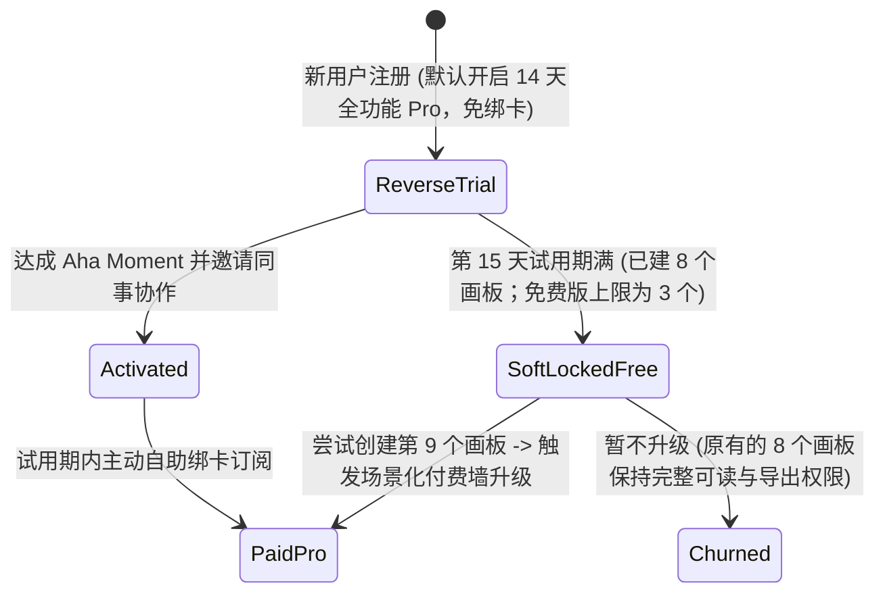
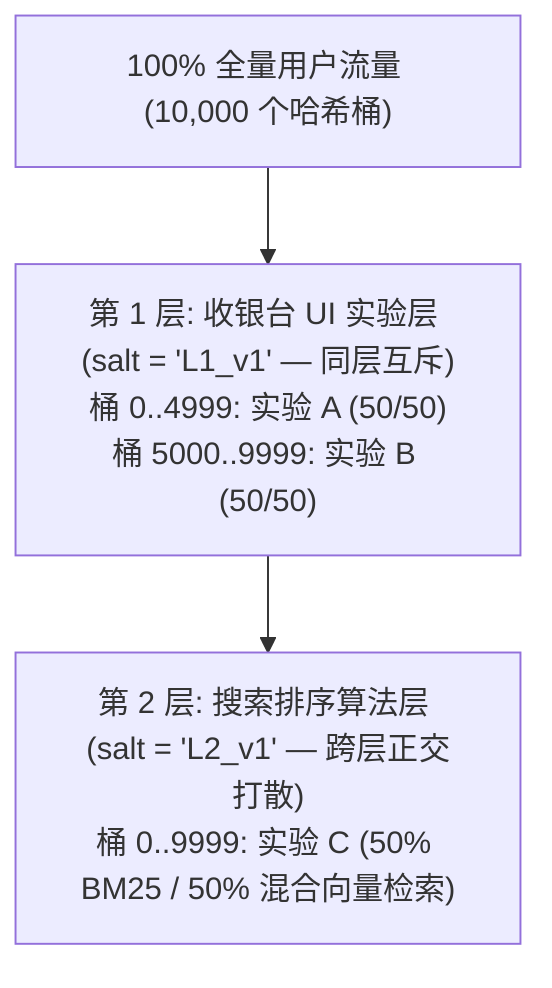

# 增长工程、产品驱动增长（PLG）与 A/B 实验平台

## 这是什么？

**增长工程（Growth Engineering）** 是通过技术与产品机制将“用户本身”转化为获客（Acquisition）、激活（Activation）、留存（Retention）、变现（Monetization）和自传播（Virality）核心引擎的工程学科。在采用**产品驱动增长（PLG，Product-Led Growth）**模式的企业（如 Notion、Figma、Canva、Dropbox、Slack、Linear）中，客户在付费前不需要走漫长的销售拜访流程——他们自助注册免费使用，在几分钟内体验到产品核心价值（**Aha Moment / 顿悟时刻**），在日常协作中自然邀请同事加入，并在触达用量或高级功能边界时通过信用卡自助升级。

除了构建裂变与变现闭环外，增长工程团队还负责构建公司的**在线科学实验平台（A/B Testing Platform）**——利用确定性哈希分流、正交互斥实验层、方差缩减算法（**CUPED**）以及自动化护栏指标（Guardrail Metrics），用严密的统计学证据回答：*“这次改版到底是真正提升了长期营收，还是只带来了短期猎奇点击甚至暗中损害了留存？”*

## 为什么要懂？

增长功能在产品文档里看起来往往极其简单（“每邀请一个好友送 20 元算力券”或“新用户注册送 14 天专业版试用”），但在生产环境中，它们是**黑灰产薅羊毛攻击**和**统计学自我欺骗**的重灾区：
- 周五下午上线一个没有反作弊卡点的邀请返现活动，周一早上回来会发现黑产脚本用临时域名邮箱和虚拟卡刷走了 `50 万元` 的大模型 Token 额度。
- 14 天试用期一到就直接把用户创建的文档全部锁死甚至隐藏，第二天社交媒体上就会充满骂你“绑架用户数据勒索赎金”的差评。
- 在用户一打开首页时就上报所有 A/B 实验的曝光埋点，会导致实验样本被稀释 20 倍——让团队把真正有效的改版误判为“无显著差异”而砍掉，或者因为样本比例偏移（SRM）把导致旧机型闪退的劣质代码当成“转化率提升 6% 的大功臣”全量上线。

## 业务流程

### PLG 增长飞轮：获客 -> 激活 -> 协作裂变 -> 触顶变现

1. **零摩擦注册与渐进式信息采集（Progressive Profiling）**：支持一键 Google/社交账号登录或魔法链接登录（`01-AUTHENTICATION.md`），把“公司规模、职位问卷”推迟到用户真正跑通第一个核心动作之后。
2. **新手激活清单与顿悟时刻（Aha Moment）追踪**：引导新用户完成与长期留存强相关的早期关键动作（例如 Slack：*团队消息满 2,000 条*；Dropbox：*同步文件夹放入第 1 个文件*；Notion：*创建第 1 篇文档并分享给 1 位协作者*）。
3. **反向试用（Reverse Trial）**：新用户注册无需绑卡，默认直接开启 **14 天全功能 Pro 专业版体验**，让用户先养成对高级功能的使用习惯与数据沉淀。
4. **无损降级至免费版（Soft-Lock 软锁定）**：第 15 天若未付费，自动降级回 Free 免费版——**绝不删除或锁死用户在试用期创作的内容**，仅冻结“继续新增”或高级权限。
5. **场景化付费墙（Contextual Paywall）与自助升级**：当用户触达用量上限（如 `3/3 个免费项目已满`、`100/100 免费积分用尽`）或点击专业版按钮（如 `导出无水印 4K 视频`）时，就地弹出上下文升级浮层，支付成功秒级解锁。

### 大规模实验分流引擎：正交分层（Orthogonal Layers）与确定性哈希

像字节跳动、Uber、Airbnb 或 Booking.com 这样的公司，是如何在同一批用户身上**同时并行跑 1,000 个 A/B 实验**且互不干扰的？
- **确定性无状态哈希分桶（Deterministic Hashing）**：用户的实验分组绝不能用 `Math.random()`（一刷新页面就变），也不靠往数据库写几亿条映射记录，而是通过无状态哈希公式实时计算：`bucket = murmurhash3(unit_id + ":" + layer_salt) % 10000`。
- **互斥域（Domains）与正交实验层（Orthogonal Layers）**：
  - 修改**同一块 UI 或强耦合业务链路**的两个实验（例如两个团队都在改收银台按钮），必须放进**同一个实验层（Same Layer）**，将 10,000 个哈希桶切分为互不重叠的区间（如 `0–2499`: 实验 A 对照组，`2500–4999`: 实验 A 实验组，`5000–7499`: 实验 B 对照组），保证同一用户绝对不会同时命中两个冲突实验。
  - 修改**完全独立模块**的实验（例如“搜索排序算法层”与“收银台 UI 层”），分别放入拥有不同哈希盐值（`layer_salt_1`、`layer_salt_2`）的**正交层**。由于不同盐值会将人群彻底重新均匀打散，每一层都能享受到 100% 的全量流量！

## 常见术语

| 术语 | 解释 |
| --- | --- |
| **产品驱动增长 (PLG)** | 依靠产品自身的免费体验、协作裂变与自助付费完成获客与变现，无需销售前置介入的增长模式 |
| **顿悟时刻 (Aha Moment)** | 新用户首次真正感受到产品核心价值、且完成该动作后留存率发生断崖式跃升的关键行为节点 |
| **反向试用 (Reverse Trial)** | 注册即免绑卡赠送 7~14 天全功能高级版，到期未付费再平滑退回免费版的高转化试用机制 |
| **K 因子 (Viral Coefficient)** | 病毒传播系数 $K = i \times c$（人均发出邀请数 $\times$ 受邀转化率）。当 $K > 1$ 时实现自维持指数级裂变 |
| **PQL (产品合格线索)** | 在免费或自助版中展现出高购买意向信号（如团队席位暴增、多次访问 SSO 配置页）从而触发大客户销售跟进的企业账号 |
| **样本比例偏移 (SRM)** | 实验设定的分流比例（如 50%:50%）与实际收集到的曝光人数比例（如 50.7%:49.3%）发生统计学显著偏离，说明实验存在致命 Bug |
| **CUPED 方差缩减** | 利用实验开始前用户的历史基线数据作为协变量剔除个体固有噪音，可将达到统计显著所需的样本量与实验周期缩短 30%~50% |
| **触发曝光 (Triggered Exposure)** | 仅当用户真正走到控制组与实验组代码逻辑发生分叉的那一行时才记录实验曝光，防止未触达人群稀释实验效果 |
| **护栏指标 (Guardrail Metrics)** | 用于保护系统与业务底线的监控指标（崩溃率、接口 P95 延迟、退订率、退款率），一旦恶化自动熔断实验 |
| **新奇效应 vs 首因效应** | 老用户因为新按钮好看而好奇多点（新奇效应，几天后衰退），或因为找不到旧入口而短暂转化下降（首因效应） |
| **双边网络干扰 (SUTVA 违背)** | 在网约车/外卖/撮合平台中，实验组用户抢走了对照组用户的运力或房源，导致两组不再独立、实验收益被严重高估 |

## 常见模式

### 模式一：试用期满的“软锁定（Soft-Lock）”超额降级模式

当用户 14 天 Pro 反向试用到期，且试用期间创建了 10 个项目（而免费版配额上限为 3 个）时：
- **严禁删除、隐藏或禁止打开第 4~10 个项目**（否则会被用户痛斥为“绑架数据”）。
- 保持全部 10 个历史项目完整可读、可分享、可导出；仅在用户点击**“新建第 11 个项目”**或使用 Pro 专属算力时弹出升级引导，提示升级 Pro 或归档旧项目至 3 个以内。

### 模式二：内生型协作裂变（Artifact-Driven Viral Loop）

最高效的裂变从来不是生硬的“分享朋友圈领 5 元红包”，而是产品核心工作流的自然副产物：
- **协作邀请闭环**：设计师把 Figma 链接发给前端、产品经理把 Notion 文档或飞书文档发给外部客户审阅。
- **内容载体署名（Powered-By 飞轮）**：每一个免费版用户发出的 Calendly 预约链接、Typeform 问卷或剪映片尾水印，都在自动为产品做零成本精准曝光。

### 模式三：双边市场的时空切片轮转实验（Switchback Testing）

在外卖、网约车或酒旅平台中，如果按用户随机 50/50 分流测试“发 5 元打车券”，实验组乘客因为有券疯狂叫车，把周围仅有的运力全部抢光，导致同一条街上的对照组乘客无车可打——**实验组通过吸干对照组的运力，制造出了虚假的翻倍增长假象（Cannibalization）**！
- **解法**：采用**城市网格 + 时间片轮转实验（Geo-Time Switchback）**，以 H3 地理围栏蜂窝和 2 小时时间片为单位，在全城维度交替切换新旧策略。

## 行业实战经验与非显而易见的最佳实践

### 1. 邀请裂变自邀刷单与黑产薅羊毛（为什么奖励绝不能在“注册成功”时发放）

几乎所有初创团队都踩过这个坑：上线“邀请一位好友注册，双方各得 $10 算力额度 / 会员时长”活动。
- **上线 24 小时后的惨状**：黑产利用泛解析域名邮箱（`*@ catch-all.xyz`）、接码平台和指纹浏览器，写个自动化脚本左手邀右手注册 5,000 个小号，一夜之间把你账户里的 OpenAI / Claude API 授信额度全部刷爆并在闲鱼倒卖。
- **经过实战检验的反作弊铁律**：
  1. **价值锚定延迟解锁（Value-Gated Unlock）**：受邀人仅完成“注册”时，邀请人只能看到`待解锁奖励（Pending）`；只有当受邀人完成了**高门槛真实价值动作**（例如：完成首笔真实付费且渡过 14 天无退款窗口，或绑定通过银行级校验且历史从未出现过的独立信用卡指纹 `card.fingerprint`）后，奖励才真正入账。
  2. **奖励设为“不可提现、不可转赠的抵扣券”**：邀请奖励仅可用于抵扣未来订阅账单的一定比例，严禁直接发放可无门槛调用高成本外部 API 或可提现的现金等价物。
  3. **多维同人图谱拦截**：只要邀请人与受邀人命中相同的支付卡指纹、设备硬件指纹、家庭宽带 `/24` IP 段或同一企业邮箱后缀，直接静默拦截奖励。

### 2. 样本比例偏移（SRM）：默默废掉 10% 生产 A/B 实验的“隐形杀手”

假设你上线了一个配置为严格 `50.0% : 50.0%` 分流的收银台实验，跑了 3 天共收集到 20 万名曝光用户：
- **对照组（Control）**：`100,950` 人（人均付费 `4.10 元`）
- **实验组（Treatment）**：`99,050` 人（人均付费 `4.35 元`，**付费率显著提升 +6.1%！**）
- **为什么此时上线等于埋雷**：对 `100,950 vs 99,050` 做一次卡方检验（Chi-Square Test），算出来的 $p = 0.00002$——触发了严重的**样本比例偏移（Sample Ratio Mismatch, SRM）**！实验组凭空消失了约 `1,900` 人！排查后会发现：实验组引入的新组件在低端安卓机或旧版 Safari 上发生了 JS 报错白屏，导致这 `1,900` 名低端机用户在曝光埋点上报成功前就退出了页面。由于留下的 `99,050` 人全是高端机型高消费人群，人均付费自然虚高了 6.1%！
- **生产铁律**：实验平台必须对所有在线实验每小时自动运行卡方 SRM 检测（阈值设为 $p < 0.001$）。一旦触发 SRM 告警，**直接锁定报表并置灰“全量推全”按钮**，直到工程团队排查出丢包、重定向延迟或端上崩溃根因。

### 3. 提前曝光稀释（Assignment Dilution）与分叉点触发埋点

你在代码的哪个位置上报 `experiment_exposed`（实验曝光事件）？
- **最常见的错误**：用户一打开 App 首页，客户端就向配置中心拉取该用户在全部 50 个实验中的分组，并一口气上报 50 条实验曝光事件。
- **为什么这会彻底毁掉实验灵敏度**：假设你的实验只是修改了“个人中心 -> 账单设置页”里的年付折扣弹窗，而全站只有 **4%** 的活跃用户会点进账单设置页。如果你在首页登录时就记录曝光，另外 **96%** 根本没见过弹窗的用户也会被混进分母里（这 96% 的人实验效应严格为 0）！原本只需要 **1 万**名账单页访客就能测显著的实验，被稀释 25 倍后，你需要 **$25^2 = 625$ 倍（即 625 万）** 总样本量才能抵消那 96% 的白噪音！
- **最佳实践**：严格区分“分流计算（`getVariant`，纯内存哈希）”与“曝光上报（`trackExposure`）”——**只有当代码真正执行到即将渲染差异化 UI 分支的前一毫秒**，才为对照组和实验组对称触发曝光上报（Counterfactual Triggering）。

## 踩坑提醒

- **每天偷看报表提前关停实验（Peeking Problem / $p$-Hacking）**：如果你每天刷新一次实验看板，看到第 4 天 $p$ 值刚好掉到 `0.048` 就立刻宣布实验成功并上线，你的真实假阳性率（把纯随机波动当成有效改版的概率）会从标准的 **5% 飙升到 26% 以上**！要么事先锁死最小样本量与实验周期（至少覆盖完整的 1~2 周以平滑周末效应），要么在实验引擎中使用**序贯检验（Sequential Testing / mSPRT 置信序列）**。
- **B2B 产品按 `user_id` 分流引发的同事界面精神分裂**：在 B2B 协作软件中，如果同一家客户公司（`tenant_id`）里的张三看到了新版审批流按钮，而坐他旁边的李四还是旧版界面，两人协作时会直接卡死。涉及团队协作或企业工作流的功能，必须以 **`organization_id / workspace_id`** 作为哈希分流主键。
- **赢家诅咒与全量留存观察组（Global Holdout）**：单个实验往往只观察 2 周，容易受到新奇效应（Novelty Effect）误导。成熟增长团队会保留 **2%~5% 的季度全局空白对照组（Global Holdout）**，在整个季度内不上线任何新增长策略，在季度末统一检验全团队一季度的工作到底有没有带来真实的长期净留存提升。

## 速查表

| 业务场景 | 推荐增长工程与实验实践 |
| --- | --- |
| 协作与创作类 SaaS 试用设计 | **14 天免绑卡反向试用（Reverse Trial）** -> 到期转入**软锁定免费版**（旧文档可读可导出，新建受限） |
| 邀请裂变活动防黑产刷额度 | 奖励仅在受邀人**完成首笔付费并渡过拒付期**后解锁 + 强校验支付卡指纹 `card.fingerprint` 与设备指纹 |
| 支撑上百个 A/B 实验同时在线 | **正交分层 + 同层互斥架构**，使用 `murmurhash3(unit_id + layer_salt) % 10000` 无状态计算 |
| 查看实验收益前的第一道体检 | 自动运行**卡方 SRM 样本比例偏移检验**（$p < 0.001$ 自动拦截告警）+ 崩溃率/延迟护栏指标监控 |
| 深层转化漏斗的实验曝光打点 | 严禁在首页启动时全量打点；必须在**控制组与实验组代码逻辑真正分叉渲染的前一刻**触发曝光 |
| 样本量不够、希望缩短实验周期 | 引入 **CUPED 算法**，利用实验前 14~28 天的用户历史行为均值剔除个体基线方差 |
| 外卖/打车/双边撮合策略实验 | 严禁按用户 50/50 切分（防止抢夺运力干扰）；采用**地理网格 + 时间片轮转实验（Switchback）** |
