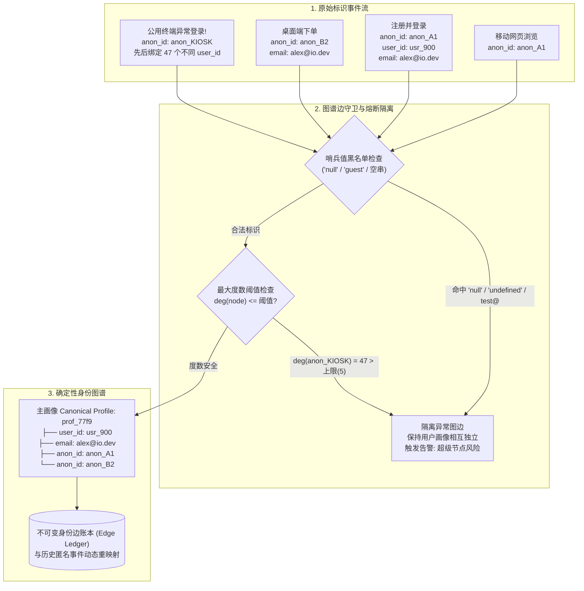
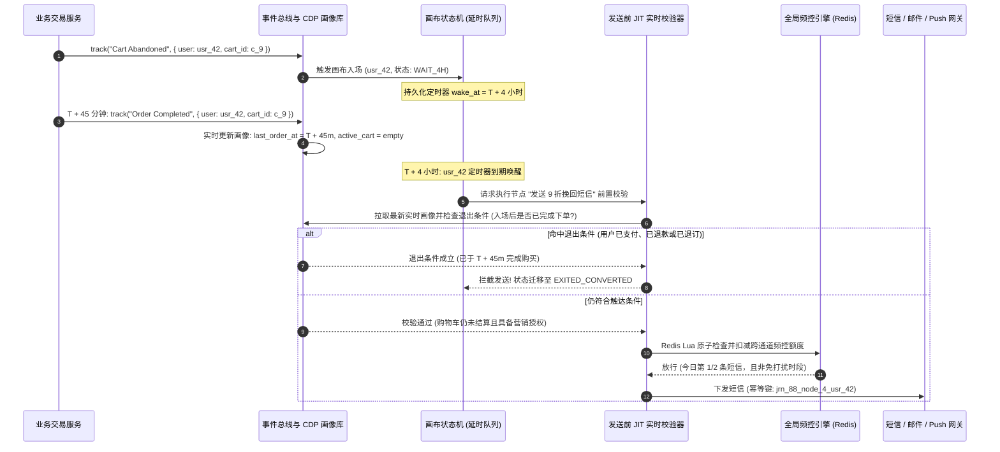

# 客户数据平台（CDP）、身份图谱与全生命周期营销自动化

## 这是什么？

客户数据平台（CDP）与全生命周期营销自动化引擎（Lifecycle Marketing Engine）是现代产品处理行为采集、跨端身份归一、动态人群圈选（Segmentation）及多通道自动化触达（邮件、短信、App Push、站内信、Webhook）的核心中枢。当用户先在手机浏览器匿名访问定价页、两天后在桌面端注册、绑定企业空间，或加购商品后离开，这些离散信号被采集为结构化事件，经**身份图谱（Identity Graph）**缝合为唯一主画像（Canonical Profile），再结合数仓经 **Reverse ETL（反向 ETL）**回写的业务指标，驱动有状态的多步**自动化营销画布（Journey Canvas）**在毫秒至分钟级内精准响应。

与传统 Web 统计工具（聚合匿名漏斗报表）或传统销售 CRM（存储手工录入的静态联系人）不同，CDP 同时运行在**实时个体事件流**与**数仓历史状态**之上，直接决定“在什么时刻、通过什么通道、向哪一个具体的人下发什么动作”。

## 为什么要懂？

中大型 B2C 与 B2B SaaS 普遍依赖 CDP 与营销自动化栈（Segment、RudderStack、Hightouch、Census、Braze、Iterable、Customer.io）驱动拉新、转化、留存与增购。该层位于分布式事件流、图算法、数仓与外部消息网关交汇处，极易发生灾难性事故：

- **身份图谱污染与“超级节点（Super-Node）”爆炸**：在医院护士站公用电脑、门店自助终端（Kiosk）或机房场景下，若 `anonymous_id` 与 `user_id` 合并逻辑缺少度数熔断，4,000 名不同用户会被传递闭包合并成同一画像——把患者 A 的就诊提醒发给患者 B。
- **延时等待节点（Wait Step）状态过期乌龙**：用户触发“加购未付 -> 等待 24 小时 -> 发 85 折挽回短信”画布，但 10 分钟后已原价支付。若工作流未在发送前最后一毫秒执行 **Just-In-Time（JIT）实时重校验**，次日仍会把 85 折券发给已原价购买的用户，引发客诉与退差价。
- **Reverse ETL 耗尽下游 CRM 全局 API 配额**：凌晨数仓更新 80 万用户的 LTV 与流失风险分，Reverse ETL 在早 8 点以单行 REST 请求灌入 Salesforce，瞬间打满企业 24 小时滚动 API 配额，导致全天线上签约与工单系统瘫痪。
- **多业务线并发轰炸**：增长、运营与账单团队各自配置独立画布，同一用户在 20 分钟内同时收到 4 封邮件、2 条短信和 3 条 Push，直接触发退订与垃圾投诉。

---

## 业务流程与核心机制

### 1. 事件采集规范与边缘 Schema 强校验

工业级 CDP 采集客户端 SDK、后端服务及 Webhook（Stripe、Shopify、Zendesk）数据时，强制统一为五大标准语义：

| 调用类型 | 核心业务语义 | 关键字段 | 生产环境调用示例 |
| :--- | :--- | :--- | :--- |
| **`track`** | 记录用户在某一时刻发生的具体动作 | `event`, `properties`, `user_id`, `anonymous_id`, `timestamp`, `message_id` | `track("Order Completed", { order_id: "ord_91", revenue: 149.00, currency: "USD" })` |
| **`identify`** | 将匿名会话绑定至实名 ID 并更新属性 | `user_id`, `anonymous_id`, `traits` (`email`, `plan`, `phone`) | `identify("usr_882", { email: "ada@acme.com", plan_tier: "pro" })` |
| **`group`** | 将用户关联至组织、工作空间或企业账户 | `user_id`, `group_id`, `traits` (`company_name`, `seats`, `arr`) | `group("org_441", { name: "Acme Corp", arr_cents: 2400000 })` |
| **`page` / `screen`** | 记录网页路由或移动端页面浏览 | `name`, `properties` (`url`, `referrer`, `utm_campaign`) | `page("Pricing", { path: "/pricing", utm_source: "google_ads" })` |
| **`alias`** | 显式合并两个已知身份标识（系统迁移） | `previous_id`, `user_id` | `alias("legacy_uid_104", "usr_882")` |

#### 埋点计划（Tracking Plan）与接入层 Schema 守门员

若接入网关不设防，前端发版把 `properties.revenue` 从浮点数 `149.00` 改成字符串 `"$149.00"`，会导致 Snowflake/BigQuery 入库类型冲突，或让画布 `revenue > 100` 过滤条件静默失效。生产接入层必须执行版本化的 **Tracking Plan（JSON Schema 注册表）**：

1. **强类型与枚举校验**：写入 Kafka 前校验必填字段、数据类型及货币/国家标准编码。
2. **动态事件名基数爆炸拦截**：拒绝把业务 ID 拼入事件名（如 `track("Clicked_Product_98412")`），防止数仓生成百万张垃圾表。
3. **PII 脱敏与违规死信隔离（Quarantine Queue）**：扫描未哈希卡号或明文密码。违规事件路由至**死信隔离队列**告警，待规则修复后支持重放。

---

### 2. 确定性与概率性身份解析（Identity Resolution）

用户登录前跨越多个触点（微信 Webview、办公电脑、iOS App），产生多个临时标识（`anonymous_id`、Cookie、IDFA、GAID）。**身份解析**将其缝合为唯一**主画像 ID（`canonical_profile_id`）**：

- **确定性身份解析（高置信度 —— 用于产品状态、CRM 与交易/生命周期触达）**：仅在观测到强认证凭据时建边（登录同时携带 `anonymous_id` 与已认证 `user_id`、点击签名验证邮件，或短信验证下单）。
- **概率性身份解析（统计推断 —— 仅用于广告重定向与家庭画像归因）**：利用同源信号（住宅 IP + User-Agent + 活跃时段 + 屏幕指纹熵）推断潜在关联。

> **架构铁律**：严禁将概率性推断边混入**确定性身份图谱**。室友共享家庭 Wi-Fi IP 时，概率模型可将其归入同一家庭广告受众，但一旦合并确定性 CDP 画像，室友 A 的账单收据与安全通知就会泄露给室友 B。



---

### 3. 仓原生反向 ETL（Warehouse-Native Reverse ETL）与增量差分

现代数据栈采用**可组合/仓原生 CDP**：原始事件落入 Snowflake/BigQuery/Databricks，结合账单、库存与 ML 模型计算高阶标签（`churn_probability_score`、`ltv_12m`、`seat_utilization_pct`），再由 **Reverse ETL** 增量回写至业务系统（Salesforce、HubSpot、Braze）：

1. **快照差分计算（Snapshot Differencing）**：数仓宽表含 2,000 万用户、每 15 分钟调度一次，但真正发生指标变化的往往仅 4,000 行。Reverse ETL 维护 `_sync_snapshot_previous` 快照表，计算行哈希（`SHA256(col_1 || col_2 || ...)`），通过 `EXCEPT` 或哈希比对仅提取 `INSERT`、`UPDATE`、`DELETE` 增量。
2. **下游限流平滑与 API 配额熔断（Rate-Limit Pacing）**：针对 Salesforce 等 24 小时滚动 API 配额限制，自动切换为 **Bulk API / 批量 Upsert 接口**（单次打包 200～10,000 条），并设置**配额水位线熔断**（当组织日配额消耗达 70% 时立即暂停后台同步，保障线上交易写入）。
3. **单调版本幂等与行级死信隔离**：携带单调递增 `sync_version` 防止重试旧值覆盖新值；若 200 条批量写入中有 3 条格式错误，提交成功的 197 条至快照基线，仅将失败的 3 条写入死信表告警。

---

### 4. 有状态生命周期画布（Stateful Journey DAG）与发送前 JIT 实时重校验

生命周期画布是为每位用户实例化的长周期**有向无环图（DAG）状态机**，流经等待节点（Wait Node）、条件分支、A/B 分流器与触达节点。



---

## 核心术语表

| 术语 | 业务与技术含义 |
| :--- | :--- |
| **Tracking Plan（埋点契约）** | 以 JSON Schema 定义的机器强校验契约，规定合法事件名、属性类型及敏感等级 |
| **Deterministic Stitching（确定性缝合）** | 仅在具备强认证凭据（如登录绑定 `anonymous_id` 与 `user_id`）时合并图谱节点 |
| **Probabilistic Stitching（概率性缝合）** | 基于统计共现信号（IP、设备指纹）推断潜在同人或家庭关系，严禁混入交易级图谱 |
| **Super-Node（超级节点）** | 因公用终端、未重置 Cookie 或 `"null"` 哨兵值导致上千名无关用户被错误合并的污染画像 |
| **Reverse ETL（反向 ETL）** | 将数仓建模加工好的指标增量回写至 CRM、营销引擎与广告平台的同步管道 |
| **Snapshot Differencing（快照差分）** | 将当前数仓查询结果与上一轮快照表进行哈希比对，仅输出最小化的增删改增量 |
| **Journey Canvas（生命周期画布）** | 驱动单个用户跨越时间延迟、条件分支与多通道触达的有状态多步 DAG 状态机 |
| **Exit Criteria（全局退出条件）** | 一旦满足（如“已下单”、“已退订”、“发起高优投诉”）立即将在途用户移出画布的全局规则 |
| **Just-In-Time (JIT) Evaluation** | 在定时器到期、消息下发前的最后一毫秒重新拉取最新画像、库存与退订状态进行二次校验 |
| **Global Frequency Capping（全局频控）** | 跨所有画布、业务线与通道的集中式限流器，防止单一用户在滑动窗口内被过度打扰 |
| **Quiet Hours（免打扰静默时段）** | 按收件人当地时区抑制夜间（21:00–08:00）营销推送，并结合 TTL 决定顺延或丢弃 |
| **Suppression List（全局压制黑名单）** | 汇总硬退信、垃圾投诉、主动退订及 GDPR 删除请求的强拦截名单 |

---

## 常见架构与业务模式

### 模式 1：基于不可变身份边账本（Immutable Identity Edge Ledger）的无损图合并与拆分

当两个画像合并时，**严禁原地 UPDATE 覆盖历史原始事件表中的 `user_id`**。若原地改写 1,000 万条历史事件，一旦发现是会议室公用 iPad 或 SDK Bug 引发的误合并，将因原始血缘被毁而**彻底无法拆分还原**。
- 原始行为事件采用只追加（Append-Only）存储，保留上报时的 `(source_id, anonymous_id, observed_user_id)`。
- 维护**身份边账本（Identity Edge Ledger）**（`edge_id, node_a, node_b, link_reason, created_at, revoked_at`）及物化**身份映射表**（`identifier -> canonical_profile_id, graph_version`）。
- 撤销错误合并时，仅需将污染边标记为 `revoked_at = NOW()` 并重算受影响子图的连通分量，即可在秒级内无损分离。

### 模式 2：实时流（Fast-Path）与数仓批处理（Deep-Path）双速分群

- **实时流式分群（< 2 秒）**：由 Flink / Kafka Streams + Redis/RocksDB 驱动，用于高时效触发（结账失败实时挽回、新手引导卡点提示）。
- **数仓深度分群（15～60 分钟）**：由 Snowflake/BigQuery + Reverse ETL 驱动，用于关联埋点、Stripe 账单、工单满意度与 ML 流失模型的复杂多表圈选。

### 模式 3：基于回执监听的多通道级联降级触达

优先下发零边际成本的站内信或 App Push -> 等待 2 小时监听 `Push Opened` 回执 -> 未打开则降级发邮件 -> 24 小时后仅对高客单价（`cart_value > $150`）且未响应用户调用付费短信通道。

---

## 常见踩坑与边界情况

- **前端把 `"null"`、`"undefined"`、`"guest"` 传给 `identify()`**：未登录时前端若把空变量序列化成 `"undefined"` 上报，而网关缺少哨兵值黑名单拦截（`"null"`, `"undefined"`, `"none"`, `"anonymous"`, `"guest"`, `"0"`, `"false"`），全站未登录访客会在几分钟内合并成一个数百万人的超级画像。
- **企业邮箱安全网关预抓取导致“伪打开/伪点击”**：Mimecast、Proofpoint 及 Apple 邮件隐私保护（MPP）会在投递后几毫秒内自动加载像素并扫描点击所有链接。画布分支必须剔除扫描器 User-Agent 及投递后 1 秒内的机器点击。
- **画布版本演进导致在途用户状态悬挂**：当 4 万名用户停留在画布 `v1` 的“等待 7 天”节点时，原地删改节点发布 `v2` 会导致定时器唤醒时指针崩溃。必须将画布版本设为不可变：在途用户沿 `v1`（`Draining` 排空态）走完，新用户进入 `v2`。
- **限时活动在免打扰队列中过期**：若“午夜闪购最后 3 小时”在 22:30 进入免打扰队列顺延至次日 8:00，用户收到时活动早已结束。排队消息必须携带 `expires_at`（TTL），唤醒时若已过期则直接丢弃。

---

## 行业实战教训与非直观最佳实践

### 1. “公用自助终端 / 医院护士站超级节点”画像合并爆炸事故

最具破坏力的 CDP 事故源于对 `device_id` / `anonymous_id` ↔ `user_id` 执行无约束传递闭包：护士站公用浏览器、机场值机终端或 QA 团队在同一浏览器连续登录 60 个账号且未清缓存，共享同一个 Cookie `anonymous_id = anon_shared_99`。护士 1（`u_101`）登出时**前端漏调 `analytics.reset()` 轮换 `anonymous_id`**，护士 2（`u_102`）随后登录，传递闭包将两人合并为同一主画像，数周内滚雪球吞并 4,000+ 独立账号，导致查询 OOM 且把护士 1 的隐私通知发到护士 400 的邮箱。

| 防御层级 | 核心机制与阈值 | 触发越界时的处置行为 |
| :--- | :--- | :--- |
| **1. 登出强制轮换标识** | 将 `analytics.reset()` 强绑定至退出登录钩子 | 登出瞬间生成全新 UUID 覆盖 `anonymous_id` 并清空本地缓存 |
| **2. 哨兵值黑名单拦截** | 拒绝匹配 `^(null\|undefined\|none\|guest\|admin\|test\|0\|-1)$` | 接入层直接丢弃非法身份边，仅保留原始匿名事件 |
| **3. 节点最大度数熔断** | 限制 `单 anon_id 最多绑定 3 个 user_id`、`单簇节点 <= 50` | 将超限 `anon_id` 隔离为**“公用设备节点”**，禁止参与跨用户传递合并 |
| **4. 主键排他性铁律** | 严禁通过共享 `anon_id` 合并两个拥有**不同实名主键**（`u_101` 与 `u_102`）的画像 | 将 `anon_id` 未来事件归属切换给新登录的 `u_102`，**绝不合并**两实名账号 |

---

### 2. 等待节点状态陈旧与发送前 JIT 双阶段门禁

入场时预渲染消息体塞入延迟队列 `(send_at: T + 3天)` 会导致用户在等待期内已原价购买、发起 P1 投诉或申请注销后仍收到错误营销信息。
1. **延时队列仅存状态指针**：只存 `(journey_instance_id, profile_id, current_node_id, wake_timestamp)`。
2. **出队瞬间同步执行 JIT 校验**：Worker 唤醒瞬间实时复核：`marketing_opt_in == true` 且不在全局压制黑名单、重新评估全局退出条件与节点准入条件（`has_completed_checkout == false AND open_p1_tickets == 0 AND item_in_stock == true`），并实时拉取最新价格与库存渲染模板。

---

### 3. 基于 Redis Lua 的全局跨通道原子频控

所有外发请求在调用网关前必须经过统一**触达策略引擎**，通过单次 Redis Lua 脚本原子检查并递增滑动窗口计数器：

```text
KEYS[1] = "fcap:global:24h:{profile_id}"       -- 全通道 24 小时最多触达 2 次营销消息
KEYS[2] = "fcap:channel:email:7d:{profile_id}" -- 邮件通道滚动 7 天最多 4 封营销邮件
KEYS[3] = "fcap:channel:sms:7d:{profile_id}"   -- 短信通道滚动 7 天最多 1 条营销短信
KEYS[4] = "fcap:dedup:msg:{idempotency_key}"   -- 精确到画布节点的防重放幂等锁
```

| 优先级分层 | 典型消息场景 | 频控计数器行为 | 夜间免打扰策略 |
| :--- | :--- | :--- | :--- |
| **P0：核心交易与安全** | 密码重置、2FA 验证码、支付收据、安全告警 | **无条件穿透所有频控**（不消耗营销额度） | **7×24 小时立即下发** |
| **P1：高意图行为触发** | 购物车放弃挽回、试用期明日到期提醒 | 适用**宽松配额**（优先于 P2 预留专属槽位） | 未超 `expires_at` 则顺延至早 8:00 |
| **P2：大盘批量促销广播** | 周报、新功能群发、节日大促广播 | 触及上限时**严格拦截丢弃或延后**，让路给 P1 | 顺延至早间窗口，过期则直接丢弃 |

---

## 速查参考

| 架构决策领域 | 生产环境推荐实践 |
| :--- | :--- |
| **事件采集契约** | 统一 `track` / `identify` / `group` 语义，接入层强制校验 JSON Schema Tracking Plan，违规事件路由至可重放隔离队列 |
| **身份图谱存储** | 只追加的**身份边账本（Edge Ledger）** + 物化映射表；严禁原地覆写历史事件的 `user_id`，确保误合并可秒级拆分 |
| **超级节点护栏** | 拦截 `"null"`/`"undefined"`/`"guest"` 哨兵值，限制单 `anon_id` 关联实名数 `<= 3`，严禁通过共享 Cookie 合并两个不同实名主键 |
| **Reverse ETL** | 数仓快照表 `SHA256` 行哈希差分 + CRM Bulk 批量接口 + 每日 API 配额熔断器（达全组织 70% 时自动暂停后台同步） |
| **画布等待节点** | 延时队列仅存状态指针；唤醒瞬间执行 **JIT 实时重校验**（复核退出条件、库存、进行中投诉工单与退订状态） |
| **跨通道全局频控** | 基于 `profile_id` 的 Redis Lua 滑动窗口计数（全局 24h + 分通道 7d），区分 `P0 交易直通`、`P1 行为触发优先` 与 `P2 广播降级` |
