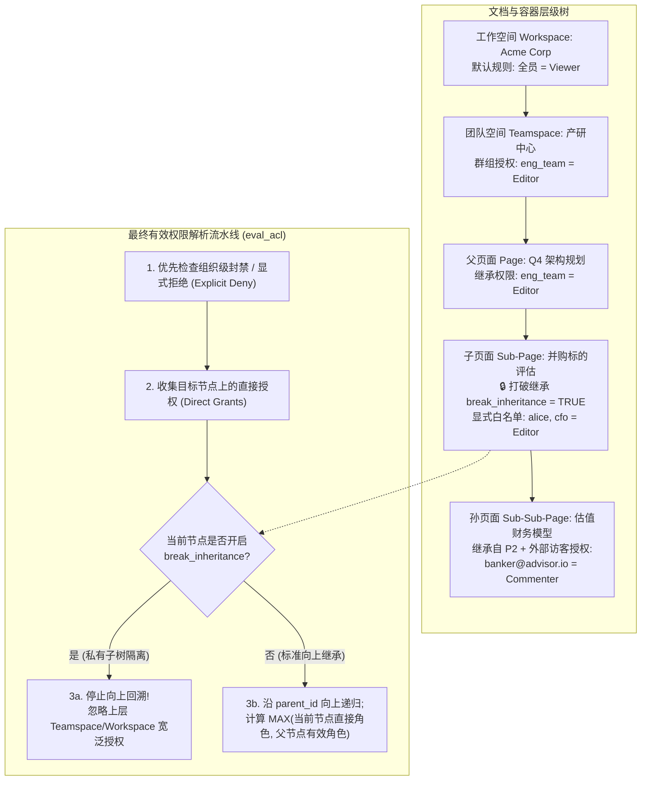
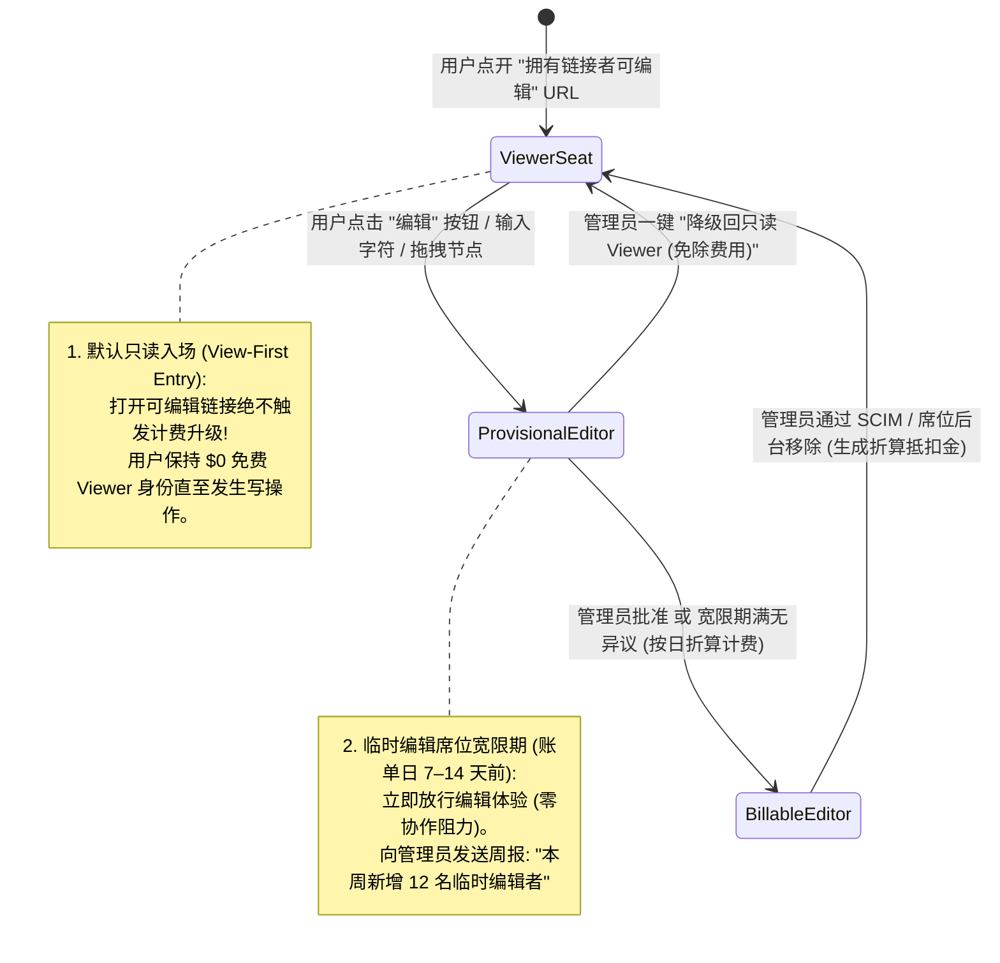

# 实时协作办公空间与文档 SaaS 业务逻辑（Notion / Figma 模式）

## 这是什么？

实时协作办公空间与文档 SaaS 平台（Notion、Figma、Linear、Coda、飞书文档、Miro）用云端原生的**多玩家块树（Block Tree）**与**场景图节点画布（Scene-Graph Node Canvas）**取代了传统的本地静态文件。数十名团队成员可以同时在同一个活文档中输入排版、拖拽嵌套块、在动态移动的文本区间上锚定行内评论、通过能力链接（Capability Link）跨组织边界共享内容，并在多层级的树状空间（`组织 Organization -> 团队空间 Teamspace -> 文件夹 Folder -> 页面 Page -> 子块 Sub-Block`）中沉淀知识库。

在底层架构上，协作办公 SaaS 绝非简单的“富文本编辑器 + WebSocket”，而是将**分布式无冲突状态同步（CRDT / OT）**、**基于关系图的层级权限继承（ReBAC）**与**病毒式席位商业化计费状态机（Editor / Viewer / Guest Seat True-Up）**深度耦合的复杂业务系统。

## 为什么要懂？

实时协作空间已成为现代 B2B SaaS 的标配形态——无论你在构建企业知识库、设计白板、AI 协同画布还是多维表格数据库。如果用传统 CRUD 思维设计这类系统，极易在生产环境引爆经典灾难：

- **“误触编辑席位”引发的病毒式天价账单（Accidental Editor Bill-Shock）**：产品经理将路线图文档设为*“任何拥有链接的 `@acme.com` 成员可编辑”*并甩进 200 人的公司大群。200 名工程师点开链接仅仅为了阅读文档，若系统在页面加载瞬间就将所有打开可编辑链接的访客自动升级为 $16/月的付费编辑席位（Billable Editor），月底客户收到近 4 万美元的意外账单会立刻引发激烈投诉与退订。
- **行内评论字符偏移漂移（Character-Offset Drift）**：用户 A 选中段落第 `[40..55]` 个字符（`“预算 120 万”`）添加评论*“请确认该金额”*。5 秒后用户 B 在段首（`offset 0`）插入了 30 个字。若评论锚点绑定的是静态整数下标而非 **CRDT 相对位置（Relative Position）**，高亮黄条会向左错位 30 个字符，挂在完全无关的词句上。
- **CRDT 墓碑（Tombstone）内存膨胀崩盘**：CRDT 算法（Yjs、Automerge）为了保证离线节点重连时确定性合并，删除字符时不会真正抹除数据，而是标记为不可见的**墓碑（Tombstone）**。一份高频迭代两年的周报文档会累积上百万个墓碑，导致仅 4KB 可见文字的文档体积膨胀至 50MB，直接卡死浏览器主线程。
- **关联数据库过滤视图（Filtered View）越权泄密**：HR 在主页面创建了《全员薪资总表》，又在公开页面插入了一个过滤条件为 `部门 == 市场部` 的关联视图并分享给市场部。由于前端渲染会拉取底层表结构与数据源，任何打开浏览器控制台修改查询过滤器的市场部员工都能直接读取高管薪资。

---

## 业务流程与核心机制

### 1. 万物皆块（Block / Node Tree）与字典序分数索引（Fractional Indexing）

现代协作文档不会将整篇页面存为一坨巨大的 HTML 或 Markdown 字符串，而是将每个段落、标题、待办项、表格行或 Figma 图层建模为树状结构中的独立寻址节点（Block/Node）：

```json
{
  "id": "blk_01HXYZ98",
  "workspace_id": "ws_acme",
  "type": "todo_item",
  "parent_id": "page_roadmap_q4",
  "sort_key": "a0V",
  "properties": {
    "title": [["上线企业级 SSO", [["b"]]], [" 本周五截止"]],
    "checked": false
  },
  "alive": true,
  "version": 42
}
```

#### 为什么整数排序列会崩溃？字典序分数索引如何实现 $O(1)$ 移动？

若页面有 500 个子块且用整数列（`position = 1, 2, 3...`）维护顺序，把第 500 块拖拽到第 2 位需要执行 `UPDATE blocks SET position = position + 1 WHERE position >= 2`，一次拖拽改写 498 行记录，多人并发拖拽时锁冲突与死锁频发。

生产级引擎（Figma、Linear、Notion）普遍采用**字典序分数索引（Lexicographical Fractional Indexing）**：
- 每个块存储一个 Base-62 字符串 `sort_key`（如 `"a0"`、`"a1"`、`"a2"`）。
- 当把一个块插入到 `"a0"` 与 `"a1"` 之间时，客户端直接计算两者的字典序中点字符串 `"a0V"`，**仅需更新被移动那 1 个块的记录**（$O(1)$ 写入）。
- **并发中点碰撞防抖（Client Jitter）**：若两名离线用户同时在 `"a0"` 与 `"a1"` 之间插入新块，双方都会算出 `"a0V"`。生产级算法会在中点后追加 2～4 位确定性客户端标识或随机抖动后缀（`"a0V_c1"` vs `"a0V_c2"`），确保全局全序且永不冲突。
- **跨节点移动的环路检测（Cycle Guard）**：当用户 1 将文件夹 A 拖入文件夹 B，同时用户 2 将文件夹 B 拖入文件夹 A 时，并发修改 `parent_id` 会形成脱离根节点的死循环孤岛（`A <-> B`）。服务端事务在提交 `parent_id` 变更前必须加祖先路径锁执行环路检测，或采用带移动撤销日志的 **Tree CRDT** 算法。

---

### 2. 多人在线状态与瞬态光标通道（Ephemeral Awareness Channel）

协作空间在 WebSocket 连接上严格隔离两条实时数据平面：

| 数据平面 | 传输内容示例 | 持久化与可靠性要求 | 发送频率与扇出策略 |
| :--- | :--- | :--- | :--- |
| **1. 持久文档状态通道（CRDT / OT）** | 文本增删、块属性修改、节点拖拽重排、评论锚点变更 | **100% 持久可靠**：写入 WAL 与对象存储，严格保证因果顺序与离线重连合并 | 事件驱动触发；经 Yjs / Automerge 或中心 OT 序列器合并 |
| **2. 瞬态感知通道（Awareness / Presence）** | 鼠标实时 `(x, y)` 画布坐标、文本高亮选区、当前聚焦块边框、正在输入状态 | **零数据库持久化**：仅驻留房间网关内存，网络拥塞时可直接丢包 | 客户端节流至 `15–20 Hz`（每 50–66ms）上报；接收端通过**三次样条/弹簧插值**渲染出 `60–120 fps` 丝滑光标轨迹 |

#### “500 人全员大会文档风暴”与旁观者溢出模式（Spectator Overflow Mode）

当公司开全员大会、500 名员工同时打开同一份会议纪要时，若每个客户端以 20 Hz 向其余 499 人广播鼠标移动，房间网关每秒需扇出 $500 \times 499 \times 20 \approx 500\text{ 万}$条消息，瞬间打挂网关与浏览器主线程。
1. **活跃协作者广播上限（Active-Editor Cap）**：仅允许房间内**前 $K$ 名活跃编辑者**（如 $K = 50$，最近 60 秒内有键盘输入或选区操作的用户）广播实时光标。
2. **旁观者降级模式（Spectator Mode）**：第 51 名之后的访客自动进入旁观模式——仍能实时接收文档正文变更（按 250ms 微批合并推送），但不再发送或渲染个人浮动光标，顶部头像栏聚合显示为 `“+450 人正在浏览”`。

---

### 3. 层级 ACL 权限继承（ReBAC）与打破继承边界

企业知识库呈现深层有向图结构：`Organization -> Teamspace -> Folder -> Page -> Sub-Page -> Block`。判断用户对深层节点的最终有效权限（`read` / `comment` / `edit` / `manage`），通常基于 Google Zanzibar 风格的**关系型访问控制（ReBAC）**：



#### 极易踩坑的三大权限边界问题

1. **“私有父页面下的共享子页面”面包屑标题泄密**：高管在私有父页面《Q4 部门裁员计划》（`break_inheritance = true`）下创建了子页面《补偿金常见问题》，并将该子页面单独分享给外部人事顾问。如果顶部导航面包屑直接返回 `高管空间 / Q4 部门裁员计划 / 补偿金常见问题`，父页面标题就会造成严重泄密！
   - **安全铁律**：当用户对子节点 `Node C` 有权限、但对父节点 `Parent P` 无权限时，服务端接口必须**脱敏抹除父节点的标题、图标与元数据**，面包屑仅渲染 `私有页面 / 补偿金常见问题`，并在侧边栏将其挂载于“与我共享（Shared with Me）”虚拟根目录下。
2. **跨权限边界拖拽移动页面**：当用户把私有文件夹下的页面拖入公开团队空间时，页面的受众范围瞬间扩大。前端必须对比 `effective_principals(new_parent)` 与 `old_parent`，弹出二次确认框（*“移动后将向产研中心 140 名成员授予编辑权限”*）。
3. **关联数据库的过滤视图（Filtered Linked View）不是安全边界**：在共享页面中嵌入“仅显示 `负责人 == 当前用户`”的数据库视图，仅仅是前端查询过滤。若要实现真正的数据隔离，服务端必须强制校验用户对底层源数据库的完整读权限（并在分享时明确警告），或者在服务端实现**行级安全策略（Row-Level ACL）/ 视图能力代理查询**。

---

### 4. 基于 CRDT 相对位置（Relative Positions）的行内评论锚定

当用户在协作段落中划选一段文字点击**“添加评论”**时，如何持久化高亮锚点？
- **错误做法（存绝对字符偏移量）**：存储 `{ block_id: "b1", start_index: 24, end_index: 39 }`。只要协作者在段首插入 12 个字符，`24..39` 就会整体错位。
- **生产级方案（绑定 CRDT 逻辑字符 ID）**：在序列 CRDT（如 Yjs 的 YATA 或 Automerge 的 RGA）中，历史上插入的每一个字符都拥有全局唯一且不可变的**逻辑项标识 `(client_id, lamport_clock)`**。
  - 评论锚点不存数组下标，而是存储起止字符的 CRDT ID：`{ start_item: (client_7, clock_104), end_item: (client_7, clock_119) }`。
  - 无论其他人在段落上方或下方并发插入、删除多少文字，客户端都能在 $O(\log N)$ 时间内将 `(client_7, clock_104)..(client_7, clock_119)` 解析还原为准确的当前字符区间。
  - **被评论文本被整段删除的兜底处理**：若协作者删光了被评论的整句话，对应 CRDT 项变为墓碑（`deleted = true`），解析出的区间长度变为 `0`。此时利用创建评论时冗余保存的**原文引用快照（`quoted_text_snapshot`）**，将该评论串优雅移入页面顶部的**“已归档 / 原文已删除”**抽屉中，确保讨论上下文永不丢失。

---

## 核心术语表

| 术语 | 业务与技术含义 |
| :--- | :--- |
| **Block Tree / Scene Graph** | 将文档或设计画布表示为细粒度有类型节点（段落、表格行、矢量画板）组成的树，而非单一文本大字段 |
| **Fractional Indexing（分数索引）** | 用字典序字符串（`"a0"`, `"a0V"`, `"a1"`）表示同级节点顺序，实现单行写入的 $O(1)$ 插入与拖拽重排 |
| **CRDT（无冲突复制数据类型）** | 支持多端离线/并发编辑并在无中心锁条件下确定性收敛为一致状态的数据结构（如 Yjs、Automerge） |
| **Tombstone（CRDT 墓碑）** | 删除字符或节点时保留在 CRDT 内部的软删除标记，用于保障离线节点重连时的相对位置定界 |
| **Relative Position（相对位置锚点）** | 将行内评论或光标选区绑定至不可变的 CRDT 字符项 ID `(client_id, clock)`，彻底消除并发编辑偏移漂移 |
| **Awareness Channel（瞬态感知通道）** | 不落盘、允许丢包的内存级广播流，专用于同步高频鼠标坐标、选区高亮与在线头像 |
| **ReBAC（关系型访问控制）** | 通过遍历图关系（`用户 -> 属于团队 -> 拥有文件夹 -> 包含页面`）动态解析最终权限的模型 |
| **Breaking Inheritance（打破权限继承）** | 关闭子节点对上层父容器（工作空间/团队空间）宽泛权限的继承，仅允许显式授权列表中的主体访问 |
| **Capability Link（能力共享链接）** | 携带加密令牌的分享链接，允许持有链接的任何人（或同企业域名成员）获得查看、评论或编辑权限 |
| **Provisional Editor（临时编辑席位）** | 允许用户零阻力立即开始编辑，同时给予企业管理员在账单出账前 7～14 天审核批准或免费降级为只读席位的宽限期 |
| **External Guest（外部单页访客）** | 仅被邀请至特定单页的外部合作伙伴（通常按付费席位配比免费赠送额度），区别于拥有全空间访问权的企业正式成员 |

---

## 常见架构与业务模式

### 模式 1：双层持久化架构 —— 热增量操作日志（WAL）+ 冷压缩快照（Compacted Snapshot）

如果每次打开文档都从头重放 25 万条历史按键记录，前端解析需要数秒；反之，如果每敲一个字都把 5MB 的完整文档快照重写进 PostgreSQL/S3，存储写入吞吐会瞬间被打爆。
1. **热增量操作日志（WAL）**：房间活跃编辑期间，WebSocket 网关每几百毫秒将二进制 CRDT 增量包（`100–500 Bytes`）追加写入高速存储（Redis Streams / DynamoDB / Postgres WAL 表）。
2. **空闲异步合并快照（Snapshot Compaction）**：当房间所有连接断开满 60 秒或增量包累计满 `500 条` 时，后台 Worker 将增量合并进基础状态，生成最新的 `snapshot_vN.bin` 上传至对象存储（S3/R2），并清理已合并的 WAL 记录。
3. **极速冷启动**：后续用户打开文档时，直接从 CDN 拉取 `snapshot_vN.bin`，再补齐序号 `seq > N` 的少量尾部 WAL 即可。

### 模式 2：智能版本历史聚合（Session Checkpoint Coalescing）

“历史版本”侧边栏若直接展示 4 万条单字符级别的 CRDT 修改，对人类毫无意义。生产系统按**同一用户在 10 分钟滑动静默窗口内（最长不超过 30 分钟硬边界）**将连续按键聚合为一个可读的“编辑会话版本”；同时在**手动保存命名版本**、**权限变更**、**单次大批量删除（删去 >20% 块）**或**外部访客首次编辑**时强制打下独立快照点。

---

## 常见踩坑与边界情况

- **复制粘贴块 ID 冲突**：用户在页面内复制 10 个块并粘贴（或复用页面模板）时，客户端必须递归为所有新块重新生成全新 UUID，并重写块间的内部引用关系后再提交 CRDT 事务，严禁复用源 `block_id`。
- **多人协作中的撤销栈串扰（`Ctrl+Z` 陷阱）**：Alice 在段尾打了一行字，Bob 紧接着在页面顶部改了标题，此时 Alice 按下 `Ctrl+Z`——如果使用全局操作栈，Alice 会把 **Bob 刚改的标题**给撤销掉！多人编辑器必须使用**限定本地源的撤销管理器（Local-Origin Undo Manager，如 `Y.UndoManager` 绑定 `origin == local_client_id`）**，仅逆转当前用户自己产生的操作。
- **离线编辑期间权限被吊销的竞态漏洞**：前员工在飞机模式下离线编辑敏感情报文档 3 小时，期间管理员已将其移出企业空间。当其重连尝试推送 3 小时的离线 CRDT 增量包时，同步网关必须在**每个 WebSocket 数据帧入站时实时复核 ACL 权限**，立即拒绝合并并下发 `403 Access Revoked` 指令清空其本地 IndexedDB 缓存。
- **“私人邮箱冒充外部免费访客”逃单漏洞**：为逃避 50 名员工每人 $20/月的席位费，某企业仅购买 1 个管理员席位（`boss@corp.com`），然后用 49 名员工的个人 `@gmail.com` 邮箱将其作为“免费外部访客（Free Guest）”邀请进根文件夹。防御策略包括：限制单付费席位可携带的免费访客配比（如 `1:5`）、禁止 Guest 访问 Teamspace 根目录，以及对长期从同一办公网 IP / 设备指纹登录的高频同源 Guest 触发合规席位转化提醒。

---

## 行业实战教训与非直观最佳实践

### 1. 能力链接共享与“误触编辑席位”病毒式账单惊吓（Viral Bill-Shock）

在 PLG（产品驱动增长）协作软件（Figma、Notion、Miro）中，用户点击“分享”，将链接设为**“任何 `@acme.com` 成员可通过链接编辑”**并发到公司大群：
1. 120 名同事点开链接仅仅为了**浏览**方案。
2. 若后端因链接携带 `capability = edit`，在页面打开瞬间就将这 120 人写入付费成员表并调用 Stripe 接口增加 120 个付费席位，月底客户收到数万美元的意外账单会引发强烈反弹。

**生产级最佳实践 —— 默认只读入场（View-First Entry）+ 临时席位对账宽限期状态机：**



1. **只读态延迟升级（Lazy Seat Upgrade）**：通过可编辑链接打开文档时，永远以 `$0 Viewer` 身份加载，仅当用户实际发生写操作或主动点击“进入编辑模式”时才触发席位状态转换。
2. **临时编辑者宽限期（Provisional Grace Window）与席位硬上限**：新触发编辑的用户先进入**临时编辑者（Provisional Editor）**状态，企业管理员在账单结算前 7～14 天收到汇总通知，可一键将误触同事降级回 Viewer 且**不产生任何费用**；同时支持企业开启“席位硬上限（Hard Cap）”或“升级需管理员审批”策略。

---

### 2. CRDT 墓碑压缩（Tombstone Compaction）与安全世代水位线（Safe Epoch Watermark）

一份仅 4KB 可见文字的团队周报文档，连续两年每周由 15 名工程师删掉上周内容重写新内容。由于序列 CRDT 删除字符只将标志位置为 `deleted = true`（保留墓碑以供离线节点定位），100 周后文档内会堆积 **180 万个墓碑节点**，二进制体积膨胀至 `35 MB`，每次打开页面主线程阻塞超过 4 秒。

**如何在不破坏离线节点合并的前提下安全清理墓碑：**
1. **维护文档压缩世代号（Compaction Epoch）**：每次执行深度去墓碑压缩时，将文档世代号单调递增（`epoch = 12 -> 13`）。
2. **空闲窗口回收冷墓碑**：当文档连续 24 小时无活跃连接且墓碑占比超过 `10:1` 时，后台压缩任务剥离早于**安全保留窗口（如 14 天）**的冷墓碑，重新编码生成轻量化的 `epoch = 13` 快照，同时将 `epoch = 12` 归档至冷存储供历史版本回放。
3. **超期离线客户端安全分叉（Forked Recovery Page）**：若某台笔记本电脑断网 21 天后重连，携带基于 `epoch = 12` 的未同步修改（低于当前文档支持的最小世代 `epoch = 13`），服务端拒绝直接执行二进制 CRDT 合并（避免悬挂指针破坏文档树），而是将该用户的离线增量自动另存为一篇**分叉恢复子页面**（`“离线修改恢复副本 — 10月12日”`），并为其干净加载最新的 `epoch = 13` 主文档。

---

## 速查参考

| 核心架构挑战 | 生产环境标准解法 |
| :--- | :--- |
| **同级块/图层拖拽排序** | **字典序分数索引（Fractional Indexing）**（`"a0"`, `"a0V"`, `"a1"`）配合客户端抖动后缀，单行更新 $O(1)$ 完成插入与重排 |
| **多人实时光标与在线状态** | 独立**瞬态感知通道（Awareness Channel）**（客户端 15–20 Hz 节流上报 + 接收端 60fps 样条插值）；限制前 50 名活跃广播者，超限自动转入**旁观者模式** |
| **多人协作中的撤销/重做** | **本地源撤销管理器（Local-Origin Undo Manager）**（仅匹配 `origin == local_client_id`），确保 `Ctrl+Z` 绝不误撤队友的并发修改 |
| **行内评论锚定防漂移** | 将评论起止锚点绑定至不可变的 **CRDT 逻辑字符项 ID `(client_id, clock)`**，并冗余保存 `quoted_text_snapshot` 应对原文整段删除 |
| **层级权限继承与隔离** | 类 Zanzibar **ReBAC** 图遍历 + `break_inheritance` 私有子树开关；对无权限的父级面包屑强制脱敏（显示为 `私有页面 / 子页面`） |
| **防范病毒式账单惊吓** | 可编辑链接**默认只读入场（View-First）** + **临时编辑席位宽限期（Provisional Grace Window）**（出账前允许管理员免费降级误触者） |
| **CRDT 墓碑体积膨胀** | WAL 增量日志 + S3 快照双层存储；空闲期执行**带世代水位线的墓碑压缩（Epoch Compaction）**，超期离线重连自动派生恢复子页面 |
