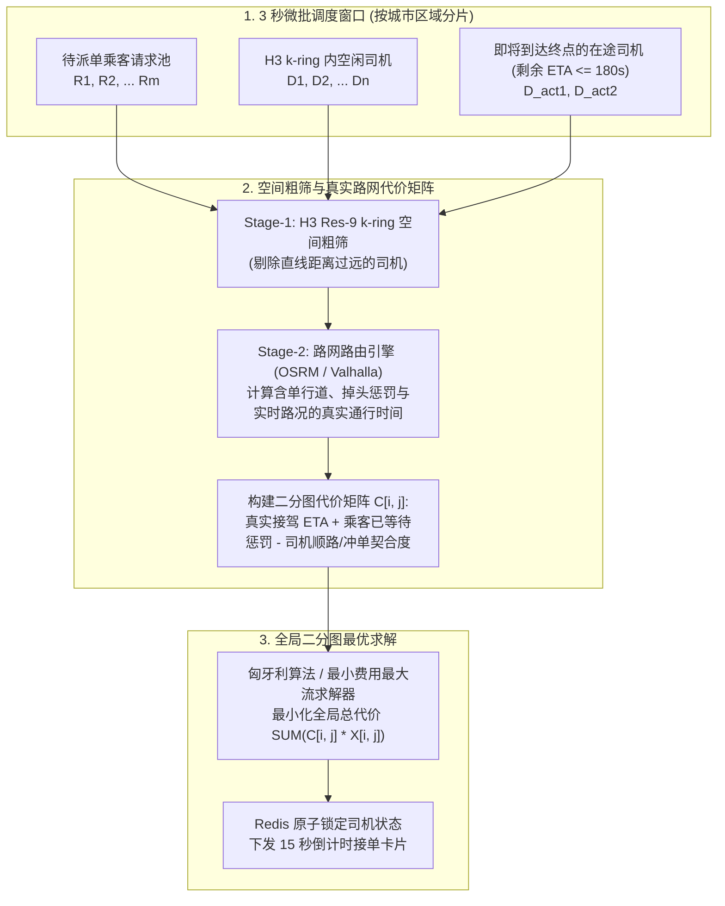
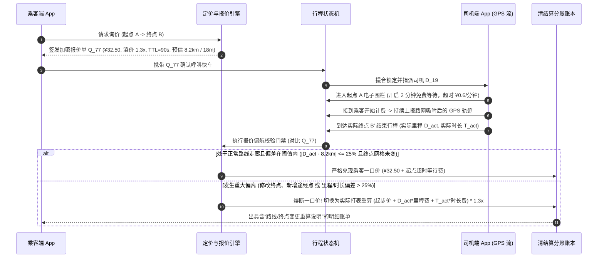

# 网约车出行调度、动态溢价与本地生活 O2O 平台

## 这是什么？

网约车出行调度与本地生活 O2O 平台（滴滴、Uber、Lyft、Grab、美团、DoorDash）负责在物理世界中实时撮合并履约线下服务。与传统电商（商品静置在确定性的仓库货架上）截然不同，出行平台的供给端是由成千上万名在城市路网中高速移动的独立司机组成的，且运力具有极强的易逝性——车辆空驶的每一秒钟，运力库存都在永久消失。

在底层架构上，出行平台运行着一套城市级的实时闭环控制系统：每秒摄入数百万条带噪 GPS 轨迹点，将供需状态实时映射至**多层级六边形空间网格（H3）**，结合时空动态溢价（Surge Pricing）签发**一口价预估凭证（Upfront Fare Token）**，以数秒为窗口执行**微批二分图全局最优匹配（Micro-Batch Bipartite Matching）**，自动仲裁司乘双边取消责任与 GPS 作弊，并利用贝叶斯置信区间算法对本地生活 O2O 商户进行公平排序。

## 为什么要懂？

出行与本地生活 O2O 是空间索引工程、双边市场动态博弈与反作弊风控的集大成者。若直接套用朴素的几何距离或简单状态机，上线即会遭遇真实物理路网与人性博弈的降维打击：

- **“贪心就近派单”导致全城运力死锁**：按先来后到顺序立即把离乘客 A 最近的司机派给 A（Greedy First-Come, First-Served），往往会抢走 2 秒后下单的乘客 B 身边**唯一**的可用车辆，导致全城平均接驾空驶距离（Deadhead Miles）暴涨 15%～25%。
- **动态溢价边界的“跨六边形跳格（Hexagon Hopping）”**：若网格 A 的溢价倍数为 `2.5x`，而一街之隔的相邻网格 B 为 `1.0x`，乘客会走 20 米过马路到网格 B 下单，而停在网格 B 的司机则会拒接所有 `1.0x` 订单等待网格 A 的高价单，导致边界运力彻底冻结。
- **一口价保障与极端拥堵/改道破产**：乘客下单时锁定去机场的一口价 `¥65`（预计 20 分钟），途中突发连环追尾封路或乘客口头要求绕路接朋友，行程变成 75 分钟。若只按 `¥65` 结算给司机，司机会集体罢工；若轻微堵车就随意撕毁一口价向乘客收 `¥180`，平台信誉则会崩盘。
- **为保完单率奖励而“接单后故意反方向空驶逼退乘客”**：司机为了拿到周末“连完 3 单且接单率 $\ge 90\%$ 奖励 ¥80”的冲单奖，接到不顺路的订单后选择先接单保住接单率，随后停在原地喝茶或朝反方向行驶，逼迫焦急的乘客主动取消，甚至白嫖 ¥5 取消费。

---

## 业务流程与核心机制

### 1. H3 六边形分层空间索引（Hexagonal Spatial Indexing）

为什么 Uber 和主流出行平台要构建 **H3 六边形离散全球网格系统**，而不是直接用经纬度矩形框、Geohash 或 PostGIS 半径查询？

1. **六邻域中心距严格相等**：在矩形网格（Geohash）中，一个格子有 4 个正交邻居（中心距为 $1.0d$）和 4 个对角线邻居（中心距为 $\sqrt{2}d \approx 1.414d$），做径向搜索或溢价平滑时存在严重的方向畸变。而**正六边形拥有 6 个邻居，中心到全部 6 个相邻六边形中心的距离完全相等**，天然契合以人为中心的等距扩散。
2. **$O(1)$ 位运算层级寻址**：地球表面任意分辨率（Res `0` 至 `15`）下的 H3 网格都被编码为一个 **64 位整数（`uint64`）**。将司机经纬度转换为 H3 网格、查询周围 $k$ 圈邻居（`k-ring` / `gridDisk`），或在父子层级间聚合，全部是纯 CPU 位运算，无需任何数据库磁盘 I/O。

| H3 分辨率 | 平均六边形边长 | 平均覆盖面积 | 核心出行与 O2O 业务场景 |
| :--- | :--- | :--- | :--- |
| **Res 7** | `~1.22 km` | `~5.16 km²` | 城市宏观供需预测、司机热力调度引导图 |
| **Res 8** | `~461 m` | `~0.74 km²` | **动态溢价（Surge）计算基本单元**及 `k-ring = 1..2` 高斯空间平滑 |
| **Res 9** | `~174 m` | `~0.105 km²` | **实时派单候选司机召回**（以乘客上车点为中心搜索 `k-ring = 2..4`） |
| **Res 11** | `~25 m` | `~0.002 km²` | 绿波虚拟上车点吸附（机场航站楼通道、商场正门、到达电子围栏判定） |

---

### 2. 为什么“微批二分图全局匹配”完胜“贪心就近派单”？

假设 $T = 0\text{s}$ 时**乘客 A** 下单，$T = 2\text{s}$ 时**乘客 B** 下单：
- **司机 1** 距乘客 A 需 `2 分钟`，距乘客 B 需 `3 分钟`。
- **司机 2** 距乘客 A 需 `4 分钟`，距乘客 B 需 `12 分钟`。

若采用**贪心先来先得（Greedy FCFS）**：
- $T = 0\text{s}$ 时乘客 A 立即抢走最近的**司机 1**（`2 分钟`），导致 2 秒后下单的乘客 B 只能分配给远处的**司机 2**（`12 分钟`）。**全城总接驾等待时长 = $2 + 12 = 14\text{ 分钟}$**。
- 若派单引擎开启 **2～5 秒微批窗口（Micro-Batching）**，构建二分图并用**匈牙利算法（Hungarian Algorithm / 最小费用最大流）**求解全局最优：将**司机 2 派给乘客 A（`4 分钟`）**，将**司机 1 派给乘客 B（`3 分钟`）**。**总接驾时长从 `14 分钟` 骤降至 `7 分钟`**，车队整体空驶效率提升 50%！

#### 连环派单：将“即将到达终点的在途司机（Ending-Soon Trips）”纳入候选池

高峰期离乘客 A 最近的运力，往往**不是**停在 3 个街区外的空闲车辆，而是正载着上一位乘客、还有 `90 秒` 就要在乘客 A 楼下完成下车的**在途车辆**！将**剩余下车 ETA $\le 3\text{ 分钟}$ 的在途司机**纳入二分图候选集，可大幅提升高峰期有效运力密度：

$$\text{接驾总耗时 } \text{ETA}(d_{\text{在途}}, r) = \text{当前单剩余时长}(d_{\text{在途}}) + \text{下车缓冲}(30\text{s}) + \text{路网行驶时长}(\text{上单终点}_{d}, \text{下单起点}_{r})$$

> **为什么派单严禁直接用球面直线距离（Haversine）？** 高架桥对向车道或隔河相望的司机，直线距离可能仅 `80 米`，但实际开车需往前开 2 公里下匝道掉头，真实路网耗时高达 `9 分钟`。必须以 H3 `k-ring` 做一阶段粗筛，再用路网图引擎（OSRM/Valhalla）计算含掉头与实时路况的二阶段代价矩阵。

---

### 3. 一口价锁价保障（Upfront Fare）与偏航动态重计费（Re-Metering）

现代出行平台普遍采用**预估一口价（Upfront Pricing）**模式消除乘客的价格焦虑，同时通过偏航阈值保护平台与司机利益：

1. **带签名与 TTL 的报价令牌（Signed Quote Token）**：乘客输入起终点后，定价引擎基于预估里程 $\hat{D}$、预估时长 $\hat{T}$ 与当前 H3 溢价系数 $S$，签发加密报价单 `quote_id`（如 `¥32.50`，有效期 `90 秒`）。
2. **司乘双向解耦结算账本**：乘客按锁定的预估一口价支付，而司机端收入则根据实际行驶里程、时长与奖励补贴独立核算。
3. **一口价熔断重算机制（Corridor & Threshold Re-Metering）**：若乘客锁定 4 公里 `¥15` 的一口价后，在车上要求司机改去 18 公里外的目的地，或中途临时增加经停点，系统在落锁结算时会自动触发重计费门禁。

---

### 4. 时空动态溢价（Surge Pricing）与六边形边界高斯平滑

晚高峰暴雨导致打车需求激增 400% 时，**动态溢价（Surge Pricing）**通过抑制低意愿需求并吸引周边空闲司机驶入热区，恢复市场接单率。

#### “跨街跳格（Hexagon Hopping）”悬崖效应与二维平滑算法

若每个 H3 Res-8 网格完全独立计算供需比：体育馆所在的中心网格 `h_center` 溢价算为 `2.8x`，而仅隔一条马路的相邻网格 `h_neighbor` 溢价为 `1.0x`。这种 `2.8x -> 1.0x` 的断崖会导致乘客纷纷过马路叫车，而马路对面的司机集体拒单。

**生产级时空二维平滑方案（空间 K-Ring 高斯核 + 时间 EMA 阻尼）：**

1. **空间 K-Ring 距离加权平滑**：计算网格 $h$ 的溢价时，将自身（权重 $w_0 = 1.0$）、一阶相邻环 6 个网格（$w_1 = 0.5$）与二阶相邻环 12 个网格（$w_2 = 0.2$）的供需量做高斯卷积平滑，彻底消除街道级价格断崖：

$$S_{\text{spatial}}(h) = \frac{\sum_{r=0}^{K} w_r \sum_{u \in \text{Ring}_r(h)} \text{Demand}(u)}{\sum_{r=0}^{K} w_r \sum_{u \in \text{Ring}_r(h)} \text{Supply}(u)}$$

2. **时间维度的变化率限幅（Temporal EMA & Step Cap）**：通过指数移动平均（EMA）并限制单周期（每 60 秒）最大涨跌幅（如单次最多上调 `+0.3x`、下调 `-0.2x`），防止溢价倍数剧烈闪烁导致乘客下单时频繁报错“价格已过期”。
3. **询价曝光（Eyeballs）按用户去重**：统计潜在需求时需纳入打开 App 询价但未下单的请求，但**必须按 `user_id` 在 5 分钟滑动窗口内严格去重**——防止同一名乘客为了等降价连续刷新 15 次屏幕，被系统误判为 15 个新增需求从而把溢价越刷越高！

---

## 核心术语表

| 术语 | 业务与技术含义 |
| :--- | :--- |
| **H3 Spatial Index** | Uber 开源的六边形分层全球离散网格系统，用 64 位整数编码全球 16 个精度的六边形单元 |
| **K-Ring (`gridDisk`)** | 围绕中心六边形向外扩展 $k$ 步的所有相邻网格集合（$k=1$ 含 7 个网格，$k=2$ 含 19 个网格） |
| **Deadhead Miles（空驶接驾里程）** | 司机接单后从当前位置空车驶往乘客上车点所消耗的无客里程与时间 |
| **Micro-Batch Dispatch（微批派单）** | 缓冲 2～5 秒内的司乘请求，通过匈牙利算法求解全局接驾总耗时最小的二分图匹配 |
| **On-Trip Matching（在途连环派单）** | 将距离当前订单终点仅剩 1～3 分钟的在途载客司机纳入下一单的派单候选池 |
| **Map Matching（路网地图匹配）** | 利用隐马尔可夫模型（HMM / 维特比算法）将漂移的原始 GPS 坐标吸附到真实的单向道路拓扑边上 |
| **Upfront Fare Token（一口价凭证）** | 带加密签名与 90 秒有效期的预估锁价令牌，在未发生重大路线偏离时保障乘客一口价不变 |
| **Hexagon Hopping（跨格跳单）** | 乘客为逃避高溢价，步行几十米跨越未做平滑处理的空间网格边界重新发单的现象 |
| **Bayesian / Wilson Lower-Bound** | 本地生活 O2O 商户排序采用的置信区间修正评分，防止“仅 1 条 5 星好评的新店”排在“2000 条 4.88 星老店”前面 |

---

## 常见架构与业务模式

### 模式 1：基于隐马尔可夫模型（HMM）的城市峡谷 GPS 路网吸附

在高楼林立的市中心（“城市峡谷”），手机原始 GPS 坐标每隔几秒就会发生 `30–80 米` 的多径反射跳变，导致轨迹穿墙、跳到平行辅路甚至在立交桥上折返。
- 严禁直接对原始 `(lat, lng)` 折线累加欧氏距离计费（锯齿噪声会虚增 15%～40% 里程）。
- 必须将滑动窗口内的轨迹点 `(lat, lng, heading, speed, accuracy, ts)` 输入基于 OpenStreetMap 路网拓扑的 **HMM 地图匹配流水线（Viterbi 维特比解码）**，还原出符合单行道与转向限制的最优连续真实行驶路径后再计算里程与 ETA。

### 模式 2：本地生活 O2O 商户排序 —— 时间衰减贝叶斯平均与威尔逊下界

在本地餐饮、汽修、家政等 O2O 频道中，如何对商户做口碑排序？
- **直接按平均分 `AVG(stars)` 排序的缺陷**：新开业店铺找亲戚刷了 1 单 `5.00 分`，就会排在拥有 2,400 条评价、均分 `4.88 分` 的口碑老店前面。
- **生产级解法 —— 时间衰减贝叶斯收缩均值（Time-Decayed Bayesian Shrinkage）**：

$$S_{\text{Bayesian}} = \frac{v}{v + m} \cdot R_{\text{decayed}} + \frac{m}{v + m} \cdot C$$

其中 $v$ 为经过指数时间衰减加权（$w_i = e^{-\lambda \Delta t}$，近期评价权重更高）的有效评价数，$R_{\text{decayed}}$ 为商户加权均分，$C$ 为全城同品类平均分（如 `4.35 分`），$m$ 为最低置信样本阈值（如 `25 条`）。仅 1 条评价的新店得分会被 96% 拉向全城均值 $C$，唯有积累足够多真实好评后才能登顶榜单。

---

## 常见踩坑与边界情况

- **机场航站楼出发层/到达层与高架桥的二维投影失真**：刚在机场出发层（二楼）或高架桥面落客的司机，与一楼到达层出口的乘客水平距离仅 `10 米`，但实际开车需绕场一周耗时 `14 分钟`。机场、火车站与立交枢纽必须引入**三维图层标签（`layer: departures` vs `layer: arrivals`）**与路网级转向惩罚。
- **隧道断网引发的“幽灵运力（Ghost Cars）”**：司机驶入长隧道断网或强行杀掉 App 进程后，若空间索引不设过期机制，该车辆图标会一直停留在隧道口被反复派单。必须为司机位置设置 **15 秒 Redis TTL 心跳租约**，超时未上报心跳立即移出可派单池。
- **中途加点/超时等待的预授权增量追加（Incremental Auth）**：乘客上车后临时增加经停点，导致最终车费（`¥120`）远超发单时的银行卡预授权冻结额度（`¥65`）。行程中修改目的地时必须实时触发**增量预授权（Incremental Authorization）**，若扣款失败则生成账户欠款锁（结清前冻结下次叫车）。

---

## 行业实战教训与非直观最佳实践

### 1. 司乘双边取消责任仲裁：识别“接单后反方向空驶逼退”与虚拟定位作弊

订单派发 4 分钟后被取消时，系统必须在毫秒级内裁定：**究竟是扣乘客 ¥5 取消费补贴司机空驶油费，还是免除乘客费用并判定司机诱导取消？**

若规则简化为*“接单满 2 分钟后乘客取消即扣费”*，黑产与恶意司机会立刻钻空子：
1. 司机正处于“连完 3 单奖 ¥50”的第 3 单，收到一个去远郊的不划算订单。为保住连单奖励，司机先点击接单，随后**把车停在路边不动（或故意朝反方向开）**，逼迫赶时间的乘客主动取消。
2. 更有甚者，作弊团伙使用 Root 手机配合**虚拟定位插件（Mock GPS）**，足不出户把车辆图标瞬移到乘客上车点围栏内，挂机等满 3 分钟后以“乘客未出现（No-Show）”恶意套取 ¥5 取消费。

| 取消仲裁场景 | 轨迹遥测与物理核验指标 | 系统自动裁定结果 |
| :--- | :--- | :--- |
| **1. 接单满 2 分钟乘客取消，且司机正常接驾** | `当前剩余 ETA <= 派单初始 ETA - 已逝时间 + 90s拥堵宽限` 且沿接驾路径靠近 | **判乘客有责**：扣取 ¥5 取消费补偿司机 |
| **2. 接单满 2 分钟乘客取消，但司机原地不动或反方向驶离** | `当前剩余 ETA > 初始 ETA + 120s` 或无拥堵下距上车点路网距离持续增大 | **乘客 $0 免责**：判定为**司机消极接驾诱导取消**（中断司机连单奖！） |
| **3. 司机到达起点申报“乘客爽约（No-Show）”** | 必须同时满足：**真实驶入 50m 电子围栏** + **等待倒计时满 3–5 分钟** + **至少拨打 1 次虚拟号电话** | 三项硬件与通信凭证全部通过才发放爽约补偿费 |
| **4. 检测到 GPS 瞬移 / 模拟器伪造定位** | 相邻轨迹点推算时速 `>160 km/h`、陀螺仪/加速度计方差为 0，或基站/Wi-Fi BSSID 与 GPS 位置不符 | **拦截取消费结算**；触发设备硬件完整性校验并封禁作弊账号 |

---

### 2. 司机冲单奖（Quest / Streak）合谋刷单与“双机原地打转”反作弊

在除夕夜或暴雨晚高峰，平台常推出阶梯冲单奖：*“17:00–23:00 完成 15 单额外奖励 ¥150”*。当司机在 `22:35` 已完成 13 单时，最后 2 单的边际收益高达 ¥150。作弊司机会把车开进偏僻停车场，掏出备用手机（或找同行坐在后排）连续下 2 单 `400 米` 的起步价短单，付给平台 ¥3 抽成即可套走 ¥150 奖励！

**多维反合谋风控防线：**
1. **司乘关系图频次上限**：任意 7 天滑动窗口内，同一 `(rider_id, driver_id)` 组合（含关联支付卡号、同设备指纹）最多仅计入 `1 次` 冲单奖励进度。
2. **发单前同车共现遥测校验（Pre-Trip Co-Location Check）**：比对乘客手机与司机手机在**发单前 10 分钟**的 GPS 轨迹、气压计高度变化与周边 Wi-Fi/蓝牙 BSSID 列表。若发单前两台设备已在同一辆车内同步移动，直接判定为合谋刷单（`COLLUSION_INELIGIBLE`）。
3. **最小物理位移门槛**：起终点直线位移小于 `600 米`、原地绕圈闭环行程或支付未成功结清的订单，一律不计入冲单奖统计。

---

## 速查参考

| 系统核心模块 | 生产环境标准设计规范 |
| :--- | :--- |
| **空间网格索引** | **Uber H3** 六边形网格（`Res 8` 算动态溢价，`Res 9` 召回附近司机，`Res 11` 吸附上车点）；司机位置维护 15 秒 Redis TTL 心跳租约 |
| **派单撮合算法** | **2–5 秒微批窗口** + Stage-1 H3 `k-ring` 粗筛 + Stage-2 路网真实 ETA 矩阵（OSRM/Valhalla）+ **匈牙利全局二分图最优匹配**（含剩余 `ETA <= 180s` 的在途司机） |
| **GPS 轨迹处理** | **隐马尔可夫模型（HMM 维特比算法）路网匹配**，将城市峡谷漂移坐标吸附至单向道路有向边后再计费与算 ETA |
| **一口价与偏航重算** | 签发 90 秒 TTL 加密报价令牌；未改终点且里程/时长偏差 `<= 25%` 时严格兑现一口价，超限则熔断切换为打表重算 |
| **动态溢价平滑** | **空间 K-Ring 高斯加权平滑**（消除跨街跳格）+ **时间 EMA 涨跌幅限幅** + 询价曝光按 `user_id` 5 分钟去重 |
| **双边取消仲裁** | 扣乘客取消费前强制核验**司机接驾路网 ETA 净推进量**；原地不动或反方向驶离一律判为司机诱导取消 |
| **O2O 商户口碑排序** | **时间衰减贝叶斯收缩均值**（$\frac{v}{v+m}R + \frac{m}{v+m}C$）或威尔逊置信区间下界，杜绝“1 条好评新店霸榜” |
