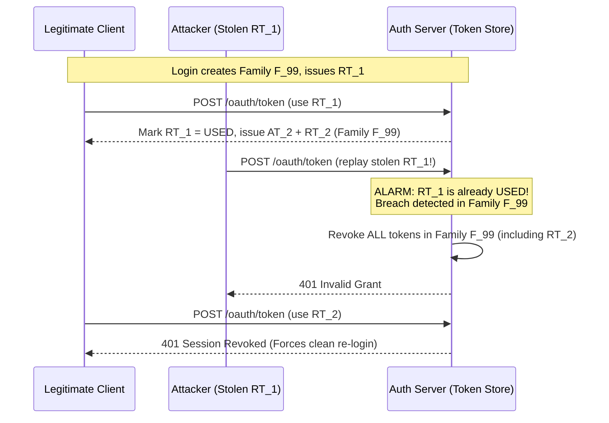

# Authentication & Authorization

## What Is It?

Authentication is proving who you are. Authorization is determining what you're allowed to do. Almost every web app needs both. When you log in, that's authentication. When the app decides you can view admin pages but your colleague can't, that's authorization.

## Why Should You Care?

Auth is the front door to your application. Get it wrong and you've got unauthorized access, data breaches, and angry users. As a developer, you'll touch auth code in nearly every project — whether it's building login pages, protecting API endpoints, or integrating with third-party identity providers. If you don't understand the business logic, you'll build something that either locks everyone out or lets everyone in.

## How It Works (The Business Flow)

### Registration

1. User fills out a signup form (email, password, maybe name)
2. System validates the input (is the email already taken? Is the password strong enough?)
3. System creates a user record and hashes the password (never store plain text)
4. System sends a verification email with a one-time link
5. User clicks the link → account is verified and active

### Login

1. User enters email + password
2. System checks credentials against the stored hash
3. If valid, system creates a session or issues a token (JWT)
4. Token/session is sent back to the client and stored (cookie, localStorage)
5. Every subsequent request includes this token for identification

### Authorization Check

1. User tries to access a resource (e.g., `/admin/dashboard`)
2. System reads the token, identifies the user
3. System checks: does this user have the required role/permission?
4. If yes → allow. If no → return 403 Forbidden.

### Logout

1. User clicks "Sign Out"
2. Client-side: token/cookie is deleted
3. Server-side: session is invalidated (if using sessions) or token is added to a blocklist (if using JWTs)

## Key Terms You'll Hear

| Term                                      | What It Means                                                                                                     |
| ----------------------------------------- | ----------------------------------------------------------------------------------------------------------------- |
| **Authentication (AuthN)**                | Verifying identity — "who are you?"                                                                               |
| **Authorization (AuthZ)**                 | Checking permissions — "what can you do?"                                                                         |
| **OAuth 2.0**                             | A protocol that lets users log in via Google, GitHub, etc. without sharing their password with your app           |
| **OpenID Connect (OIDC)**                 | A layer on top of OAuth 2.0 that adds identity information (who the user is, not just what they can access)       |
| **SSO (Single Sign-On)**                  | Log in once, access multiple apps. Common in enterprise (e.g., Okta, Azure AD)                                    |
| **MFA / 2FA**                             | Multi-factor authentication — requiring a second proof (SMS code, authenticator app, hardware key)                |
| **JWT (JSON Web Token)**                  | A self-contained token that carries user info and permissions, signed so it can't be tampered with                |
| **Session**                               | Server-side storage of user state. The client holds a session ID (usually in a cookie), the server holds the data |
| **RBAC (Role-Based Access Control)**      | Assign users roles (admin, editor, viewer), each role has specific permissions                                    |
| **ABAC (Attribute-Based Access Control)** | Permissions based on attributes (department, location, time of day). More flexible than RBAC, more complex        |
| **Refresh Token**                         | A long-lived token used to get new access tokens without re-entering credentials                                  |
| **SAML**                                  | Security Assertion Markup Language — an older SSO protocol, still widely used in enterprise                       |
| **API Key**                               | A simple string identifying a client application (not a user). Used for server-to-server communication            |
| **Pre-Account Takeover (Pre-ATO)**        | An attack where an adversary registers an unverified password account using a victim's email before the victim signs up via OAuth/SSO |
| **Domain Capture**                        | An enterprise feature where an organization claims ownership of an email domain (e.g., `@acme.com`) via DNS verification to enforce SSO |
| **Refresh Token Rotation (RTR)**          | Issuing a new refresh token every time an access token is refreshed, immediately invalidating the previous refresh token |
| **Token Family**                          | All refresh tokens descended from a single initial login grant, tracked together so replay of any ancestor revokes the entire chain |
| **Step-Up Authentication**                | Requiring a logged-in user to re-authenticate (often with MFA or passkey) within a short window before executing a high-risk action |
| **`amr` / `acr` Claims**                  | OIDC token claims recording Authentication Methods References (`pwd`, `mfa`, `hwk`) and Authentication Context Class Reference |

## Common Patterns

### Pattern 1: Session-Based Auth (Traditional)

User logs in → server creates a session → stores session ID in a cookie → every request sends the cookie → server looks up the session.

**When it's used:** Traditional web apps, server-rendered pages, apps where you need easy session invalidation.

**Trade-off:** Requires server-side storage (memory, Redis, database). Harder to scale horizontally because sessions are stateful.

### Pattern 2: Token-Based Auth (JWT)

User logs in → server generates a JWT → sends it to client → client sends it with every request in the `Authorization` header → server validates the token's signature without looking anything up.

**When it's used:** SPAs, mobile apps, microservices. The token is self-contained.

**Trade-off:** You can't easily revoke a JWT before it expires (no server-side session to delete). Workaround: short expiry + refresh tokens.

### Pattern 3: OAuth 2.0 / Social Login

User clicks "Sign in with Google" → redirected to Google's login page → user authorizes your app → Google redirects back with an authorization code → your server exchanges it for tokens → you now have user info from Google.

**When it's used:** "Sign in with Google/GitHub/Apple," integrating with third-party APIs on behalf of the user.

**Trade-off:** Complex flow (multiple redirects). You depend on a third party for availability.

### Pattern 4: SSO (Enterprise)

Employee visits your app → redirected to their company's identity provider (Okta, Azure AD) → authenticates there → redirected back to your app with a SAML assertion or OIDC token → your app trusts the identity provider.

**When it's used:** B2B SaaS apps where enterprise customers want their employees to use their company credentials.

**Trade-off:** Integration complexity. Each customer might use a different identity provider.

## Gotchas & Edge Cases

- **Password reset flow**: Don't reveal whether an email exists in your system. Say "If this email is registered, you'll receive a reset link" — otherwise attackers can enumerate users.
- **Token storage**: Don't store JWTs in localStorage if your app is vulnerable to XSS. HttpOnly cookies are safer.
- **Session fixation**: Always regenerate the session ID after login. Otherwise an attacker can pre-set a session ID and hijack the user's session.
- **OAuth state parameter**: Always use the `state` parameter to prevent CSRF attacks during OAuth flows. Without it, attackers can trick users into linking their account to the attacker's identity.
- **Role explosion**: Start with a few roles. Companies that create dozens of fine-grained roles end up with an unmaintainable mess.
- **Forgot to protect the API**: You added auth to the frontend but your API endpoints are wide open. Always enforce auth server-side.
- **Hardcoded secrets**: Never put API keys or secrets in frontend code. They're visible to anyone who opens DevTools.

## Industry War Stories & Non-Obvious Best Practices

### 1. Pre-Account Takeover ("Unverified Email Pre-Hijack") When Linking OAuth/SSO

A classic vulnerability occurs when a developer naively "auto-merges" accounts that share the same email address across authentication providers:

1. **The Attack**: An attacker learns `victim@company.com` will soon use your SaaS product. The attacker signs up for a password account using `victim@company.com` and their own password. Because they don't own the inbox, the account sits in `email_verified = false` (or your app lets unverified users log in with a banner).
2. **The Trigger**: Two weeks later, the real victim visits your app and clicks **"Continue with Google"** using `victim@company.com`. Google returns an OIDC token with `email: "victim@company.com"` and `email_verified: true`.
3. **The Fatal Mistake**: Your backend sees an existing row for `victim@company.com`, links the Google identity to that row, and flips `email_verified = true`.
4. **The Takeover**: The attacker's original password (or active session created before the link) **still works** on the merged account. The attacker now has full access to every workspace, API key, and document the victim creates.

| Existing Account State | Incoming OAuth/SSO Claim | Safe Production Resolution |
| ---------------------- | ------------------------ | -------------------------- |
| `email_verified: true` | `email_verified: true`   | Safe to auto-link **only** if the IdP is authoritative, or prompt user to enter existing password once |
| `email_verified: false`| `email_verified: true`   | **Overwrite / Quarantine**: Wipe the unverified password hash, revoke all prior sessions, and let the verified OAuth login claim the account cleanly |
| Any state              | `email_verified: false`  | **Never auto-link**. Reject or force an inbox verification loop before linking |

### 2. Enterprise SSO "Domain Capture" vs. Pre-Existing Shadow-IT Accounts

In B2B SaaS, employees almost always adopt a tool individually ("Shadow IT") using personal passwords or Google login with their `@acme.com` work email long before Acme Corp's IT department buys an Enterprise plan and enables SAML/OIDC SSO.

When Acme's IT admin verifies ownership of `acme.com` via a DNS `TXT` record and turns on **"Enforce SAML SSO for `@acme.com`"**, naive systems crash into three production disasters:

- **Personal Data Leak to Employer**: An engineer used `alice@acme.com` for personal side-project workspaces before Domain Capture. If you silently hand ownership of her account to the Enterprise org, Acme's admin can read her private workspaces.
- **Billing Orphans**: 40 employees had individual $20/mo Pro credit card subscriptions under `@acme.com` emails. Enforcing SSO without cancelling or migrating those Stripe subscriptions causes double-billing chargebacks.
- **IdP Outage Lockout**: If Okta goes down or the SAML certificate expires, the IT admin cannot log in via SSO to upload the new SAML certificate.

**Production Best Practices:**
1. **Account Claim Migration Flow**: When a domain is captured, prompt existing `@acme.com` users on next login to choose: *(a) Migrate account into Acme Enterprise*, or *(b) Change email address to a personal `@gmail.com` to keep personal workspaces private*.
2. **Emergency Break-Glass Admin Bypass**: Always maintain a cryptographically gated bypass URL or recovery code (with mandatory hardware WebAuthn MFA) for designated Org Owners so they can fix broken SAML certificates when the IdP itself is unreachable.

### 3. Refresh Token Rotation (RTR) with Reuse Detection & Token Family Revocation

Because stateless JWT access tokens cannot be easily revoked before expiry, modern SPAs and mobile apps keep access token TTLs short (5–15 minutes) and use a Refresh Token to mint new ones. But if an attacker steals a long-lived refresh token via XSS or device malware, they have persistent access.

**The Solution — Refresh Token Rotation with Family Tracking (RFC 6819 / OAuth 2.1):**
Every initial login creates a `token_family_id`. Every time `RT_1` is exchanged for a new access token, the server marks `RT_1` as `status = used` (never delete it immediately!) and issues `RT_2` in the same family.

- **Why keep used tokens instead of deleting them?** If you `DELETE` `RT_1` upon rotation, when the attacker replays `RT_1` you only see "token not found" — you can't tell whether it's a harmless expired token or an active theft. Keeping `RT_1` marked as `used` with its `family_id` acts as a tripwire that immediately invalidates `RT_2` as well.
- **Network Grace Window**: Mobile clients on flaky cellular networks sometimes send duplicate refresh requests when a response drops. Allow a tiny 5–10 second idempotency grace window for the exact same `RT_n` from the same IP/TLS fingerprint before triggering a full family nuclear revocation.

### 4. Step-Up Authentication for High-Risk Mutations

A valid session cookie proves the user authenticated *at some point in the past* (perhaps 14 days ago via "Remember Me"), not that the human sitting at the unlocked laptop right now is the account owner, nor that the session wasn't hijacked ten minutes ago.

High-risk operations — **generating production API keys, exporting customer PII, changing payout bank details, disabling MFA, or transferring organization ownership** — must enforce **Step-Up Authentication**:

1. **Embed Auth Context in the Session/JWT**: Track `auth_time` (Unix timestamp of last interactive verification) and `amr` (Authentication Methods Reference, e.g., `["pwd", "mfa", "hwk"]`).
2. **Middleware Policy Check**: When the user calls `POST /api/v1/payout-bank`, the middleware checks:
   - Is `"mfa"` or `"hwk"` (WebAuthn passkey) present in `amr`?
   - Is `now() - auth_time < 300` (authenticated within the last 5 minutes)?
3. **Challenge-Response Upgrade**: If either check fails, the API does **not** log the user out. It returns `403 Forbidden` with `{ "error": "step_up_required", "required_acr": "aal2", "max_age": 300 }`. The frontend opens an inline modal prompting for a Passkey touch or TOTP code, which issues an upgraded token with a fresh `auth_time` so the client can replay the mutation.

## Quick Reference

| Scenario                         | Recommended Approach                                                                 |
| -------------------------------- | ------------------------------------------------------------------------------------ |
| Traditional web app              | Session-based auth with cookies                                                      |
| SPA / Mobile app                 | Short-lived JWT (5–15m) + Refresh Token Rotation with family reuse detection         |
| "Sign in with Google"            | OAuth 2.0 + OpenID Connect (wipe unverified password state on verified email match)  |
| Enterprise B2B                   | SSO via SAML/OIDC + DNS Domain Capture migration wizard + break-glass owner login    |
| API-to-API                       | API keys or OAuth 2.0 Client Credentials grant / mTLS                                |
| Need extra security              | Add MFA (TOTP, WebAuthn Passkeys)                                                    |
| High-risk mutations (payout/key) | Step-Up Auth checking `amr` includes MFA and `now - auth_time < 300s`                |
| Microservices                    | JWT passed between services, validated at each gateway                               |

