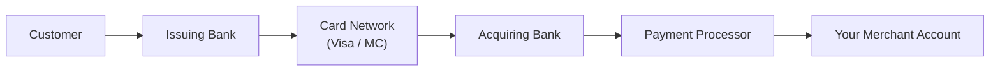
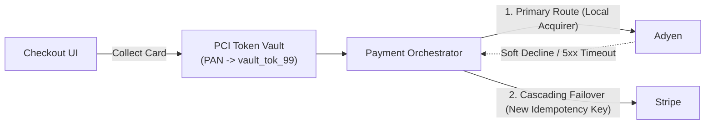

# Payment Processing

## What Is It?

Payment processing is how money moves from a buyer to a seller in an online transaction. It involves multiple parties — the customer, the merchant (you), a payment gateway, a payment processor, the card networks (Visa, Mastercard), and the banks on both sides. As a web developer, you're building the checkout experience and integrating with services like Stripe, PayPal, or Adyen that handle the actual money movement.

## Why Should You Care?

Money is the most sensitive thing in your application. Bugs in payment code mean lost revenue, double charges, angry customers, and potential legal trouble. Even if you use Stripe and never touch raw card numbers, you still need to understand the business flow — when does money actually move? What happens during a refund? What's a chargeback and why should you be terrified of too many?

## How It Works (The Business Flow)

### The Checkout Flow

1. **Cart → Checkout**: User clicks "Buy" → system calculates total (items + tax + shipping - discounts)
2. **Payment Method Selection**: User picks credit card, PayPal, Apple Pay, bank transfer, etc.
3. **Payment Intent / Order Creation**: Your server creates a payment intent with the gateway (e.g., Stripe's `PaymentIntent`)
4. **Card Details Collection**: User enters card info into the gateway's secure form (never on your server)
5. **Authorization**: Gateway sends the card info to the processor → processor asks the issuing bank "Does this card have $50?" → bank says yes or no
6. **Hold**: If authorized, the money is held (not yet transferred). The order is "pending payment."
7. **Capture**: You confirm the order → gateway captures the held amount → money begins moving
8. **Settlement**: Usually 1-3 business days later, the money lands in your merchant account (minus fees)

### How Money Actually Flows

At each hop, someone takes a small fee. That's why payment processing costs 2-3% of each transaction.

### Refunds

1. Customer requests a refund (or you initiate one)
2. You call the gateway's refund API
3. Gateway reverses the transaction through the same chain
4. Money returns to the customer's card (3-10 business days)
5. You lose the transaction amount AND usually keep paying the processing fee

### Chargebacks (Disputes)

1. Customer calls their bank and says "I didn't authorize this" or "I never received the product"
2. Bank pulls the money back from you immediately
3. You receive a chargeback notification with a deadline to respond
4. You must provide evidence (receipts, shipping proof, logs) to fight it
5. Bank decides who wins. If you lose, you pay the amount + a chargeback fee ($15-25)
6. Too many chargebacks (>1% of transactions) → your payment account gets flagged or shut down

## Key Terms You'll Hear

| Term                  | What It Means                                                                                                                        |
| --------------------- | ------------------------------------------------------------------------------------------------------------------------------------ |
| **Payment Gateway**   | The service you integrate with (Stripe, PayPal, Adyen). Handles secure communication with banks                                      |
| **Payment Processor** | The backend that routes transactions through card networks. Often the gateway is also the processor                                  |
| **Merchant Account**  | A bank account specifically for receiving payments from card transactions                                                            |
| **Authorization**     | Checking if the card is valid and has funds. No money moves yet                                                                      |
| **Capture**           | Actually pulling the authorized amount. Now money moves                                                                              |
| **Auth + Capture**    | The two-step process. Some businesses authorize immediately but capture later (e.g., hotels)                                         |
| **Settlement**        | When money actually arrives in your account (1-3 business days)                                                                      |
| **Chargeback**        | Customer disputes a charge through their bank. Very bad for merchants                                                                |
| **PCI DSS**           | Payment Card Industry Data Security Standard — rules for handling card data. If you use Stripe's hosted forms, you're mostly covered |
| **PCI SAQ**           | Self-Assessment Questionnaire — the form you fill out to prove PCI compliance                                                        |
| **3D Secure (3DS)**   | Extra authentication step ("Verified by Visa"). Shifts fraud liability from merchant to bank                                         |
| **Idempotency Key**   | A unique key you send with payment requests to prevent duplicate charges if a request is retried                                     |
| **Webhook**           | Payment gateways send you HTTP callbacks when events happen (payment succeeded, refund issued, dispute opened)                       |
| **PSP**               | Payment Service Provider — another name for the gateway/processor combo                                                              |
| **Network Token (VTS / MDES)** | A card-network-issued token (Visa Token Service / Mastercard Digital Enablement Service) that replaces the raw 16-digit PAN and stays valid even when a physical card is reissued |
| **Card Account Updater (CAU)** | Automated card-network service that pushes updated expiry dates and replaced card numbers to merchants when a customer's card expires or is lost |
| **CIT / MIT**         | Customer-Initiated Transaction (user is present at checkout) vs. Merchant-Initiated Transaction (off-session recurring charge or post-shipment capture) |
| **VDMP / VAMP**       | Visa Dispute Monitoring Program / Visa Acquirer Monitoring Program — network enforcement programs that penalize merchants exceeding ~0.9% dispute ratios |
| **Pre-Dispute Deflection (RDR / Ethoca)** | Visa Verifi Rapid Dispute Resolution and Mastercard Ethoca Alerts, which let merchants auto-refund contested charges before they become official chargebacks |
| **Incremental Authorization** | Increasing an existing authorized hold amount before capture (common in hospitality, ride-hailing, and grocery delivery) |

## Common Patterns

### Pattern 1: Redirect to Hosted Checkout

Customer clicks "Pay" → redirected to Stripe Checkout (or PayPal) → completes payment there → redirected back to your success page.

**When it's used:** Simplest integration. You never touch card data. Great for small businesses and MVPs.

**Trade-off:** Less control over the UI. Users leave your site temporarily.

### Pattern 2: Embedded Payment Form

You embed Stripe Elements (or similar) directly in your page. The form looks like part of your site but card data goes straight to Stripe's servers — never touches yours.

**When it's used:** Most production apps. You want a seamless checkout experience.

**Trade-off:** More integration work, but still PCI-safe because card data bypasses your server.

### Pattern 3: Server-Side Payment (API-Based)

Your server creates payment intents and manages the entire flow via API. Used for subscriptions, marketplaces, or complex flows.

**When it's used:** Recurring billing, marketplace payouts, custom checkout flows.

**Trade-off:** Most complex. You need robust error handling, webhook processing, and idempotency.

## Gotchas & Edge Cases

- **Double charges**: If a payment request times out, don't retry without an idempotency key. The first request might have succeeded.
- **Webhooks are the source of truth**: Don't rely solely on the client-side redirect. The user might close the browser. Always confirm payment status via webhook.
- **Currency matters**: $10.00 is represented as `1000` (cents) in most payment APIs. Mixing dollars and cents is a classic bug.
- **Tax calculation**: Tax rules are insanely complex (varies by state, country, product type). Use a service like Stripe Tax or Avalara. Don't try to calculate it yourself.
- **Partial refunds**: You can refund part of a payment. Track what's been refunded to avoid refunding more than the original amount.
- **Failed payments are normal**: Cards expire, funds run out, fraud checks trigger. Your app needs graceful failure handling.
- **PCI compliance**: Even using Stripe, you have some responsibilities (HTTPS, not logging card data, not storing CVV). Fill out your SAQ.
- **Testing**: Use test card numbers (Stripe: `4242 4242 4242 4242`). Never use real cards in development.
- **Marketplace payments**: If you're building a marketplace where sellers get paid, you need split payments or connected accounts (Stripe Connect). This adds significant complexity.

## Industry War Stories & Non-Obvious Best Practices

### 1. Multi-PSP Orchestration & Cascading Failover

At scale, relying on a single PSP (e.g., Stripe alone) creates both an availability single point of failure and a 2–5% hidden revenue leak due to **false declines** (issuing banks rejecting legitimate foreign or cross-border acquirer traffic).

Mature payment architectures insert a **PCI-Compliant Vault / Tokenization Proxy** (e.g., Basis Theory, Spreedly, Hyperswitch, or an in-house PCI Level 1 enclave) in front of multiple PSPs (Stripe, Adyen, Braintree, Checkout.com):

- **Smart Routing by BIN / Currency**: Inspect the first 6–8 digits of the card (**IIN/BIN**) to identify the issuing country and card brand, then route the transaction to the PSP with a **local acquiring bank** in that country (lifting authorization rates from ~82% cross-border to ~94% domestic).
- **Never Failover on Hard Declines**: Only cascade to a secondary PSP on PSP 5xx timeouts or specific issuer soft/routing errors (`issuer_unavailable`, `do_not_honor` without fraud flags). Cascading a `stolen_card` or `invalid_account` hard decline across multiple PSPs triggers card-network velocity alarms and hefty fines.

### 2. Network Tokenization (Visa VTS / Mastercard MDES) & Card Account Updater (CAU)

When a customer saves a card on file, your PSP normally gives you a **PSP Vault Token** (`pm_123`) mapped to the raw 16-digit Primary Account Number (**FPAN**) and expiry date. When the customer's physical card expires or is reissued after being lost, that FPAN dies — causing recurring payments to fail (**involuntary churn**).

Two card-network mechanisms prevent this and boost authorization approval rates by **2–4%**:

1. **Network Tokenization (Visa VTS / Mastercard MDES)**: Instead of storing the static 16-digit FPAN, the PSP requests a **Network Token (DPAN)** directly from Visa or Mastercard linked to the customer's underlying bank account.
   - When the bank reissues a lost or expired physical card, Visa/Mastercard updates the FPAN-to-DPAN mapping inside the card network in real time. Your saved Network Token never breaks.
   - Network tokens carry a dynamic **cryptogram** on each transaction and qualify for lower interchange fees (or higher issuer trust) than raw PANs.
2. **Card Account Updater (CAU)**: For legacy cards not yet on network tokens, batch/real-time CAU queries Visa/Mastercard updater feeds before billing cycles to automatically replace expired dates or closed-and-replaced card numbers, firing a `payment_method.updated` webhook to your server.

### 3. The 0.9% Chargeback Cliff (VDMP / VAMP) & Pre-Dispute Auto-Refund Deflection

Many engineers assume fighting a chargeback ("representment") is just a matter of uploading shipping tracking logs, and if you win the dispute, your record is clean. **Both assumptions are dangerously wrong:**

- **Every Chargeback Counts Against Your Ratio — Even If You Win**: Card networks calculate your dispute ratio as $\text{Total Chargebacks Opened} \div \text{Total Transactions}$. Winning representment recovers the transaction dollars, but **does not remove the chargeback from your Visa/Mastercard dispute ratio**.
- **The 0.9% Threshold**: Crossing **0.9% and 100 disputes/month** places you into the **Visa Dispute Monitoring Program (VDMP / VAMP)** or Mastercard Excessive Chargeback Program (ECP), triggering per-dispute fines ($25–$100+), mandatory remediation audits, rolling reserves (freezing 10–25% of your revenue for 90 days), or complete merchant account termination (**MATCH list** blacklisting).

| Metric / Outcome | Fighting Chargeback (Representment) | Pre-Dispute Deflection (Verifi RDR / Ethoca) |
| ---------------- | ----------------------------------- | -------------------------------------------- |
| **Network Dispute Ratio Impact** | **Counts toward 0.9% limit** (even if you win!) | **0% impact** (deflected before becoming a chargeback) |
| **Fee Cost** | $15–$25 dispute fee + $25–$100 network fine if in VDMP | $10–$20 alert/RDR fee, $0 chargeback fee |
| **Win Rate / Economics** | 20–40% win rate; takes 60 days of manual ops labor | Automatic instant refund for low-value orders (< $50) |

**Production Rule**: Integrate **Visa Verifi RDR (Rapid Dispute Resolution)** and **Mastercard Ethoca Alerts**. Configure rules to automatically issue a full refund for any disputed transaction under a threshold (e.g., $< \$75$) the moment the issuer receives the customer's call — deflecting the inquiry into a standard refund before it ever hits the card network's chargeback ledger.

### 4. Authorization Expiry, Incremental Auth & Partial Capture Edge Cases

Treating "Authorized" as "Money is safely reserved until we ship" breaks down whenever physical fulfillment, out-of-stock substitutions, or backorders enter the picture:

1. **Authorization Hold Expiration (The 7-Day Cliff)**: Standard Visa/Mastercard card-not-present (CNP) authorizations expire after **7 calendar days** (down to 24–72 hours for certain debit networks, or up to 30 days only with explicit Extended Auth flags at higher interchange fees). If an item is backordered for 10 days and you try to capture the original `auth_id` on Day 10:
   - The hold has silently dropped off the customer's bank statement.
   - Your capture fails (or triggers a penalty fee for late presentment).
   - **Fix**: For orders shipping > 5 days out, either vault the payment method with a $0/$1 `SetupIntent` (CIT with 3DS) and execute an off-session **Merchant-Initiated Transaction (MIT)** when the warehouse scans the item for packing, or periodically re-authorize before the 7-day window lapses.
2. **Partial Capture & Releasing the Remainder**: Customer orders 3 items for $100 total; 1 item ($30) is out of stock at the warehouse. You capture $70. If you do not explicitly pass `final_capture: true` (or send an **Authorization Reversal** for the remaining $30), the customer's debit card still has $30 frozen for another week, generating angry support tickets ("You charged me $100 AND $70!").
3. **Incremental Authorization**: In grocery delivery, hotels, or EV charging, the final total may exceed the initial hold ($100 grocery cart becomes $114 due to weighted produce). Instead of running a separate $14 charge (which fails without CVV/3DS or confuses the customer), use **Incremental Authorization** on supported card networks to raise the existing hold from $100 to $114 prior to final capture.

## Quick Reference

| Scenario                              | Recommended Approach                                                                    |
| ------------------------------------- | --------------------------------------------------------------------------------------- |
| Simple one-time purchase              | Hosted checkout (Stripe Checkout)                                                       |
| Custom checkout UI                    | Embedded payment form (Stripe Elements)                                                 |
| Recurring billing / Card-on-file      | Subscription API + Network Tokenization (VTS/MDES) + Card Account Updater (CAU)         |
| Marketplace payouts                   | Stripe Connect / PayPal Commerce                                                        |
| High-scale / Cross-border resilience  | PCI Token Vault + Multi-PSP Orchestration with BIN-based local acquiring & soft failover |
| High-value or physical shipping       | Auth + Capture (re-authorize or use CIT SetupIntent + MIT if shipping > 7 days out)     |
| Variable final amount (grocery/hotel) | Incremental Authorization before final capture + explicit reversal of unused hold       |
| Fraud & Chargeback (< 0.9% VDMP)      | Enable 3DS2 + Verifi RDR / Ethoca auto-refund deflection for disputes under $50–$75     |
| Refunds                               | Always process via API with idempotency keys, never manually adjust balances            |

